# Story of a Priestess

_by Allita in **Dark Ages**_


Hello, my name is Allita, and this is my story. As I am growing older, I feel the need to put my memories to parchment, that my children will have a glimpse into their mother's past. Perhaps one day they will share a bit about me with their children and grandchildren.

## My mundane life

I was born in the town of Piet, the only child of Terrance and Morana Gilmour. My father assists Gunnar in the smithing of excellent weapons, and my mother helps Saskia at the Piet inn, tending to guests there when Saskia needs a bit of time off.

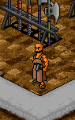

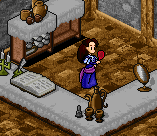

Growing up in the town of Ceannlaidir's shrine, I met many warriors who came to worship. When they visited the inn or the weaponsmith, I would listen to their tales of battle and bravery. They told of their faith in Ceannlaidir, how he gave them strength to continue in the fiercest battles, how he watched over them. I marveled at the power of this mighty god and his birth out of the primordial fire.

The shrine in those days was not as you will find it if you visit Piet today. There was no temple to go in, just a statue of Ceannlaidir standing where his temple stands today. There was no priest to conduct worship services. Worshippers would gather around the statue of Ceannlaidir and join in prayer. Often, offerings of weapons or the spoils of the hunt were presented. I used to sneak up and listen during worship, wishing that I, too, could be touched by Ceannlaidir. "Oh, Ceannlaidir," I prayed, "if only I were worthy enough to worship you fully."

The warriors who would visit seemed to enjoy the company of the girl who thrilled in their stories of battle. I would tag after them as they went off to fight in the sewers of Piet, wishing that I could go along.

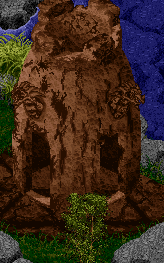

Years went by. We were shocked by Danaan's sacrifice and mystified when hearing about "Aislings" who had received Deoch's spark. We adjusted to our new Deoch calendar, with year 1 being the year of Danaan's sacrifice and the birth of the first Aisling.

Little by little, Aislings found their way to Piet and I got to know some of them. They had a light in their eyes unlike anything I had seen before. How I envied them!

In Deoch 4, we heard that throughout Temuair, worshippers were gathering to restore the shrines of the gods. A large group of Ceannlaidir's worshippers arrived in Piet and began building a temple devoted to him. I helped where I could and ran errands into town when someone needed something.

Soon the temple was complete. I visited it daily. Erika, the attendant in the shrine, and I became fast friends. We would work together cleaning the temple, polishing the weapons, and sharing tales of adventure we had heard. Erika and I both dreamed about what the life of an Aisling must be like, knowing that such was not ours. We watched as Aislings from far and near came to Piet to pray. Ceannlaidir gave his oath to devout Aisling priests and they began conducting worship services. I attended the services, but always stayed quietly on the side, offering my prayers to Ceannlaidir.


One night in the winter of Deoch 5, after a particularly moving worship service, I stayed in the temple, praying for hours. "Ceannlaidir, show me the way that I might best serve you. I know that I am mundane and not worthy of your attention. Still I pray that one day I shall be able to serve you fully." Did I really hear it, or was it the wishful longing of a devout worshipper? A voice, small and still inside my head, yet full of such power that I shuddered. "It is time," the voice said. I know not what happened in that moment - I felt as though some strong and powerful force had touched me. I felt something inside of me begin to tingle, and I knew that I would never be the same again.

"Time?" I wondered, "time for what?" I went home in wonder, feeling that _something_ was about to happen. I kissed my parents goodnight, clinging to them for a bit before going up to my room. "I love you mother, I love you father.... Goodnight...."

## First days as an Aisling

When next I awoke, I found myself in a room in an inn. I had no clothing on, but found a ragged blouse in a drawer and quickly pulled it on. I wondered at the feelings surging through me, at the dream I had had. Could it be? Dare I imagine that I had received the Aisling spark? It was too much to think of.


I wandered downstairs and met the innkeeper, Riona. She told me that I had arrived in the town of Mileth. She looked into my eyes and assured me that I was, indeed, an Aisling. Stunned, I could hardly listen to her tell me a bit about the town and the other mundanes to whom I should speak. I heard her speak of going down the path and crossing a bridge, something about an old temple... but it all passed by me so quickly I could not comprehend it.

Dazed and confused, I wandered out of the inn and met a kindly young warrior named Tareth. He could tell by my look that I needed assistance and came up and introduced himself. He asked what path I wished to follow, but I knew naught about the choices open to me. As he explained each of them, I tried to picture myself - was this my true calling? All my life I had admired warriors... was this my path, or was there another better suited to me? "Guide me, oh Ceannlaidir," I prayed. "How may I best serve?" When Tareth described the priest path to me, I felt something. Was it just a breeze blowing by? Had the wind whispered "Yes" to me, or was it all in my imagination?

"I ... I think I would like to be a priestess," I told Tareth, "but I am not quite sure." He told me that when I had decided, I would need to ask an Aisling of the path I chose to guide me. Sensing somehow that the priesthood would indeed be the path I would walk, Tareth bought me a gorget gown. "Keep this for when you become a priestess," he said. He also bought me boots to cover my bare feet and a dirk to wield.

"Now, you need to hunt," he told me. "Crypt or the woods?" Confused, I shrugged and let him choose. He led me to what I now know as the Mileth crypt. Tareth watched over me as I killed my first rats and spiders. "Watch out for the centipedes!" he cautioned. I picked up a bit of food that I found on the ground... should I eat it? But no, one look told me it was rotten. Tareth told me to keep it for now.


We hunted for a while, gathering up what fell as the creatures died. "Now to sell," Tareth instructed. He led me from the crypt and showed me the way to Dar's and Cian's shops. Amazed, I discovered that the wizard and alchemist would give me coins for the rotten food and insect parts I had found!

Having gotten me off to a good start, Tareth needed to go. I thanked him for his help and said goodbye, feeling quite lucky to have met such a helpful Aisling.

I remembered Riona telling me that I should talk to the other mundanes in town, and I was eager to learn more about the town. I spent some time visiting all the shops and talking to the shopkeepers. I thought more about what path was calling me, and it became clear that the priesthood was indeed my destiny.

About this time, I ran across a priest named Kyulan in one of the shops. Timidly, I asked him if he would be able to guide me to be a priestess, and to my relief, he agreed. We went to the temple of choosing and he waited and watched over me as I walked the path through the temple, carefully weighing the decision of which door to choose in each new room. My instincts guided me truly, and soon I felt a wash of magic over my body. I was a priestess!

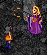


I put on the gorget gown that Tareth had bought for me and thanked Kyulan for his guidance. He generously gave me some coins and took me to see Devlin, the Fae Priestess of Mileth. I knew I had much to learn, and did not wish to keep Kyulan waiting, so I thanked him again and bade him farewell.

I studied long that day with Devlin, listening to her teachings on Beothaich Deum, Entreaties, the Graymayre. I talked with her about secrets which she will teach only to priests, and I learned my first healing spells. She told me of many more spells which I would be able to learn in time, when I had more experience in the Aisling ways. I took notes carefully, wondering how I could ever learn it all.

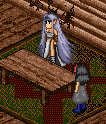

Not long after this, I was walking near the crypt and ran into Tareth again. "I am a priestess now!" I exclaimed. Smiling, he asked me if I would join his hunting party. I agreed and soon was hunting with Tareth and his friend Orlandu. I could hardly believe it - after all the years of hearing warriors tell of their exploits, here I was watching them firsthand, keeping them healthy with my beag ioc spell so that they could battle on! I murmured a silent prayer of thanks to Ceannlaidir, hoping he would hear.

My new life as an Aisling priestess had begun.

## Memorable Times, Good Friends

As the days passed, I learned my way around my new town and I met many other Aislings. I found my way to the Eastern Woodlands and went into the Enchanted Garden where I soon discovered that I was not powerful enough to kill a wasp. I next wandered to the wastelands. As I entered, I met a pair of monks who were going to hunt there. Arrakis and Pasha invited me to join their party, and soon we were taking on the creatures of the wastelands.

Days turned to moons and I continued to grow in experience and insight. I learned new spells and explored new towns. Kyulan contined to offer his assistance and guidance. There were many more who were also very helpful to me as I made my way. One day, as I stood in Mileth, the wizardess Ayshilin greeted me. She asked if I had found the spot in the enchanted garden where I could make red potions. As I had not, she kindly took me to the garden and showed me a magical tree where the faeries lurked. It was here that I first made beothaich deum potions. On another day, some evil magic trapped me in a statue just outside the temple of choosing. I cried for help, and the warrior Faeron and the monk Twila came to my rescue and gave me arcane scrolls. I had never seen one of these scrolls before, but I quickly read one and found myself free! I have never forgotten how these kind Aislings were willing to stop what they were doing in order to help me, without ever having met me before.

I met and hunted with many Aislings, but found myself most commonly accompanying Orlandu (and usually Tareth ) or Pasha (who was often with other monks, particularly Arrakis). We grew to be great friends as well as hunting partners.


Before too long I reached the 11th insight and could wear a Mystic Gown. Orlandu offered to travel to Loures and get it for me, and I gratefully accepted. When Orlandu returned, I tried on my new dress. It fit perfectly!


I hugged Orlandu and thanked him for his generosity. Imagine my surprise when he grinned and gave me a pair of coral earrings too!

One day in the late winter of Deoch 5, while Orlandu and I were hunting in the crypt, he stopped for a moment. "Allita," he said, "will you marry me?"

Startled, I was not sure he was serious. "Are you asking me for real, Orlandu?"

"Yes," he said, and took my hands.

"I accept."

Orlandu was eager to get married as soon as possible and began making arrangements right away. He contacted the priestess Sakura, who agreed to perform the ceremony and offered to let me borrow her wedding dress. Ayshilin let me borrow her veil. Orlandu was able to borrow a tuxedo and began inviting guests. I was concerned that my friends Tareth and Pasha were not about at the time, as I did not think it right for me to get married without telling them... nevertheless, I was caught up in the preparations and swept along. I remember wondering how Pasha in particular would take the news of my marriage.

As Orlandu and I walked to the Mileth Chapel, we happened to run into Pasha, who had just awakened. "I am getting married!" I exclaimed. "Will you come to the wedding?"

For a moment I thought I saw a glimmer of disappointment in Pasha's eyes, but he smiled and said, "Congratulations." He accompanied us to the chapel where he took a front row seat.

I worried that my marriage may have hurt Pasha's feelings or that he thought I would not spend time with him anymore. "But we can still hunt together," I whispered to him.

"Of course," he nodded and whispered back.

Guests continued to arrive, but Sakura was nowhere to be found. We waited quite a while but it seemed that she was going to be unable to perform the wedding after all... and that I would not be able to borrow her wedding dress. I was disappointed not to be able to get married in a wedding gown, but was so thrilled to be marrying this handsome, strong warrior that it did not matter.

Not wanting to keep our guests waiting any longer, we asked the priestess MayHeart to perform the ceremony. She consented - the wedding was indeed going to happen!

Happily, Tareth woke up just in time and we quickly invited him. He was a bit unhappy that we had almost gotten married without him being there or even knowing about it, but hurried to the chapel in time for the ceremony.

To tell the truth, I don't remember much of the ceremony itself - I was so excited that it just flew by! Soon, Orlandu and I were promising Naomhan that we were sincere and wished to be married, and he pronounced us husband and wife.

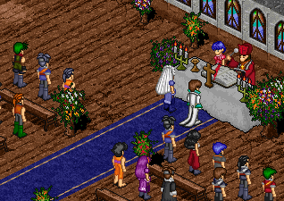

Orlandu kissed me and we turned to thank our guests for joining us at our special time. Pasha shook Orlandu's hand and congratulated us, then silently left the chapel.

As our guests were leaving, Sakura rushed in. She apologized for missing the wedding, explaining that magical forces had kept her from Temuair. We assured her that we understood. She had the wedding gown with her, though, and let me try it on. At last I looked like a bride on my wedding day!


One day not long after our wedding, Orlandu and Tareth were talking with the beggar at the Mileth Tavern, who told them of a terror lurking in the crypt. Ever ready to take on a challenge, they asked me to join them on their quest to slay the terror. Nervously, I accepted. We told the beggar that the three of us would go fight the terror, and he told us where to go to find it.

We walked to the area of the crypt the old beggar had spoken of. As I walked around, something reminded me of something the beggar had said, and I soon found myself in a small room with many pillars and only one door. Tareth arrived shortly after. We called to Orlandu, but, although he was the leader of the party, he could not seem to enter the room.

We soon were under attack by a scorpion. Tareth fought furiously and I did my best to keep him healthy, but we were overpowered. Soon we both were looking Sgrios in the eye. Tareth and I went back to that room several times but finally were forced to admit that the two of us were not going to be able to finish this quest. We did our best to get our items which had fallen to the ground and went back to tell the beggar that we had failed.

I was quite shaken after the experience of fighting the terror, and for many moons got nervous any time I walked near the area of the crypt where we had begun the quest. For Deochs, Aislings would ask me to go with them to fight the terror, but I would always decline. Tareth also suffered a crisis of confidence and shortly afterwards left Temuair.

Orlandu and I were happy and enjoyed hunting together. He took me to new places in the woods where we battled creatures I had only heard of before - kobolds and goblins!

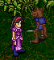

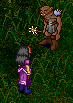

Pasha and I continued to be close friends, although I always suspected that he wished it could be something more. He would ask how my marriage was going, and nod silently when I told him that everything was fine between Orlandu and me. Soon, however, he met a warrior named Lizanna. They fell in love and eventually got married.

One day in the summer of Deoch 6, Orlandu was called off on a dangerous journey outside the boundaries of Temuair. Not wishing to put me in danger, he insisted that I stay. "I'll be back soon," he promised. Days turned to moons, and moons to Deochs, but no word came back from him. I waited, hoping against hope that nothing had happened to him... but it was in vain. Finally, I came to accept that Orlandu must have been killed on his journey. I mourned my loss, but my faith and the company of good friends helped me carry on. Pasha let me cry on his shoulder, and my dear friend Zrafh comforted me when I was feeling low. Pasha's brother-in-law Sareth was always willing to talk when I needed someone.

The thrill of the hunt helped keep my mind off my troubles, and I often found myself hunting with my friends Pasha, Jac, and Theodrin.


In retrospect, I can see that all of them wished they could be more than friends... but at the time I did not know. I also got to know the gallant warrior Caere and his friend Lamorak, who showed me a way to hunt which was extremely effective and kept me very safe. Unfortunately, this "door method" is no longer possible, due to the magic which pulls us across portals.


Eventually, in the fall of Deoch 7, Jac convinced me to try to slay the terror once more. Pasha came along too, and this time, after a difficult battle, we were victorious! I have never felt compelled to return, even though I have been told that new terrors lurk in dark corners of the crypt. I am content with the memory of this conquest, and shall leave it to others to slay what terrors remain.

## A Priestess of Ceannlaidir

It was my fondest hope that I could become a priestess serving Ceannlaidir. I journeyed to Piet, and after a joyful reunion with my parents, went into Ceannlaidir's shrine and spoke with my friend Erika. She gave me information about joining the fellowship, and soon I was a Ceannlaidir probate. I gave thanks to Ceannlaidir for accepting me and prayed that I would be able to ascend to full priesthood soon.

With devotion to my prayers and attendance at mass, Ceannlaidir eventually found me worthy to ascend, and I became a priestess of Ceannlaidir by his oath in the summer of Deoch 6.

I remember well the first mass I attended as a Ceannlaidir priestess. Priest Ardok was there and welcomed me, saying, "Ah, another priest!" Priest Migar was also there. I was honored to join them in the service of Ceannlaidir. They instructed me in the process of holding mass. Unfortunately, shortly after this, Ardok vanished from the land, but I will not forget how he helped me.

At that time, Ceannlaidir's temple was smaller than it is now, and our masses were held outside the shrine. We had only one mass each double moon, and Migar and I alternated as hosts. I initiated many new members and we watched our fellowship grow strong. (Yes, this is Migar in the picture with me - in his "blue hair" days.)

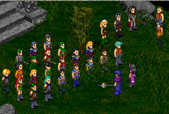

In the Fall of Deoch 6, we heard news that a conflict had broken out at Pravat between the Goblins and the Grimlok, a race we had not known of previously. They were struggling over something called the "calling stone," and worshippers were being asked by their gods to aid one side or the other. Ceannlaidir asked us to assist the Goblins. This was a difficult time in our faith, with many questioning what was about to happen... whether we could really trust the Goblins, and wondering whether our Aisling friends who worshipped other gods would meet Sgrios due to our actions.

At this time, the fellowship had a meeting to better organize. We chose Migar to be the High Priest and agreed to follow Ceannlaidir's dictate to assist the Goblins. On the day the Pravat caves opened, a large group of followers met outside the shrine. We marched off together to try to do Ceannlaidir's bidding.

What chaos greeted us when we arrived at Pravat! No one knew where the Goblin King was so that we could complete our alliance with him, nor did we know where to find the stones or how to collect them. We entered the caves and saw Goblin and Grimlok, heard their bellowing, and tried to make our way around unharmed and unimpeded by the many other Aislings who had also come to join in the fray. Alas... I wandered into an area where I was overpowered by a group of Grimlok. They forced me against the wall and beat me mercilessly and I met with Sgrios that day.

Soon, however, Ceannlaidir's faithful began collecting dark stones and returning them to Bahadir, the Goblin king. It turns out that our followers were the only ones assisting the Goblins, and a few weeks later Bahadir rewarded us by allowing us to summon creatures of war to fight by our sides. (Prior to the Pravat war, only followers of Sgrios could summon creatures.) From this time forward, legends would tell of the faithful collecting Goblin calling stones for Ceannlaidir.

Throughout the Deochs, I have continued in service to Ceannlaidir. I have watched the fellowship grow in numbers and have initiated over 170 Aislings to the faith. Our temple was expanded to accommodate larger gatherings, and now mass is held inside the temple twice each double moon. I hold one of the masses and try to be present to assist at the other one, if needed.

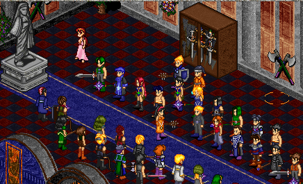

My faith in Ceannlaidir remains strong, and I am honored to be able to serve him.

## Pasha


Orlandu had been gone for many Deochs, but I remained married to him. Being married helped me to keep my distance from those Aisling men who wanted a bride, any bride. Yet those who got to know me closely knew the truth, that Orlandu had vanished, never to return. There were a few for whom I had deep feelings... but no, that is neither here nor there. Through it all, always ready to comfort me when my heart was broken, was my faithful best friend Pasha Hyrill.

Little by little, I came to realize how deeply I cared for Pasha. The night I could first wear an elle, I hurried to the enchanted garden where he was making potions so that I could show him. Speechless, he gasped.


"What is it, Pasha?" I asked.

He stammered, "I.. I had forgotten how beautiful you are."

My heart fluttered, but, as he was married to Lizanna, I dared not speak, other than to say, "Oh, Pasha...." I had to turn away. Could it be that he still had feelings for me beyond friendship?

As time went on, the longing to tell Pasha my feelings grew stronger. One evening, as he and I were returning after hunting in the woods, I could contain myself no longer. "I was a fool when I was young," I told him.

"What??" he asked.

Startled that I had said anything, I stopped. "No, I... I mustn't say any more.... I am sorry."

We continued in silence out of the woods, then he stopped me. "Look at me, Allita," he said. I looked up into his eyes. "Are you ever going to tell me?"

I could not speak. He continued, "I can see it in your eyes, Allita... but I would rather hear it from you."

Somehow I found the courage to tell him, "I... think I love you, Pasha..." and then, almost bitterly, "Are you happy now?"

Softly, he replied, "Yes, but I wish it had come several Deochs ago." Tears in my eyes, I nodded and walked off.

I did not know it then, but Pasha and Lizanna had been growing apart even before I told him of my love. He, however, is an extremely loyal man and would do nothing that might cause her pain. They stayed together, but with a growing restlessness. One day, Lizanna told him that she needed to leave Temuair for a while, a time of introspection. He understood and bade her well.

During Lizanna's absence, Pasha and I began to see each other secretly. We both knew that, more than anything in the world, we wanted to be together... but how?

One day in Deoch 9, Lizanna returned from her journey. She and Pasha had a long talk, finally admitting to each other that they were no longer in love. With a sense of relief yet sadness, they decided to get divorced. I decided to formally end my marriage to Orlandu.

Pasha and I began to see each other more openly, going to motley activities together, walking and talking for hours together. Finally, we decided it was time to let everyone know of our love for each other. When we announced to our motley that we were going to go to the Faerie Glade to be joined in Fae love, their reaction was "Its about time!" It seems that the attention we had been paying each other had not gone unnoticed. Priest Sayl performed the rite, and our friends cheered as the faeries flitted over our heads and we were joined together.

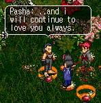

Not long after this, our dear friend Imajica told Pasha that she looked to him as a father. Pasha was at first surprised, then skeptical, then flattered. We went to the beach where he and Imajica talked for a long time. Imajica convinced Pasha of her sincerity, and Pasha agreed to adopt her. Then Pasha turned to me, saying, "Now there is one thing more to do." He got down on one knee, took my hand in his and asked, "Allita, will you marry me?"

"Oh, Pasha! There is nothing in this world I would like better than to be your wife..." I turned to Imajica. "And your mother, if you will have me." Happily, Imajica immediately accepted me as her mother.

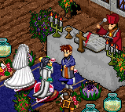

Pasha and I were married in the 11th moon of Deoch 10.


Paladine performed the ceremony and afterwards our reaffirmation of Fae love.


We have remained happily married ever since. In Deoch 12, Imajica's sister Shilmistra received the Aisling spark and we adopted her too. Imajica's husband Trinity is like a son to us. We are blessed to have such a wonderful family.

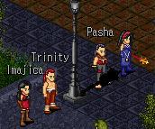

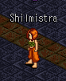

## Closing Thoughts

Over the years, I have participated in many events. I worshipped at the Eulogies and helped defend my home town of Piet when dubhaimid ravaged the land.


I was blessed to be kissed by Danaan at the Adoration. I have been called upon to assist when summoned succubi were attacking young Aislings. Pasha and I went on a quest to find Marlin's love, Bella, who had disappeared from Piet. Pasha and I performed the rite of the Heart of Moon and Heart of Fire together. I have collected blossoms from Mehadi and I cured a child in Loures.

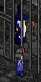


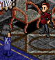

I was treasurer in a motley and a council member in a guild. I have been a respected citizen in both Mileth and Rucesion. I have guided and mentored many Aislings and have taught the ways of worship to hundreds more.

These days, I lead a quiet life. I hunt infrequently, preferring to spend my time with my family or in service to Ceannlaidir. I feel that I can best serve him by being available to assist those who are setting out in battle, rather than by being on the battlefield myself. I am fortunate that my parents remain in good health, and I enjoy visiting them after I have finished my duties in the temple. My husband and children bring me joy I cannot express, and I will treasure them always.

It is a good life.


_Allita Gilmour Hyrill_  
_Priestess of Ceannlaidir_  
_Deoch 14, 3rd Moon_

***

```
*Librarian Notes*

Recognized: Kingdom, 2000 (Mileth College master list).
This entry has been heavily edited to conform to Library formatting.
The original can be found at https://novus-imperia.com/college/bio/allita_bio/index.htm .
```
