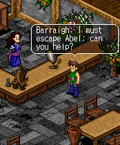
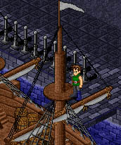
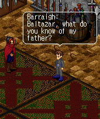
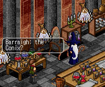
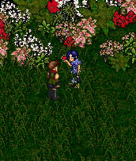
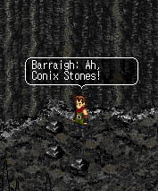
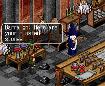
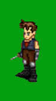

# Abel's Son

_by Barriagh in **Dark Ages**_

Abel's Son

Growing up fatherless is never easy, especially in the back alleys of Abel. My first memories are those of the smell of the pipe tobacco mixed the salty scent of the sea, boisterous laughter, and the light of fire dancing on the ceiling of Anna's Inn on the south side of Abel, not far from the docks. The establishment was frequented by the dregs of the Abel, wondering sailors, and the occasional red-faced farmer come to Abel to sell his harvest and take a break from the monotony of farm-life.

My poor mother, rest her soul, was a barmaid there. Not the fairest place for a young women to spend the rest of her life, but as an immigrant, newly come to Abel from the countryside north Mileth, I imagine her choices were few. She worked hard for me, her only son, but our life was base to say to least. We lived in a small loft above the inn. It was in this loft that she nursed me from infancy into childhood, and where she finally passed away the Winter of Deoch 9. This was the winter of the Biting Plague, a famine brought to Abel by ships from an unknown southern port.

I survived. A lean kid of 12, I was sent to live on the streets that spring after the task burying the many dead of Abel was complete. The imagines will be forever etched into my mind... The choices for children like me were few. Like most of the other street urchins on the southern docks of Abel, I took up a life of petty hustling and theft.

## My Days With The Bilge Rats

The days and years passed quickly, I survived by thieving, and running from the port authorities was my pastime. By what I deem to be about age 13, I took up with a gang of tough little hooligans known as the "Bilge Rats." The name came from the sailors who visited Abel. I can remember their cries as we would swarm them as they disembarked from incoming merchant vessels, "By the gods! Be off with ye!" "Ye mongrels!" "Sgrios take ye!" "Blasted bilge rats, be gone!"

And so, the named stuck. Our little band of boyhood bandits would terrorize the docksides by day, and hide out at night, when they become too rough for all but the most brutal of men. I rose in the ranks of this unsavory company through the usually means: being lucky in games of chance and winning fistfights. It was a necessary combination. The years passed, the lucky ones grew older, those not so lucky were quickly forgotten. So was life of the Docks of Abel.

I grew into manhood, as did one of my steadfast friends, Raef. We shared many an adventure together as the uncrowned princes of the "Rats." He was a cheerful soul in a cheerless world. To this day I still cannot fathom how he kept his inexhaustible sense of humor. Looking back on it, I guess it was this that keep him from breaking. His dirty face and all but toothless smile pass through my mind every time I return to Abel. I could swear I sometimes catch a glimpse of him in the faces of the children who still live by the Docks...

It was in the final days of this part of my life that Raef stole from the wrong shopkeeper one too many times, and was finally caught. The ensuing beating he received at the hands of this ham-fisted brute cost Raef his life. After this, my heart become lead - cold and heavy, nothing more than a burden to carry. I resolved to avenge Raef's death. One rainy night, that is what I did. Even now as I write this, an admission of my guilt, I feel nothing. Like the night it happened so many years ago, I feel nothing.

## Escape

Soon word of my evil deed spread, and I was a wanted man. In fact, I was but 16, and running for my life. I had to leave Abel, to escape before I was dragged into the town square and stoned to death for my crime. Not knowing where to turn I went to Anna. Would she remember me and show me mercy? Would she help me escape my plight?



I slipped in the back entrance of the inn under cover of darkness and begged her for help. She offered little, "Be gone you devil! You murderer! You're your father's son, indeed! Sgrios take you, as he did your father, the Rucesion blackheart!"

With these words ringing in my head, I ran back into the night. Confusion and a great wondering had been added to my growing fear. I could not get her words out of my head: "your father" "the Rucesion blackheart." Was he really dead? - Rucesion...

The name of this far off city was not unknown to me. For years there had been tensions between Abel and Rucesion, the two great maritime powers of the northern world. Occasionally, these tensions would manifest themselves in acts of violence on the high-seas or massive brawls in the watering holes between sailors of the two great city-states. With little other option to choose from, I made up my mind: to Rucesion I would go.



That night I crept aboard a Rucesion merchant ship. She was to sail in the morning. This I knew, as she had taken on large stores of water the day before. I stowed away in her lower decks for the better part of three weeks, a miserable three weeks I would just as soon forget. As I had always done before, I survived by "borrowing" from my gracious hosts.

Once I even managed to sneak up to the deck of the ship. It was a warm night, but a cool wind gusted down from the north. The moonless sky was a kindle with countless stars. I was dumbstruck by their beauty.

It was at that moment that a hitherto fore unknown passion arose from the depths of my very being... A lust kindled by the openness of the sea - a wanderlust, a desire to see the great cities of Temuair, to hear the waterfalls, to smell the vast pine forests of Soumi, to transverse the mountains, to seek out the source of ever stream and brook and then follow it to the sea, and perhaps I would find out a little about greatest mystery of all: my father. Thus, my life as what we call an Aisling began.

## Sojourn in Rucesion

Needless to say, the task of escaping the ship proved more difficult than actually boarding did. I pondered my possibilities for some days after I overheard two hands discussing the approaching arrival in Rucesion. I thought the situation was hopeless, and that I would surely be discovered. The evening before the ship was set to arrive I was nearly frantic. Finally, after composing myself, I remembered a story I once heard about a similar fellow in a similar situation. After some rummaging, I managed to find an empty barrel. That night I rolled to where the rest of the transit cargo was and secured myself inside.

The trick worked and with little trouble the barrel and I were both ashore and safely in Rucesion that morning. The following night I forced my way out of the barrel only to find myself locked securely into a small warehouse. Being exhausted, I consigned myself to my fate and fell into a deep dreamless sleep. The next morning I was awoken by a kick and gruff words. I had landed myself in the storehouse of Braz, an infamous character in Rucesion. He was the sole proprietor of certain "exotic" goods, and often at odds with the city guards.

He spotted me for what I was - a homeless run away. He feed me and put me to work. I delivered messages for him to various "business contacts" in the city. I was well suited for the job, and did it gladly. In exchange, I was fed and clothed; that was enough for me at the time. It was not long until I had gained some degree of his trust and more freedom. I started wondering the city streets and frequenting the local public houses.

It was at this time I met Callesta, a fair and wise young women, and a native of Rucession. She became a mentor of sorts for me. She showed me around the city and taught me a few survival tricks. From time to time, I still see her. We discuss the happenings of Temuair and laugh about the old days.

## On the Trail of My Father

By autumn of the following Deoch, I was once again fueled by the desire to find out about my father. I had by this time amassed a few coins and gained some knowledge from little adventures in the city and the surrounding countryside. So, acting on a tip from Braz, I visited one of his contacts. This shady fellow was a Rogue by the name of Baltazar. Around sunset the following day, I meet him and asked what he knew of my father. He would say nothing. I pressed him further, and still nothing...



After some more prying, he finally told me that he recalled a sailor he had met Deochs before by the Rucession docks. The man hailed from Rucesion, and had fallen into some trouble. He was wanted in Loures, but for what Baltazar could not say.

"The man was half out of his head... a madman! It was almost as if he was under some sort of enchantment... He muttered and rambled. I could only pick out parts of what he said - 'Conix' he mumbled over and over, and something about his 'heir'. I doubt the old scoundrel had a top pence to his name," laughed Baltazar.

I questioned Baltazar further but he could offer no more answers. Although I had no reason to really believe the man Baltazar spoke of was my father, followed this lead. I resolved to go to Loures as soon as I could. Loures ships carrying mercenaries and prisoners from the wars in Suomi passed though Rucession from time to time, and after a few weeks I managed to find a place on board a frigate bond for Loures' southern port.

## The Trail Takes me to Loures

I had never envisioned a such a massive city. The fertile countryside surrounding the capital had brought prosperity to many, and the noble classes had grown fat from the wealth foreign conquests had generated. Loures was like something out of a fairy tale - a massive walled city with a grandiose palace directly in the center. Fountains lined the broad avenues and splendid gardens were in every corner of the city. I marveled at the beauty of the place. It was only later that I was to discover the city's dark secret.

After sometime nosing around outside the palace I was able to sneak in and after some further inspection I acquired a disguise. Dressed as I court page, I was able to move freely throughout much of the castle. I learned quickly that two men where being held in the dungeon. One was some sort of curious wizard, and the another a foreigner from Rucesion. My heart skipped to hear the news, this man must be the man I was in search of. I made my way to the lower regions of the palace. After a few hands of cards and a couple of potent drinks with the wardens, I managed to slip into the dungeon as they nodded.

In the dungeon I found the wizard, whose name I later learned was Marlin. I asked him about the foreigner. Marlin did not know the man's name, but told me he had been sent to Jean long ago. He had not heard from him since. I was dishearten but questioned Marlin further. I asked what 'Conix' might be, but he would tell me little. He insisted on telling me of his love, Bella. I was not interested, but he blubbered on about it so, that I was forced to listen. Finally, he mentioned Jean the Court Councilor again, and told me that the foreigner was somehow connected to him.

This was the lead I was looking for. I made my way out of the dungeon and to Jean. I confronted him and told him what I had learned. Initially, he confessed nothing, but my dagger to his throat convinced him to speak up a bit.

"Yes, I know this foreigner you seek...but you will not learn what I know if you kill me, " he gasped.



Knowing he was right, I had no choice but to loosen my grip.

He continued, "He was wanted for thievery in Loures, but I convinced the King to hand him over to me when he was captured. In exchange for his life, he agreed to obtain certain rocks for me... very rare rocks, the Conix Stones. I need these stones to complete the ritual required to free my love, Bella, from the clutches of the Dark Beasts that roam the shadows..."

"Where is the man you speak of now?" I asked.

"I will not tell you unless you bring me the Conix from the Caves to the North. Pravat is the place you seek. Take my seal, and when you return show it to the guards, " he said

"Very well, I will do as you say. But be warned, if you are lying I will not spare you my wrath the next time we meet."

He only laughed to himself and handed me a small map with his seal stamped upon it.

## The Wild

After this encounter, I made my way north through the great forests between Loures and the mountains. I arrived in Piet, a pleasant and simple town in the northern regions of the Loures Empire, in the dead of winter. I took shelter and gathered information there for a week before moving further North.

A week out of Piet a blizzard stuck and I became lost. I floundered on the brink death as I hopelessly wondered in the snow-covered mountains for what seems weeks. I was just beginning to lose all hope, when I happened upon a glade in the wood. It was dream like - so unreal. Had the cold sleep of Sgrios already claimed me? In this enchanted glade there were flowers and birds, and I could swear I heard the sounds of laughter. Blundering blindly into the glade, I finally dropped to my knees.

The next sight I saw filled me with wonderment. As I looked up, the face of a beautiful maiden met my gaze. Circling her were a number of small winged creatures. I could not believe my eyes. After I had recovered from my amazement, the maiden told me she was a priestess of the Cail, the God of Nature, and that she had traveled to the wood from her homeland of Undine. She explained her name was MorriganNyte and the blizzard had taken her by surprise as well. I told her my tale and she listened graciously.

Many Deochs ago, the followers of Cail had build a hospice of sorts in the wood for pilgrims. That was where we waited out that bitter winter. We talked and I poured my heart out to her. MorriganNyte was a vision of beauty and kindness in the cold world. I had not felt as if someone really cared for me since my mother had died so long ago until the fates brought her into my life. We fell deeply in love that long winter of Deoch 12.



Finally, the spring came and as all good things do, our time together ended. We parted tearlessly and both promised to met each winter at the Enchanted Glade.I should have held her in my arms longer that warm spring morning. Since our parting that warm spring day, I have not seen her. Every winter I brave the snows and seek out the Glade. Each time I wait for the spring alone. That once magical Glade is a cheerless place for me now. I have journeyed to Undine, spoken to many a Cail priest, and wondered the endless wild expanses of Temuair, but I have uncovered no trace of her. I sometimes wonder if it was just a dream - an enchantment placed upon me by the mischievous fairies of wood. I may never know.

## Pravat and Beyond



Little did I know that I would never seen MorriganNyte again when I set off for Pravat that spring. Within weeks I found my way to those forsaken caves, to find their inhabitants, the Grimlocks, engaged in a bitter struggle with Goblin invaders. I had no mind to take sides in this war and avoided both groups as best I could. I was there on a quest to find the Conix stones, not to get involved in some senseless war. Still, from time to time, both Goblins and Grimlocks failed to report back their respective leaders after falling into the potent traps I devised.

After sneaking about inside Pravat Caves for a fortnight, I had collected the stones for Jean and I returned to Loures. I was admitted and once again a stood before Jean, the King's Councilor.

"Have you brought what I require?" he asked, licking his lips in anticipation.



I showed him the stones. Surprisingly and true to his word, he told me about the man I thought to be my father.

"That fool! Armini, was his name. He stole from the King... such a crime is punishable by death. I saved him from his fate, and he swore allegiance to me. I sent him, as I did you, to Pravat. Being a cunning thief, he returned with the Conix stones, although I fear the poor rascal fell victim to the stones _destabilizing_ effects. - A creeping madness was upon, but against my better judgement, I sent him along with Conix stones, into the lower regions of the castle to complete the Stone Quest for me. It was the only way I could free my beloved Bella. Alas! He never returned and my Bella remains lost!" he sighed.

"The lowers regions? The dungeons, you mean?"

"No, this castle was build on a portal to the nether regions," he hissed. "I fear the fool perished below. I can only hope the same fate has not befallen Bella!" he sobbed.

I told him I would seek out Bella if he told me the way to this portal. He did, and I entered the dark regions. My mind swam and I nearly lost my way. Unspeakable terrors dwell in that hellish place. I was lucky to escape alive. Although I escaped, I found no trace of Bella, or the madman Armini...

## Endless Wanderings

I left Loures in Deoch 13 and have not returned since. A curse be a upon that forsaken city! I have spent the last Deochs of my life wandering lonely roads and traversing the wide expanses of Temuair's seas. I have plundered treasures from deep crypts, hunted the beasts of the Wood, sailed in the company of both the honorable and the honor less, and with each step I take I search... I search for a love lost and a man I have never met.

Sometimes, as I walk along winding forest paths, I feel the presence I felt Deochs ago in the Enchanted Glade. I wonder if MorriganNyte was there not long before. Sailors whisper about a strange man named Armini in pubs and meeting houses from Undine to Rucesion. I am always just one step behind what I seek.

So, I sit here once again in Rucesion, the sea winds gusting outside my window. I think back, and setting quill to parchment I record these remembrances. Tomorrow I set sail for southern coasts. Will my wanderings cense the endless wondering that plagues my mind? The candle burns low and the ship sails at dawn, I must rest for a few hours before I am off again...



_Barraigh of Abel_

***

```
*Librarian Notes*

Recognized: Village, 2001 (Mileth College master list).
This entry has been edited to conform to Library formatting.
The original can be found at https://novus-imperia.com/college/bio/barriagh_bio/barraigh.htm .
```
