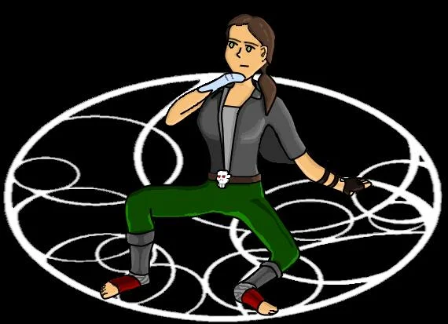
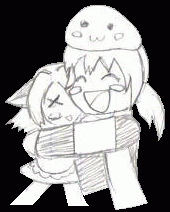
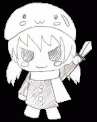
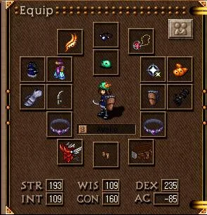

# Legend of the Nila Blossom: Brittany Hamaru

_by Brittany in **Dark Ages**_

_An Autobiography_



## Chapter One: The Beginning (Deoch 42)

This tale begins not from a traumatizing tragedy nor from a great revelation. The faithful night had arrived as uneventfully as it always had, casting its serene glow upon a small farm nestled in the Mileth countryside. Within the farmhouse, next to dying embers, sat a frail woman named Savannah. She rocked gently in her wooden chair, using every moment of life left in her fire to finish her knitting. A rainbow of colored lengths fell from her lap into a basket at her feet. Next to that stood a modest bookcase. Its shelves were also littered with an array of color, both from spines of books and small portraits filling the gaps between them. The portraits were of the family—Savannah, her husband, and their only child.

Savannah soaked in the details of the portraits for what must have been the thousandth time. The Spark had claimed her husband very suddenly after she announced she was with child, and ultimately it was arranged that the Aisling would go about his travels and support the family from afar. Despite their distance, Savannah smiled. Her husband's reluctance to leave her and the child was reflected in the many parcels she still received after so many Deochs. His letters described fabulous things unlike those seen in Mileth; somewhere out there waited creatures larger than buildings, strange foods, and earth so hot walking upon it caused burns. However, no matter how incredible the sights or events described in his letters seemed, each and every letter was signed the same way: _Yours, Jibsley_.

Their daughter was not kept from the knowledge of her father. The girl loved her father's letters but remained realistic due to the great responsibility of the farm's upkeep. Indeed, as Brittany grew older, her mother grew more and more ill. Savannah could no longer carry hefty buckets of milk, drive hay to the herd, or visit the town for supplies. So the duties fell to her daughter, whose young bones rose before dawn and returned to the farmhouse well after the sun had disappeared. Tonight had been no different. Brittany appeared in the darkness of the entrance and smiled at her mother, afterwards turning into her bedroom located adjacent. Savannah listened to the quiet rustling of her daughter's filthy garments as they dropped to the floor. Then the sound of water came from the open doorway—no doubt the girl was at her wash basin.

Suddenly, something was amiss. The air seemed heavier. Savannah's eyes leapt from her work and scanned the room's walls. Her eyes lingered over the single window across from her daughter's room for a moment. She was sure she heard _something_, but she reasoned that the sound must have been her imagination. The woman dropped her eyes back to her lap just in time to hear the sound again. The sound was a voice; louder than before, unintelligible; as if carried by the wind. It was clearly not her daughter's voice. Startled, Savannah flung her knitting to its basket and bolted from her chair. Her steps led her halfway across the room before she was blinded by an extraordinary light far brighter than any fire. Terrified, Savannah tip-toed her way forward with her arms outstretched until she finally felt her daughter's bedroom door frame.

Brittany was still hunched over her pail of browned water, staring wide-eyed at her bed. She suddenly became aware of herself and yanked her hands from the basin. A tingling sensation spread to her legs, her heart, and her crown. She was not sure how much time had passed but she snapped her head toward the door, terrified of a noise from outside it. Savannah was there, her brows furrowed in anguish. Brittany's mouth hung agape, and her trembling form undecidedly turned the basin over as she went to stand. The girl was unaware of what had just happened, unaware of the sworl of light that had temporarily illuminated the entire farmhouse, but her mother knew. Savannah had always known The Spark would come to take her daughter away.

* * *

Brittany stood on the porch's bottom step. She was dressed no differently than any other day, save for the laden pack strapped against her back. Her eyes flickered over her shoulder, eyeing the dark form looming in the Inn's doorway. The sale of the farm and her mother's relocation were complete. At first, Brittany did not believe her mother when she said that she would be fervent to leave her home soon. However, as the moons passed following her introduction to The Spark, the girl began to sense the growing need for freedom. She would return to Mileth as often as she could to ensure that her mother was being well cared for.

Shakily, she stepped onto the beaten dirt below the step. She drew in a breath, released it, and stepped again. She reached the Mileth fountain and plunked her hands against the fence guarding it as she passed. She reached the path beyond that and traveled it. And finally, when the sun again broke through the sighing trees, she reached a sign. The sign was a board gaudily nailed to a weather-worn post. On it, four letters were appropriately knifed: _Abel_. Brittany's heart fluttered, for this was the town her mother had told her about. Any talented Aisling could find a well-paying job here. She was still unsure of her skills, but she was sure that she would find something appropriate for her. Her booted feet swiftly trudged down the path.

The girl could see the buildings before she reached them. They were tall, new, glistening structures with pointed peaks and glowing windows. Dotted along the rooftops were chimneys, billowing with smoke. Taken in by the town's splendor, Brittany's toe snagged a bump in the road and she toppled, crashing onto her stomach with a resounding _oof_! She winced, but was quick to notice that the dirt road she had been traveling abruptly ended. It was now replaced with a very sleek—and very hard—cobblestone. She groaned and raised herself to a sit, but her rest was short-lived. A clattering wagon approached from behind and she wobbled to her feet. The wagon was loaded with goods that were firmly fastened behind two snorting horses. On top of the grand pile sat the driver, a long-haired and wiry man with an eye patch. He gently tipped his finger at his brow as he peered down at her. Was he greeting her? She walked alongside the sauntering caravan, and after a kind exchange, she found herself dangling from the caboose of the wagon as it moved into town.

When she dismounted, she had arrived at the center of Abel. The air was thick with the scent of cooking fires, sea salt, an array of different foods, and many scents she did not even recognize. The streets were also thick with people bustling to and fro. Merchants lined the cobblestone walkways for as far as she could see, and their wares glittered as the midday sun shone over them. The girl waded through the massive sea of people, overwhelmed by the cramped surroundings, but finally found a small clearing near what smelled like a restaurant. She wilted over an open barrel and splashed her face with the water therein. Meanwhile, a plump woman emerged from the nearby restaurant door and busied her hands in her apron. The woman, whose face gleamed sunset pink from her work over a stove, approached Brittany, who was already as exhausted as she. The girl thanked the woman for her concern; as she wiped the water from her brow, she queried the baker on where to find work. The baker had much to say, but finally insisted that The Girl would soon be traveling again if she wanted to work as anything but a merchant. Thanking her again, The girl propped herself against the barrel and considered her options. She crossed her arms and peered into the street. Judging from the smell of the salt, perhaps there was a ship nearby. The baker had mentioned _Rucesion_, a town across the sea. She would try her luck there. With the slightest glint of happiness upon her face, she was decided.

Before she could assimilate back into the sea of people, however, the sounds that once filled the area were exchanged by a tone of disruption. Ladies shrieked, the deep undertones of gentlemanly voices soon ceased, and the crowd parted in such a way as to allow some monstrous creature room to pass. But it was not any monster she had read about in her story books, or any other type of being that would elicit such a response. Instead, from the clearing came a sprinting boy, soon followed by an aggravated merchant. Surprised by the sight, she stood like a statue at the street side.

The boy came excruciatingly close in order to shake his pursuer. His satchel, a burlap sack tied gaudily to him by nothing more than a rope, hooked Brittany's arm as he flew past her. She was caught off guard and instinctively attempted to free herself, but was not able to do so before the boy's youthful strength managed to drag her straight into a merchant's stand. As she crashed into the wooden slats, emerald apples toppled over her and scattered into the street, collapsing the stand's frame and skittering the rose-faced merchant into an adjacent stand. Her face flushed, as well. Instead of the rosy complexion caused by fatigue, however, hers was elicited by a sudden, violent rage.

She sprang to her feet after the boy, scarcely noticing the apples rolling and squishing out of her way, and promptly set off down the cobblestone path. Though he was many paces ahead of her, her farm-borne legs pumped, unfazed by the strange looks she received from the merchants left behind. Finally, she reached the boy and dragged him to a stop by the very article that had dragged her before. He turned, shocked by the sudden halt, and glared at Brittany. She, too, became shocked. He was much like her, after all—his eyes were more narrow than her own, but of the same emerald hue. The two stood at nearly the same height, and were perhaps even the same age. A glint from his fan of hair, smoothly peeking out from under his bandanna and sheltering his right eye, captured her gaze. His hair was of a dark shade, as well. When their eyes met again, the two exploded into a flurry of combat. Fists flew, though neither of them could best the other, and many jabs and lunges followed. A crowd of now-entertained people gathered around, staring and causing immense clamor. Loud, too, was the gasp from many of the ladies when Brittany finally managed to grasp a fistful of the boy's tunic. The girl was even more enraged now, but she did not bury her fist into him. Instead, she grabbed the closest thing she could from the surrounding crowd—a round cake, nabbed from a baker woman's basket—and slammed it into his nose. The boy reeled back and bounced twice when his bony behind smacked the cobblestone. His face was covered in spongy cake fragments, but despite his embarrassment, he did not run. Instead, he rose to his feet and also acquired the closest object to him: a pie that smiled happily at them from the merchant stand behind him. Brittany had let her guard down too soon, to laugh with the crowd at his shame, and the pie soon smiled upon her face.

The battle continued for several more moments. The barrage of fists was made complete with crashing stands, flying pastries, and finally a rolling scuffle upon the cobblestone. However, soon the commotion alerted the nearby guards and the two were wrenched apart. A flailing body was heaved over each of the guards' plated shoulders, and the two dessert-laden children were carried away.

* * *

The sky had grown dark. The only source of light in the chamber was the three dying torches dotting the wall opposite of which Brittany was chained. She was tired now, seemingly exhausted from the earlier excitement. The boy reflected her mood; his glazed eyes gazed blankly through the leaden bars and he was quiet despite being in the very same cell. Occasionally the two of them would hear a metallic clang from a neighboring cell, but neither of them spared the effort enough to survey their surroundings or even rise from their corners. The girl had heard the guards conversing during her ride in the horse-drawn cell. This place was the _Loures Dungeon_, which apparently rested somewhere within the underground of the grand _Loures Castle_. Though she had never ventured this far from her home, much less by causing a ruckus, somehow she was not afraid. Rather, she was curious as to how long she would be caged and what her punishment would be.

Her thoughts were interrupted by a much different noise than the clang of tools nearby. The metallic shuffling came from the great mouth of an archway at the end of the dungeon. Through the mouth emerged the two guards from before, still clad in their silver-gray plates. They escorted a young woman, clad loosely in a pink dress, to the cell door. Brittany peered through the bars at the lady as she bent slightly to squint through the darkness. The Lady was top-heavy, but attractive; the pink dress was modest, how ever strained at the breasts. Her curiously-shaded red hair flowed from beneath a billowing hat to just to her shoulders. Her hazel eyes gazed innocently through the bars at them.

The Lady motioned to the guards to open the door and release the children, mentioning to the men that the prisoners were only babies. The elder of the two guards raised his metal key to the keyhole and swung the crying door open. The younger of the two guards entered the cell and freed Brittany and the boy from their chains. The children were then forced like rag dolls through several rooms, until finally they stood outside of the grand castle's ebony gates. Brittany looked to the boy, and then to the guard. She had many questions, about The Lady and about other things, but the guard was in no mood to chat with children. He suggested that she seek out _Piet_, a town that nearby that would shelter her, and instructed that both "little rogues" should behave. The girl turned and faced the darkness once again.

The boy had already disappeared, as speechless as had become habit that day. She still had no idea who he was, but at least she had learned two things from the day's events: that her occupation had been chosen for her, and that pie tasted _delicious_.

## Chapter Two: Lessons (Deoch 43 to Deoch 44)

Brittany became accustomed to the senses of the sea, for after departing Piet her path trickled south. While generally traveling alone, she made some of her way by accompanying merchants. The merchants proved themselves to be a slippery, untrustable bunch, but her reputation was far from pristine so far. The skills Brittany developed from these people included marketplace knowledge, eyes for the right items, and the art of haggling, but perhaps the greatest skill she learned was how to feed herself when far from town. The rogue became quite adept at trapping, polishing gems for gold, and tailoring when the time came.

The merchant trails had finally ended at the coast. She hopped upon a dinghy and set off across the complacent channel, chopping the water unacquaintedly until she had reached the island in the distance. She had arrived on _Oren Island_, which was said to be overrun with pirates. She dragged her very lucky little boat well onto the beach and squinted toward the town. The town stood proudly—albeit aged—upon its sandy plateau, complete with a grown-up hedge of sunflowers and ashy cobblestone. She made her way from the beach to the town's entrance archway. The archway, also an ash-colored structure, was flecked with lichens. Beyond that, she noticed grasses peeking through the cracks in the walkways at nearly every step. The very air was uninviting, so she was quick to find the inn. The rogue gained much experience from this town. The pirates, as sea-worn and nimble as they were, were also quite stupid; she would simply lay a trap, when the bounty called for it, and the buffoons would impale themselves upon the deadly blades.

Bounties were not the only source of income on the island, but they proved to be much more stimulating than gathering flowers for the jeweler. A particularly exciting bounty lured the rogue to the local wizard's shoppe. The job was not like the bounties she had fulfilled before, however, because she would not be required to kill the target. As they discussed the details of her new mission, she found that the large-capped man in robes would be sending her across the northernmost channel to _Karlopos Island_. She grimaced more firmly as the details were made clear: the wizard's young assistant had gone missing while scouting the area for his fauna research. The rogue set off that day, alone as was usual.

* * *

Again Brittany plunged her bare feet into the sloshing surf, dragging herself to the most distant reaches of the island. The flora had converted from the shady, fluffy greenery found more inland to thin, unforgiving prickles of plants. She treaded across the darkened sand, her boots dangling carelessly from her fingers, in order to avoid the occasional sharp jutting of new palms and shrubs. She could not, however, avoid the boiling ball in the sky, and soon she found her skin irritated. She was distracted from this because she did not expect to find other Aislings as far from town as she was. She blinked a few times, squeezing her eyelids tight. They were not illusions caused by the dismal heat, after all! They stood with their backs to her, stretching, after what must have been an unpleasantly lengthy trip on the nearby raft. She trotted to them, making her presence known with several accidental stumbles in the surf. They turned to her, and the two parties greeted each other.

There were three of them: two men, and one woman. The taller of the men, a man in his prime, appeared to be a warrior. His armor did not glitter, but Brittany could tell from the dents and slashes that he must have been experienced. He stood nearly two hands higher than her, was built like a column, and had longer, more luxurious hair than she did. She blinked at him curiously as he explained their presence on the island. Their presence was not the curious detail of the situation, however; they had simply paused on this beach to camp on their way to Oren. What _was_ curious was the fact that from the moment she had laid eyes upon the man, he held a bottle of rum in his hand. He nursed from it as he greeted her, spoke to her, and called to the others. The drunken warrior, Lareth, also called to his critter: a shaggy, gray wolf that had been biting at the incoming waves nearby. Scar scurried to his master hastily and dropped his furry rump to the sand when instructed.

The second of the men was younger, perhaps her age. He was taller than her, slightly, but was much more lanky. His horribly loose robes suggested that he was some kind of mage. The sight and sound of him was simply laughable, she thought amusedly, as he squeaked his greeting to her. At least his complexion was an attractive olive-tan, unlike her now enraged epidermis. He seemed unfazed by the midday sun. Squee soon called to their womanly counterpart.

The female of the group was barely visible from behind the raft. Occasionally during the introductions, her blazing crown peeked over the craft's sail. When Squee called to her, she revealed herself with equipment in hand. She was certainly more dainty a woman than Brittany had predicted from afar; in each hand she clutched mending tool, and connected to those hands were two thin—but graceful—arms. The remainder of her was equally as conservative. While not as modest as Squee's, her attire was befitting of the environment. Her shoulders and legs were lightly plated in midnight blue armor, and her perspiring midriff bared itself shamelessly. Upon her feet were not heavy boots, but rather wrappings that left her heels and toes free. The rogue greeted her kindly, since she had received an equally as kind a greeting, and assumed the loving monk to be the responsible leader of this group. Her name was Synah.

The rogue told the trio of the Oren wizard's predicament. Baffled by the story, the band agreed to accompany her in a brief scouring of the area. The four prepared their packs, hid Scar away under the raft's tent, and ventured far onto the beach beyond the vessel. Their search had barely begun when they followed the beach up an awkward slope. At the peak, two onyx walls of rock rose to either side and the sandy trail snaked between them. The beach was so compact, in fact, that the group had only enough space to walk aligned with one another. They squeezed into a line formation and continued, but something was amiss. Several paces into the rift, the sand began to shift. Synah turned and shouted, sensing the movement in her toes, but her effort had arrived too late. The sand fell from beneath Squee's very feet! Suddenly, there was a storm of sand as Brittany and Lareth leapt to his aid. Each of them grabbed the dangling spellcaster's arms as he faced death at the pit's lip. The treacherous edge threatened to swallow them, too, and their heads bumped as they struggled to fight sliding to their doom. Luckily, the monk speedily hooked her fingers into their belts and reeled them all to safety. The four of them panted as they piled upon the assumingly solid sand and peered back at the trap. The chasm was deep and filled a quarter deep with jagged palm shoots. Their future steps were more cautious.

Soon after the trapped rift, the beached opened once again. They followed the slope down and were delighted at the ability to touch the surf again, despite the occasional grumpy crab. Around the bend they sauntered, pausing at every thicket and large clearing to call for the wizard's assistant. The local fauna, which also included chubby slugs, curious spores, and washed-up octopi, gave the four little trouble. But finally the sun began to set, and the tired travelers were as wilted as the ancient palms that heaved with coconuts. They had reached what appeared to be the end of the beach.

The group turned to retrace their steps, disappointedly, before all light was lost. Before they could venture too far, however, the beach was heard shifting again. This time, all four individuals could place the foreboding noise, accompanied with the thunderous _tsssh_ of falling water. Loving, drunken, wily, roguely eyes darted to the nearby coast, and what was seen immediately thereafter struck fear into each unsuspecting body. A gigantic creature was approaching them from amidst the rocks at the end of the beach! The creature was monstrous; it was five-fold any of their sizes. Upon its slick, porous hide lay two enormous eyes. The eyes were as glassy and terrifying as its gourd of a head, but paled in comparison to its massively coiled tentacles. Eight such appendages sprung from its horrible body. It was a giant octopus!

As the creature scooted itself closer and closer, Brittany spied a fleeting splash of color among the onyx rock formations, now many paces to the octopus's rear. Squinting, the form became clear: it was the wizard's assistant, waving raggedly from the rock. They would have no choice but to fight, if they wished to recover him, she shouted. Synah and Lareth rushed the great beast, leaving Brittany and Squee gaping at the feat. With an astonishing but wobbly slash, the warrior felled two of the creature's thrashing tentacles. The monk backed close to him, fending off stray appendages and delivering mighty kicks. The mage finally snapped his mouth closed, but did not stray from the rogue's side; he simply raised his hands to the sky. Upon doing so, a darkened cloud was yanked from the ever-darkening expanse. The cloud surrounded the octopus, choking it, and therefore weakening it to their attacks. Finally, Brittany jarred herself from her amazement and threw herself at the beast. She grappled skyward, clawing at the viscous jelly, and buried her dagger into one of the creature's horrendous orbs.

After a lengthy relentless assault upon the creature, its form slumped. It let out a gurgling groan, tremored, and finally fell back upon itself, resulting in a melting pile of stagnant flesh. The four gathered themselves. The rogue silently scooted from the pile without turning her back, burying her fists into the cooling sand to dry them. Squee joined her, murmuring words under his breath to relieve their injuries. The monk was at the warrior's side throughout it all. She looked to the now overhung man and babied him accordingly, seemingly unwilling to leave his side. There was no need to go to the boy stranded upon the rocks because after the monster was felled he quickly descended and came himself. After tiptoeing around the stinking corpse untrustingly, he fell to his knees and praised them. He explained that the giant octopus had kept him trapped upon the rocks for several suns, and that the only way he had survived was by roasting the crabs that dared to scurry near. Irritatedly, Squee and Lareth grabbed him by the necklace and proceeded to drag him down the beach from which they had come. Synah and Brittany stood until the men were a few paces away, then followed. The rogue looked to the other female, somehow gathering her attention by only glancing at her. The loving monk's eyebrows raised, curious, until the rogue asked the question she had been wanting to ask much of the day. Was there something the older woman had kept inside, something that she wanted to tell to someone special? The loving monk stared straight ahead. The setting sun shone past her, illuminating her face and causing her eyes to glow.

Sometimes there would be things your heart would burst to tell another, but for their sake you would not.

* * *

Brittany did not realize she had traveled so far until the fleeing sun took shelter behind the trees. She quickly noticed that the trees in this region were not the same as those she had seen farther north; instead of the tall, tubby-trunked giants she witnessed on the outskirts of Abel, Piet, or Oren, she now laid her eyes upon the malnourished flora typical of swampland. The black-barked trees' appendages swept across the sky, blocking out much of the little sunlight that remained from the day with their mossy tresses. A rouge bud lay blooming upon the remains of a trunk, blessed to have found a patch of sunlight beaming through the dense blanket overhead. As if the surroundings were not strange enough already, it felt as though the farther she paced, the more and more the earth beneath her boots liquified as well.

Soon she was ankle-deep in the stagnant muck. Utilizing the dexterity so conveniently bestowed to her class, she vaulted onto a nearby trunk and sunk slightly as the corpse's flesh gave way to her weight. There she sat, shaking the mud-like gunk from her soles, and viewed her surroundings. A plump amphibian, frightened at her cleansing display, plopped into the sludge and disappeared. A couple of mating dragonflies drew her attention forward and she instantly propelled herself in that direction; the sudden increase of light ahead signified a clearing. She sloshed excitedly to the edge of the swamp but was not prepared for the sight presented to her next.

The area beyond the swamp was, comparably, magical; through it flowed a shimmering river so silent that she was unable to hear it from the sludge only steps to her rear. While the earth remained mossy, it no longer allowed her feet to penetrate, and in place of the terrifying trees, shrubs of the most pristine green grew. She followed the mossy path along the riverbank until she found an impeccable bathing location. Her hands, already so callused for someone so young, were first. She dipped them into the frigid water, turning her palms upward, and watched the brown hashes of dirt drift away. With a sigh, she sat so still that she could gaze upon her reflection on the water's surface. However, it was not not her reflection she was interested in; she was too preoccupied with formulating a plan of evening refuge to notice that she was gazing at herself. At least for the first few moments, anyhow.

An angled, shrub-colored mass appeared first at her reflection's shoulder, and then noiselessly rose toward the crest of her head. The rogue's eyes followed the mass's movement as she peered down at it in the water, and when a pair of eyes peeked over her shoulder, she dove away from the figure. The water was not deep enough to submerge her, so she was forced to turn and deal with the foe. With her heart racing and her hands still numb from the icy water, she poised to defend herself, but the attack never came. What met her was not a pair of eyes, but three pairs. Standing before her presently were not men: while twice her width, the creatures stood only half her size at best, and possessed greener complexions than the illest of men. Similar to their ears, their heads resembled pulled raindrops, and at the base of their angular heads were two yellowed eyes. The eyes, all of which lacked pupils and irises, were sunken beneath what resembled scaly eyebrows. But they were not cruel eyes...

The rogue felt the river's icy water creep between her toes and flinched slightly. The largest of the three creatures, who still stood within her striking distance, raised its arms and backed itself and the others away. It was at that time that The rogue noticed a staff in each of the creatures' hands. Perhaps they were the sages of this swamp, or maybe there was a village of unknown peoples nearby. Either way, they did not seem to be of any threat. Brittany flinched again when the largest of the creatures suddenly began to speak in her tongue. It suggested kindly that she exit the chilling water for her own well-being; the sun had not yet set completely, but the drop in temperature was more than apparent. Like a cat with bags tied to its feet, she clomped over the smooth pebbles and clambered onto a large boulder wedged into the bank. It was then that the creatures introduced themselves as Mukuls, explaining that visitors were few in their swamp, which they called _Mehadi_. The name of the largest Mukul was the leader.

The leader told her of the Mukul, their social system, their beliefs, and their ultimate goal of appeasing their goddess of the sun. While all very sudden and new to her, Brittany recognized that this society was as simple as the loosely-knit clothes upon their backs. This society was not ready for Aislings, and she would move on quickly. She spoke to another of the Mukul: the artisan. The artisan pointed its gnarled staff toward a span of swamp opposite from that which she had arrived, insisting that if she pushed on she would eventually find those of her kind. She thanked the Mukuls, and turned to make her leave.

Before her escape was complete, the third of the trio of Mukul lowered its staff into her path. He was the keeper of time. Unlike the other Mukuls, it was the only of the three capable of striking fear into her heart. Its speech was broken, and it appeared glassy-eyed as it began its tale. The sun was quickly departing, but she would certainly not be rude. It recalled a tale of the Wastelands; the old frozen north, before they were forced south... The days when the shores of the Sarnath had not yet been theirs. In those days they lived close to the frozen north. There, at night, a thief of dreams appeared...in the hills and crevices. Her brows came to life. A thief? What significance did such a thief from the ancient wastelands have to this Mukul presently? She inquired politely, urging him to continue.

_There is one plant that survived the journey_, it said: _The Nila. Mukul planted it in the soft earth there...before it was swamp. Some of the older Mukul went to the heart...of Mehadi swamp. There, a brave Mukul would eat...the fresh picked Nila blossom. He would dream of the old frozen north._ The keeper of time's brow furrowed. _A nightmare from their history. He would dream of the Marauder. A furred thief of the frozen north who attacked...the Mukul and lived off our crops, magic, and more. The wastelander wore the skull of their great work...animal. The wastelander gloated. They were helpless._

Brittany grew impatient. She lifted the keeper of time's great staff out of her path and scurried to the edge of the swamp to continue her journey before the sun was completely dissipated. The keeper of time called after her that the foolish Mukul wanted the wastelander to infuse power into him, and that he did not understand what that meant. She must beware. Dreams came true. And nightmares too. She paused at the edge of the darkening swamp and gripped a low-growing limb with both of her hands. Glancing over her shoulder, she watched the keeper of time recede to its position of watching over the river. Before parting the curtain of moss and sliding beneath the limb, she silently recited a prayer for these people; if they were to survive, it would take the effort of both Matrika and the Aisling dieties.

The segment of swamp beyond the Mukul threatened to swallow the rogue alive; the wicked trees were even more tangled amidst one another allthewhile sloped into her path. However, she used them to her advantage as she raced the burning orb in the sky. She hopped and swung between them, sometimes upright and at other times on all fours, until she leapt upon what resembled a grand wall. Steadying herself, for the wall spanned just short of the length of her feet, she noted that she had once again departed the mangroves. Behind her, streams bubbled from the twisted vines and flowed toward and around the great wall. Ahead, a series of walltops similar to that she perched upon spanned the distance. Her head flickered as she surveyed. A maze?

The sun scarcely survived being buried in the distance now. She stood and curled her feet parallel to the maze wall—how easy it was to outsmart a trap!—and swiftly catwalked the expanse. Her good fortune lasted well until she lowered herself with a grunt from the final blockade, when the exhausted sun had at last disappeared. She had dropped into a fertile area of rainbowed blossoms, lush sprigs spiraling from the earth, and grassy underbrush. She had reached the Heart. The stretch of swamp ahead would prove too difficult to navigate with her diurnal vision at any rate, she reasoned, suddenly realizing that she had grown weary from her journey. She paced into the center of the Heart and flattened herself a leafy mattress. Sprawling onto her back, her consciousness soon began to fade...and then a whisper pricked her ear, drawing open her weary drapes. Boosting herself upon the heel of her left hand, she raised herself slightly and peered over the surrounding patches of unopened buds. Despite the cloudless, star-speckled sky and flecks of light created by forming drops of dew, the Heart was now shrouded in silent shadow. Had she been dreaming?

The rogue reassumed a basking position, neatly folding her hands beneath her head. Moments later, however, her dreaming was interrupted again. This interruption came not as a whisper upon the wind, but rather as a crescendo of light upon her lids. Alarmed, she rocked her head in the direction of the beam and snapped back to consciousness. An arm's length away sprawled a dampened, pink-petaled plant. She scowled, for it was not this plant that plagued her so, and stretched to part the wiry underbrush at the plant's base. The underbrush mildly irritated her unarmored forearm, but the Heart was quickly returned to shadows as she acted. Retracting her arm, she snapped a bud from the scratchy underbrush and brought it to her face, only inches from her nose. Unlike the others in the Heart, this flower stood fully open between her fingers. She rotated the tar-colored blossom between her thumb and index finger, musing skyward at the midnight beauty, and suddenly remembered what the crazed old Mukul had said. There was one plant that survived the journey. The Nila.

Her lips pulled back, slowly revealing two rows of pearly teeth. Was this the Nila spoken of in Mukul legend? Surely such an innocent bloom, with its delicate layers of velvetine petals, could not harm a creature as defined in tales. She drew the blossom closer to her face, turning the mangled stem so that the delicate petals slid over her bottom lip. Finally, closing her teeth carefully over a stray petal, the blossom was destroyed. Brittany did not fully ingest the bitter blossom; the Heart began to warp much sooner than doing so would allow. The remainder of the petals fell with her hand, now too heavy to lift from the grassy earth. Mist drifted into the Heart, penetrating every crevice, cooling the earth. Frightening daggers of ice plunged through the surrounding walls and caged her immovable body. A layer of frost crept over every blossom, each shrub, and all walls she once considered protection. Finally, the metamorphosis was complete and she was able to pry her youthful eyes open once more.

Above her, where the blossom once hung, the mist pulled and twitched until it was finally in a form she could recognize. A man? No, this figure was much more unsettling; a furred giant of what could have been a man filled her vision. Its heavy, cloth-covered boots loomed directly overhead. Her vision followed the figure's coiled legs to a strikingly alien torso. The barrel was covered in what appeared to be a sheet of blushing animal skin, the edges of which tufted into fine hairs. Further, the crested collar was carved from the finest of ivory. Finally, her eyes followed a naked neck and settled upon the great head. Two gaping holes peered down at her, surrounded in a storm of horns and tusks. A skull.Visions of the Marauder's exploits played out before her eyes: ambushing caravans, discovering ancient sites with artifacts from old days, and piles of coins. The rogue laid like the fallen trunks she had stepped over in the swamp, terrified at the exhibition. The entity shot its steely finger down at her. Gather a horde of five million coins by any means possible and return before eight Temuairan hours pass, it said. And then she awakened.

Her body jarred from the immense fear of sighting the marauder. She thrashed, lunging out with her fists and legs to protect herself even before her eyes had opened. Amidst her thrashing, her knuckles connected with a solid something and she cried out. While her throat stung with the pain, not a sound could be heard; she finally opened her eyes, tremoring still from both pain and terror.The room was not the Heart she so vividly recalled in her dreams. Instead, she found a place all too familiar to her: a bedroom, a spansive bed from which she had fallen, and an oaken dresser that had bruised her now-throbbing hand. She unwound herself from the quilt and leapt to her feet, immediately shuffling over to the bedside window. She heaved the dusty window upward with her good hand and peered into the night. Compelled by some imaginary force, Brittany slipped her legs onto and over the sill and dropped to the ground outside.

She was lightheaded, but remained somewhat aware of her surroundings. The town was basked in twilight, lit only by dim lanterns that dotted the main path. The lanterns were not, however, enough to shake the familiar white mist from lingering.The compelling force inside hurried her down the path. Soon she felt as if she were not walking at all, but instead floating past all of the town's landmarks that she knew so well. Soon she found herself in the crypt, staring into the bleak darkness that so many never returned from. Down, down, she drifted, deep into the belly of the accursed place, until she happened upon a chamber filled with chests. The treasure of the fallen lay before her.

One by one she visited the chests, somehow forcing their age-encrusted mouths wide, and one by one she plundered their valuable contents. Her head twirled increasingly as she moved from chest to chest, and when it appeared she had looted the last of them, the dizziness had become too much to bear. She wobbled back, planting herself upon her rump, and finally laid flat against the dank crypt floor. Again she rested her eyes, for how long she was not aware.Some time later, she had returned to the icy cavern. She was not sure if she had risen and carried herself or been carried by another being. The image of the marauder filled her eyes again, and when she offered her horde with hands held above her laying body, a wave of icy air fell over her. The horde was lifted; the coins glittered around her like confused rain. In exchange, the marauder's image disintegrated before her, leaving only the vision of the precarious armor it once wore. She reached for it, threading her fingers through its fine fur and tentatively testing the crescent bone collar. The great beast's skull descended to her second, beckoning to be taken between her palms, and she did not resist.

The skull's rounded condyles plopped comfortably between her palms as its hollow cavern turned to face her. She lifted it toward her face and stared into the darkness. Did the marauder want to infuse her with its power? The darkness drew closer. Would she be be rude to refuse it? The darkness... Would she be evil to accept it? Closer...

Her face fit like a key into the receptacle. In a flash of ice-white light, energy saturated her every pore. The energy, which flowed from her crown to the very distal tips of her toes, chilled her so deeply that her skin felt as if it were instead on fire. She crashed onto her back, writhing, tearing, and struggling to rid herself of the Marauder's helm. In a final, frustrated scream, she lurched up into a sit, slamming her clenched fists upon the ground at her sides.

She opened her eyes. The bony case that had imprisoned her skull had vanished. The light had diminished from the Heart, as well as any traces of ice that had once locked out the sky. There was no marauder, no mystical armor, and strangest of all, no evidence of a gnawed Nila Blossom alongside her shredded bed. Sweating, she felt herself all over frantically. She wrung her hands over her head, her ears, her chest, and her abdomen, as if to ensure that she was still solid upon Temuairan soil.

Dawn had arrived. As quickly as she had risen to her feet, The rogue sprinted into the swamp ahead of her and distanced herself from the Heart. She tore through the loosening trees and the evaporating muck, not daring to look back. At last, she flew from the last of grasping limbs and rolled into a stretching field. There was a grand, familiar castle in the distance, poised pristinely upon a bumpy hillside, but she found herself too weary to press onward.The vibrations of the earth signified Loures Guards and their steeds nearby. She felt herself lifted and slung over a muscular rump. Had any of the events of the former evening really occurred?

Despite her fear and exhaustion, she hoped they had. If such terrible power could be bestowed to her in a nightmare, then so too could the wildest of desires from her fantasies.

## Chapter Three: Empowerment (Deoch 45 to Deoch 57)

After the incident in Mehadi Swamp, Brittany devoted her time to mastering her occupation. She scoured Temuair for improved traps and snares to learn. She teased ancient tomes containing detailed descriptions of rogue weapons and armors from their shelves. In the _Cthonic Remains_, among other places, she hoarded experience and improved all that she had learned. Brittany grew socially, as well; her skills as a master gem and blade smith caused other Aislings to beckon in the streets for her time. The locals shortened her name to just "Britt," and she kindly accepted the nickname. But the time soon came where she felt she had learned all there was to offer in Temuair. How very wrong she was.

Brittany visited her mother in Mileth that summer, the way she often did when the weather was warm. Savannah marveled at her daughter's sudden growth. Indeed, Brittany had become a young woman. She was much taller than she had been when she began her journey, with hips that would make Duana jealous. It was more apparent now that she would keep her weight in her hips and retain her natural chocolate brown colored hair despite spending so much time in the sun. Savannah too was impressed with the skills and knowledge that Brittany had learned. The older woman suggested that her daughter should seek out the nearby _Temple of Choosing_. If anyone knew where more knowledge could be sought, it was Aoife, she explained.

Not to disappoint her mother, Brittany set off across the town and soon arrived upon the step of the mentioned temple. The rogue sucked in a heavy breath and hoped that this Aoife would not be as difficult as some had been in her journey. She moved to ascend the stairs when she was halted by a man's voice. Do not be afraid, he said, effectively capturing Brittany's attention. She peered down the staircase and located the man, who was braced against the fence opposite the temple doors. His hair, which included a scraggly crown and a young mustache, blazed like fire in the midday sun. He was dressed from neck to ankle in the robes of a mage. For the most miniscule of moments he seemed translucent, as if he had been formed by clouds that suddenly decided to become solid. Magic tricks, she thought amusedly, rubbing her eyelids gently until he was completely visible. She smiled down at him and asked for his name.

His name was Nefarus, he replied. He had been in this temple many Deochs ago and claimed he knew what events were going to transpire when the rogue entered. Brittany grinned and descended until she was mere inches from the attractive mage. If he knew so well what was going to happen, then he would have no problem escorting her inside! She grasped his unsuspecting hand and flew up the stairs with him before he could refuse. In the doorway, he stifled a small laugh and reached into his pack. From the pack slid a slender object: a flute. Curiously, though the flute was nothing more than a tube with holes bored into it, its black skin gleamed in the sunlight of the doorway. Nefarus offered the flute to his roguely counterpart, explaining that she would soon need it. She nodded and uncomfortably accepted the gift, insisting that she would buy his dinner afterwards.

She led him deeper into the temple, where Aoife stood waiting. Upon Brittany's bombardment of questions, The honey-haired temple woman motioned to the walls of the temple. There were no books, scrolls, or any other type of evidence that the building held learning materials. Instead, Aoife explained, the temple granted increased power to those who were willing to sacrifice. With that power, many Aislings were able to go forth and pursue their passions. Aoife recognized the Fae Flute in Brittany's hand and scrunched her nose. The rogue, ever adept at reading facial expressions (it was handy when haggling!), insisted that the instrument was an appropriate item to sacrifice. She motioned with an outstretched thumb over her shoulder to Nefarus and explained that he had said it was so. Aoife quirked an eyebrow as she peered where the rogue was pointing, for there was no man there. She diverted the rogue's attention by inquiring if she had considered rededication of her efforts.

Brittany shook her head adamantly. With a sigh, Aoife began the ceremony. The only other memory the Master could muster from that day was awakening upon the stone floor of the temple wrapped in new garments. Somehow she knew it was impossible to feel so drained yet so empowered all at once, but the feelings remained as she dragged herself back to her mother's loving arms.

* * *

During her recovery, Brittany discovered a new item in her pack. She lifted the hy-brasyl dagger from amongst the other trinkets, gripping its shining hilt near her face. She had seen the weapon somewhere before, in her studies of lore, but was convinced it was a legend until now. Her fingers delicately ran over the glimmering emerald orb at the tip of the handle and she trailed the weaving blade with her eyes. Suns later, she found herself in _Tagor_ with plans of speaking with the wizard who originally provided her with the information of the blade's existence. She advanced along the path confidently; she had memorized that Matei's shack stood third on the right, just across from Areini's pet shoppe.

As she neared the structure she sought, a unique sound graced her ears. A rhythmic melody danced down the path and whirled into her, eliciting her interest more than any tome had in several Deochs. Brittany raced past Matei's establishment, opting to first locate the superb song. She rushed to the rear of the town, sliding to a stop in front of a decrepit house she had long thought was unoccupied. The music was deafening now; it filled the wooden house and poured from the cracks embedded in its door. She approached the rickety plank and knocked firmly. The music did not cease. She frowned, hopped away, and rounded the building until she found a window through which to spy. Through the open shutters she spotted a man sitting upon a chest, facing her. The room itself was empty except for a suit of armor standing at his left and an array of cookware spread before him. She gaped at him; he was a wiry, older gentleman. He was no doubt a warrior, judging by the scars lining his arms and his unkempt, waist-long hair. The two of them may have shared the same hair color if not for the presence of grays beginning to seep from his scalp. She was mused by the way he expertly wielded dual wooden spoons and clattered them upon the pots and pans scattered about. Occasionally he would stretch an arm toward the wall and pummel a phalange at the base of his breastplate, eliciting a thunderous _csssh!_.

The tune ceased when the man discovered Brittany peeking through the slits in the shutters. She squeaked and ducked under the pane when she realized she had been seen, berating herself for her overwhelming curiosity. Embarrassedly, she shuffled to the front of the house to apologize to the man for her behavior. She nearly bumped into him as she rounded the corner. The man shook his head at her apology, explaining that he did not take offense to her prying. In fact, he extended his hand in greeting. Brittany took his hand in her own and squeezed it politely, finally raising her eyes to look him in the face. Something about this man was strikingly familiar, and and by the time she released his hand, she knew what his name was. Her eyes flooded with tears.

His name was Jibsley Hamaru.

* * *

With the assistance of her father and his band of helpful misfits, Brittany continued her journey. This day, three of them had ventured far north of Tagor to the unforgiving _Mount Girigan_. The Grand Master sank into the slope's powder several steps ahead of Jibsley and their guest. Her shadow hood flapped as the fierce gusts rushed past her and her eyes trailed back toward the rift her boots chiseled in the snow. Though they neared the top of the grand mountain, her body had long since become numb. Somehow she managed a smile. Jibsley had been most welcoming when she explained that he was her father. She looked just like him, he said, though he was amazed that she had grown so quickly. They shared memories of Savannah and lengthy accounts of their adventures. For many suns they hardly left the refuge of the bare house in Tagor, save to nourish themselves.

After leaving their home in Mileth, Jibsley earned a living by hunting marks. For the right pay, he would track down any pesky creature and slay it. His occupation was considered a mostly noble one; the townspeople were happy to pay to ensure their homes and children were safe from harm. His target of the day was an unruly goblin claimed to be descending the mountain and terrorizing the Undine territory. The people were horrified when they heard a crash outside their doors and peered out their windows only to see a goblin vandalizing their property. Jibsley was certainly was not paid well enough to brave this sort of weather to find the creature.

Brittany grimaced when she found that their path ended against a sheer cliff face. The wall had a luster similar to the skin of ice she often found in buckets during the cold season in Mileth. She smoothed her palm against the sleek surface and turned her attention to the third party member, Shinron. Brittany was not sure why Shinron considered himself a warrior; the young man had a better fashion sense than most women she had met. He did not need his fashion sense to set him apart from the rest of Temuair, however—his white hair and wood-brown skin effectively did that for him. Brittany wrenched her mouth as he delicately sauntered the remaining distance to the top of the slope. She shouted over the howl of the wind, asking the feminine man to guide them.

Shinron tossed his head, claiming that the trio must have somehow traveled in the wrong direction and that he would need to check his map to set their course right again. Without warning, Jibsley shot his arm out, pointing his metallic gauntlet to a bundle of trees frozen near the shimmering wall. There, the older warrior spat, a cave! The trio stumbled pitifully through the snow and dove inside the safety of the cave without question. Inside the surprisingly deep cavern, they praised their gods and goddesses for eliminating the biting wind. Shinron rolled his shoulder and dropped his pack to the ice encrusted ground, then diligently laid out a lengthy parchment marked up with a map he had made himself. He seemed displeased that although he had traveled this mountain dozens of times, he did not know where the three of them currently were. Jibsley and Brittany surveyed their temporary refuge. The cave was nothing more than a tube lined with ice like so much of the mountain was. Several paces in the direction opposite their entrance door, it appeared the tube ended at another area of the mountain. They stepped forward in attempts to orient themselves. After finding his quill in his pack, Shinron followed quietly, scritch-scratching the details of their location on the back of his map.

Instead of the expected mountain path, they discovered a clearing. The clearing was a bowl of jutting ice peaks that rose from the frigid ground they stood upon to the sky, all nearly converging at a single point above their heads. Only the luckiest beams of light penetrated the clearing through the mass of ice, but they were enough to light the place well. The wind scarcely penetrated here, either. Jibsley and Shinron plopped down and began scouring the map. Brittany rubbed her hands on her arms and listened to them squabble.

Brittany's eyes scanned the surroundings and she cocked her head when she noticed a rough patch in the usually-smooth wall. She frowned and approached the wall, wiping her hands over the imperfections. She backpeddled when a delicate sheet of ice fell away from the remainder of the wall, but was barely able to contain her own scream when she realized what she had uncovered. A hulking, bull-like creature stared her in the face. It stood upon two hooves, exactly the way Aislings stood upon their feet, and it clenched an enormous axe across its trunk with digited hands. A single, horrible horn spiraled above its head and its eyes were devoid of life. Luckily, the creature was fully engulfed in ice and appeared that it had remained that way for quite some time. Icicles dripped precariously from every protruding detail. Brittany clamped a gloved hand over her mouth in attempts to quell her trembling. With the other hand she waved furiously at the two bickering warriors. Even the Phoenix, Medusa, and Shamensyth Creants had not frightened her this much. She quickly deduced that her father and Shinron would not be any assistance until they resolved their quarrel and attempted to settle herself down.

Suddenly, Brittany's blood surged with a distant memory. She threw off her pack and rummaged through it, tossing many items aside in order to find the very bottom. At last, she had found what she was looking for: a package wrapped tightly in parchment paper and twine. She sliced the covering off with her kris, revealing two items she had long forgotten she possessed. She lifted a horn and a ring from the paper and remembered how she had cursed herself for purchasing the expensive items from that sly merchant Deochs ago. Now the grand master compared the horn in her hand to the one on the bull's head. She was sure they were the same. Shrugging, she decided to return the artifacts to their rightful places. She would not be able to sell them, at any rate.

Although the creature was frozen solid, the grand master crept closer. She located a convenient ice shelf behind the frozen figure and carefully climbed upon it. Leaning forward, she located the receptacle from which her artifact had been removed long ago. She blew the hole clear of debris and jammed the horn into it. The rogue shoved the tight-fitting horn as firmly into the hole as she possibly could while standing on ice and slid down before she could lose her footing. She turned the ring over in her hands, wondering from where the treasure was removed. She stretched her hand with the ring overhead, dangling it inches below the creature's bovine ear. No, the jewelry was crafted much too sturdily for wear in the ear. Her hand trailed from the ear to the snout, where she located a fine indentation in the base of the nostrils. Of course! She carefully clipped the ring in place and dusted her hands together, satisfied.

Brittany finally turned to settle the quarrel between Jibsley and Shinron, but was pleased to find that the fight had already settled itself. The two men, who had been watching her activity, waved the rogue to the map. They were sure that they had discovered the path they required. As Shinron explained their navigation error, an ominous crackling filled the chamber. The three adventurers darted from their positions around the map and eyed the frozen creature against the opposite wall. Jibsley and Shinron shot Brittany questioning glances, upon which Brittany simply shrugged. How was she supposed to know the thing would come to life? The Tauren stomped away from the frozen wall, breaking away shards of ice from its hooves and joints. It instantly spotted the trio, who had taken up their arms, and released a vehement bellow. Its hot breath rushed forward in the cold air and curled into nothingness. Then it advanced—it was time to fight!

Before the Tauren was upon them, time seemed to stop. Brittany peered curiously at the creature, who was halted mid-stride, and then to her companions. Her father and Shinron were seemingly frozen in place, much like the attacking creature. She rubbed her hands over her eyes. What was happening? Speaking to the men was futile, and when she attempted to grab her father's arm, suddenly she was ten or more paces away. The grand master panicked and ran in every direction to escape the mist that was quickly filling the chamber. Soon, the Tauren and the men had disappeared from view completely. Brittany fell to her knees and placed her forehead to the ground, terrified, until a great light ripped through the wall nearest to her. She shielded her eyes with her forearm until she was wrenched to her feet.

Stand, the figure demanded. Brittany remained on her feet but cowered until the light had dimmed. Once her vision had returned, she was presented with a vision the likes she had never seen before. It was an Aisling, or so she thought. He was dressed in pitch black mail and hunter green trousers. Beneath his flowing cape peeked the butt of a quiver and his ash gray hair fell over his glowing eyes as he stared through her. The mist in the room sworled around this Arcane Entity, and Brittany was not sure whether the mist was flowing into or out of him. She shuddered.

The Arcane Entity presented her with a wooden bow. She decided it would not be wise to upset him and reluctantly took the weapon. He next rose his right arm and parted the mist before them, revealing the Tauren in the same position it had been in previously. He turned his head to the confused grand master and spoke again: You have the capability to banish this creature on your own. Now, raise your bow.

Brittany did as she was told. She raised the wooden bow parallel to her body and a golden arrow appeared between the grip and the string. She drew back the string, but due to her tremoring, did not release the arrow to its target. The Arcane Entity boomed at her to release it, but still she hesitated. The muscles in her arm began to burn and she despaired that she would never be able to hit even such a large target. Finally, with a terrifying scream, her fingers released the arrow's sinew and the projectile flew. Brittany was not sure if the ensuing light was from the impact of the arrow or the Arcane Entity's exit, but soon the mist was swallowed up by the tear in the chamber wall and the Arcane Entity was absent. The Tauren laid in a heap before the two warriors, who stood perplexed at the sight. They sprinted to her side.

Shinron and Jibsley explained that they had only seen a spark of light embed itself into the Tauren's hide before it fell. They could not say how Brittany had suddenly appeared at the opposite side of the chamber or where the bow in her hands had come from. When Brittany attempted to explain what she had seen, the men gazed at her ridiculously.

But she was sure of what she saw, and she would go to any lengths to prove it all true.

## Chapter Four: Release (Deoch 58 to Deoch 69)

The time after encountering the Tauren Creant was not a completely happy one. Brittany poured her very being into proving the existence of her mysterious mentor. She began to alienate her friends and family by placing herself in danger, all in hopes that The Arcane Entity would appear before them. Frustratingly, The Arcane Entity would appear to her often. He sometimes came as a murmur from behind, and other times as a guiding push on her dagger. Despite her frustration, with The Arcane Entity's guidance, Brittany grew. The archer left sniping vultures on the _Noam Plains_ and began to study the insects of _Andor_. Deochs later, she helped forge the path through the _Desert Dunes_ to discover the _Fire Canyon_. Still no one believed that she was being driven by an otherworldly force.

The only reprieve Brittany found in her search was her companionship with Nefarus. The two were reunited at _Pravat Cave_ during an uneventful spring morning. He stood outside the mouth of the cave, munching an apple as fiery as his hair, and beamed at her as she approached. She returned the smile and spoke with him casually about the Deochs that had passed. Brittany was still as attracted to him as she had been when they met the first time; he was soft-spoken for a man, easy on the eyes, and charmingly boyish. The archer continued to visit the cave for any chance to see the mage. After several Deochs of chance meetings, he finally wound his fingers with hers and escorted her away from the cave.

Brittany explained numerous times that she would not abandon her search for The Arcane Entity. Each time the mage would simply nod his head, replying that he believed every portion of her story. The Deochs seemed to fly by as the two of them searched every dungeon and performed every ritual to make The Arcane Entity appear. Brittany's mentor remained real only to her, and yet somehow she found happiness. She supposed being in love had that type of effect.

* * *

When it seemed they had exhausted every possible place to search, Brittany found herself sitting alone upon a knoll overlooking the _Grass Fields_. She sighed and wilted into the grass, not minding how the blades had become brittle from the ever approaching winter. She thought of Nefarus, who was away selling wares in Rucesion, and of The Arcane Entity. In the recent Deochs, she rapidly began to believe that the latter of the two men would never be seen by any other individual than herself. Perhaps, she reasoned, that fact was not all bad; though sales had recently ebbed, she was now a modest merchant and made a decent living for herself. So what if she was considered a tiny bit insane? The archer grimaced. Somehow the question had sounded _much_ better in her head.

_Pssst_. Brittany shaded her eyes with her hand and peered down the slope. The stretch before her eyes was congested only with the necessities of battle: swords and shields, all utilized in the Goblin War. She saw no other beings at first. However, her eyes bored themselves into the motionless equipment; she would not believe that the sound was her imagination. Sure enough, the slightest of movements eventually nabbed her attention. The movement was a single wisp of hair that wafted gently over the tip of a shield. The archer rushed through the grass to the screen, hastily rolling the propped object to the side. She stared blankly at the ludicrous crouched man, who promptly stood but said nothing. Brittany cocked her head to the side and inquired if she could possibly help the man with something.

They stood staring at one another for several lengthy seconds. Brittany was somehow bothered by this man; she knew him, and yet could not place from where. His deep-hued hair fell into his eyes and he opened his mouth as if to speak, but did not. She jabbed her finger into the chest of his bardocle and demanded an explanation for his interruption. Abruptly, another man silently slipped from behind and placed himself between Brittany's finger and its target. A tangerine scarf entwined itself around his head and neck, revealing only the blacks of his eyes. The archer rested her hand at her side.

Easy, kid, he said. He then introduced himself as Nikolad and explained that they were there to offer Brittany a job. The words sparked her attention; her market sales waned during this time of the Deoch and she was not opposed to earning extra gold. She prodded the man for more information, but he was not taken in by her cleverness. Nikolad shook his bound head and said that she would have to travel to their hideout to learn more. The wily man whispered a password—lightning—and ordered her not to let it escape her memory. She needed it if she was to enter the hideout behind the Mileth Church.

As the men went on their way, Brittany stood stunned. As long as she had lived in Mileth, she had not been aware of any guild of such strange people. The men walked quickly and were nearly out of sight before she turned her attention to the path they traveled. She called out to the familiar man, asking for his name, but both of them turned to her before rounding the bend. Nikolad shouted for him: the man was named Nicotis, but she should not make a habit of asking him questions. After all, he was a mute. Then they were gone. Brittany's chin dropped to her chest, dejected. She would find out why Nicotis's vert eyes cried out with such sadness. She went to Mileth.

The archer arrived under the cover of darkness. The lanterns twinkled on the town's path as she found her way to the rear of the church. She glanced left and right, but luckily, the entire town was asleep. Not a single Aisling saw her creep up to the building and place her hands upon the bricks nor mutter into the cracks around them. The bricks growled as they ground past one another, sliding aside to reveal a secret passage. Nikolad was pleased that she had arrived. He explained the origins of his guild and assigned her a mission. The mission seemed straightforward; since they did not yet trust her, the guild decided that she would carry out a simple delivery. Nikolad handed her a black box and pointed her to a beggar that made Pravat Cave his home. He sent her away with a grin and a warning not to shake the parcel too rigorously.

Approximately the same time the next day, she opened the passage again. She sprinted into the hideout and jerked Nikolad from his chair, wrinkling his tunic in her fists. The mission had revealed the guild's true identity: a band of assassins. She slammed him to the ground and cursed his trickery. The black box she delivered exploded when the beggar opened it—the mundane fell to the ground, dead as a stone! Nikolad rose to his feet and simply chuckled as he rubbed his new bruises. He said that her work had been good for a novice, and wondered if she had recovered the beggar's journal after his death. He reeled indignantly when Brittany denied the knowledge of a journal. The archer clenched her jaws and seethed.

Brittany loathed Nikolad's apathy. Still, the worst of the deeds had been done. She squeezed her eyes shut and wrung her hands, as if she could feel hapless beggar's blood dripping from her fingers. Her heart sank with regret and realization of her stupidity; she should have known better than to relinquish her trust so willingly. At the very least, she would retrieve the beggar's journal as Nikolad demanded. Perhaps inside its pages she could find evidence of the beggar's surviving family...or anyone who may have cared about the man.

The archer returned to the beggar's post in Pravat Cave and was slightly relieved when she found that someone had been kind enough to bury the poor soul. Her mouth was a grim line as she scoured the dirt surrounding the burial site. Finally, she spotted the remains of a once-proud journal nestled among the bushes. Anxiously, she scooped up the haggard pages and flipped through them. Indeed, the beggar had loved ones. Brittany could not be sure if they were still alive or already passed, but decided she would not be returning the journal to Nikolad; she would not be the catalyst of additional innocent bloodshed. The archer placed the journal deep into her pack and removed her blade. She would be delivering Nikolad a gift of her own.

She was still lost in her thoughts when she felt a hand placed upon her shoulder. She whipped around and lashed out all at once, expecting an assassination attempt. She gasped when she found she had run her blade through Nefarus, who had apparently returned from Rucesion early. The man leapt away from her instinctively with his hands clapped across his stomach. The moment afterwards, he stood regarding her questioningly. Brittany threw down her blade and dove to Nefarus desperately, horrified that she had stripped him of his life as well. She fell to her knees before him and wrenched his hands away from his stomach. However, when she inspected the area, she saw nothing out of the ordinary; even his robes were undamaged. The man cocked an eyebrow and gazed down at her. He quipped that she was getting slow in her old age.

When Brittany returned to her feet, she became sullen. She knew what she had seen—that there should have been two bodies buried in mounds of earth instead of just one. Nefarus stepped toward the archer and told her that he had stumbled upon a lead to possibly making The Arcane Entity appear once and for all. He motioned toward the cave, saying that the truth may have been right under their noses the entire time. Brittany's mind reeled with many things: memories; emotions; confusion. Her very soul pleaded for emotional release, yet she followed him deep into the cave. They found _Chaos_ and stepped inside.

The archer instantly knew she had made a grave mistake by entering the cursed cavern. From what little she could see of the surroundings, the only passage forward was through narrow walkways guided by towering rock walls. Glowing eyes of every shade leered at her from the darkness and whispers of a foreign language drifted around her. Suddenly, vines of ice sprang up from beneath the pebbly earth, devouring her legs and waist. A crimson cloud of dust spun around her incapacitated form. She choked and coughed, twisting her body to reach back toward the entrance where Nefarus stood. She pleaded with him to help her escape the icy prison and stretched her fingers to touch him, but his smiling visage did not budge. Finally, she summoned the strength of the Tauren and broke though. She dove at Nefarus as she had outside the cave and was fully intent on carrying them both through the exit of the terrible place. But she bolted through the magical barrier alone, falling into the path beyond. She gazed into her outstretched arms and searched for Nefarus desperately.

She soon realized the dust settling into the cracks of her hands was the last she would ever see of the blazed hair man.

* * *

A short time later, Brittany returned to Tagor. She slumped at the very outskirts of the town, overlooking the churning sea below. Her legs dangled carelessly over the edge of the cliff and swayed as the ocean breeze nudged them. The archer was clearly ill. Her body was ragged, yet she could not eat. The gray rings peeking through the skin once fair around her eyes signaled her exhaustion, but she was plagued by nightmares.

She was familiar with countless Aislings, Mundanes, and books, and yet she had never learned of an illness such as her own. She saw Aislings—living, breathing beings, whose touch she could feel and scent she could smell—when others could not. She had spent several suns simply contemplating why she had the cruel affliction. Was she crazy? Cursed? Damned by higher powers? A distant memory eventually came to her. Her fingers held a delicate Nila blossom before her eyes, just as they had so many Deochs ago. The blossom's sooty petals only slightly stood out from the backdrop that was the darkening sky. Brittany barely remembered eating the Nila, but she clearly remembered the Mukul's warning. _Dreams come true. And nightmares too._

She was no longer sure which portions of her life were real and which were visions. The archer flung the blossom into the sea and cursed herself for being so foolish when she was young. Did The Arcane Entity truly exist? What about the sea that now folded its arms over the lost blossom? Her reddened orbs narrowed to slits. She released herself from the need to know and the need to care. She was so tired...as her eyes finally closed, her body tipped forward and fell to the sea.

Brittany was a bough as she crashed into the waves. She buoyed for a few brief moments, much too weak to keep herself afloat, then slowly drifted under. A surge of water pressed the remaining air from her chest and her consciousness began to slip away. She peered upwards and watched as the surface quickly became more distant. The bubbles from her mouth suddenly became part of a glowing nimbus of bubbles at the surface. In a ripple, the nimbus parted and a scaled creature drifted through. Its mighty tail flailed and a clawed appendage reached to her. Another ripple split the water and the form was again engulfed in globules of air. A hand emerged from the fizz, then an arm, then finally a face. His black locks streamed around him as he clenched her arm in his fist and heaved her upwards. Brittany's consciousness did not reach the surface.

* * *

Warmth. Comfort. _Life_. Brittany opened her eyes. She found herself in an unfamiliar room filled with the most basal of necessities. A large cooking pot hung over a crackling fire and released an aroma so tantalizing she wondered how she managed to remain asleep. She laid upon a cot, cocooned in its woolen blankets. Several cooking utensils sat in proximity of the fire and casted their narrow shadows across her legs. The room lacked an exit save for the single door closed several feet across from the fire. She quickly noticed how her energy had returned and shoved the blankets off of her. How long had she been asleep?

The archer speedily shielded herself with the blankets again when the door swung open and clapped against the wall. In stumbled her rescuer, his back packed with an oddly-shaped bundle. He dropped the bundle to the floor and unintentionally spilled some of its contents across the floor: fruits and vegetables. A golden apple escaped across the floor and settled itself at the edge of the cot. He grimaced and shut the door, afterwards turning to collect the fiendish fruit. Their eyes met as he moved toward the cot and he froze in place; he was not expecting her to be awake.

Lost for any other words, Brittany said hello. She slowly dropped the blankets to her lap and studied the man. It was likely that he was taller than her, but he was unique in that she had never seen a more slender man. His black eyes were neither kind nor harsh and contrasted greatly to the milky white skin of his bare chest. He rubbed a slim hand over his sinash and crouched slowly to the apple, as if eager to keep the archer calm. Hello, he echoed, and rolled the apple onto her blanket. The druid was overcome with confusion when Brittany ignored the apple and darted from the cot. She threw her arms around his chest and squeezed firmly, pleading to him to tell her that he was real. The man grabbed her by the shoulders and wrenched her away, exclaiming that of course he was real, and that she must be delirious from lack of food. Brittany wilted back into the blankets and thanked the man for saving her life. Then they shared the pot of stew and introduced themselves.

The druid's name was Sacravis. He lived alone on the Tagorian countryside and made a living from hunting the nearby Cthonic Remains. He lived a quiet life but did well for himself, despite what the bare walls suggested. He was a fine cook and was skilled with communicating with nature. He explained that he had grown the stewed vegetables himself, as well. When the archer told him of her predicament, he only shrugged. He said he, too, was also sick; though he willingly merged his spirit with that of a reptilian creature he called a Komodas many Deochs prior, the wily lizard often had plans of its own. Sacravis stared into the fire and reminisced how he sometimes awakened on the forest floor, surrounded in half-devoured vegetables and apple cores.

Sacravis invited Brittany to stay in his home until she was ready to leave. The archer was no longer sure of her path and graciously accepted the offer. While he was away, she cleaned furiously, tended his crops, and completed any other task she thought would be helpful to him. While he was home, she attempted to cook for him. Her cooking never quite turned out the way she planned, but he seemed grateful for her effort. In the meantime, her strength and agility returned. She brandished her bow once again and provided meat for their meals. Many doublemoons passed and her happiness slowly began to return. Still, the effects of the Nila blossom gnawed at the back of her mind.

Eventually, Brittany leaned on the doorway of their humble home. She knew what had to be done—she must leave Tagor and gather what information she could on both of their illnesses. If there was no information to be found, then she would conduct the research herself. Sacravis approached from behind and gently sought her attention. She turned to him, and found that words were not necessary. Somehow his eyes reflected that he knew what she was going to say, and perhaps that he had been hoping it would never be said. He mustered his courage, embraced her, and told her that he would miss her company. She smiled and returned his affection. A thoughtful expression crossed her face and she said that he was not required to miss her.

The druid accepted her offer. They left Tagor together at dawn with no particular destination in mind.

## Chapter Five: Reflections (Deoch 70 to Present)

Presently, BrittHamaru continues her research of the Nila blossom and Komodas spirit. In doing so, she often disappears for Deochs at a time, absorbed by texts lining library shelves. She has not yet found an antidote for the plant's uncanny side effects but the archer is often sighted working over bubbling concoctions with Braishi of Asilon. She still occasionally suffers from visions, including the one of The Arcane Entity, and continues to regret eating a Nila Blossom when she was a young rogue.

Though Brittany has seen much of Temuair and Medenia, she does not yet consider herself expired and wilted. Since the passing of her parents, she spends a great amount of time running her business, Britt's Andor Wrangling Services, and gathering information on newly-discovered areas. A great love of animals has led to her adoption of many pets, including her second traveling companion, a smiley blob from the Loures Sewer Canal. True to her roots, she continues to trade and purchase items from markets and visit the Mileth College.

She has also set out to rekindle some of the relationships she had before her sickness was at its worst. The archer meets Lareth and Scar in Shinewood Forest every moon for no better reason than to down a bottle of rum and sing loudly to the beetlalics. Squee often joins her on market ventures. Brittany returned to the Assassin's Guild, ultimately shutting it down and beginning a respectable new life for Nictotis. It is rumored that the relationship between Brittany and Sacravis blossomed after their departure from Tagor and that they can rarely be spotted kissing under the cherry blossoms of Hwarone City.

Brittany feels that her life as an Aisling has been comparable to an adventurous dream. From the moment she stepped outside of Mileth as a bud, her path has led her to new and exciting sights, events, and foods. She now appreciates all there is to see, including grand architecture, powerful ships, and curious creatures that roam the lands. She samples domestic and exotic foods, and enjoys even the most simple of tunes carried on the wind. Most importantly, she treasures the Aislings she has met along the way and the knowledge they have bestowed upon her. Their knowledge is nothing one could learn from any book:

To honor family, because one can never be sure how long they will be present or under what circumstances they may be rediscovered.

To be grateful for one's voice and able-bodiedness, because there is no guarantee that they will never be taken away.

To appreciate that even the most scrupulous of mentors often have more faith in their students than the students have in themselves.

To be thankful for friends, because they play a part in the lives of every soul they have touched.

Finally, be thankful for true love—the only power capable of restoring a dying plant to a dazzling blossom.

_Thank you for reading._


## Credits and Thanks

- `((All Dark Ages images, names, and most likely whatever else they want to claim from this biography are property of Kru Interactive, Incorporated, copyright 2006.))` [Visit Kru's Dark Ages website](http://www.darkages.com/)
- A special thank you to Pixieboy for the main page art. Another special thank you goes out to Chou for the cute Credits art, as well as the mid-chapter "button." These drawings were requested specifically for this piece circa Deoch 80 and are used with permission.
- I am truly appreciative to the nobles who critiqued my work before it was available for public review. These nobles include Contest Host MaeSen, CittiKAT, Topic, Cazbrileth, and Dewi. Thank you all!
- My biggest thanks goes out to the Aislings that are mentioned throughout this biography. This is by no means a complete list of all the wonderful people I wanted to mention, but my Temuairan and Medenian experiences truly would not have been the same without everyone. I am so glad I met each of you along the way.



### The Cast (in Order of Appearance)

| Role | Player |
|------|--------|
| Mother Hamaru | SavannahB |
| The Boy | Nicotis |
| The Drunken Warrior | Lareth |
| The Squeeker | Squee |
| The Loving Monk | Synah |
| Blazed-Haired Man | Nefarus |
| Father Hamaru | Jibsley |
| Feminine Man | Shinron |
| The Arcane Entity | ArcaneEntity |
| The Lizardman | Sacravis |



### Information on Brittany Hamaru (BrittHamaru)

BrittHamaru was born in the winter of Deoch 1 and sparked in the winter of Deoch 42. She grew quickly and mastered as a pure rogue in Deoch 45. Afterwards, she branched out and explored the worlds of politics, teaching in Mileth, mentoring, and even playing in the arena. Below is a summary of her legend (pets have been ommitted for sanity's sake). "The Legend of the Nila Blossom" was written mindful of these dates. A portrait of her gear and her statistics (Deoch 98) is included too, just for fun.

#### Legend Gear & Statistics

- Aisling - Deoch 42, Winter
- Rogue by oath of mmoonn - Deoch 42, Winter
- Small Heart of Moon with Talrasha - Deoch 43, Spring
- Completed Ciad Quest - Deoch 43, Spring
- Master to a pet penguin, Deoch 43, Summer
- Mileth mundane birth - Winter, Deoch, 1
- Slew Terror of the Crypt (2) - Deoch 44, Spring
- Completed Tiota Quest - Deoch 44, Fall
- Cured a sick child in Loures - Deoch 44, Fall
- Defender of Loures Invasion - Deoch 44, Winter
- Worthy of the Band of Danaan, Deoch 44, Winter
- Completed Treas Quest - Deoch 44, Winter
- Gem Smith (10)
- Defeated the Octopus of Karlopos - Deoch 45, Spring
- Hunted down a wolf of West Woodland
- Explorer of Oren Sewers, Deoch 45, Spring
- Aisling of Talgonite - Deoch 45, Summer
- Master - Deoch 45, Summer
- Great Soldier of the Goblin War
- Defeated the Lady Phoenix Creant, Deoch 45, Fall
- Defeated the Medusa Creant, Deoch 45, Fall
- Defeated the Shamensyth Creant, Deoch 46, Spring
- Aided the Pact of Anaman - Deoch 47, Spring
- Defeated the Tauren Creant, Deoch 47, Fall
- Reviving Erbie Species - Deoch 48, Summer
- Blade Smith (10)
- Killed Lorais 5
- Found Dioram 6
- Helped Mephit - Deoch 51, Spring
- Has forsaken Luathas - Deoch 51, Fall
- Fiosachd Acolyte by ShiningAura - Deoch 51, Winter
- Completed religious geas for MWarFoxSan - Deoch 51, Winter
- Completed motley Geas for Yula (1) - Deoch 52, Summer
- Initiated Euterpe into a Motley (4) - Deoch 52, Summer
- Rucesion Kingdom Lore Keeper (1) - Deoch 54, Spring
- Eulogy to Matrika at Mehadi (1) - Deoch 56, Spring
- Librarian Blaise's Hunt - Deoch 58, Spring
- Married Nefarus - Deoch 58, Spring
- Explorer of Andor Dungeon - Deoch 58, Summer
- Matrika's Redemption at Mehadi (1) - Deoch 59, Spring
- Defeated Arsaidh Aon - Deoch 59, Summer
- Recovered the Arcane Gauntlet - Deoch 59, Winter
- Helped Build Suomi Inn - Deoch 63, Summer
- Helped Design Suomi Inn - Deoch 63, Summer
- Eulogy to Adranuch at Pravat (1) - Deoch 64, Summer
- Chadul Reincarnation - Deoch 64, Winter
- Guild Leader - Deoch 65, Spring
- Founded Desolate Wind Guild - Deoch 65, Spring
- Hwarone War kills - 1887
- Adranuch's Redemption at Pravat (1) - Deoch 67, Spring
- Broke up with an illusion (1) - Deoch 69, Spring
- Loves Sacravis (1) - Deoch 69, Summer
- Mileth Citizen by oath of Cairistacia - Deoch 69, Fall
- Aisling of Mythril - Deoch 69, Fall
- Loved by Suomi Mundanes (1) - Deoch 69, Winter
- Arena Circuit Champion - Deoch 70, Summer
- Demagogue by Cadalot (1) - Deoch 70, Summer
- Exiled Squeel (1) - Deoch 70, Fall
- Pardoned exiled of Elirak (4) - Deoch 70, Fall
- Respected Citizen by (5) - Deoch 70, Fall
- Aisling Lore Keeper (1) - Deoch 70, Fall
- Lady of the Arts - Deoch 70, Winter
- Able to Sponsor (9)
- Guard (1) - Deoch 70, Winter
- Marauder of Gold - Deoch 71, Spring
- Admitted Citizen Moonie (11) - Deoch 71, Spring
- Guild Council - Deoch 72, Spring
- Member of the Suomi Troupe - Deoch 72, Spring
- Event - Captured Leprechaun - Deoch 74, Winter
- Political Clout (106)
- Aisling Bard (1) - Deoch 75, Spring
- Fire Reverence 5
- Helped Clean Bank - 1
- Adoration of Danaan (4) - Deoch 52, Winter
- Aided the Emerald Knights - Deoch 76, Spring
- Recovered the Emerald Knight Insignia - Deoch 76, Spring
- 1st Annual Insect Event-Elite Insect Catcher- Deoch 76, Winter
- Guided Rogue Baiken (36) - Deoch 76, Winter
- Archaeologist of Beal na Carraige - Deoch 77, Fall
- Guided Warrior Lantern (1) - Deoch 77, Fall
- Guided Wizard Labret (1) - Deoch 77, Fall
- Guided Priest Bantorain (1) - Deoch 77, Winter
- Guided Monk Feretus (1) - Deoch 78, Summer
- Initiated Rogue Moriko (1) - Deoch 79, Spring
- Defeated Count and Countess of Macabre - Deoch 79, Summer
- Zombie Slayer Record: Round 7, 2 zombies slayed
- Team Arena Wins - 4
- Completed the 1st Annual Pig Chase Event - Deoch 79, Winter
- Eulogy to Arpina at Astrid (3) - Deoch 48, Spring
- Has Defeaed 213 of Oren's Pirates
- Delivered Love Packages - Deoch 81, Winter
- Messenger of the Heart - Deoch 81, Winter
- Mentored by ArcaneEntity - Deoch 81, Winter
- Aisling of Hy-Brasyl - Deoch 82, Spring
- Involved in Blade Smithing (403)
- Found One Lucky Clover - Deoch 82, Fall
- Event - Received Pot of Gold - Deoch 82, Fall
- Mentored Lantern (300) - Deoch 82, Winter
- Tailor (9)
- Arpina's Redemption at Astrid (3) - Deoch 50, Winter
- Captured Giant Floppy - Deoch 83, Spring
- Arena Battles: 107
- Arena Victories: 66
- Found a Golden Starfish - Deoch 97, Winter
- Legendary Aisling - Deoch 97, Winter
- Hwarone Soldier - Deoch 98, Spring
- Reputable - 1
- Kept Fisk's Secret - Deoch 98, Spring
- Found Two Lucky Clovers - Deoch 98, Spring
- Educated - 5
- Involved in Gem Polishing (7254)



***

```
*Librarian Notes*

Recognized: Aisling, 2011 (Mileth College master list).
This entry has been heavily edited to conform to Library formatting.
The original can be found at https://novus-imperia.com/college/bio/britthamaru_bio/Main.html .
```
