# The Wheel of Kindness

_by MistressIvy in **Dark Ages**_

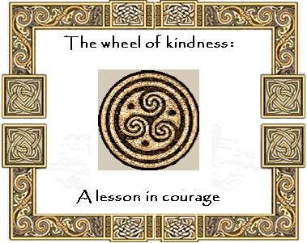

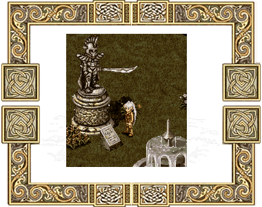

"Ivy Divine... Master", she said to herself delightedly. She was daydreaming of the day before when she had finally become a master of her path, remebering the feeling of pride in her accomplishment. It was a quiet day, several deochs ago, she was happily strolling through Loures harbor, reveling in the salty sea air mingling with the sweet scent of blossoming flowers. Whispers, from aislings seeking her attention, were floating to her ears, but she was quite content to be alone. As she wandered through the grass she read the plaques inscribed for the heros of Temuair and thought of their bravery in breaking the seal. She considered doing something brave also, on a smaller scale, of course, to prove to her peers that she was worthy of the title she bore. She contemplated for awhile, and then it came to her. She would slay the beasts that were plauging the Grass fields.

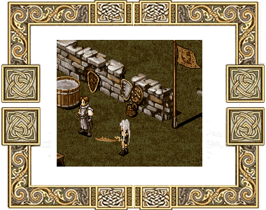

She had inquired there the previous night about what a battle there would bring. Other aislings, standing about on the outskirts of the field, spoke of a great reward if she was successful in battle there. She would earn a helmet fit for a master warrior. "That will prove my bravery." she thought confidently. She donned her armor, took up her sword and was on her way, without a second thought. She briefly spoke with Dealos on the outskirts of the field, he told her of the battle raging within and that she must prove her valour to claim her reward. "Slay three of each type of beast." he instructed. The eager warrior nodded and entered the feild.

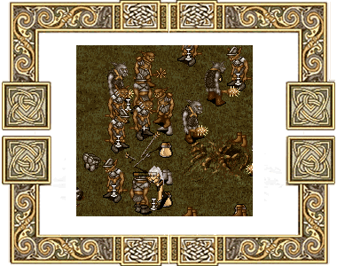

She charged into battle slaying beasts one by one, the sun glinting off of her freshly empowered blade. She was the warrior, victorious and mighty, she swung her sword skillfully, using the force of the wind to guide it. Turning and swaying within the masses, pausing only briefly to concentrate on her own protective inner energy and project it around her body. "Asgall Faileas" she chanted to herself. Her cheeks reddened with the flush of pure energy. The creatures became more enraged when her energy reflected thier attacks back at them. She hesitated not, with each new adversary her speed increased, she charged at them her blade stinging the beastly flesh. She felt she was invincible...

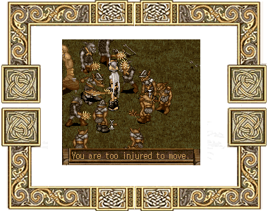

but she wasn't aware of the strength these creatures had in great numbers. She became breathless in the midst of battle, overwhelmed by the sheer number and tenacious nature of these 'Goblins'. She felt the life draining from her, her hands began shaking as they pummeled her. She was simply not strong enough to continue. She struggled to reach for the song she had tucked away in her pack to carry her to Fiosachd's door where she may rest awhile in safety. She tugged at her pack and rummaged around for a moment, the Goblins still beating her in thier fury, but the song was nowhere to be found. "Oh no! I must have lost it somewhere!" she thought, panicking as the beasts continued to call for reinforcement. She shouted for help as loud as she could, but there was no aisling about. She was at the end of her battle and she knew it. Suddenly she felt Shamble's cold fingers wrap around her beaten body and rip her items away one by one tossing them to the ground like they were bits of trash. Then... all was silent.

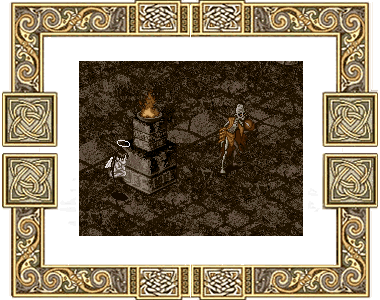

For a moment she was relieved to be away from the horrors of war until she looked to her left. There stood Sgrios, his imposing, decrepid form shaking with waves of cackling laughter at her naked form. She cried out "Nooooo!", her eyes darted about the large stone walled chamber, searching for an escape. The walls were solid all around and burned her flesh if she got too close to them. She could hardly tolerate the smell of decay hanging in the stagnant air. Defeated and trapped she approached Sgrios and begged in desperation to be released from his chamber. He agreed, so long as he could mark her, that all may know her humiliation. She begrudgingly agreed to his request, knowing there was no other way out.

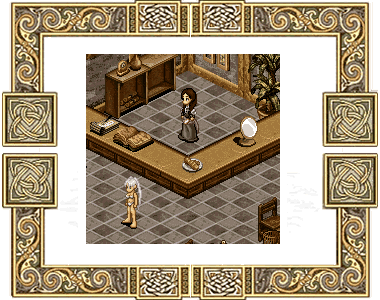

He sent her promptly to the inn of her fair city, Rucesion. She stood there for a moment trembling, then gathered as much strength as she could and wiped the tears from her eyes. She dashed from the inn naked and humiliated, the mingled stench of failure and the lingering smell of Sgrios' realm following in her wake.She hurridly made her way back to the grass field and attempted to go retrieve her things,but the goblins were awaiting her return, surrounding her possesions like vultures. She ran out to safety and thought for a moment, "I need help." she groaned. She called out to her clan, "Is there any aisling near Grass fields who can help me?", there was but one reply "I'm hunting." the voice said plainly. "Oh please, please help me. I don't know what to do..." Ivy cried pleadingly. "Alright." the voice sighed.

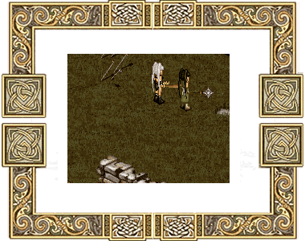

A few moments later there arrived a young priestess, a vision of lovliness in her understated green silken frock, fine locks of deep green hair flowing down her back, wielding a dainty staff that looked like it had seen more than it's share of hardship. "Take my hand." said the priestess in a soft voice. The warrior eagerly accepted the priestess' hand. The priestess felt the warrior trembling. "We'll be fine." she said calmly and gripped Ivy's hand firmly. Together they walked inside, the priestess wrapping the warrior with spells to protect her from harm. IvyDivine lead the way through the feild taking the brunt of the goblins wrath yet she never felt the sting of thier clubs and hatchets. The priestess, calm and steady, applied her healing power to the warriors broken body.

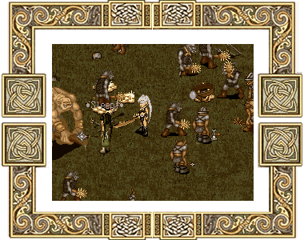

Ivy shouted "My things are over here! I see them." The preistess said not a word, but simply held onto the warriors hand and kept her wrapped in safety. The warrior, breathless and terrified saw a huge goblin charging after the lovely priestess. She shrieked "Look out!", but the priestess never waivered. She simply sang the beast to sleep and continued on. They reached the pile of cast off items and the warrior quickly gathered them. The priestess then said"Let us finish this battle." The warrior nodded her head and nervosuly began fighting against the mobs. With the aid of the priestess' skillful hand there were none left standing after a few moments. Amazed, the warrior stood motionless and gazed at the empty feild. The priestess then instructed the weary warrior to claim her prize with Dealos. "You are after all victorious." she said with a smile. The priestess sang a song of Abel and was whisked away to Fiosachd's door.

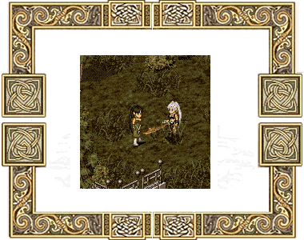

Ivy rushed out to Dealos, he acknowldged her acheivement and handed her a brand new helmet. Beaming with pride, yet still shaking, she thanked him briefly, tucked her helmet in her pack and hurried off to find the priestess. Once in the familiar safety of Abel she looked about for the priestess. She saw her walking calmly across the grass. The greatful warrior rushed to her and cried "Thank you so much!". The priestess paused and turned to her."It was nothing." she quietly replied. "Oh but it was! You left a hunt to help me and I hardly even know you...How can I ever repay you?" said Ivy."If you really want to thank me" she said with a kind smile,"be kind to others and help them when they need you, no matter what you may be doing. The hunt is fun and rewarding, quests are satisfying to complete, social life is entertaining, but helping someone without thought of recognition or reward, that is something truly couragous." Ivy smiled and promised to help whenever she could. As the priestess walked away to go back to her hunt, the warrior realized, true courage doesn't always come from battles or achievements, sometimes it comes from acts of kindness, from taking time to lend a helping hand, walking selflessly into the face of danger so that someone else may be safe.

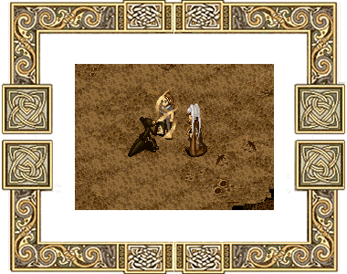

And so the day was done. Many of her material possesions were lost and needed to be replaced. Ivy was not upset or disheartened though, in fact she had never felt so full of her spark before. The lesson she learned that day would never leave her. To this very day when she sees an aisling in need, she will help them without question, and when they thank her she thinks back to that day, long ago, in the grass fields and tells them with a kind smile, "You can thank me by being kind to others.". And so the wheel of kindness turns.

_End_  
_~Authored and penned by Mistress Ivy Divine_  
_(MistressIvy in DarkAges)_

***

```
*Librarian Notes*

This entry has been heavily edited to conform to Library formatting.
The original can be found at https://novus-imperia.com/college/bio/Mistressivy_Bio/index.html .
```
