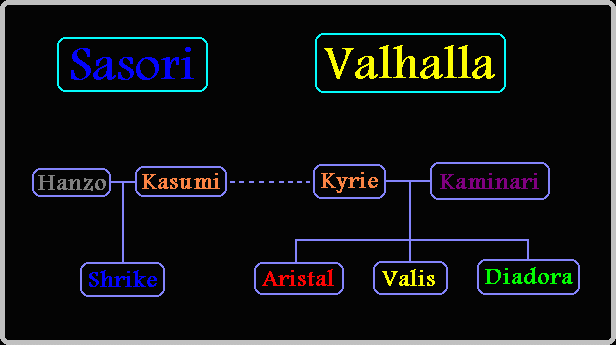
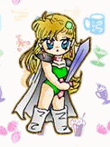
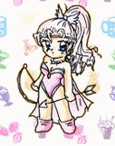
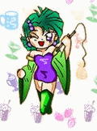
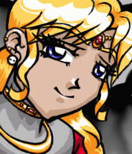
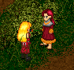

# The Breath of Heaven

_by Valvalis in **Dark Ages**_

_A Biography of Valvalis_

## What's in a name?

That which we call a rose, by any other name, may smell as sweet... But would it not fall upon our ears with an unfamiliar sound? Would it not strike a different feeling into our hearts upon the utterance of a name that once had a special meaning? A name is very important, you see. Some people are labeled by their actions, and others act out in ways they have been labeled. Yet have no doubt, one's name is always meaningful. And with this in mind, I will tell you the story of a beautiful name.

To spare you a lengthy tale of ancestoral heritage that dates back for centuries, I will begin with a woman named Kyrie. A wonderously beautiful woman with hair so light, that it was almost white. Kyrie was a talented archer as well, very practiced in the arts of war, as well as healing magics. It was not uncommon during this period of time for a female archer to be adept at healing magics, actually it was almost expected. Kyrie was a very kind and gentle person, who's spirit was as beautiful as her face. She also had a sister named Kasumi, and they loved each other dearly. As Kyrie grew from a young girl into woman, she eventually, and not surprisingly, fell in love and married into royalty. The man's name was Kaminari, although this name was never used by common address. His official (regal) name was spoken "Valka", in the tradition of the house of Valhalla. In the old ways of his people, the name of the royal house is spoken first, followed by ones given name, and in combination, they become your "regal name" or "title". Thus, it becomes necessary to take this into account when naming the child, in order to make a name that will be meaningful before and after the royal transformation. For example, "Valhalla Kaminari" becomes "Valka", which means "ice storm". The original name "Kaminari", in his native language, means "lightning and thunder". In this way, you can see that the Valhalla family names are quite meaningful.

As time went by, Kyrie gave birth to a daughter. On account of the gentle breeze that embraced her on that day, she named the girl "Valis". Valis of Valhalla, literally "Breath of Heaven", formally known as Valvalis, "The Shining Wind". It was a beautiful name, and Kyrie was overcome with joy.

Not long after, Valis was soon a big sister. At first she was given a younger sister, "Diadora" (Valdia), and then along came a younger brother, "Aristal" (Valaris). The children grew up in a loving family, and were given everything their hearts could desire. They grew up to be as kind and gentle as their parents, and not a trace of flaw touched their pure spirits.

A few years later, half way around the world, Kyrie's sister Kasumi had started a family of her own. She had married a man named Hanzo, who was a martial artist of the clan of Sasori (translated, "Scorpion"). They gave birth to a spunky young girl named "Shrike", who is cousin to the Valhalla children, although she is considerably younger than they. As time went by, and Shrike grew up, she began to train in the martial arts, to take after her father. She traveled to Valhalla whenever she could, to visit her favorite cousin, Valis.

## Immediate Family Tree



## The Path of Humility

As Valis grew into a young woman in her comfortable family estate just outside of Loures, she was just starting her training as a knight. Her younger brother Aristal was on his way to becoming a talented young mage, while Diadora was constatly wandering around the countryside on a quest for adventure (soon to mold her into quite a rogue). At the same time, cousin Shrike had taken up residence at a monastary in Undine to complete her training. So for the most part, everyone was close together. But the study of swordplay did not sit well with Valis, as she disliked the concept of violence. After consulting her parents, family and friends, Valis decided to go on a pilgrimage to Mileth to study healing arts. She said her farewells, and went on her way, alone.

Thus at the dawn of the 5th Deoch, Valis began study as a priestess under the guidance of the already famous priestess, Leona. She clothed herself in deep crimson to honor her mentor, and began to increase her magical abilities. After some time passed, Valis grew strong, and Leona sent her on her way, proud of her young apprentice. At this time, Valis returned home to visit her family. When she arrived there, she found that her brother and sister had followed in her footsteps. Aristal had hence traveled to a mage academy in Rucesion where he was already on his way to becoming a potent student of the arcane, and Diadora was supposedly last seen wandering in the area of Suomi, seeking her fortune as a rogue. Even Shrike had left the area, after finally finishing her training at Undine, she had left for the mountains in the far west to test her strength as a monk. Clearly seeing that her siblings had chosen their paths in life, Valvalis was finally ready to choose hers. Having her eye set on a humble fellowship on the outskirts of Mileth, she set out to return and become a priestess in the service of Glioca, the Godess of love and compassion. She finally felt a strong sense of identify and purpose, and made haste back to Mileth.

## The Women of Valhalla



_Valis_



_Kyrie_



_Diadora_

## Touched by an Angel

Upon her attendance to her first Glioca mass, Valis witnessed a truly glorious sight. The two priestesses giving the mass were beautiful and wise, and their words touched her heart. She would find out later that their names were Angelic and Gwyneth. Angelic, who was giving the majority of the sermon, particularly stood out to Valis as intriguing, and she approached her after the mass to talk. To make a long story short, eventually they became very good friends, which came as quite a surprise and honor to Valis. Angelic was famous and charismatic, Valis was nobody of consequence yet. After going on a religious Gaes for Gwyneth, Valis was officially made a priestess of Glioca, henceforth called Valvalis of Glioca. She attended every one of Angelic's masses to hear her friend's beautiful and inspiring words. These were very happy times for her.

After some time, she was approached by Angelic and her husband Bentic. They were forming a guild, and offered to let Valis join as one of the motley founders. She happily agreed, and the guild was created, named "Tuatha de Deo", literally "Children of the Light". Other mutual friends were in the guild, like Dartanian, Cedrik, Moiraine, and many others. Deoch 5 was nearing an end, but the friendships and memories that Valis was building were just starting to begin. Valvalis' happiness was embodied in the oath of the Tuatha that all members were required to live by:

"I vow from the depth of my heart,  
and with the full weight of my word,  
that I shall treat all others with respect and kindness,  
in the same manner that I myself wish to be treated.  
I shall be merciful and forgiving,  
not creating conflict and strife amongst other aislings.  
I shall give to those in need,  
showing piety and modesty to all.  
I shall only use force as a last resort,  
and shall spread the light of Danaan,  
through my words and example."

## Angelic Stedwinn



## The Fall, and the Return

It came to pass that the happy times blessing Temuair would not last forever. Nearing the end of Deoch 6, without warning, a strange illness swept across the land. This was not a physical illness, rather, an illness of the spirit. The symptoms were strange indeed, the afflicted would lose their passion for life itself, and seemingly vanish from the land entirely. A dread illness to be sure, many were terribly saddened at the loss of loved ones, as they watched them fall from their outstretched arms. Valis fearfully found herself to be a victim of this terrible sickness, and one day, before Deoch 7 had the chance to touch her face, she was gone.

Nearly 6 Deochs later, something even stranger came to pass. The Aislings that had previously fallen from Temuair as a result of the illness suddenly began to reappear. Nobody knew quite why, but they did not care. All were happy to see their loved ones return to the land, and bring about the happy times that had only been a memory until now. The Tuatha de Deo, on the verge of disbanding, was revitalized with almost every one of their old member, along with many new ones. And in the glory of this revitalization, one day, from out of nowhere, Valvalis had returned as well.

Valis was overjoyed to be reunited with Angelic and all her other friends. She spent most of her time rekindling old friendships that she had not nurtered in almost 6 Deochs. One day, it even came to pass the Valis came across Leona herself, who had been gone even longer than she. Happily reunited with her old Mentor, Valis was grateful that finally all her prayers had been answered. With the strange fall in the past now, and her whole life ahead of her, Valis set out with a completely revitalized passion for life. Angelic and Valis even started giving mass regularly at Glioca's now very large temple. It was a time of joy again, and everyone was happy.

## Reunion with Leona



## A Golden Hope

With the vast possibilities of the future in front of her, Valis was content with her simple life as a priestess. She had her best friend Angelic as a companion, and many other wonderful friends that she cared for. The foundation of her new mass with Angelic had also renewed her faith in the fellowship of Glioca, making her spirituality grow as well. Seeing Leona become among the most powerful priestesses in the entire world, she also had a new drive to increase her magical abilities once more, like she had so fervently done in the past. And on top of that, Valis had fallen in love with a wonderful man who she never thought would know she existed. This relationship also flourished, and was maybe the most important aspect of her new happiness. The life of Valvalis was still only at a beginning, and many possibilities lied in store for her. But as her name implied, Valhalla Valis, the shining wind, the breath of heaven, had the Gods watching over her, carrying her life in their arms, and sending her comfort in the warm breeze. She had a strong hope that the future would bring only beauty and love to her already wonderous life.

***

```
*Librarian Notes*

This entry has been edited to conform to Library formatting.
The original can be found at https://novus-imperia.com/college/bio/valvalis_bio/index.html .
```
