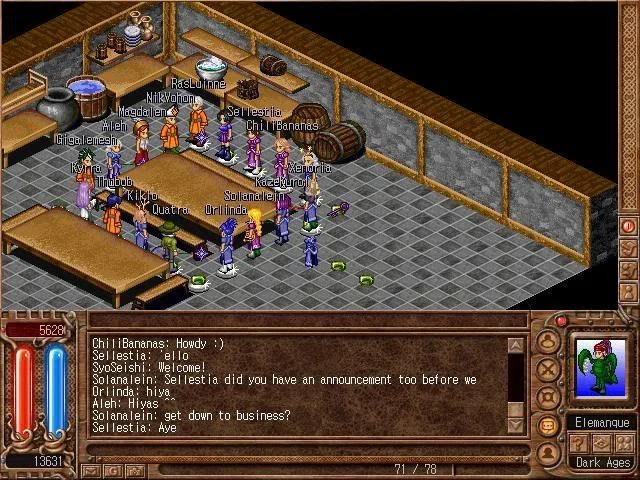
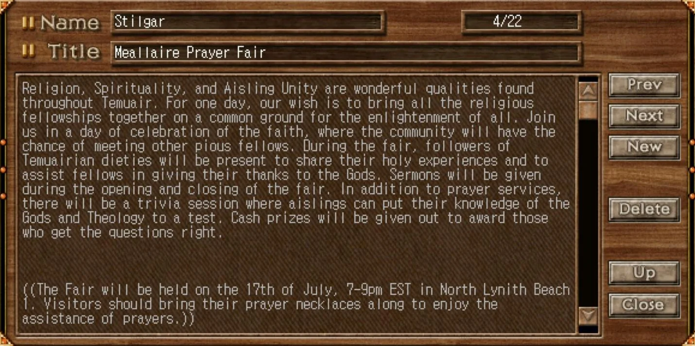
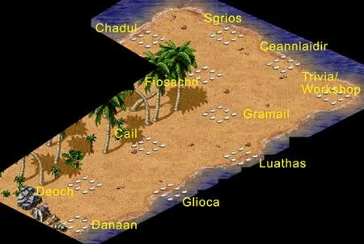
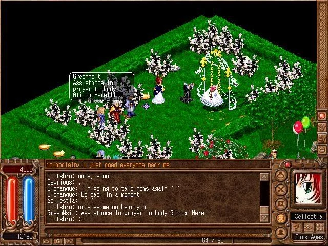

# History of Meallaire

_by Blanche in **Dark Ages**_

(Note to readers: this scroll was written in the third person to make distinguishing the narrator easier.)

## Prologue

Aisling history starts at the Great Awakening. This is the moment characterized by the creation of the first Aislings by Deoch under Danaan's orders. Before that time, many mythological events were discovered by scholars on scrolls and stone carvings, not to forget the stories told by bards over time. Several lore gatherers and historians already elaborated on these aspect of the past, so this piece will not focus on them. In any case, Aislings awakened one by one starting in Deoch 1 `((1999))` and found a land filled with mysterious creatures. Some creatures had good intentions, for example the peaceful Mukuls still around today, and others were more aggressive when finding Aislings on their territory, such as the goblins and the kobolds. In between areas of wilderness, Aislings started building villages that eventually became cities, even fortresses and castles. The first Deoches were characterized by establishing communities around the villages and by the construction of the temples used to revere the eight established Temuair Gods. All that while fighting evil creatures spread in the wild territories. It was considered a harsh time. Some Legendary Aislings can still confirm this, as they were actively participating in the development of Temuair from Deoch 4 to 14 `((1999-2000))`. Five of such Legendary Aislings have their statue erected in the Loures Harbor for all to admire, since they have broken the Medenian Seal. In short, Aislings have the chance to spend their time protecting Temuair in a more active way than mundanes can. They must face a choice pretty early on: choosing the path they will specialize in, namely monk, warrior, priest, wizard or rogue.

In contrast to the harsh reality of the first few Deochs, the 30s and 40s `((2003-05))` were characterized by a focus on self-development rather than community building. Aislings who sparked during these times had the capacity to find guides and mentors to show them the ropes of what it meant to be an Aisling. The cities were well-established with complex politics systems, the God temples were quite active, and many guilds were created to assemble Aislings having similar interests. As previously mentioned, each "newborn" Aisling must do some soul-searching to figure out what motivates them the most. The Temple of Choosing, tended by Aoife, is the first place to have a glimpse of what a path can entail. It is not an easy feat to determine the direction of our future actions when waking up from the Mundane slumber. Alas, this has been the challenge of all Aislings since the Great Awakening. Fortunately, guides, mentors and guilds could provide a much-needed support for confused or lost Aislings, as it still is the case today.

## Introduction to Guilds

After choosing a path, one must progress in Temuair by using the skills and the spells taught by the expert mundanes. However, it has always been very challenging to do so without the help of other Aislings. The mundanes don't usually have much time to explain most of the mysteries found in Temuair, as they tend to be specialized in a few topics and will be mostly useful to provide some quests, resulting in a trade of experience for gathered items. Hence, the first guilds were rapidly created to provide a community for Aislings in need of guidance and to find partners to defeat the evil creatures in the wildnerness. Some of the original guilds include Lionnear Uasal, Aingeal Aire, AcadamiArcanus, Runic Terra, Cult de Carrot, Tuatha de Deo, Imperium (which later became Novus Imperia) and the Unseelie Court, to name a few. Each guild has a leader who will decide, with the help of council members, on the direction of the guild activities. A guild can be built to help members find friendly advice. Other guilds can be specialized on the formation of hunting groups to fight the evil that lurks here and there. A rarer purpose would be to assemble Aislings of the same path in the aim of discussing about its specializations. AcadamiArcanus was a guild admitting only wizards for a long period of time, and following this example, Meallaire was founded to focus solely on the priest path.

## Meallaire creation and founders

Formerly a wizard but later converted to priesthood, Blanche was the original founder of the Meallaire guild. The idea to assemble priests together under the same banner arose naturally while hearing about how the AcadamiArcanus was strictly admitting wizards. Blanche felt that her first priest mentor was not awake enough to explain her all the priestly lore and teach her the skills associated with the complex path of the Priest. Most times, she would ask random experienced priests for advice, but they would often be busy or unresponsive. Blanche was able to learn many things by accident or by chance, but she often felt lonely and needed a bigger community to share valuable knowledge.

Blanche started talking to other priests about the idea of forming a priest-only guild. The majority of her encounters showed that such a guild would be most welcome in Temuair. Creating a guild is not an easy feat, however. There are several prerequisites for such a process: the support of 15 Aislings willing to be part of it, the support of the Nobles who can grant official recognition for one's work, and substantial financial support. Blanche was able to gather enough gold and enough priests willing to become the first members, but she lacked the official recognition. However, an unlikely set of circumstances put Solanalein on Blanche's path. Their encounter occurred in Deoch 43 `((2004))`, and it was surprising since they were both gravitating in opposing worlds. Solanalein was part of the Ceannlaidir High Clergy, while Blanche was a priestess of Luathas. Both Gods are natural enemies, so members of their respective temples would not meet frequently by design. Somehow, fate put them in contact since they both had the same goal: creating a priest-only guild and celebrating all Gods in the end.

The Meallaire guild was then created in Deoch 44 `((2005))`. Solanalein had the Noble's recognition needed for such a project, while Blanche had the initial idea, the funds and the first recruits. Surprinsingly, the Meallaire creation process was very similar to the beginning of the AcademiArcanus, since Veneficus had the original idea of bringing wizards together while Arachne held the recognized title and supported the idea (thanks to Arachne for sharing these details). For both Meallaire founders, this birth was a moment of true celebration. The name Meallaire was chosen to denote the main focus of the guild: the process of sharing information through teaching, allowing experienced priests to teach various lessons to interested pupils. It would be similar to what the Mileth College was offering, but the content would strictly relate to priest knowledge and be taught to guild members only.

## The essence of Meallaire

As the guild grew, there was a need to provide a certain hierarchy and organization, allowing members to know "who's who" in this larger group. The Treoraiche (leaders) were Blanche and Solanalein. They regarded each other as equals and generally consulted each other for important decisions. Then, the Cur Coyrle da Meallaire (council members) were appointed through an admission and vote process. Regular council meetings were used to create and update the Guild Charter (their set of rules), to organize events, and to discuss of other important matters. After a while, a new title could be given to some of the most motivated members who took time to write pieces of lore about a certain topic: they would become Eol Teyider (knowledge gatherer). This title could help them become a council member later on, and of course to teach classes according to their speciality. However, since the Eol Teyider were identified for all the guild members to know what their speciality was, they were also responsible to answer to private mail or open questions from the other guild members at any given time. The regular guild members, who wanted to have a simpler life devoid of guild responsibilities, were called the Beayn-Oltey. Last but not least, after sending an application form and a voting process from the guild members, the newly-admitted prospects would be placed on probation for a period of 2 weeks and the bearers of such status were called Doltey. Lastly, the chosen faith of all Meallaire members was recorded on a scroll for future reference as this information was useful for members wondering about which God to serve, or to find someone for object consecration.



_An example of a council meeting held in the first Deochs following the guild's creation. (Memory provided by Elemanque, Meallaire council member.)_

Being a priest may be complicated at times. Similar to the complexity of wizardry, there are many spells and crafts a priest can choose from. The first crucial role of a priest is to keep a hunting party alive, mostly with beothaich deums. Devlin of Mileth does explain how these potions are made, but Blanche has always preferred a more hands-on approach than being given oral instructions to remember. Periodically, classes on Herbalism would be organized by specialists to teach this most needed skill to curious minds. The teacher would ask the attendees to bring cherries, grapes, a cloth glove and enough wine bottles beforehand. They would all meet in the Enchanted Gardens to explore the knowledge of creating beothaich, hydele, personaca and betony deums. The classes would eventually continue in Piet and Undine to learn about the hemloch deums as well as the ancusa ceir crafted from bee's wax.

Each priest must "face the music" at some point: which God should I serve? A worshipper already has to determine which deity will best match their own core values. At times, Aislings will worship a deity due to family pressure or because "it's like that" in certain circles. When it comes to priesthood, however, one must go beyond the basic reasons and do profound soul-searching. Due to the complexity of the Octagram, Meallaire's purpose was to include members of all faiths. When a member would need more details about a certain deity, or the relationships that Gods have between each other, clergy members would be present to provide such information. Some classes on the topic were organized by respected clergy members. At times, masses were cast outside temples to give supplementary insight to worshippers. Such events would, as an example, include Glioca masses cast in the Enchanted Gardens, Sgrios masses cast down in an obscure crypt, or Ceannlaidir masses cast in areas where attendees would be expected to fight wild creatures after mass was cast. Meallaire wanted to provide both intellectual knowledge and down-to-earth, practical experience to its members.

Matrimony is another act reserved to priests. Even though Devlin of Mileth is happy to offer the starting information on fairy matrimony taking place in the Enchanted Gardens, the more advanced knowledge about marriage was not necessarily shared by mentors to their students. Consequently, Meallaire classes on the topic would include a stroll in the gardens or a visit of some of the most important churches, located in Mileth and Tagor, to ensure that this priestly task had no secrets anymore.

## Meallaire and the Temuair community

At a certain point, Meallaire had active members in all faiths (except Cail, since that temple didn't have a very active clergy at the time). To gain more visibility and to offer services to the public, some activities were organized well in advance and advertised on the community boards. Such activities would include a period dedicated to prayer assistance for all faiths, also known as Prayer Fair. These public events would help Aislings find priests to be admitted in a chosen faith, or to gain knowledge about the different churches before making the decision to serve a certain God more than the others. Some Meallaire members were even organizing raffles during these events. It was a nice opportunity for Aislings of all crafts to get to meet so many priests at once in the same area. Some hunting groups were formed during these events. Some priests were requested to perform matrimony for the attendees. Some impromptu masses were even cast in the chosen Fair Grounds or on the beach.



_Post 482 by Stilgar in the Events of Temuair announcing the details of a Meallaire Prayer Fair event held during the Golden Age of the guild._



_Disposition of the areas where Aislings could meet the priests of all faiths during a Prayer Fair held on the Lynith beach. An area reserved for trivia and workshops was also set aside. (Map created by Elemanque to help the organization of the event while it happened.)_



_The Glioca prayer area during a Prayer Fair held in the Mileth Fair Grounds. (Memory provided by Sellestia, Meallaire council member.)_

## The first Meallaire rogue

As the guild grew, a new class was deemed necessary to admit within the Meallaire ranks. In order to help the priest's tasks and providing the gems required to learn their advanced spells, the guild started including rogues in its roster. It became a necessity for the guild members to know enough rogues to contact for such a need, so the leaders decided to admit these skilled Aislings in the guild for a more direct line of communication. Additionally, rogues were able to higgle many wine bottles at once, which allowed herbalists to brew several types of potions during their classes. In return, priests could assist rogues with building their faith for their chosen God (oftentimes it was Fiosachd) and they would also craft beothaich deum potions for hunting purposes. It was a very positive mutualistic relationship. As a general rule, Meallaire did not want to accept members of all paths because this would strip the guild from its specificity, but rogues were considered an essential addition.

To keep up with the Meallaire view of teaching and learning, some new Eol Teyider were specializing in the rogue crafts. A series of new scrolls were written and new classes were given to teach the specifics of the rogue skills. Eventually, the Eol Teyider started including specialists in some hunting methods, questing skills or knowledge of the newer Medenian areas. Meallaire had become a community of well-rounded individuals, a place where its members could discuss of almost anything and organize activities for the group.

## The Fall

Any group of Aislings has some kind of politics, and the bigger a group gets the higher the chances of having conflicts between subgroups. Meallaire was no different. Most of the time, its members would be willing to exert politeness and curtesy between each other. The guild had a charter and a code of conduct to follow. All the official scrolls were pinned to the board for all to see. For instance, if a current member had an issue with an applicant, it was useful for the whole guild to know about the issue in order to prevent conflicts before they had a chance to arise. This would potentially mean that the applicant was not to be accepted. At times, this rule would create a bit of a turmoil, but in most cases it was resolved without a fuss. If there was a major problem, typically the council would call an urgent meeting and try to figure out the best course of action.

Despite the level of organization Meallaire had and the common sense of its members, a single event created a chain reaction in the guild, comparable to the gradient of spells going from beag to ard, progressively. The event itself was a member's eviction following serious trouble they stirred. This person's name was stricken from record and is only known as nimhe (for poisoner). No official scrolls were kept about this event, perhaps to remember the good things and forget the bad ones. Luckily, it was possible to gather some of old members' testimony. In essence, nimhe would enjoy creating mayhem on purpose, especially in the guild conversations. As a reaction, there was a steady increase in the level of animosity between a few members and nimhe. Since Luathas pushed Blanche to favor reason over emotions, she first requested nimhe to refrain from emitting hurtful comments within the guild discussions. Everyone can have an opinion that may hurt others inadvertently, but we should always remind ourselves that these opinions can also be kept in our mind without being expressed. From the gathered testimonies, there were repeated offenses, and the more nimhe was putting oil on the fire, the more guild members would become inflamed. Since nimhe did not wish to calm down or willingly excuse such behaviour, Blanche felt she had no choice but to expel them promptly. She asked her most trusted council member to quickly act while nimhe was still awake. The removal was swift, and tranquility was restored immediately. Oh, peaceful silence! Little did Blanche know that this would only last for a moment.

Some witnesses of the expulsion believe that nimhe was a good friend of Solanalein. Blanche's decision provoked a backlash within Meallaire's Ceannlaidir community and an emergency council meeting was called right away to review the event. Blanche sincerely thought that her vision was shared with the majority of the guild members. According to some witnesses, Solanalein seemed furious and felt betrayed, since she would have preferred to be consulted before a friend was forcibly removed from the guild. Blanche acted quickly, thinking that waiting any longer would make other members angry and unwilling to spend time within their guild, since nimhe enjoyed the chaos they were creating. A guild should be like a family and a safe place, and in Blanche's opinion a family should be a group of people with whom we can discuss without screaming or insulting each other. Unfortunately, several guild members were agreeing with Solanalein and two opposing opinions remained. A rift was created. Instead of dissolving a functioning guild completely, Solanalein decided to leave Meallaire to create another guild, Fiel Capilla. The Meallaire members siding with her left promptly, and the others remained. It was a heartbreaking decision for many members, who felt that they had an issue with nimhe but neither with Solanalein or with Blanche. The rupture occurred at the end of Deoch 55 `((2006))`.

## Meallaire's recovery

The guild lost roughly half its members to the fission. After this crisis, Meallaire needed new hope and high morale. As a consequence, new rules were written to the Charter. Meallaire was originally a priest-only guild, then it became a priest-centered guild with the help of rogues. However, after some discussion with the remaining members, this "priest-only specificity" was not what most Aislings were searching for anymore. On top of this, many Aislings did not wish to remain "pure" in their path and it was quite common to meet "subpaths" here and there. Blanche knew of that process, being formerly a wizard. She could not agree with a policy that would force a current member out of the guild solely on the basis of their second path not being priest or rogue. Meallaire thus decided to keep up to date with this new reality and opened its doors to Aislings who chose to subpath from or to the priest and the rogue paths. This would make an interesting community, in which the priest and rogue functions would be active up to a certain point. Meallaire had members who were priest-wizards, wizard-priests, priest-rogues, rogue-priests, rogue-wizards, and so on. All members were valuable assets to the guild, after all!

As time passed in Temuair, many things changed. The focus of most Aislings changed also, switching from learning a craft in details over many Deochs to learning one's path minimally and quickly. There were many new threats developing in Medenia and it became a priority to travel there and vanquish the existing evil before it spread further. Staying in Temuair and practicing skills such as tailoring, herbalism or wizardry research was not popular among Aislings anymore. The necessity to hold classes and to write lore even dwindled with time. Some Meallaire members started disappearing, too. Either they passed away, or they went into a long slumber. If Meallaire wished to remain an active guild, new rules would have to be made to accommodate for the reality of that era. Some members wished for their family members to be admitted into the guild, even if they were pure warriors or monks. Thus, the guild opened it doors to everyone. As long as the clan was made of friendly and compassionate Aislings, this is what mattered the most.

Blanche stayed busy and active in Temuair for several Deochs, taking care of the guild and her family. However, she was progressively aging and some activities would get more difficult to carry out as time passed. Around Deoch 107 `((2012))`, she took a step back to evaluate what her life had been and ascertained that it was complete. Blanche explored wizardry, priesthood, friends, family, a clergy and a community. She also had children and hopefully a nice legacy followed. Since she was not ready to disband a functional guild, she preferred passing on the leadership to a capable and motivated council member. The designated new leader was GreenMsit, possibly assisted by Rowan according to a source recently interviewed. Blanche wished Meallaire the very best and took her leave. What happened since is still obscure.

## Meallaire's renaissance

Like many other Aislings, Blanche mysteriously reawakened in Deoch 212 `((2025))`. It was almost like an influx of life brought the majority of Temuair's inhabitants their consciousness. According to some serious sources, including Solei, a newcomer named Bindo appeared one calm day. He was able to stir up some energy into the land and infused it throughout the world. Temuair became a very busy hub once more.

The first thing Blanche did was to wander around to compare the old Temuair from her memory to the current one. Were the Enchanted Gardens still in the same wooded area? Yes, they were, and the landscape was still filled with the same flowers and bees. Were the cities of Mileth and Rucesion still standing? Indeed, and they were still quite active since the returned citizens resumed some of their old activities. Blanche wondered if there were still grimloks and goblins in the Pravat caves. She quickly realized their never-ending war was still raging, and now there was even a reward offered by the goblins given to the Aislings willing to help eliminate their direct competition. Most places she visited were still exactly the same, so this was quite reassuring. Blanche also crossed path with many Aislings who were glad to give her updates about some developments in Medenia. Some faces were slightly familiar, especially the active rangers or the members involved in politics in the past. Blanche stumbled upon someone standing in Piet who looked very formal. It was Ranger Viveena, who was part of Meallaire a long time ago. Even if a long time had passed, they remembered each other quite vividly. Some relationships are lasting, to say the least.

Blanche took some time searching Temuair and Medenia for more Aislings who were former Meallaire members, and she did! It was reassuring to meet them after such a long time! One of the first things Alustria and Craigskull asked Blanche was "Are you going to rebuild Meallaire?" Other old members, namely Nepheal, Rahl and Eloria, were also inquiring about the ability to "bring the old gang together". Blanche was glad to witness the positive impact the old guild has had on its past members, so much so that they wanted to reform it. Blanche visited Aricin in Abel tavern to inquire about the guild creation process. Alas, the requirements to form a guild did not change over time. Unfortunately, Blanche still had no official recognition from the nobles, so she could not recreate the guild on her own.

Motivated, Blanche started to look for a recognized Aisling who would be benevolent enough to assist her in the recreation of Meallaire. With some help, she was able to find such a generous Aisling who had recollections about the old guild and thought its restoration was an important event. Blanche's benefactor wishes to remain anonymous, and she will be forever grateful for the selfless act of recreating a guild for other Aislings. This leadership is meant to be temporary, and Blanche waits to gain Meallaire's control again.

With time, Blanche is convinced that Meallaire will grow again to include priests of all Faiths. Like in the past, there will be events organized periodically in the aim of meeting many priests in the same location, for Aislings to find prayer assistance, to allow easy admissions to a temple, for the consecration of blessed items, or to meet herbalists for potions of all kinds. The guild will also be blessed with the presence of members with specific knowledge of everything that happened in the past 100 Deochs or so. Meallaire still wishes to favor priests, but is ready to admit Aislings of all classes. Let the knowledge grow as a new guild, and let Meallaire rise again!

`(( Special thanks to:`

- `Alustria, Nepheal, Rahl, Craigskull, Eloria and Elemanque for wanting to recreate Meallaire with me after all this time. Discussing with them brought memories to the surface and helped me write this piece.`
- `CReaper for joining me in my DarkAges adventures, for contributing to the guild website and some artwork.`
- `My anonymous benefactor for recreating Meallaire for me. Without you, the guild would still be a ghost.`
- `Elemanque/Elexius for the memories and the maps, making this text much nicer to look at. Arachne for her insights concerning the Academie Arcanus creation and its internal mechanics.`
- `Angelique and Ramanayan for donating their precious time for a peer review. Laurier and my anonymous benefactor for their recommendations in my early writing stages.`
- `Veneficus' History of the Academie Arcanus, which inspired the present text. The Novus Imperia website for the information about the recognition process. The Loures Library for the collection of works consulted to the elaboration of the introduction timeline, including `[Letharia's Alternate History of Temuair](Lethalia-Alternate-History-Of-Temuair.md)` and Dave Kennerly's work.))`
- [Veneficus' History of the Academie Arcanus](Veneficus-History-Of-The-Academie-Arcanus.md)`, which inspired the present text. The Novus Imperia website for the information about the recognition process. The Loures Library for the collection of works consulted to the elaboration of the introduction timeline, including Letharia's Alternate History of Temuair and Dave Kennerly's work.))`

_Sincerely,_  
_Blanche, Deoch 214_

***

```
*Librarian Notes*

Recognized: Kingdom, 2025 (Mileth College master list).
This entry has been edited to conform to Library formatting.
The original can be found at https://novus-imperia.com/college/his/blanche_meallaire.pdf .
```
