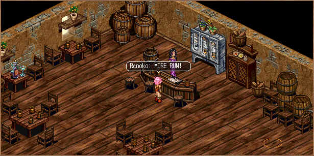

# Spear Arrows

_by Cordeiia in **Dark Ages**_

## The Creation of Spear Arrows

Upon my arrival in Medenia the first thing I looked into was the bar in Noam.
Being a world-renowned drunk this was always my first stop.



When chatting with the bar wench Noahn and getting a bit tipsy, my foot
nudged against something quite peculiar. It looked to be a small old book,
which seemed to be falling apart. On the front it said in very faded lettering
"Winsom." "I know that name! I just spoke with him in the training hall he is
the archer master!" "He comes in here often it must of fell out of his sac"
Noahn commented. Very curious I opened it up to inquire its contents when a
small section came unstuck from its spine and fell halfway into my drink.
Knocking over my glass to retrieve it, I quickly wiped it off and began to
read.

> _Winsom's Journal: Page 97_
>
> _…It's been many cycles since the Creants invaded. Seems as if they will
> never rest at their goal to harness the spirits of Medenia. We have held
> them off thus far I don't know how much longer we can last, their power
> seems so great…_

"The Creants he speaks of are of the same race and nature of those that
invaded Temuair. I have defeated four of them to get to where I am now…Very
difficult indeed" I said out loud with out realizing. "Oh that was hell that
was" Noahn interjected "If it wasn't for good ol' Winsom we would be goners."
Completely ignoring her I read on…

> _Winsom's Journal: Page 104_
>
> _I have been speaking with the Earth Spirit about my new ideas. Although the
> Star Arrow spell that I have harnessed with the Spirit's help seems to be a
> great assistance in dealing with the Creants, it may not be enough. If only
> there was a way to vanquish these beasts faster and with more accuracy. I
> know the others are working with this similar dilemma… we have to think of
> something and quick..._

Pausing I thought to myself "That Star Arrow spells sure is helpful. Up until
now creatures of darkness had always given me a lot of trouble… I had no idea
this spell was created to deal with the Creants…"

> _Winsom's Journal: Page 107_
>
> _Although my arrows are very weak, I have been researching the elements and
> things around in the desert and the plains to try to find a way to make them
> stronger. Maybe Taku the Gladiator can prove to be insightful in my search._
>
> 
>
> _Nearing Taku's home I could hear much yelling and swearing. I thought "What
> a fool I had been to think that a Gladiator could actually contribute
> anything useful to my quest." Oh how wrong I was. When I entered I
> confronted Taku and asked what had been the matter. He informed me that
> while fashioning his dune and astion blades today he had broken not one or
> two but three of them. I looked to the floor to find the tips of the blades
> lying on the floor. My mind raced and I quickly asked if I could take the
> scraps. "What ever would you want with my disappointments!?" he asked. "You
> will see shortly my friend". I raced quickly back to my house where I laid
> out the tips of the massive blades. I grabbed a sturdy file and made the
> broken edges smooth and flat. I then took some spare wooden shafts I had
> lying around from some unfinished arrows that I used to attach the ends of
> the blades to. These were indeed massive arrows._

I had found some of these arrows hidden in chests near the ship when I
arrived. They are indeed very powerful. I have had archer friends show me
their strength when fighting the Creants in Temuiar. One arrow alone killed a
Creant. This indeed was a truly impressive arrow…

> _Winsom's Journal: Page 115_
>
> _Word had come from the locals that Creants were in town heading for the
> Earth Spirit. The others and I set off at once to stop them in their tracks.
> As we approached I reached into my quiver and pulled out one of the new
> arrows. Taku, glancing over at me laughed at me when he saw me wielding the
> huge arrow. "Are you serious?" he said with a snort. "The power of your
> blade and the strength of my bow will rid us of any Creant" I told him.
> Dodging a few attacks I set myself up against the town inn. About 200 yards
> down a Creant which seemed to have snakes protruding from its head was about
> to reach the Earth Spirit. Quickly aiming at my target I used all of my
> skill and let rip this special arrow. The arrow soared through the air and
> hit the beast between the shoulder blades, cutting through the hard scales
> it speared her in the heart…she was destroyed. Glancing over at my comrades
> I gave a wink and then went to talk with the Earth Spirit…_


They are very strong indeed. I wish I knew where I could get more of the spear
arrows. How come the shopkeeper does not sell them? How come they are only
found in the chests? As I asked myself these questions I flipped to the last
bit of page that was left.

> _Winsom's Journal: Page 123_
>
> _The Creant attacks on the towns and attempts at the Spirits have become
> minimal now. With the use of my spear arrows they don't dare get within my
> shot anymore. In fact according to the Earth Spirit they are looking for new
> lands to inhabit, wreak havoc on, and conquer. According to the spirit,
> after the Creants leave our lands I must be rid of the new arrows I have
> developed. When I inquired why he told me that they were in fact too
> powerful and that in the wrong hands could prove to be very dangerous to the
> people of Medenia. Having to agree with the Earth spirit I seeked to make
> arrangements to be rid of the arrows._
>
> _Later that night I was in the bar when I happened to strike up a
> conversation with a very shady fellow. He told me some wild tales of the
> sea; he was in fact a pirate. I made a very interesting deal with him. If he
> were to take my masses of spear arrows that I had created I would talk with
> the spirits about his docking in Noas. He agreed, of course, and the next
> day the thousands of arrows were placed in chests on the pirates ships and
> were taken away._

Hah, little did the pirate or Winsom know, the seas around Noas are not always
so kind. Ships lose cargo all the time and it ends up on the shores of Asilon.
At least Winsom still teaches us how to use the arrows with his special arrow
attack skill even if he doesn't fashion the spear arrows himself anymore.

Sobering up a little bit, I set off to return the journal to master Winsom
grateful for knowing even more of the history of my class.

_By Ranoko, Archer Extraordinaire_

***

```
*Librarian Notes*

This entry has been edited to conform to Library formatting.
Recovered from the Internet Archive; the original site no longer exists.
The original can be found at https://web.archive.org/web/20040927031435/http://www.freewebs.com/ianda/Spear/Arrows.htm .
```
