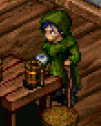
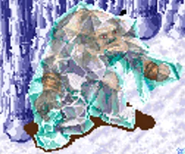
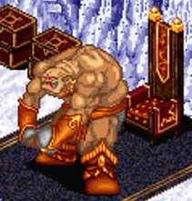
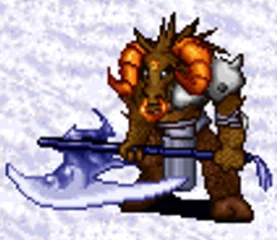
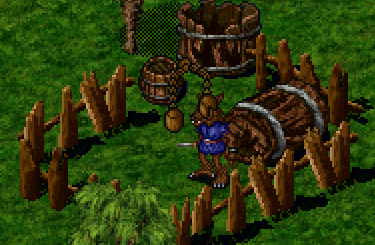
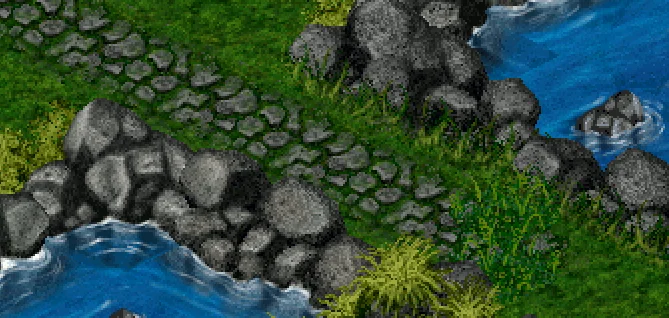

# History of the Frostveil Coven and the Tauren Creant

_by Nadja in **Dark Ages**_

## Foreword

My name is Nadja Spellweave. I am a witch, a bard, and, by His grace, a priestess of Cail. I am a descendant of a coven of witches known as the Frostveil Coven. We are few in number now; many of us scattered after our downfall. Presented herein are the oral histories of the rise and fall of my coven, put to paper to preserve them for all time. Included is a timeline as well as a more detailed recording of the events that have transpired. For more accurate time estimates, I have cross-referenced a few other historical works.

## Timeline

- Danaan 1431: The drowning of Hy-brasyl. Flight of the witches.
- Danaan 1435: The Frostveil Coven formed on Mount Giragan.
- Danaan 1435-1979: The Frostveil Coven lived in harmony on the mountain with no outside contact.
- Danaan 1980: Creants invaded Temuair. They were sealed away by the Temuarian Gods. Most everyone in Temuair had their memories purged of them. The Frostveil Coven entered their pact with the Gods of Temuair. The founding of the Witch Knights of the coven.
- Danaan 1981-Deoch 27: The witches of the Frostveil Coven used their occult magic and rituals to deter people from investigating the mountain.
- Deoch 28: Goblins invade Loures. Goblin General Prugar of the Northern Goblins defects from the main force and seeks refuge in the peaks of Giragan. The conflict between the Frostveil Coven and the Northern Goblins left the coven and their knights decimated.
- Deoch 29-31: Guerilla tactics against the goblins. Loss of many more Frostveil Coven witches and Witch Knights.
- Deoch 32: The partial thawing of the Creant and the discharging of the Frostveil Coven's duty.

## Introduction

The chilling winds of Mount Giragan tell a story. All Aislings in this day and age know of the Tauren Creant, which was sealed by the Gods in ages past. What many do not know is that there used to be a powerful coven of witches who were tasked with keeping the Creant on ice, both metaphorically and quite literally.

This Frostveil Coven, as they called themselves, lived in the mountains for nearly 2,000 years. Here, they established their small society of witches; men and women who were wholly devoted to the advancement of their craft away from the prying eyes of the rest of civilization.

For those unaware, a witch is someone who learns and practices magic outside of a formal institution of learning. This learning includes the standard black and white magics that your average wizard or priest will learn from the various institutions of Temuair. Beyond black and white magics, witches engage in more esoteric rituals that allow them to do divinations or to take on the guise of animals. Witches also commonly engage in herbalism to create potions with potent effects.

Adding onto that, a coven is a collection of witches bound together by a common thread. This thread varies depending on the coven, but such bonds can be via blood relations, a shared ideology, or even something as simple as safety in numbers. Witches can exist outside of a coven, but those who do often find themselves living solitary lives. A coven offers community, which is something that is very appealing to the majority of witches.

## Founding of the Frostveil Coven

In Danaan 1435, a coven of witches, formed on Mount Giragan. They called themselves the Frostveil Coven, because the bitter cold and snow of the mountain shielded them from outside forces. Those who would form the coven had fled the drowning of Hy-brasyl a short 4 years earlier; the Elemental Wars had destroyed the golden continent, and the coven sought to practice their magics in the aftermath in secret.

They consulted the Silent Gods of Kadath via casting runes, an ancient divination technique that had fallen out of favor even in that era. These seers were led by the Silent Gods to the lower crags of Mount Giragan. What they found when they arrived was a land of wintery wonder untouched by man; a sanctuary of nature that was as beautiful as it was deadly.

In these secluded peaks, the witches did their rituals, worship of the Silent Gods, and elemental research where few would find them. They inhabited the ice caves, which offered protection from the raw elements of the mountainsides. They remained isolated and would use their occult rituals and prayers to scare away any who dared get too close. For those who would not flee, they would use the Rite of Transformation to turn the intruders into penguins as a warning for others (the Rite of Transformation is detailed in Imhotep's literary work [Of Transformation into Animals](../Literature/Imhotep-Of-transforming-into-Animals.md).) They would make offerings to the Kelberoth, a mythical creature of the mountain whose blessed hide made it immune to the coven's magics. The witches of the coven were able to live in secrecy and harmony for over 500 years.


## The Creants Invade Temuair

According to the written accounts of Aisling Historian Xoody, the Creants invaded Temuair in 1980 Danaan. The mundane Brilann of the Nobis Tavern recounts that they ravaged the lands, destroying everything in their path. Their assault was sudden and swift; none knew from whence they came. The great smith Miraedus created the Grand Master Armors for each of the five classes to combat this threat, but the Creants murdered Miraedus and stole his creations. The Gods combined their might and sealed the Creants away with their stolen treasures, placing guardians around each of their prisons and wiping the memory of the Creant's existence from the minds of all peoples of Temuair.



## The Tauren Creant

After each Creant was sealed, the Gods needed guardians to keep those with more curiosity than sense from discovering their prisons and inadvertently (or intentionally) freeing them. For the Tauren's prison on Mount Giragan, they encased it in ice in a deep chamber of the highest peak of the mountain. None can say why they chose this location. My personal belief is that this is simply where the Tauren was finally cornered and defeated by the Gods, though the site may hold additional relevance beyond our mortal ken. The Gods knew that the strange powers of the Creant, however, would not stay frozen forever if left alone.



To this end, the Gods looked to the witches from the lower reaches of the mountain. In exchange for the promise of further seclusion to allow them to continue their worship and research in peace, the Gods gave to the coven the sacred task of being the Tauren Creant's jailor. To the witches, they were given skin as blue as a penguin's feathers, which made them impervious to the cold of the mountain's peaks. In addition, the witches were granted the nose ring and horn of the Tauren, artifacts needed for the specialized rituals designed to keep the Creant and the rest of the mountain in a perpetual freeze.

To further help the coven, the Gods gave visions to some noble warriors of Finach, who were led to the mountain to help protect the witches as they performed their duty. These warriors would come to be known as Witch Knights. Over time, many of the witches and their knights would fall in love with each other, and unions between them that produced offspring would not be uncommon.

As a last line of defense, the Gods placed an enchantment on the wolves of the mountain. In case of catastrophic circumstances, the wolves would transform into dire wolves and attack all interlopers on the mountain. The Ice elementals would rise from slumber and freeze their targets to their very marrow. The victims of these attacks would rise as ice skeletons to eternally defend the Tauren's prison.

## The Goblin War

The Frostveil Coven lived in secrecy and relative safety for 1,340 years. This changed in my great-grandmother's time. She was known as Lumi, the leader of the Frostveil Coven. Aisling Historian Ramanayan wrote that a massive contingent of goblins declared war on Loures in Deoch 28. Not all of goblinkind were dedicated to overthrowing Loures, however; General Prugar of the Northern Goblins defected from the main force and, like my ancestors before them, sought refuge in the crags of Mount Giragan.

General Prugar's goblin army pushed into the peaks where they met the coven. While the witches were adept at deterring curious explorers, they had no experience with fending off an organized military force. The Witch Knights at the time were led by Dorste, knight and lover of Lumi. Dorste led several successful skirmishes against the goblins in the lower crags. As more and more goblins began to swarm the mountain, many knights and their witch charges began to fall and Dorste had to make the decision to pull the remaining forces back to the more defensible caverns that sheltered them for generations.

Dorste and his knights, augmented by the magical powers of the witches, were able to put up a valiant defense. However, after a prolonged siege, supplies began to dwindle. The lack of food began to wear on the besieged, and eventually the goblins were able to punch a hole through their defenses.

After a bloody struggle in which the majority of the witches and Witch Knights were slaughtered, the coven was ousted from their ice cave home. Witch Knight Dorste fell, and without his military leadership, the witches would find themselves forever on the backfoot against the invaders. General Prugar seized the Tauren's nose ring as a trophy, ignorant of the power it contained. In the depths of the cave, he set up his command center; the seat of his power in the region. The coven's safe haven was forever lost to them.



## The Decline

With the coven forces split, the witches had to engage in guerilla tactics against the goblins. This back-and-forth struggle continued for years, but each foray would cause ever-increasing casualties on the coven's side. With only the Tauren's Horn in their possession, the freezing rituals became less and less effective. Over time, the Tauren would begin to partially thaw.

The partial thawing caused the God's additional defenses to trigger; the ice elementals rose, the wolves morphed into dire wolves, and the bones of the fallen began attacking all who intruded upon the mountain indiscriminately. Goblin and witch alike fell victim to these guardians. With the awakening of these final guardians, the witches knew they no longer could keep up the fight against the goblins or continue their sacred duty.



Coven Leader Lumi had to make the difficult decision to entrust the Tauren's Horn to the mythical Kelberoth. She had hoped that as long as both relics stayed on the mountain and were not reunited by nefarious actors, the Tauren would remain contained on the mountain, if not in his prison of ice. With the duty of the Coven discharged, the majority of the remaining witches fled their mountain home to live in the wilds surrounding Suomi and Undine.

## After the Fall

Beyond this point in time, the witches continued to decline. The world they returned to was not as wary of magic as the one their ancestors fled, but they could not grow to trust the other peoples of Temuair.

Some settled in Astrid, where they upheld the old traditions of casting runes (Miss Paramour has published a wonderful tome of her research on this ancient practice, and I cannot recommend it highly enough). The witches that settled in Astrid formed a symbiotic relationship with the kobolds there. The kobolds, like the Frostveil Coven, have a long tradition of oral histories. They worked together to weave great magics, and eventually created the strioch line of spells cooperatively.



The Witch Knights formally disbanded, but some stayed with their charges. Others went back into the wider world to become sellswords or find a new lord to pledge themselves to.

Some of the fractured coven, including Lumi, would come to settle near Undine, where they would use their magics to aid those who sought them out. In Deoch 39, many of these witches joined the Undine Revolt against Loures, even showing the rebels a defensible position to make a base in the peaks of Mount Giragan. My great-grandmother, as well as all those who did not abandon the battle, perished in the fighting that erupted between the rebel forces and those of Loures.



## The Present

My own parents gave birth to me in Undine, where they passed our history down to me before they perished in an excursion back to our ancestral home. Some witches still make pilgrimages to the mountain to stay grounded in their roots, but many descended from the coven keep to themselves in smaller groups in Astrid, Porte Forest, and other similar secluded locations throughout the valley.

## My Own Thoughts

With oral histories, it is difficult to differentiate between truth and hyperbole, especially when it involves the Creants. The Gods took great pains to wipe the memories of (nearly) every person in Temuair to keep the Creants a secret to keep the people safe. Because of this, there are no surviving written accounts on their invasion and imprisonment.

What I do believe is that the Frostveil Coven must have been blessed by the Gods. Our imperviousness to cold and its ability to be passed down hereditarily is not an adaptation a mundane or Aisling can achieve via evolution in less than 2,000 years. Nor is it a feat that I have seen replicated by magical means. As such, I am forced to conclude that divine intervention was involved.

One need only explore the peaks of Giragan to see evidence of the lives once lived. The slates that warn travelers of the Kelberoth and the forever-reanimated skeletons of the fallen defenders of the crags and its secrets. One can converse with remnants of the Frostveil Coven and the Witch Knight descendants (if one can find them), and they will tell you similar stories.

## Conclusion

The secret vigil of the Frostveil Coven over the Tauren's icy bindings was one of devotion, not only to the Temuarian Gods, but to the study of magic itself. It cannot be understated how devastating to the continent it would have been if the Creant's bonds had been broken in a time before Aisling heroes. The Frostveil Coven may no longer protect the secret of the Tauren (in fact, defeating this once-formidable beast is a rite of passage for all Aisling masters on their path to grand mastery), but their surviving descendants are among the peoples of Suomi, Undine, and the lands between them to this day. The next time you explore Mount Giragan, remember that it is not a frozen wasteland; remember that it is a battlefield, a place of great significance in Temuairian history, and most importantly, a home.


## Bibliography

### Mundane Sources

- Brilann
- Unknown Author. [Temuair Timeline](Mundanes-Timeline-of-Temuair.md). Library of Loures, Unknown Date.

### Aisling Sources

- Caesar, Ramanayan. [28 to 44](Ramanayan-28-to-44.md). Library of Loures, Deoch 181 Winter.
- Ekadant, Xoody D. A History of the Oren Pirates. Library of Loures, `((2024))`.
- Imhotep. [Of Transformation into Animals](../Literature/Imhotep-Of-transforming-into-Animals.md). Library of Loures, Unknown Date.
- Runda, Leanna. Casting Runes. Library of Loures, `((2018))`.

_Nadja Spellweave_

***

```
*Librarian Notes*

Recognized: Kingdom, 2025 (Mileth College master list).
This entry has been heavily edited to conform to Library formatting.
The original can be found at https://novus-imperia.com/college/his/nadja_coven.pdf .
```
