# Caroun

_by Naze in **Dark Ages**_

They say that history is recorded by the victor, that the conquered and
subjugated never have their histories remembered. Civilizations vanish leaving
no record for future; Time consumes all history that is not carefully recorded.
So it was with great surprise when I happened across such a history. The truth
came in the most unusual of forms.

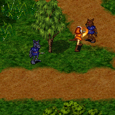

I was aiding the plight of the children of Undine. Kalliope had told me of the
Kobold and Goblin that plagued her town. I, for my part, was attempting to
educate the Kobold in the error of terrorizing human children... with my
scythe. As I wandered the plains of Astrid delivering a pointed education, I
came across a very old Kobold. His fur was grey and matted. He could barely
hold his blade in his paw. His eyes, however, still burned with the pride of a
Kobold.

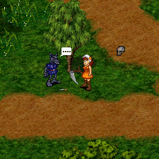

The old Kobold laid his weapon on the ground as I approached, and I knew he
meant me no harm. He beckoned me to listen to his story, a story that needed to
be told. I listened to this story with great interest, for it is rare that one
gets to hear the insight of one who lives on the other side of things.

"Know you, _'tuatha de danaan'_, that the _'tuatha de Arpina'_ are not your
enemies. The Kobold pack of Astrid is a wayward race. My pack is not what you
would call evil. We are masters of stealth and illusion, not true minions of
what you humans call Chadul."

"We pups of the All-Mother once roamed the plains, free and unfettered. We were
one with the _athar_ that flows across the plains. We did not bother the humans
who dwell nearby, save for an occasional honorable theft of food from your pens
when the winds did not bless our pack with enough food."

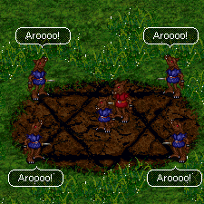

"The thing we call Caroun is an ancient rite practiced by all peoples of this
land. You humans sacrifice food to please your gods to grant you a bountiful
harvest next season. We, the children of Arpina used this sacred rite in a
different way. Our pack was kept strong with the sacrifice of the runt of the
litter. The rite was to return the runt to the womb from which our pack all
came, that it may be reborn a proud and strong Kobold in future. It was a
painful ritual, but it was for the good of the pack and Arpina's will."

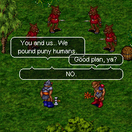

"All that was before the coming of the _bocan_ pack. Oh, how our pack has come
to lament the day this great curse befell our people. They appeared at the edge
of our Astrid and spread across it like an ill wind. We knew not what to make
of these interlopers when first they tread our plains, but our pack soon found
out. They came before our council of elders and told us to rejoice; we need no
longer sacrifice our own pups. With the strength of their pack added to our
own, we could appease Arpina with human children."

"Our elders were wise, however. They knew that to use human flesh in our Caroun
would surely bring the wrath of Arpina and the wrath of the _'tuatha de
danaan'_ upon our pack. The elders sent the _bocan_ pack away. They would have
no part of this sacrilege."

"Over the next few weeks, the _bocan_ pack took their plan directly to our
mothers, for they were most hurt by our ancient rite of Caroun. The mothers
came before the elders to voice support of the _bocan_ plan, but the elders
were wise to such guile, and still refused."

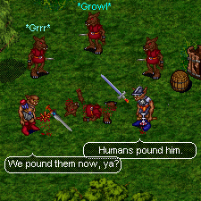

"The next trick the _bocan_ tried was not so subtle. The wisest of the elders
was found in pieces upon the ground, human weapons littered beside his
desecrated corpse. They told us the humans slew him. The _bocan_ said we could
avenge his slaughter with the abduction and sacrifice of human pups. The Kobold
pack are masters of deception, however. This crude trick was an affront to our
ways. There was no scent of man about the remains of our revered elder, only
that of _bocan_. We knew then that the _bocan_ were enemies of the Kobold pack
of Astrid."

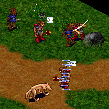
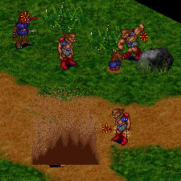

"The Kobold pack of Astrid tried its best to rid our plains of the _bocan_
scourge. Our wily rogues laid traps to deter them from treading so lightly on
Kobold land, but their snares and snipes only annoyed the _bocan_. Our wise
shamans tried to avenge the death of our elder with their strongest magics and
spells. The _bocan_ shamans' magic, however, proved stronger. My warrior kin
fought a mighty fight against the _bocan_, using all the bravery they could
muster. But the _bocan_ pack was too strong. After a moon of battle, our pack
was cowed; The _bocan_ pack became our masters."

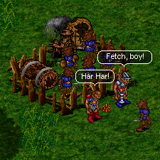

"And so it was one night that our new masters bade our pack's wiliest rogues to
take your pups from their homes. But our pack's rogues proved too wily for the
_bocan;_ They left our plains and fled to faraway plains with the speed of
_athar_, an honorable tradition of our kind. The _bocan_ were furious. The next
night, when they ordered the same task as the night before of our wiliest
remaining rogues, the _bocan_ held our pack's mothers hostage. They would be
slaughtered if the rogues fled this time. So it was that our rogues used mighty
Kobold stealth to steal away small humans from the dwellings on the edge of our
Astrid.

"Kobold rogues are very stealthy. Their thefts go as unnoticed as a soft
breeze. They returned triumphantly to Astrid with the human pups the _bocan_
wanted so badly. The children were hidden by the _bocan's_ dark secrets of
_creag_ for the evil Caroun their pack would have my pack perform. As your kind
no doubt know, our efforts to fulfill the hideous desires of our new masters
came to naught. The mighty of your kind, the _'Aislings'_, spread across our
plains and slaughtered our pack and our _bocan_ masters to retrieve your
young."

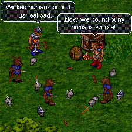

"Our _bocan_ masters were not pleased with this. They continued to send our
pack into the place you call Undine to steal more of your young. They must have
learned some guile from our pack, for they motivated our stealthy rogues with
promises of human blood equal to that of Kobold blood spilt. But time and again
the _'Aislings'_ have put a stop to the plans of our _bocan_ masters."

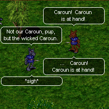

"For so long now, this cycle of death has continued. The pups of our pack no
longer wish to hear how things were, the tragic tale of how our kind came to be
caught in this spiral of destruction. They only see the humans slaughtering
their friends and litter mates in your undying attempts to retrieve your young.
In order for the truth to be remembered, it must be told to ones who will
listen. So mark well these words I have spoken, human. My pack's salvation
depends on the days of the past being remembered."

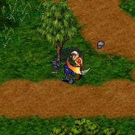

The old Kobold asked that I do him one final favor. He was old and weak now, a
burden to his pack. He wanted to go join Arpina through a Caroun as they once
were for his kind. His eyes were sad now, yet still flickered with the pride of
a fighter. I raised my scythe and delivered his final wish.

I cannot help but relate this plight of the Kobold to the plight of Undine.
Both lands were once free, but now are occupied by forces claiming to be their
allies. It is too great a coincidence, there is surely sinister plotting at
work in this part of the world. I tell this tale now to all who will listen,
lest the truth of this page of our world's history be lost in the fog of war.

***

```
*Librarian Notes*

This entry has been edited to conform to Library formatting.
Recovered from the Internet Archive; the original site no longer exists.
The original can be found at https://web.archive.org/web/20031009084040/http://www.geocities.com/peasantnaze/Caroun.html .
```
