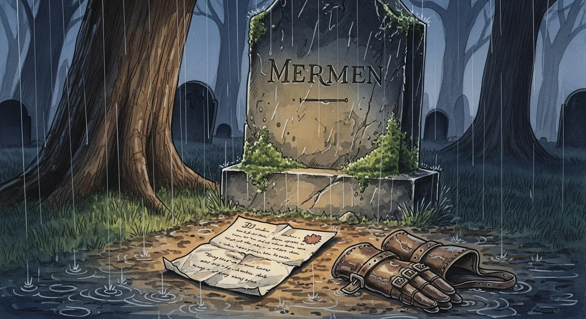

# A Letter Unsent

_by Bywyd in **Dark Ages**_



I was going to say this out loud. There is something about writing it down though, that makes me feel less seen.

You were on my mind last week, almost by accident. A goblin culling was requested in Astrid. A boring task, one which cleared the mind for lost thoughts to be found. You weren't found quickly, Astrid's fields saw to that. An eerie change in direction took the clouds like a dog takes to sheep. The treetops became still, shadows were claimed by a dimming light. It was dead silent. The faint chanting--if you can call what the goblins do chanting--was lost to a strange heaviness. Nature fought back for no silence in Astrid is to be permitted. Trees could open the chorus with a bodhran beat of the heavens. Dandelion clouds played woodwinds while violins, played by sweeping bloodied earth, took the stage. It was the rain that played the melody, a song that remembered. I forgot for too long.

The best parts of anything are the moments before.

Yeah, that feels like - Hey, do you remember that time we got stuck in the rain in Astrid? We must have been 10 or 11. You were halfway up that massive oak tree; "girls can do anything boys can do," playfully taunting. You made it to the top before the rain started, but it was already sprinkling before you realized you were stuck. Just like always, you wouldn't admit when you were in trouble, you know, until you were really in trouble. I tore my arms to shreds trying to help you get down--skin was a bit soft before my Spark. The look that monk gave us when he offered a ride as shelter? He must have laughed about that for miles. You made up some story, that the rain made you lose your bearings, there was no way that the rain was the reason you wanted a ride. Swelling set in on that grapefruit-sized ankle, must have been twisted pretty bad when we fell, but my mouth kept shut. You wanted to look tough in front of an Aisling.

It was a rare treat to even come across one back then. I never asked if you had a crush on him. You would have lied anyway.

That wagon ride back to Suomi, nothing beats falling asleep in the back of a horse-drawn cart. Unless of course you were the horse which certainly didn't welcome the extra weight, judging by the huffs before each incline. I laid there, on some magical cloth he tried to pass as hay. Fresh as new grass, smelled like toast? How does that happen? Cookery and trickery, that's all there was to it.

My second favorite part of the rain is more of an experience; you have to be in the right place to really get in touch with it. The reflection of each pitter-patter on the canvas covering, each one singing a lullaby. In between long blinks, I caught glimpses of you up front with the Monk. The distance turned your voices into gibberish, and trying to make out the words, might as well try to turn wine into silver. It didn't matter how much rain fell--it wouldn't have mattered if it was hail. It didn't matter how dark it got, or how long-winded the monk's ramblings were. I saw your eyes were locked. Not on him, really, but on the idea of an Aisling, of adventure, of being a monk. Looking back, some of it seems ridiculous. He wore a dobok! Who even travels in a dobok? I still don't know what he was doing out there alone in a wagon. I'll stick to the unquestioned memory for now. That night was probably the last time I truly felt like a kid. Life changed abruptly after that.

That's when sparks are born. For some it's a path, for others a reason. For the rest it's a dream.

I ended up in your room last week. It wasn't a creepy visit or anything; your mom sent a pigeon inviting me for dinner. She missed seeing me around, which made me realize I'd been avoiding your family. We swapped stories while I looked around. Not much has changed. Your father is still making ends meet at the docks, mostly dealing with inventory and numbers. The house was different, though she hadn't touched your room. I asked if she minded me straightening it up a bit--I would hate for you to see it in such a state--and I think she was happy I asked. Before I left, she pressed your first dugon into my hands as a keepsake. I think she expected me to wear it right there and then. I never really got over how mad I was at you that entire thing, but I was polite enough to take it.

Now I'm not sure what to do with it.

The rage used to burn, but then eventually settled like eating stew that was too hot. Now it just sits there with nothing to do. It sleeps. It's a guilty sort of weight, though I'm not exactly sorry about carrying it. It never made sense to me, you choosing her as your Sabonim. I figured you would ask Trinity. He was your mentor after all. You two were inseparable since we hitchhiked on his wagon all those deochs ago. No, you chose a flash in the pan. You valued strength over all else, and your sabonim was on every goblin wanted poster, if you know, they had posters.

You know what? I'll come out and say it: I was angry you didn't pick me. You could have, but you didn't. It doesn't take gods to leave a scar.

The argument? Sure, we were around the same age. Sure, it wouldn't make sense for me to be wiser and more practiced than you, but we both know I was. I trained every damn day. I mastered herbalism and the potions of our craft. I read the tomes. I did everything to make myself stand out. I even helped clear the Piet crypt when needed. The Piet Crypt, for Glioca's sake!

Maybe it's still jealousy, or crying over spilt milk. Maybe the fact I still feel this way makes you right about the whole thing. This is the closest you will get to an apology, at least for now. Not enough time has passed for anything other than empty promises. This whole ordeal should have made me grow, but instead, I just got older. I decided to keep the dugon in a drawer next to where I sleep. It keeps the ghosts away.

Let me change the topic.

Oh, I ran into Cecilia the other day, by the way. On the road to the bank in Rucesion. Must have been 200 deochs since we last spoke. I don't know if you two were close--she didn't bring you up, if she remembered you at all. I remember her and Galehorn joining us on one of our adventures, an all-monk group. Sounded like a great idea at the time; I think we all left with scars that day. There's truth in every scar, and a lie in every removal.

I might be the biggest liar around, HAHA! I asked about her family, but... well, no point going on if you don't remember her.

I hope you get to read this, though. Maybe send some sort of message back?

You wouldn't believe how much the country has changed since I last visited. News doesn't travel well north of Undine, but I guess there was a rift in the worlds? Mechanical beings? I don't know a better term. They invaded and were pushed back--or so I overheard at the tavern. Some of their constructions remained, though. There was a literal mechanical automaton walking around the square. I tried to draw it for you, to capture the gears, but my hands are useless with ink. I'm actually in the process of trying to steal one. Don't see a reason to pay.

Speaking of paying, I got rich. Not bad, right? Rich for me, anyway. No longer will I need to spend my nights melding sharp, corroded chains--biting broken silverware into links just to string together something I called a necklace. Now, I can get repairs done by a professional, just like the grown-ups do. I don't know what to do with my newfound fortune besides that, though. It's in the bank. People say, "What would you do with a few gold bars?" and they fantasize about fancy gatherings in castles, living at sea, or if they're virtuous, feeding the needy. Getting rich was easier than it had any right to be.

See, I had a piece of chocolate left over from the journey back from Undine--I think it was from Samatha's, you know, the lady near the Chart House. Shortly after arriving in Rucesion, a random vendor offered me 5 billion gold pieces for it. That's billion with a big ol' B. Rare to see chocolate these days, I suppose. I actually talked him down to a lower number and made the trade. I am a terrible negotiator. I believe no one should have that much gold, and felt guilty enough for taking what he considered fair. It's a shock that some Aislings just have that kind of coin lying around. Though I do feel like the needy need a better voice. Gliocan priests ask for compassion but they never fork up the gold to do anything to help those needy. Gatherings at castles, they should all be torn down. Living at sea though... well, issues with that, too.

Your voice seems to wander, though the words are my own.

"Donate it to the stream." You know I'd refuse. We would fight, argue, and not speak for a while. The stream hasn't changed, except for the listless sabonim and overfed hubae. I swear, monks these days don't know what real work is. In my day, Sgrios would eat us for lunch for meditating wrong. To me, it's still just a way for the teachers at the top to reap the benefits of the students. I could ramble on, but this time I am willing to concede some ground. I compromised. I seem to do that a lot with you. So I am saving the gold. It's better in the bank. I can't get in trouble if I never make a decision. I guess that's the point, isn't it? Making decisions. It's impossible to move on if decisions aren't made. The longer we put them off, the harder they are to make. Time isn't going to wait.

Each day that passes is a spark waiting to be used, or wasted.

Do I need to live harder? Existing is difficult enough. I catch myself hoping the day would end, sitting in Guard meetings. They are boring, necessary evils that should be half as long. That's when I catch myself wishing time would smash a window and fly out, taking me for the ride. What would I do with more time? I once wanted to make the world a better place for everyone. As I get older, I find I'm mostly trying to make the world a better place for myself. A bit more selfish than I wanted to admit. Last deoch, I decided to change that. As you probably noticed, I decided to get into politics again. It's not that I feel there is an abundance of crime; if anything, too many crimes are being stopped. But I see Aislings complaining about the quality of elected officials. For every person saying politicians are corrupt, there is an empty mirror. You can either watch the problem or be part of the fix. You would be against it, probably why I waited so long. Woke up and looked into the mirror and saw something that needed changing. It's at least one decision I can make.

I have learned of a disease known as Ascension, but I think I am getting it wrong. I overheard it in the Mileth tavern. Normally I would frequent the bars of Oren, but that's the thing. Oren has been hit hard by this. It's almost like Oren's been invaded by zombies and possibly thoughtless Aislings. One is winter-cold looking for brains, the other is winter-cold and never had them. The mindless flood the street, like water to an old dam. One day that dam is going to bust wide open and swallow us whole. At night you see the reflections, eyes twinkle not gold but blue. With so many Aislings in one spot there should be Sparks flying everywhere, but not one found. Oren's legacy, Oren's people, a wolf pack without an alpha. Mindless journeys have mindless endings. Why even take the journey at all? It's logic they can't put together. They can't stop moving, they can't make decisions, they move without going anywhere.

An Aisling with no spark is a chicken without its head. It will scurry around. It will fight against its death. In a splash of red it paints its feathers. All this action, it's an illusion, it's already dead.

To keep sane, I try to get out. I go to the beach in the summers--well, specifically Abel beach, if you can call it a beach.

It's commonly known there is something about the air there. It feels sticky, but not honey sticky. Like you tried to wash tree sap off your hands a few times but they are just sorta, you know, sticky. Abel air is the stickiest. Peace still permeates at the beach. The waves crashing -- a pendulum, a watch on a string--the fade to daydreams. Each exhale uncoils a muscle. Then there is the way the salt catches right above your eyes. You hated Abel, but hear me out. Compare this to a trip to Lynith Beach taken a deoch or two ago. A quick ambush saved me from a fresh scar from a shark. Wait though, I wasn't in the water but instead the shark was in the sand. That's right. IT WAS IN THE SAND. A shark doesn't belong in sand. Why wasn't it in the water? That's crazy. Sharks are crazy. Then this naked guy started running right at me. Then there was a starfish, I think. It took around 30 Aislings to get me out of there. I do not recommend that place.

There are days that are easier.

I'm told I talk in my sleep. Sometimes I call out your name, like a cat wanting dinner. At least, that's what I'm told. I don't remember the dreams; I hope they are good ones. I miss you. Every day you aren't here, even if you weren't going to be here at all. I got sentimental for a moment. It'll pass.

I wanted to ask Ramanayan about things. Sgrios things. Somebody should have answers, if he doesn't, who does? Ramanayan, or maybe someone he knows. Questions about shadows that don't fade, sounds you can't hear, souls that don't make it back. Things beyond scars. The end of the path.

Gods, I was so excited when I heard you got a job on a boat--or ship, I forget the difference. You had been training for so long that even the idea of a paying job sounded too good to be true. Not just any job, but fighting off monsters on a damn ship. I knew it was a dangerous voyage, the one to Medenia. It's not like you hadn't done dangerous things before, but that ship... it sailed often. Too often. I don't want to dwell on it now. Not like I could have talked you out of it. You always had a thing for the sea, the rain, the risks. Your mom still blames herself for letting you take that job. I told her it's not her fault, but she didn't believe me. Why would she? I feel the same way. To be honest, I do blame myself. As time goes by, I am starting to forgive myself for some stuff, but I can't forgive myself for not being around more often. We missed out on memories in the glades. We could have danced at the bottom of the crypt to the music of the wind passing through the scales of that dragon statue. We should have had more sleepless nights watching the fireflies flash into our reflections in the Undine River. The campfires we couldn't start in the cold at Mount Girigan, laughing and shivering in blankets--next time I could bring a proper flint! There were more days to be interrupted by random Aislings in cat costumes yelling nonsense. Laughs to be had, late mornings to wake up to. Until there weren't.

I am sorry I wasn't around more.

I will hold on to your spark until you get back.

`((Thanks goes to @edzazel for reviewing my work and giving me a few extra tips.))`

***

```
*Librarian Notes*

Recognized: Kingdom, 2025 (Mileth College master list).
This entry has been heavily edited to conform to Library formatting.
The original can be found at https://novus-imperia.com/college/lit/bywyd_letter.pdf .
```
