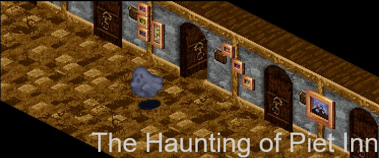

# The Haunting of Piet Inn

_by Moogle in **Dark Ages**_



The Piet Inn hadn't been my first choice of places to stay that night, but an unexpected downpour had cut my adventuring short on that cold fall day. I arrived in the early evening, water dripping from my Rucesion blue dolman. The ground floor of the inn was quiet and empty, save for the innkeeper, a middle-aged woman in a faded blue dress. She was sitting behind a counter, quietly reading a book.

"We're booked up," she told me without looking up. "You'll have to find somewhere else to stay for the evening."

"Oh no, are you sure?" I asked. "I don't think there's much nearby here. Surely you've got somewhere I can stay? I'd be willing to pay double!"

Her eyebrows rose at this, and she finally looked up at me from her novel. Her eyes lingered on me for a moment too long, as though she were weighing something in her head.

"I don't think you want what we have to offer," she said at last.

I shrugged. I was soaked through, freezing, and desperate to be finished with the day. "I'll pay triple. Please, I'll take anything!"

"All right," she said, sighing. It was the sigh of a woman who had clearly dealt with this situation before, and knew that it wasn't worth the argument. She raised a single finger. "We have one room." Her chair scraped the floor as she pushed away from the counter. She crossed to a wall of old, dull-gray, metal keys. When she returned, she held one that looked far more worn than the rest. "Room eleven. End of the second hall."

This was what I wanted, but I couldn't help hesitating.

"If you had a room, why didn't you tell me that in the first place?" I asked.

"Some doors are meant to stay locked. Look, the room's got a history. We don't quite understand it, but some people... they don't mind the room. Others... Sometimes morning comes and they're simply not there anymore." She paused, her gaze distant. After a moment, she gave a gentle shake of her head. "You want to pay triple to risk it, that's fine. Take it or leave it! Er-what did you say your name was?"

"Annette," I said.

That was the end of what she was willing to share about the room. Whatever mysteries lay in there, I would either discover them over the course of the night or remain blissfully unaware. Saskia wasn't about to tell me more. I did learn her name and that she had run the inn with her mother since her father's passing some twenty Deochs ago. Beyond that, she was a remarkably difficult woman to get information from.

I didn't linger in the entrance long. Tired and cold, I just wanted to strip down to my underclothes and crawl beneath the covers to sleep. I climbed the stairs to the second floor and made my way to the room at the end of the hall.

The lock turned with a surprisingly smooth click, and I felt a pang of disappointment at the mundanity of the room before me. It was a medium-sized space, enough for ten or so paces from end to end. A bed, a dresser, and a few vases filled it. Presumably, in any other room, they would have held fresh flowers. Here, they were a reminder of neglect. The air in that carried a sort of sour odor that bordered on intrusive. It felt as though no one had entered this room for a very long time. Like a corpse that should have remained dead and buried, and I was disturbing its slumber.

I walked over to the corner, where a window overlooked a small stream behind the inn. The room's scent was getting to me, so I undid the latch and cracked it just enough to let in a little fresh air. The rain was still coming down in sheets outside, but it fell in such a way that none of it made its way into the room.

I set my bag on the floor on the side of the room closest to the door, opposite the window. It held my supplies, and a lantern hung from a strap on its side. I stripped down, hung my clothes on a hook to dry, and climbed into bed.

The mattress was stiffer than I would have liked. The blanket smelled faintly of mildew, and the pillow was lumpy, stuffed with something that shifted oddly when I laid my head on it.

I told myself I was imagining the weight of the air in that room. I felt like I was being watched, but I knew that was just silly paranoia brought on by exhaustion, and the strangeness of how the innkeeper had acted. The rain outside tapped against the window like a restless ghost hiding between the walls.

For a while, I lay there listening, waiting for the sound to change, for something to crawl out from between the floorboards and, I don't know, attack me. But nothing did.

Despite my unease, sleep dragged me beneath its current, sudden and without mercy.

I was startled awake, though by what, I couldn't say. A sound, a sensation, maybe a nightmare my mind had already let slip? I only knew that something was wrong.

A strip of red light sliced into my room through the cracked window, catching on the dust motes as they slowly fell through the air. The room was eerily still, filled by a silence so smothering that it felt hard to breathe. Even the drone of rain and river had vanished.

It was unnaturally cold, yet I was drenched in sweat, the sheets clinging to my skin. I didn't dare move, afraid to disturb that stillness. That oppressive silence. My mind floundered for the time, the day, even where I was, but came up blank. I was left with only the too-still quiet, and the thin red light painting the room in dim shadow.

Slowly, I turned my head, sweeping my blurry gaze from the open window on the right, to the door on the far left wall. Only, I never made it to the door.

Something stood in the path of the red light. A vaguely humanoid silhouette. The moment I laid eyes on it, its edges began to pulse. It was faint at first, and then stronger, matching the rhythm of the heartbeat pounding in my ears.

I have a difficult time explaining what exactly it was that happened next, as I stared into that silhouette. It was like gazing into the night sky, not the familiar dome of stars we know, but a bottomless horrible abyss, speckled with pinpricks of light. I felt as though I wasn't just looking at it, but out through it into some unfathomable cosmos. Something no one was meant to see.

My vision pressed into it like a dull spear, pushing against a thin, invisible membrane. The thing writhed against my gaze, a ravenous maw snapping and tearing, desperate to consume me. Time stretched into aeons as I strained to keep from blinking, my sight seemingly the only barrier keeping it at bay.

As though arriving by divine messenger, a thought jolted through my mind. It was here for one thing:

Me, my spark, everything that was I.

A wave of nausea struck me then, immediate and overwhelming. I felt as though I was going to pass out. My vision was beginning to tunnel. I don't know why it occurred to me in that moment, but in a shock of clarity, one intrusive thought rose above the fog of panic:

I needed to see! My glasses! Where were they?

Through the mounting sensation of illness, my mind mercifully landed on their location. The bedside table! I reached out and felt them glance off my fingertips, followed by the clatter as they hit the floor.

I tore my eyes away from the silhouette. Was it growing? Or getting closer? I couldn't tell! I needed to find those glasses!

I looked down at the floor, but my glasses were hidden by the darkness. I frantically leaned over the edge of the bed, catching myself before I fell. My hand swept blindly across the floor. Was I wasting too much time? Was that maw almost upon me? At last, my fingers closed around the familiar shape.

I slammed the glasses onto my face and looked back. The silhouette was gone.

In its place, the dim red light remained.

Looking all around the room, I extracted myself from the tangle of sheets that the night had left me in.

What was that? And where had it gone?!

I was about to throw my legs over the side of the bed when a thought I might have once dismissed as childish occurred to me. It's under the bed.

The lamp I had on the bedside table had been knocked over, its candle long since lost in the struggle of searching for my glasses. There was the lantern with my bag, but that was on the other side of the room. I would have to cross the floor that was covered in shadow to get there.

My mind buzzed with anxiety, but despite everything in me saying don't, I knew what I had to do.

Slowly, I inched toward the corner of the bed closest to my bag. I knew that light was my only hope for safety.

I needed to see!

The edge of the mattress reminded me of the edge of a pool of deep, dark water. The idea of setting a foot down there sent shivers up my spine. I didn't like deep water at the best of times, but I knew that thing wasn't going to wait for me forever.

I hesitated for what felt like minutes, every second seemed to stretch. I strained my ears for any sign that the thing was under my bed, but there was only silence.

There was nothing else for it.

I leapt from the bed.

Clumsily, my foot caught on the sheets, nearly pitching me forward into a faceplant. My lantern was only a few short steps away, but I had already screwed up. The time that it took to steady myself was all the thing needed.

A black appendage, darker than shadow, shot out from beneath the bed, wrapping around my leg and climbing just above my knee. It was freezing, as if it had never known warmth. Its movements were unlike anything I'd ever seen. Skipping seconds, unnaturally jolting from one moment to another seemingly unrelated moment, like time itself recoiled from it.. Cold exploded along my skin, vanished, then burned again in a way that made no sense.

It pulled, and I went sprawling, face-first onto the floor. My arms shot out for my bag even as I was dragged backward. The thing was reeling me in toward the temporary lair it had made beneath my bed.

I clawed at the floorboards, ignoring the pain as my nails bent and broke, catching on the wood. Somehow, perhaps by the grace of Fiosachd, I hooked a finger through one of the straps of my bag. The creature's pull grew stronger, but I had gotten what I needed!

Quickly, I found the lantern still hanging from its strap. My thoughts were fraying, and I was slipping into sheer panic, but muscle memory carried me through. I somehow found the energy and the time to whisper a quick srad spell that sparked the lantern to life.

The room lit up in a warm orange glow.

At first, the darkness beneath the bed didn't move. A stubborn shadow, refusing to give way to the light. Then, slowly, two shapes emerged within it. Voids, within the void.

Eyes.

Not eyes meant for seeing. No, not for processing light, but for consuming it. For ending it.

For an endless moment, those eyes bore into me. My stomach twisted, and my skin crawled as though it were trying to escape from me. Then, whether due to the now overwhelming light or the power of my gaze, or perhaps both, the creature slowly faded. Like a cloud of blood dissipating in water.

And then it was gone, fading like a bad dream. The moment the creature disappeared entirely, so too did the glow of my lantern. The room returned to shadow and dim red light. No amount of channeled energy was successful in relighting the lantern. It was as though some unknown force was snuffing out my efforts.

I fumbled to pull my dolman over my head, the fabric tangling. I forced my feet into my not-quite-dry boots. I didn't know if that thing was truly gone, or if it just needed to recover. I wasn't going to stick around to find out.

My belongings were scattered about the floor from my struggle with the entity. So I quickly gathered what things I could find and shoved them back into my bag. Then I noticed something else. A small leather journal, worn and half-hidden beneath the bed. I don't know exactly what possessed me to do it, but I snatched it up and shoved it into my bag with the rest of my things.

I tried to open the door to the room, but the inn had changed. It was older, somehow. At first, the door resisted, and in a renewed panic I couldn't help but jump to the conclusion that I was going to be trapped in that room. But with some considerable effort, I managed to get the door to budge. It felt like the hinges were rusted solid, as though they hadn't been maintained in a hundred Deochs.

The hallway outside glowed with the same eerie red light from a window at its far end. The shadows that that light cast seemed somehow wrong. Like they were predators waiting for unsuspecting prey. Hostile pitcher plants, patiently waiting for victims to fall inside and become trapped in their digestive juices.

I crept toward the window at the end of the hall. The floorboards groaned underfoot, each creak seemed deafening in the silence, announcing my presence to whatever else might lurk in the dark.

When I finally reached the glass, I peered through it, almost afraid of what I'd see outside. I froze.

The world I expected was gone. No rain, no river, no cobblestone path. Only endless dunes rolling in every direction. Sand, swallowing everything I could see.

And above it all, a red moon hung colossal in the sky. So vast, it seemed to crush and distort the horizon around it. There were no stars beyond, no black abyss to cradle it. Only that moon, and its sickening red glow.

I might have gotten lost staring at it, caught in the fraying edges of my sanity. I could feel something reaching inside of me, threatening to change me into something I didn't fully understand. But before it could take hold, I was yanked back.

Movement.

Black figures, darker than shadow, small against the dunes, speckled the horizon. At first I thought they were tricks of the light, but they were moving. Shambling forward, jittering in a way that didn't seem real. Like time itself was too repulsed to keep them in sync with the rest of the universe. I recognized that movement. That same cosmic horror that had attacked me in my room. Only now there were dozens. More.

And they were coming for me.

I dropped to the ground, no longer caring about the noise I made. Whatever prowled inside the inn was nothing compared to what was swarming the dunes.

I tore through my pack until my fingers closed on what I was looking for. I withdrew a grey scroll. I focused energy through it. It puffed into dust in my hand. Nothing.

No. That isn't right! I should have been gone! Safe! "Dachaidh!" I cried, again and again, but the magic failed me again and again.

Glass shattered below. The walls shook under heavy blows. They would be inside the inn momentarily.

I had to move! I needed to hide, but the rooms were no good, they had already failed to keep one of the things at bay.

The window? I could break it and jump, but I would probably hurt myself. I was no athlete. I had already fallen just trying to jump out of bed, a drop from here might leave me crippled, or worse.

I spun in place, frantic. No help on the floor. No salvation on the walls.

Then I noticed it: one door was ajar. Not the door I had come from, so why was this one left opened?

I ran to it, and peered inside. Instead of a room, I found a set of stairs leading up into darkness.

Below me I heard a crash, those creatures were definitely inside the inn now.

I saw no alternative. I squeezed through the crack in the door and tried to shove it closed behind me, but it was stuck.. Giving up, I took the stairs two at a time. It wasn't an escape, but it might buy me time to think.

I found myself in the attic of the inn. Below me I heard the door shatter.

The attic was cluttered with odds and ends that an inn might store. Nothing here could help me. Nothing, except a window at the far end offering a clear view into a familiar black, starry sky.

I saw no other path, if I was meant to be consumed, I'd at least try to do it beneath my own sky.

Behind me, the first creature reached the top of the stairs. I had no more time to think. Panic filled my mind so completely that nothing else existed. I ran for the window.

They were fast. Faster than I could have imagined. I felt the tug of their grasp on the back of my clothes, the burning cold nearly claiming my skin again. But there was no room for fear, no thought beyond a pure, unadulterated will to survive.

I raised my arms to shield my face.

I leapt through the glass, feeling shards tear through the sleeves of my dolman and into the skin of my arms. Then darkness took me.

A cold, wet something pressed against my face. My eyelids flickered open, but the world around me lacked definition. I had, once again, lost my glasses somewhere along the way. I could hear the familiar sound of water rushing nearby. My head pounded and my heart thudded in my ears. Every part of me ached.

I tried to move, and it was then that I realized that the wet something I found myself lying in was just grass. It soaked through my clothes. I shivered, realizing just how cold I was. How long had I been there?

Was I still in danger? I was too exhausted to feel any more panic.

I squinted, taking in my surroundings until a small blue blur caught my eye. My glasses! Sliding them onto my face, the world came into focus.

I was in the narrow strip of grass between the back of the Piet inn and the river. I looked around, expecting to see those black things shambling toward me, but they weren't there. Was I safe?

The sleeves of my dolman were destroyed, my arms marked in shallow cuts. Beyond that, and the aches and bruises, I seemed miraculously unharmed.

I looked up toward the attic window of the inn. It was shattered. But that wasn't my problem. I still don't understand how I survived a fall from that height with such minor injuries, but I've thanked the gods ever since for it.

Slowly, I rose to my feet. My arms stung where the cuts had been. My leg burned where that thing had grabbed me earlier. I stumbled forward, catching myself on the wall of retaining boulders between the river and me.

I made my way back to the front door of the inn and opened it to reveal a familiar face. Saskia was there, behind the counter, still reading that same book.

And yet, a shiver ran down my spine as a cold draft blew past me. I felt it. Somewhere in the night, they were still there. Watching, waiting, ready to consume the spark of the next person unlucky enough to find themselves bathed in the light of the Red Moon.

The end.

## Epilogue

When I stumbled back through the inn door, bruised and bloodied, Saskia refused to believe what I told her. I was met with stubborn denial. I can understand that. No one wants to hear that their inn is swallowing people whole, not even leaving bones behind. But there must be justice! Piet's history is already stained: plagues, battles, the dead coming back to haunt the living. There's something there, in Piet, something that weakens the veil between the land of the living and the dead.

It was only later, digging to the bottom of my bag, that I found the journal again. The one I had pulled from beneath the bed. What I found inside, it answered some things, and made me question others.

A man had once found himself trapped in that place, long before my cursed visit. I don't think he ever made it out.

That thing in my room...

His writing spoke of his experience. Endlessly circling the same halls, over and over again, searching for an exit that did not exist. He tried breaking the windows, but they resisted. Doors opened, but only to reveal visions that gnawed at his sanity. Eventually, he stopped trying the rooms. He wandered, only stopping to stare at the red moon that loomed outside every pane of glass.

He wrote of other things, too: wisps of gossamer light that drifted across the dunes beyond the windows. Ghostly figures. People once, he thought. Piet's dead, perhaps. He watched them fix their gazes on the red moon, and he watched them fall victim to it. He watched as their forms twisted into abyssal things.

He wrote of thoughts seeping into his mind that were not his own. Of truths too vast to comprehend whenever his eyes lingered on that grotesque red light. At first he resisted, but the journal records the unraveling of his mind. His sentences degraded over time. By the final entry, it's barely writing at all. Just an incomprehensible scrawl.

From what he wrote, I think I can piece together what that place must be: a land between. And in Piet, where the veil is already thin, it is thinner still during the fall. That thing there, the red moon, it grows in strength with each passing day. With each new victim it transforms with its power.

I know this, because it has been some time since I left the Piet inn. Yet this autumn has brought the first stories of Aislings transformed beneath a red moon.

_Annette - Deoch 47_

***

```
*Librarian Notes*

Recognized: Aisling, 2025 (Mileth College master list).
This entry has been heavily edited to conform to Library formatting.
The original can be found at https://novus-imperia.com/college/lit/moogle_piet.pdf .
```
