# Calaveras of Temuair

_by Naena in **Dark Ages**_

Over many Deochs, I've held the Calavera Poetry Contest in Suomi, inviting Aislings to test their wit and creativity with a single purpose: to celebrate both life and death.

This anthology gathers the calaveras I have written over time— pieces inspired by the imagination of the many Aislings who have participated in this tradition, as well as by my own journeys through Temuair.

While these poems draw from real experiences and memories, they include elements of creative freedom. They tell a story, not history.

Calaveras are short, satirical poems that often imagine the subject's demise or playfully exaggerate their quirks, habits, and flaws. Despite their dark themes, they are meant to be lighthearted, serving as tributes that honor friends, rivals, public figures, and even fictional characters.

Each poem in this collection follows that tradition: a celebration of personality through humor, exaggeration, reverence, and sometimes chaos. We remember those who've fallen, laugh at our own mortality, and preserve the stories that make Temuair the world we cherish.

## Setites

Here lies my friend Setites,  
"Arena Overlord" he recites

The Master of Hosts,  
Turned everybody into ghosts

And burned all the posts.

He thought he called all the shots  
And called himself everybody's boss.

Hoarder of all the pots,  
He'd include them in all his plots.

Red, Green and Blue extonics  
Cheating? His opponents are moronic.

And everyone found it ironic,  
As he was attacked with great strength,

You could hear his last breath  
"Blue one restores health",  
As he finally found death.

_Deoch 208_

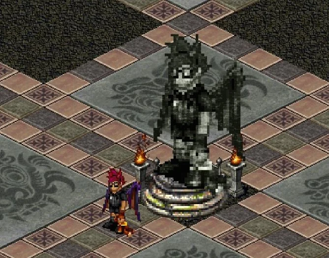

## Laurier

A citizen of Suomi, busy and bright,  
A cleric of Cail with endless might.

Chancellor of Mileth College,  
Home to boundless knowledge.

While he shaped his mind, studying lore,  
I battled in the Arena, seeking more.  
In Suomi Troupe, our paths did meet,  
Unlikely friends, a tale so sweet.

He served Fire Nation, council and guide,  
With wisdom and strength, always by his side.

Full of work, he rarely found rest,  
With endless duties, he gave his best.

Meetings and college entries filled his days,  
He did it all, with patience and grace.

Late one night, beneath a candle's gleam,  
He drifted to sleep, lost in a dream.

From the shelves, a tome took flight...  
Down it fell, extinguishing his light.

Some say his spirit still wanders the halls,  
Guiding the eager, answering their calls.

His wisdom and kindness, a lasting legacy-  
Laurier, forever in our memory.

_Deoch 215_

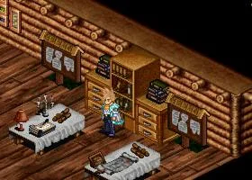

## ricksanchez

A few Deochs ago, a crowd of Aislings gathered  
In the home of the Count and Countess.  
But none foresaw what came next.  
A summoner trying hard to impress.

He dressed as a lich in House Macabre,  
An old necromancer, clever and sharp.  
A fake death potion, pretend to skull,  
Watch all in the Mansion lose their cool.

Tricked an orc or two, easy to fool,  
They're not known for being the sharpest tool.

He grinned as a Town held their breath,  
Running to rescue his feigned death.

"You're welcome!" rang through the hall,  
As he smirked, amused by it all.

But Sgrios watched, in quiet delight,  
At the fool who toyed with death that night.

He whispered fas spiorad far too fast—  
Left with a hundred health that couldn't last.

His health ran low, the laughter gone,  
The line between life and death was drawn.

He shouted for "red," but none gave a glance,  
The crowd stood silent, as if in a trance.  
His voice grew faint, his magic spent,

And slowly, ricksanchez' soul to Sgrios went.

_Deoch 216_

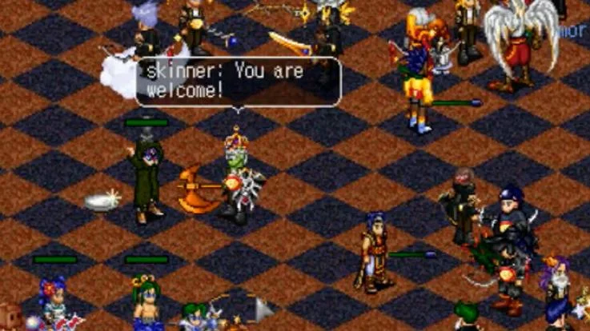

## Merisa

Let me tell you of a story,  
Of a lady crowned in glory.  
Her spark shone bright, her spirit light,  
Her deeds brought Temuair delight.

In Rucesion her path was clear,  
Until a new law caused her course to veer.

Frustrated, she stood her ground,  
And sought the Coliseum's battleground.

In Suomi she found her new home,  
Joined the Troupe to volunteer once more.

Still Glioca's Temple called for her care,  
While Mileth College had her rushing everywhere.

They joked she chased titles dawn, dusk, and noon—  
If there was an award for breathing, she'd seek that one soon.

And when she earned her Knighting at last,  
It was just one more title added to her stash.

But one day, Merisa was nowhere to be found,  
Her footsteps vanished without a sound.  
Not much is known of how she passed,

Perhaps in the enchanted garden, she danced,  
And the shadows took her, like Bella before,

While we're left to weep and wonder evermore.

Her name, a symbol of kindness still,  
Her memory lives in Temuair's will.  
Some await her return one fateful day,  
But her spirit in us will always stay.

_Deoch 216_

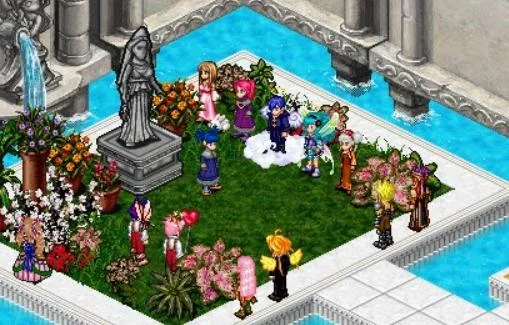

## Kedian

Temuair has seen its brightest sparks,  
But you, Kedian, were its constant star.

I met you in Deoch one-seven-three,  
In a pageant where I took the stage.

And still, I wonder to this day:  
How did I miss such a brilliant mind  
And spend a hundred Deochs in the dark?

Not one for hunts or reckless battle,  
You never cared to max your strength.  
Could you even fight with all your might?  
Oops! There goes your secret, right?

You never sought power, titles, or clout,  
For respect is earned, not handed out.

No title-hoarder like dear Merisa,  
Yours were earned through study, never fame.

A mark in your legend that made you stand out,  
"Aisling Wise One"—what's that one about?  
A title so vague it made young sparks doubt,

Yet somehow it fit you perfectly... go figure that out.

From Deoch One you watched us all:  
Mundanes take power, Aislings rise and fall,

Some vanished into the silent void,  
But you stood tall, enduring after all.

Luathas won your mind for wizardry's art,  
Though Deoch held your devotion from the start.  
Your sibling read His masses with sacred grace,  
While you cast your spells, wishing you'd taken their place.

And so Sgrios listened, jealous and low,  
For Deoch adored a mind so bright, a steady glow.

He came for you softly, without a mortal blow,  
Claiming the scholar Temuair refused to let go.

_Deoch 216_

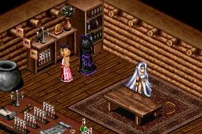

## ZerA

Zera of Loures, so quiet and wise,  
With a flick of his hand, foes met their demise.

A wiest and bard, a champ times four,  
In the Coliseum, he'd settle the score.

Not one for crops but rare items galore,  
He farmed the bosses, events, and more.  
Humble in triumph, no bragging in sight,  
In trades he dealt fair, each bargain just right.

Then Sgrios appeared, death was near,  
"Your final prize awaits, my dear."

But Zera just chuckled, his voice a tune,  
"I've got bosses to farm, you're far too soon."

So Sgrios took him, thinking his job was done,  
But XerAm appeared, farming like none!

The God scratched his head, confused and beat,  
"Is this some kind of cheat?"

Then came his siblings, the whole clan in line,  
Same face, same clothes - a copy each time.

Sgrios groaned aloud, "This will never end,  
They all look the same - which one did I send?"

Confused, he blinked, then sighed in defeat,  
"For the King of Loures, it seems death's no feat!"

_Deoch 216_

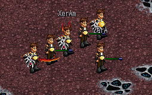

## Moogle

Oh, sweet Moogle,  
Too kind for your own good,  
Thank Danaan you had Rena  
To keep you grounded where you stood.  
And when you slipped up or lost your mood,

Firion messed up worse,  
And somehow made it good.

A bard with endless stories,  
You thought we couldn't read a line.  
But our hearts were in the right place,

Even if our grammar wasn't fine.

You won fashion shows and wolf fang fist fights,  
Respected by the temper-prone;  
Believed the best in everyone,

Which drew in every toad you should've known,  
Thank TryliS for the loud mouth,  
That scared them off alone.

Wigs for every outfit,  
Hair puffed wild day and night;

Ukkyo offered styling free,  
But you needed "just more length" for wig #93.

Then fate, with perfect irony, struck:  
You tripped in Abel Port, fell off the dock—

Your bangs too long, your vision stuck.  
Down you sank with your heart of gold so deep,

Now Sgrios has a personal stylist,  
And we remain to weep

Freed from guarding Moogle  
From every lurking creep.

_Deoch 216_

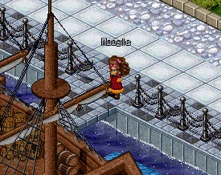

## Huhuman

He moved swiftly through the coliseum's floor,  
A basher all casters would cheer and adore.

His combos were sharp, his timing tight,  
A true terror in every fight.

Wolf Fang Fist or Lullaby Punch,  
A blink, then Charge and Ambush,  
Turning you into a ghost without remorse,  
He was morrior, yet an unstoppable force.

Arena Hosts, in their balancing spree,  
Stacked teams against him for all to see.  
They thought the stacked odds would bring his fall,  
But he wiped his opponents and outmatched them all.

A thousand victories, champion's belt in his hand,  
He beat the odds no other could ever stand.

But even legends tire, his strength no longer sound,  
Huhuman vanished from Temuair, nowhere to be found,

His spirit hid within his siblings, a shadow still around.  
Haunting those who tipped the scales on the Arena's ground.

With Sgrios at his side, Huhuman stalks the Underground,  
And the Arena Hosts grow cold, aware their fate has come around.

_Deoch 216_

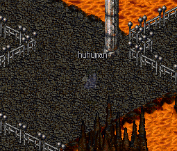

## final

Frustrated by his class's fate,  
He prayed for buffs that never came late.

A morrior proud, ignored once more  
No God, No Mundane replied, no champion roar.

He plotted his vengeance at the Banrion's expense,  
A plan so absurd it barely made sense.

He pushed every new spark to learn Hide, naturally  
Raising a rogue-army haunting Naena silently.

Final drank red extonics for a quick boost,  
Filling his stomach 'til seams felt loose.

Known for his Health, a mountain of might,  
He mentored the new, taught many to fight.

Whispers spread of gold slipped to rangers,  
Bribes, they claimed, tied to guild dangers  
But all remained gossip, nothing proved for sure,  
Just tales of a legend Temuair would endure.

Yet who would've thought his end would draw near  
Not skill, nor spell, nor primitive spear  
But one final gulp, one extonic more,

When even his vast stomach refused to store.

With a thunderous pop that echoed afar,  
Sgrios laughed, "Even tanks have a bar."

And so Final fell, in unforgettable lore  
The morrior whose health could grow... no more.

_Deoch 216_


## yLo

One of the greatest without a doubt,  
A team captain and guide.

He led his teams to victory's route,  
And mentored the newcomers at his side.

With disarray beside him, a duo feared by all,  
They secured the pink belt in Bashelor's grand brawl.  
Yet some would joke he never saw a tourney through at all,  
For yLo was known to vanish if a lady chose to call.

But that wasn't the only time he'd abandon mid-match—  
He'd ditch Arena battles as well,

The moment triumph slipped from his grasp,  
Leaving the Hosts muttering, "He's gone again? Oh well..."

Going home with a loss? He'd never know.  
He crafted his legend just for show.

For one so famed, it seemed too petty  
To guard his wins by being so sweaty.

When defeat came creeping out,  
He'd grumble, a quiet whine and pout,  
Then grab a scroll and warp right out,  
Escaping the coliseum without a shout.

But as Sgrios watched him walk out,  
A crooked smile creeping about.

He cursed the scroll that yLo held out,  
And claimed his soul the moment he dipped out.

_Deoch 216_

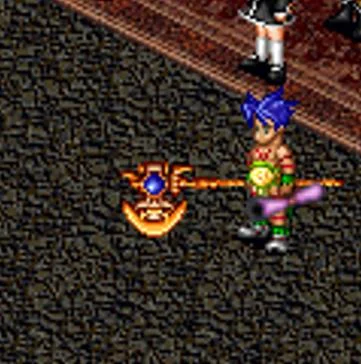

## Set

Here comes Lady Set,  
From Setites' ashes to Loures' Knight,

Ready to rule with fiery might.

Traded his robes for a lovely gown,  
Shortened the name to earn renown.  
Through Pravat Cave she struts in style,  
To Chaos or the Coliseum? It's been a while.

Crimson hair with a dress to match,  
Always scheming her next catch.

You'd think Sgrios would cool her fire,  
But it only fed her heart's desire.

Self-crowned Queen of Fire Nation,  
With dreams of Banrion coronation.

One fateful night while out on a hunt,  
She sailed through Chaos, her favorite stunt.

She fell asleep mid-casting, perchance,  
And Verran found her in a trance.

Now jailed, her titles stripped away,  
Her flame still burning, though turned to gray.

Her friends reached out to make her stay,  
But Sgrios called, and she followed his way.

_Deoch 216_

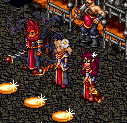

## Yukii

Yukii once searched for criminals, full of pride,  
Thinking her work was justice, a force to guide.

She jailed the lawless, locked them away,  
Believing she was Temuair's protector each day.

Her rogue's art let her vanish from sight,  
But she never learned to see hidden right.  
So she went to the Hosts, her plea well-spoken,  
"An Arena Trinket will fix what's broken!"

But the Hosts denied her, calm and clean,  
So she threatened to jail their Master Host Queen!

Forgetting law— it was not her place,  
Her ego became her fall from grace.

Enraged and scorned, she stormed Mileth Hall,  
Her temper sharp, her mouth gone wild.

She cursed out loud, forgetting she was a Knight,  
Until Angelique came to set things right.

In Loures Dungeon, she used to stand so tall,  
With Ishikawa by her side, watching crooks fall.  
She thought herself better, more righteous than most,

But in the end, she had met the same ghost.

One night the barred cells burst into light,  
Those she'd jailed returned to claim the night.

Sgrios appeared and watched them brawl,  
Her breath grew cold, they had answered his call.

Now Yukii wanders, a ghost in the afterlife,  
Among the very criminals she once saw as strife.

Her work, once so noble, now feels so small,  
For in Sgrios' realm, she's just like them all.

_Deoch 216_

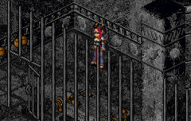

## Jaylinn

To my friend Jaylinn, Arena's bright flame,  
I will make sure everyone knows your name.

I knew you since my very first breath,  
Our stories paralleled until your death.

Together we'd run from "Kelb on Sight",  
No health — at least not enough to fight.

Waiting for mana to regen once again,  
Just to cast something, or heal a friend.

You said we shared the same brain cell,  
Through chaos and laughter, it served us well.

Yet I will never quite compare,  
To how you carried yourself— such flair,

And truly, with that perfect hair.

Bonded by the same passion,  
Arena battles and Temuair fashion,  
Your sparkles, just like my antennae,

Were an icon, envied by many.

We could never be on the same team,  
And if we were — oh, it must've been a dream.  
You never joined my guild — I could not contrive,  
Since you died of old age waiting for Tiarnach to revive.

Some say you'd still be alive today,  
If you'd joined Renaissance instead of turning away.

And Jaylinn... if my plea is heard,  
Then you'll meet me for once in Abel Tavern.

_Deoch 216_

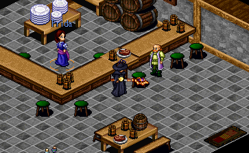

## Topic

The Burgess who opened my path,  
From the Coliseum to Suomi's peace.

Never once did you turn your nose  
At a rowdy Arena rascal like me.  
You welcomed me with ease,  
As if it was always meant to be.

A call from the Mundanes,  
At the College you cherished so,  
Became the final straw one dusk,

And in anger, you chose to go.

You closed your Library's doors,  
Where lore and art once filled your day;  
But even locked, the works you loved  
Still wander through Temuair anyway.

And so Sgrios took you, quiet and slow,  
No blade, no beast, no mortal blow

Just the grief of knowing wisdom slain  
By hands that never sought to know.

But as I learn Suomi's quiet ways,  
And walk the paths you once called home,

I feel the weight of what was taken,  
A silence neither of us chose.

For now I wear the same orange dress,  
The same band resting on my hair now;  
In the same role — who would have guessed?  
I try to mend the void that Topic left somehow.

_Deoch 216_

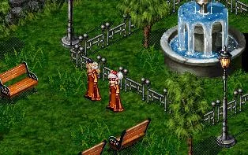

## Epilogue

Here lies Naena, to Temuair's great shame,  
Calavera connoisseur, the keeper of each name.

She wandered the lands as a Loures Knight,  
Hunting for stories of mischief and might.

Aislings envied her Banrion gown,  
But none would dare fight her for the crown.  
Suomi Burgess, Arena Master Host, so strong  
She captured their tales, whether noble or wrong.

Some say Sgrios favored her curious craft,  
For she used Him boldly in her art,

But the fate of those who toyed with Death  
Was something she wrote about from the start.

Whispers rose from the verses she'd spin  
Of sparks she had ended for a poetic whim.

Their spirits gathered, one by one,  
Each victim of her well-aimed fun.

Laurier first, with book in hand,  
Then Huhuman from the Underground,

Final, bursting, still annoyed  
And yLo, pouting, "My win rate destroyed!"

They circled Naena one silent night,  
As she had her beauty sleep in Suomi Inn,  
Their pale forms flickering in lantern light.  
The ghosts whispered, "Come write from within."

For though the ghosts arrived to pull her away,  
ZerA welcomed her and gently led her way.

So Naena crossed quietly past the mortal line,  
Joining the souls she had framed in rhyme.

_Naena_  
_Deoch 184_

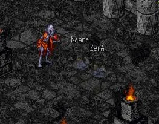

***

```
*Librarian Notes*

Recognized: Aisling, 2025 (Mileth College master list).
This entry has been heavily edited to conform to Library formatting.
The original can be found at https://novus-imperia.com/college/lit/naena_calaveras.pdf .
```
