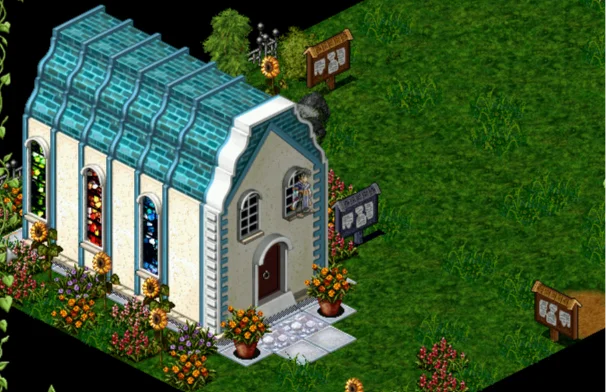

# The Lantern of Glioca

_by TeddyPaw in **Dark Ages**_

Among the oldest scrolls preserved within the Temple of Glioca lies the account of a lantern unlike any other.  
Whether it is a vision, or an old tradition, no Priest or Priestess can say. Yet each generation chooses to preserve the account, for some stories endure not because they can be proven, but because they continue to illuminate those who hear them.

There was once a young Priest whose desire was not to become admired but simply to become worthy of serving Glioca.  
Before dawn, on the day of ordination, the Temple stood wrapped in silence. Beyond its stone walls, Mileth still slept beneath the fading moon. Candles burned quietly before the altar, their light reflected upon the streams of water by generations of prayer.  
The young Priest knelt alone.  
When the first light of morning filtered through the coloured glass, the High Priestess entered.  
Without ceremony, she lifted a simple prayer necklace. Its polished green beads bore the gentle wear of countless faithful hands. She placed it around the Priest's neck, straightened the cord, and smiled.  
"May Her Light be with you."  
Nothing more was said.  
No lesson followed.  
When the Temple bells welcomed the dawn, another servant of Glioca quietly entered the world of Temuair.

That evening, the young Priest dreamed.  
There was no Temple.  
No altar. No sky. Only light.  
Not the brilliance of the sun, nor the silver glow of moonlight, but a warmth that seemed older than both.  
From within it stood Glioca.  
She spoke no command and asked for no promise.  
Instead, She placed the prayer necklace into the young Priest's hands.  
Beside it appeared a lantern.  
It was unlike any lantern fashioned in Temuair. Its bronze was plain, its glass clear as still water, and its flame neither flickered nor smoked. It simply burned—steady, patient, and silent.  
The young Priest wished to ask its purpose.  
Before a single word could be spoken, Glioca smiled.  
It was the same gentle smile worn by the High Priestess that morning.  
Then came the blessing.  
"May Her Light be with you."  
The dream dissolved with the coming dawn.  
The young Priest awoke before the Temple bells.  
The prayer necklace rested against the chest exactly as before.  
The lantern...  
was nowhere to be found.  
Yet throughout the morning, its quiet flame refused to leave memory.

For many moons, the young Priest spoke of the dream to no one.  
At last, unable to silence the questions, the young Priest sought the High Priestess.  
She listened patiently.  
When the story had ended, she remained silent for so long that the sanctuary candles seemed louder than either of them.  
Finally, she adjusted the prayer necklace once more.  
"Dreams seldom explain themselves," she said softly.  
She smiled.  
"Nor should they."  
The young Priest bowed and returned to the work of the Temple.  
The questions remained.  
But somehow, they no longer felt quite so heavy.

The years passed quietly, as faithful years often do.  
The Priest came to know the roads of Temuair better than the chambers of the Temple.  
There were mornings spent tending the sick before sunrise, afternoons walking the forgotten roads, and evenings returning beneath the glow of sanctuary windows.  
Some journeys were remembered.  
Most were not.  
The Priest preferred it that way.

One autumn evening, weary from travel, the Priest found an elderly Peasant struggling beneath a sack of grain.  
The warmth of the Temple lay only a short walk ahead.  
Someone else would surely come.  
The Priest walked on.  
One step.  
Then another.  
Before the third, the footsteps stopped.  
Without a word, the Priest returned, lifted the burden onto waiting shoulders, and walked beside the old Peasant through the East Woodland.  
When they reached the little cottage, the Peasant bowed deeply.  
"I have nothing to offer you."  
The Priest smiled.  
"The road was mine to walk as well."  
That night, the dream returned.  
The lantern remained unchanged.  
Yet somehow, the light seemed to reach a little farther than before.

One day, after a crowded evening Mass, muddy footprints covered the sanctuary floor.  
The Temple stood empty.  
The Priest fetched water and quietly cleaned the stone until no trace remained.  
No one noticed. No praise followed. None was sought.  
Several nights later, the dream returned.  
The lantern's flame had not grown brighter.  
At least, the Priest did not think so.  
Yet the shadows no longer gathered quite so closely around it.

When spring returned, so did the pilgrims.  
One evening, long after the final hymn had faded, a grieving villager remained seated alone.  
The Priest approached quietly.  
Neither spoke.  
Rain tapped gently against the stained glass.  
Nearly an hour passed before the villager finally whispered, "My wife used to sing that hymn."  
The Priest simply inclined the head.  
Nothing more was needed.  
The villager returned the bow before disappearing into the night.  
When the dream came again, the lantern's flame leaned gently forward, as though listening.

Another deoch passed.  
The Priest spoke less often of the dream.  
Not because the mystery had been solved, but because there were always greater needs before it.  
A frightened child.  
A weary traveller.  
A lonely Aisling.  
A novice uncertain of the simplest prayers.  
Each deserved more attention than questions without answers.  
One crisp morning, a young Priestess stood upon the Temple steps, clutching her prayer necklace.  
"My hands still tremble," she confessed.  
The Priest smiled.  
"So do mine."  
"But everyone says you never fail."  
"They simply arrive after my mistakes."  
For the first time that morning, the young Priestess laughed.  
It was a small laugh. But it was enough.

As the years slipped quietly into memory, the dream came less often.  
The Priest scarcely noticed.  
There were roads yet to walk, burdens yet to carry, and hearts yet to comfort.  
One evening, while extinguishing the final sanctuary candle, the Priest suddenly realized it had been long since the lantern had last appeared.  
The memory no longer stirred longing.  
Only gratitude.  
Like remembering the face of an old friend whose presence was no longer needed because its lessons had already taken root.  
The Priest smiled and quietly closed the Temple doors against the coming night.

Many deochs later, sleep came gently.  
For the first time in what seemed a lifetime, the dream returned.  
The old Priest stood once more within the endless light.  
The lantern waited, just as it always had.  
Unchanged.  
Its bronze remained plain.  
Its glass remained clear.  
Its flame burned without movement.  
Without smoke. Without sound.  
Once, there had been questions.  
Why the lantern?  
Why the dream?  
Why had its light seemed to change?  
None of them remained.  
The old Priest simply stood beside it.  
After a long silence, the warmth of the flame drew gently nearer.  
No voice spoke.  
No revelation came.  
There was only peace.  
When morning arrived, the old Priest did not awaken.

The Temple bells rang softly that day.  
Aislings, Peasants, and clergy gathered to remember the old Priest.  
None spoke of miracles. None spoke of greatness.  
Instead they remembered a burden quietly carried, a lonely meal shared, a comforting silence, a gentle laugh, and a servant who had never seemed too busy to walk beside another.  
As evening settled over the Temple, a young Priest remained behind.  
Upon the altar rested the old Priest's prayer necklace.  
A High Priestess entered without a sound.  
The young Priest stood quietly before the altar.  
For the briefest moment, the sanctuary felt warmer than before.  
The High Priestess said nothing.  
She simply lifted the prayer necklace.  
She placed it around the young Priest's shoulders.  
Adjusted the cord. Smoothed the robe.  
Outside, the first light of dawn began to touch the rooftops of Mileth.  
The Temple bells welcomed another day.  
The High Priestess smiled.  
"May Her Light be with you."  
End.



_Deoch 221_

***

```
*Librarian Notes*

Recognized: Kingdom, 2026 (Mileth College master list).
This entry has been heavily edited to conform to Library formatting.
The original can be found at https://novus-imperia.com/college/lit/teddypaw_lantern.pdf .
```
