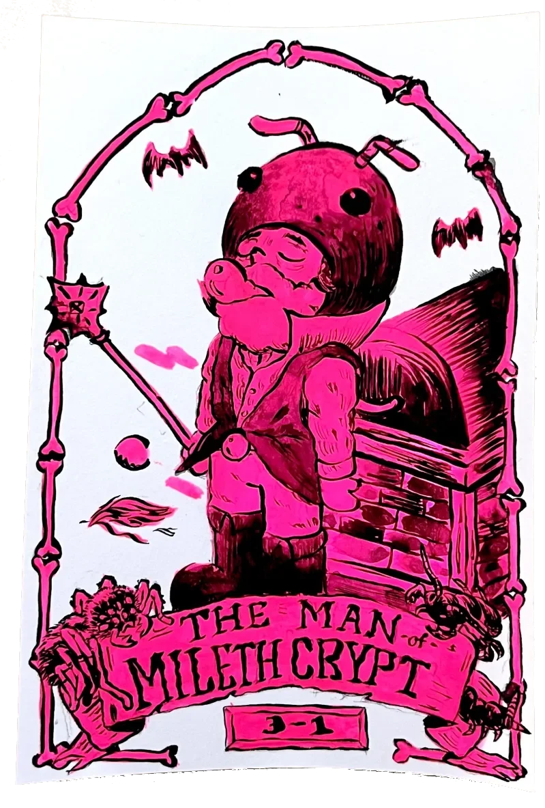

# The Man of Mileth Crypt

_by ZerioAgain in **Dark Ages**_

It is said that no spark enters Temuair wholly alone, though some would argue the man of Mileth Crypt disproves this. His face is half-remembered, yet his deeds remain etched in whispers and gratitude.

Each dawn, before even the roosters of Mileth stir, he departs the crypt where he rests... not in a house, nor a hall, but in a coffin of cold stone. His walk takes him across the Kasmanium ridges, where he waits for a boat willing to carry him to Oren. There, with what little coin his hands can gather, he purchases garments and tools of survival. He returns, dragging these burdens back, passing through a town that will not house him, to deliver them freely into the hands of sparks too young to know the danger that lies beneath their feet.

## The Oath in the Dark

He was not always so. Once, he wandered Temuair unclaimed, a spark like any other, unbound to path or purpose. But within the crypt his fate would harden.

The first child he met below was already choking on poison. He raised no spell, for he knew none, and only watched as her small body stiffened and stilled. Another came, and another still, each gasping, stumbling, trying desperately to reach the surface, only to collapse before his powerless eyes.

Yet worse than his silence was what followed: a thing of a Sgrios, one of those gaunt shadows of bone that wander, drawn not to save but to feed, seizing each as though it were no more than a morsel. Still he could do nothing but watch.

It was there he fell to his grief-stricken knees and spoke an oath: if he must devote his life, it would not be to glory or to the halls of power, but to the safety of the children whose cries otherwise went unheard. He took the path of priesthood not for gods, but for the living.

## A Power Unblessed

The years were not kind. The elders of Mileth knew his labors well and spoke of his charity. Yet when night fell, no door was opened. Where most Aislings are granted a bed within the inn from the moment of their first spark, his had long since been denied him. He was turned again to the crypt, for the power he drew upon was not sanctioned by temple nor decree.

It was said he reached to the spirits that shaped the lands before any altar had claimed them, seeking no help from the Gods who seemed to barter only in death. His art bore none of the darknesses of looking towards the north, but neither did it bear the approval of those who feared any light unscripted. Some even whispered he could ease Aisling's blight without so much as waking from his nap.

To many, power unbound by temple was power to be feared. Thus, though no one denied the fruit of his hands, no hearth was ever opened to him.

## A Town's Debt

If there is sadness in this telling, it is because truth has sadness in it. While we slept, he bore gifts across mountain and sea. While we barred our doors, he lay down among coffins, as though already claimed, for he has long since lain where the earth intends him, seared by the slavering face of a yearning shambler.

Yet though he asked for nothing, in time Temuair gave. A few, perhaps ashamed, placed spare coin or cloth in his hands. Others guided fresh sparks down into the crypts, whispering that the 'man below' would show them kindness. Children who once feared him began to sit with him, asking why he walked so far, or why he gave so freely. In answering, he taught not of gods nor glory, but of need, and of the duty of the living to one another.

## A Hearth in Shadow

Though no roof was ever opened for him, the small alcove he claimed in the crypt became known as a place where all might leave or take as they must: a cloak for bare shoulders, a loaf for empty hands, a charm for the road ahead. What began as his burden grew into a quiet custom of Mileth; a strange thrift of shadows where sparks, young and old alike, came seeking either aid or the chance to give it.

So it is that the man of the crypt may pass unremembered by name, but his work endures in the living; in every spark who walks a little further because his hand once steadied them, or because he taught them that giving is itself a form of survival. His bed is stone, his fate is silence, but his labor became a hearth none could bar.



_Author unknown, Year of Deoch 214,_

***

```
*Librarian Notes*

Recognized: Aisling, 2025 (Mileth College master list).
This entry has been heavily edited to conform to Library formatting.
The original can be found at https://novus-imperia.com/college/lit/zerio_crypt.pdf .
```
