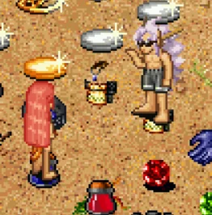
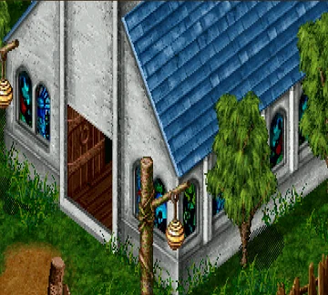
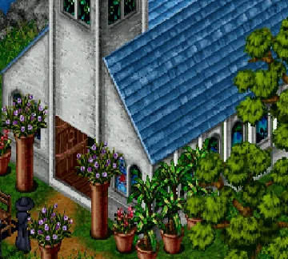
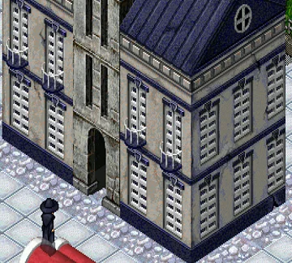
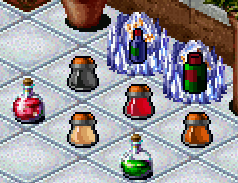
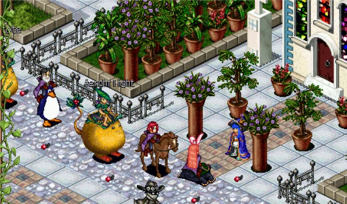

# Love in Temuair

_by Aerobyte in **Dark Ages**_


_Wedding of Blueberriez and Aerobyte, Winter of Deoch 212_

Love can be found in all places in Temuair. Perhaps you are attending a local Gliocan mass and strike up a conversation. Maybe you catch a glimpse of your soul mate at the Lynith Beach shop. There are no shortages of finding the one in this land we call home; and there are many ways to express how you feel about them.

Showing affection isn't just running off to the nearest church and getting married. There's many events and places that aren't always known to many aislings.

 

## Dating

So you finally got the courage to chat up that aisling you met at the Oren Faire huh? Take it slow and steady; you don't want them knowing you spend most of your days walking the streets in some green mantis costume.

Perhaps a date? Nothing says I want to invest time in you like a picnic or a trip to the snowy slopes of Mount Giragan (who doesn't like penguins?). Share meal; maybe you've both finished hunting and could use the recovery, nothing starts conversation like bread slices and chicken.

Checkout upcoming events; always check the board posts in local cities for some new and exciting action that aislings are dying to see.

The Suomi Troupe are always planning and putting on events that your date might be looking forward to; get to know them and find out what really interests them.


_Skiing together in Mount Giragan_


_Pet store date_

The ideas are limitless, almost any occasion can be turned into something special.

Temuair is the land of expression and freedom. All sorts of ideas and practices are going on here.

Same gender unions have been spreading far and wide across the countryside. Priests will be happy to bond you to the mate of your choosing regardless of who they are.

Still unsure? If you really want to take it a step further, the mundanes offer a potion carefully brewed to alter your gender into the opposite of your current.

The Gender potion is available in the mundane marketplace as imported goods and is always available.

There are also some events where you could get a hold of this prize such as the Insect Catching tournament and the Make a Wish annual affair.

## Lover's Glade


Not known to many aislings I have personally spoken to; the Lover's glade is located by visiting the East Woodlands of Mileth, then entering the Enchanted Gardens. Proceed to the north-west corner to enter Lover's Glade. In this beautiful location, there is a secret fae ritual of bonding you can make with your intended.

Bring a priest as they will be needed to begin the ritual by entreating the hidden fairies. From there the priest can assist you in coming together but also separation should you seek it.


_Legend for bonding yourself at the Lover's Glade_


_Legend for ending your bond at the Lover's Glade_


_Priest only legend for ending a bond at the Lover's Glade_

Should things end between both parties, the priest who breaks this bond between the two will also be given a crimson color mark upon their legend, something that most aislings look down upon.

## Marriage

  

Ready to commit eternally your very spark and being to another? The mundanes of Temuair have happily built structures for just this special day. There are four locations in which you may choose to bond yourself, completely up to you. Mileth, Rucesion, Tagor and Blackstar Village proudly give you the opportunity to confess your love to another whether you be surrounded by friends or family. The venues boast a great amount of space allowing you to decorate and host as many aislings as you've always dreamed of. You will need to find an official to begin this eternal bond, a priest of Temuair can serve as such. Speak to them of what you would like to do on that special day and they will happily do this for you.

Save the date! Temuair hosts many public boards where events are shared throughout the lands. Everybody loves a good event, why not share the day?


_Official marriage legend_


_Official divorce legend_


_Priest only legend for performing a marriage ceremony_


_Priest only legend for performing a divorce_

Make sure they are the one before you begin this journey, your legend speaks for all to listen. Love is patient and gentle; some have been around for over 100 deochs and haven't found the right partner. Make sure you know what you're looking for.

## Attire

Don't forget to dress appropriately; or maybe it's a casual wedding? The choices are all yours! I've outlined some appropriate wedding attire and where you can find them below.

Males

- Black suit - Oren Fair Event
- Black Tuxedo - Piet Bank (5,000,000 coins)
- White Tuxedo - Piet Bank (500,000 coins)
- Prom Tuxedo - Mundane Marketplace
- Seasonal Tuxedo Vest - Mundane Marketplace

  

Females

- White Formal Gown - Oren Fair Event
- Wedding Veil - Piet Bank (50,000 coins)
- Gossamyr Veil - Piet Bank (50,000 coins)
- White Satin Gown - Piet Bank (500,000 coins)
- White Silk Gown - Piet Bank 5,000,000 coins)

  

## Decor

Looking for decorations or something to spice up the event? There are many types of flowers across Temuair, most of the venues come with some floral decorations but if you're looking to go the extra mile, I can recommend:


_Nila Blossom_


_Sevti Blossom_


_Tulsi Blossom_

All three of these flowers are found from the Mehadi Swamp for the Curing the Sick Child Quest. Only one flower of your choice can be picked per day so start saving up!


_Folly Flower_


_Passion Flower_


_Dendron Flower_


_Kobold Tail_

The lands of Temuair and Medenia are filled with so many flowers it's hard to choose which ones look the best. These are just some among the best I personally would recommend. Many of them come from slaying creatures, or you may find them in passing.

 

What's a wedding without food? Local restaurants are more than willing to provide nourishment for the party at great prices.

Don't forget to stop by the nearest tavern and pick up plenty of booze. It's a celebration, go all out!

Looking for some ice? Mount Giragan is loaded; stock up when your date isn't looking.

### Don't forget the Confetti!

To ensure your special event is one of memory, the mundane store supplies packages of party poppers; which are imported as parcels. A small price to add the perfect touch


_Francis | Loures Castle Fireworks Event (July)_

Francis sells all kinds of fireworks that would make your event the talk of Temuair for Deochs!



## Wedding Planner

Feeling overwhelmed? Don't stress about it. There are plenty of aislings who love to prepare your venue every step of the way.

Contact a local planner and watch your day unfold stress-free. Don't get caught up in traffic; nobody wants to be delayed getting their mount parked or finding the correct seating inside. Not only do wedding planners come with great taste and do all the heavy lifting, they also come with entire teams designed to carry out your wishes.

## Rings

There are three rings in all of Temuair I would consider a true symbol of love. Some you must be brave and truly willing to go the distance to obtain; others you must simply ask to receive.

### Divine Love Ring


Nothing says "I love you" more than sharing divine love. This ring becomes available to aislings around the year of Glioca. Speak to the Fairy deep in Shinewood forest; and say "Divine Love Ring". They will hand you a promised love ring. Once you bring it back to your lover, you may propose to them. Should they accept, the ring will transform into this one.

### Eternal Love Ring


This beautiful ring requires teamwork; the very foundation between two sparks.

With your lover; speak to Aingeal in the Mileth Tavern about "The Letter". Both of you will be tasked towards helping a friend who is grieving a lost love. Working together, you can help a soul in need. Should you succeed, you will be given bouquets you can further use to dazzle at your wedding ceremony, and if you're lucky you may also find this ring in your pocket.

### Engagement Ring


Only obtainable by those willing to risk everything. Venture out and discover the mystery of the vanishing dragon statue in Mileth Crypts. This adventure will require friends from many paths to conquer. These are the kind of aislings who would see you at the altar on your best day. Should you overcome such odds you will be gifted this ring. Go to the Mileth Restaurant and speak to Muhsin to begin solving this unusual mystery.

_Deoch 217_

***

```
*Librarian Notes*

Recognized: Village, 2026 (Mileth College master list).
This entry has been edited to conform to Library formatting.
The original can be found at https://novus-imperia.com/college/lore/aerobyte_love.pdf .
```
