# Prey

_by Areyn in **Dark Ages**_


_Know the Enemy_

## Overview

_What does all this mean and how do I use it?_

In the hunt, there is predator and prey. This work describes several types of
prey that aisling predators will encounter and gives basic strategies for
hunting each of them. The strategies offered have been tested and are known to
work, but this is in no way an exhaustive list of every possible way win a
combat. It is my hope that after reading this, not only will you be a more
efficient predator, but also you will be able to observe the patterns of prey
and develop your own strategies.

Enjoy the hunt!

### Prey Descriptions

The prey is described by the way it moves and behaves. At the beginning of each
chapter is a description of the prey, its behavior, and common abilities.

 

Click on the Martial Awareness Icon (or Sense Icon for aislings) to quickly
jump to the description of the prey.

The description is followed by three sections, which outline how to take
advantage of this knowledge with different fighting styles.

### In Melee

This information is mainly for monks and warriors, but applies to anyone who
engages in close combat. Melee combat takes place at a range of zero (0) paces.


Click on the Assail Icon to jump quickly to the In Melee section.

### At Range

This part is for offensive spell casters, primarily wizards and priests with
Deo Saighead. Some of the tricks may work with a little modification for rogues
who are able to throw surigam. Ranged combat generally occurs at ranges of one
(1) to six (6) paces, but most ranged attacks can effect a target anywhere
within the casting aisling's sight, even in melee range.


Click on the Beag Srad Icon to jump quickly to the At Range section.

### With Traps

Rogues more than any other path must learn to anticipate and control the
motions of their prey. This section will explain how to coax your prey over the
traps you set. There is no particular range for traps, though most rogues
prefer to keep out of melee range of their prey.


Click on the Needle Trap Icon to jump quickly to the With Traps section.

### Hunter

The Hunter chapters at the end of this work provide additional information of
interest to aisling predators, including potions every hunter should know how
to use, elemental interactions for greater defense and stronger attacks,
enchantments that enhance items and the wearer, smithing and tailoring to
enhance weapons and armor, and long lasting spells to aid a hunter.

### Important Concepts

**_Distance_**: Whenever _distances_ are used in this work, it describes the
number of paces between the reference point and the target. For example, in the
picture below there are two (2) paces between the aisling and the wolf.

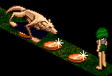

**_Melee Range_**: A creature at zero (0) paces and standing next to the hunter
(not on a diagonal) is in _melee range_.

**_Target_**: Creatures only tend to focus on one aisling or creature at a
time. This _target_ will be the one the creature uses all its attacks against.
If another aisling attacks the creature, he risks becoming the new target and
the old target will be forgotten.

## Beasts

_As merciless as they are stupid, these are the mindless beasts aislings hunt._

From the measly mouse to the devastating draco, beasts come in all shapes and
sizes with a vast range of abilities. A watchful hunter will see that most
beasts, even with vastly different abilities, behave in similar ways.

Beast behavior is broken down into three types:

* **_Common Beast_**: Common beasts are called such because this behavior is
  seen in most beasts of Temuair. This type of creature charges toward its
  victim to attack with little thought of anything else.
* **_Shaman_**: Shaman attempt to stay away from aislings and avoid melee,
  using only powerful spells and summoned creatures to attack. As of this
  writing, Shaman are only found in Astrid among the goblin and kobold races.
* **_Rogue_**: Beast rogues attempt to lure aislings into following them over
  traps. As of this writing, the only beast rogues are kobolds in Astrid.

At the end of this unit is a chapter on the V Formation. This is a very
flexible formation that can be used by groups of mixed paths to efficiently
kill beasts.

### Common Beast

_Typical monsters you will encounter_

Most creatures you encounter fall in this category. These mindless brutes will
charge directly toward their target with no thought of danger. Creatures of
this type will always take the shortest route possible to get to the goal. They
are very predictable and are easy to guide exactly where you want them to go.

Think of the battlefield as a grid with two axes. There is North and South on
one axis. The other axis is East and West. There are two distances between the
monster and the target. One is the North/South distance. The other is the
East/West Distance. For example, the battlefield marked be coins shown below on
the left is 3 paces N/S and 4 paces E/W. The distance between the aisling and
the mantis is one (1) on the N/S axis and two (2) on the E/W axis. A simplified
grid diagram (below right) will be used to represent the battlefield.

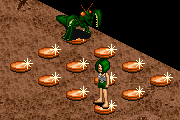 

A Common Beast will always move to close the greater of these two distances. In
the example, the mantis will move east, since the E/W distance of two (2) is
greater than the N/S distance of one (1).

 

If both distances are the same, as they are now in the example (E/W 1 and N/S
1), the creature could move on either axis. The mantis in the example might
move east or south. In either case, the mantis will move into the space marked
with a star on its next move because of the new distances involved. (E/W 1 and
N/S 0 make it move east, or E/W 0 and N/S 1 make it move south.)

 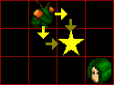

When a wall, tree, another monster, or even an Aisling blocks the Common Beast,
the beast will try to move clockwise around the obstacle. For example, a beast
wants to move east to get close to its victim, but a tree blocks the way. It
instead moves to the north (the creature's left).

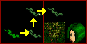

#### In Melee

The easiest way to take advantage of a Common Beast in melee is to allow the
monster to come to you. While it approaches, the hunter can rest and prepare to
attack. If you position yourself properly you will be able to start the battle
with a flurry of attacks to the side of the creature, which is more vulnerable
than the front. Waiting for it to come close also keeps you from wandering into
the view of other monsters that might swarm you.

Another trick that helps with Common Beasts is _Sidestepping_. While fighting a
monster, take one step to either side (but not back). The beast will follow,
but exposes his vulnerable side. An attack to a creatures side does 150% the
damage of a frontal attack. (Attacks to the rear do 200% the damage of a front
attack.) Attack a few times until the creature turns and attacks and then
sidestep again. Sidestepping is slower than simply slugging it out toe to toe
with a creature, but it does give an advantage in a fight where the hunter and
prey are near evenly matched.

Read the V formation chapter for more details on using this formation for
groups of mixed paths.

#### At Range

Common Beast tactics are hardest on spellcasters, who usually prefer to keep
hostile opponents away from them. The best way for a spellcaster to deal with
these types of creatures is to block their movement. Trees in the Eastern
Woodlands and Undine Fields provide an ideal blockage. Two blocks arranged
diagonally to each other will keep a Common Beast from its target indefinitely,
if the hunter can get the beast on one side of them, while she takes a position
on the opposite side, between the blocks. The figure at the right illustrates
the proper formation. The blocks need not be trees or objects. Two aislings
standing in formation to block will confound the monster just as completely as
a tree.

 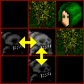

Be careful using this technique. The beast cannot reach you with physical
attacks, but its spells are just as effective as ever, and may even come more
frequently than normal.

Read the V formation chapter for more details on using this formation for
groups of mixed paths.

#### With Traps

The Common Beast is very easy to anticipate. A rogue who understands the way
the beast moves will be able to guide it directly to her traps without wasting
time or precious mana.

Any rogue can tell you, the simplest way to get a monster onto a trap is to
place the trap directly between yourself and the beast, either in a north/south
line or an east/west line. Then monster will blunder straight through the
traps, not caring that its life is coming closer to the end with each step.


Examine left figure below. If a rogue put a trap in the space marked by the
star, the monster will hit that trap, no matter which path it takes. If the
rogue stood south of the trap, as in the right figure below, then the monster
might hit the trap, but it may step to the west of the rogue, missing the trap
altogether. Then the rogue must scramble around in circles to get the beast to
trigger the trap. When setting traps, either stand in a straight line with the
monster, placing the traps between it and you, or stand on the opposite
diagonal of the trap, guaranteeing that the creature triggers it.

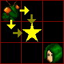 

A variation of the trick described in Common Beasts At Range uses a little
known fact about rogue traps called _**layering**_ traps. If a rogue sets two
traps in the same place, both traps stay active. The first monster in that
space will trigger the last trap set. If another beast, or the same one, enters
that space again, the earlier trap will go off. Rogues may layer as many traps
as they like in the same space.

Now, using the V formation described above in Common Beasts At Range, a rogue
gets the monster on the opposite side of the blockage from himself. Then the
rogue loads that space with as many traps as are required to kill the creature.
Once the traps are set, the rogue steps to the side of the blockage and coaxes
the monster around it to the side with the traps. Now all the rogue has to do
is get to the safety on the opposite side of the tree. The monster will kill
itself walking back and forth over the traps.


Read the V formation chapter for more details on using this formation for
groups of mixed paths.

### Shaman

_Cowardly beasts that cast spells at range_

Shamans are cowardly creatures. They try to run from the aisling who has its
attention and cast spells from range. When they reach the edge of spell range,
they will come back just close enough to cast spells at you.

A Shaman tries to stay two (2) or three (3) paces from its target. If it is
further away than two (2) paces, it will move toward the target. While moving
toward the target, a Shaman behaves exactly as a Common Beast. When it is
closer than three (3) paces from the target, it will retreat to stay out of
melee range.

A _retreating_ beast moves the opposite of the Common Beast. When a Common
Beast would move north, a Retreating beast would move south. When a Common
Beast would move east, a Retreating beast would move west. If the target
pursues a retreating beast, it will stay in retreat until it gets to what it
considers a safe distance, three (3) paces for a shaman.

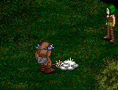


Sometimes a shaman will seem to freeze in its tracks and do nothing. A shaman
that isn't moving is casting a spell. After the spell is finished, it will
resume moving as normal.

#### In Melee

Melee fighters can become very frustrated with Shamans. As soon as a fighter
closes with the prey, it runs away.

The best way to fight a shaman up close is to corner it. Surround the Shaman on
all sides with aislings or blocks and it will be unable to run.

A solo fighter will have troubles cornering a shaman. Another alternative is to
back a Shaman against a wall `((three or more blocks in a row, or the edge of
the map))`. The Shaman will walk back and forth between the space in front of
you and one pace to the side. This tactic will take time, since you are only
able to hit the Shaman half the time, but it is far better than chasing the
wandering beast all over Astrid.

 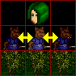

#### At Range

Spellcasters find Shamans ideal. The Shaman is very helpful in fact. It will
stay within range at all times and never close to do melee.

#### With Traps

Trapping Shamans can be a little more difficult than trapping a Common Beast. A
good rogue can always guide the Shaman where she wants it to go, but its
close/retreat nature makes it slightly harder to control.

The simplest way to take advantage of a shaman is to hide and set a line of
traps. Then get behind the Shaman and attack it. The Shaman will move directly
away from the rogue and the rogue may chase it, keeping it in retreat and
attacking all the while.

Another way that is slightly more dangerous does not require hide. The rogue
gains the attention of the shaman by taunting or attacking it, then sets a
trap. The rogue then moves away from the shaman and sets another trap. Repeat
as necessary. As the rogue gets further from the shaman, it will be lured over
the traps. A rogue using this tactic should be more wary of spells.

### Kobold Rogue

_Humaniod rogues that lure the unwitting into traps_

Kobold rogues are some of the trickiest beasts. They try to lure you into
following them and tripping over their traps and snares. Then suddenly, they
will turn and attack. They will sometimes skip merrily around you taking two
paces at a time as you swing at the empty air where you expect them to be. By
watching the rogues carefully, you can learn to anticipate and control them
almost as easily as the Common Beast or Shaman.

The kobold rogue taunts and lures its prey. It will close with its target,
sometimes jumping two paces at a time. When it reaches the target, the rogue
will attack once, then retreat trying to draw the aisling over its traps. It
will retreat until it gets to a distance of four (4) or more paces from its
target, and then close again. (See the Shaman chapter for more details on
retreating beasts.)

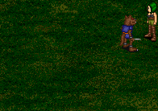


Anywhere the kobold rogue steps, there might be a snare or trap. Possible traps
include needle trap, poison snare, and sleep snare. Aisling rogues can detect
and attempt to disarm kobold traps. If the aisling fails to disarm it, a simple
way to protect other aislings is to lay an aisling trap over the kobold's trap.
The aisling trap will prevent the other trap from going off.

The only time the two pace jump really comes into play is if the rogue manages
to land diagonal to it's target while trying to close in. The rogue will run
circles around the aisling. This may seem like harmless play, but beware. The
rogue is likely to set traps in every diagonal.

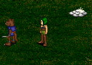 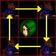

#### In Melee

Kobold rogues are most challenging to fighters. They simply will not stand and
fight, forcing you to bring the fight to them.

The best way to deal with kobold rogues in melee is to corner it while it is
trying to lure you. Corner the rogue just as you would a Shaman, but never
follow directly behind a kobold rogue. That is exactly what it wants, and it
can leave any kind of nasty snare for you to stumble across. To pursue a rogue,
step to the side of its trail and pursue it.


To close with a rogue that is circling, take a single step in any direction.
The rogue will be able to line up with you and attack, then it will return to
luring mode and you can corner it.

#### At Range

Spellcasters will find rogues easy prey if they can get the rogue to circle
them. A circling rogue poses no immediate threat, and the spellcaster can take
her time to blast it to a pulp.

To get a rogue to circle, stand in place. If you are lucky, the rogue will
begin circling you on it's own. If not, the rogue will attack you once and run
away. Just be patient. Right before the rogue takes the final step to close in
and attack, step to one side of the kobold's path. It will begin circling you.
If not, try again. Once you master the timing, you can get it every time. Now
you can finish the circling rogue at leisure.

#### With Traps

Kobold rogues can be very easy for an aisling rogue to slay. The aisling should
align himself in a straight line with the kobold. Set a trap and walk away from
the rouge. Continue setting traps and walking away one step at a time. The
rogue will walk over your traps on it's own.

### V Formation

_Versatile and powerful formation suitable for almost any group._


The trees of East Woods, Astrid and Undine Field inspire the V Formation. It is
called the V formation because the most basic form consists of an aisling and
two blocks arranged in a V shape.

Most aislings use techniques of this formation without even being aware of it.
By expanding on the ideas in the At Range and With Traps sections in the Common
Beast chapter, an entire party of mixed paths can find a role to play in
trapping and annihilating prey with this formation.

The basic V formation works best with common beasts. It also works with shaman
while they are closing in, as long as only the target aisling attacks. If the
shaman shifts focus to another aisling, it will dislodge itself from the V.
This formation might be modified for retreating beasts, but I have never tried
it, finding other methods much more efficient on beasts that close and retreat.

The V formation can be broken down into 5 positions as illustrated here:


*  **Block Position**:
  The key to the V formation is the two immobile blocks that the monster cannot
  pass. These blocks can be a natural obstruction, an aisling, or even a
  monster. Monsters tend to move around, so that's not suggested, unless the
  rogue has a strong blind snare to hold it in place for a long time. An
  aisling acting as a block may attack the monster, as long as he DOES NOT
  MOVE. If the monster steps away from the nook of the V, just be patient and
  the beast will step back for more punishment in a moment. If the aisling
  block begins to weaken and is concerned about his health, all he has to do is
  stop attacking. After a couple spells from the Protected Aisling, the beast
  will turn its attention away from the aisling block and start wandering back
  and forth again in the V shape of the barrier.

*  **Protected
  Position**: The aisling standing in the point of the V formation is the
  Protected Aisling. Her job is to draw the attention of the monster with a
  barrage of spells or taunts. Any aisling with damaging spells or taunts may
  take the role of Protected Aisling. The Protected Aisling should not move
  from her position. It is suggested that the Protected Aisling wear as many
  Gramail items as possible. The monster cannot physically attack, but is very
  likely to unleash its most powerful spells.

*  **Nook**: The nook of the V is
  immediately opposite of the Protected Aisling. This is the space that the
  monster will occupy most often. As it paces back and forth, the beast will go
  from the nook to one of the trap positions, and then back to the nook.
  NOTHING BESIDES YOUR PREY SHOULD ENTER THE NOOK. If anything blocks the prey
  from entering the nook, it may slip around the side of the Blocks and nullify
  the entire formation.

*  **Trap Positions**: A
  rogue can layer trap after trap (as described in Common Beast With Traps) in
  either of the positions marked in yellow on the illustration. When the rogue
  moves away from the space, the monster will blunder into the traps. The rogue
  must be careful not to enter the nook and dislodge the formation.

  Trap positions can also be used as Block Positions to give more attackers
  access to the monster. (See the Sample Variations below.) Notice that adding
  extra blocks like this will also add extra Protected Positions. DO NOT LEAVE
  THE TRAP POSITION until you are certain the prey is not targeting you. If the
  prey is attacking you, stand passively until the Protected aisling or one of
  the Blocks draws its attention, then you may step away without breaking the
  protection of the formation.

* 
  **Non-Aggressive Positions**: A non-aggressive aisling may stand anywhere
  else on the battlefield. The monster will ignore anyone in these positions
  completely as long as they do not attack the beast. Priests are ideal for
  this role. DO NOT ATTACK THE PREY FROM A NON-AGGRESSIVE POSITION. Attacking
  from these positions may distract the monster and dislodge it from the Nook.

  If you get bored watching everyone else do the work and want to attack the
  beast, move to one of the Trap Positions (or Protected Positions created by a
  Block in a Trap Position) and attack. (See the Sample Variations below.)

There are limitless possible variations of this basic formation. Experiment and
see what works.

#### Sample Variations


_3 Blocks make an extra Protected position._


_4 Blocks protect everything!_


_Another Protected position in the basic formation \*_

\* The third sample shows that there are other protected positions hidden in
the basic V formation. Any space diagonal from the Nook and protected behind
the Blocks will work as a Protected position. Make sure to stay close enough to
get experience for the kill.

## Aislings

_The Most Dangerous Prey_

With the opening of the arena, aislings become the most dangerous prey. No two
aislings behave exactly the same, indeed, the same aisling may act very
differently each time you encounter him. Since aislings are so varied, I
present general guidelines and common styles instead of specific details.

Some aislings have _subpathed_. This means the aisling has several abilities
from one path and are pursuing a second path. These aislings are very
dangerous. If you see an aisling using abilities outside her path examine her
legend to discover which two paths she follows.

If a particular aisling doesn't follow the normal pattern, study his legend,
watch his fighting style, find his weakness, and take him out! Know your enemy.

A few tips for all aislings in the Arena:

* **_Chants:_** Long chants are dangerous in the arena. They inform your
  opponent that you are preparing a spell or trap and can give away your
  position if you are hidden or the enemy is blind. Clear all your commonly
  used chants before entering the arena.
* **_Blindness:_** Rogues and priests can blind an aisling. If you find
  yourself blinded, you can still sense things nearby `((by opening the map
  with the tab key))`. You can also hear where they are when they speak or
  cast.

### Warrior

_The most physically powerful, yet least versatile aislings_

Warriors are the brute fighters of aislings and usually the easiest to predict.
This in no means makes them easy to hunt. Warriors make up for lack of variety
with their sheer power and ability to take damage. They also have the most
powerful physical weapons and best armor of all paths.

Warriors can only attack things in front of them, and do the most damage at
melee range. Warriors have one ranged attack, called windblade, which lets them
attack anything in a straight line in front of them.


Warriors may also be able to paralyze an aisling in front of them with _beag
suain_. An aisling paralyzed by this secret can still attack and use all skills
and secrets. Only movement is restricted.

#### In Melee

Melee is what a warrior does best. Two things can beat a warrior in toe-to-toe
combat; a monk with dion and lots of willpower, or a stronger, healthier
warrior.

There are a couple tricks that might help against an aisling warrior in melee.
Sidestepping works with aisling warriors as it does with a Common Beast, though
aislings tend to face you much quicker. Ambush, the monk skill, works even
better on aislings. Monsters turn the moment you ambush them, but most aislings
take a few moments to react.

#### At Range

Warriors are easy prey at range, but they will close in as quickly as possible.
Stay as far away as you can, and try not to stand in line where the warrior can
use his windblade.

If possible, block his movement either with inanimate objects or strong
aislings. While the warrior struggles with the barrier, you can assault him
with spells.

_Prahm_ can give you a few extra moments to get away from a warrior, should you
need to flee.

#### With Traps

Warriors are extremely susceptible to traps. Damage traps might seem the most
obvious routes, but some warriors can withstand even the strongest maiden trap.
After stepping on a trap, the warrior will usually freeze until they can heal.
A brave rogue might try to throw a warrior onto the next trap. Be wary, the
warrior will attack you if he knows you are close.

Blind traps and snares are only partially effective, because a blind warrior
can still sense the proximity of things `((by using the map))`.

Sleep trap will cripple a warrior completely for a few moments. You can use
this time to set more traps where the warrior cannot avoid triggering them, or
even bash the warrior while he is helpless.

Poison trap and snares are the most devastating to warriors. Let the poison do
its work, then a sneaky stab and twist or even a thrown soori can finish the
weakened warrior off.

### Monk

_Unarmed fighters with devastating skills_

Monks are one of the most varied paths; though most you meet will be Draco form
power monks. Before you fight a monk, try to find out want form they are. A
monk's form is listed in her legend. That will provide a lot of information
about how they fight.


**_Draco Form:_**  
This is the most common form. The stance makes the aisling invincible to
physical damage for about 10 seconds. The Draco tail kick can kill even some
99th insight aislings in a single blow and strikes in all directions putting
anyone next to the monk in danger. Even the snort can sting an aisling.


**_White Bat Form:_**  
The second most common form. White bat stance hides the monk from view. Read
the Aisling Rogue chapter for helpful hints when dealing with hidden aislings.
The other white bat skills have no special effect in the arena.


**_Kelberoth Form:_**  
Kelberoth form has been declining in recent deochs, since the full potential of
draco tail kick has been widely realized. The kelberoth strike does a great
deal of damage, but also hurts the monk. The stance makes the aisling
temporarily stronger. Roar has no apparent effect on aislings.


**_Scorpion Form:_**  
Scorpion is a very rare form. The stance enhances the armor of the monk. The
other skills have very little effect in the arena.

Some other Monk abilities:

* _**Ambush**_: With ambush, a monk may leap behind or to the side of a target
  from up to two paces away.
* _**Ao Spells**_: Monks can learn to cure blindness and poison.
* _**Beag Nochd**_: This rarely learned secret is a wind based attack spell,
  similar to wizard spells.
* _**Dion**_: Regardless of a monk's form, _dion_ provides the same physical
  invulnerability of draco stance.
* _**Gentle Touch**_: Green dugon monks can learn to heal everything in melee
  range.
* _**Eagle Strike**_: A yellow dugon skill, eagle strike blasts everyone in
  front of the monk to a range of about 3 paces, similar to the warrior skill
  windblade.
* _**Cat's Hearing**_: Cat's hearing is also learned with the yellow dugon. It
  allows monks to sense invisible things.
* _**Claw Hand**_: Claw hand is a purple dugon skill, which magnifies the
  damage of a monk's strikes.
* _**Suain**_ With the red dugon monks can learn a skill like the warrior skill
  _beag suain_. This version of suain completely disables an aisling. The
  victim can not preform any actions until the effects are over.
* _**Black dugon?**_ What does the black dugon teach monks? One day perhaps we
  will know.

#### In Melee

Monks are tricky combatants. Be wary of ambush or you may find yourself
swinging at air while the monk is pummeling your vertebrae. Don't use auto hit
on a monk. Keep your eye on him and be ready to turn in an instant

If you are fighting a monk with Dion or Draco Stance, try to time your most
powerful attacks to strike after the stance ends. You will have a very short
window when she is vulnerable.

#### At Range

As with warriors, the key to fighting a monk is to keep him at range where he
can not hurt you. However with ambush and throw, an aisling barrier is not
likely to keep them at bay for long. Standing behind walls and other inanimate
objects can effectively block a monk for a time.

Hit a monk as hard and fast as you can. If the monk gets close, abort the spell
you are casting and run. Chances are you will not finish the spell anyway if
you stand your ground. _Prahm_ can give you a few extra moments to get away.

#### With Traps

Most monks are able to cure poison and blindness, so those traps and snares may
not be very useful. Try one of each to see the range of your opponent's
abilities. If they do not have the skills to remove the affliction, it can
cripple the monk as easily as any warrior.

Sleep traps and snares work great on monks, and since they are less armored
than warriors, a rogue can do a fair amount of damage just bashing on them.

Monks can ambush from up to 2 paces away to bypass your traps, however, if they
land on a trap after ambushing, the trap is triggered. When luring a monk,
always keep a sleep or maiden trap at your back.

### Aisling Rogue

_Hidden assasins with powerful traps_

Rogues are most noted for the traps and the ability to hide. A hidden rogue is
invisible to normal sight and may continue to set snares and traps without
revealing themselves. The most powerful snares do not even require a chant so
you will not get the 'audible' cue that traps are nearby.

Traps and snares may:


**_Poison:_** Poison traps cause health to slowly dwindle until the poison is
cured or wears off.


**_Blind:_** Blind traps make it impossible to see anything. A blind aisling
may still sense where things are `((by opening the map with the tab key.))`
While blind, attacks are slightly less powerful and defenses weaker, since an
aisling cannot see to dodge blows effectively.


**_Sleep:_** Sleep traps completely incapacitate aislings for a short time. The
priest spell ao suain will remove the effects, and a priest may even awaken
enough to cast this spell on himself.


**_Damage:_** Damage traps directly inflict damage to an aisling. An aisling
that is near death and fighting a rogue might want to hold still and heal a
bit, before risking another trap.

Other rogue combat skills:

* _**Stab and Twist**_: This melee strike does a fair amount of extra damage.
* _**Throw Surigam**_: Throw surigam allows rogues to throw their weapons to a
  range of about 6 paces.
* _**Throw Smoke Bomb**_: A mere distraction, throw smoke bomb blinds everyone
  near the rogue for a short period of time. This skill doe not blind members
  of the rogue's group.
* _**Eisd Creutair**_: Many rogues can see invisible aislings with this secret.

#### In Melee

Rogues rarely stand and fight. Pinning them down is the most challenging part.
Once a rogue is immobilized, they are easy prey. Suain works very well. Monks
can try to ambush a fleeing rogue, but it is hard to ambush and attack before
they have run off in another direction.

If you suspect a hidden rogue is in the area, you can try to locate him with
taunts, snorts, or spitting at him. `((Target random empty areas until you
manage to hit the rogue.))` Yellow Dugon monks can also use the Cat's Hearing
secret to track a hidden rogue. Once you locate the rogue, continuing to snort
or spit at him will allow your teammates to see his location.

When chasing a rogue, try not to walk over her path. There will likely be
snares of every kind in the fleeing rogues trail.

#### At Range

Rogues cannot trap a target that does not move. Stand still and cast spells at
the rogue. It is not likely that the rogue can do any appreciable damage to you
in melee. Try to stand in a corner so that a rogue cannot push you onto a trap.

To detect hidden rogues, cast low power lamh spells. You will be able to see
the effects of your spell striking the invisible aisling. You will even see the
rogue if the spell misses.

#### With Traps

Aisling traps don't work on aisling rogues. Dueling rogues must fall back to
their melee skills and throw surigam to fight one another.

The _Eisd Creutair_ secret allows rogues to see hidden creatures. Taunting or
throwing surigam at the hidden rogue will reveal her location to others.

### Priest

_Blessed healers with powerful defenses_

Priests have a huge variety of spells and different abilities. The only
weakness of a priest is weak armor and, in most cases, poor health.

Magic resistant items, like Gramail consecrated items and Rings of Eternal
Love, are very helpful when fighting a priest. These items make it more likely
for spells to miss the target. See the Enchantments chapter for more
information.

Some abilities of the Priest:

* **_Healing:_** If she is not slain quickly, a priest can easily heal all
  damage she has taken in moments.
* **_Cradh:_** A curse that lowers defenses.
* **_Pramh:_** A sleep spell. While asleep, an aisling can still turn to face
  enemies, reducing the damage slightly.
* **_Poison:_** A poison spell. The poison will linger, slowly draining away
  the life of the aisling.
* **_Dall:_** A blinding spell. Blind aislings can still sense their
  surroundings `((by hitting the tab key to examine the map.))`
* **_Suain:_** A freeze spell that immobilizes aislings.
* **_Deo Saighead:_** A blast of pure holy light that does a great amount of
  damage.
* **_Mor Dion:_** Makes the priest invulnerable to physical harm for a short
  time.

#### In Melee

Close in quickly and hit the priest with everything you have. Use Suain to
immobilize the priest if you can.

If the priest casts Dion (It looks like a ring of fire around the feet.) save
your heavy attacks until you can damage the priest.


#### At Range

Hit the priest with the strongest spells you have, as quickly as possible.
Fighting a priest at range often becomes a contest of mana levels. _Pramh_
spells can help give you the upper hand.

One sneaky trick that can cripple a priest is to group him and cast _Puinneag
Spiorad_, which leeches away all the priest's mana.

#### With Traps

Wise priests will stand still when fighting a rogue. You can still trap them by
setting traps next to them and throwing the priest onto your trap. If the
priest is standing in a corner and not moving, there is little that can be
done.

Most priests can cure blindness and poison, and several have learned to cure
the effects of sleep traps. Try these traps out. If the priest cannot remove
the effects, they are crippling for a priest. If the priest can remove them,
they are little more than an annoyance.

Smoke bombs can be useful to sow confusion and give a rogue a few heartbeats to
escape when a priest has located her and is hitting her with spell after spell.

### Wizard

_Arcane practitioners of the magic arts_

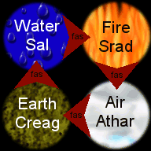

Wizards use elemental spells to fight. Most wizards specialize in one element;
so to hunt a wizard you should learn the elemental interactions. Water (sal) is
strong against Fire (srad), Fire is strong against Air (athar), Air is strong
against Earth (creag), and Earth is strong against Water. For more details on
elemental interactions, see the Elements chapter.

Find out what the wizard's most powerful element is, and wear a belt that is
the same element to minimize damage. For example, wear a Sea Belt when fighting
a Sal wizard. Avoid the element that is weak to the wizard's element. Wearing a
Fire Belt against a Sal wizard will cause you to take extra damage.

Beware of the _fas nadur_ spells. _Fas nadur_ intensifies the defense element
of the target. _Fas nadur_ is covered in more detail in the Spells chapter.

Magic resistant items, like Gramail consecrated items and Rings of Eternal
Love, are very helpful when fighting a wizard. These items make it more likely
for spells to miss the target. See the Enchantments chapter for more
information.

#### In Melee

Move in fast and hit hard. There is nothing you can do to keep a wizard from
casting except to kill her or keep her on the run.

Use Suain to immobilize the wizard so he can not flee. Ambush may help you
close in quicker.

#### At Range

Like the priest, ranged combat with wizards is a contest of mana levels. Use
your strongest spells and cast as fast as you can. Prahm spells will stop the
wizard for a few moments.

As with the priest, _Puinneag Spiorad_ will drain all mana from the wizard and
leave her helpless, if you can catch them unaware and group them.

#### With Traps

Wizards will usually stand still and try to cast spells at rogues. The only way
to trap an immobile aisling is to throw him onto the trap. Set a trap on one
side of the wizard, then stand on the other side of him and use the throw
skill.

Unlike priests, Wizards have no defense against poison, blindness, or sleep
snares. A blind wizard will have trouble targeting spells, a poisoned wizard is
easy prey for stab and twist, and a sleeping wizard is completely defenseless.

If you are hiding and a wizard does manage to locate you, a smoke bomb can
blind him for a few moments, giving you a chance to run. Try to run in the
direction the wizard least expects.

## Hunter

_Know yourself._

Knowing the enemy is only half of the equation for success. To be a strong
hunter, know yourself.

Chapters in this unit are not about the prey. They are devoted to the aisling
predator and basic abilities that any path can take advantage of to make the
hunt more productive.

* **Potions**: Herbal remedies and magical elixirs.
* **Elements**: Elemental interactions and items that provide elemental defense
  and attack abilities.
* **Enchantment**: Enchantments and consecrations that alter equipment
  properties and the abilities of the wearer.
* **Smithing**: Improving the quality of weapons and armor.
* **Spells**: Long lasting spells that protect or enhance aislings, and where
  to find these spells.

In addition to these resources, aislings should become familiar with their
particular path's strengths. Numerous works of lore in the Library of Loures
deal with specific paths.

It is also recommended that you learn the abilities of the god you worship.
Deity miracles can be very powerful. Tryston's lore,
"[The Gifts of the Gods](Tryston-The-Gifts-Of-The-Gods.md)",
explains miracles in detail.

### Potions

_Herbal remedies and magical elixirs._

There are many potions in Temuair. Below is a description of the most common
potions and effects. There are more detailed works of lore about herbalism and
potions in the Library of Loures.

#### Healing Potions

Healing potions replenish the health of an aisling. Note that foods will also
heal aislings, but the effects of most foods are minimal. _Healing potions are
listed from most potent to least potent._


**_Hydele Deum_**: A powerful herbal remedy. Hydele Deum will heal **all**
damage that an aisling has received. Herbalists make hydele deum.


**_Ard Ioc Deum_**: A rare magical elixir. Ard Ioc Deum heals a tremendous
amount of damage. Be careful not to confuse Ard Ioc Deum with Beothaich Deum,
which looks identical. Ard ioc deum is found deep in the East Woods and several
other deep hunting grounds.


**_Honey_**: A sweet natural remedy. Honey is not actually a potion, but is as
potent as many herbal and magical remedies. Honey jars are received from
mundane quests and Cail entreaties. Raw honey can be found wherever wasps are.


**_Mor Ioc Deum_**: A mid level magical elixir. Mor Ioc Deum is not as powerful
as hydele deum or ard ioc deum and is rarely sought by aislings. Mor ioc deum
can be found rarely in Dubheim castle.


**_Fifleaf Deum_**: A mild herbal remedy. Fifleaf is not very powerful. Since
it requires as much labor and raw materials as hydele deum, fifleaf is rarely
used. Herbalists can make fifleaf deum.

#### Fior Potions

Fior Potions are elemental nodes used by wizards with leiseich spells to
replenish willpower. Drinking fiors has no effect.


**_Fior Athar_**: Elemental air node.


**_Fior Creag_**: Elemental earth node.


**_Fior Sal_**: Elemental water node.


**_Fior Srad_**: Elemental fire node.

#### Other Potions


**_Beag Spiorad Deum_**: A mana replenisher. Beag Spiorad Deum will return a
small amount of willpower. Beag spiorad deum can be found in Dubheim castle.


**_Beothaich Deum_**: The well known "red potion." Beothaich Deum is used to
revive party members that are facing death. Face the aisling like you are
trying to hit him and use the potion to restore him to life. Beothaich deum is
made by aisling priests.


**_Betony Deum_**: A protective potion. Betony Deum will give the protective
equivalent of a short duration aite spell, but this potion sometimes fails to
work. Betony deum is made by aisling herbalists.


**_Hemloch Deum_**: A potent poison. Hemloch Deum will sap nearly all the life
from an aisling that drinks it. Hemloch deum is made by aisling herbalists.


**_Personaca Deum_**: A poison remedy. Personaca deum will cleanse your blood
of poisons. Personaca deum is made by aisling herbalists.

### Elements

_Elemental items for defense and added damage._


There are six elements in Temuair: earth, water, fire, air, light, and dark.
The basic four elements, earth, water, fire, and air, compose a circle of
strengths and weaknesses as shown in the picture to the right.

The word _fas_ means strong. _Creag fas sal_ means that earth elemental attacks
is strong against water elemental defense. Water (_sal_) is strong against Fire
(_srad_), Fire is strong against Air (_athar_), and Air is strong against Earth
(_creag_).

An elemental attack is weakest against a matching elemental defense. For
instance, water defense is best against _sal_ spells.

Light and dark do not fit into the cycle of the basic elements. Dark and light
attacks hurt about as much as a nuetral elemental attack. The advantage is that
they are nuetral to all the basic elements, so you will not encounter creatures
with strong defense against your attack. (Dracos and dubheimid are the
exception. They have dark defense.) Dark defense is fairly strong against all
elements except light. _Deo Saighead_ is the only known light attack so it is
hard to compare to other elemental interactions. _Deo Saighead_ is very strong
against dark defense elements. There is not yet any known light defense.

**Elemental Damage**¹

| Attack \ Defense | Air | Earth | Water | Fire | Dark | None |
|------------------|-----|-------|-------|------|------|------|
| **Air**          | 25% | 75%   | 45%   | 30%  | 35%  | 100% |
| **Earth**        | 30% | 25%   | 75%   | 45%  | 35%  | 100% |
| **Water**        | 45% | 30%   | 25%   | 75%  | 35%  | 100% |
| **Fire**         | 75% | 45%   | 30%   | 25%  | 35%  | 100% |
| **Dark**         | 50% | 50%   | 50%   | 50%  | 25%  | 63%  |
| **None**         | 25% | 25%   | 25%   | 25%  | 25%  | 25%  |
| **Light**²       | 50% | 50%   | 50%   | 50%  | 90%  | 100% |

¹ All percentages are approximated from data gathered first hand without the
use of the _Fas Nadur_ spell or any other spell enhancements.  
² Percentages in the Light Attack row are not scaled against other attack
elements.

#### Sensing Elements

Monks may sense the elemental attack nature and defense nature of beasts when
they approach mastery of Echo Sense or Martial Awareness. Rogues may use Study
Creature to sense elemental affinities of monsters and the Sense skill to find
the elemental affinities of aislings. The attack nature only corresponds to the
physical attacks of the creature. A single creature could cast spells of an
element that doesn't match the its attack nature, and the defense nature could
be yet a third element.


An aisling may sense his own elemental affinities even if he can not identify
the items that are providing the elements. `((Open the stats page by pressing G
or alt-G. The elements are in the top right corner. The top one is your attack
nature. The one below it is your defense nature.))`

#### Belts

Belts provide an aisling with elemental defense. Wear a belt that matches the
element you are being attacked with to minimize damage.


**_Fire belts_** provide fire defense.


**_Earth belts_** provide earth defense.


**_Sea belts_** provide water defense.


**_Wind belts_** provide air defense.


**_Dark belts_** provide dark defense.


**_Leather belts_** increase an aisling's wisdom in addition to providing
elemental defense. `((+1 Wis))`


**_Mythril belts_** increase an aisling's constitution in addition to providing
elemental defense. `((+1 Con))`


**_Hybrasyl belts_** increase an aisling's wisdom and constitution in addition
to providing elemental defense. `((+1 Wis, +1 Con))`

#### Necklaces

Necklaces can give an elemental affinity to aisling attacks. Wear a necklace
that is _fas_ against a creature's defense element for maximum damage. Many of
these necklaces can be found without any element linked to it.


**_Earth necklaces_** give no special benefit besides earth attacks.


**_Fire necklaces_** give no special benefit besides fire attacks.


**_Sea necklaces_** give no special benefit besides water attacks.


**_Wind necklaces_** give no special benefit besides air attacks.


**_Pearl necklaces_** enhance the aim of aislings. `((+5 hit))`


**_Gold Jade necklaces_** increase the damage aislings can cause. `((+1
damage))`


**_Bone necklaces_** enhance accuracy and damage. `((+5 hit, +1 damage))`


**_Jade necklaces_** greatly enhance accuracy. `((+10 hit))`


**_Amber necklaces_** greatly increase the damage and aisling causes. `((+2
damage))`

### Enchantment and Consecration

_Enchanted items providing special effects._

Most items in Temuair may be enchanted or consecrated to a god to provide a
mystical boost to the person who wears them. Elemental items can not be
consecrated or enchanted, nor can weapons, armor, helms, and some types of
boots. See the Smithing chapter for weapon and armor enhancements.

Enchanted and consecrated items are most often found while hunting. If you seek
a particular item, powerful wizards can provide enchantments and priests may
consecrate items to their deity.

Enchanted and consecrated items are perishable. If you die with one of these
items on your person or in your pack, it will break.

#### Enchantments

* **_Abundance_**: Abundance items usually weigh half as much as a normal item
  of the same type. They also enhance the damage caused by the aislings
  attacks. `((+1 damage))`
* **_Blessed_**: Blessed items enhance the wearer's aim. `((+5 hit))`
* **_Magic_**: Magic items are specially prepared so that they do not reduce
  the mana of the wearer as much as a normal item of the same type. Some magic
  items, particularly rings, actually give the wearer more mana. `((up to +50
  mana))`
* **_Might_**: Might items increase the amount of damage an aisling can
  withstand. `((+100 health))`

#### Consecrations

Prayer necklaces do not grant the properties of other consecrated items.

* **_Caennlaidir_**: Caennlaidir, patron of warriors, grants enhanced strength
  with his consecrated items. `((+1 Str))`
* **_Cail_**: Cail is the patron of monks. Cail consecrated items promote
  health and vigor. `((+1 Con))`
* **_Deoch_**: Deoch items quicken the healing of the wearer. `((+5 healing
  rate))`
* **_Fiosachd_**: Fiosachd is patron of rogues. Fiosachd consecrated items
  enhance dexterity. `((+1 Dex))`
* **_Glioca_**: Glioca is the patron of priests. Her consecrated items promote
  wisdom. `((+1 Wis))`
* **_Gramail_**: Gramail is the god of law. His consecrated items protect the
  wearer from magic, which tries to bend the natural laws. `((+10% magic
  resistance))`
* **_Luathas_**: Luathas, patron of wizards, enhances the mental abilities of
  those who wear his consecrated items. `((+1 Int))`
* **_Sgrios_**: Sgrios is lord of destruction. Curiously, items consecrated to
  Sgrios are more resistant to wear and decay than normal items. They are also
  much heavier. `((10 times normal durability, double normal weight))`

#### Rings

Rings enhance the health and mana of aislings. A few have additional properties
as well. All rings except the ones with special properties (beyond health and
mana enhancements) may be enchanted or consecrated.


**_Small Spinel Ring_**: +300 health, +2 hit. Small spinel rings can not be
enchanted further.


**_Small Emerald Ring_**: +300 health, +2 damage. Small emerald rings can not
be enchanted further.


**_Talos Ring_**: Insight 4, +100 health


**_Beryl Ring_**: Insight 5, +50 mana


**_Ruby Ring_**: Insight 6, +200 health


**_Coral Ring_**: Insight 7, +100 mana


**_Lapis Ring_**: Insight 8, +300 health


**_Red Jade Ring_**: Insight 10, +100 health, +50 mana


**_Amethyst Ring_**: Insight 12, +200 health, +100 mana


**_Spinel Ring_**: Insight 12, +500 health, +2 hit. Spinel rings can not be
enchanted further.


**_Emerald Ring_**: Insight 12, +500 health, +2 damage. Emerald rings can not
be enchanted further.


**_Jade Ring_**: Insight 16, +300 health, +150 mana


**_Grave Ring_**: +150 mana. There are many rumors about these rings having
additional abilities. None have been verified. To debunk two false rumors,
aislings still get scars when wearing a grave ring, and grave rings do not
noticeably affect undead creatures.

**_Black Pearl Ring_**: ?

**_Signet Ring_**: +1 to all attributes! Signet rings can not be enchanted
further.


**_Ring of Eternal Love_**: +20% magic resistance. Rings of Eternal Love can
not be enchanted further.

#### Other Enhancement Items

Earrings, belts, boots, and bracers also enhance the aisling who wears them.
Belts are covered in the Elements chapter. Earrings, boots, and bracers can
also be enchanted or consecrated for even greater effects. For example, Luathas
coral earrings are very popular. `((+3 Int!))`


**_Beryl Earrings_**: Stimulate thought processes. `((+1 Int))`


**_Coral Earrings_**: Greatly enhance memory and problem solving skills. `((+2
Int))`


**_Ruby Earrings_**: Enhance thinking and strength. `((+1 Str, +1 Int))`


**_Silver Earrings_**: Increase strength. `((+1 Str))`


**_Gold Earrings_**: Give a tremendous boost to strength. `((+2 Str))`


**_Cured Boots_**: Give a minor increase in dexterity. `((+1 Dex))`


**_Shagreen Boots_**: Give a moderate increase in dexterity.`((+2 Dex))`


**_Cordovan Boots_**: Give a large increase in dexterity.`((+3 Dex))`


**_Saffian Boots_**: Give a major increase in dexterity.`((+4 Dex))`


**_Magma Boots_**: Give a massive increase in dexterity.`((+5 Dex))`


**_Enchanted Boots_**: Give an amazing increase in dexterity.`((+6 Dex))`


**_Iron Bracers_**: Give a minor increase in dexterity.`((+1 Dex))`


**_Mythril Bracers_**: Give a moderate increase in dexterity.`((+2 Dex))`


**_Hybrasyl Bracers_**: Give a large increase in dexterity.`((+3 Dex))`


**_Iron Shield_**: The cold iron used to make this shield grants additional
resistance to magic. `((+10% Magic resistance))`

### Smithing and Tailoring

_Smithing and tailoring to improve weapons and armor._

Smithing weapons and tailoring armor increases the effectiveness and value of
the item while reducing the weight. Smithed or tailored items also require a
higher insight to wear or wield than the plain counterpart.

Smithed weapons may be found while hunting, or a regular sword, soori dagger,
or surigam may be smithed by an aisling rogue. A rogue with higher level of
Bladesmith (found by looking at her legend) has a better chance of getting
higher quality items. Rogues or warriors may assist a bladesmith to help
increase the quality.

A rogue, monk, or warrior who has learned the tailor skill may tailor armor. An
aisling's legend reveals his Tailor level. An aisling with a higher level of
tailor has a greater chance of making higher quality items. Another tailor may
assist in tailoring to raise the quality of the armor.

There are four grades of smithing/tailoring, in order from lowest to highest
quality, good, fine, grand, and great.

| Quality | Damage | Armor | Insight | Weight |
|---------|--------|-------|---------|--------|
| Good    | +2     | +1    | +2      | 80%    |
| Fine    | +4     | +2    | +4      | 60%    |
| Grand   | +6     | +3    | +6      | 40%    |
| Great   | +8     | +4    | +8      | 20%    |

* **_Damage_**: Smithed weapons cause extra damage based on the quality of the
  weapon as given in the chart above.
* **_Armor_**: Tailored armor increases the armor rating of the item by the
  amount listed in the Armor column in the table above.
* **_Insight_**: The insight required to wear or wield item increases by the
  amount listed in the Insight column in the table above. There are exceptions
  that require more insights than expected.
* **_Weight_**: The weight of a smithed or tailored item is reduced to the
  amount listed in the Armor column in the table above.

**_Examples:_**

| Plain Moon Dagger | Good Moon Dagger |
|-------------------|------------------|
| Damage:           | Damage:          |
| S 45m65           | S 47m67          |
| L 40m60           | L 42m62          |
| Insight: 30       | Insight: 32      |
| Weight: 9         | Weight: 7        |

| Plain Gardcorp | Fine Gardcorp |
|----------------|---------------|
| Armor: -5      | Armor: -7     |
| Insight: 1     | Insight: 5    |
| Weight: 4      | Weight: 2     |

### Spells

_Special long lasting spells that help greatly._

There are a number of spells available in Temuair that greatly enhance the
abilities of aislings. It is far beyond the scope of this work to list every
spell effect in Temuair. There are more detailed works of lore about the spells
of various paths in the Library of Loures.

The spells listed here, with the exception of _Fas Nadur_, are cast by mundanes
and have very long duration.

#### _Naomh Aite_


_Naomh Aite_ is a very powerful protective spell that reduces the damage caused
to an aisling by about 50%.

Any aisling who has completed the Heart of Fire or Heart of Moon Quest may go
to Marlin in the Loures Dungeon and he will cast a long duration version of the
spell on the aisling and his party members. The aisling talking to Marlin will
receive _Naomh Aite_, with the longest duration. **Members of his group** may
receive _Dia Naomh Aite Comlha_, which lasts nearly as long as _Naomh Aite_.
Others in the vicinity might get _Naomh Aite Ionad_, which does not last very
long and is commonly referred to as "bad aite". If you receive _Naomh Aite
Ionad_, wait for the effects to wear off and try again for _Dia Naomh Aite
Comlha_.

Aisling priests may also learn to cast various forms of _Naomh Aite_, but these
spells have a much shorter duration.

#### Grimlok Alliance


Grimlok Alliance, also known as _Kyongkong_, is most noted for preventing the
Grimlok of Pravat cave from attacking an aisling. It has a secondary effect,
which enhances the rate that aislings regenerate mana. Even if you do not
intend to fight in Pravat Cave, it is wise to get Grimlok Alliance if you find
yourself running out of mana often.

Evan in Pravat and Phailin, the Grimlok Queen, will cast Grimlok Alliance on an
aisling. An aisling can not receive both Goblin Alliance and Grimlok Alliance
at the same time.

#### Goblin Alliance


Goblin Alliance is similar to Grimlok Alliance, keeping Goblins of Pravat Cave
from attacking the allied aisling. In addition, Goblin Alliance enhances the
healing rate of the aisling exactly like the monk secret Inner Fire. `((+20
healing rate))`

Evan in Pravat and Bahadir, the Goblin Chieftain, will cast Goblin Alliance on
an aisling. An aisling can not receive both Goblin Alliance and Grimlok
Alliance at the same time.

#### _Fas Nadur_

_Fas Nadur_ magnifies the elemental defense of the target. With a monk or rogue
who can identify the defense element of a monster and an assortment of
elemental necklaces, a party can easily defeat powerful creatures. An aisling
with a dark belt and _fas nadur_ is greatly protected from all elements.

_Fas Nadur_ is not cast by any mundanes. You must seek an aisling wizard to
cast the various forms of this spell.

***

```
*Librarian Notes*

Recognized: Aisling, Lorekeepers Recognized (Events of Temuair post #150).
This entry has been heavily edited to conform to Library formatting.
The original can be found at http://www.darkages.com/community/lore/Areyn_Prey/index.html .
```
