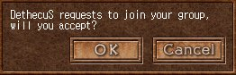
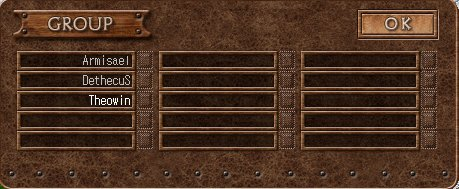
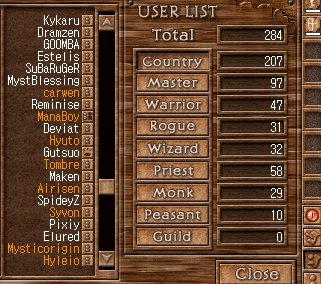

# A Guide To Hunting Group Etiquette

_by Armisael in **Dark Ages**_

## Table of Content

* Introduction
* Basics
* Seeking and Getting Invitation
* Conduct During Hunting
* Path Specifics
* Conclusion

## Introduction

Greetings fellow Aislings. The purpose of this parchment is to aid young
Aislings who want to learn some tips about good conducts in hunting. Hunting is
a large part of Aislings' life in Temuair. Although hunting alone is a viable
option and can be very fun in your early circles `((levels))`, as you enter
higher circles, creatures tend to become increasingly stronger and harder for
lone hunters to handle. Later, in most master hunting areas, hunting with a
group of Aislings almost becomes a necessity, which is why it is important to
behave politely in a hunting group. A good hunting conduct can not only gain
you more friends and invitations, but also help your group hunt more smoothly.

In addition, having a good etiquette is good for building up your reputation,
which will follow you throughout your life in Temuair. If your group mates do
not like the way you talk, or the way you try to claim every precious drop from
monsters, they will likely tell their friends and guild mates to not invite you
to hunt again or join their guilds.

For these reasons, I hope this guide will help you start a fun adventure in
Temuair. This will be discussed in several aspects: the basics about forming a
group, how to seek and invite people to hunt, and some specifics about each
path. `((Some paragraphs will contain OOC content and will be enclosed with
double brackets.))`

## Basics

### Invite People To Your Group

Inviting someone into your group or joining into a group is quite simple. `((To
invite a person into your group, click on the person and click on his group
icon. Sometimes people turn off their group icon to avoid being grouped, in
which case you can remind them to turn it on.))` If you are invited to join a
group, `((in which case a menu will pop up,))` you can answer yes to join or no
to refuse. You can also decide that you don't want to be bothered by invitation
`((by turning off your group icon))`. Keep in mind that you will automatically
leave your group if you travel from Temuair to Medenia, a new continent, or
vice versa.



### Leave Your Group

`((To leave your group, simply turn off your own group icon. You will see your
group icon change graphically when you turn it on and off.))`

### Kick Out A Member Of Your Group

Only a group leader can practice this action. You can politely ask a member to
leave the group by himself. `((Or you can click the designated member's group
icon and he will automatically be disjoined from the group))`

### Disband Your Group

Only a group leader can practice this action. `((Click your own group icon to
disband the whole group.))`

### Check Your Current Group Members

Anyone can check his current group status. There are several ways to know who
are in your groups. A priest who has group healing spells, such as _beag ioc
comlha_, can cast it once to see who are healed. `((Current Darkages client
5.51 provides two options. You can click the group icon in the left bottom
corner of your Darkages interface window, and a menu will pop up to show a list
of current members. The group leader will appear in different color. You can
also press 'H', and any group member within your sight will appear in slightly
yellow color.))`



### Use Group Chat

You can whisper to your group, and your whisper will travel far to any place
within Temuair. `((Press <shift><quote>!! to whisper to your group. Your group
conversation will appear in brown color. Press <F1> in game to see details.))`

## Seeking and Getting Invitation

### User List

`((A convenient way to seek potential group mates is to search through global
user list, a feature added after client 5.51))`. Understand that when you group
hunt with people, you share experience. The group mates who are of higher
insights than you will gain more experience for each monster killed, depending
on how wide the insight gaps are between each member of your group. `((On the
global list, the names in orange colors are the ones suitable to hunt with your
insights. The names in white colors are either too high of insights or too low
for you. You can utilize this feature to look for potential group mates.))`



### Ask Politely

Usually a simple "Hunt?" will suffice. However, keep in mind that there are
some people who are sensitive to how polite you are, and how heretic you are.
And if you are in the majority of melee paths in Temuair, you may sometimes
have to contend to get a priest or a wizard. In this case, a polite invitation
such as "Hi, I am a warrior of insight 57th and I am very good at westwood
hunting. Would you like to hunt?" can really go a long way.

In addition, patience, humbleness, and availability are all very attractive
traits that people seek. If you whisper someone to hunt and get rejected, don't
give up just yet. Tell them something like "Aw that's too bad. But I will hang
around in Temuair for hours, so if you ever need a warrior, please let me know
OK?" This has worked very well for me personally, since I get whispered back
very often. The fact is that at some points people will start looking for group
mates, and they will very likely remember your invitation, plus they already
know you are available. Furthermore, if humor is one of your traits, be sure to
show it! Having an interesting profile helps too. Everyone likes to hunt with
fun people.

### Be Prepared

Perhaps nothing is more inviting, or more demonstrative of professionalism,
than "Hi. I have dark belt, dark necklace and elemental necklace. My equipment
is up-to-date and I nearly perfect my assail skills. Would you like to hunt?"
If you are melee paths, be sure to update your equipment and train your skills.
If you are casters, be sure that you learn new spells as soon as you are ready
(_ioc, cradh, aite, fas_, etc). This is a practical matter, and people will
probably ask you about it anyway. In addition, make sure you have plenty of red
potions (_beothaich deums_) and home scrolls, which become crucial when hunting
goes wrong. You will always be thanked for having extras!

### Be Sociable

Even when you are not looking for a hunting group, you can still whisper people
to ask how they do and chat, in order to get them to know you better. People
prefer to hunt with friends that they hang out with, so this way it is easier
for you to make friends and eventually make a steady hunting group.

### Teach A Thing Or Two

Depending on whether you want to go extra miles, you can help young Aislings
out instead of saying "This group sucks. I am leaving!" There have been several
occasions when I take the time to tell my group how wearing different
necklace/belt changes your attack/defense power, and how casting _fas_ spells
enhance them during battles. This extra effort not only makes hunting go more
smoothly, but also makes you more friends.

## Conduct During Hunting

### Help Other Groups In Need

If you meet another group that gets ambushed by a mob of monsters and seems to
have difficulty handling the mob, lend a hand by casting healing or buff-up
spells (if you are priest or wizard), or by diverting or blinding some monsters
(if you are warrior, rogue, or monk). In return they might help you back. This
is especially important in many master areas, where groups under ambush often
have to help each other with handling huge ambush or resurrecting group
members.

### Pooling

A common practice is for one group member to pick up the loot, including money,
and distribute the loot evenly among members when the hunting ends. Discuss in
advance who will do the pooling. During battles, don't be so hasty to grab
dropped items like they are flying away, because they won't. Dropped items will
be cursed for a while so only your group members are given the priority of
picks. Wait until the situation eases a bit then claim your loot.

### Sharing Loot

Consult your group beforehand, especially if the main goal of your group is to
seek rare items. In my humble opinion, nothing in Temuair is as rare or
precious as having good hunting buddies.

### Pulling

Basically, pulling is not an issue if you have a rogue in your group because
crowd control is one of rogue's expertises. However, Do not be greedy and walk
all over the map to attract 40 monsters if your group can't handle them!

### Keep Them Informed

Let your group know beforehand that you have to leave soon. This allows your
group to decide whether to end hunt soon or to find a replacement, or to decide
to speed up if your group is currently on a quest. If you run out of red
potions, ask your group mates to spare some potions and check the total count
of red potions. If your buff spells run out, such as _aite_ or _fas_ spell,
inform your casters your status and don't rush into attacking monsters.

### Don't Steal Monsters

It is generally not respectful to steal monsters that clearly target on other
groups. Excessive stealing of monsters may even constitute harassment, which
may get you into trouble with the law.

### Don't Leave Anyone Behind

In case you decide to disband your group, leave your group, or ask a member of
your group to leave, please make sure to do so in a safe environment. Playing
with group options while battling monsters is really dangerous to your group.
It will also be better to announce your action to your group first. If your
group is on a quest, stick around until everyone finishes the quest. It's
impolite to suddenly leave your group without any warning.

If you are outnumbered or you are fighting monsters that are too strong, your
group could end up all getting skulled. Try to stay calm and evaluate the
situation. If there is a safe area near your current location, try to remember
where your group mates get skulled and run to the safe area. If there is no
safe place to go, scroll back to town first. The siblings of your skulled group
may whisper you (which is quite common) and wait for rescue. If you know there
are some groups nearby at the time, try to whisper them for help. Hopefully
other groups will help kill the monsters and make it safe for the skulled to
come back and get resurrected. If there is unfortunately no group nearby to
help, then try to form a rescue team ("I am trying to form a rescue team now.
We are going to rescue everyone."). Don't just abandon your skulled group mates
as it gives you bad reputation.

## Path Specifics

### Warrior/Monk

A common thing melee paths like to do is attacking monsters boldly `((by
auto-targeting))` and expect the priest to keep them alive. Know when to step
back and wait until it's safe to engage with the enemy. For example, wait until
_fas_ or _cradh_ spells are cast on monsters. If you are in low health, step
back for a bit and ask the priest to heal you.

The repair cost of warrior's equipment is significantly more than that of other
paths. Therefore, you can discuss with your group in advance that you need more
money from the loot to repair your equipment, and they usually do understand
and give you larger share of the loot.

### Rogues

Rogues are very good at immobilizing enemies and thus a natural puller.
Communicate well with your group. If you like to lead your group, let them know
that you are leading and pulling. However, if monsters are tough, and you do
not have much health power to take much beating, you can ask your warrior or
monk teammates to pull monsters and set a blind snare line after them, and let
them lure monsters back to the snare line. Make sure your teammates give you
room to set blind snares.

### Priest

Priests have healing spells and lots of buff-up spells. A common practice for
priests is to synchronize casting buff-up spells on teammates. Since everyone's
spells run out at the same time, the priest would know when to cast them again,
making his busy job easier. If you are low on mana, let your group know that
you need time to regenerate your mana power so that they stop pulling more
monsters ("I am low on mana power, can you give me a minute to regenerate?").
If you are about to cast buff-up spells, you can whisper your group to stop
running around for a moment so you can synchronize ("_Aite_ runs out soon, so
stop for a bit and let me cast _aite_ please").

In addition, when you achieve mastership as a priest, you will gain a very
useful spell called _mor dion comlha_. This spell will harden the body of your
group mates, and costs relatively little mana. Cast this spell on your group
mates whenever you can.

### Wizard

Wizards can enhance elemental defense and attack power, which makes hunting
very easier (providing that the correct necklace or belt is used). Similar to
priests, some experienced wizards like to synchronize spells, though casting on
demand isn't so bad for wizards.

As a wizard, you should be cautious with multiple-target spells. If you have a
rogue in your group, wait for him to blind all monsters nearby then start
attacking. In addition, if monsters are not blinded, make sure that you don't
end up pulling away the monsters that your melee teammates are targeting, which
could be annoying and dangerous.

## Conclusion

Hunting etiquette is very crucial to achieve success in a `((multiplayer))`
community like Temuair. It really comes down to gaining respect from people,
and make yourself known in this community. I am sure that the list of tips in
this parchment is not a complete list, as I know everyone has his own tips and
ways of hunting conduct. I hope that my tips will be at least helpful to get
young Aisling started and make their hunting more enjoyable and friendly
experience.

`((This web page is written for lore contest in Darkages. All pictures are
properties of Nexon Inc.))`

***

```
*Librarian Notes*

This entry has been edited to conform to Library formatting.
Recovered from the Internet Archive; the original site no longer exists.
The original can be found at https://web.archive.org/web/20050507122021/http://www.geocities.com/dawassabi/hunting_etiquette.htm .
```
