# Event: Where is Tailte?

_by Ashen in **Dark Ages**_

`((This event was held on the 1st of October, 2000. It had no mundane
intervention at all. All scripts and participation was by aislings and
aislings only. The four hosts were myself (Feena), Jayer, Ashen and Felicity.
The event ran for just about 2 hours long. About 20 aislings attended and
participated. Special thanks to my hubby, JubeiX, for participating to be
Ashen's test subject and donations of some prizes. The invitation to the event
was sent on the 26th of September. It was posted on four grey boards in
Temuair.))`

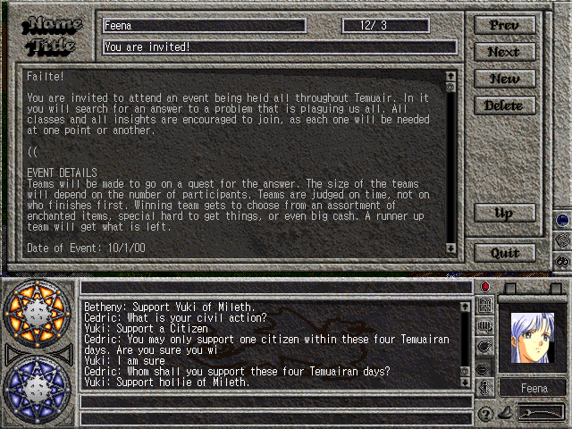

## The Story

It was in the 15 Deoch, in the year of Ceannlaidir, that a young baker woman
named Damara approached me in secret after mass one double-moon. She resided
in the shire of Undine beneath the cruel yoke of Loures. It seemed that her
only child, a girl, named Taillte had come up missing. She spoke in a hushed
whisper as she recounted the awful details.

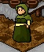

It was early in the morning when she went to fetch her daughter from the
shadow of sleep to attend to her chores. Taillte was usually an early riser
and it seemed strange to her mother that she would have to rouse her but up
she went into the child's bedroom. Upon arriving, to her horror, all that she
found was a golden signet ring that bore the crest of the royal family of
Loures. She thought to immediately alert authorities but stayed herself.

Damara thought to herself that after all the problems and movements toward
rebellion and war that perhaps she ought to try to correct things herself. She
was going to approach her own church, that of the God Cail, but then thought
better of it. Since the discovery of the monastery, the monks had become
rather powerful and were more united. She was worried that it would just push
them to violent action and after hearing of me through some of my fellowship,
she thought that I would be the best suited for the job. Fiosachd, being the
Lord of luck and wit, would hold her secrets and stealthily return her
daughter home.

After hearing the whole story, my heart was moved to assist this poor woman
who had even stepped against her religion to find her child. I sent word
throughout Temuair that I sought heroes to assist me in my quest.

Within my church I found those who would be available to assist these young
Aislings. Brother Ashen, I knew he would be within the library in Loures
researching and I sent them there to see if he had found any evidence to
support the kidnapping claim. He had not seen anyone enter or leave the palace
while he was there.

Being clever, Brother Ashen sent our adventurers to Brother Jayer whom I had
sent to Undine to comfort Damara. Damara had confided in him that her daughter
had been complaining of horrid nightmares involving pictures of a terrible war
that killed everyone she cared for and loved. While he was there he scoured
the bedroom of the girl in search for further clues. He found nothing, not
even the mysterious signet ring.

Brother Jayer sent them to his mentor Lady Felicity whom he knew was praying
in Ceannlaidir's temple. As they arrived there, Felicity told them that she
had no information, but if they liked she could throw bones to read the
omens. After they returned with the skulls of three different creatures,
Felicity interpreted the meaning to be that the god Ceannlaidir was calling
the girl forth toHim.

The clever adventurers headed straight away to the temple of veils in Mileth
where they found the young girl transfixed by Ceannlaidir's avatar. Taillte
slowly awoke from a trance-like state. The presence of aislings in the room
broke Ceannlaidir's spell on her. She handed them a family heirloom and sent
them back to me.

When I returned to Undine and handed the heirlooms to Damara, she knew her
daughter had been found and she was overjoyed. The priesthood of Fiosachd were
so delighted with the way things turned out they dumped piles of gifts and
gold into my lap to give to the adventurers who had helped to find precious
Taillte.

After Taillte was safe at home, My fellow priests and I heard the rest of the
story which I happily imparted to the seekers. Taillte was having visions of
war which were sent to her by Lord Ceannlaidir. After the uprising, the war
god had hoped for a monumental battle. When things calmed, he thought he could
stir the people into fighting by making the child look as though she has been
kidnapped. If Damara had reported the "crime", it might have worked. I'd like
to think that Fiosachd whispered in her ear that there might be a better way.

What about the ring? As the ring was never found, we now know it was merely an
illusion placed by the God of war to incite Damara to anger. Perhaps the great
God Ceannlaidir will try his trickery again one day and in the mind of my
adventurers, they can't wait to foil him again!

## How the Event was Played

I placed an invitation to my event on all the public boards of the game. I
received very few replies, but most everyone just showed up at the designated
time anyways.

I had 3 co-hosts; Felicity, Ashen, and Jayer.

I sent parties out in 4 teams of 4. The went from the starting point of the
Kasmanium mines to Loures. They had find Ashen a royal wax to continue on to
Undine. In Undine they found they had to bring Jayer a fifleaf deum to help
soothe the heart of Damara. Then on to Ceannlaidir's temple where they had to
bring Felicity three different skulls. In the room where Ceannlaidir's avatar
lies to have warriors take oath is where they found Taillte.

As they went from point to point, I asked my accomplices to rate them on their
role-play while I marked the start times and endtimes. My scoring system was
as follows. Time counted as 66% of the score and role-playing counted as 33%.
Quickest team got 60 points, 2nd got 54 points, 3rd got 48 points and last got
42 points. Role playing was judged on a scale from 1 to 10 and got one score
from each of the other co-hosts, so a maximum of 30 points. The points were
added to decide the winning team.

After I did the scoring, I announced the winners as team 2 which consisted of:
Maiwyn, Boltmage, Browneyes, Rebe and Josef. From my pockets and the pockets of
Felicity and Jubeix, we awarded prizes.We had a huge list of items to offer.
The first place team got to pick three things, the second place team picked
two and the 3rd and 4th place teams picked one item, for each aisling in the
team.

## Participants

This is only the list of players I got at the beginning of the event, a few
joined in later. I'm sorry if you aren't listed, you aren't forgotten though!

| Team 1    | Team 2    | Team 3      | Team 4   |
|-----------|-----------|-------------|----------|
| Nabet     | Mailwyn   | Spader      | Seminijr |
| Perish    | Boltmage  | Joshrambo   | Tencho   |
| Melisande | Browneyes | Xae         | Dulio    |
| Lenoa     | Rebe      | JeymalDesse | Tomochan |
| Torakak   | Josef     | Chrissy     | Anthea   |

## Feedback

All the feedback from the event was helpful for making another one. Even ones
with a negative tone are positive in that you know what to look for the next
time to make it more enjoyable. Browneyes' and Lenoa's email was edited to
remove their email address from the message for privacy reasons.

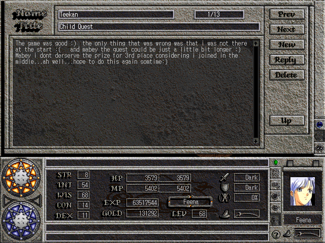

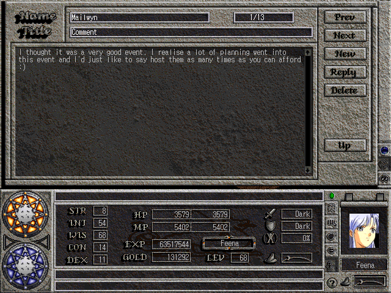


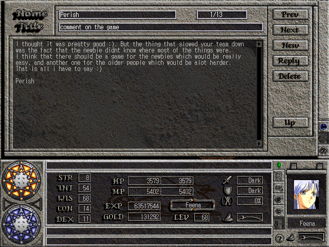


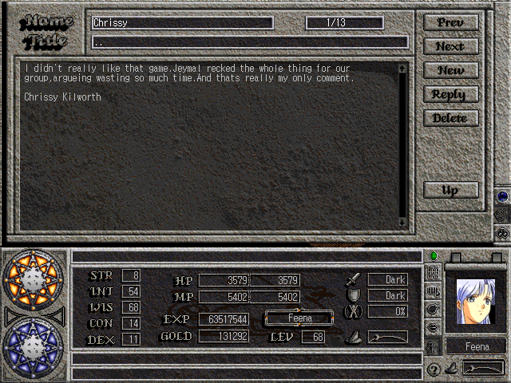

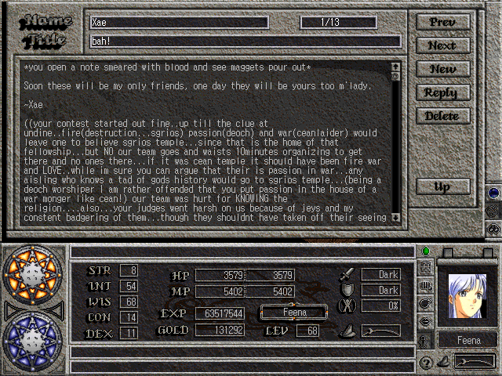

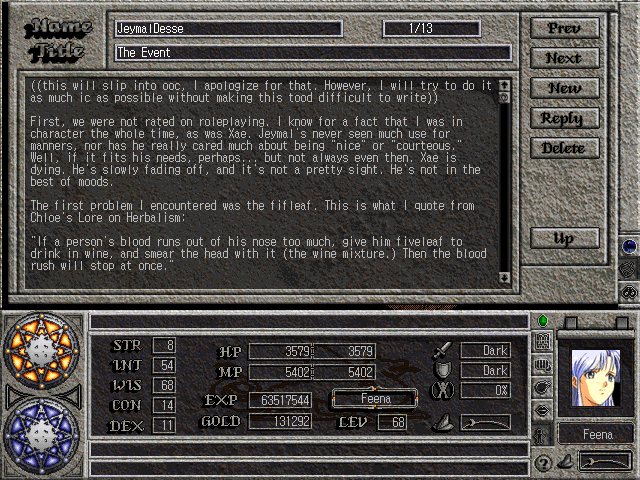

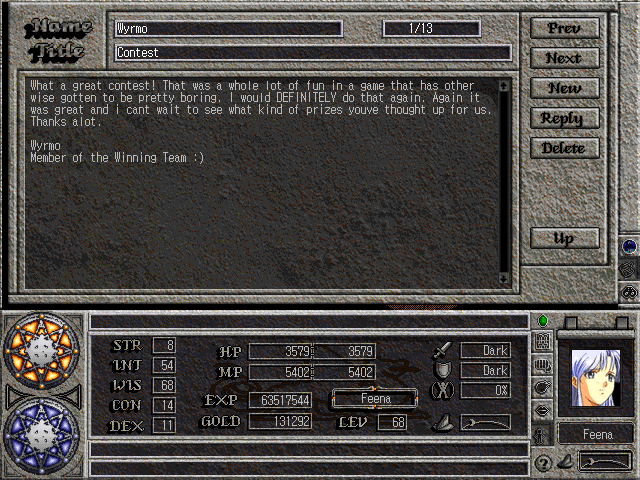

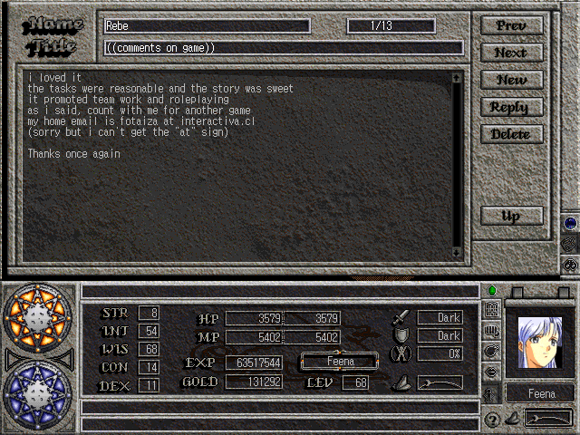

Browneyes

Lenoa

## Screenshots

I hate to say it, but we seemed to get a few less screenshots then we wanted
to. I know half of the ones I hit F12 for didn't seem to register. Sorry
:-( ...

Feena:

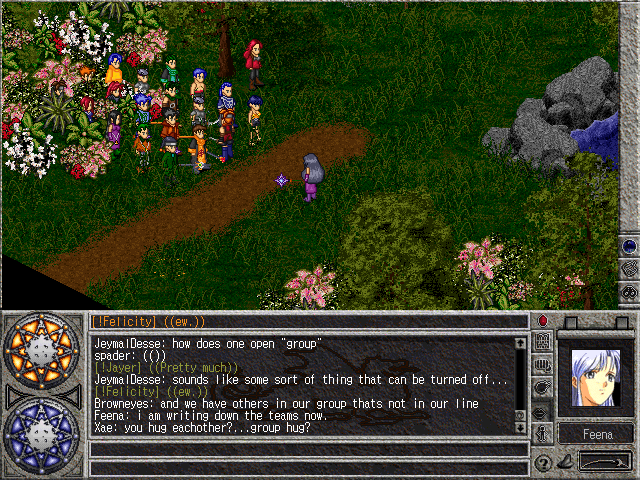

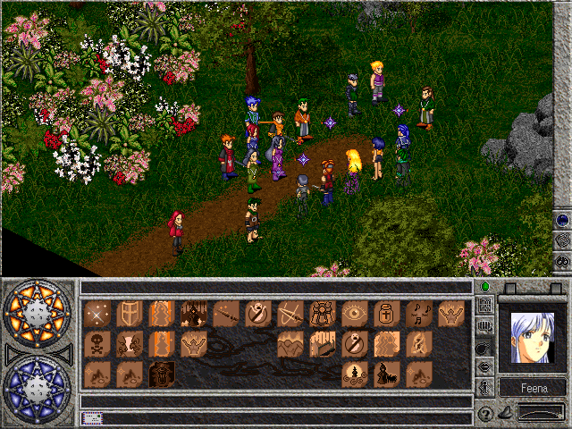

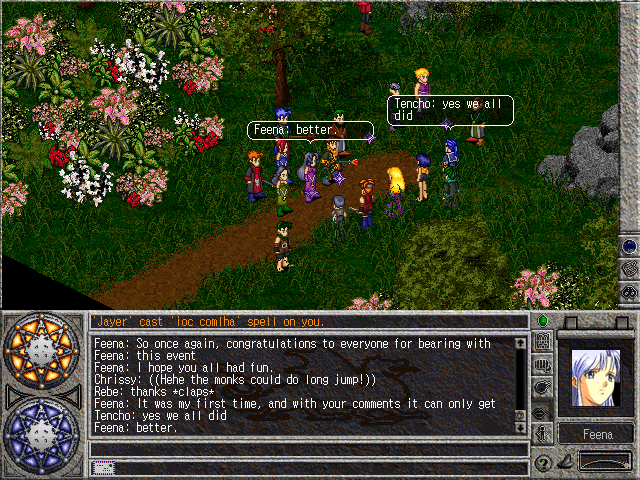

Browneyes:

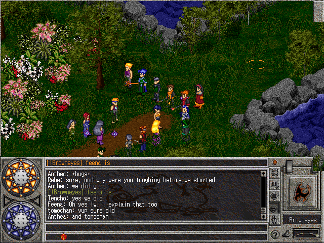

JubeiX:

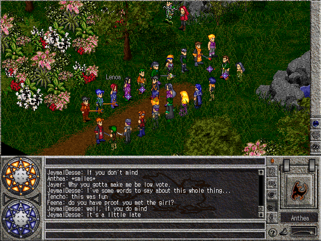


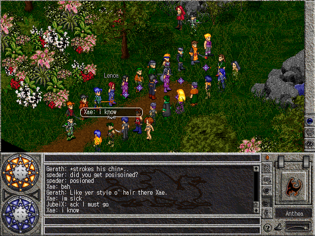

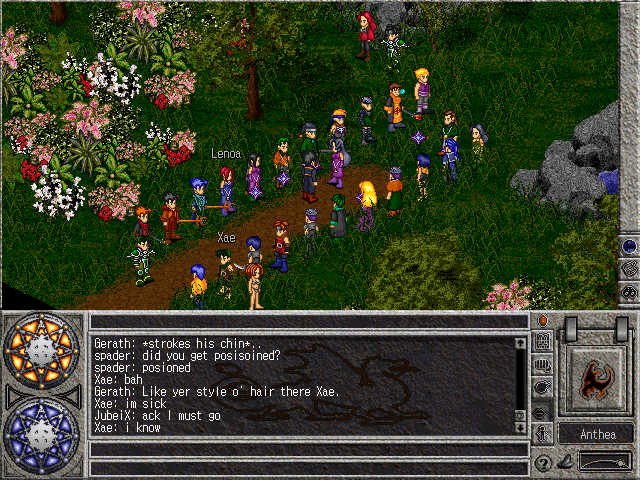

***

```
*Librarian Notes*

This entry has been heavily edited to conform to Library formatting.
The original can be found at http://www.darkages.com/2000/community/evt/Where_Taillte/taillte1.html .
```
