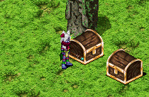
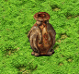
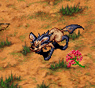
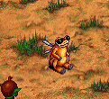
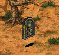
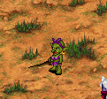
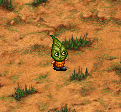

# A Bee-ginner's Guide to the Chests of Asilon

_by Bee in **Dark Ages**_



## Introduction

When traveling the prairies of Asilon on the continent of Medenia you will discover many treasure chests. The rough terrain of the prairies makes for bumpy travels for the merchant caravans which make the journey from the harbour to the villages. Because of this chests are lost off of the back of the carts without the merchants taking any notice. Thankfully, the keys to these chests are often falling out of the pockets of the merchants, where they are picked up by the native creatures.

Many people simply walk right past these monsters, and ignore the chests as they venture in search of greater treasures and adventures. But there are exciting things to be found here in Asilon. Through this guide we will explore the process of finding the keys to open these chests, as well as the riches that can be found inside of them.

## Chapter One - Finding Keys

There are a total of four different keys which can be used to open the chests. Not every creature seems to pick up these keys, and sometimes it seems as though none of them have. But don't lose hope! During my expeditions I have been able to compile a list of the different types of keys, and keep brief notes on the creatures that are attracted to them.

### Love Keys



Urns are slow, earthy creatures but they are nonetheless strong. Do not let their speed or docile appearance fool you. They can be found deep in the Asilon Prairies.



Hyena are wild and vicious creatures, so use caution when hunting them. They can be found in Noam Plains, just outside of Noam Village.

### Red Keys


Green Droppers look like bouncing jelly spheres and one would assume they are easily taken down. But they are strong and capable of defending themselves quite effortlessly. They roam in abundance in the early fields of Asilon Prairies.



Black-Eyed Salog looks like a very relaxed being, but these creatures are fast and strong. They are native to Noam Plains, just outside of Noam Village.



Death Stone, as the name implies, is a deadly tombstone-like creature which lives in the centres of Noam Plains.

### Marble Keys


Orange Scrummel are cute and unassuming, but strong in their own right. They also carry with them Panticas, which can be incredibly useful to those just starting out in the paths of Medenia. They are found in the beginning fields of Asilon Prairies.


Fleal look something like a floating pillow, with bright yellow eyes. They are beautiful to watch in motion, but if you desire the keys they carry you will need to fight for it. They are often seen floating about deep in the Asilon Prairies.



Phowa Gladiators are the hardened warrior women of the Phowa tribes, native to Noam Plains, just outside of Noam Village.

### Leaf Keys



NamuNamu are curious leaf-like tribesmen, found in the heart of Noam Plains. They are flighty and easily startled, so you must be swift!

Vultures are large, and deadly birds, which feed off the carcasses of fallen creatures and maybe even the unfortunate Aislings who dare to venture deep into Noam Plains.

## Chapter Two - Opening Chests

Once you have found what you feel is a suitable amount of keys, you can begin locating chests to open. The chests fall and end up scattered all over the prairies of Asilon, so if you just take a walk around you will soon discover many.

Simply having the keys is not enough to just open the chests. Many of the locks have been rusted away or covered in dirt over time, so a little force is required to be able to insert the key. Assailing or using a spell on them does the trick to getting them opened. I personally use Deo Lamh, and it works quite nicely.

Because of the disrepair that has befallen the chests, there is no way of knowing which key is required to open a chest, and at times you may realize...

_Bee Macro_

***

```
*Librarian Notes*

This entry has been heavily edited to conform to Library formatting.
The original can be found at https://novus-imperia.com/college/lore/bee_asilon/1.html .
```
