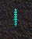

# Sagesse des Armes

_by BioMagus in **Dark Ages**_

_Weapond Lore_


This Mystic Tablet Contains the Details of the Ancient Weaponds Found in The
Depth of Temuair. However, for prices and locations for some of these weaponds
one should council the prize winning scrolls "[Lioarlan oe
Ynsagh](Lethalia-Lioarlan-De-Ynsagh.md)." Constructed by Mighy Lethalia
Horidre, Priestess of Deoch. This table is to help young and old Aisling's with
the strength and weakness of thier weaponds.

Some of the larger weaponds can not be bought and only be found from monsters.
Thus will be "Tailored" better than it's normal stats. To find the stats of a
taloired item you would add points to it's "Damage" (Both S: and L:), and Level
the Weapond can be used, as shown here...

```
Good    +2
Fine    +4
Grand   +6
Great   +8
```

For example, a Long Sword is normaly

```
Damage: S: 55m75
        L: 49m69
Peasant Level 56
```

Now if it was taloired to Great you would add 8 points to it's Damage and
Level, making it

```
Damage: S: 63m83
        L: 57m77
Peasant Level 64
```

This tablet was constructed by the help of a very important person, Luathas,
with his Knoelege he found these details. Thank you...

## Peasant Weaponds

These weaponds are weaponds that any path can wear. All these weaponds can be
bought by Mundane's.

### Stick


Durability: 1000  
Weight: 3  
Damage: S: 4m14  
L: 4m14  
Peasant Level 1

### Dirk


Durability: 3000  
Weight: 4  
Damage: S: 5m15  
L: 3m13  
Mana Increase: -25  
Peasant Level 2

### Eppe


Durability: 4000  
Weight: 5  
Damage: S: 3m13  
L: 5m15  
Mana Increase: -100  
Peasant Level 2

### Loures Saber


Durability: 6000  
Weight: 7  
Damage: S: 18m28  
L: 18m28  
Mana Increase: -250  
Will Increase: -1  
Peasant Level 7

### Claidheamh


Durability: 7000  
Weigth: 8  
Damage: S: 20m30  
L: 16m26  
Mana Increase: -500  
Will Increase: -4  
Peasant Level 14

### Broad Sword


Durability: 8000  
Weight: 9  
Damage: S: 16m26  
L: 20m30  
Mana Increase: -750  
Will Increase: -4  
Peasant Level 17

### Battle Sword


Durability: 10,000  
Weight: 10  
Damage: S: 33m43  
L: 33m43  
Mana Increase: -1000  
Will Increase: -5  
Wisdom Increase: -2  
Peasant Level 26

### Templar


Durability: 11,000  
Weight: 12  
Damage: S: 35m45  
L: 31m41  
Mana Increase: -1500  
Will Increase: -5  
Wisdom Increase: -2  
Peasant Level 29

### Masquerade


Durability: 12,000  
Weight: 15  
Damage: S: 31m41  
L: 35m45  
Mana Increase: -2000  
Will Increase: -5  
Wisdom Increase: -2  
Peasant Level 31

### Bramable


Durability: 15,000  
Weight: 12  
Damage: S: 40m60  
L: 34m54  
Mana Increase: -2000  
Will Increase: -5  
Wisdom Increase: -3  
Peasant Level 41

### Black Death


Durability: 16,000  
Weight: 18  
Damage: S: 34m54  
L: 40m60  
Mana Increase: -2500  
Will Increase: -5  
Wisdom Increase: -3  
Peasant Level 45

### Long Sword


Durability: 20,000  
Weight: 18  
Damage: S: 55m75  
L: 49m69  
Mana Increase: -3000  
Will Increase: -6  
Wisdom Increase: -3  
Peasant Level 56

### Stilla


Durability: 22,000  
Weight: 25  
Damage: S: 49m69  
L: 55m75  
Mana Increase: -3000  
Will Increase: -6  
Wisdom Increase: -3  
Peasant Level 61

## Rogue Weaponds

### Snow Dagger


Durability: 2000  
Weight: 3  
Damage: S: 10m20  
L: 5m15  
Rogue Level 1

### Snow Secret


Durability: 1000  
Weight: 3  
Damage: S: 10m24  
L: 5m18  
Rogue Level 1

### Center Dagger


Durability: 4000  
Weight: 5  
Damage: S: 25m35  
L: 20m30  
Rogue Level 4

### Center Secret


Durability: 3000  
Weight: 5  
Damage: S: 25m42  
L: 20m36  
Rogue Level 7

### Blossom Dagger


Durability: 6000  
Weight: 7  
Damage: S: 40m50  
L: 35m45  
Rogue Level 14

### Blossom Secret


Durability: 4000  
Weight: 7  
Damage: S: 40m65  
L: 35m60  
Rogue Level 21

### Whip


Durability: 6000  
Weight: 10  
Damage: S: 20m80  
L: 30m90  
Rogue Level 26

### Moon Dagger


Durability: 8000  
Weight: 9  
Damage: S: 45m65  
L: 40m60  
Rogue Level 30

### Moon Secret


Durability: 6000  
Weight: 9  
Damage: S: 45m78  
L: 40m75  
Rogue Level 39

### Light Dagger



Durability: 10,000  
Weight: 11  
Damage: S: 60m80  
L: 55m75  
Rogue Level 40

### Light Secret


Durability: 7000  
Weight: 11  
Damage: S: 60m95  
L: 55m90  
Rogue Level 52

### Sun Dagger


Durability: 12,000  
Weight: 13  
Damage: S: 75m95  
L: 70m90  
Rogue Level 60

### Sun Secret


Durability: 9000  
Weight: 13  
Damage: S: 75m110  
L: 70m105  
Rogue Level 69

### Lotus Dagger


Durability: 14,000  
Weight: 15  
Damage: S: 80m110  
L: 75m105  
Rogue Level 75

### Lotus Secret


Durability: 10,000  
Weight: 15  
Damage: S: 80m125  
L: 75m120  
Rogue Level 86

## Warrior Weaponds

### Two Handed Claidhmore


Durability: 60,000  
Weight: 45  
Damage: S: 146m186  
L: 130m170  
Mana Increase: -500  
Will Increase: -7  
Grace Increase: -3  
Wisdom Increase: -3  
Warrior Level 71

### Two Handed Emerald Sword


Durability: 66,000  
Weight: 50  
Damage: S: 128m168  
L: 144m184  
Mana Increase: -500  
Will Increase: -7  
Grace Increase: -3  
Wisdome Increase: -3  
Warrior Level 77

### Two Handed Gladius


Durability: 80,000  
Weight: 70  
Damage: S: 156m216  
L: 140m200  
Mana Increase: -500  
Will Increase: -1  
Grace Increase: -3  
Wisdom Increase: -1  
Warrior Level 86

### Two Handed Kingui


Durability: 90,000  
Weight: 80  
Damage: S: 142m202  
L: 158m218  
Mana Increase: -500  
Will Increase: -1  
Grace Increase: -2  
Wisdom Increase: -1  
Warrior Level 90

### One Handed Hy-Brasyl


Durability: Unknown  
Weight: Unknown  
Damage: S: Unknown  
L: Unknown  
Magicaly Properties: Unknown  
Warrior Level Unknown

## Staffs

Just for a little note, staffs are not seen as weaponds and are used for thier
magical properties, and thus can not be taloired by any rogue.

### Wizards

#### Magus Ares


Durability: 3000  
Weight: 5  
Damage: S: 4m20  
L: 6m30  
Mage Level 19

#### Magus Kronos


Durability: 3000  
Weight: 5  
Damage: S: 4m20  
L: 6m30  
Mage Level 19

#### Magus Zues


Durability: 3000  
Weight: 5  
Damage: S: 4m20  
L: 6m30  
Mage Level 19

### Priests

#### Holy Hermies


Durability: 3000  
Weight: 5  
Damage: S: 4m20  
L: 6m30  
Poet Level 19

#### Holy Kronos


Durability: 3000  
Weight: 5  
Damage: S: 4m20  
L: 6m30  
Poet Level 19

#### Holy Zues


Durability: 3000  
Weight: 5  
Damage: S: 4m20  
L: 6m30  
Poet Level 19

#### Holy Gaea


Durability: 3000  
Weight: 5  
Damage: S: 4m20  
L: 6m30  
Poet Level 19

_Bio M'agus_  
_Wizard Of Athar_  
_Subject of Luathas_

***

```
*Librarian Notes*

This entry has been heavily edited to conform to Library formatting.
The original can be found at http://www.darkages.com/2000/download/Biomagus_Weapon/index.htm .
```
