# Library of Knowledge

_by Biomagus in **Dark Ages**_

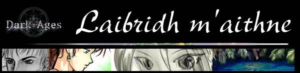

## Laibridh M'aithne

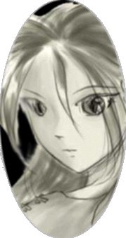

Welcome to Laibridh M'aithne. This is inscriptions in the ancient tongue
meaning "Library of Knowledge". This library is one of the oldest talking about
many different issues. Throughout this archive one will first discover the
wonders of this great land of Temuair. The scroll labeled **"Attractions"**
will conference both the great art of the land & the exciting sights of what in
thrills us to move on to the next challenge... the next quest.

The knowledge of Temuair is mostly held in the minds of the many we love, the
Mundanes. There are many Mundanes all over however, all of them are hard to
keep touch of. In the ancient scroll of **"Mundane Ainm's"** one will find all
the names of the famous mothers and fathers that brought us up. This magical
scroll also can help many Aislings that are on a quest or journey to find a
mundane, as it give details of what he does and where he is found. Imagine All
the Names of all the Mundanes ever.

One of the most important scrolls is the **"Cthonic Remains"**. This is for
many of the younger Aislings that wish to venture into the great hunting
ground. It will give specific details of the magnificent beasts that dwell in
this ancient land. Also where they are found. However, as this is for the
younger asilings, this scroll only goes to the depths of the eighth realm of
the dark place. For the young to venture farther would mean certain death and a
quick visit to the dark lord, Sgath.

One of the last scrolls found in this ancient asylum is the scroll of
**"Legends"**. It will preach of the young tale of the demi-gods, scary tales
of our priestess, sad tales about the sacrifice of heroes to our local
nightmares. This scroll is in hope to enrich the minds, and encourage the
telling of stories of all. Stories & legends are what make the mind a beautiful
thing.

Have fun absorbing this scrolls, and always send a **"Pigeon"** about
complements. Please note: This library is best viewed in spectacles of 800x600,
with a lenses that support frames. I thank you.

## Attractions of Temuair


### Abel Crypt

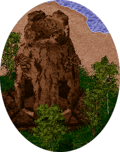

Danger, courage and fear. This is what you'll find in this horrid place. Dark
creatures dwell in this pit of destructions. On the out-skirts of Abel you'll
find the dark palace that dips into the underground far beyond the reaches of
light. However, such a magnificent peice of art-work this palace is. Great
mounds of earth reaches out of the ground, as if it owns the land it stand on.
The both gothic yet mysterious design of this temple is breath-taking and
horrifying at the same time. If one wishes to battle the dark in a ever-lasting
glory, visit this palace, but be warned... take a learned priestess, you'll
need it.

### Cail Temple Fountain

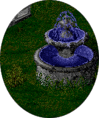

Outside the mighty temple of balance of peace, lies the soft sound of water
sprinkling over the splashes of heart-warming purity. This must be one of the
most artistic points in all of the lands of Temuair. The water dripples of the
cold stone like rain-drops off mountain dew. This expression of love is a must
see for all.

### Glorious Undine Lake

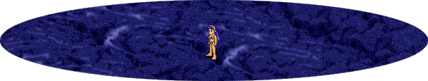

Gliocas' indomitable drive and passion is what gives this lake a mystical
being. On a soft, quiet night, it is said that you can see Glioca her-self bath
in the soft tender waters of this magnificent lake. It is truly blessed with
the powers of a goddess.

### Mileth Church

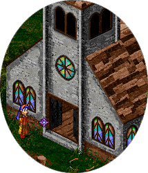

Can you hear the bell of those "Just-married-couple"? Such peace, and love is
in the air. And even Sgath the dark lord can't with-stand the harmonies that
plagues this place. Colours infuse this paradise with such bravery. A
insightful sight to see.

### Statue of the Temples

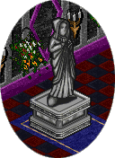

Every temple of a god is blessed with a statue. This statue is not to be taken
with neglect. It is like a tender fairy that not only represents a god, but is
a god in its own way. This statue is crafted with care, that you can almost see
the emotions of the god at times. A true peace of art-work, and a great peice
of faith.

### Abel's Spectacular Beach's

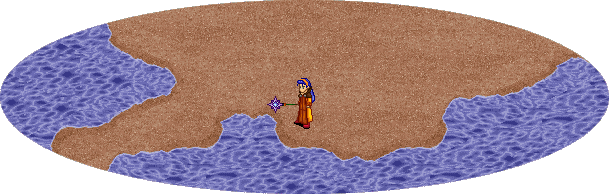

Great castle made out of sand, a romantic stroll along the beach shore. This
coast is one of spenders. One can heard the soft sounds of the water, of the
waves that crash onto the shore of spenders, so tempting even a fairy can't
resist to stop and listen. Gazing onto this beach is said to renewed ones
energy and zeal. One should try it out one night.

### Ascension Outstanding Ice Temples

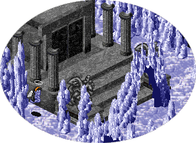

Composed of ice, these temples renew both wisdom and health. Peering into them
gives the seeker a new look on life. The ice looks like crystals on a dewy
morning, as the sun pierces the edges of the transparent rocks, into the minds
of all the Asilings that have the honor of touching it.

### Soumi's Enchanting Fountain

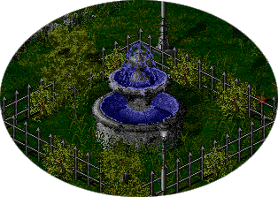

Yet another great peice of artistic visions. It incorporates both water and
nature in one clear picture. The waters of Soumi is the purest of the land,
which makes good soil for crops and fruits. One day one must enter the great
gates of Soumi and sit on a bench that is seated around this visionary pool of
pleasure.

### Wonder of Astrid

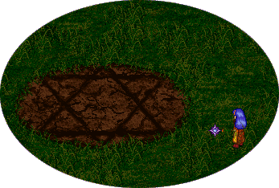

Astrid has always been a place of mystery. Being just out-side on Undine this
forest is enchanted with Kobs' Wolfs' and Gob Shamons'. A enchanting octagram
is located in the center of this fierce place. It is use by the Shamons' for
all sorts of rituals and incantations to hinder their race. The octagram itself
represents the eight gods of the beautiful land of Temuair and also follows
great history that surrounds it. This mystery can not be missed.

### Prize of Mileth

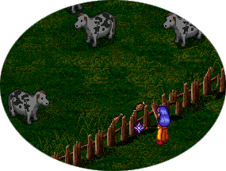

One of the great prizes of Mileth is its love for animals. Even in Mileth
itself is cows that shows this great farming land a pleasure to witness.
Mileth's cows are the best in the land and have a great repetitions to give the
most tastiest milk in the world. If you have some of Mileths' milk then you
should consider yourself lucky.

### Curse of the Crypt

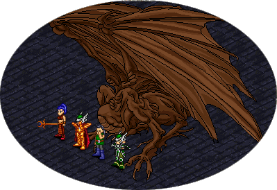

The most splendid place of them all is the dragon in the most bitter deeps of
the crypt. In this dark dark place, that no god, not even glioca herself would
touch. Here there is a great statue of a once powerful dragon. Even though just
a statue one can sense the power and enormous magic that emulates from its
body. If one listens hard they can hear all the screams of the victims that
this beast has taken. A truly scary thought, it sometimes can make the listener
mad. Be careful when you travel this far, you could catch the curse of the
Crypt!

### Undine Fountain

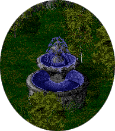

One of the best fountains in all of Temuair, is the Undine fountain. Powered by
the great waters of the undine lake, this fountain gives both slender to all
that gazes into it. If you look deep into the enchanted waters, you can see the
ancient heroes of the land as it tells you the stories of long ago.

## Mundane Ainm


| Picture | Name of Mundane | Where They Hang Out | What They Do |
|---------|-----------------|---------------------|--------------|
| 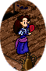 | Riona | Mileth | Inn Keeper |
|  | Runa | Abel | Inn Keeper |
|  | Saskia | Peit | Inn Keeper |

| Picture | Name of Mundane | Where They Hang Out | What They Do |
|---------|-----------------|---------------------|--------------|
| 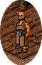 | Torrance | Mileth | Armor Smith |
|  | Steinar | Abel | Armor Smith |
|  | Valdemar | Soumi | Jewlery Smith |
|  | Leo | Peit | Armor Smith |
|  | Lowell | Loures | Armor Smith |
|  | Carlos | Rucesion | Armor Smith |
|  | Alexios | Undine | Armor Smith |

| Picture | Name of Mundane | Where They Hang Out | What They Do |
|---------|-----------------|---------------------|--------------|
|  | Callough | Mileth | Arms Smith |
|  | Vidar | Abel | Arms Smith |
|  | Torbjorn | Soumi | Arms Smith |
|  | Gunnar | Peit | Arms Smith |
|  | Marlon | Loures | Arms Smith |
|  | Marcelo | Rucesion | Arms Smith |

| Picture | Name of Mundane | Where They Hang Out | What They Do |
|---------|-----------------|---------------------|--------------|
| 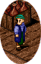 | Brody | Mileth | Tailor |
|  | Arnljot | Abel | Tailor |
|  | Huberto | Rucesion | Tailor |
|  | Hali | Undine | Talior |

| Picture | Name of Mundane | Where They Hang Out | What They Do |
|---------|-----------------|---------------------|--------------|
| 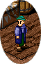 | Cassidy | Mileth | Higgler |
|  | Lamont | Abel | Higgler |
|  | Jilt | Peit | Higgler |
|  | Antonio | Rucesion | Higgler |
|  | Argus | Undine | Higgler |

| Picture | Name of Mundane | Where They Hang Out | What They Do |
|---------|-----------------|---------------------|--------------|
| 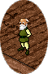 | Colm | Mileth | Message Bird Sender |
| 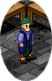 | Angelo | Rucesion | Message Bird Sender/Demagogue |

| Picture | Name of Mundane | Where They Hang Out | What They Do |
|---------|-----------------|---------------------|--------------|
| 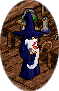 | Cian | Mileth | Alchemist |
|  | Egil | Abel | Alchemist/Award Keeper |
|  | Appie | Peit | Alchemist |
| 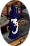 | Jean | Loures | Alchemist/Councilor |

| Picture | Name of Mundane | Where They Hang Out | What They Do |
|---------|-----------------|---------------------|--------------|
| 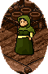 | Oona | Mileth | Baker |
|  | Aud | Abel | Baker |
|  | Gudny | Soumi | Baker |
|  | Alleen | Peit | Baker |
|  | Damara | Undine | Baker |
|  | Eadaoin | Mileth Tourial | Baker |

| Picture | Name of Mundane | Where They Hang Out | What They Do |
|---------|-----------------|---------------------|--------------|
|  | Aingeal | Mileth | Tavern Attendent/Demagogue |
|  | Frida | Abel | Tavern Attendent |
|  | Viveka | Soumi | Tavern Attendent |
|  | Lia | Peit | Tavern Attendent |
|  | Chloe | Undine | Tavern Attendent |

| Picture | Name of Mundane | Where They Hang Out | What They Do |
|---------|-----------------|---------------------|--------------|
| 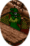 | Dar | Mileth | Dark Wizard Teacher |
|  | Hadrian | Soumi | Dark Wizard Teacher |
|  | Kiril | Undine | Dark Wizard Teacher |

| Picture | Name of Mundane | Where They Hang Out | What They Do |
|---------|-----------------|---------------------|--------------|
| 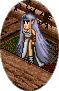 | Devlin | Mileth | Priestess Teacher |
|  | Bertil | Soumi | Priestess Teacher |
|  | Narve | Peit | Priestess Teacher |

| Picture | Name of Mundane | Where They Hang Out | What They Do |
|---------|-----------------|---------------------|--------------|
| 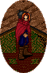 | Daithi | Mileth | Rouge Teacher |
|  | Fisk | Soumi | Rouge Teacher |
|  | Baltasar | Rucesion | Rouge Teacher |

| Picture | Name of Mundane | Where They Hang Out | What They Do |
|---------|-----------------|---------------------|--------------|
| 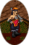 | Keallach | Mileth | Skills Teacher |
|  | Bodil | Abel | Skills Teacher |
|  | Berg | Soumi | Skills Teacher |

| Picture | Name of Mundane | Where They Hang Out | What They Do |
|---------|-----------------|---------------------|--------------|
| 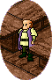 | Connlaoj | Mileth | Judge Attendent |
|  | Ramiro | Rucesion | Judge Attendent |
| 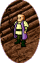 | Cedric | Mileth | Burgess Attendent |
|  | Eduardo | Rucesion | Burgess Attendent |
|  | Aricin | Abel | Guild Attendent |

| Picture | Name of Mundane | Where They Hang Out | What They Do |
|---------|-----------------|---------------------|--------------|
| 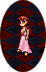 | Meaveen | Outside Mileth | Gloica's Attendent |
|  | Audny | Outside Abel | Fiosachd's Attendent |
|  | Gabriela | Outside Rucesion | Luathas's Attendent |
|  | Erika | Outside Piet | Ceannlaidir's Attendent |
|  | Camille | Outside Lourse | Gramail's Attendent |
|  | Evania | Outside Undine | Cail's Attendent |
|  | Vivianne | Outside Soumi | Deoch's Attendent |
| 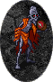 | Greim | In Dubhaim Castle | Sgrios's Attendent |

| Picture | Name of Mundane | Where They Hang Out | What They Do |
|---------|-----------------|---------------------|--------------|
| 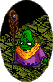 | Bhrigus | Mehadi Swamp | Mukul Teacher |
|  | Chandra | Mehadi Swamp | Mukul Teacher |
|  | Varuna | Mehadi Swamp | Mukul Historin |
|  | Ganesha | Mehadi Swamp | Mukul Teacher |

| Picture | Name of Mundane | Where They Hang Out | What They Do |
|---------|-----------------|---------------------|--------------|
|  | Kieran | Sgath Prison | Sgath Summoner |
|  | Sath | Lag Prison | Lag Beast Protector |
|  | "Shambler" | In Deaths Palace | The Soul Taker |

| Picture | Name of Mundane | Where They Hang Out | What They Do |
|---------|-----------------|---------------------|--------------|
| 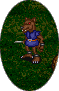 | Zeroun | Astrid | Kobold Shamon |
|  | Shant | Astrid | Kobold Teacher |

| Picture | Name of Mundane | Where They Hang Out | What They Do |
|---------|-----------------|---------------------|--------------|
| 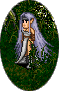 | Moire | 20-1 Woodlands | Armor Master |
|  | Rowena | 15-1 Woodlands | Armor Master |
| 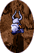 | Ake | 5-1 Abel Crypt | Armor Master |
|  | Torgny | 10-2 Abel Crypt | Armor Master |
| 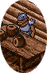 | Baki | 16-1 Woodlands | Warrior Armor Master |

| Picture | Name of Mundane | Where They Hang Out | What They Do |
|---------|-----------------|---------------------|--------------|
| 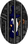 | Marlin | Loures Prison | Prisoner Wizard |
| 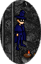 | Yves | Loures Prison | Prisoner Apprentice Wizard |
| 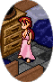 | Blanchefleur | Room in Loures | Girl Of Loures |
| 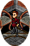 | Paulin | Room in Loures | Guard |
| 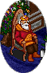 | Bruce | Loures Courtroom | King |
| 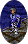 | Thibault | Lourse Courtroom | Kight Caption of Loures |
| 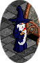 | Blaise | Loures Library | Librarian of Loures |
|  | Jay | Loures Courtroom | Jester of Loures |
|  | Courtney | Loures Courtroom | Jester of Loures |

| Picture | Name of Mundane | Where They Hang Out | What They Do |
|---------|-----------------|---------------------|--------------|
| 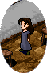 | Kalliope | Undine Tavern | Undine Girl |
|  | Hauk | Abel House | Abel Child |
|  | Evan | Pravat | Allience Boy |
| 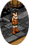 | Ase | Abel Beach | Girl Attendent |
|  | Naomhan | Mileth Chapel | Chapel Attendent |
| 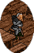 | Tague | Mileth Tavern | Drunk |
|  | Duana | Mileth Tavern | Dancer |

| Picture | Name of Mundane | Where They Hang Out | What They Do |
|---------|-----------------|---------------------|--------------|
| 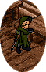 | Goran | Soumi | Cherry Seller |
| 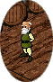 | Alvar | Soumi | Grape Seller |
|  | Braz | Rucesion | Black Market Attendent |

| Picture | Name of Mundane | Where They Hang Out | What They Do |
|---------|-----------------|---------------------|--------------|
| 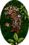 | Ozkan | Pravat | Gob Teacher |
| 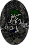 | Pricha | Pravat Cave | Grimlok Teacher |
|  | Bahadir | Pravat | Gob Commander |
|  | Phailin | Pravat Cave | Grimlok Queen |

| Picture | Name of Mundane | Where They Hang Out | What They Do |
|---------|-----------------|---------------------|--------------|
|  | Uistean | Mileth College | Mileth Librarian |
|  | Parthalan | Mileth College | Lore Teacher |
|  | Conn | Mileth College | Philosopher Teacher |
|  | Steafan | Mileth College | Litature Teacher |
|  | Rory | Mileth College | Historian Teacher |

| Picture | Name of Mundane | Where They Hang Out | What They Do |
|---------|-----------------|---------------------|--------------|
|  | Aoife | Temple Of Veil | Temple Assistent |
|  | Dee | Temple Of Veil | Temple Assistent |
|  | Gregory | Temple of Veil | Temple Assistent |
|  | Neal | Temple of Veil | Warrior Master |
|  | Donnan | Temple of Veil | Monk Master |
|  | Keefe | Temple of Veil | Rouge Master |
|  | Erin | Temple of Veil | Priestess Master |
|  | Logan | Temple of Veil | Wizard Master |
|  | "Gramail" | Ascension | Ascension Attendent of Mana |
|  | "Deoch" | Ascension | Ascension Attendent of Health |

| Picture | Name of Mundane | Where They Hang Out | What They Do |
|---------|-----------------|---------------------|--------------|
|  | Bartley | Mileth Tourial | Grampa Assistent |
|  | Flynn | Mileth Tourial | Merchant Boy |
|  | Keelin | Mileth Tourial | Priestess Assistent |
|  | Raghnall | Mileth Tourial | Wise Man Teacher |

## Cthonic Remains


### Nagetier Dieter

 

| Max Experience |
|----------------|
| Cthonic 1 - 40,800 |
| Cthonic 2 - 51,300 |
| Cthonic 3 - 75,900 |
| Cthonic 4 - 75,900 |
| Cthonic 5 - 75,900 |

These beasts are what you find in your nightmares. Though appearing harmless,
they really are quite strong. The foolish of Aislings would under-estimate
them. In their dark minds they only seek to destroy their enemies with force.
Even though they are dark, one can not help but admire their artistic values.
Just look how they wear the red cape, and wear it with such ease. The knife
they use is said to be stained with the blood of all their enemies, and most
definitely enchanted by a dark wizard. Watch out for these beasts of this
underground temple.

### Dhole Larva

 

| Max Experience |
|----------------|
| Cthonic 1 - 23,400 |
| Cthonic 2 - 31,500 |
| Cthonic 3 - 40,800 |
| Cthonic 4 - 51,300 |
| Cthonic 5 - 51,300 |

The larva is one of the more childish creatures in this place of death. Even
though they are young, do not attack them unprepared. Without a fully developed
mind, they rely mainly on instinct. This can be a most dangerous aspect. An
irrational larva can take-out a whole group of heroes in no time flat. However,
on a lighter note, these larva also make a rare delicacy among the Mundane
populations. Bon appitè!

### Scarlet Beetle

 

| Max Experience |
|----------------|
| Cthonic 1 - 31,500 |
| Cthonic 2 - 31,500 |
| Cthonic 3 - 31,500 |
| Cthonic 4 - 40,800 |
| Cthonic 5 - 40,800 |
| Cthonic 6 - 51,300 |
| Cthonic 7 - 51,300 |
| Cthonic 8 - 63,000 |

These concourse bugs dwell all throughout Cthonic. They feed off the dead and
store parts of other bodies in a place for safe keeping. These bugs don't just
attack Aislings, they attack all that threaten them, friend or foe. This makes
them a powerful enemy or a devilish ally. Their red coat protects them from
meall attacks and they use the antenna on their head to guild themselves
through the dark. All in all, the red beasts are to be taken serious, do not
get caught in their powerful talons, or you'll surely turn up dead in their
nest.

### Qualgeist

 

| Max Experience |
|----------------|
| Cthonic 2 - 40,800 |
| Cthonic 3 - 40,800 |
| Cthonic 4 - 40,800 |
| Cthonic 5 - 40,800 |
| Cthonic 6 - 121,800 |
| Cthonic 7 - 121,800 |
| Cthonic 8 - 121,800 |

This ghostly figure is used to scare Aislings first. Even the dead are threated
by this transparent beast. At times, one can hear the chanting of the Qualgeist
in the Cthonic Remains all the way from the entrance. This chant can make a man
half-deaf for moons. Blue fire surrounds this ghost in a blaze of gore. This
fire protects them greatly from attacks of the mind, even the greatest of the
wizards have a hard time punishing these rodents for their evil deeds. Make
sure you have a great healer with you if you venture this deep, and also, have
the Glioca priestess at her temple pray for your well being... you'll need it.

### Bone Collector

 

| Max Experience |
|----------------|
| Cthonic 6 - 63,000 |
| Cthonic 7 - 63,000 |
| Cthonic 8 - 75,900 |

Have you ever heard the cracking of bones? This noise you'll have to be very
comfortable with if you plan to hunt this creature. The beast itself is only
made of bones and can not survived without the bones from other sources. These
beasts can only be deal with by quickly attacking them, any other means, with
this irrational creature, would make you their next victim on the bone list. Be
very carful or you might find your partner getting munched up for dinner.

### Mummies

 

| Max Experience |
|----------------|
| Cthonic 6 - 246,000 |
| Cthonic 7 - 270,900 |
| Cthonic 8 - 297,000 |

Everyone has heard the tales of mummies, having them come into our dreams at
night, laughing at the idea of them. Until you see them for real. This beast
has great intelligence and cunning will, matched with brute force. A very
dangerous combination for any enemy. They are the masters of their realm, and
they keep this realm with an iron fist. They hold many wonderous items though,
a well price for the death of this creature if you don't die yourself. Unlike
in your dreams, you will not be laughing at this mystical beast.

## Legends of Temuair


### Song of Morrigu

_Black crow, over the flower follow the river flow._  
_The washer at the ford sours the clothes with blood's flow._  
_Battle-bound warriors pass by as tattered leaves fall._  
_You wash the garb with lye of those about to fall._  
_\*collapses into a deep slomber\*_

> _"Song in the Enchanted Garden, by the Great Tree."_

### Morrigu


Morrigu was the ancient triple goddess. It has been thousands of years since
she was openly worshipped. She is a Tuatha De Danaan, and rumored to be a dark
queen of the Faeries.

**Where should You go to?**

In the very center of the Enchanted Garden grows a large tree and a patch of
bloody flowers. Sing the Song of Morrigu. Be careful. She will claim you.

**Has Morrigu ever appeared?**

She flew over the battlefield of the second battle of Moy Tura. She is three
sisters: Ana, Macha, and Madb. They are the fates and harvesters of battle.

**How?**

Sometimes one of the Morrigu is seen by a river before battle by a warrior. She
washes the garments or arms of the warrior that will die in the battle.

**Who is Ana?**

Ana is a goddess of magic in battle. She sometimes takes the form of a wolf or
of a wild heifer. Her magic confuses foes in war.

**Who is Macha?**

Macha is a goddess of the battle. Macha sometimes takes to form of a crow.

**Who is Madb?**

Madb is the great fury. Sometimes she takes the form of a carrion-crow. At
other times, a she is a wolf.

**What is the nightmare?**

Morrigu chooses wantonly. She lets the blood of brave men for carrion-crows to
feast upon. Her appetite grows, perhaps lured by the likes of dark, cthonic
beings.

_Fortold by Narve of Peit_

### Ascesion Tablet Of Counting

 

#### Please Fill in the Desired Information

Base HP/MP:

Desired HP/MP:

Experience Needed to Achive the Value:

_Biothean M'agus_  
_Pictures on this scroll remains to Shanna Lane. All rights reserved._

***

```
*Librarian Notes*

This entry has been heavily edited to conform to Library formatting.
The original can be found at http://www.darkages.com/community/lore/Biomagus_Library/index.htm .
```
