# Feral Fountains

_by Dylanlan in **Dark Ages**_

## Intro

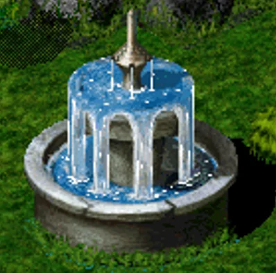

Water Fountains. Usually they are quite peaceful and serene scenery. But every Cycle during a specific sequence of Double Moons these seemingly innocent Fountains become evil watery assailants that randomly force unsuspecting Aislings to revisit their own home via some type of dachaidh lamh spell. One might ask: "What's up with that??" Worry not, fellow Aisling, for we will dive deep into the mysterious waters of these "Feral Fountains" to answer your endless questions. An important proverb comes to mind: Know Thy Enemy. We'll explore the quest that triggers these Fountains, that quest's rewards, what makes the Fountains so deadly, how to defend against Fountain attacks, which Fountains are dangerous vs safe, and some theories that help explain why the Fountains might teleport Aislings. I apologize, dear reader, for the bulk of this document. But as an Aisling personally attacked by these Feral Fountains across two Cycles so far, I desire to have a comprehensive document to help understand these vile creatures. Feel free to skip to any of the sections that might interest you. I highly recommend reading at least "The Only Known Defense" section, since we need to prepare ourselves for future assaults. And checkout the "Theories" section if you want to understand why we suffer this misery every Cycle.

## Make A Wish

The Fountains tend to make their curious transformation during a sequence of activities that some Aislings call the "February Events" - whatever that means . I'll be referring to this time as the "Feral Period". Among various seasonal quests of love and passion is an innocent one involving making a wish.

It might not be obvious but that quest to make a wish is the main trigger that transforms the Fountains into their Feral Form. As soon as the quest becomes active you can immediately hear cries of confusion and frustration across Temuair:

"WHYYYYYYYYY?! NOT AGAIN!!!!!" "FOR FIOSACHD'S SAKE!" "STUPID FOUNTAINS!!! >:("

This is usually a strong indication that the Fountains have turned Feral. For any Aisling who hasn't encountered them before, it is quite a confusing experience. Simply walking too close to a Fountain can result in oneself being immediately and violently teleported back to one's own home - as if the Fountains are continually casting some type of dachaidh lamh spell. The only clue received? A completely unhelpful thought: "You decide to go back home."


What just happened? Why would I want to go home right now? What does it mean?! Did I do something wrong? Did a Ranger send me home?! Is Temuair broken??

These are many valid questions that a confused Aisling might ask. But it seems these Feral Fountains want to remain mysterious since they don't give any clues as to why the Aisling was ejected home or how to make it stop. Eventually, through word of mouth `((or by perusing www.darkages.com))`, the Aisling will hopefully figure out that Naomhan in the Mileth Church knows something about the Fountains. Rumor is that Naomhan has known about these confusing Fountains since at least Deoch 122 but possibly earlier `((The event first released February 14, 2014 - thanks Wizadrian!))`.

The Mileth Church can be found at x40, y77 in Mileth Village:

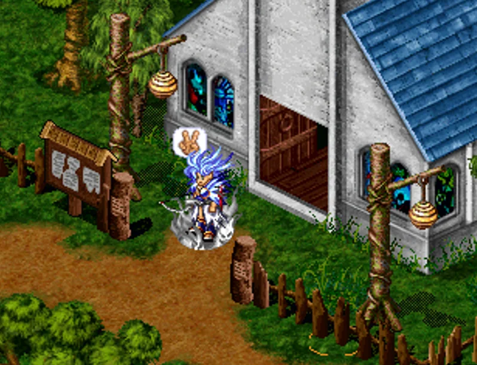


Inside, you can find Naomhan working away on his Priestly duties - perhaps an upcoming mass sermon.

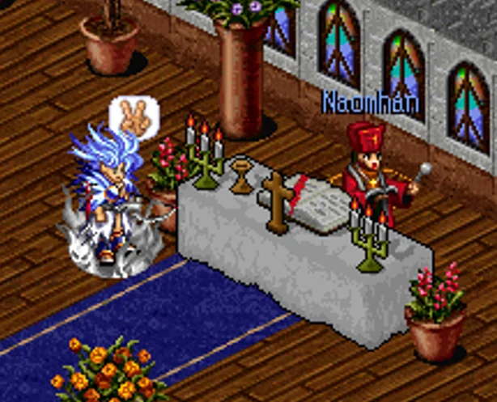

I chatted with him about Making a Wish and he mentioned that a Faerie got injured from a recent storm and has become ill in the church. He asked that I wish for the Faerie's good health and fast recovery.

While he didn't explicitly mention Fountains, he recommended that I go out in the open where Gods can hear - to a common place where wishes are performed. He also gifted me his magical coin - presumably to toss into a Fountain when making a wish.

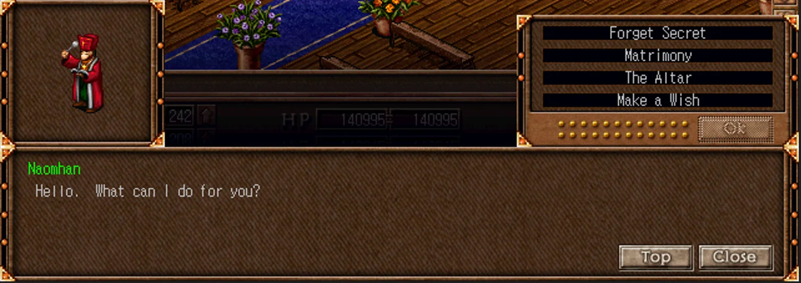

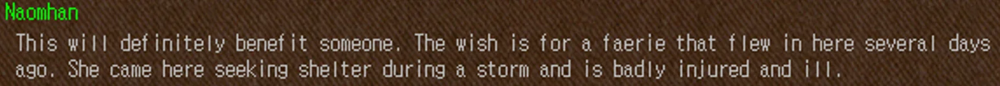

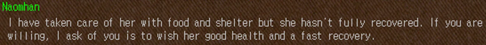

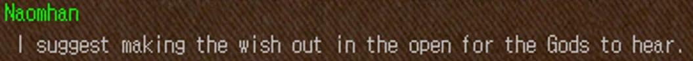

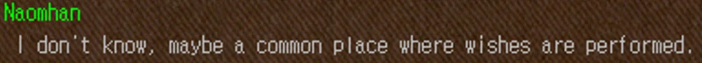

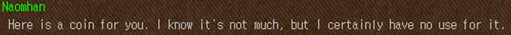


The whole conversation seemed innocent enough but I was curious about the magical properties of Naomhan's coin. Interestingly, the magical coin is soulbound to the Aisling it was given to! It must be quite powerful if Aislings cannot even trade it to other Aislings or drop it on the ground.

Yet we can somehow deposit it to a Banker or throw it into specific magical Fountains.

_Suspicious_

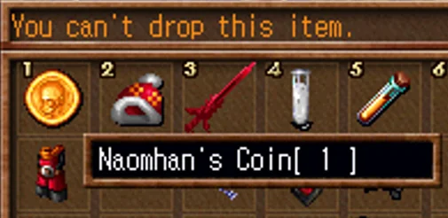

I couldn't identify any magical properties on the coin by using a Magic Lore skill. Does that mean it's truly not magical, or that it's too powerful for us Aislings to analyze? Unclear.


The coin itself doesn't seem to be worth much when Appraised, though - only a meager one hundred regular gold coins. I suspect that this appraisal isn't taking into account all of the coin's magical powers that we'll explore later. Next we'll look at the various rewards for Naomhan's quest.

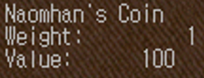

## Rewards

There are six different potential rewards that you can receive from making a wish and two fake rewards. Choose wisely! To receive a reward you just need to walk a couple steps near a Feral Fountain as you've likely accidentally done already. But by wielding Naomhan's magical coin you'll get to consider a reward instead of just the immediate regret of being sent home with nothing. Note that whichever reward you do choose, you will still be sent home. Every time you contemplate your wishes, you'll be able to wish for Faerie's good health with a fast recovery, a varying reward, and an option to do nothing. I've included my own personal ranking of each reward's value in their own sections.

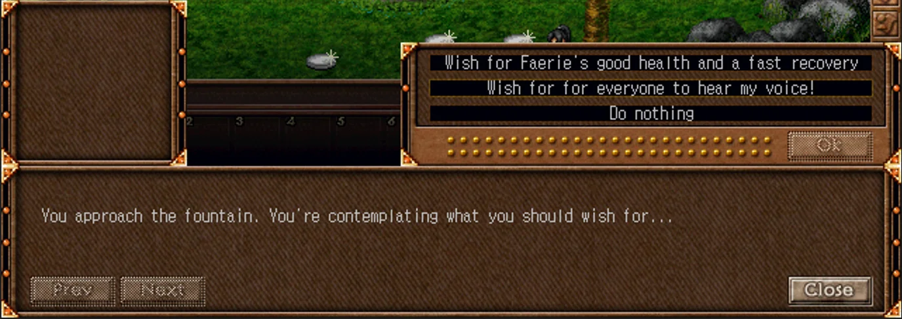

### Do Nothing

Be warned, if you choose to make a wish to do nothing then the Fountain will still take an opportunistic strike and fling you back home. If you truly want to avoid the attack you should avoid making any wish instead of picking this one! `((Press Escape or click the Close button))`. Value: 0/10


### World Shouts

One of the more powerful and often sought-after rewards is the ability to shout across all of Temuair. If you contemplate a "Wish for for everyone to hear my voice!" option (A classic Mundane typo), you will be granted the ability to reach all Aisling ears sixty times. Your shouting ability will require a short recovery period between uses, however `((5 minutes))`.

Note that the bundles of shouts are tradeable to other Aislings but will no longer be tradeable once you open the bundles into the actual usable items. And the message you receive when opening a bundle has another classic Mundane typo: "you inventory" instead of "your inventory". Value: 6/10

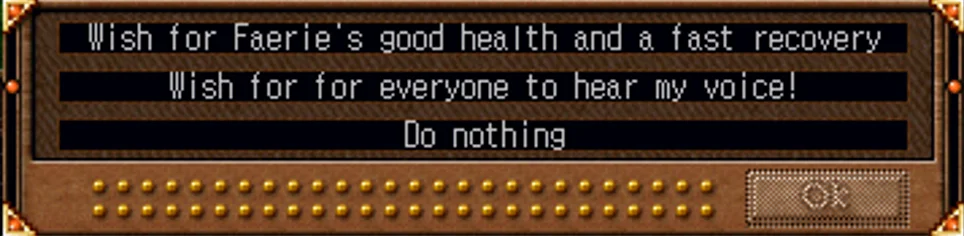

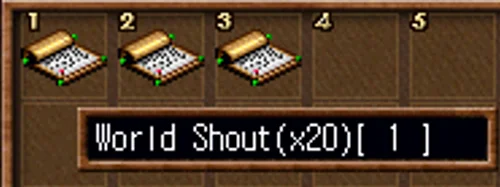


### Light Necklace Raffles

Another potential wish is "for a chance to get a Light Necklace" which will give you a bundle of five raffle tickets to test your luck at receiving a Light Necklace. This option was perhaps more valuable in the past. But nowadays, given how easy it is to obtain a superior Lumen Amulet, a paltry five raffle tickets is almost an embarrassing reward. It might be tempting for any Aislings wishing to collect this specific necklace but for most of us it's way too few raffles to be worth it.

Note that the raffles are neither tradeable before nor after opening the bundle. Value: 1/10

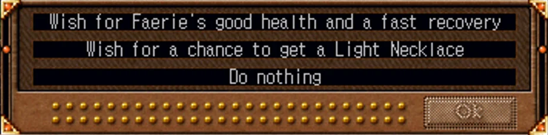

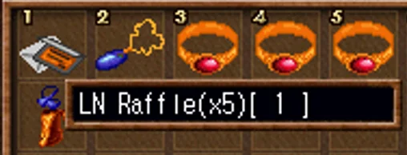

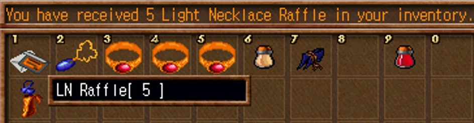

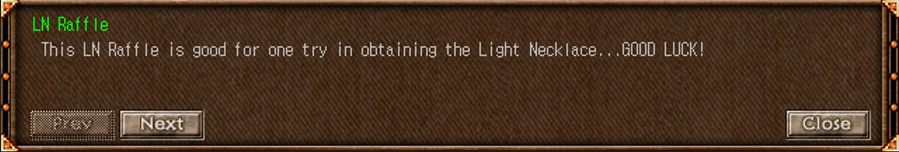

_Be warned: The almost guaranteed result is nothing at all!_

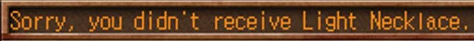

### Party Poppers

A mildly fun wish is "to be the LIFE of the party!" which will grant one hundred party popper items. They don't have much functional use but they are a cute item to use when celebrating some type of victory or accomplishment - and one hundred is a decent amount. Note that these poppers are tradeable to other Aislings both before and after opening the bundle, and they're accompanied by the same "you inventory" message typo. Value: 5/10

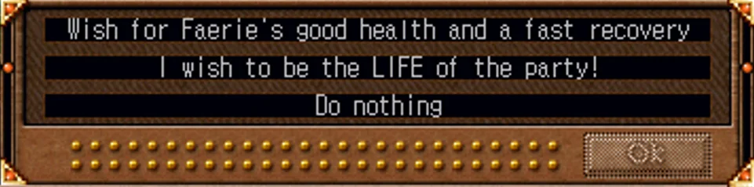

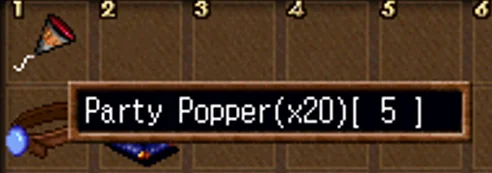


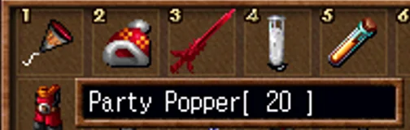

_When the poppers are opened they shoot multi-coloured confetti around yourself for a second or two. Fun!_

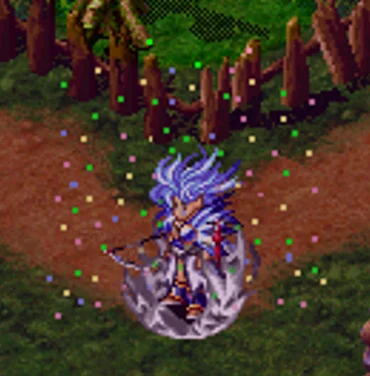

### Strongest Aisling

Be careful with this fake wish! It may sound tempting but it actually rewards you with just a classic Fountain dachaidh attack: getting thrown back home with no reward. Also you hear a creepy laugh behind the Fountain coming from an unknown source - how spooky! Value: 0/10

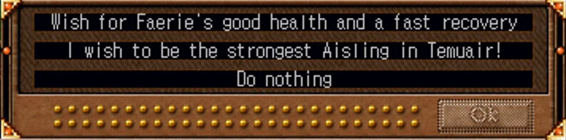


### Double Experience and Ability

Possibly the most sought after reward - wishing "for more Exp/Ab while hunting" will grant a bundle of five magical Double Bonus Exp-Ap stars. Along with the free Valentine's Double items from Nadia, an Aisling can walk away with a significant amount of double experience `((10 hours))` for their hunts from these Cyclical events! Unfortunately both types of magical items cannot be combined to receive "Quadruple" experience since they're both forms of Hy-Brasyl Shard stimulant charms (See: Kelberkai's college entry on Magic Charms). Note that these magical stars are not tradeable to other Aislings neither before nor after opening the bundle. Value: 10/10

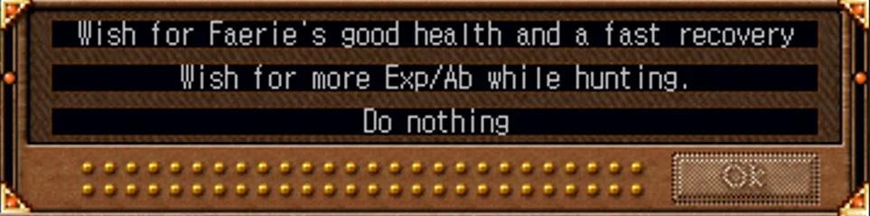

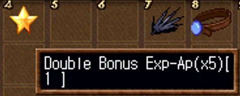

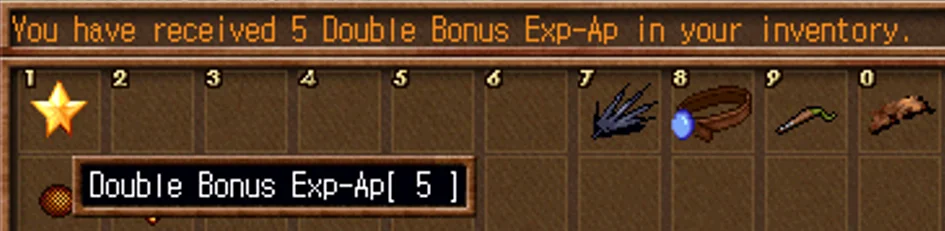

### Gender Potion

Another wish from the Fountains is "to be the opposite gender" which will provide you with a Gender Potion. This magical potion can transform an Aisling's appearance from Male to Female, or Female to Male. It's a shame there aren't any other options provided by this potion, but it's still quite a powerful concoction nonetheless! I ranked this reward's potential value based on a non-specific Aisling acquiring it, but its value easily jumps to 10/10 for any Aisling suffering from Gender Dysphoria (See: Moogle's college entry on Gender Potions).

Note that you'll need to be in your birthday suit when drinking the potion, and you won't be able to wear your previous gender-specific gear after consumption. This potion seems to be carefully brewed for each specific Aisling because it cannot be transferred to others. Value: 4/10

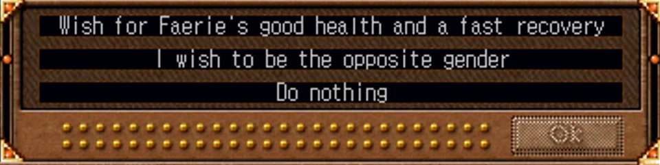

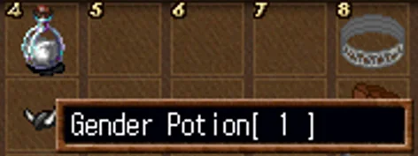

_There is a list of instructions written on the potion - be sure to read them when drinking it!_

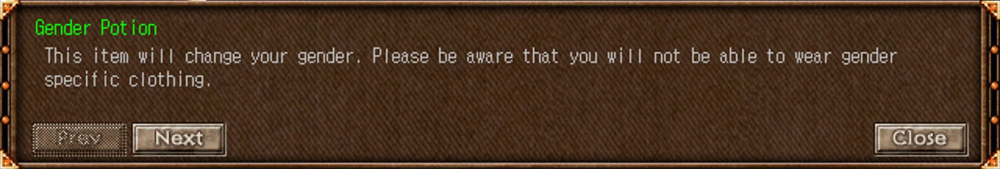

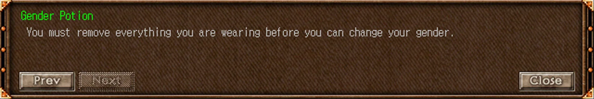

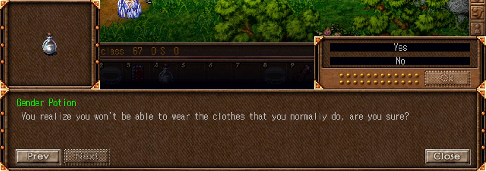

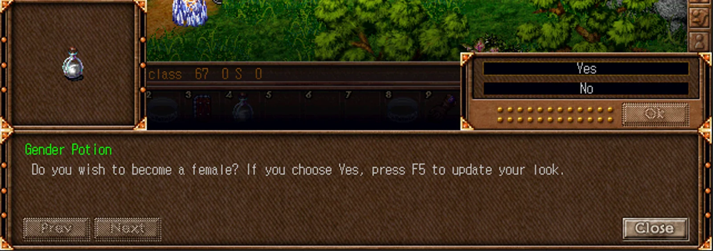

_One of my cousins was able to successfully test one direction of the potion's effects:_


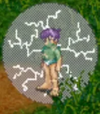


### Faerie's Good Health

Another prime reward! This is the main wish that Naomhan encourages you to choose. It eventually results in a desirable mark upon your Aisling legend, a loyal Faerie pet that can be summoned, a writable Valentine's Note parchment, as well as two million experience points! It involves quite a few extra steps to choose this wish, however, so make sure to study up and understand what you'll need to do beforehand. Value: 10/10

IMPORTANT WARNING: You will need to wait 8 Temuairan Days `((24 hours))` for the Faerie to recover during this wish. If you accidentally talk to Naomhan again about making a wish while the Faerie is recovering, then the Faerie's health will mysteriously deteriorate and you'll be forced to wait the full duration again! Make sure to leave yourself plenty of time to complete this wish if you've picked it. After the final Chaos Rise occurs from the Feral Period and the Fountains return to their normal form, Naomhan will completely forget about all Wishes - even any in-progress ones. Thus an Aisling with poor time management skills might end up with no reward at all!

To claim this reward you must first throw Naomhan's magical coin into a Feral Fountain. You'll get flung home as usual with no rewards given to you (yet). Journey your way back to Naomhan and ask him about making a wish again. He'll tell you to check back in on Faerie in a bit `((24 hours))`.

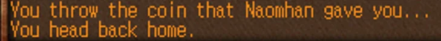

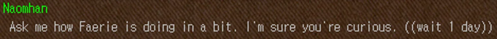

After you've waited the requested duration you can check on the Faerie's health at Naomhan again.

`((WARNING: DO NOT CLICK ON NAOMHAN WHEN WAITING! IF YOU CLICK "Make a Wish" AT THIS POINT, IT WILL RESET YOUR TIMER AND YOU'LL NEED TO WAIT AN ADDITIONAL 24 HOURS! CONSIDER YOURSELF SUFFICIENTLY WARNED!))`

Say verbally out loud: "Naomhan, How is Faerie doing?"

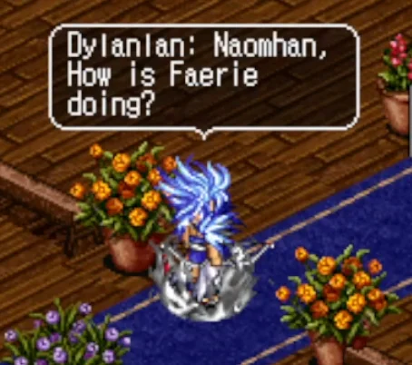

It's fine to ask Naomhan this question before the proper time - he'll just tell you to ask again later. After the Faerie has been given adequate time to recover, Naomhan will let you take her with you and he will request that you take her home to Shinewood Forest.

The Faerie will appear in your inventory as a regular summonable Pet with options to Name, Summon, list Commands, and be Done.

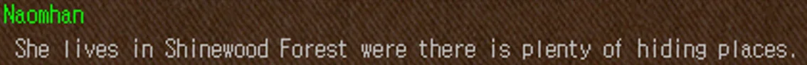

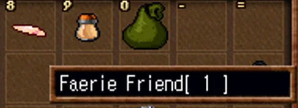

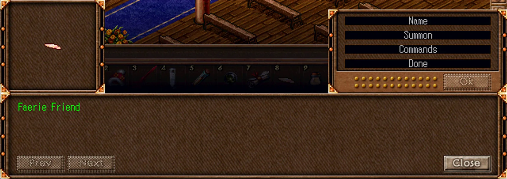

Naming the Faerie will provide you with a neat mark upon your legend! What a happy healthy Faerie!


The Faerie's home is somewhere within Shinewood Forest 11 - the home of the magical Faerie that can teach Priest and Wizard Aislings some of their Master Spells. You might need to search for a while but it shouldn't take too long to find her home - depending on whether you're using an Insect Cloak or not `((It took me around 20 minutes))`. Make sure that you have summoned your Faerie Friend to travel alongside you! My Faerie's home ended up being near x5, y84 between two trees. I had used the effects of a Monster Cloak to disguise myself as a Wasp and explore the forest quicker.

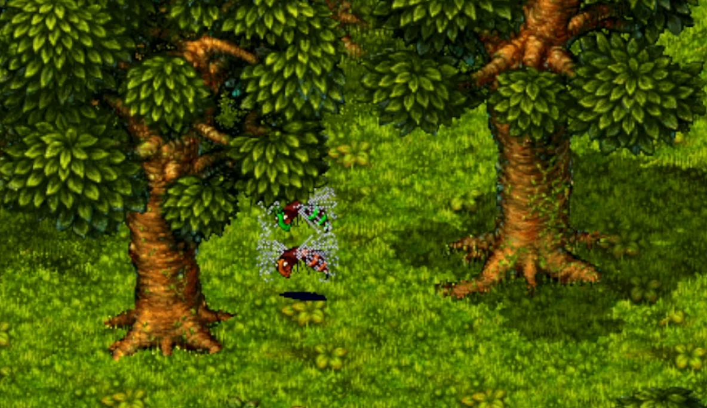

Once you find your Faerie's home, she'll speak to you. She'll thank you for your walk, and gift you a Valentine's Note parchment which is quite handy for writing custom tradeable messages to other Aislings. She'll also request to stay with you permanently so that she'll always be your Faerie Friend Pet.

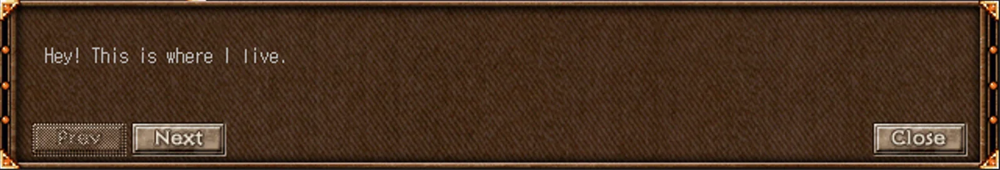


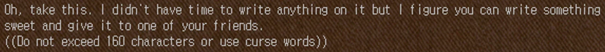

For any Aislings of low insights, be warned that finding the Faerie's home will grant two million experience points which might skip a few of your insights!


Aislings can write personal messages on the Valentine's Note reward in magical ink that is easy to erase. Be careful when depositing these notes in a bank, however, since Bankers have been known to erase the written messages to prevent ink from smearing on other deposited items.

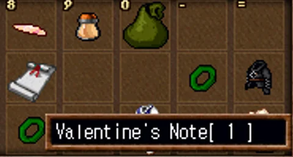


Note that if you ask Naomhan about making a wish again after wishing for something other than the Faerie's health then he'll be upset with you! He really wanted you to help the Faerie recover, it seems.


Phew, hopefully that gives you a good understanding of the various rewards for making a wish! Next we'll dive into what makes the Fountains so vicious!

## Feral Qualities

There are a number of qualities about the Fountains which make them especially Feral.

For one, their attacks are invisible and enigmatically unpredictable - there are no visual indicators showing which specific spots near a Fountain will cause ejection. Helpful Aislings will place coins on the ground as clues to assist in avoiding attacks. However, these specific spots shuffle after each Chaos Rise so it is a painfully fresh battle every day.

The Fountains are also the ultimate stealth combatants by attacking Aislings without leaving a trace. There are no clues for a bewildered Aisling to know who or what just teleported them. They only receive the cryptic message that they decided to go back home.

Another Feral Quality is that the Fountains will strike first regardless of whether the Aisling has spoken to Naomhan yet or not. Indeed a great strategy for winning a battle is to attack before the opposing side even realizes a battle has begun! Sneaky!

Similarly, the Fountains are unrelenting - even finishing the wish quest from Naomhan will not cease their attacks. Aislings will receive a different message if they get attacked afterwards but it's still a confusing message nonetheless:


The Fountains are also quite cunning and have decided to target popular zones first. By attacking in Mileth and Pravat Cave they ensure that many Aislings fall into their traps. And they make life very hard for any Cail worshippers since the Fountain right outside the Cail temple becomes Feral. Its proximity makes it especially difficult to safely enter or exit that temple which can make it a nightmare for any Aislings attempting to finish the Goop prank part of Nigel's Ciad quest.

The Fountains are especially merciless by viciously attacking both Fragile Aislings and weak Aislings who haven't yet reached their 20th insight. Those Aislings already have enough challenges on their plate but pitting them up against a Fountain they cannot defend themselves against is quite cruel. They will unfortunately continue getting subjected to the rude teleportations until they can strengthen themselves.

Fragile Aislings receive a message when sent home from a Fountain:


Note that if a level 99 Aisling saves Naomhan's coin during one Cycle and tries to use it in a subsequent Cycle while Fragile, they will still receive this message and get teleported home. It seems that the coin's magical qualities are somehow tied to one's own Fragility.

Aislings under insight 20 will receive a message from Naomhan when they ask about making a wish, telling them that they must be at least insight 20.


And a Fragile Aisling who tries to ask Naomhan about making a wish will just get rudely sent home with a classic message. It's interesting that Naomhan can also forcibly send Aislings home.

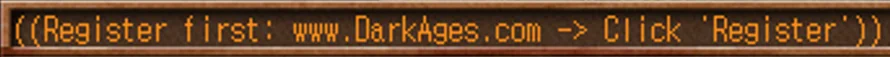

_Interesting._

WARNING: NOT EVEN RANGERS ARE SAFE! Even Yukii was heard complaining that the Fountains hit her with a sneaky assault. The Fountains must be especially adept if even one of the most powerful Aislings across Temuair cannot block their attacks!

## The Only Known Defense

There is only one strategic tactic that I'm aware of which can help defend against the involuntary dachaidhs: Naomhan's Coin. Simply speak to Naomhan, acquire his coin, and KEEP IT. Do not use the coin. Do not get rid of it until you're ready for the attacks to resume.

There must be some incredible magic imbued into his coin which can help momentarily block the Fountains' vicious attacks. By merely possessing the coin (while not Fragile), it allows you to choose your fate when you approach a Fountain. You'll be able to think quickly and choose a wish, and you can also simply choose none of the wishes to avoid the Fountain Attack for as long as you want `((You'll receive a popup, and you can just close it and you won't get teleported. Reminder: Choosing "Do nothing" WILL teleport you home))`.

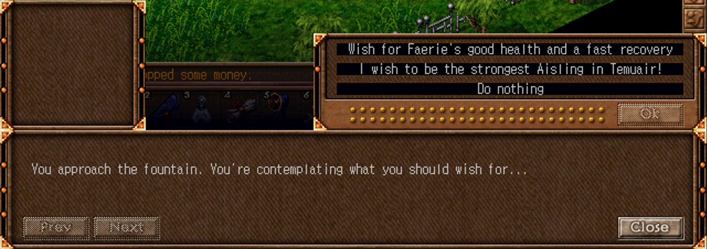

Curiously, this shielding effect still persists even if you entrust a Mundane banker to look after the magical coin. Although you receive a different message that you should throw something in the Fountain, it still protects you from being sent home! Powerful magic indeed! But which Fountains should this strategic defense be used against? Let's discuss the various Fountains of Temuair - Feral or otherwise.

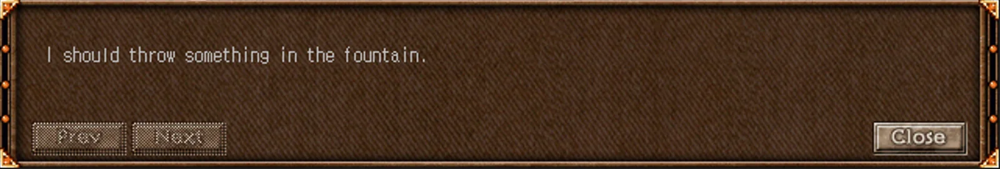

## Areas Under Attack

Interestingly, not all Fountains in Temuair get affected by the Feral spell. There are some primary "Danger Zones", some "Safe But At Risk" areas to keep an eye on, and a number of "Totally Safe" areas.

### Danger Zones

These danger zones seem to be consistent targets for the Feral Fountains. These areas are near major towns or populated areas and the Fountains find huge success in frustrating many confused Aislings here. I've included my own assessment of the danger risk per zone.

Pravat Cave: This popular Fountain is near the right-side cave entrance to Pravat. This is undoubtedly one of the Fountains with the most successful attacks, given how many Aislings choose to spend their free time in this area. We must be on our highest alert to guard against attacks when socializing here! Danger Value: 10/10

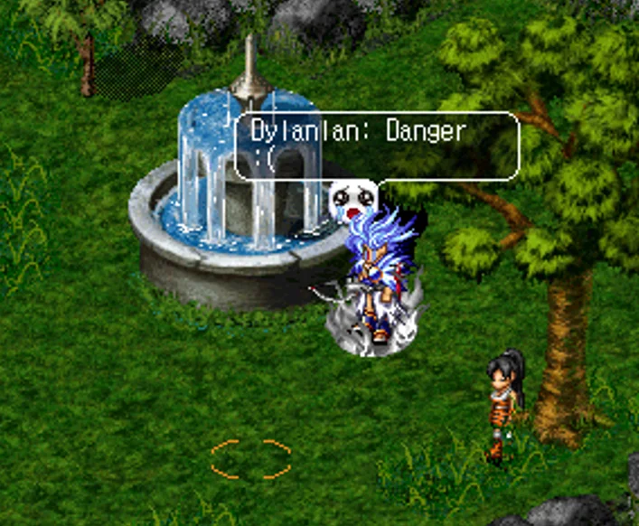


Mileth Village: This often-visited Fountain is in between the Mileth Crypt and Temple of Choosing. This Fountain's attacks cause a ton of confusion for unwitting Aislings who are just trying to walk from their hometown to the rest of Temuair. And its attacks are also severe for Aislings that have formed groups to go hunting in the Crypt. Danger Value: 10/10

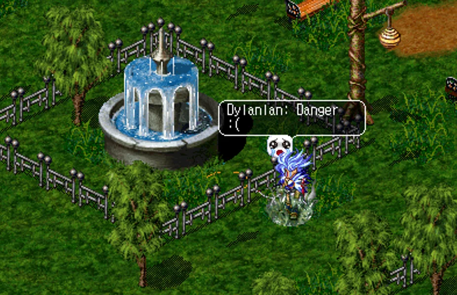


Undine Village Way: This Fountain is right outside the Cail Temple. As a result, those poor Cail followers get frequently interrupted from their worshipping! And any Aisling trying to complete Nigel's Ciad quest by throwing Goop on Evania might instead be the victim of a rude prank. This Fountain isn't nearly as commonly visited as the previous ones, but it is still a massive nuisance for those it can reach. Danger Value: 7/10

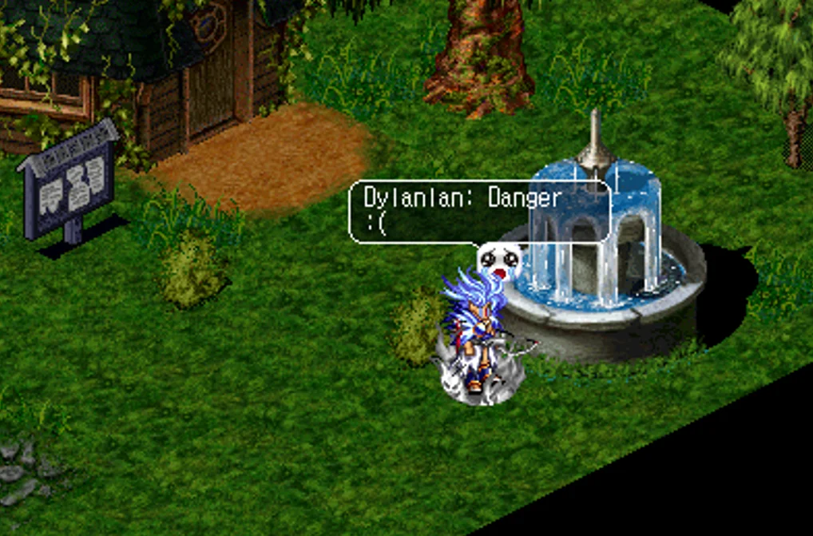


Undine Village: This Fountain is near the Bridge to Muisir. It doesn't receive as many visitors as the previous ones but it can still launch a sneaky attack on unsuspecting Aislings wishing to hunt Ability Points in Muisir. Or on a pair of Aislings wishing to find a romantic location for a picnic in Undine! Danger Value: 4/10


Suomi Village: This Fountain is on the way into Suomi Village. This one is a few steps away from the common path and doesn't attack too many Aislings. But it causes a lot of frustration when it does attack, given how far away Suomi is from most Aisling hometowns! Danger Value: 6/10


### Safe But At Risk

There are also quite a number of Fountains that DO NOT become Feral. It's still a mystery why they remain normal! These areas can be considered safe for now but we should definitely keep an ear out for any strange sounds emanating from these Fountains in the future. I've included my own potential danger assessment per Fountain, were they to one day become Feral.

Loures Castle: Thank Danaan that this Fountain is currently safe! Otherwise Nadia and Aidan might have a rough time handing out their Valentine's Gifts to Aislings, and Aislings would certainly have a tough time receiving said gifts. Potential Danger Value: 9/10


Loures Market Village: This Fountain doesn't get visited too often lately (Deoch ~212). But if it does become Feral, it will be an absolute nightmare for any Aislings forming large groups to battle monsters in the Sewer Canals of Loures. Potential Danger Value: 6/10


Loures Harbor: This Fountain is located near the epic statues of the brave Aislings who Broke the Seal and discovered Medenia (NOT the first masters!). It would've been quite disrespectful if this Fountain were to become Feral. Almost as if the attacks were a rude beyond-the-grave strike from the Elemental Creants or the Seal Master!

If this Fountain ever becomes Feral it will cause a huge amount of confusion and frustration for any new Sparks wishing to follow Bindo's footsteps to visit the legendary statues! Potential Danger Value: 9/10


Cedar Grove: This Fountain is located in the heart of the Saphire Stream which is critical to the Hubae process that all Monks follow. As such, it would be an extremely painful attack in one of the most serene and peaceful areas across Temuair. Potential Danger Value: 8/10


Phoenix Altar: This is the famous altar at which the Lady Phoenix Creant is summoned by brave Aislings wishing to become closer to Grand Master status. Some might argue it's not a Fountain at all but it seems to be a stone structure with some swirling watery-like substance in it, so it's definitely on my radar.

It's not visited too often but it is a mandatory quest for any Aislings wishing to become their Medenian Class. And it is a very long hike back to this Fountain if you get sent home so it would be extremely painful if it turned Feral. Potential Danger Value: 9/10


Muisir Entrance: This Fountain is located in a small gathering area before the required tiny entrance to Muisir via Shrinking Potion from Undine's Dark Wizard Kiril. Given how popular Muisir is for hunting Ability Points for fresh Medenian Aislings, it would be quite painful if it became Feral! Potential Danger Value: 7/10


Mileth Fair Entrance: The entrance to the Mileth Fairgrounds has a magical Fountain next to Ertha and the Tavern. Aislings can acquire a few different random beneficial spells from this Fountain, and thankfully they don't get teleported home! It seems as though this Fountain is trying to convince us that it's not Feral and is actually Friendly? I certainly don't trust it!

The fairgrounds are unlikely to be opened during a Feral Period but the fact that this Fountain can already cast magic at all is definitely a cause for concern - especially given how close it is to Mileth. (Thanks Brittany for this visual Memory!). Potential Danger Value: 5/10


Oren Fair: I wasn't able to explore the Oren Fair myself while making a wish since it's usually not available at the same time. But from Vorlof's research it seems that there is a Fountain located within the Fair. It might have a name of "Fair Helper" to try and sound non-threatening but we should be careful around it regardless. Although it would be quite chaotic for this Fountain to turn Feral while Aislings are trying to enjoy the Fairgrounds, it's unlikely that the Oren Fair will ever be open during a Feral Period. Potential Danger Value: 2/10


Glioca Temple: This Fountain is located at the back of the Glioca Temple in Mileth. Thank Glioca it isn't Feral! Why was it spared while Cail is continually under attack? Your guess is as good as mine but it might reflect upon the power of the corresponding God . Since Aislings don't need to travel near this Fountain to be able to enter, pray, and exit, it isn't quite as dangerous as the Cail Temple Fountain. It would likely be a giant pain for any Priests trying to host a Mass sermon, though. Potential Danger Value: 3/10


Mileth College: This Fountain is a bit off the walking path in Mileth College and thus wouldn't pose a huge threat if it became Feral. But it would certainly find some victims from the groups of studious Aislings trying to further their Education. Potential Danger Value: 3/10


Water Spirit Temple: These Fountains line the walls of the Water Spirit Temple within the Water Dungeon of Medenia. This area used to be commonly trodden by courageous Aislings preparing to fight vicious water monsters for a chance at the previously rare Water Dungeon Chests. But nowadays, Aislings can easily obtain those rare chests by attending the randomly scheduled spectacle of summoned monsters in the Balanced Arena `((BA Spawns))`.

Currently, these Fountains at the main floor of the Temple are only a potential threat to the handful of Aislings aspiring to increase their Water Spirit Reverence, or to an Aisling who has nearly finished the lengthy Plamit quest for their Ancient Baem armor and attacks. Potential Danger Value: 4/10


Water Dungeon: The Water Dungeon itself is home to many Fountains - at least 15 across its 15 floors of death. However, these Fountains see way fewer Aislings than the previous ones in the main lobby of the Dungeon given that there's no Reverence or Plamit quest requirements on these other floors. My guess is that only a handful of Aislings attempt to conquer this obsolete Dungeon every Cycle since its rewards are embarrassingly out of date and it doesn't even record a mark of glory upon an Aisling's legend when conquered.

But, if these Fountains ever became Feral it would make this Dungeon nearly impossible to conquer during a Feral Period. Not only is the Dungeon itself super dangerous and filled with randomly appearing vicious monsters (You can see I'm wearing my sturdier Baem armor in this memory for safety), but Aislings often need to stand near these Fountains (unless they shout) to chant the magical instructions which ironically teleport them to the next floor. Making just a single mistake and standing too close to a Feral Fountain would immediately halt their painful adventure and likely obliterate any motivation to continue.

It is deeply unsettling that these Fountains can already teleport Aislings, although the destination is merely another floor deeper in the Dungeon instead of all the way home. Are these Fountains trying to help Aislings in their quest to conquer this mighty dungeon? Or are the Fountains trying their hardest to ensure Aislings end up in a watery grave? I'd bet on the latter, personally. Alas, too few Aislings currently visit this location to make it worth worrying about too much. Potential Danger Value: 5/10


Here is another memory of a different style of Fountain from within the Water Dungeon. This is the largest Fountain I've ever laid my eyes upon, and I certainly thank Danaan that it doesn't appear to be Feral (yet?).


Dubhaim Chamber: Arguably another pool instead of a Fountain, this is the infamous Viewing Portal for the Arsaidh Aon quest and it seems totally safe. But could you imagine a Time-Travelling Fountain that went Feral?! Aislings would be unsafe at any and all times!

Thankfully this location is another one that's visited fairly rarely - though it's definitely a potential pain for any Aislings wishing to defeat the legendary Dracon Dubhaim. Potential Danger Value: 4/10


Feasgar Kingdom: There have been suspicions that Feasgar Kingdom used to contain a Fountain. I forgot to take memories of the Kingdom during the latest Feral Period myself but my sibling was able to, and this was the only structure that looked potentially Fountain-esque to him.

It looks like whatever this structure was has been neglected and overcome with fungus over time. It's not mandatory to stand near this strange structure to defeat the Arsaidh Aon dragon, so a Feral Fountain in this location likely wouldn't cause too much damage. Potential Danger Value: 1/10


Oren Sewers: This Fountain is hidden away underground in the sewers of Oren Village. Aislings must fight through vicious Salamanders and Pirates to reach it and it is still a popular place for Aislings to visit a couple times per Cycle for the vitality extending effects. It's quite brave for Aislings to drink from a Fountain located within sewers!

It would be extremely annoying for an Aisling to fight their way to the end only to be violently thrown back home before claiming their reward from this magical Fountain. But given the low odds of their schedules overlapping, it likely wouldn't find that many victims. Potential Danger Value: 3/10


Abel Port: This Fountain is near the middle of Abel and isn't too close to any walking paths. We're thankful for every Fountain that isn't FeralfF but this one would almost go unnoticed were it to become Feral. Potential Danger Value: 1/10


Pudgy's Health: Luathas Priest Iglis had wondered whether an old event related to wishing for the health of a mouse named Pudgy involved a Fountain and whether it might've caused Pudgy's poor health in the first place.

My sibling NaLyd still has a memory from Deoch 89 of throwing a coin into a Piet well (a similar but different species than Fountains) to wish for Pudgy's good health. The well still had magical powers to send Aislings home when coins were thrown in so we should definitely keep our guard up when around them!

It's interesting that Aislings have been asked to throw a coin into a watery stone structure to wish for an injured creature's good health multiple times. The coin (named a token) which was used to wish for Pudgy's health originated from Kalliope of Undine. I wonder if she has ever met Naomhan since her token visually looks identical to Naomhan's Coin Potential Danger Value: 7/10


### Totally Safe

Lastly, there are various areas that do not appear to contain any Fountains at all! These areas can be used as a safe haven if you need a break from the relentless Feral Fountains of Temuair:

- Mount Giragan
- Astrid
- Undine Field
- West Woodland
- East Woodland
- Kasmanium Mine
- Piet
- Coliseum Arena
- Mehadi Swamp
- Grass Field
- Blackstar Village
- Rucesion (But it had a Fountain in the past!!)
- Dubhaim Castle
- House Macabre
- Tagor
- Filth Forest
- Beal na Carraige
- Karlopos Island
- Lynith Beach
- Nobis Village
- Grassland Village
- Feasgar Village
- Medenia except the Water Dungeon

## Potential Cure

If a cure or treatment for Feral Fountains could ever be developed it would likely contain some combination of the following nine effects.

1. Remove the Fountain's first strike priority. By allowing Aislings to initiate the combat you will cut down their confusion immensely. This is such a simple change that would have the largest impact on reducing Aisling frustration in my opinion. `((Only initiate the Fountain teleporting after talking to Naomhan))`.
2. Remove the lingering strikes. After an Aisling has successfully made a wish they should no longer be affected by the Fountain's attacks in a given Cycle. This would immediately remove most of the long-lasting pain that Aislings experience when they hastily choose a quest reward and it would help encourage them to complete the quest sooner rather than later. `((Completing the quest should cease the teleporting))`.
3. Shuffle the Danger Zones. The Fountain attacks are currently quite effective since they target high traffic areas (eg: Pravat, Mileth). Swapping some of the Danger Zones with At Risk zones could eliminate much of the pain. The trade off would be that more Aislings would struggle to find an appropriate Fountain to make a wish at but I think it's worth it. `((eg: Swap out Mileth and Pravat for Abel and Loures Market Village))`.
4. Remove the randomness of Fountain attacks. Each Fountain's dachaidh lamh spell affects a random location around itself which changes every day. This makes it quite hard to predict and prepare for an attack. If the Fountains instead only targeted a single consistent space on each of their sides (like a conventional non-srad, non-athar lamh spell), then Aislings would be better able to predict and defend against the attacks. `((eg: only one space on their immediate north/east/south/west sides teleports home))`.
5. Have mercy on Fragile Aislings. Aislings with Fragile Chrysalis currently get attacked but have no ability to defend themselves. This is quite cruel and unlikely to convince new Aislings that Temuair is enjoyable! `((Unregistered Aislings should not get teleported by the Fountains if they cannot start the quest))`.
6. Have mercy on weak Aislings. Aislings who have not yet reached their 20th insight also get attacked without an ability to defend themselves. `((Again, any Aislings who cannot start the quest should not get randomly teleported))`.
7. The Fountain attacks should leave more traces or clues. Knowledge is half the battle and a bewildered Aisling is unlikely to know how to defend themselves properly. Perhaps the Fountain could give clues about why they were teleported or where Aislings should journey to begin the quest. `((Mention that Naomhan in Mileth Church can help - in the orange text))`.
8. Proudly extend Aisling legends when Fountains have been defeated. It's not always obvious which Aislings have completed the quest each Cycle and this can make it quite tedious to figure out which Aislings still need to complete it. And continuing to teleport Aislings that have either finished or not started the quest certainly doesn't help with the confusion. `((Add an incrementing legend mark, eg: "Defeated the Feral Fountains - 1, Deoch 211"))`.
9. Prevent Naomhan from reinjuring the Faerie. If an Aisling has chosen to save the Faerie, then they will need to wait 8 Temuairan days `((24 hours))` for the Faerie to recover. But if the Aisling accidentally chats with Naomhan again about making a wish instead of asking about the Faerie, then Naomhan seemingly injures the Faerie again since it will then require an additional 8 Temuairan days to recover. This can be especially problematic for any Aislings who have decided to use the Only Known Defense until the last possible day since it can lock them out of receiving any reward at all. Talk about shoving salt into an oozing wound! `((Don't reset the timer - this just seems like a bug))`.

Even a single one of these taming suggestions would help immensely with fending off the Feral Fountains. Combining all of them would yield the optimal defense. But why are we forced to defend ourselves against these Feral Fountains each year? Let's explore the theories next.

## Theories

Aislings have theorized far and wide to try and explain why the Fountains become Feral. Nobody knows for sure what causes the Ferality but here are a few of the more popular theories. I've included my own assessments of their feasibility.

### Main Theory: Naomhan. Is. EVIL!

The most promising theory regarding why the Fountains became Feral is simply that Naomhan is evil and responsible for creating the Feral Fountains.

"What?! The friendly Priest from Mileth Church is evil?!" I can hear you ask. It certainly sounds a bit far-fetched. But there are multiple clues that point towards him being the culprit which we'll explore in detail: Rucesion's Demolished Fountain, Donn's Mysterious Evil Wizard, and Naomhan's Magical Coin.

#### Rucesion's Demolished Fountain

Rucesion had a large Fountain in the past but it got removed during the Great Rucesion Renovation and a Church was built in its place. This renovation was believed to have happened in Deoch 33 `((Around December 19, 2002 from Client Version 5.21 - thanks Ramanayan!))`.

Old Rucesion: The sizable Fountain used to be located in a pool near the Black Market. (Thanks Deksar for the Memory!)


New Rucesion: The Fountain and pool have been replaced by the Rucesion Church! And all of the walkways are a whole lot brighter, too.


Nowadays there's a bunch of rubble in Dubhaim Castle North 1-1 near the entrance to the Shrine of Sgrios - perhaps some of the removed Fountain ended up there?


A Fountain forcefully ejected from a location for a Church... interesting. Could this demolished Fountain perhaps be the original Feral Fountain?!

#### Donn's Evil Wizard

Aislings who have ventured into the Unknown Depths and acquired valuable gems from the mermaid Maryla will have met a strange skeleton named Donn along the way. He tells a lot of interesting stories which give many clues about what might've happened to the original Rucesion Fountain.

If you talk to Donn nowadays, he mentions how he was studying to become a Burgess of Rucesion. He also claims that Maryla was banished from Rucesion for bathing in the Fountain and he's aware that the Fountain has been replaced by a Church.


Donn admits that he bathed in the Rucesion Fountain in his birthday suit as an act of defiance and also got banished from Rucesion as a result.


(Note that Donn misspeaks the name of his love: "Marlya" when it should be "Maryla" - woops!)


Donn also admits that he was in contact with an evil wizard necromancer while he was desperate to be with his love Maryla. And the wizard's dark magic succeeded and turned Donn undead!!


So we know that there was a necromancer that turned Donn undead to allow him to "live" underwater forever. Hmm, so we have an evil wizard and a soon-to-be Burgess who had been forcefully removed from a Fountain which later got demolished for a Church... Very interesting!

#### Naomhan's Magical Coin

It's very curious that the only defense against the Feral Fountains is to wield Naomhan's own coin. What makes his coin so special that it can tame the Feral Fountains, whereas even the most powerful Aislings of Temuair stand no chance? I believe the coin was created with the same magical properties that originally turned the Fountains Feral: Naomhan's magic.

#### Tying it all together

Here's a completely plausible and brief twenty-three step timeline of the theory of Evil Naomhan:

1. When he was young, Naomhan started off as a Wizard class. Origins? Unknown.
2. At some point in his Wizardly adventures he decided to become a necromancer. Motivations? Unclear.
3. After becoming a necromancer he desired to practice his dark arts whenever possible. Donn had been in contact with Naomhan regarding the ability to live forever underwater and Naomhan began practicing his experiments on Donn secretly without his knowledge.
4. Donn unknowingly had some of Naomhan's secret dark magic applied to him when he did his skinny dipping in the Rucesion Fountain for Maryla. Some of the dark magic got transferred to the Fountain while his skin touched the water.
5. Donn got forcefully ejected from Rucesion when he got banished which might've impacted some of the paired dark magic in the Fountain.
6. Naomhan ended up granting Donn his eternal undead state as a cruel prank which also might have affected the dark magic.
7. As a result, the dark magic within the Rucesion Fountain caused it to become undead and violently teleport any Aislings who got too close to it.
8. Rucesion officials had to do something to protect their citizens so they hastily and forcefully demolished the Fountain and ejected its cursed rubble to reside in Dubhaim.
9. The Rucesion officials also built a holy church in place of the Fountain to try and counteract the evil magic which thankfully succeeded in keeping all of Rucesion safe.
10. But unfortunately the dark magic within the demolished Fountain pieces in Dubhaim began to spread across Temuair.
11. The dark magic was able to reach Pravat, Mileth, Undine, and Suomi on its own.
12. Rucesion officials began a far reaching investigation into the cause of the cursed Fountains, and they began interviewing wizards for any clues about the dark magic.
13. Naomhan panicked, sub-classed as a Priest to attempt to hide his necromancy powers, moved to Mileth, and became the local Church Priest to try and uphold an appearance of innocence.
14. However, his dark powers and prankster tendencies remained intact.
15. Once per Cycle Naomhan gets too bored of his Priestly duties and decides to activate the dark magic in the Fountains across Temuair by making them forcibly dachaidh unsuspecting Aislings.
16. To try and hide his true intentions, Naomhan intentionally injures a Faerie from deep in Shinewood and asks Aislings to help make a wish to help her recover. But it was his own damaging magic that caused the injury and he can choose to reverse it at any time with his priestly magic. He does exactly that after forcing Aislings to "wait for the Faerie to recover", as well as reinjuring the Faerie again if the Aisling mistakenly asks about making a wish again.
17. He lends his magical coin to Aislings which is imbued with the same dark magic that afflicted the Fountains to begin with. As such, the coin grants its owner temporary immunity from Fountain attacks.
18. Naomhan decides to provide a few minor reward options from the Fountain wish to reduce suspicion even further, and to incentivize Aislings to fall for his pranks.
19. It truly reflects upon his magical capabilities that he can grant Aislings the ability to shout across all of Temuair and Medenia, concoct a powerful gender-altering potion, or create Hy-Brasyl shards to double an Aisling's capabilities of acquiring experience.
20. Naomhan continues his prankster tendencies by providing a reward option of fake tickets to a non-existent Light Necklace.
21. And Naomhan also makes sure to prank any Aisling wishing to become the strongest in Temuair to try to discourage them from challenging him and his dark magic one day. He can be heard laughing behind the Fountain when an Aisling attempts this wish.
22. After an Aisling loses possession of Naomhan's coin the dark Fountain magic is no longer defended against, and it will resume teleporting that Aisling.
23. Naomhan makes sure to end his pranks after two Double Moons, so that Aislings don't start asking too many questions about his mysterious ways.

It's quite clear from these 100% facts that Naomhan is an evil Wizard/Priest Necromancer who still controls the dark magic which originally created the Feral Fountains!

Theory Feasibility: 10/10

### Alternate Theories

For anyone who doesn't buy into the rock solid Evil Naomhan theory, here are a few short alternative theories that can help explain the Feral Fountains.

#### Werefountains

The ability for a usually peaceful creature to become a vicious monster for a couple Double Moons every Cycle is certainly not a wholly unheard of concept. "Were-Creatures" are those types of creatures that will uncontrollably transform into monsters for a duration of time on a repeating schedule or somewhat randomly.

The fact that these Fountains transform Feral at the same predictable Double Moons every Cycle suggests they are strong candidates for being known as "Werefountains". If we exclude the Naomhan Theory for some reason, then I personally believe this Werefountain theory is the most plausible - although there aren't many other Werecreature examples in Temuair.

Theory Feasibility: 8/10

#### Evania Prank

Aislings before their 26th Insight can receive a strange number of requests from Nigel of Tagor to receive a Ciad Necklace reward. One of the requests can be to prank Evania of the Cail Temple by tossing Goop at her!

Perhaps she got sick and tired of getting Goop thrown at her by Aislings over and over through the Deochs, and maybe she wanted to get a bit of revenge every Cycle.

This theory posits that Evania casts some powerful nature spell on the Fountain outside the Cail temple to teach it a dachaidh lamh spell. The main motivation is to send Aislings home who might've otherwise thrown more Goop at her.

And perhaps after some time of encountering fewer Aislings who wish to pray inside the Cail Temple due to the Fountain attacks, she regrets her action and reverts the Fountain to normal so that Aislings can safely pray again.

How do the other Fountains end up with the same Feral qualities as this one converted by Evania? Unclear! But Nature spells are known to grow and flourish on their own!

Theory Feasibility: 6/10

#### Final Joeker Prank

Older Aislings might still remember the name "Joeker" - an Aisling with unbelievable powers and the ability to mold all of Temuair as he so desired. Given his name, it wouldn't be a huge surprise if he wanted his legacy remembered every Cycle with a cruel prank. It's unclear where Joeker resides nowadays or how to communicate with him, so I wasn't able to reach out to him for comments.

Theory Feasibility: 4/10

#### Social Distancing

Due to the recent Terran Plague that happened, there's another theory that claims that the Feral Fountains aren't so Feral after all. Maybe they're actually trying to assist Aislings by ensuring they don't stand too close to each other. A sort of abrupt "Social Distancing" which sends Aislings home if they're gathered in common areas too much.

Why only during the Double Moons of love? Perhaps to try and prevent the spread of miniscule yet contagious Temuair creatures `((germs))` when Aislings are smooching the most! This theory tries to paint the Feral Fountains as a benevolent force, however, which is clearly nonsense and should be ignored. It's only kept in this document so that I can claim I'm not biased. NEXT!

Theory Feasibility: 1/10

#### Jealousy

This theory revolves around Fountains being jealous of Aislings walking around every day, going on thrilling adventures, achieving endless glory from defeating vile monsters or other vicious Aislings, or otherwise having fun times with their mobility. Meanwhile Fountains are completely stationary except for the trickle of water that keeps eternally flowing in the same agonizing path.

Perhaps the Fountains became extremely jealous over time and got so sick of these adventuring Aislings and their freedom that they finally decided to start enacting some revenge? But maybe their revenge drains their mana too much and they can only dachaidh Aislings for a couple Double Moons and require the rest of the Cycle to regain their mana due to their abysmal wisdom.

Theory Feasibility: 3/10

#### Curfew

This theory is another one which tries to "innocent-wash" the Fountains and make them seem helpful rather than evil. There's no point in even discussing it, but some foolish Aislings believe that the Fountains are merely trying to look out for Aislings who need some rest and deserve to go home to bed. Just a bunch of silly nonsense, really.

Theory Feasibility: 1/10

## Conclusion

As we've seen, the Feral Fountains are indeed quite a Terror on Temuair. But by knowing details about their attacks we can save many Aislings from frustration. It's especially important to know which locations the Feral Fountains assault so we can be constantly vigilant.

We have also found some potential effects of a desired cure and we just need Aislings and Mundanes to conduct the required research to implement such a cure. And lastly, I confidently believe that Noamhan is the ultimate culprit responsible for the Feral Fountains and thus is responsible for such anguish from Aislings every Cycle.

If this guide can help save even a single solitary Aisling against a Feral Fountain attack, then it was well worth it. Knowledge is power: it's important to Know Thy Enemy. And maybe, just maybe, one day the Feral Fountains will become tamed.

## Credits

I'd like to thank the wonderful Aislings of the Sradagan guild for putting up with my endless Fountain phobia. I'd also like to specifically thank these Aislings for their help with my research:

- Iglis: Informing me about the removal of Rucesion Fountain, questioning the cause of Pudgy's Health, and helping explore the evil Naomhan theory.
- Brittany: Editing help and Memory of the Mileth Fairgrounds Entrance Fountain: https://www.youtube.com/watch?v=BbqsBXH1vNQ
- Kelberkai: Magic Charms college entry: https://novus-imperia.com/college/phi/kelberkai_charms.pdf
- Moogle: Gender Potions college entry: https://novus-imperia.com/college/lore/moogle_gender/archiveofourown.org/works/56565928.html
- Vorlof: Knowledge of the Oren Fair Helper Fountain: https://www.vorlof.com/map.php?map=7110
- Ramanayan: Knowledge of the Rucesion Renovation date: https://web.archive.org/web/20071213085618/http://dapedia.org/wiki/index.php?title=Dark_Ages_Client
- Deksar: "Catch That Goblin": Memories of the Old Rucesion Fountain: http://deksar.aisling-spark.de/deksar.html (Reuploaded: https://www.youtube.com/watch?v=CVciKZ31s40)
- Wizadrian: Knowledge of the record of Make a Wish's first debut: https://darkages.fandom.com/wiki/Make_a_Wish
- Laurier: Editing help
- Snooze: Editing help
- Miraedus: Editing help

***

```
*Librarian Notes*

Recognized: Village, 2025 (Mileth College master list).
This entry has been edited to conform to Library formatting.
The original can be found at https://novus-imperia.com/college/lore/dylanlan_feral.pdf .
```
