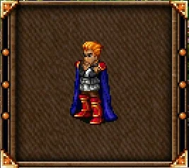
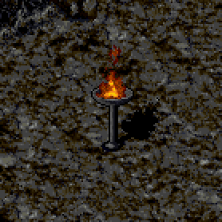
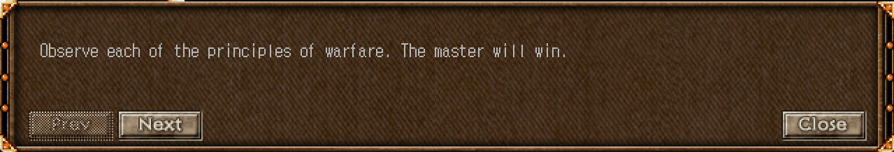

# On the Principles of Warfare

_by Enemy in **Dark Ages**_



## Introduction

The deities of the Temuair pantheon are known to offer proverbs to worshipers who seek guidance through prayer. However, the wisdom that the deities impart is not always straightforward. Some of these proverbs require deep reflection.

In this essay, I unpack the divine proverb of the God of War: "observe the principles of warfare. The master will win." My objective is to explain each of these principles and their practical applications to virtually all forms of competition in our lives, including direct combat, guild politics, town politics, and even personal rivalries.

As an acolyte of Ceannlaidir, I came to fully grasp the principles of warfare through a religious geas—one that led me to encounter a renowned commander of the Loures army. The lessons I share in this essay are inextricably linked to this geas, through which these insights unfolded in dialogue and reflection. To some extent, my lessons are woven into the narrative of my conversations with this Loures military tactician. Many of his examples form the basis of these lessons. The background section is a short story to provide more context about my geas.

My hope is that these lessons are of service to aspiring leaders, tacticians and theologians alike. Ultimately, I chose to submit this essay as lore because that is the predominant focus.

However, these lessons are embellished with a great deal of philosophy for worshippers of the Ceannlaidir trinity. Glory to the God of War!



## Background: the Warrior's Geas

After yet another crushing defeat at the hands of the wretched Count, it took every ounce of my willpower to drag myself back to Tagor. Each journey to Sgrios' servant had chipped away at the irreparable durability of my self-esteem. My companions refused to press on, insisting we wait for reinforcements. But I stubbornly rejected their plea. There I stood abandoned before the Count's mansion, my guildmates indifferent to the even greater battle against the demons brewing within me. The Countess' gnarly vines—thick and thorned—were ready to ensnare my feet the moment I dared violate the Count's sanctity with my spark. The Count's bloodthirsty bats prowled the vestibule, forbidding any entry or escape. Grudgingly, I surrendered to shame, retreating from the estate as the mocking cackles of phantom children echoed behind me.

I sought refuge in the only sanctuary with which my bruised pride would be commiserated. When I arrived at the battlemented temple in Piet, I knelt in reverence before the Honorable One. The soothing crackle of the braziers ignited my soul with the primordial fire through which He leapt. I was not alone that night; a cleric stood by me to lend his assistance in prayer. In that moment of meditation, I decided to pray to Ceannlaidir for something I had never before sought: guidance. While many might question the tangible value of seeking guidance, the cleric assured me that it comes at no cost to labor or faith.

I will never forget His thunderous voice. The braziers erupted with excitement, heralding His presence. He imparted His words of wisdom:



"What principles? How?!" I asked out loud, my voice trembling with anticipation. Before I could respond, my concentration faltered, waning with the flickering flames of the braziers. I slipped from my meditative state.

"A pilgrimage to the settlement," the cleric replied on behalf Ceannlaidir. It was as though, by the right of divine faith, this loyal cleric was anointed to deliver Ceannlaidir's will. However, the cleric refused to elaborate on his terse command.

As I exited the temple, the unforgiving mid-autumn wind gnawed at my delicate cheeks, still acclimated to summer's warmth. Afterall, barely a Deoch had passed since we fended off the pirate raiders in the scorching hot beaches of Lynith.

In my journey through Piet, I circled the village perimeter three times like a disciplined pattern walker of Aosda, only to find nothing. What could possibly be of significance here? Why was I not called to the battlefield? Still, I refused to return empty-handed in defeat yet again. Growing weary of the elements, I sought refuge in Bella, the tavern of Piet.

At the tavern, it was not until after Lia poured my ale that I realized the Count's curse still tormented me: I was as coinless as a church mouse, having left my gold behind in that wretched mansion. Just as I was about to offer an heirloom ring to Lia as collateral before visiting the bank, a fellow patron placed his hand on my shoulder, signaling me to stay put. With a subtle flick of his wrist, the man tossed a few gold coins onto the table.

The man introduced himself as commander Brawn, a rising star in the Loures army. The methodical eloquence of his speech was as striking as his blue-dyed skin and slick, clean-cut hair. His royal garments only heightened the confidence that emanated from his voice. He wore a charcoal gray tunic that complemented his crimson cloak. The tunic, marked with rips and burns, bore the unmistakable signs of battle rather than age. I sensed that these preserved imperfections told as many stories as the proud, gilded symbols of Loures' imperial past, stitched onto his chest panel.

"Well, I owe you one," I joked with a slight bow. "You certainly do", replied Brawn, refusing to depart from his cold but calm, business-like tone. "Your kin's presence is a rarity these days, and so you'll lend me your ear tonight in fair exchange. That's all I ask."

I was more than happy to oblige his request. At that moment, I noticed my mood had completely changed. Perhaps the calming ale and the delicious aroma of Alleen's chicken roast from next door had completely exorcized the stress from my embattled mind. I could not remember the last time I felt so unburdened. The crackling hearth was a constant companion to our conversation, filling the air with a comforting blanket that none of my elementally enchanted armaments could ever provide.

Brawn explained that his battalion was deployed here to thwart the growing threat in the Kasmanium territories. Due to the dwindling aisling population and their disinterest in older battlegrounds, many hostile creatures close to towns increased in number over the past couple decades. However, Brawn seemed most interested in discussing my pilgrimage and, to my chagrin, my recent failure.

"All accomplished warriors have tasted the bitterness of defeat", Brawn mused. "The path of the warrior is not to dwell on that defeat but to learn from it and press on."

Brawn paused, then continued. "No two situations are ever alike, but the principles of warfare remain constant. Allow a seasoned tactician like myself to explain this to you. While our noble philosophers deserve respect for their wisdom, one cannot ignore the palpable bias that stains much of the ink in our archives. Truthfully, they can't speak to our lessons nor our philosophies while comfortably detached from the cruelties of the world in their hy-brasyl towers." He took a long pause to take a swig of his ale.

"Look around you", Brawn continued. "These people were shaped by war; molded by it. They and their ancestors lived through tragedy and triumph. Do you know the history of Piet? It's no coincidence you were sent here on your geas."

Brawn advised me to peruse the Loures archives for works on history as part of my geas. In his own studies, Brawn found that no figure in history comes as close to embodying the principles of warfare as Ainmeal, former emperor of Loures. Yet, even Ainmeal tasted the bitterness of defeat in his first battle against the dark ruler Tenes. Ainmeal had lost almost all his wealth and prestige and accepted his self-imposed exile to Suomi. In the end however, Ainmeal prevailed over Tenes by mastering the five key principles of warfare:

- I. Master the art of deception and surprise to stay one step ahead
- II. Know the battleground environment and use it to your advantage
- III. Manage your resources wisely
- IV. Leverage power through alliances and leadership
- V. Study your adversary

It quickly dawned on me that this encounter was no coincidence. In fulfillment of my geas, I have outlined each of these principles below, informed by Brawn's wisdom.

## Ceannlaidir's Five Principles of Warfare

The following five principles represent Ceannlaidir's core tenets of warfare. Interestingly, these principles extend beyond the battlefield; they are guiding principles for our pursuit of power and success in all areas of life, such as politics, guilds, and personal rivalries. Applying these lessons can help you gain an advantage over your opponents and minimize the need to engage in direct combat with them.

Readers will notice that many of the examples used to illustrate some principles apply equally to others, and that is to be expected. The principles of warfare are interconnected and often very interdependent.

### I. Master the art of deception and surprise to stay one step ahead

"Save your clout for Burgess," Devan assured his colleague. "No need for more dems when we're up 4 to 1. This proposal's in the bag." Devan felt a wave of relief—he would not need to exhaust more political capital by calling in additional allies. His conservative faction had pushed to include the transfer of spark renewal in the schedule of forbidden trade. Still, he was surprised that the disgruntled citizenry had not risen to oppose his controversial amendment. But he did not care to indulge his curiosity further. Devan was sound asleep in the final hours before the voting period ended.

The next morning, Devan headed to the legislative hall to check the official results. During his commute, he was already fantasizing about writing his signature on the official promulgation post. When he finally arrived to examine the results, he completely froze as if under a spell, spilling his kobold tail tea spilling onto the wooden floor. His proposal had been defeated, 5 to 4.

In his state of confusion, Devan barely overheard the Mundane burgess Aliran announcing that his clout had been whittled to nil. Devan's daze was finally broken when two guards placed their hands on his shoulders, escorting him out of the voting chamber on account of losing office.

While legislative politics may seem as far away from the physical battlefield as one can get, Brawn's tale illustrates a crucial lesson in the art of deception and surprise. Knowing when to reveal your strategy is as vital as the strategy itself. Conceal your plan like a coiled serpent in the shifting swamps of Mehadi, ready to strike an unsuspecting traveler stuck in a mire. If Devan's legislative opponents played their hand too early, he might have had time to put up a counterattack.

Once your adversary is lulled into a false sense of security, the only variable left is timing. In this case, the officials opposed to Devan's proposal timed their votes to perfection, leaving Devan's faction with no ability to maneuver. And, if you despise your adversary on a personal level, humiliation is icing on the cake.

Consider another case study: a humorously cutthroat pageant event from only a couple decades ago. One of the competitions of this pageant event was a group scavenger hunt. In a suspenseful turn of events, the guild castle of one of the competitors was ransacked as soon as the scavenger hunt began. It was later revealed that someone had paid a handful of gold bars to a couple of mercenaries to initiate the assault.

The attack on the pageant contestant's castle was particularly disruptive, as her scavenger group consisted of her strongest guildmates. One of her opponents clearly recognized this vulnerability and seized the opportunity. How could she respond? Letting go of the castle temporarily might have been the easier choice, but that would still come at the cost of her guild's pride. In the end, the surprise attack forced the competitor and her guild to make a decision that likely distracted them from the event. Despite this surprise attack, the competitor still prevailed in the end, speaking volumes about her resilience.

Was attacking the castle a toxic move? That is irrelevant. The question is, did it help achieve the desired objective at a reasonable cost? Costs should not be viewed solely in financial terms. The price of alliances, neutral relationships, public perception–these all factor into the equation, however subjective they may be. Ultimately, it is up to the strategist to determine these costs in their calculations along with any mitigating factors, including plausible deniability.

Likewise, one must always be prepared for deception to be used against them. Never grow complacent when the path to victory seems all but clear. Devan the demagogue counted his chickens before they hatched. The ambusher's plan is typically only detectable after it is set in motion. If you are not awake when the final sun heralds the closing of the proposal, expect your sly enemies to sneak into the coop like foxes in the night. Always assume the worst-case scenario and plan accordingly to stay one step ahead of your opponents. This may require having a prospective legislative official or two monitoring the board in the final hours of voting. Take stock of all possible vulnerabilities in any situation.

Brawn referenced passages from Etienne's seminal essay, L'Impertore, to further illustrate the principle of deception. In the war between Ainmeal and Tenes in the Tenth Aeon, Ainmeal employed several strategies of deception against Tenes. These tactics left Tenes in a weaker state:

> _In the meanwhile, Ainmeal put all his efforts into regaining, in secrecy, his own power. Temuair's most ironic case of corruption took place. Despite the destruction of many of the records, there is some evidence that Ainmeal's trusted men were infiltrated in the construction of Loures, and from it deviated resources; it would be no surprise, however, judging by the state of Tenes's treasury by the much delayed end. Using Tenes's money, Ainmeal built the army that would put an end to the darkness of the League's rule._
>
> _[...]_
>
> _It was not until Danaan 2901 that Ainmeal showed Tenes his claws again. Isolated attacks began to be reported all over the ten kingdoms. At first no one related them to Ainmeal, but as the pattern of the attacks was realized, it became clear that the League was facing a superb strategist. First, small military outposts of little apparent relevance were destroyed. Following these events, supply lines were disrupted to the larger outposts in many borders. Until finally open attacks started taking place on major outposts. A general of Tenes was the first to notice why the attacks were following a determined pattern of placement - what once seemed like random targeting had the discreet purpose of driving the civilian population away from the main battlefields, while always leaving a doubt about where the next attacks would occur._
>
> \- _L'Imperatore, by Etienne_

While Ainmeal's isolated attacks were eventually detected, his prolonged infiltration of Tenes' treasury lasted long enough to alter the balance of resources (assuming the evidence of Ainmeal's infiltration is accurate). The lesson to take away here is that the longer you can keep your adversary in the dark while shifting the balance of power in your favor, the higher your chances of victory. This passage also further illustrates the difficulty in trying to discover your opponent's plan before it is already set in motion. Tenes's general required numerous observations to piece the puzzle together.

To summarize, mastering the art of deception and surprise is crucial for staying one step ahead of your opponents. Carefully consider the value and costs of any action you take. Always be prepared to use these tactics and expect them to be used against you. Never become complacent; anticipate ambushes, and plan your moves carefully, particularly when the stakes are high and your rivals are actively seeking weaknesses.

### II. Know the battleground environment and use it to your advantage

"Let me ask you again," Brawn said, his voice steady, each word weighed for precision. "Do you know the history of this settlement?"

He paused, letting the question linger in the air for a moment before continuing, his gaze sweeping over the rugged landscape visible through the window. "Here we sit," Brawn continued, his tone steady, "flanked by Temuair's deep waters, forming a natural moat. To the right, untraversable thickets; to the southeast, a fetid swamp; and to the north, the towering spine of Temuair. The geopolitical significance of this region cannot be overstated—it has shaped the rise and fall of empires."

Brawn flipped through the torn pages of L'Impertore, his finger tracing the lines as he recounted Ainmeal's military campaign to establish encampments in the mountainous region behind modern Piet:

> _[...] the League never noticed the large group of well trained men doing what seemed impossible: Ainmeal's army's main faction, in less than one year, but suffering many casualties, crossed the mountains from Finach to the plains of Ardmagh, establishing itself, in by the end of Danaan 2902, in what is today called Piet. This faction was called the "Mountaineers" for its mostly daring act of courage - the mountains had never been crossed by so many at one time._
>
> _Not counting with an attack from the North, Loures had left that flank poorly defended. At the same time, protecting the outposts from the surgical destruction was costing Tenes many lives. In the beginning of the 2903rd year of Danaan, Ainmeal made his first direct attack against the capital. The few remaining men in the position would have been enough to take over the poorly defended Loures, but Tenes made use of an unorthodox method to prevent it, having many creatures of Darkness summoned to protect the castle._
>
> _[...]_
>
> _A decade of bloodshed followed, with the five kingdoms battling the other five. The attacks from the reinforced Mountaineers against Loures continued, but the capital would not leave his North side open again. On its turn, the capital frequently attacked the outpost in today's Piet, but never succeeded - they just could not find it at all. What none of the generals of Tenes could count with was that the Mountaineers were living underground. Even today part of their installations remain, unfortunately taken by animals of all sorts._
>
> \- _L'Imperatore, by Etienne_

After an initial phase of deception, Ainmeal launched a strategic territorial campaign that forced Tenes to relocate his troops. The key lesson here is the importance of identifying your opponent's situational or geographic vulnerabilities while positioning yourself in a way that makes retaliation difficult. Rather than confronting Tenes directly, Ainmeal forced them into a game of asymmetrical warfare, where the Mountaineers could evade Tenes' grasp.

Exploiting the battlefield environment was also foundational to Brawn's mission to reclaim control of the Kasmanium Mines. After catching a large contingent of orcs by surprise, Brawn directed his troops to take strategic positions. Brawn's forces established sentinel camps along strategic access points, ledges, and cavern skylights. Archers were stationed around the narrow channels in the third area of the Kasmanium Mines where the dracos nest atop the towering walls.

Did you know that the draco's domain in the Kasmanium Mines is one of the most perilous paths for a traveler in all of Temuair? Its narrow bridges—no wider than an orc's broad shoulders—span deep chasms swallowed by endless shadows. The dracos swoop down on hapless prey attempting to cross these precarious bridges. However, such a landscape is a dream for archers, who can easily snipe both the free-flying dracos and any wingless foes who dare attempt the crossing. From hidden crevices, all interconnected by a network of paths behind the cavern walls, the archers can strike with deadly precision. By capturing these strategic positions, Brawn was able to restore Loures' territorial supremacy over the orcs and dracos.

Guild castle battles are another perfect example where the environment heavily dictates the balance of power. Every guild leader at some point relishes the idea of holding a mighty fortress to convey their power to the world. This display of strength is especially valuable when the number of castles is very few while the number of active guilds is high.

For many aislings, there is something deeply satisfying–if not arousing–about exerting control over an important territory or position. Though they might not admit it, even our seemingly pacifist politicians are just as bloodthirsty as the combatants fighting over the southern Coliseum. There is nothing shameful about lust for power. The strong do what they can and the weak suffer what they must. This is the natural order of things. Controlling the environment means everything for the power seeker. Guild castle battles epitomize this principle.

The objective of guild castle battles is symbolically represented by the chess piece that each side holds. The first side to lose their chess piece loses the battle. Winning is largely about raw power, yes, but also strategy. In these battles, the attackers are at a territorial disadvantage. The attackers cannot reach the defenders' chess piece without either destroying the castle walls or climbing the dangerous ladders. The defenders, on the other hand, can easily enter the battlefield outside their portcullis, where there are no physical barricades surrounding the attackers' chess piece. Despite these advantages, the attackers possess perhaps the most important advantage of all: timing. If you are among the attackers, use timing to your advantage by assembling your ranks at a time when there are less defenders awake. Deception tactics, such as spying on the other guild's conversation and active numbers, can help you know when the defenders' numbers are low.

Despite the physical nature of this principle, it holds relevance beyond direct combat. Any astute politician understands the importance of mapping the landscape when seeking office. Before taking power and embarking on a project, you must study the political climate. Who are the most influential figures in town? Those politicians are usually emboldened to engage because they are well-resourced and have siblings who hold prestigious office, like Knight. They also feel a sense of ownership over the towns and institutions they used to control. However, if these political titans are in hibernation, you may have more freedom to experiment or shift legal frameworks without drawing their ire.

Besides the political landscape there is also the legal one. You must understand how the laws of a town or institution are interconnected. You must also know the culture and history that ink the written words. Otherwise, any fundamental changes to the technical or cultural contours of the lawbook could be met with disastrous results. You might inadvertently set yourself up for misconduct charges or create inoperational laws. Do not place a target on your back for opponents who are looking for any excuse to oust you from office. Know the political and legal landscape before establishing your own regime.

We also see this principle of warfare apply to guild politics. Guild schisms are as predictable as the cyclical outbreaks of pestilence. While such events are understandably mourned by guild members who long for a community of solidarity, these cataclysmic events often present a prime opportunity for power seekers. Without challenges or shifts to the balance of power, it can be next to impossible to uproot those firmly planted in their council positions. The most established, reputable guilds do not like handing these positions out freely. However, leadership is meant to be challenged and loyalties tested.

Do not sit back and watch drama unfold if you have ambitions within your guild, unless you consciously decide that inaction will yield a better path when the storm calms. You may console your deserted leader with reassurances of greater loyalty. Work to rally the members who remain, especially the fence sitters. Find ways to boost morale and rebuild the ranks. Or, if you see better opportunities with the defectors, take these exact same steps except with the new guild.

To summarize, to succeed in any battle theater—be it physical, political, or organizational—leveraging the environment to your advantage is crucial. Whether navigating the Kasmanium Mines, engaging in guild castle battles, or maneuvering within the political landscape, understanding the terrain and timing your moves can put you in an unassailable position. In metaphorical battlegrounds like town commons or guilds, you must identify most influential figures and cultural dynamics at play. Know when to make a move when a climatic schism is altering the balance of power.

### III. Manage your resources wisely

Economizing resources is important–if not essential in many cases–to winning battles of attrition and holding onto the reins of power. The case studies previously discussed also touch upon this principle. Ainmeal learned all too well the consequences of losing all his wealth and prestige in Danaan 2874 at the hands of Tenes. Ainmeal learned to formulate a grand strategy that would gradually siphon Tenes' resources. Meanwhile, Tenes grew reckless and overconfident after his battle against Ainmeal:

> _Tenes, sure about his control over his kingdom and strong influence in the other nine, committed the mistake, which brought his downfall. In 2883, the construction of Loures was started. The symbol of Tenes's power, however, drained much of his treasury, placing the army and wizards in the background._
>
> _In the meanwhile, Ainmeal put all his efforts into regaining, in secrecy, his own power. Temuair's most ironic case of corruption took place. Despite the destruction of many of the records, there is some evidence that Ainmeal's trusted men were infiltrated in the construction of Loures, and from it deviated resources; it would be no surprise, however, judging by the state of Tenes's treasury by the much delayed end. Using Tenes's money, Ainmeal built the army that would put an end to the darkness of the League's rule._
>
> \- _L'Imperatore, by Etienne_

It is believed that Tenes' extravagant expenditures drained a significant portion of his warchest. The problem was not just the resources spent on the massive construction project; the sheer scale of the undertaking made it difficult to oversee, a vulnerability that Ainmeal is said to have exploited. Do not commit the same mistake as Tenes after vanquishing your enemies or securing your position. No matter how stable things may seem, you must continue to maintain your warchest and be prepared, as our enemies are always finding ways to target our assets.

The currency of warfare comes in many forms. Physical assets are the most critical resource in most combat situations, but do not forget the importance of assets like labor, political clout, intangible clout (meaning those who are willing to support your decisions or regime), and time. Consider the situation of Devan the demagogue discussed previously, where political clout and sponsorship were the weapons of battle. Devan's detractors did not use their sponsorships to take office until the last minute. The detractors also clearly had enough clout in the warchest to not only take office but whittle Devan's own clout down to nil.

The role of a law enforcer provides a clear example of the need for efficient resource management. Experienced law enforcers know that resources such as time, labor, and clout must be managed judiciously to maintain law and order. One cannot be everywhere at once, constantly waging war against rulebreakers. These rulebreakers will inevitably seek out the remotest corners to sleephunt. They will also hold unsanctioned community events and practice forbidden magic under the veil of night. To combat this, a diligent investigator must make use of every tool at her disposal. This could include leveraging connections with informants, using anonymous siblings to take countless memories, patrolling key areas, and keeping an eye on known criminals to anticipate their movements.

Intangible clout can also be described as simply influence and/or respect. A leader usually requires intangible clout in order to hold onto the reins of power and exert control. This is especially true of positions that are not secured by decree of the Mundanes. A guild leader can be easily challenged. We have seen time and time again that even the most reputable guilds are not immune to a massive exodus if the leader fails to maintain support of the members. This brings us to the next principle of warfare where we examine how one can leverage power through alliances and leadership. Suffice it to say that for the purpose of managing one's resources, governance and rulership run much smoother when the leaders have gained respect and influence. Subordinates will trust your judgment, support your plans or projects, and come to your aid.

To summarize, economizing resources is usually crucial for winning prolonged conflicts and maintaining power. Depleting your warchest and overextending your power can leave you vulnerable to exploitation. Leverage every tool at your disposal to minimize cost. Always keep the warchest replenished, even in times of peace. Any currencies of warfare valuable to your situation should be readily available, including gold, armaments, political clout, labor, time, and even intangibles like respect and influence within your group.

### IV. Leverage power through alliances and leadership

Victory is rarely the result of a single actor. In Temuair, the acquisition of power and utter annihilation of our enemies are often achieved through coordinated action. How we conduct ourselves is crucial in motivating others to participate in our scheme. Even in the face of defeat, a valiant display of heroism can build the influence needed to ultimately win the war. Such was the case with Ainmeal. Historian Chloe gives us a deeper glimpse into the leadership qualities of Ainmeal in Blood of the Forgotten Empire:

> _Tenes' power was first tested by Lord Ainmeal, an unknown noble, in 2871. Ainmeal, named for the noblest of birds, the Swan, had raised a small army and was successfully attacking forts on Mileth's southern border. The fighting was easy, as loyalty to Tenes was through fear alone. Tenes would have allowed some raiding, if reports of Ainmeal's charisma and strange charisma had not made him wary. He dispatched his finest troops, therefore, and Ainmeal barely escaped with his life._
>
> _Yet the damage was done. A significant challenge was afoot, and Tenes and Dubhreal began to prepare for war. Ainmeal's bravery caught the attention of the Fae, who realized that one had emerged who may be able to counter the growing darkness of the League's reign. They therefore began helping him to prepare for the decades of battle awaiting him. The young lord's confidence and grace in battle drew many to him, including several of the Fae._
>
> \- _The Blood of the Forgotten Empire, by Chloe_

The downfall of an established power at the hands of a strong, charismatic leader is a familiar trope in both history and legend. This serves a valuable lesson not only for the aspiring rebel but also the uncontested ruler. Those in power must be wary of the rebel forces that threaten the status quo. Tenes was wise to take the threat from Ainmeal seriously, but, in the broader context, Tenes' failure to maintain a unified coalition of states left him vulnerable. Relying primarily on fear to sustain support can easily backfire if the ruled become convinced that the rebel forces have a chance to succeed. In the eyes of the ruled, there must be something more than fear to justify the ruler's grip on power.

You cannot hold the throne through fear alone in the long run if there are adversaries who can divide and conquer your power under your nose. As mentioned previously, internal conflict in guilds, arena factions, and town politics are as predictable as the cyclical outbreaks of pestilence. The leader, whether the uncontested ruler or the rebel, must gain the respect of subordinates and allies. Consider how Ainmeal's focus on leveraging his leadership and alliances proved to be far more impactful than Tenes' preparation for direct combat:

> _"Thirty years passed, in which both Tenes and Ainmeal prepared for a war to decide the fate of the empire, and more importantly, whether dark or light would hold sway. Minor battles were fought, but the bulk of the Lords' energies were elsewhere. Tenes worked on preparing elemental attacks, while Ainmeal negotiated secretly with Tenes' allies to divide them against each other."_
>
> _Struggle for Loures_
>
> _In 2903, Ainmeal struck. He launched an attack directly on the impregnable castle at Loures, while Tenes rained magic down on his enemy. Yet Ainmeal was protected by Danaan, and the attacks had little effect on his army, for morale was high and the Fae's spells of protection strong. While Ainmeal diverted Tenes, his spies in each allies' camp began the far more deadly work of destroying loyalties. The entire empire erupted in chaos as the political system was overturned and chaos reigned. Each kingdom made due as it could against internal and external invasions, but Tenes and Ainmeal seemed balanced until 2919 when Suomi, carrying its material power as well as the silent power of Undine, came to Ainmeal's side. The war ended two years later when Ainmeal killed Tenes on the battlefield and was crowned Emperor of Loures._
>
> \- _The Blood of the Forgotten Empire, by Chloe_

While fae magic played a crucial role in shielding Ainmeal against Tenes' magic, that is still an example of Ainmeal depending on allies to come to his aid (in this case the Fae) on the defensive front. On the offensive front, Ainmeal leveraged and divided alliances to leave Tenes isolated.

Brawn proudly employed Ainmeal's tactics to exploit the deteriorating relationship between two Kasmanium orc tribes: Draco Claw, the strongest, and Fire Blade, the second strongest. Intelligence gathered by Brawn revealed that the leader of Draco Claw, who saw himself as an ascended demigod, felt deeply humiliated by two Fire Blade members' unflattering paintings of him. In what many orcs saw as an overreaction that jeopardized their collective security, the leader of Draco Claw severed access to a shared hunting technology. This leader declared that cooperation with Fire Blade became untenable. Even members of Draco Claw questioned whether this would weaken all orcs against external threats, including the Loures army.

Brawn offered Fire Blade a deal that the tribe could not refuse. In exchange for allowing Brawn's forces to annex half of Draco Claw's territory without repercussion, Brawn promised to respect Fire Blade's territory and give them Draco Claw's coveted hunting technology. This alliance strengthened Brawn's hold on the Kasmanium Mines. Under normal circumstances, an external threat to one orc tribe is considered a threat to all the tribes. The alliance also bolstered Fire Blade's position because many Draco Claw members defected to Fire Blade.

The case study of the two orc tribes highlights the importance of strategic leadership in defending one's honor. Defending your honor should be prioritized, but the costs of the measure chosen must be weighed carefully. Leaders must be mindful of what they ask their supporters to sacrifice. If the demands to stand by your side are too high, you risk alienating your followers. In such cases, a tactician like Brawn or Ainmeal will exploit these divisions to divide and conquer your support. Likewise, if you see the leader of your rival guild causing internal drama, you may want to seize opportunities to divide and conquer the guild's support base.

There is another important lesson to grasp under this principle of warfare: alliance and friendship are not the same. To conflate the two is a mistake that has led to the downfall of many leaders and politicians. But what exactly is friendship and how does it differ from a mere alliance?

The foundation of a true friendship is built on intimate personal connection. Friendship is a unique bond that seeps through the talgonite walls we erect to shield ourselves from a cold, unfamiliar world. This dynamic can set expectations for loyalty as if it were a virtue or an end and never a means. The bond of friendship is ironically strengthened by letting our guard down, as we feel compelled to divulge our fears, secrets, aspirations, and vulnerabilities. True friendship in Temuair is extraordinarily rarer than one might think. Friendship fulfills an important need in our lives–a need that cannot be fulfilled through allyship alone.

For alliances, loyalty is often of a transactional and conditional nature that one party can be manipulated into believing is a genuine friendship. Where cooperation in a hierarchical organization is the main shared interest between two parties, one should manage this relationship very carefully. In these relationships, displays of weakness and vulnerability should be avoided unless coldly calculated, such as to charismatically assuage the other party's ego through our self-deprecation. With all that said, such philosophical distinctions to neatly categorize social behavior like friendship and alliance oversimplify reality. Our relationships with others and the needs those relationships fulfill are fraught with complexity. That is why the distinction between alliance and friendship in this context should simply be understood as a general principle for the pursuit of power.

Have you ever climbed ranks in a highly structured organization? A political town? Guild? Temple? Other community groups? At first glance, the organization can appear like a monolith of solidarity, no different from the obedient Andor workers that accept their place below the royal guards. Yet, as one advances and necessarily forges collegial relationships, that monolithic structure gives way to a Garamonde Theatre melodrama about a dysfunctional family. No doubt, some colleagues confided in you their seething hatred and envy towards other position holders. Maintaining neutrality in a social organization will invite others to give you a glimpse into the breadth of this animosity, but typically not in as much depth unless you are perceived as a loyal friend or highly respected ally. One must understand that this dynamic is almost always a defining feature of any hierarchical organization.

Assess the fickleness of each power holder within the organization. Understand their ambitions, histories, addictions, and philosophies. Placate their egos to earn their favor and respect. Appear trustworthy, confident, and stable. Forge alliances where they are strategically valuable, but be cautious about what you reveal and on whom you rely for support—especially unstable members. Those who frequently leave and rejoin the group over personal disputes will become a liability if you place your loyalty in them.

Playing the role of the neutral statesmen can be strategic for political longevity, but there will come a time when hard decisions must be made. In those cases, forming alliances can be beneficial. It is very seldom that defeating the opposition can be done without allies.

To summarize, a wise tactician knows that the key to shifting the balance of power lies in effectively leveraging alliances and leadership. Success depends on choosing allies carefully and mastering the art of dividing and conquering your rivals. It is also crucial to appreciate the difference between friendships and alliances, as each serves a different purpose in the pursuit of power.

### V. Study your adversary

Applying the first four principles of warfare is a difficult task without a deep understanding of your opponent. To succeed, you must study not just their tactics, but their ambitions, history, philosophy, and legend. This final principle takes us full circle.

After Ainmeal lost almost everything from the first few battles against Tenes by Danaan 2874, Ainmeal studied his enemy much more carefully. As we saw under the previous sections, Ainmeal learned everything about Tenes, including his plans to construct an expensive fortress, the fickleness of his alliances, and the location of his supply lines.

Learn everything you can about your opponent before setting a plan in motion. Who is this old demagogue retaking office to re-enact old laws? Are they motivated by a reactionary desire to restore cultural traditions from a bygone era? Is that what motivates them? And what can other old politicians tell you about their history and tactics? Some politicians are notorious for periodically resurfacing to disrupt the status quo, only to fade away after a few Deochs. Their enemies have learned to wait out their inevitable departure, carefully preserving their clout (and sanity) before restoring the status quo regime.

Similarly, consider the newly returned combatant from your rival guild, stepping into the fray of the southern Coliseum. What can you learn about their personality, moral sensibilities, and preferred roles in combat (the 'basher' or the 'caster')? Do they use banter to strike blows to your honor and morale? If so, consider how you respond, as their goal is to trigger an embarrassing reaction out of you. If this mouthy adversary often skirts the boundaries of civil etiquette, you might goad them into overstepping them far enough to trigger legal consequences.

Understanding the enemy was also key to Brawn's military campaign in the Kasmanium Mines. When his battalion was deployed, his first priority was to understand why his enemies had become such a formidable force. His battalion quickly discovered that the population of hostile races had surged exponentially. But why? He reasoned that it was because their greatest threat–the aislings–neglected the area for so long. These vile creatures no longer had an external threat for some time.

In Deoch 170, Brawn advised the Loures military council to call upon aislings for aid. The announcement promised enhanced experience recognition for slaying certain creatures. Brawn chose the Grimlok and Dracos specifically because they tend to inhabit strategic locations that give one the high ground in the mines, like ledges. Following the announcement, curiosity drove ailsings to cull the Kasmanium fiends and temporarily push their numbers down. That then allowed Brawn to station his soldiers in strategic locations, knowing full well that aisling interest would disappear in a matter of time.

To summarize, study your opponent thoroughly when formulating a strategy. Pay close attention to your opponent's patterns, legend, motives, and any recurring behaviors. Determine what your opponent relies on for strength and how to take that advantage away. This will allow you to employ the other four principles of warfare effectively.

## Conclusion

After Brawn and I grew weary from our conversation, he rose from his seat, mug in hand, preparing to savor the last swig of ale. Alas, as with all good things, this lesson too was drawing to a close. He lifted his mug high, a salute to the great glory of Ainmeal. "May his imperial legacy live on. Long live the empire," he proclaimed.

After that final gesture, Brawn finished his ale. Without another word, he turned toward the exit, taunting the outside elements with his confident stride as he disappeared into the frigid night.

Brawn's teachings show that the principles of warfare are applicable to virtually all forms of competition in our lives, including direct combat, guild politics, town politics, and even our personal rivalries. There is truth to the cliché that whatever doesn't kill you makes you stronger. When you suffer defeat and live to tell the tale, treat it as a valuable learning experience. Reflect on your loss and apply the principles of warfare to assess the strategies of both you and your adversary.

Thank you, dear reader, for reflecting alongside me on this great wisdom. I hope these principles will resonate with you as you prepare for the battles that lie ahead.

## Bibliography & Inspirations

| Author | Work |
|--------|------|
| Ceannlaidir | Prayer (seek guidance) |
| Etienne | [L'Imperatore](../History/Etienne-L'Imperator.md) |
| Mundane news announcement | Kasmanium Mines |
| Chloe | [The Blood of the Forgotten Empire](../History/Chloe-Blood-Of-The-Forgotten-Empire.md) |

`(( Star Wars: Thrawn, by Timothy Zahn ))`  
`(( The Art of War, by Sun Tzu ))`

_- Enemy_  
_Deoch 208, 8th Moon._

***

```
*Librarian Notes*

Recognized: Aisling, 2024 (Mileth College master list).
This entry has been edited to conform to Library formatting.
The original can be found at https://novus-imperia.com/college/lore/enemy_warfare.pdf .
```
