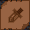

# A Peasant's Guide to Rogues

_by Harmonie in **Dark Ages**_

## Why a Rogue?

The first step to becoming a rogue is to make sure you really want to be one.
The path of the rogue is often difficult. We must be patient and cunning to
prosper.

Rogues are not brute fighters. We can not prevail if we charge headlong into
battle like monks or warriors. Instead, a crafty rogue often relies on
skillful placement of traps to deal with her enemies. Heavy weaponry and armor
such as swords, shields, gauntlets and greaves should be avoided. These bulky
items will only hinder the effectiveness of your traps. With traps and the
unique ability to throw weapons at opponents from a distance, a clever rogue
can stay safely away from the more dangerous monsters while killing it. If you
do find yourself trapped in close combat, a sneaky Stab and Twist can help
finish the creature quickly.

Battle is but a small facet of a rogue's busy life however. We can acquire
skills to improve the quality of weapons or armor as well as increasing the
value of gems. We beautify Temuair by dying and styling the clothing and hair
of aislings. Rogues can also create rings from the gems we polish. Scholarly
rogues may learn many types of lore to identify many of the properties of
items.

One of the most noted assets of the rogue is the ability to higgle. Using our
silver tongues, we can procure a pack full of useful items from higglers for a
very small cost. These items are rarely of much direct use to the higgling
rogue, but many other paths need great quantities of the things we can get.
Some careful bargaining on the rogue's part can provide her with many items
not readily available to her.

You should spend some time getting familiar with Mileth. Speak to any mundanes
you see and talk to them about anything they care to share. The mundane
shopkeepers are full of useful information that will grant you valuable
knowledge and experience.

Talk with any aislings that can spare some time. Most are happy to help a
polite peasant by providing information. Do not beg for items or money, or
persist in speaking to someone who has made it plain they are not interested
in helping. Such behavior will earn you a bad reputation before you even begin
and you may find difficulty getting assistance later.

Carefully consider all the paths before you choose. The rogue path is perhaps
the most versatile, but each path has a lot to offer aislings who follow it.

## Becoming a Rogue

Now that you have decided to become a rogue, you must find a guide to vouch
for you in the Temple of Choosing. Finding a guide can be difficult, but do
not give up. Ask politely and most of the good people of Temuair will be happy
to help you find a guide. You do not have to accept a particular guide if you
are not comfortable with them. Make sure it is someone that you think is
willing to help you and that you feel at ease with. Don't let anyone bully you
into choices you don't like.

After you have become a rogue, you may want to choose a mentor. There is no
penalty if you choose no mentor, so take your time and find someone truly
worthy of you.

### Starting Equipment
If you are lucky, your guide will grant you a small starting fund and/or some
items of use to you. Don't expect these things, because the guide is under no
obligation to provide them. If you do not get any money, your only recourse is
to take your trusty stick or dirk into the crypt and beat critters to a pulp.
You can take the items that the dead monsters leave behind to Dar and Cian
(The wizard and alchemist in Mileth) to sell them or give away to advance
their research into arcane matters. Under no condition should you beg for gold
or items from strangers. Not only is it rude, it is illegal. You can always
get enough money if you are patient and willing to work for it in the crypt.
Later on, you will find many wonderful ways to gain wealth like higgling, gem
polishing, or praying to the patron of rogues, Fiosachd.

 

When you come into some money,
you will want to get some basic equipment. A dirk is a good weapon to begin
with and is fairly cheap at a cost of 500 coins in the Mileth weapon shop. If
you have the funds (1500 coins) and are willing to walk to Suomi weapon shop,
I suggest you purchase a Snow Secret. It is a small four-bladed weapon, shaped
like a cross or star designed to be thrown.

 

Next you will want better
armor than the peasant garb you have. Men may find the scout leather at the
higgler in Piet but female rogues must brave the long walk to Rucesion for the
cotte. These armors will protect you well until you reach 11th insight and can
purchase something more effective. Remember that even though we can use
greaves, gauntlets, and heavy weapons like swords, you will tire quickly using
them and be less capable of setting traps.

## Special Rogue Abilities

The draw of the rogue is the wide selection of abilities that she may use. The
rest of this work will describe how to use many of the abilities available to
rogues in their first dozen insights. These abilities are presented in no
particular order. I encourage each rogue to pursue the skills that appeal most
to her style.

### The First Trap and Trapping

 

The first secret I suggest any rogue learn is Needle trap. Bring a dirk to
Dathi, the special skill trainer of Mileth and for a small sum, he will teach
you Needle trap. The heart of combat as a rogue is the trap, so it is
important that you learn how to do it right. Each trap (and most other
secrets) has a chant or procedure that goes with it, which helps timing the
trap to be set before your enemies close in. Each line of the chant is a
separate beat in the countdown until the trap is set. The Needle trap has four
lines and therefore four beats. `((Right click the icon for needle trap. A dialog box with 4 blank lines will pop up. Make sure to enter something in each line and click OK when you are done.))`

`((To set the trap, double click the trap icon or press the number key for the trap. The Dark Ages manual has details on how to assign secrets and skills to the number keys.))` When you start to set the trap, your chant will begin.
While you are chanting, you may not talk, attack, walk, or even turn to face a
new direction. Doing any of these things will cancel the trap, so make sure
you have time and space to set the trap before you begin or you will leave
yourself open to attack.

Once the chant is over, the trap is set in the space where you are standing.
You can not see the trap, so you must remember where it is or mark it with
something. A single coin works marvelously and you will not lose much if you
must retreat or someone snatches it away. It is especially useful to mark
traps when you are hunting in a group so that your allies know where to guide
the monsters.

A creature must walk over the trap to trigger it. Your traps will not hurt
other aislings, not even those who become monsters by summoning Dubhaimid.
Watch your enemies carefully and learn how they move. A clever rogue can make
a critter move exactly where she wants.

Later, you will learn traps or snares that do greater damage or have special
abilities, including sleep, blind and poison. Each trap and snare is used the
same way as the basic needle trap. Some traps take as many as seven beats to
set, while the much sought after great snares take no chant at all. The rogue
is so adept that the great snare is immediately ready.

_Special Traps_

  

### Unlock


Unlock is another basic ability of rogues. Using this skill, a rogue may open
the chests found in the crypts of Mileth or other dungeons. Daithi teaches
this skill and sells the lockpicks you will need to employ it.

To unlock a chest after you learn this skill, hold the lockpicks `((by double clicking them to equip them))` and walk in front of a chest. If the chest is
empty, nothing will happen. It can be frustrating trying to find a chest that
has not already been raided by other rogues, but be patient and you will be
rewarded. If the chest contains loot, you have the option to attempt to open
the chest or to go on without trying the lock. Be careful! Though the chests
often contain gold and treasures, they are also trapped! If a rogue is not
highly skilled or very dexterous, she will find herself poisoned. The remedies
for poison are many. Monks and priests both learn secrets to cure the effects
of poison. A charismatic rogue will have no trouble finding such assistants to
keep her safe during her treasure seeking. The other alternative is a potion
called a personaca deum. These are acquired from herbalists. To see if an
aisling is a herbalist, simply look at their legend. Most herbalists will be
happy to give a few potions to a helpful rogue in exchange for a load of
higgled wine, since wine is a vital part of the herbalist's concoctions.

### Higgling
By now, you are surely wondering what higgling is. Higgling lets a rogue
negotiate with mundane higglers to get information or large quantities of
items for less money than other aislings can obtain them.

A rogue may higgle in any bank in Temuair. Before you begin, you should try to
empty your pack as much as you can. The higgler won't let you have more than
you can carry. Talk to the mundane behind the counter and request to higgle.
He solicits 500 coins to open the negotiations, but that is a small fee for
the number of items you will carry away. After you concede the money, you can
have an assistant aid you. A rogue assistant will increase the amount of
higgled goods you receive, so try to find a friendly rogue to assist whenever
you can. Next, the higgler will show you his available wares.

 

The first two items you may
higgle are cherries and grapes. These food items have a little nutritional
value and may be used to replenish health slowly, but this is not the primary
use of them. Priests learn to make beothaich deum, known more commonly as
"reds potions", from cherries and grapes. By higgling these items for a
priest, you can often get a few beothaich deum in exchange.


The next item available is wine. Most rogues need no
instruction in how to dispose of a backpack full of wine, but there are other
uses for it besides releasing your inhibitions. Wine is required for most
herbal remedies. By trading them to a herbalist, you can get a wide variety of
very useful potions.


Parchment Scrolls are another choice. I have
found no practical use for these items save one. A wizard may pen magical
songs upon them that transport the reader instantly to the threshold of the
city the song is linked to.


Wolf skins are of little real use, but they are more
valuable to mundanes than any other item you can higgle. As a young aisling, I
made most of my gold by higgling these skins and carrying them to the Abel
armorer, who buys them. When you reach the 11th insight, you can get even more
for them in the black market.

The final option the higgler gives you is to "identify the item in my first
inventory slot". This is a bit misleading, because it will not identify the
name of the item. Instead, this option provides you with detailed information
about an object, such as the damage a weapon can cause. The item to be
identified must be in your top left inventory slot before you choose this
option.

### Gem Polishing


Gem polishing lets a rogue improve the quality and value of a gem by expending
some craft time. To polish, the rogue casts the secret anywhere magic may be
cast and drops a coin at her feet. Then the rogue chooses whether to polish
alone or with a rogue assistant. As with all crafts, having an assistant
increases your chance of success and the quality of your work, so find a
friendly rogue if you can. That's all there is to it. If you succeed, the gem
becomes a raw gem, which means you are uncertain of its quality. If you fail,
usually nothing happens but sometimes you will crack the gem and blister
yourself.

I give you one warning. Blistering hurts. I know of a rogue who actually died
from it. He had just been poisoned and fled the crypt to wait for the effects
to wear off. After the poison left his system, he decided to polish to kill
time while his health returned. Sadly, the first attempt blistered him and
before he realized what had happened, he was staring at Sgrios instead of a
shiny beryl.

_Gems_

  

### Appraising and other lore skills


A rogue may appraise raw gems and a select few other items to find it's value
and identify its name. If you sell the item, you can expect about half the
value from mundanes. If you bank or send it as a parcel, you will pay about
10% of its value.

To appraise an item, place it in the first inventory slot in the top left
corner. Then just use the skill. `((Go to the skills screen and double click the appraise icon.))` If the object is the right sort of item for the skill,
you will learn its name and the value of the item.

Other lore skills provide various details about the items associated with the
skill. They work in exactly the same way that appraise and usually provide
useful information about the item.

### Tailoring


Tailoring is a skill with many uses. The tailor may repair damaged garments in
the field, improve the quality of clothing in a tailor shop, or even dye and
style attire if you are a respected citizen.

_Mending damaged garb_ is risky for inexperienced tailors. A failed attempt to
repair a garment will damage it and it is possible to destroy your apparel if
it is badly damaged. To patch your raiment, place it in your first inventory
slot, then apply your tailoring skill `((by double clicking the icon.))` All
mend skills work the same way as using tailoring to mend garb.

_Improving attire_ must be done in a tailor's shop. Only there can you find
the proper equipment. It is suggested that you remove all clothing that is not
tailored from your person before beginning. It is easy to accidentally tailor
the wrong garment and since this process takes craft time, it is important to
tailor the right clothing. If you fail terribly, you can even break armor,
including the armor you are wearing. I have found myself adorned by nothing
more than my boots and my embarrassed blush on a few occasions while
tailoring.

Talk to the tailor and ask him about male or female tailoring, whichever you
intend to work on. Then you may choose to tailor alone or with an assistant.
As with all skills that allow an assistant, having one will improve the chance
of success and the quality if the finished product. After your assistant
agrees, or if you are working alone, it is finished. You should have someone
identify the finished product to see what grade of armor it is.

To _dye clothing_ , A respected citizen must have a practiced tailor assistant
`((Tailor must appear on the legend of the assistant.))` There are four places
in Temuair where garments may be dyed: Suomi armory, Mileth tailor, Piet bank,
and Rucesion tailor. Make sure that the tailor assistant has the garb to be
dyed in her inventory. Then talk to the mundane present in the shop and ask
about male or female style clothing. For instance, in Mileth I would ask about
Mileth female style tailoring to dye a corsette green. The mundane will ask
who has the item. Tell him the name and he will ask the assistant questions to
determine which item is to be dyed. Dying clothing takes a lot of craft time.

Note that a tailored item may be dyed, but a dyed item can not be tailored. If
you want a "good Mileth jupe", you must dye a "good jupe".

### Hairstyling


Hairstyling is a skill unique to rogues that lets them change the color and
style of another aisling's hair. To style or dye hair, the stylist and the
client must go together to one of the two places in Temuair that have the
proper gear. These places are Mileth bank and Rucesion bank. Styling takes
craft time from both the stylist and the client.

The stylist must talk to the higgler and ask about styling, then supply him
with the name of the aisling to be groomed. `((That is all there is for the stylist, the rest of the process is entirely up to the client.))`

The aisling may dye their hair on once per moon `((day))`. To dye their hair,
the client must select dye before any other hairstyling is performed for that
moon. The client may choose different colors and preview them before making a
final decision. `((Once the client has left the menu to select colors, though, the hair will be that color for a full moon. ))`

The client selects hairstyles in a similar way. The client will be provided
with numerous choices and may continue to preview them until she finds one
that she is happy with. The client's hair may be styled three times per moon.

### Stab and Twist




There is not much to say about
this savage combat maneuver. The rogue must be facing an enemy in melee to
stab and twist. If successful, the rogue thrusts a dagger or surigam into her
opponent and yanks it out with a twisting motion that tears a vicious jagged
wound as the weapon exits.

### Throw Surigam


Using this skill, a rogue may stand many paces away from an opponent and throw
a surigam or soori dagger to inflict damage at range. To be effective, the
rogue must be in a straight line with the target and more than one pace away.
You can not throw a soori at a monster you are in melee with, but you can
throw it over him at any creatures behind. This skill is especially useful
because you can throw over the shoulder of an aisling in front of you or even
through obstacles. The rogue will not lose her weapon by throwing it. It will
always be ready in hand when you need it.

The drawback of this skill is that it is very difficult to hit things when you
begin using it. However, if you take the time to practice and become
proficient with thrown weapons, you will find that it is much more deadly than
assailing a monster.

### Taunt


Taunt lets a rogue draw the attention of a creature without having to get near
it and strike it. Upon hearing the taunt, most creatures will rush headlong
toward the offensive rogue with little thought of the traps they stumble over
en route. `((To taunt, double click the taunt icon and click on the monster you wish to taunt.))`

## Conclusion

This is far from a complete list of rogue abilities, but it provides a good
basis for beginning rogues to build on. After reading this article, a newly
awakened aisling may confidently pursue the path of rogue and know what to
expect in the beginning of her career and how to perform many of the tasks
available to her.

***

```
*Librarian Notes*

This entry has been edited to conform to Library formatting.
The original can be found at http://www.darkages.com/2000/download/Harmonie_Rogue/index.html .
```
