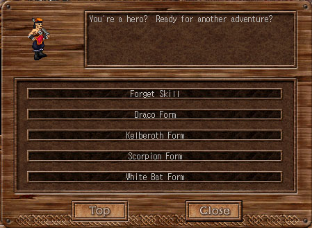
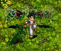
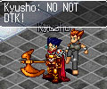

# Draco Lore

_by IMeizo in **Dark Ages**_


## Martial form

It's said among the top fighters in the world, monks represent the core. From
the cracking of flash-fast strikes and thunderous kicks, they hold there own.
Along with the normality of a monks every day life; waking, training and
teaching young Hubae - Monks in complete uniqueness have the choice to further
study a path, or a Martial Form of four animals from Berg, Fighter Trainer of
Suomi: Kelberoth, White bat, Scorpian and ofcourse the mighty Demi-dragon, the
Draco. Draco form, also known as the "hunting form" dishes out massive amounts
of damage, as compared to the other forms which rely on spells to improve the
fighting ability.



## Attribute Pros and Cons

After ones physical and mental abilities have sustained a base average `((5 on
each stat))` one may learn the form of his or her choice from a monk of the
wanted Martial Form. If the monk in training wishes to learn a Martial form
without the assistance of another, his or her physical and mental abilities
must be improved further than that of a monk learning under a teacher. `((10 on
each stat))` Upon learning the Draco Form - one will notice many changes in his
or her physical and mental being. Knowledge and power will fill the minds and
veins of these individuals. As for Draco form students the learner will feel a
rush of endurance, however the monk will suffer in his intelligence and wisdom
arousing slight clumsiness and a loss of concentration because of the natural
rage of the Draco. `((-1 int, -1 wis, +3 con, -3 dex))`

| Before Learning  | Upon Learning    |
|------------------|------------------|
| Strength - 5     | Strength - 5     |
| Intelligence -5  | Intelligence - 4 |
| Wisdom - 5       | Wisdom - 4       |
| Constitution - 5 | Constitution - 8 |
| Dexterity - 5    | Dexterity - 2    |

Endurance `((Constitution))` will greatly improve the main function of a Draco
form Monk - Offensive attacks.

## Skills

Again, upon learning the form, one will be granted skill(s):

_**Draco Tail Kick**_ (_DTK_) - The single strongest kick, able to hit all
targets around the user, backed with the rage and endurance of the animal
Draco. `((Con + Str based attack, sided more for Con))`

Draco tail kick is the most powerfull monk attack known to date in Temuair, far
surpassing the Saphire streams skill "_Mantis Kick_"





## Spells

Again, upon learning the form, one will be granted spell(s):

_**Draco Stance**_ (_Dion_) - A very usefull spell indeed, quick but handy `((7
second))` dion. (_Invincibility_) - The user pulls at his being and summons the
dracos ability to withstand physical damage. `((200 mp to cast))`


_**Snort!**_ (_Taunt_) - A quick but to the point taunt. `((1 line))` - The
user flashes signs of his Form to enrage opponents while snorting and barking
chants of vindication.


## Draco fighting tactics (_Hunting_)

### Group hunting, Low - Med insights: (_11th - 80th_)

After taunting ones prey using "**Snort**", low insight Draco form monks will
use "**DTK**" to eliminate creatures and beasts in quick, but efficient, bursts
of damage. With the added effect of a priests curses and the right element
attack, creatures should be easily eliminated with straight forward attacks and
bashing. A common tactic used with monklings is to "**Snort**" , Rush in,
ambush and exhaust your combo, starting with Draco tail kick to the back, and
or side of the beast/creature. A more exotic tactic, with the expertise and
knowledge of ones path is to combind ambush with a suprise attack, deverting
the creatures attention for a moment while an assistant basher then re-occupies
the attention of the creature allowing you to then exaust your combo ending
with Draco tail kick with the insurance that the creature is busy with another.
Make sure to conserve MP when casting "**Draco stance**".

### Group hunting, High - Master insights: (_80th+_)

When one has reached a level of fitness which allows him or her to fight in
master hunting grounds, the combination of the already powerfull "**DTK**"
along with other monk skills and the added effects of curses and the right
elemental attack, creatures should be eliminated more efficiently. Common
tactics with 99th insight monks and masters with there already evolved and
powerfull attacks are similar to those of low insight monks, however with the
added skills and power of the monk damage should be pushed out at a slower rate
to avoid wasting skills. Exotic tatics generally come generally through
personal styles.

## Soloing

Soloing is only recommended for those of low to medium insight ranges because:

1. At higher insights creatures and or beasts are only easily defeated with the
   combination of Draco Form attacks and curses from an aiding priest.
2. Though the experience will be greater, the time in which it takes to defeat
   a monster by ones self would not be worth it.

## Draco fighting tactics (_Arena_)

\*Although simple in thought, the Draco form monk when dueling and or fighting
in the arena must use precise timing and aim.\*

### With Caster aid: (Avoid being cornered, to prevent damaging aiding caster with DTK)

When an opponent has been cursed and or put under stasis make sure his or her
Dion, or Draco stance (If applicable) has exhausted, when so - unleash your
combo and immediately cast "Draco stance" to prevent from a retaliating attack
if the opponent has not already been defeated.

### Solo: (The closer the better. The closer (an) opponent(s) is to you the better, if possible fight in closed in areas for more of a chance to hit with DTK)

When facing one or more opponents, "**DTK**" will be essential. Because of its
ability to hit targets all around the user, the combination of ambush and throw
could be deadly.



## Uncommon tips

1. Draco tail kick does not unhide a hidden user. - Great for suprise attacking
   arena opponents.
2. Draco stance looks the same as mist when casted. - Can throw off an
   opponents timing.
3. Draco form monks are usually more attractive then Kelberoth form monks -
   Easier to get married.


~ _By IMeizo_

***

```
*Librarian Notes*

This entry has been edited to conform to Library formatting.
Recovered from the Internet Archive; the original site no longer exists.
The original can be found at https://web.archive.org/web/20041211125350/http://www.angelfire.com/psy/meizo/index.html .
```
