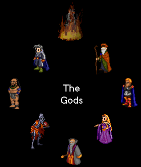
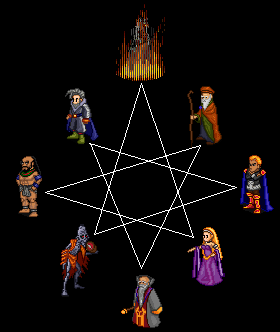
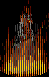
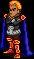
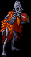

# Worshipper's Guide to the Gods

_by Innoruk in **Dark Ages**_

_Of all the things in Temuair, the Deities are perhaps the most important. Most
know of the eight Earth-Sea Deities, but few know of all the Gods. And even
those who do rarely realize the true depth of the Deities. If you truly wish
such knowledge, I invite that this volume be read. Study the Octogram below if
you so wish the truth of the Gods of Temuair and their deepest relationships._



## The Earth-Sea Gods

_There are eight Deities known as the Earth-Sea Gods. They are the Gods still
living, worshipped in great Temples by the Aislings. This section of the volume
will endeavor to explain them._

Perhaps the most important tool of any Worshipper is the Octogram. It compares
each of the Gods to all the other Gods. I have displayed it below:



The Octogram is read quite simply. Each God has, next to Him, His Enemies (i.e.
Glioca's Enemies are Gramail and Ceannlaidir). Each God also has two lines
extending to His Allies (i.e. Glioca's Allies are Cail and Deoch). Finally, on
the opposite side of the Octogram is the God's Opposite (i.e. Glioca's Opposite
is Sgrios). It should be noted that the Opposites are not Enemies, They simply
represent opposite beliefs.

Each God is very individual. Below, I show the eight Gods of Temuair. Choose
one and you will go to that section of this volume. It should be noted that
each God's section will be written from the point of view of that Fellowship.









## Deoch, Lord of Light and Inspiration


### The Story

Deoch. Perhaps the oddest God of the eight Temuairian Gods. Deoch does not date
back as far as several of the others. Yet He is one of the most respected of
them all. His Story is a strange one, but due to the nature of His Followers,
this only makes Him more respected in their eyes. Read of the creation of Deoch
in this passage from an ancient tome:

_And lo! On high rose forth a Dark Shape, Darker than the Night. And we knew
that it was the Dark Lord come for us. But He froze. And from His Hands did
come forth Flame. And from that Flame came Life. And so the Flame Lord Deoch
was born, as a Dubhaimd of Debauchery._

Deoch was created by the Dark Lord Chadul, to be a Dubhaimd. His Realm was that
of Debauchery. Deoch, unlike the other Dubhaimd, did not mutilate and destroy
like the others. But He was very loyal to His Master. But, it would so happen
that He would change drastically...

_And Deoch, like His Brothers, was born of Darkness. But Darkness only creates
more for Light to penetrate. And so did the Light of Danaan penetrate the Flame
Lord Deoch. He took from Glioca Love, and He offered it unto Danaan._

Deoch fell in love with Danaan. Unable to serve both Chadul and Danaan (they
are antitheses), He chose His Love, and joined the side of Light. He was key in
the Shadows War. But it would so happen that He would soon be given His own
Light Domain.

_And so did Deoch follow the Holy Light. And His Love for the Lightbringer did
grow massively. But there was more importance than His Love, and Danaan was not
as quick to give back Her Love to Him, if indeed She felt any for Him. But,
when She did Sacrifice Herself to Defeat the Dark Lord Chadul, Deoch did Weep.
And to forever remember His Love, He took the element of Light, and imbued it
within the aptly named "Tuatha de Danaan."_

Following the Sacrifice of Danaan, Deoch took the Element of Light and made it
His own. Using His Inspiration, He imbued certain Mundanes with amazing
intelligence and awareness. And from there came the Aisling, the Tuatha de
Danaan. To forever honor Deoch, the Calendar of Temuair is currently measured
in Deochs.

### The Worshipper

The Worshipper of Deoch is a unique one. Due to the far distance from any city
to His Temple, the Deochian Worshipper must be quite loyal, and willing to
strain himself for the worship of Deoch. What is more, due to the unique nature
of Deoch, of both Light and Dark, one must be somewhat neutral. However, many
who follow the Light will worship Deoch, as He is the God of Light since the
Sacrifice of Danaan.

### The Beliefs

Those who follow Deoch have one primary belief: That creativity is the key to
the Aisling's soul. His Followers are the ones who write the best poetry, who
think the deepest thoughts. It is almost guaranteed that the Board for the
Temple be covered in works of literature and poetry.

### The Allies

As must each God have His Allies, as does Deoch. Deoch's two allies are Glioca
and Sgrios. And there is good reason for each. Glioca, as the cause of Deoch's
Love for Danaan, therefore the reason He came to His new position, has had
great effect on Deoch's "life." Therefore, it is only appropriate that such a
path of Love be allied with Love Herself. As for Sgrios, it is commonly
believed that He began as a Dubhaim. If true, then Deoch and Sgrios are
Brothers, and former allies in the Shadows War. Therefore, it is only
appropriate that They remain allies.

### The Enemies

As opposed to Allies, each God also has Enemies. Deoch's are Fiosachd and
Luathas. These also have a good basis. Fiosachd, being concerned with wealth,
would seek to eliminate the creative works of Deoch. For there is no monetary
value in poetry. As for Luathas, He too would seek the destruction of these
creative works. For Luathas is concerned only with facts, and the stories of
Deoch merely muddle the true, hard facts.

### The Temple

The Temple of Deoch, like all Temples, is where it is for a reason. The town of
Suomi is very much isolated from the rest of Temuair. Therefore, it provides a
quiet place to create and dream. Its isolated location also requires one to be
quite determined to reach the Temple. Finally, the Temple is in the western
part of Temuair, and the Sun, often thought to be the Legacy of Danaan, rises
in that part of Temuair.

### Modern Interaction

Today, Deoch's works are seen often. Many would-be Bards and Artists ask for
His Blessing prior to seeking Recognition. Also, seeing as how the Temuairian
Calendar is named for Deoch, His Name is always being repeated. Finally, it is
the Spark of Deoch that makes the Aislings Aislings, and therefore Deoch may be
the God closest to the Heart of each Aisling.

## Luathas, Lord of Knowledge and Gnosis


### The Story

Luathas is one of three Gods who was formerly an Aosdan. Luathas was a great
scholar of the time of Aosda, ever curious. He was proclaimed by all to be a
wise Master of Knowledge, and could be counted on to know of almost anything.
As such, He was one of the first to know of the foolishness of the Aosdans, and
the coming destruction of Aosda.

So as to have a chance at restoring the Glory of Aosda, Luathas prayed for
assistance. Danaan heard Him, and touched Him with Her Power. It was then that
He joined the Octogram to aid the restoration of His former society. He has
begun on this path by discovering the element of Light, aiding the side of
Light in the Shadows War.

### The Worshipper

The Worshipper of Luathas is one who seeks Knowledge in all forms. He does not
seek poems, but facts. He seeks the true knowledge of all things. He may have
been a member of other Fellowships to have learned from them their beliefs.

### The Beliefs

The followers of Luathas seek one thing above all: Knowledge. They will go to
any lengths to learn new things and discover new customs. But Luathas also
preaches teaching. Therefore, Luathans are often those who write of History and
Lore. The Board is often covered in Lores and tomes of great knowledge gathered
by the Worshippers of Luathas.

### The Allies

As must each God have His Allies, as does Luathas. His Allies are Cail and
Gramail. Cail is the Lord of Peace and Nature. As Cail preserves Nature,
Luathas gains Knowledge. The Knowledge of Nature is perhaps the most valuable
there is. Gramail is one who utilizies Knowledge, therefore honoring Luathas'
Knowledge to all of Temuair.

### The Enemies

As opposed to Allies, each God must also have Enemies. Luathas' Enemies are
Deoch and Ceannlaidir. Deoch, seeking only to dream and imagine, discounts
Luathas' facts as worthless. Such a thing is humiliating and belittling.
Ceannlaidir, in His rage, seeks to destroy. The destruction of anything limits
Knowledge, but Ceannlaidir would destroy Knowledge completely in His Rage.
Therefore, Luathas forever has an Emnity.

### The Temple

The Temple of Luathas is in its location for several reasons. Primarily, the
city of Rucesion is the one where the most knowledgeable of Masters dwell. As
such, it is a ripe place of knowledge. Next, Rucesion is where the Element of
Light was discovered, requiring great research. Finally, as the area closest to
the dark forces of the Dubhaim Castle, it provides an ample chance to learn of
Darker powers.

The Temple is warded by great magicks. To enter the Temple of Luathas, one's
intelligence must be high for the insight, requiring certain knowledge to be
known.

### Modern Interaction

The works of Luathas are not as often recognized as are the works of other
Gods. Luathas is the Patron of Wizards, and so, of course, every Wizard knows
of Him. However, Luathas is also partly responsible for the Deo spells of the
Priest, mostly responsible for the imbuings of the Belts and Necklaces
throughout the land, and the Elemental alignments of certain creatures. It is
Luathas' ordering of the Chaos of the Elements that enables all these things to
be.

## Ceannlaidir, Lord of War and Honor


### The Story

Ceannlaidir is one of the original Gods, in that He came from the time of
Danaan and Chadul. Yet He was not created by Grinneal. No, His creation was an
odd one. In the later years of the Grinneal times, the society of Aosda fell
apart. This accounting gives an accurate description:

_And so did Aosda come to ruin. And from the fire of the Aosdans sprung forth a
being unlike other known to Earth-Sea. It was a being of great power, yet
consumed of the fire from which He sprung. It was the fire of rage, of
determination, of Honor._

The fighting and rage of the Aosdans caused Ceannlaidir, God of War, to come
forth. It is believed that He may have caused the three day war against Chadul.

### The Worshipper

There are several types of Worshippers of Ceannlaidir. Primarily, the
Worshipper is concerned with Honor. Much of the Fellowship is quite Honorable
in their approaches with each other and others. The other type of Worshipper
seeks conflict. As Honorable as Ceannlaidir is, He IS the God of War. As such,
much of the Fellowship seeks fights, not for the sake of fighting, but for the
sake of superiority. Many Worshippers will hold Sumo battles with one another
within the Temple.

### The Beliefs

Perhaps the primary belief of those who follow Ceannlaidir is that strength is
the main way of judging a person. For this reason, Ceannlaidir's followers are
concerned primarily with being the strongest. Even Priests are unnaturally
tough in this Fellowship.

### The Allies

Ceannlaidir, like all the Gods, has two Allies. They are Fiosachd, God of Luck,
and Sgrios, God of Death. Because of the nature of War, Luck can be a deciding
factor between life and death. As such, Ceannlaidir and His Followers have
great need of Luck in their daily endeavors, especially when they are at war.
Obviously, Death comes from War. Therefore, Sgrios will often come to aid
Ceannlaidir, be it by crippling the enemy or by bringing the fear of Death.

### The Enemies

Ceannlaidir's Enemies also have reasons. His Enemies are Glioca, Goddess of
Love, and Luathas, God of Knowledge. Glioca, with Her All-Loving ways, would do
anything in Her Power to prevent war. This prevents Ceannlaidir from showing
His Strength and Honor. Luathas, preferring the strength of the mind, would
seek to drain away all strength of the body, therefore preventing true strength
to be shown.

### The Temple

The Temple of Ceannlaidir is located in a wonderous place. The city of Piet,
due to its low population, is wonderous for the training and sparring of
battlers and Followers of Ceannlaidir. It also allows Ceannlaidir to come to
any army that might seek to gather in Luathas.

The Temple is warded by great magicks. So as to ensure that only the hardiest
enter into the Temple, one must be wielding a weapon in order to enter. It can
be anything from a Stick to a Staff to an Escalon, but it must be SOME weapon.

### Modern Interaction

Ceannlaidir is most commonly seen in the way of his Path, that of the Warrior.
Every Warrior takes their strength and skill from their Patron Ceannlaidir.
However, Ceannlaidir is often beeseeched by blacksmiths for strength of steel,
and by armorsmiths for durability of armor. In addition, the greatest warriors,
the Orcs and the Champions of the Order of Carnun, pray to Ceannlaidir, though
He is known by a different name to them.

## Glioca, Lady of Love and Compassion


### The Story

Glioca is a daughter of sorts to Danaan. Though She was not conceived by
Danaan, Glioca came from Danaan through some other process. It is most commonly
believed that She was once part of Danaan, and simply came off. Either way, it
is most likely that Glioca came into being during the Shadows War, when Danaan
and the side of Light would have needed a force to combat their rage. That
force would have been Glioca

### The Worshipper

All sorts of people follow Glioca. However, the true Gliocan is one who would
give up time for the good of others. He may spend time in the Mileth Crypt,
helping new Aislings with hunting, or he may give away free items to those who
have just died so that they can get back on their feet. The true Gliocan will
even go against Glioca's ideals by being mean to a person so that a majority
will be better off. Perhaps most importantly, a Gliocan will always take
responsibility for his actions, and will not blame others for it.

### The Beliefs

Gliocans believe in two concepts, both closely related, above all others. They
believe in Eternal Love and Eternal Compassion. A Gliocan will never be unkind
unless they have a reason for doing so (i.e. banishing one person to allow five
others a better chance to pray). But Glioca will seek the best way to be
Compassionate.

### The Allies

Glioca has two Allies. Her Allies are Deoch, God of Inspiration, and Cail, God
of Nature. Deoch, being the God of Inspiration, inspires people to show their
love for one another in the form of poetry and sonnets. Also, Deoch Himself was
greatly affected by His Love of Danaan, and so Glioca may depend on His
firsthand experience with Love. Cail, in addition to being the Son of Glioca,
represents Peace and Harmony. In addition, being the Protector of Nature, Cail
strives to protect natural order, which includes Love. His ideals and Glioca's
are mutual in this aspect.

### The Enemies

Glioca's enemies are also rightly justified. They are Ceannlaidir, God of War,
and Gramail, God of Law. Ceannlaidir, for obvious reasons, is the worse enemy.
Representing War, Ceannlaidir strives to kill, while Glioca strives to Love and
Heal. As such, Ceannlaidir routinely destroys what Glioca represents. Glioca's
other enemy is Gramail. Because of the nature of Law itself, any true justice
official cannot truly show love to people. As such, the strict Law of Gramail
does not allow the Love that Glioca requires.

### The Temple

The Temple of Glioca has the most noticeable of all locations. It is located in
the crossroads of Mileth, and is the second Temple (second only to the Temple
of the Veil) seen by most Aislings. This is both negative and positive.
Positive, because it draws a large Clergy and a large Fellowship through which
to spread Glioca's teachings. However, many join the Fellowship simply for the
ease of its location, and know very little about the teachings of Glioca.

The Temple is warded by great magicks. So as to enforce the Compassionate
nature required of those who enter, no weapon may be wielded upon entry to the
Temple. At the time of this writing, an exception has been made by the Clergy
to allow certain items (such as staves), but that policy may or may not change

### Modern Interaction

Glioca's presence is most clearly in the Faerie Glade of the Enchanted Garden.
It is their that the Fae will celebrate Aisling love, the most precious thing
to Glioca. However, other examples are often seen, most noticeably in the Path
of the Priest, Glioca's chosen Path. In addition, every Church in Temuair
reveres Glioca above all others, for it is Her Love that allows Aislings to
marry.

## Gramail, Lord of Law and Justice


### The Story

Gramail is one of three Gods that was formerly an Aosdan. In the times of
Aosda, Gramail was an old and wise man, yet did little to improve society. When
Hy-brasyl was drowning, Gramail made Himself known, and became a God. He now
serves to spread Justice and Law to all parts of Temuair so that it will not
meet the same fate as did Hy-brasyl.

### The Worshipper

Gramail, though not worshipped by many, has a very set type of worshipper. That
worshipper is one who reveres Justice above all else. Almost, if not all of His
worshippers are very involved in politics. The Worshipper will often assist
officials in seeking justice, as that is the highest Honor of all to a
Gramailite.

### The Beliefs

Gramailites believe that Justice is the highest calling. As such, the politics
of Mileth and Rucesion are the most sacred things. At the time of this writing,
the guild that effectively controls Rucesion politics is Vallaire Cura, whose
leader is a Priest of Gramail. The most honored position, as opposed to a High
Priest, is a Burgess, who makes fair and just laws. The calling of Justice is
one that all Gramailites must feel.

### The Allies

Gramail has two Allies. They are Luathas, God of Knowledge, and Fiosachd, God
of Luck. To be fair in a trial, one must have great knowledge of the case. Such
knowledge comes from Luathas and His Followers. All fact gained in trial is
owed to Luathas. The other Ally, Fiosachd, is an Ally for a seperate reason.
Oftentimes, true judgement or strong arguments come through chance. This chance
is provided by Fiosachd.

### The Enemies

Gramail's enemies are equally justified. They are Glioca, Goddess of
Compassion, and Sgrios, God of Death. Glioca, in Her etneral Love, cannot show
true judgement, as She will seek to save all people. As such, Justice is
diluted. Sgrios, on the other hand, seeks to bring all into His Realm. As such,
He would take someone without due process of Law. Life and Death must be
dictated by Law, for without it, they are simple and utter chaos.

### The Temple

The Temple of Gramail is located in Loures, Capital of Temuair. From here,
Gramail is able to be certain that fair judgement comes from King Bruce. It
also allows Gramail to observe politics throughout the land, so as to be sure
that all is fair.

The Temple is warded by great magicks. In order to provide fair judgement,
items that could threaten are not allowed. As such, one may not wield a weapon
to enter the Temple of Gramail.

### Modern Interaction

Gramail is, obviously, most clearly seen in the courthouses of Temuair. Each
and every Judge, Guard, Captain, Demagogue, and Burgess follows Gramail's will
in creating a fair, safe enviroment for all the peoples of Temuair. However, He
even exists in every Aisling, with their sense of right and wrong.

## Sgrios, Lord of Death and Decay


### The Story

Sgrios was not originally a God. During the Shadows War, Sgrios was created by
Chadul as a Dubhaimd. But this Dubhaimd was given a special position, that of
guarding the Underworld. Because of the nature of the Dubhaimd, they gain power
when Death comes to them. Sgrios, watching the Underworld, encountered many
Souls, and harvested them for power. He reached the point where He was so
powerful that He can be considered no less than a God. The following first-hand
account acurately portrays the day that Sgrios gained such power.

_'twas a great roar that came forth from the bowels of the land. And so did the
Sidh, Gods, Demigods, Warriors, Mundanes, and Dubhaimd stop alike, to look
forth. And thither was a great being, possessed of power unbeknownest 'fore
that day. 'twas the greatest luck that the Nameless One was already under
siege, for them would none be capable of reaching past TWO such powerful
beings._

And so Sgrios became the Lord of the Dubhaimd following Chadul's defeat. With
the exception of Deoch, Sgrios is the only Dubhaimd who has reached past the
stage of Servitor.

If more information is sought regarding the Life of a Dubhaimd (including
Sgrios), I would invite you to read the Philosophy entitled

### The Worshipper

The Worshipper of Sgrios is a hard one to explain. There are two main types
however. The first is the one who sees Death as the inevitable end, even moreso
than Life. This Worshipper seeks to worship Sgrios as He is the one who
provides such a release from suffering. The second Worshipper is the "Dark"
worshipper. Though the Sgriotans do not consider themselves evil, probably over
half of the Fellowship follows Chadul as well. This is because Sgrios is the
closest God to Chadul. So it is not odd to have Sgriotans claim themselves to
be more loyal to Chadul.

### The Beliefs

The Beliefs of a Sgriotan are rather simple once thought upon. First and
foremost, they believe that Death is the Holiest thing imaginable. They will
argue that it ends suffering, and that without it, Life is impossible. They see
Death as a release from pain and suffering. They also recognize that Sgrios
protects their Souls, bringing them back to Life. A slightly lower belief is
that Sgrios recycles the world through Decay. Such as mold growing a flower
that becomes a Hydele deum that becomes a rat's food. And so on and so forth.

### The Allies

Sgrios' Allies are actually quite easy to understand. They are Ceannlaidir, God
of War, and Deoch, God of Inspiration. Ceannlaidir, simply, provides Souls to
Sgrios. In a War, Death occurs. Plain and simple. As such, Ceannlaidir provides
the Death and passage to the Underworld that Sgrios seeks. Deoch has a bit of a
more muddled reason, but it is still simple. In the Shadows War, prior to
falling in love with Danaan, Deoch was a Dubhaimd God of Debauchery. As such,
Sgrios and Deoch are practically Brothers, and continue to be Allies, even
though Deoch has given up His Dubhaimd heritage.

### The Enemies

Sgrios' enemies are slightly more complicated. They are Cail, God of Harmony,
and Gramail, God of Law. Cail is somewhat simple, as He seeks balance in Life,
while Sgrios seeks the Death that feeds Him. As such, what Sgrios builds, Cail
destroys. Gramail's reasons are far more complicated. Gramail, through His
processes of Law, would seek that Death be under His control, only to be used
to dispense Justice. Sgrios does not appreciate such a trespass on His domain,
and so despises Gramail.

### The Temple

The Temple of Sgrios is hidden within the Castle of the Dubhaimd. This place is
one of only two homes that the Dubhaimd still have (the other being the
Labyrinth of Ardmagh). As such, it is perfect for Sgrios, a Dubhaimd God
Himself, to house Himself and His Brothers here. Out of respect for the
Fellowship, I shall not reveal the Temple's exact location.

### Modern Interaction

Sgrios perhaps the largest impact on Temuair out of all the Gods currently.
Every Aisling either respects Him or fears Him. His Scars are known to all
Aislings. Sgrios is seen by every Aisling at least once, be it by visiting the
Underworld through Death, Ascension, attacks of the Dubhaimd Lagh, or even
should the Horrible Sgath be called. Sgrios is all these things and more.

## Cail, Lord of Nature and Harmony


### The Story

Cail is the son of Glioca and Ceannlaidir. One day, Glioca was seduced by
Ceannlaidir, and thus came Cail. Cail inherited both the gentleness of Glioca
and the strength of Ceannlaidir. Ceannlaidir, realizing how powerful His Son
was, forbade Cail from using a weapon, so as to prevent Cail from attacking
Him.

### The Worshipper

The Worshipper of Cail is one who recognizes the importance of Nature and
Balance. Most traditional Monks follow Cail, simply because He represents what
they do. The Worshipper will strive to protect all parts of Nature, and will
attack with a reason. They do not fight for fun, but for necessity. They are
all very humble, and do not brag of their achievements. They accept fact as
fact, but will not embelish or exaggerate their own achievements.

### The Beliefs

The Followers of Cail believe that Nature is the most important part of
Temuair. They insist that having a healthy Nature will protect Temuair more
than any sword or shield can. They also believe that Balance is of the utmost
importance. Though they protect Life, they recognize the importance of Death as
well.

### The Allies

Cail, like all Gods, has two Allies. They are Glioca, Goddess of Compassion,
and Luathas, God of Knowledge. Glioca, besides being the Mother of Cail,
assists Cail in many ways. Because Cail protects Life, Glioca allows Him and
other creatures to show Love to one another, completing a very important part
of the Cycle of Life. Luathas is the Ally of Cail because of His great
Knowledge. For Nature to be sufficiently protected, all possible causes must be
prepared for. Luathas, having this Knowledge, aids Cail in His Task.

### The Enemies

Cail's enemies are NOT easy to understand. It requires a very in-depth look at
Their Beliefs. Cail's enemies are Sgrios, God of Death, and Fiosachd, God of
Luck. Sgrios' role as an enemy is somewhat strange, considering that Death is
recognized as a vital part of Life. However, to the Cailites, Sgrios represents
UNNATURL Death, Death that is not part of the Natural Cycle of Life. As such,
Sgrios attempts to undermine the Balance of Temuair. Fiosachd is Cail's enemy
for His tendencies. Fiosachd's Luck and Greed simply do not work with the
Balance of Cail. To begin, Luck has no place in a well-ordered, Balanced
society. As such, Fiosachd's simple presence undermines Cail. Also, because of
Fiosachd's Greed, He would strip the land of all resources. This is something
that Cail cannot allow.

### The Temple

The Temple of Cail is located in the town of Undine. There are two main reasons
for this location. For one, Undine is a very peaceful town, where there are
plains, springs, fountains, and other wonderful places to meditate. Second,
Cail is the Patron of Monks, and Undine has been the Holy City of Monks for a
long while.

The Temple is warded by great magicks. Due to the Natural feel of the Temple,
one may not be seperated from the Earth when inside the structure. Therefore,
boots are not allowed to be worn within, so as to maintain contact with the
Nature of Cail.

### Modern Interaction

Cail is, obviously, most often seen in His Patron Class, that of the Monk.
However, every time one witnesses new creatures, it is the miracle of Cail.
Also, every herb and flower was created by Cail, with the single exception of
the Rose of Mehadi. As such, almost every Aisling has very intimate detail with
Cail.

## Fiosachd, Lord of Wealth and Luck


### The Story

Fiosachd is one of three Gods who was originally an Aosdan. Fiosachd was exiled
from the Aosdan society due to His Greed and Cunning. However, when Hy-brasyl
drowned, one such as this was needed to keep the Balance. Therefore, Danaan
came forth and touched Fiosachd, turning Him into a God.

### The Worshipper

The Worshipper of Fiosachd is generally one who is quite clever, one who is
stealthy, or one who seeks wealth. Because of the money that this Fellowship is
centered around, many who hoard money are drawn to this Temple. Many
Worshippers also respect skill, another thing that Fiosachd represents.

### The Beliefs

Those who follow Fiosachd believe that life is a game of chance, where
everything changes. Therefore, they believe in great Luck, not fate. They also
believe in getting what you can. As a result, most, if not all members, are
rather wealthy, and are very skillful in many things, some of which may be
considered "shadowy" activities.

### The Allies

Fiosachd has two well-determined Allies. The first is Ceannlaidir, God of War,
and the second is Gramail, God of Law. Ceannlaidir, due to His rage in battles,
is a prime example of Luck. In a war, Luck is the difference between a blade
cleaving one's arm (healed by a Priest) or one's heart (delivering the person
to Sgrios). As such, wars often spark much belief in Fiosachd, and Ceannlaidir
is responsible for wars. The second Ally, Gramail, is equally well-defined. In
simple exchange for last-minute information in trials, Gramail will turn a
blind eye to some of Fiosachd's proceedings. As such, this relationship is
mutually good.

### The Enemies

Fiosachd also has two enemies. They are Cail, God of Nature, and Deoch, God of
Inspiration. Cail and Fiosachd have equal dislike for one another. Cail would
seek to destroy Luck, so that all things exist well in His Balanced society. He
would also stop the gaining of money so as to "preserve" Nature. Deoch, on the
other hand, values things of dreams and words. He cannot understand that what
is truly valuable are items, money, and trade.

### The Temple

The Temple of Fiosachd is located in the city of Abel. The prime reason for
this is that Abel is a port town, and therefore receives much trade. Trade
means money. As such, a lot of money comes through the city, in reach of
Fiosachd's ever-seeking hands.

The Temple is warded by great magicks. Due to the nature of a Fiosachd
Follower, as well as Fiosachd Himself, one must be "worthy" in order to enter.
As such, one must carry 1000 coins with them upon entry to the Temple of
Fiosachd.

### Modern Interaction

Fiosachd is seen often in modern Temuair. As prices grow higher and higher, it
is Fiosachd's Greed that affects both the buyer and the seller. As Monks are
sold as slaves to satisfy the corrupt Monks of higher insights, it is
Fiosachd's Greed. As Rogues tailor and warriors smith blades, it is the Skill
of Fiosachd. However, Fiosachd is best expressed through His Patron Path, the
Rogue. Rogues are secretive, skilled, and generally quite rich.

## The Other Gods

_In addition to the common Earth-Sea Gods, there are those known as the Other
Gods. These Gods are either dead or no longer worshipped. Either way, there is
little that is known of them to the normal Aisling. This section is to acquaint
you with each of these Other Gods._

There are three main Other Gods. Each has Their own place in the Temuairian
Pantheon.


## Grinneal, Lord of Everything and Nothing

### The Story

Grinneal. It is unknown whether Grinneal was simply here or if He was created
by something even more powerful. What IS known is that Grinneal is the first
God that was known of to the inhabitants of Earth-Sea. Grinneal was a massive
power who had everything. But His first creation divided Himself. For when
Chadul and Danaan were created, each was given one half of Grinneal's power.
Therefore, Grinneal became a part of everything. Each and every Deity has a
piece of Grinneal within Itself. However, Grinneal Himself is the Lord of
Nothing, as He does not exist as a whole any longer.

### Emnity

Due to the presence of Grinneal in all things, it is impossible for Him to have
an enemy, as He would be an enemy with Himself.

### Modern Worship

Though it is nigh impossible to have a true worship to Grinneal (as one would
pray to everything, which is contradictory), Grinneal is, in essence,
worshipped whenever anything happens, as Grinneal is the one who allowed it to
happen.

### Modern Presence

As was stated above, Grinneal is a part of everything. As such, whenever
anything is seen, from a hydele plant to a Draco, it is Grinneal.

## Danaan, Lady of Light

### The Story

Danaan. The Goddess of Light. She was created originally by Grinneal as one of
the two original Deities. Danaan was created to be the Light side of the world,
to balance out Chadul, the Dark Force. She is responsible for the creation of
the mundane, and many other things. Created in the time that we only know of as
the Grinneals, Danaan did much to transform Temuair. Beginning in the Three Day
War, Danaan did what was capable to reverse the folly of Hy-brasyl. The three
most powerful Aosdans were turned to Gods by Her Touch. These Three are
Luathas, Gramail, and Fiosachd. Each came to Her aid in the War, along with Her
Daughter, Glioca, and Her Son Cail.

As time passed further, the wonders of Danaan were forgotten, and foolish rules
again returned. But one cunning man came to power. By the name of Tenes, he
ruled Ardmagh, presently Loures. Uniting Lords with Chadul, thus came the
Anaman. But Ainmeal, Paladin of Light, was blessed by Danaan. Danaan's
creations, the Sidh, or Faerie, aided him. But this invited conflict, bringing
Tenes and the Anaman against Ainmeal. Though Suomi, Massai, Feasgar, and Glaic
were united against Ainmeal, he prevailed with the favor of the Goddess. For
Danaan blessed him, and Suomi turned to him, allowing the strength of two and
the Lightbringer to win over the Dark Power of the Anaman. And so again did the
worship of Light continue.

But again did foolishness come. And this time, there was no Ainmeal, who was
long past dead. As the latest Emperess of Ardmagh came to power, she invited
Chadul back to Temuair. Summoning Her Allies, Danaan went into battle against
the Forces of Chadul and the Dubhaimd. The Shadows War.

In this War, it was Sidh versus Dubhaimd. The Forces of Light being Cail,
Ceannlaidir, Glioca, Fiosachd, Luathas, Gramail, and Danaan went against the
Forces of Darkness. Led by Chadul, the Dubhaimd, including the now-Gods Sgrios
and Deoch, battled against the Holy Forces. And it lasted to some hundred
years. But then, as Deoch saw Danaan and realized Her Inner Beauty, He was
smitten. And so He turned from Darkness to Light. Danaan entrusted this Living
Flame with the element of Light, then faced Chadul directly. Realizing that His
Dark Power of Chaos was sure to win out eventually, Danaan did what She must
for the Good of Temuair. She turned to Chadul and exploded Herself, banishing
Him to an Eternal Sleep. And so has Danaan been gone from the lands of Temuair
for over 4000 years.

### Emnity

Danaan has three principal enemies in the modern world of Temuair. The first
is, obviously, Chadul, Lord of Darkness. He has, for all time, been the Force
opposite Danaan. The two have tried for countless years to defeat the other.
The next is Sgrios, a Chief Dubhaimd in the Shadows War who helped Chadul wage
the war against the Forces of Light and the Sidh. Because Sgrios still has His
link to Chadul, He can be considered a foe of Danaan. The third is a lesser
known Goddess named Morrigu. As the Goddess of Slaughter, Morrigu has often
brought battle and death to Danaan, which She has never desired.

### Modern Worship

Though Danaan has been gone for over 4000 years, worship to Her has recently
begun yet again. At the top of this page is a drawing of Sandoza, one of the
original members of the modern Order of Danaan. The High Priest of Danaan,
Landon, also exists in this land, bringing worship to the Lightbringer
approximately once each Deoch. However, there are many, many, many Aislings who
worship Her in their own ways.

### Modern Presence

Danaan, though long gone, still exists in many aspects of Temuair. First and
foremost, each Aisling is Her child, as we are the Tuatha de Danaan. As such,
each and every Aisling must recognize Her as a Mother. Next, most Aislings who
have had at least 50 insights will attempt to earn the Cap of Danaan, a most
holiest item. It can then be consecrated to any of the Earth-Sea Deities, but
it is still known as the Cap of Danaan. Perhaps most finally, every time one
experiences a bit of joy, one experiences a little Touch of Danaan.

## Chadul, Lord of Darkness

### The Story

Chadul is the God of Darkness. He was created by Grinneal in a time remembered
by few. As Danaan was Light, Chadul was the Darkness to balance Danaan. As
such, the two were in eternal conflict. Chadul began this conflict when He
sought to destroy the Light. But when all beings banded against Him, He was
quickly defeated, in what is known as the Three Day War.

Long after this war, Chadul was summoned back to Temuair. Several lords, led by
the Lord Tenes of Ardmagh, summoned Chadul and made a Pact with Him. This Pact
guaranteed a 1000 year life span for each member of the Pact, as well as the
unity of Temuair. This unity was so that these lords could rule Temuair without
conflict. Due to the nature of this Pact, it gained the name "The Anaman Pact."
And it came to be a terrible thing. For Chadul, through His Summoning, began to
conjure dark creatures. These creatures were known as the Dubhaimd.

It so came that as Chadul had Tenes and the Dubhaimd, so did Danaan have the
Paladin Ainmeal and the Sidh. And Ainmeal was clever, and so fought the Forces
of Chadul. These Forces were Ardmagh, led by Tenes, and his Allies, Suomi,
Massai, Feasgar, and Glaic. But Ainmeal, being clever, broke apart the Allies,
and brought Suomi to him. And so did Ainmeal win, defeating the Pact of Anaman,
and gaining control over Ardmagh, which he renamed Loures.

But as the bloodline of Ainmeal faded in generations future, a new ruler came
to Ardmagh. This Shaman-Emperess summoned forth Chadul yet again. And now she
held an additional promise. The Element of Darkness. And thus began the Shadows
War.

The Shadows War is the crowning point of the great achievements of the Dark
Forces. On the battlefield, Chadul and the Dubhaimd, including Deoch and
Sgrios, went to battle against the Octogram and Danaan. And Chadul seemed to
triumph. But when Deoch turned to the Light, Chadul lost some ground. With this
new addition, Danaan had sufficient power to expend Herself, imprisoning Chadul
in an Eternal Sleep below Earth-Sea.

It is believed that Chadul still rests, even now, under the ground of Astrid,
beneath the evil Octogram there.

### Emnity

Chadul has three chief enemies in all Temuair. First and foremost, obviously,
is Danaan. The two Forces have battled for countless years, neither able to
maintain victory. The next prime enemy is Deoch, in a sense. Though Deoch is a
Dubhaimd, He abandoned Chadul, which judging by Chadul's past actions, is a
probable cause of Hatred. The final enemy is Cail. Because of Cail's strict
adherence to Balance and Harmony, He will stop at nothing to prevent the Chaos
of Chadul. What is more, He is a direct descendant of Danaan, and is capable of
defending Temuair from Chaos.

### Modern Worship

Chadul is worshipped by many, though His presence has not been felt in many
years past. To begin, there are indeed rumors of a Cult of Chadul. Although it
is indeed likely to exist, there is no information on it that can be known to
an outsider. Nextly, though it is forgotten by most, there are the Cthonic
Disciples. Though most disregard what they are swearing to do, by becoming a
Cthonic Disciple, one is pledging himself to Chadul. In addition, much of the
Fellowship of Sgrios considers itself Chadul Followers. This most likely
springs from the direct and still-strong relationship between the two Gods.

### Modern Presence

Chadul, though perhaps long dead, is oftentimes still felt. Most importantly,
if one walks near the Octogram of Astrid, one can feel His Dark Power. Also, on
that spot, the Anaman Avatar will appear each Eulogy. Also, oftentimes when
simply walking about, Chaos itself will arrive, destroying EVERYTHING that is
not mundane or Aisling in nature. This even includes the Dubhaimd, the Dark
Servants of Chadul.

## Adranuch, Lady of Gold

### The Story

The story of Adranuch begins far back, before the time of the Shadows War.
Danaan, the Good Lady She was, loved all species and races of Temuair. And
obviously, the species of the Grimlok was among these.

At the time that will be spoken of shortly, the Grimlok and the Goblins held an
uneasy truce. At once, felt a Great Power coming into the Caves of Pravat. It
was Danaan, come to observe the Grimlok and Goblins. It just so happened that a
Grimlok Miner had falled into a lake near the Conix Mine Wall. Danaan came and
pulled him out.

To the primitive race that the Grimlok were at that time, such a thing was
indeed a miracle (as it still would be today). The Grimlok High Priestess came
out of the Holy Sanctuary, and fell to worship before this Power. All the
Grimlok, Queen included, joined in the prayer. It was then that Danaan spoke.
Of course Her words cannot be understood by an Aisling, but to the Grimlok, it
apparently made sense. And the Grimlok, awed by such power, accepted Danaan as
a Great Deity.

The Grimloks named the Power Adranuch, meaning in their tongue "Lady of Gold."
As any who has studied the Grimlok Society knows, one's skill is based on
mining ability (with the exceptions of the Queen, High Priestess, and Aide). As
such, to be named after such a precious metal is actually the highest praise
that anything can receive from the Grimlok.

As the current High Priestess would tell you, in the story of Adranuch, She
came and gave Herself to the Earth, creating from the stone the Cross. This
Cross was in fact a symbol given to the Grimlok as a Sign from Adranuch. To
them, it indicates the turning of a weapon to a tool, as seen by the shape of
the Cross, which is similar to their mining picks. However, the blunted edges
symbolize it not as a weapon, but a tool.

### Emnity

The sole possible enemies of Adranuch (and not Danaan), would most likely be
the Gods of the Goblins. Seeing as how the Goblins and Grimlok have been at war
for nearly all time, it is a possibility for their Gods to be enemies. However,
as no non-Goblin knows of the Goblin Gods, it cannot be said for certain.

### Modern Worship

Adranuch, although constantly worshipped by the Grimlok, has three principal
times of worship. The first is known as the Eulogy of Danaan. At this time, all
embodiments of Danaan are worshipped. For several reasons however, Adranuch is
often the most worshipped of all the forms. The next time is the Redemption of
Danaan, where the forms of Danaan are asked for repentance. The final is the
Adoration of Danaan, where Aislings come and praise Danaan in all Her forms.

The Euloy, Redemption, and Adoration all happen at the time of the Conjuction,
every 8 years.

### Modern Presence

Because Adranuch has come to symbolize a Deity of Mining, as seen in Her Sign
as the Cross, the modern presence of Adranuch is that of the Miner. When an
Aisling (the Tuatha de Danaan) approach a wall of the Conix, then the power of
Adranuch comes forth to draw in the Miner.

Unfortunately, the presence of Adranuch exists in another form. One of the more
prevalent of the Priestly weapons is the perversion of Adranuch's Sign.
Although it is still called the Pravat Cross, it is a massive device that fires
forth Dark Energy. It is unknown as to whether or not this Cross is in fact a
symbol of Adranuch's.

## Matrika, Lady of Blood

### The Story

As most of the people studying the Mukul will know, there are two principal
Gods that are worshipped. The first is Namesh, who protects them from the Five
Nameless Gods. It is to Namesh that the Tulsi Flower is sacrificed.

The other God is, as might be guessed, the Goddess Matrika. The Goddess Matrika
has a very interesting past to Her worship.

In the far distant past, when the Randi Mukul split from the rest of Mukul
society, there were many Dark Magicks abound in the Swamps of Mehadi. In one
most unfortunate swoop, the Randi Mukul assaulted the main community of the
Mukul, killing many. The top leaders of the Mukul with struck with a powerful
illness. The most potent medicine of the Swamp, that being the Sevti Blossom,
was not enough to save them. And so the Priests of the Mukul appealed to any
Deity that might be hearing to come and aid them.

The Deity listening at the time was Danaan, Goddess of Light. She came into the
Mukul colony, and spilt Her Blood upon the Sevti Blossom, turning it a Deep
Red. When fed to the Mukul leaders, they immediately were cured of this
illness. So amazed were the Mukul that the Priests declared this a mircale, and
so named this Spirit to be Matrika, the Lady of Blood. The Rose has ever since
been preserved as a symbol of Matrika's Power.

### Emnity

As Matrika is a Mukul deity, it is likely that Her enemies would be simply
those of the Mukul. The deities of the Randi Mukul are likely their foes, but
also probably the Nameless Gods that Namesh protects against.

### Modern Worship

Matrika, although constantly worshipped by the Mukul, has three principal times
of worship. The first is known as the Eulogy of Danaan. At this time, all
embodiments of Danaan are worshipped. The next time is the Redemption of
Danaan, where the forms of Danaan are asked for repentance. The final is the
Adoration of Danaan, where Aislings come and praise Danaan in all Her forms.

The Euloy, Redemption, and Adoration all happen at the time of the Conjuction,
every 8 years.

### Modern Presence

Matrika's Presence is, of course, found in the Rose. Be it called the Mehadi
Rose or the Matrika Rose, it refers to the same Embodiment. Although Aislings
are unable to make use of its Healing properties, I am certain that to the
Mukul, it is the pinnncale of the healing arts.

## Arpina, Earth Mother

### The Story

Arpina is perhaps the least known of the forms of Danaan. Arpina is worshipped
by the Kobold Tribes of Astrid, which is far beyond where most Aislings are
willing to walk and study. In addition, Arpina is not as public as the other
forms of Danaan are.

The story of Arpina begins shortly before the Sacrifice of Danaan. Danaan was
aware that Her Light powers could not destroy. As such, She was in need of a
place wherewhich to detain the Dark Powers of Chadul. In searching across
Ardmagh, She found Astrid.

When She investigated the nature of Astrid, it was noted that the forces of
Chadul were stripping Astrid of all resources. The Kobold Tribes had collected
vast quantities of Gold and Weapons, and their hides were useful for armor. In
addition, the Goblin Clubs were powerful tools for the Dark Warriors, and the
Goblin Skulls were used for Necromatic Arts.

Coming across a battle between some Kobolds and Dubhaimid, Danaan was
infuriated, and so called upon Her Grandson Cail. Cail came forth in three
forms: that of a Storm, that of an Earthquake, and that of Lightning. The three
simultaneously struck the Dubhaimid, destroying their Dark essences.

The Kobolds of course realized the Spirits that aided them, but they mistook
which it was. As such, as opposed to naming Cail as their Savior, they instead
named Danaan. The Kobold Priests called Her Arpina, the Earth Mother.

This act would do great things for Danaan, as it allowed for Her to consecrate
the land and seal it, allowing Chadul to be cast below ground in Astrid.

### Emnity

Arpina has the most powerful of Enemies, with the exception of Danaan. That is,
of course, Chadul. Because the power of Arpina keeps Chadul sealed below
ground, it might be that Chadul is of great enmity to the concept of Arpina,
second only to the full Spirit of Danaan.

### Modern Worship

Arpina, although constantly worshipped by the Kobolds, has three principal
times of worship. The first is known as the Eulogy of Danaan. At this time, all
embodiments of Danaan are worshipped. The next time is the Redemption of
Danaan, where the forms of Danaan are asked for repentance. The final is the
Adoration of Danaan, where Aislings come and praise Danaan in all Her forms.
Because of the great power that is sensed in Astrid, it seems that most
Aislings come to Astrid, to the Octogram itself, to praise Danaan in Her
Adoration.

The Euloy, Redemption, and Adoration all happen at the time of the Conjuction,
every 8 years.

### Modern Presence

Arpina's Presence is found in two ways currently. The first is the object known
as the Astrid Octogram or the Arpina Octogram. This is a most Holy item to the
Kobold Priesthood, and is representative of both the Earth Mother Arpina and
the Full Spirit Danaan. It represents the full togetherness of the whole Earth.

The second presence of Arpina is that of the Octogram Seal. This Seal is laid
upon Astrid by Arpina, and is the shape that the Astrid Octogram is modeled
after. This Seal is one of the most powerful locations in all Ardmagh.

_Innoruk Fash Nassan Sgrio_

***

```
*Librarian Notes*

This entry has been heavily edited to conform to Library formatting.
Recovered from the Internet Archive; the original site no longer exists.
The original can be found at https://web.archive.org/web/20040323150010/http://soori.netfirms.com/darkages/godguide/ .
```
