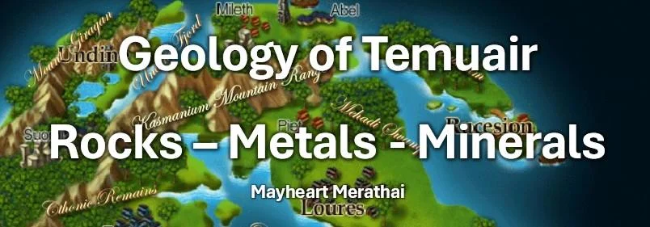
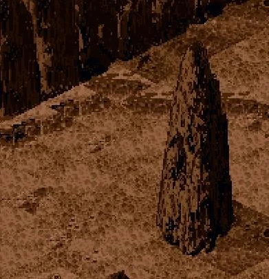
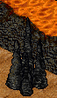
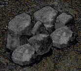
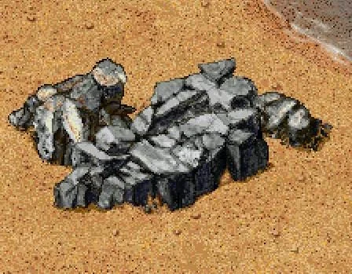
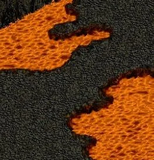
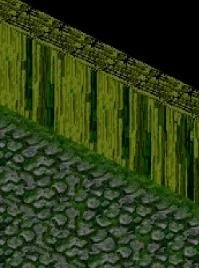
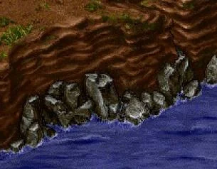

# Geology of Temuair

_by Mayheart in **Dark Ages**_



## Introduction

The study of geology (the study of the history, structure, compositions, and physical processes of the world) and geography (the study of interactions between the physical world and its inhabitants, Etienne Lorneau), is critical for both Aislings and Mundanes alike. This is because they heavily influence the economic aspects of society through mining, construction, agriculture, alchemy, spell/skill research, and crafting of weapons, armor and accessories. As such, knowing what can be found where and how to use the resource can vastly benefit the kingdom and its people.

Aislings are restricted in their ability to manipulate these resources, in fact, they are limited to rogues who have the ability to cut and polish gems and to craft rings. Luckily, many Mundanes, such as Seph in Blackstar Village and Violet in the Oren Jungle, have spent their lives honing their skills to craft with many of these resources. However, they need Aislings to do the hazardous work of gathering said resources.

In this study, we will be taking a look at the many different types of Rocks, Metals and Minerals that can be found across Temuair. We will explore the properties of these items, where they can be acquired, and their most common uses. We will also delve deeper into the minerals and determine the possible mineral variants.

## Rocks

Rocks are literally the foundation of our world! We use this wonderful material in many ways, from building our homes and castles, paving our streets, carving sculptures, and even in one case, eating. Some rocks contain large minerals while others might have various metals; we call these types of rocks "ores" and will explore them later in this study.

A rock is a coherent, naturally occurring solid that consists of an aggregate of minerals or, less common, a body of glass. Rocks can be broken into three major categories based on careful observations. The first is clastic rocks, these are formed from the cementing of small grains of minerals or rock fragments (clasts). They often appear to be layered with a variety of colors and patterns. The second category is crystalline rocks. These rocks appear to be comprised of interlocking crystals. The final category is left for rocks that do not match the other two, we call these non-crystalline rocks. In these rocks, there are no crystals, or layers, and they appear to be made of only one material.



To begin, we will look at what types of rocks are available, where they can be found, and their most common uses. Many of the rocks presented have no use to aislings but are essential to the foundations of Temuair! As many of the quarries are off-limits to Aislings, I can only provide regional locations for many of the active quarry operations.

### Basalt



Environment: Formed from the cooling of molten rocks such as those found within the depths of Cthonic Remains, Chaos & Dubhaim Castle. While Chaos still shows active volcanism, Cthonic Remains and Dubhaim Castle only show evidence of past volcanism. Basalt can also be found near the Medanian villages of Plamit Village, and Hwarone. Basalt comes in an array of colors, the most common is black but can range into grey.

Uses: The primary use of basalt is in construction. There are many limitations to Basalt as it is not as plentiful as Sandstone, not as durable as Granite, and not as prized as Marble. However, it is very useful for constructing when locally available and when a dark style is desired such as the fences found in Plamit Village.

### Black Stone

Environment: Found in its raw form in the deeper levels of Cthonic Remains (floors 54 & 55) and is picked up and carried by Draco Sgail, Draco Avatar, and Ancient Skeletal Dracos.

Lore: The art of crafting with Black Stone had been lost to modern Aislings and Mundanes. Recently, wizards and smiths of Loures have been studying the rocks from Cthonic Remains and the rings from Chaos in an attempt to replicate the process due to the Black Stones ability to increase the defense of whomever wields it. Many experiments in the rings production have found their way into the sewers beneath Loures.

Uses: The only known use is cutting and polishing the stones into a ring called the Black Stone Ring. These rings can be found with the depths of Chaos (floors 27, 33 & 34) and are carried by Copar Dracos and Grim Succubus.

### Coal

Environment: These rocks can be found in many areas around Temuair. Quarries are known in the Piet region and well as along the slopes of Mount Giragan. Coal can often be found by Yetis and Leprechauns and use it to prank Aislings.

Uses: The primary use is as a heat source to warm homes but is also used in the forging of steel. The general consensus from Mundanes and Aislings is that chunks of coal are "useless" for weapons, armor, and magical research. The Rucesion banker Antonio will request you help return some coal if it gets too cluttered in the bank.

### Conix

Environment: This dark rock is only found as fragments within the mines of Pravat (Works, Deep, and Prole Ground). Mentioning this rock is currently taboo, however, restricted records can be read by most noble Aislings within the library of Loures which will allow the Aisling and a friend to be able to handle the dangerous stone safely.

Lore: Believed to have Aosdic origins, these stones contain divine energies or at least are able to resonate with divine energies. Even the grimloks and goblins of Pravat Cave consider the Conix fragments holy (Paladine Meatha, Deoch 7). The divine energies limit what Mundanes and Aislings are able to comprehend of Conix to one moon before the knowledge is wiped from their minds.

Uses: Conix fragments are used by a few Mundanes for a variety of purposes. The most recent usage is by the Mundane Paidira in the consecration of the Lumen Amulets. Julia Rene in Plamit has also shown interest in these stones and will request a pair of them. The grimloks and goblins of Pravat Cave will happily accept any Conix fragments discovered within the mines. The last known use of Conix fragments was discovered in the Dark Maze beneath Loures Castle and is used by those who brave the maze alone.

### Granite



Environment: The most common of the crystalline rocks, a careful look reveals the presence of many interlocking crystals. Found primarily in the Kasmanium Mountain Range.

Uses: The primary use of granite is for construction. It is the hardest of the rocks to work with and takes extra time and effort to cut, sculpt, and transport. So, few outside of those affluent enough to afford the costs use it. Granite has little value in weapons or magical research but has found uses in earrings and gauntlets.

Around Deoch 18, a piece of Granite, along with other ingredients, was used to permanently destroy the monolith, which had been repeatedly respawning, that blocked the entrance to the Chaos Realms and was also summoning snakes across Temuair. (Ramanayan Caesar, Deoch 33)

### Limestone



Environment: This rock often contains the fossilized remains of marine organisms, yet the rocks themselves can be found almost anywhere. Examples of known quarries are Karlopos Island, Lynith Beach, Lynith Sea, the Unknown Depths, Oren Island, Mount Giragan and the plains of Loures to name a few. Limestone can be found in many colors ranging from white to grey and can have colored streaks throughout it.

Uses: Limestone is the softest of the major rocks and is commonly used in the construction of buildings and roads. A great example of its uses is found throughout Oren city and the ruins of Nobis. The soft nature of Limestone does require constant upkeep and replacements.

### Marble


Environment: Found primary where limestone and granite or basalt meet, indicating an transformation of limestone into marble through the presence of extreme temperatures. The most well-known quarry is found along the eastern section of the Kasmanium Range. Marble can also be found in Medenia near Hawrone and Plamit villages. Slabs of Marble can be found being carried by the monster Goddess Statue in the Lost Ruins in Medenia.

Uses: More durable than Limestone, Marble is ideal for not only construction, but also the carving of statues. Major trading cities such as Abel, Rucesion, and Blackstar have imported large quantities to be used. Even Loures Castle is primarily built and decorated with Marble. Marble is one of the oldest construction materials and can be found in many ancient, ruined cities. As a material component, Marble is used in the learning of many Medenian skills and spells but tends to be too bulky to be used in weapons and armor.

### Obsidian



Environment: This dark glassy rock is found near Basalt and is formed from the rapid cooling of lava or magma. Large deposits have been found in Chaos and near Hwarone. Obsidian can range in colors from grey to black to red.

Uses: Recent discoveries of magically infused obsidian and careful examination of research notes from famous smiths have allowed Blackstar smiths to use obsidian as one of the key ingredients in crafting a powerful dark elemental necklace. Monks can also pursue a powerful weapon crafted from obsidian by following hints in the Demon Lord's Notes.

### Peat



Environment: Peat is a highly compact, partially decomposed concentration of dead plant matter common to swamps and bogs. It is found in large quantities within the Piet dungeon due to its vicinity to the Mehadi Swamp where stagnate waters preserve the dead plant matter. At one time, the swamp must have once extended to where Piet now resides.

Uses: The only known use is as a cheap burning alternative to wood and coal. Citizens of Piet commonly use Peat as a fuel for warming their homes and cooking.

### Salt

Environment: Found rarely in underground mines near sandstone and shale. It can also be found in the dried-up seasonal lakes near the Deadwood Forest. Due to salt's importance and value in the preservation and flavoring of foods, the large active mine locations are being kept secret.

Uses: Salt is too soft to be used in any construction. Besides the uses with food, there are experiments with using salt as an alchemic ingredient and as a ward against magical effects.

### Sandstone

Environment: Found near large deserts or locations that were once large deserts, Sandstone is a very hard material. It comes in colors ranging from tan to reddish brown. The largest known quarry is located on islands near Abel before it was infested by dwarves and monsters. A slightly smaller location was used deep in the Piet dungeon until it was also taken over by monsters. Now the only easily available source is west of Deadwood Forest.

Uses: There are not many known uses, though it is used to a limited extent in construction. The extremely hard nature of Sandstone tends to wear down chisels and mining equipment too quickly to be a viable building material, unless it is local and no other resources are easily available, as in the construction of Beal na carriage.

### Shale



Environment: Shale is found mostly along Oren Island and usually not far from limestone deposits. Shales come in many colors ranging from grey to black to brown. It is formed in flat sheet-like deposits and tends to break in along the layers.

Uses: Due to the overall soft and brittle nature of Shale, it is often ground into a powder, mixed with straw and baked to create strong bricks used in construction throughout Temuair and Medenia.

### Slate

Environment: Very similar to Marble in that it is found where shale comes into contact with basalt or granite. The largest known quarry is in Medenia near Plamit Village, but smaller deposits have been found south of Abel.

Uses: Used in roof shingles as slate breaks in sheet like patterns similar to shale. A few Medenian smiths have fashioned some slate pieces into armored gauntlets and into earrings. These should only to be used by the strongest of adventurers due to slates' extreme weight.

## Metals

Metals are characterized by their shine and lustrous appearance. They come in either their pure forms or are mixed into alloys that provide desired properties. Metals can be shaped into many forms by an experienced smith to provide weapons, armor, accessories and some can contain and channel magical elements.

Metals are not often found in their pure form. They are mixed with rocks and minerals called ores. An ore is a high concentration of a desired metal that is viable enough to process and achieve a profit from. Through geological processes, magma, water, and gravity move and concentrate metals into ribbon like deposits called an ore vein. There are other types of ore deposits, such as placer deposits where a river has moved the ore from its original position to a more concentrated place along the river system.

Ore deposits are extremely valuable, and their locations are kept secret from the general population, Mundanes and Aislings alike. I have talked with a few miners about their methods of finding ore bodies. They explained the first approach is to look at the landscape. Vegetation can be easily influenced by ore bodies below them causing a shift in the color of their leaves. Many ore bodies are found near granite and basalt deposits where they come into contact with other rocks. These other rocks form cracks that get filled creating the ore vein.

After obtaining ore, it must be processed in a procedure called smelting to extract the metals. The most common method is to slowly heat the ore until the metal begins to melt and extraction can begin. Further heating allows different metals to be extracted, as each metal has its own melting temperature. As temperatures increase, the color of the flame will react with the metal, giving off a unique color that helps identify the metal being processed.

### Bronze

Description: Bronze is an alloy of copper and tin at ratios between 80-90% copper to 10-20% tin. Bronze provides properties that are superior to either copper or tin and have been used throughout history as one of the most important metals. As copper and tin both have relatively low melting temperatures, it is easy to create bronze with basic smelting tools.

Uses: The ability to smelt stronger and more diverse metals has made it so that bronze has fallen out of favor as a major material for creating weapons, armor, and accessories. However, many other species such as kobolds and goblins do still fashion equipment from bronze. For Mundanes and Aislings, the only combat use is the crafting of shields for young adventurers due to bronze being a good conductor of magical and divine properties. Outside of equipment, bronze is used for decorations and fine metal works.

### Copper

Description: Copper is one of the few non-silver metals and appears to have a reddish-brown luster to it. Copper is very ductile, malleable, and great at transferring heat. Having a low melting temperature, and being easily malleable restricts, copper to only a handful of applications. When exposed to the air, it will form a green outer coating which protects the pure copper underneath.

Uses: The primary use of copper is to alloy it with tin to form bronze. When used in tools, copper bends and wears out quickly requiring constant maintenance.

Rogues have found a use for this metal. Deep within Cthonic Remains (floors 54 and 56) Draco Sgail's have been known to carry Copper Files on them.

When used in combination with a Smith's Hammer, rogues can craft the Fae's Flute proving their mastery of their class and earning their master armor and weapon.

### Gold

Description: This precious metal comes in a yellowish metallic color. It is also known as the noble metal due to its ability to resist tarnishing and reacting with many other substances. It is valued for its rarity and ability to be easily worked with.

Uses: Gold is the primary form of currency throughout Temuair and Medenia and comes in either minted coins or in a bar form worth 50 million coins. Gold is also used in crafting gauntlets, rings, necklaces, and earrings. It can be spun into threads that can be woven into garments or inlaid into weapons and armor. Gold's natural affinity to the divine and ability to carry magical properties makes it a common ingredient in many spell and skill ingredients. It is also crafted into other decorations and sculptures used by the wealthiest of Mundanes.

### Hy-Brasyl

Description: Similar in color to gold, Hy-Brasyl acts both as a gem and as a metal. Rogues trained in gem smithing are able to polish Hy-Brasyl fragments just like other gemstones. Unlike gold, Hy-Brasyl is far stronger and resilient. It is named after the ancient Hy-Brasyl civilization. It is commonly found being carried by monsters within the Cthonic Remains. It can also be found crafted into various weapons, armors and accessories throughout Temuair. One strange note, Fire Drakes from Chaos (floor 33) have been known to grow horns of Hy-Brasyl.

Uses: Like many metals on this list, Hy-Brasyl can be crafted into a large array of useful objects. Accessories such as belts, earrings and necklaces are popularly crafted around Temuair and Medenia and can be easily found. Armor pieces are popular among high insight Aislings. Where Hy-Brasyl really shines is in the weapons crafted to become the most powerful instruments of destruction. As such, Hy-Brasyl is prized above all other metals among Aislings and Mundanes. It is even associated with the most valuable awards, like the coveted "Aisling of Hy-Brasyl".

### Iron

Description: Iron is the most common of the metals throughout Temuair. It is dark, silvery in color and when not seasoned, can rust turning reddish-brown in color. In its ore form, it can appear red, orange, to yellow in hue. A special type of iron can be found that when suspended in water, creating a compass which will orient itself with the cardinal directions allowing for ease of navigation. Iron is not well suited for magical enchantments. With effort, some magical attributes can be imbued.

Uses: Pure iron is not very useful in and of itself. It tends to be brittle, causing it to not be very practical in applications relating to construction or combat. To make it viable in its pure form, it needs to be thicker, which adds to its weight making it unwieldy. Its cheap cost however does find a market in rookie adventurers. It is primarily used in equipment such as gauntlets, bracers, greaves and shields. More common uses of iron are used for things such as fencing, furniture supports, decorations and ornaments.

### Kasmanium

Description: Refined from Kasmanite ore found in the Kasmaniun Mine south of Mileth and west of Pravat Cave. This material is extremely limited in its quantities. It shows promise in its durability and rigidity once processed. It is lighter than but has a slight reduction in durability when compared to steel. The sole processing facility is found in Piet though some samples have been known to reach the fabled armories of Oren. With low supplies and guarded processing methods, experiments with Kasmanium are currently limited.

Uses: Kasmanium is more resistant than iron to taking a magical enchantment. As such, its practical applications are limited to warrior armors. Because this metal is so rare, a warrior wishing to craft this armor must first show that they are of upstanding social status (Respected Citizen or higher).

### Mythril

Description: Also known as True-Silver, mythril has a more dazzling brilliance than silver. It does not tarnish and has a durability above steel. It is mined in its pure form from many mines around Temuair, however, it is in a much more limited supply than iron. It does take a higher temperature to process into materials which limit the number of forges that can work it into usable products.

Uses: Most mythril is purchased and used by the nobility and wealthy in decorations, ornaments, and inlayed a wide array of objects, such as clothing, statues, woodworks, etc. Aislings have found it has a more combative application due to mythrils toughness and durability. It is used to craft bracers, gauntlets, greaves, and shields. It can be used to inlay boots and be shaped and woven into accessories such as earrings and belts. Gwian, a pirate blacksmith, has been known to link sections of mythril into a whip.

### Silver

Description: A precious metal, silver is soft and lustrous. Its color is so common, it is used as a descriptor for other metals. It can tarnish easily, becoming dull to black in color. Applying a minuscule amount of mana to the metal will prevent it from tarnishing. Silver is one of the most magically conductive metals, causing it to resonate strongly with arcane and divine energies. It's cold to the touch and generally mined in small quantities alongside other metals, such as copper and lead. High-yield mines tend to be kept secret by the kingdom's elite.

Uses: The primary use of silver throughout Temuair and Medenia is as a currency. 1 silver coin marks the lowest denomination. Other uses are as ornamentation, decorations, and if hammered flat and polished, it becomes highly reflective making a great mirror. Other uses are for jewelry and inlayed in armor.

### Steel

Description: When forging iron using coal or charcoal as a fuel, iron gains strength, as well as resistance to breaking, corrosion and rusting. This stronger, more durable iron is called steel. This is not a magical or divine attribute added to iron which has been confirmed through wizard and priest artificers, confirming it a natural enhancement. Steel is also more accepting of magical and divine properties making it an inexpensive highly versatile material. To increase durability even more, steel goes through a process known as tempering where the steel is heated, not to the level of forging, and cooled slowly or quenched in water.

Uses: Steel is used all throughout Temuair and Medenia in a wide range of applications. It is used for construction to reinforce structures and used to make an unlimited number of tools. In fact, the only limit steel seems to have is how much can be made at a time. The strength of steel is also used on the battlefield in a wide range of weapons and armor.

### Talgonite/Talos

Description: This dull grey metal is often found within the depths of Chaos, Cthonic Remains, the Dark Maze, and is carried by the minions of Chadul. Talos, like HyBrasyl, can take on the form of a gem or a metal depending on how it is processed. There is also a rare form of Talos Ore found in chaos. Though often thought of as an "evil" metal, Talos can be used to channel divine magic.

Uses: The most common use of talos is as a gemstone and polished to a high degree so it can be used to divine ceremonies or as an ingredient in divine crafting. It can also be shaped into a ring, or if processed as a metal, forged into a shield.

### Tin

Description: Tin is a brittle silvery metal found in many places. A bar of tin can be bent by hand. It is heavier than silver but lighter than gold. If tin is exposed to extremely cold temperatures below freezing, it becomes more brittle and can even turn to dust on its own. Making it unviable for weapons and armors.

Uses: Combined with copper, tin is a key component in the creation of bronze. It can be alloyed to other metals not listed here to form new metals such as pewter which is used as utensils and crafting inexpensive decorations and artworks.

### Veltain

Description: This yellowish metallic ore is found exclusively in Medenia within one mine that shares the minerals name. The Veltain Mines are located north of Hwarone. This mine is one of the few mines throughout Temuair or Medenia that is not maintained by Mundanes. This ore is extremely durable as well as compatible with magical and divine affinities. It can only be obtained in small samples, requiring various amounts depending on their intended application.

Uses: Veltain ore is used as an ingredient in many spell and skill formulas for Medenian classes. It can be used to form necklaces, rings, a druid bracer and swords. It is also used as an ingredient in the forging of the most powerful armors and rings.

                      

## Minerals

In the broadest sense, a mineral is a substance that is neither an animal nor a plant. But, as we delve deeper, we can build on this by also stating that they are a solid and crystalline in shape. That means they have a geometric form. They can be transparent, translucent, or opaque. This allows minerals to sometimes qualify as gemstones. To qualify as a gemstone, we cut or polish them to enhance their beauty. We also value them for their rarity, size and overall perfection. Most gemstones form from single mineral crystal while others form through an organic nature.

With a few exceptions, most minerals take tremendous amounts of time to form. Minerals can form in many sizes; smaller minerals are more plentiful than larger ones. They also require the resources that make up the mineral to be present to form. The combination of slow growth and limited resources prevent the majority of minerals from growing to larger sizes. These growth environments come in two varieties. First, the movement of fluids through the ground happens upon a cavity in the rock and the mineral grows within that space. The other is from magma pools where the minerals can grow as the magma slowly cools.

Minerals and gemstones have an extremely high affinity for arcane and divine magical properties. This affinity increases as the overall perfection increases. This puts a high demand on skilled gem-smiths. Rucesion is a central hub for gem cutting and polishing in Temuair due to its prime location as a trading hub between Temuair and Medenia. Being able to channel and store magic allows for high potent magical applications such as enchanting, spell mastery, and crafting of every kind of equipment. As such, this section will focus on briefly describing each type of mineral and listing its known variants.

### Amber

Description: Formed from hardened tree resin that has become fossilized over a long period of time. It comes in colors from yellow to brown to red. Amber has a warm feel to the touch. On rare occasions, small insects can be found inside. Amber can be burned to act as an incense. When rubbed with a fur cloth, it will produce a minor static charge.

Known Variants: Amber Ore, Large Amber

 

### Amethyst

Description: Formed in underground cavities of volcanic rocks, Amethyst has a lavender to deep purple translucent color. Amethyst is hard for a mineral but can be chipped or broken if struck. Crystals of amethyst have a shape of six parallel sides that will terminate to a point.

Known Variants: Amethyst


### Andor

Description: Formed from the crystalized secretions of the Worker, Guard, and Warrior ants of the Andor caves, Andor ore has a teal to light blue color. However, when cut and polished, Andor ore can take on a yellow to golden to reddish color. Andor ore is highly malleable but gains a strong durability when worked. It will also take on variety of properties depending on the skill of the smith. These versatile properties have made Andor ore highly prized in crafting for those of high ability.

Known Variants: Andor Ore


### Aqua/Wind Stone

Description: Andor Ants can mix their secretions with elemental magics that flow through their cave systems allowing for a magically crystallized elemental stone. As wind and water elements are strongly focused within Andor caves, aqua and wind stones are produced and found within the remains of those that it has formed within.

Known Variants: Aqua Stone, Wind Stone

 

### Beryl

Description: Formed in the presence of hot fluids, beryl's tend to form near volcanic rocks that have a lot of water nearby. They can form in many different colors, but the common variety tends to stick to yellow and oranges. They form in with six parallel sides, similar to amethyst, but have a flat top and bottom instead of a pointy end. Beryl is harder than amethyst.

Known Variants: Raw Beryl, Orange Beryl, Helios Beryl

  

### Coral

Description: Formed from the skeletal remains of marine polyps. They can have a rainbow of colors, but the blue variety is most common off the eastern shores of Temuair. Corals tend to be soft and oddly shaped.

Known Variants: Raw Coral


### Crystal

Description: Rock crystal is colorless transparent mineral with a hardness like amethyst. When in the presence of magical energies of the crystal caves near the Aman Jungle, they can take on the shape of bars of orbs which turn them into a translucent blue in color.

Known Variants: Crystal Orb, Crystal Bar

 

### Diamond

Description: The hardest of all minerals, diamonds have a clear, to white, to blue in color. They can also show up in other colors, but currently, quantities are too small to experiment with. They form in an octahedron shape. Due to their hardness, the only thing that can cut a diamond is another diamond. Diamonds are highly prized for their clarity, color, cut, and size.

Known Variants: Diamond Ore, Ash Diamond, Small Blue Diamond, Large Blue Diamond, Large White Diamond

    

### Emerald

Description: As hard as Beryls, Emeralds have a light green to dark green color. They grow in the same size and shape as Beryls, giving theories that they are the same mineral but with a different color. Unlike Beryls, Emeralds are more highly prized.

Known Variants: Emerald Ore, Small Emerald, Large Emerald, Large Light Emerald, Small Dark Emerald, Large Dark Emerald

     

### Garnet

Description: Garnets come in a range of colors from Pink to Red to Reddish Purple. Smaller samples have been seen in all the colors. Garnets are common among minerals and are very hard. When crushed into a powder, it is often used to cut and polish other gems.

Known Variants: Garnet


### Gemstone

Description: With no better name to give to these minerals, Gemstones are extraordinarily rare, having only been seen during the Light vs Dark War. They are believed to have a divine nature with the intent of swaying the war one way or the other. There are very few of these minerals left.

Known Variants: Gemstone


### Heartstone

Description: A mineral common in Medenia but rare in Temuair, Heartstone has a purple translucent color. It is like Amythest in color, but Heartstone is harder and much rarer a mineral. Named for the ability of this mineral to strengthen and give its wielder the heart to fight on.

Known Variants: Large Heartstone


### Ice Crystal

Description: Ice Crystals of Mount Giragan are highly imbued with magical energy and implanted with runic magic. This mineral is very similar to water ice, but due to their magic, they never melt or heat up.

Known Variants: Ice Crystal

    

### Jade

Description: Jade is an opaque mineral that comes in many colors. The most common color is green, but white, red and even golden yellow have been discovered. Jade has a hardness like Amethyst but has a much higher durability. When struck, Jade tends to form a scratch or chip off a little piece rather than break completely. For this reason, Jade is believed to have strong protective properties.

Known Variants: Jade, Gold Jade, Red Jade, White Jade

   

### Lapis

Description: Also known as Lapis Lazuli, Lapis has a deep blue color that is extremely rare to find. It can be ground to a powder and will keep its deep blue color. Lapis forms near areas containing marble or limestone, but it also needs a nearby volcanic rock. Lapis is highly prized for its use in making blue pigments for paintings.

Known Variants: Lapis


### Mystrious Ore

Description: Mystrious Ore can only be found within the remains of the Snake King that makes its way to Temuair once per cycle. Mystrious Ore has a bright green translucent color and adaptable magical properties. The exact origins of Mystrious Ore remains unknown, but scholars have hypothesized a link to the ancient, drowned civilization of Hy-Brasyl (MuZaTa).

Known Variants: Mystrious Ore


### Pearl

Description: Formed within many species of fresh or saltwater shelled mollusks, like oysters. Pearls are grown in ringed layers and are often misshaped spheres, perfect spheres are rare and highly prized. Pearls come in a range of colors from white to cream, and in rare cases, red and even black. Pearls have a unique shine that shares the name of this gemstone.

Known Variants: Pearl, Giant Pearl, Dark Pearl, Red Pearl

   

### Ruby

Description: Rubies are known for their deep red color and extreme hardness. The only mineral harder is a diamond. The deep red color has linked Rubies with blood. Rubies can be found in rocks that have undergone extreme temperature and pressure. Rubies have a strong magical affinity with health and healing.

Known Variants: Raw Ruby, Ruby Ore, Large Ruby, Chaos Ruby

   

### Sapphire

Description: Sapphires can come in any color of the rainbow, except red, which is reserved for Rubies. As such, Sapphires have similar properties. When imbued with magic, or high temperatures, Sapphires are known to take on a deep blue translucent color.

Known Variants: Sapphire Ore, Large Sapphire, Sky Shard

  

### Spinel

Description: For the longest time, Spinels have been indistinguishable from rubies. Spinels are, however, not as hard as Rubies, so a hardness test is capable of telling them apart. Spinels are far more common than rubies but are used in a similar way, but with a weaker magical affinity, they are not as potent.

Known Variants: Spinel


The principle foundation of geology is to understand the physical world in which we all live. Examining the rocks, metals, and minerals that are all around us is in essence a look at the building blocks of our world. As the methods and processes of the formation of those blocks take a large amount of time, the study of them allows us to see the history of the world and what has happened to it over its lifespan. Thank you for exploring this study that has been painstakingly collected by many scholars over the course of many cycles.

## References and Acknowledgements

| Author | Work |
|--------|------|
| Etienne Suarven Larneau | [Economia](../Philosophy/Etienne-Economia.md) |
| MuZaTa | [Newly Discovered Artifacts](https://novus-imperia.com/college/lore/muzata_artifacts/muztotheata.wixsite.com/entry.html) |
| Paladine Meatha | [The Conix Stone & Faith](https://www.darkages.com/community/phi/Paladine_Conix.html) |
| Ramanayan Caesar | [Chaos Ascendant](../History/Ramanayan-Chaos-Ascendant.md) |

- Background Image: Opensource Images: FREEPIK https://www.freepik.com/free-photos-vectors/scroll-background
- Menu Board Image: Dark Ages, captured via screenshot: ©KRU Interactive https://www.darkages.com/index.html
- Rock Images: Dark Ages, captured via screenshot & provided via Vorlof.com: ©KRU Interactive https://www.darkages.com/index.html https://vorlof.com/
- Metal and Mineral Images: Dark Ages, provided via Vorlof.com: ©KRU Interactive https://www.darkages.com/index.html https://vorlof.com/

Special Thanks: Laurier, Ramanayan, Moogle

***

```
*Librarian Notes*

Recognized: Aisling, 2026 (Mileth College master list).
This entry has been edited to conform to Library formatting.
The original can be found at https://novus-imperia.com/college/lore/mayheart_geology.pdf .
```
