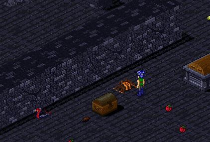
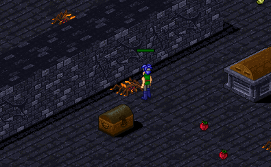
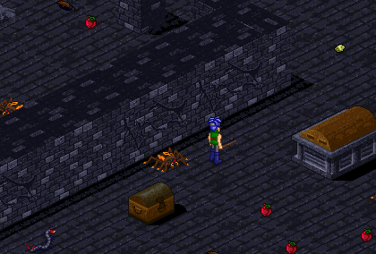
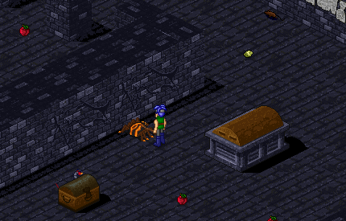

# The Book of Five Paths

_by Miyamoto in **Dark Ages**_

_Mentoring the Young Aisling_

## Introduction

_Some thoughts on Guiding and Mentoring._

The bond formed between a Mentor and his Student is a life-long one, even if
the time spent in each other's company is brief. A good Mentor will find his
Students developing a life-long loyalty towards them that can be stronger than
blood; an inept Mentor will quickly find himself deserted for a better one; a
Mentor that exploits or abuses his Students will find he has a new life-long
enemy.

Good Mentors can be hard to spot. A Mentor should provide his Student with
knowledge enough to walk their Path, and perhaps even help them with equipment
and items required to learn their Secrets and Skills, but he doesn't have to
walk with them every step of the way. Indeed, he should provide enough
information in the beginning for their Student to walk their Path alone, and
then occasionally check in with the Student, and be available to them to
provide help and answer questions when needed. Doing everything for them makes
for weak Students, too reliant on their Mentors to successfully function when
they're not available.

Inept Mentors are easily spotted, but unfortunately, usually not until after
the Mentoring relationship has begun. These are the Mentors that hand their
student their first-circle armor, a few thousand coins, and send them on their
merry way, while the Mentor returns to his hunting, or political campaigning,
or other activities. Letters and whispers to the Mentor go unanswered, and
before long, the Student grows frustrated and disappointed with his choice of a
teacher, and seeks help elsewhere.

Bad Mentors are easy to spot from the beginning. As evidence, I'll relate an
anecdote recently told to me by one of my own Students. Just after he had
reached the second circle, he was walking through Mileth when he was approached
by a third-circle Aisling who requested that my Student "allow" the Aisling to
Mentor him. My Student replied that he already had a Mentor, at which point the
Aisling offered my Student an outrageous sum of money to leave my tutelage and
join his. He wanted to run for political office, he explained to my Student,
and needed to Mentor someone before he could do so. But no amount of money, my
Student later told me, could replace the knowledge and aid that I had already
given him, so he promptly refused and walked away. Unfortunately, it is not
always easy for younger Aislings to spot such traps, and they find themselves
with a great deal of money, but no idea of what to do with it, nor any idea of
how to walk their Path.

The purpose of this treatise, then, is not to teach you the basics of your
Path; I'm assuming you already have that knowledge. It is my intention, though,
to provide you with the information your Students will need to begin their
journey on their respective Path. The infromation here is relatively basic,
however, and Mentoring is, indeed, a life-long proposition. And while you may
not be able to help your student with direct knowledge of what lies ahead of
him on his Path, you undoubtedly know others who do; if you are training a
Monk, and you are of a different Path, don't hesitate to ask your friends about
things your student will need to know. This is not intended as a comprehensive
guide to every Path, but is intended to help you Mentor your Student through
his first and second circle.

It has long been tradition in Temuair to provide one's Students with their
first-circle armor, and a sum of money to begin their adventures. While I am
not against this practice, I feel that this is but the beginning of one's
obligation to one's Student, and that the knowledge, advice, and aid passed
from Mentor to student is beyond mere financial value. Indeed, I am more likely
to show a student how to earn money for himself than I am to give him money; in
this way, he can raise whatever funds he needs even when I am unavailable, and
learns a sense of self-reliance.

While I am somewhat ambivalent about providing money and basic equipment for my
Students, I am strongly in favor of providing them with the special components
required by the Mundanes in order for them to learn their Secrets and Skills.
In fact, before you begin Mentoring, it is probably a good idea to begin
building up a supply of such components, so you will have them ready when your
Students need them. I'm not advocating picking up every bit of refuse creatures
drop, but it is certainly a good idea to have a few extra Centipede Glands,
Mantis Eyes, Bat's Wings, and so on. The reason for this is twofold: the sooner
your Students learn their Secrets and Skills, the sooner they can begin
practicing them; and it is better that they have the item they need when they
need it, rather than risking a visit to Sgrios while searching for it.

And while these investments in your Student are important, I cannot stress this
point enough: the most valuable asset you can give your Student is your time.
If you find that you are going to be busy with political activities, or church
functions, or hunting, do not hesitate to turn a prospective Student down. If
you accept a Student and later become too busy to Mentor him, I feel it is the
Mentor's duty to help that Student find a new teacher.

I have recently had occasion to Mentor students of various Paths, and struggled
at first to provide them with the information they needed to successfully
follow their Path. I've done a great deal of research, mostly through speaking
to higher-insight Aislings of each Path, and what follows is information needed
by first-circle Aislings of each Path, along with knowledge that needs to be
passed to every Aisling. It is not intended to serve as a guide to Mentoring
someone of your own Path ... if you are a Monk, you likely know, and will be
able to relate, the knowledge a first-circle Monk needs to survive in Temuair.
Rather, it is intended to serve as an aid to those who Mentor Aislings of Paths
other than their own. If you are a Monk serving as a Priest's Mentor, you can
use this treatise as a guide to information your Student will need to know; or
you can travel about and ask various Priests the basic information about their
Path, as I did.

This information is intended for use by permanent residents of Temuair, and may
not accurately apply to our guests.

`((Unregistered characters will find their choice of Skills, Secrets, and even
Quests limited, but these will open up once they register.))`

However, it is the opinion of this author that one should not Guide a guest
unless one is also willing to act as that Aisling's de facto Mentor, even
though the Mentoring relationship may not be official.

`((In other words, many people make their decision of whether or not to
register based on their treatment at the hands of other players. Treat them
like an unwanted guest, and they'll leave, probably never to return. Treat them
like a welcome new addition to Temuair, and they very well may decide to
stay.))`

Finally, throughout this treatise, I use the singluar masculane pronoun "he" to
refer to hypothetical Students, but only in the interests of convenience and
brevity; all of the Quests, Secrets, and Skills discussed herein are available
to Aislings of both genders.

## Curriculae Vitae

_Vital Knowledge for All Aislings_

### Temuairian Society

One of the first things a Mentor should teach his student is the basic workings
of Temuairian Society. It is my view that this knowledge should be passed to
the young Aisling before that Aisling has even chosen their path.

#### The Importance of Law

Introduce your students to the law of the land, perhaps most importantly to the
laws against heresy. Let them know that heretical speech and postings on
message boards are forbidden. Introduce them to the concepts of whispering, and
of the double-brackets.

`((It is important for all players to know that talking about work, school,
family, and so on, is not appropriate in public. If one wishes to speak
Out-Of-Character, there are several ways to accomplish this without violating
the law: talking via whispers, going to a room in one of the inns, et
cetera.))`

It is also, unfortunately, necessary to discuss theft with your student. Let
them know that it is inappropriate to pick up something that another Aisling
has dropped, without first asking their permission, and it is **never**
appropriate to pick up something that another Aisling is standing on.

I think it is also appropriate, indeed, even important to instill into your
student a sense of self-reliance in two ways: first, by warning them that
begging is illegal; and two, by pointing out that they have gifts that they can
offer other Aislings. When seeking a particular item it is better to offer an
exchange, rather than merely begging for the item needed. Potions, for
instance, require both Wine to brew the elixir, and Labor to gather and mix the
herbs; by offering these two things to an Aisling herbalist, he is more likely
to get a postive reponse than if he were to merely beg for a needed potion.
Additionally, each Path has special gifts they can offer other Aislings, even
in their first circle. Monks can brew potions needed by other classes,
particularly personaca deum, greatly prized among Rogues plundering the chests
of the Crypt, and hydele deum, desired by Warriors of all insights. Even
first-circle Priests can brew vast amounts of the life-giving elixir beothaich
deum, a necessary part of any hunter's pack. Rogues, through higgling, have
access to more goods, and more wealth, than the other Paths do at early
insights. Wizards can offer other Aislings some Arcane Scrolls, or other
results of their Research; one of my Wizard students quickly learned how prized
the Blessed and Abundance Leather Gauntlets he enchanted were worth to
second-cirlce Warriors. Warriors, meanwhile, have a great deal of Labor each
moon, but generally have no skills on which to use it until they reach the
second circle; some Aislings, particularyly Rogues and Monks, are willing to
provide goods, services, or even cash payments in exchange for this Labor.

Introduce your student to the Law Board of Mileth, and make sure they
familiarize themselves with all the laws. Continue into the Mileth Civic area,
and show them the Political and Law Enforcement boards, as well. Let them know
that should they be a victim of a crime, they can call on a Guard or Guard
Captain to assist them. Remind them that law enforcers rely upon them to gather
evidence in order to effectively do thier job. `((Teach them to take
screenshots.))`

Remember that your students' behaviour reflects on your teaching, and remind
them of that fact as well. I try to instill in my students a sense of honor,
and let them know that any dishonorable behaviour on their part dishonors me as
well.

#### The Importance of Friendship

No Aisling is an island... everyone is reliant on someone else at one point or
another. Whether it's asking for Assistance in performing a skill, partnering
with others for a hunt, or just a desire to share one's latest exploits with
another, everybody needs somebody sometime. Nearly anything that can be done
alone can be done better with someone else.

Some Aislings, especially when their new to Temuair, are extremely shy, and
tend to stick to themselves, even while hunting ... a prospect that is not only
antisocial, but dangerous. It may be difficult to tell at first if your student
is the shy type; they may be extrememly comfortable around you, but freeze up
around people they don't know. Just in case they are the shy type, I recommend
that you introduce your student around to your friends, your other students,
even to your own mentor. You don't have to parade them around Temuair ... that
could be both embarassing and time consuming. But as the two of you walk along,
when you run into people that you know, introduce them to your student. Perhaps
friends of yours have students of similar insight that would be willing to hunt
with your student. In fact, some of my friends and I have something of an
understanding: any student of mine will be treated as a student of theirs, and
vice versa.

#### The Importance of Religion

After your student has learned about the Gods of Temuair, they should begin
thinking about which Fellowship they wish to join. This is one area where I
believe a Mentor should say little or nothing: the choice of one's god is an
extremely personal one, and should be made by the Aisling alone. Answer
questions they may have about the gods to the best of your ability, but try to
do so without bias. Don't encourage your student to join your religion; don't
discourage them from joining any particular religion. Let them make the choice,
and support them in it, even if their choice of god is one of your god's
enemies. Recommend to your student that they attend one of their chosen
Fellowship's masses ... this is the best way to learn more, not just about the
god, but about the attitudes and beliefs of the priests and of the other
followers of the religion. Is the mass quiet and respectful? Is the priest's
sermon inspiring? Or is it a loud and raucous affair, with the priest saying
little or nothing before casting mass? Don't make a judgement about which is
right and which is wrong: some people **like** mass to be loud and raucous.
Generally, following each mass, priests of the Fellowship are willing to admit
new worshippers, and your student can join at that time. It is not recommended
that your student seek out a priest to admit them at any time other than just
after mass; eagerness aside, they should be respectful of the rules of the
Fellowship, and most Fellowships want new worshippers to be initiated after
mass. And I wholeheartedly recommend against you seeking out a priest of a
particular religion to initiate your student; they should do it themselves.

Finally, I will say this on religion: Faith is important, and can bring great
boons, but no one should join a Fellowship with the expectation of reward; one
should worship a particular god because their heart tells them to do so.

### Temuairain Geography

Depending on how disoriented they become upon receiving Deoch's touch, a new
Aisling may have very little recollection of their prior Mundane existence in
Temuair. They may not even be from Mileth, and may have difficulty finding
their way around town, let alone between towns. It may be a good idea to ask
your prospective Student if they need a tour, and show them around to the
various sites in Mileth. Afterwards, you may wish to show them how to travel
between the various towns of Temuair. This is knowledge that is often sorely
lacking among new Aislings; I am often surprised by the number of young ones
that cannot find their way through the Pravat Pass to Piet, or didn't know that
they can charter sailing vessels in Abel and Rucesion.

It is important, at the same time, to warn your students of the dangers of
Temuair ... especially those of Mehadi Swamp and Astrid; warn them to stay away
from those places until they have gained more insight. Too many young Aislings
have innocently wandered into those places out of curiosity, only to find that
they cannot decipher the secrets of the exits, and quickly find themselves
face-to-face with Sgrios.

### The Wisdom of the Mundanes

Shortly after being Guided onto their Path, your student should speak with the
various Mundanes throughout Mileth, as these wise souls can provide much needed
information about Temuairian society, religion, and even combat. Some of you
may have already learned some of these Lectures from the Mundanes yourselves,
so this would be a good time to give them to your student. Whatever lectures
you aren't able to give can be heard from the Mundanes themselves.

* Both Torrance the Armorer and Callough the Weapon Smith can teach your
  student about Arms.
* Naomhan, the Priest of the Mileth Chapel, can tell your students about the
  mysterious Altar.
* Keallach the Trainer can give your student some basic Fighter Training.
* Dar, the Dark Wizard, can teach your Priest and Wizard students about
  Graymayre, the anceint language of the mystics. In exchange for a Viper's
  or Centipede's Gland, he will also speak to them of the Elements.
* Devlin, the Fae Priestess, is a virtual fountain of knowledge, and can
  teach any Aisling about the Woods and Faerie Love. Like Dar, she can also
  teach the secrets of the Graymayre to Wizards and Priests, and to Priests
  she can also speak about Entreaties.
* Maeveen, the attendant in the Temple of Glioca, can speak to your student
  about the Gods of Temuair. Actually, any temple attendant can speak as
  eloquently as Maeveen, but as she is in Mileth, where all new Aislings
  first find themselves, I'd bet that she's spoken about them more often.

### Early Quests

#### Spare a Stick

Young Aislings can speak to Callough the Weapon Smith of Mileth to undertake
their first quest. 'Tis a simple one: Callough merely wishes them to gather six
sturdy branches, and in exchange, he will give them a Stick and a Wooden
Shield. Still, it is an easy way for Aislings to learn the basics of
interacting with Mundanes, and to provide basic arms for himself in the
meantime. Occasionally, an Aisling will remind Callough of a relative or a lost
love, and he will bestow upon them a special gift: a sturdy Oak Stick. The
value of this weapon is not to be underestimated, as it is at least as good as
a Dirk, and better than most metal weapons for those Paths that use mana, as it
will drain none of theirs.

#### Dark Things

Dar, the Dark Wizard of Mileth, has a strange need that young Aislings can
fulfill: he wants some of the various body parts left behind when a creature of
the Crypt is dispatched. Specifically, he seeks Spider's Eyes and Silk, Bat's
Wings, and Scorpion's Stings. He needs them every Temuairian week, and usually
wants a different one each week. While first-circle Aislings may have trouble
finding Bat's Wings and Scorpion's Stings (and should probably be discouraged
from seeking them), a patient hunter can usually find an Eye or a piece of
Silk, given enough time.

#### A Little Bit of That

Like Dar, Cian, the Mileth Alchemist, seeks things that the rest of us would
find repulsive. Cian wants some of the mold or bits of rotten food dropped by
creatures of the Crypt, for use in his alchemical experiments. As with Dar, he
seeks them every week, and a different one each week. Fortunately, these items
are relatively easy to find on the first or second level of the Crypt.

#### On Honey

Devlin, the Fae Priestess of Mileth, seeks various items dropped by creatures,
as well, but her's are a bit more understandable: she has something of a sweet
tooth, and desires Raw Honey or even a bit of Raw Wax dropped by the wasps of
the Wasteland and the Enchanted Garden. As with Dar and Cian, she seeks them
once per week; ask her each week, and she will tell you which one she desires.
By just agreeing to get it for her, she will bless an Aisling with a bit of
minor healing.

#### Mother's Love

There must be something about being a Grocer's daughter that is particularly
hazardous, for throughout Temuair these girls are suffering from various
afflictions nearly every week. By speaking to a Grocer in Mileth, Piet, Suomi,
or Undine, an Aisling can learn of which particular affliction that Grocer's
daughter suffers, and offer a potion to remedy the situation. If your student
is a Monk, they can probably concoct the remedy themselves, otherwise they will
have to seek out an Aisling herbalist to make one for them.

#### Flame Licked

Like the Grocers' daughters, the mother of Seskia, the innkeeper of Piet, has
trouble staying healthy. It seems that in her old age, the poor woman has grown
absent-minded, or clumsy, or both. Frankly, she cannot be trusted around an
open flame, and despite Seskia's attempts to keep her mother away from candles,
fireplaces, even the stove, she manages to burn herself nearly weekly. By
speaking to Seskia, your student can offer something to relive her mother's
suffering.

#### The Terror

This is perhaps a young Aisling's first true "quest", as opposed to a mere
exchange of items with Mundanes. Teague, long-time permanent resident of the
Mileth Tavern, is truly frightened ... he's certain that something that's been
stalking him in his dreams has come to life, and is ready to wreak havoc
somewhere in Temuair. This quest cannot be undertaken by a lone Aisling ... it
requires three individuals of similar insight `((4th-9th))`, and it is
**highly** recommended that one of these three be a priest skilled in healing
and with beothaich deum at the ready.

#### Other Quests

As Aislings gain insight, other tasks will be set before them ... as their
Mentor, you can provide your student with valuable information about what tasks
are available, and how to complete them.

### The Art of Combat

While each Path has an individual, and unique, approach to combat, at some time
or another, your student will likely have to engage in hand-to-hand combat with
a creature in the Crypt or the Woodlands. This does not mean, however, that the
most effective means of doing so is to walk up and bash it on the head with a
stick. Teach your student that there's no need for them to toe-to-toe with a
centipede to defeat it. Remind them that they are Aislings, touched by light,
and blessed with intelligence ... certainly with greater intelligence than the
average 'pede. (One would hope, anyway.)

It is important for them to know that it is easier for them to hit a creature
if they strike from behind or along its side, and that they inflict more damage
when they hit those vital areas. More importantly, the creatures your student
will be likely to encounter early on are rather simple, and can be tricked into
exposing their flank, even in the heat of battle.

The ideal scenario goes like this:



The combatant sneaks up and attacks a creature from behind.



Continue attacking until the creature turns to face you.



When it does so, quickly take a step, **a single step**, to your left or right.
Be careful to avoid getting cornered or boxed in by other hostile creatures.
Note here, the combatant steps to his right, away from the approaching
Centipede.



The creature will follow you, exposing it's flank, allowing you to attack it's
weak side again. Eventually it will turn to face you again, at which point you
can repeat the process. It is important **not** to step back away from a
creature, even when fleeing; the creature will still follow you, and if it
catches up, it will be able to attack **you** from behind, allowing it to do
even greater damage than it would normally.

To be honest, I've always found it difficult to describe this procedure
adequately, which is why I'm relying on illustrations here, and why I provide a
demonstration for my students. In using this technique, a combatant can
maximize the damage done to the creature, while minimizing the damage done to
himself. The only drawback to this method is that it takes more time to execute
than the simple bash-between-the-eyes method ... but better a slow and
methodical hunter than a quick and soon dead one.

Unfortunately, while this technique is effective against the simple creatures
of the upper Crypt and Woodlands, as your Student gains insight, he will have
to learn new tactics, especially when facing Kobolds and Goblins. These crafty
foes not only are able to lay traps and cast spells on your Student, they are
also able to work together to lead him into an ambush. The more insight your
Student gains, the more important it becomes for him to avoid hunting alone.
Further, with the exception of Warriors, these tactics often bcome inefficient
once your student is able to use some of his Skills and Secrets more
effectively. For instance, it makes perfect sense for a Rogue to retreat
directly away from a creature, in order to lure it into a trap; Wizards,
meanwhile, will probably have little need for hand-to-hand combat at all, once
they become proficient with their spells.

## The Monk's Path

### Advantages and Disadvantages

Without wearing heavy armor or weilding any weapons, Monks are able to
effectively combat many of the creatures in both the Crypt and the Woodlands
... although perhaps not as well as a Warrior. A Monk must be a cautious,
calculating hunter, using all the skills and secrets at his disposal; he must
be more than a critter-basher. Monks are also blessed by their father Cail with
an uncanny affinity for nature, and even in their first circle are able to
learn the art of gathering and mixing herbs. Their skills are wide and varied,
often mimicking some of the ones used by other Paths. If your prosepctive
student is looking to become, as I heard one new Aisling say, "a Warrior who
casts spells", he is sorely mistaken. Monks will never be as powerful as
Warriors, nor as blessed as Priests, nor as at ease with magic as Wizards, nor
as skilled as Rogues ... but they will have some abilities in all these areas.

### Attribute Allocation

Monks are something of a Jack-of-all-Trades, and should keep themselves
relatively balanced throughout their first and second circles. At later
insights, I'm told, Constitution and Strength will serve a Monk well, so
perhaps concentrating on these early on is a good idea. First, though, a Monk
should raise either his Dexterity and Constitution, in order to learn Kick, or
his Intelligence and Wisdom, in order to learn Herbal Lore. I've spoken to
Monks that have done it one way or the other: either they learn Kick first, and
use the insight gained from hunting monsters to learn Herbal Lore; or they
learn Herbal Lore first, and use the insight gained from brewing potions to
learn Kick.

It is also important to keep in mind that Berg in Suomi can teach a Monk his
Animal Stance once his attributes are of the appropriate level. A Monk must
have a minimum of 5 in every attribute to learn the Stance with another
qualified teacher, or he can learn it directly from Berg if he has a minimum of
10 in each attribute.

### Basic Equipment

A Monk's first-circle armor, the Dobok for the males and the Earth Bodice for
the females, as well as their second-circle armor, the Culotte for the males
and the Lotus Bodice for the females, can both be purchased from Hali, the
Tailor of Undine. Keep in mind, though, that arms and armor are forbidden in
Undine, thus these "armors" appear to be nothing more than simple garments.

A Cloth Glove is required to successfully gather herbs, and this tool can be
purchased from the Fae Priestess of Suomi, Bertil. Your Student will also
probably need a large supply of Wine with which to mix the herbs; it can often
be purchased from taverns in Suomi, Undine, Abel, and Piet, although there have
occasionally been shortages. Once your Student has a supply of potions,
especially personaca deum, he may be able to find a Rogue who is willing to
higgle Wine for him, in exchange for a few vials.

### Skills and Secrets

As stated above, the first Skill your Student should learn is either Kick or
Herbal Lore. Kick can be learned from Keallach, the Fighting Trainer of Mileth;
in addition to gold coins, he will want your Student to present him with a
Viper's Gland and some Spider's Silk. Bertil, the Fae Priestess of Suomi, can
teach your Student the art of Herbal Lore, and will require some Wine and a
piece of Raw Wax in addtion to the coins she charges. Simply knowing Herbal
Lore isn't enough, however: your student must know which herbs to gather, and
what effects those herbs have. If you are unable to teach them this knowledge
yourself, refer them to Chloe's excellent work, [Herbal
Lore](Chloe-Herbal-Lore.md). The Enchanted Garden is a good place to gather
herbs, provided your student can avoid or combat the Mantises and other
creatures that reside there. Better yet are the Lover's Glade or the open
fields near the Kasmanium Mine, as both of these areas are free of monsters.

Upon raising his attributes to the requisite levels, your Student will be able
to learn an Animal Stance, granting him great powers and abilities. The choice
of one's totem animal is a personal one, and you should make no attempts to
influence your Student's thinking; you most certainly should **not** encourage
him to learn the stance you know, simply because you would be able to teach
him. A good source for learning about Animal Stances is Randolf's [Principia
Monastica](Randolf-Principia-Monastica.md). Make sure you understand the
advantages and disadvantages of **each** stance, though, so you can explain
them to your student. Once your student has decided upon his totem animal, you
should help to find him a teacher, if you are unable to teach him yourself. A
list of those Aislings willing to teach their Stance to others, and the Stance
they can teach, is maintained on the Message Board outside the Temple of Cail
in Undine.

As he gains insight, your Student will be able to learn more skills from a wide
variety of sources. He should speak not only to Keallach and Devlin, but to
other Mundanes as well, particularly Dark Wizards and Rogue Trainers, in order
to learn what knowledge is available to him. Skills and secrets of particular
importance to Monks as they enter the second circle include Tailoring, Ao
Puinsein, and Perish Lore, plus skills like Ambush, High Kick, Double Punch,
Poison Punch, and Mist, all of which help to make your student more effective
in combat.

### Combat

When hunting alone, it is imperative that your Student use the hit-and-run
techniques described earlier; they simply won't be able to go toe-to-toe with a
monster the way a Warrior can. They can, however, make a good secondary or even
primary attacker when grouped with others, provided they have access to a
Priest's healing, or a good supply of hydele deum. Once they learn their Animal
Stance, however, the situation changes dramatically: your Student must learn to
fight in a way that best suits his style. White Bats, for instance, with their
invisibility, can attack a creature from behind, then disappear from view
before the monster even turns around. Draco and Scorpion masters, with their
enhanced defensive capabilities, can be nearly as hard to hurt as Warriors of
similar insight, and can use their special abilities to inflict more damage on
their eneimies. Kelberoth Monks, with their enhanced strength, can inflict a
great deal of damage, but with the draining effects of the Kelberoth Strike, it
is recommended that they remain secondary attackers, and that they carry a
**lot** of hydele deum.

### Interaction

While Monks **can** practice their skills and even hunt in solitude, it is not
recommended that they do so. Mixing herbs with an Assistant greatly increases
both the chances of success, and results of the brewing. Alone, your Student
will be able to brew one, or possibly two potions per bottle of Wine; with an
Assistant, I'm told, they can brew as many as five. Encourage them to ask
others to Assist them, and to be willing to Assist others. Likewise, while a
Monk can "go solo" in both the Crypt and in the Woodlands, it is not only more
effective to hunt with others, it is usually a lot more fun. Most hunters,
smart ones anyway, will welcome a Monk into their group, both because he will
be able to "take care of himself", and because he can help take care of
**them**.

## The Priest's Path

### Advantages and Disadvantages

Blessed with an ability to commune with the gods, priests are granted
fantastical abilities to both heal and protect their allies, and bring harm to
their enemies. Early on, though, they will have difficulty tackling the
creatures of the Crypt or the Woodlands without aid from others; direct combat
is their weakest ability, and it will be quite some time before they can learn
some of their more powerful attack spells. They will, for a good long time, be
dependent on the combat skills of others, but at the same time, they are adept
at finding Fellowship with others. This is, perhaps, a Path most suited for
Aislings that feel at ease in social situations.

### Attribute Allocation

Wisdom is the province of the Priest, and should be the primary focus of their
development, both because it is needed to learn magickal Secrets, and because
it helps them build mana. Intelligence is important, too, primarily for
learning Skills, and they will need to develop their physical attributes as
well, both to learn certain Secrets, and to keep them from being completely
vulnerable. Within their first couple of insights, they'll want to make sure
they raise their abilities to the point that they can learn _beag ioc_, perhaps
the most important Secret for a young priest to know.

### Basic Equipment

Fortunately, your students don't have to travel far to purchase their
first-circle armor: both the Cowl, for the males, and the Gorget Gown, for the
females, are available from Brody, the Mileth Tailor. When they reach the
second circle, male priests can purchase a Galuchat Coat from Huberto, the
Rucesion Tailor, while females need to go to the top floor of Loures and speak
to Jean to purchase their Mystic Gown.

As for other implements, I would recommend that first circle priests use a
Stick or Dirk as their primary weapon, as these drain the least amount of mana;
hopefully, they won't be engaging in much direct combat, anyway. For the same
reason, it is recommended that they avoid using various mana-draining secondary
pieces of armor, such as gauntlets and greaves.

To use one of their most useful spells, _beothaichdeum_, used to prepare the
potion of the same name, priests will need a large supply of fruit,
specifically one bunch of grapes and two bunches of cherries for every three
potions they hope to produce. Various Grocers about the realm sell these
fruits, or if they wish, they can travel to Suomi, where they can harvest the
fruits themselves.

### Skills and Secrets

Undoubtedly, the most important Secret for a first-circle priest to learn is
_beag ioc_, taught by Devlin, the Fae Priestess of Mileth. With this spell, a
priest will be able to use his mana to heal other Aislings, the primary
function of a priest in any hunting party. Beyond that, the spell is a
prerequisite for _beothaichdeum_, a very useful and important Secret. Devlin
can teach other spells to your Student, as well, and I would recommend learning
both _armchahd_ and _beannich_ as soon as possible; other than the coins to
purchase the spells, Devlin also requires Raw Wax to learn _armchahd_. Priests
I have spoken to fall into two camps when it comes to learning the _fein_ or
"self" spells: _armchahd fein_ and _beag ioc fein_, both of which only affect
the priest himself. There are those that believe that learning them is a waste
of time, money, and experience, since their effects are duplicated by spells
that work on anyone, and because casting them when you could cast their
counterpart robs the Student of important skill levels in each of them. On the
other hand, there are those that believe that learning them is worthwhile,
since they are quicker than their counterparts, and consume less mana, and
allow the priest to protect himself without sacrificing his efforts to aid his
compatriots. I fall in line with the former, thinking that a Student would be
better off learning, and mastering, spells that can be used on anyone, but I
feel that this is a personal decision and is ultimately up to the Student.

After raising their beag ioc level to at least ten, your Student can learn the
_beothaichdeum_ spell from the Fae Priestess of Piet. As stated above, the
student must have one bunch of grapes and two bunches of cherries for each
three potions they hope to produce. They then cast the spell, which blesses the
ground underneath them. By walking back and forth upon this now-sacred ground,
your student can remember the Faerie Lore, and transform the fruits into
Beothaich Deum ... if they're successful. If they fail to remember the lore,
the fruits will either sour, turning into Wine, or they will rot. I encourage
my Students to save the Wine, as one day they will be able to learn the skill
Herbal Lore, at which time they will need a good deal of Wine. Even the rotten
fruit can serve a purpose: they should take it to Cian to see if he needs some;
even if he doesn't, he will usually pay them for it.

As they gain insight, Students should be encouraged to speak with other
Mundanes about new skills they can learn, as well. Some Rogue Trainers will be
able to teach them Lore skills, and Dark Wizards can offer offensive spells.

### Combat

Unfortunately, Priests are simply not powerful fighters, and it is unlikely
that they ever will be. When they must hunt alone, they should cast protective
spells upon themselves before entering battle, and heal themselves immediately
afterwards. But a priest is most effective when hunting with others, when they
can stay away from the front lines and concentrate on protecting and healing
their allies. Later on, much later on, they will be able to learn some truly
powerful offensive spells, but until that time they will be reliant upon others
to hunt with them. Fortunately, priests usually do not have a problem finding
hunting partners.

One technique I've picked up from the priests I've hunted with is for the
priest to cast protective spells on each of the party members, then on himself.
While the priest, hopefully, won't be exposed to the front lines, the spell can
serve as a sort of "timer", allowing him to know when its effects on his allies
have worn off. Oftentimes, a Warrior or Monk doesn't have time in the midst of
a battle to inform the priest that _armchahd_ or _fas deiras_ has worn off, and
in this way the priest can cast it on them again.

### Interaction

Priests, by their very nature, are perhaps the most social of Paths. They will
often need Assistance from others to pray or perform consecrations, and as with
Monks, brewing herbal potions is much more effective with an Assistant.

But more than this, when they join a Fellowship, they become a member of a
community, and can participate in this community as much, or indeed, as little,
as they wish. It is recommended that priests study the gods soon after
receiving their oath, so they can decide which Fellowship best suits them. Do
not, however, attempt to influence your Student's decision; merely answer any
questions they may have about the gods in an impartial manner, and let them
choose their own Fellowship.

Unlike other Aislings, those of the Priest's Path can initiate themselves into
the worship of a god at his temple; they do not need another priest to initiate
them. Joining a Fellowship will open up a whole new world to a Priest, as they
begin taking part in their respective community, relying on them for aid and
counsel, giving aid and counsel when they can, and using their Faith to perform
miracles from the gods.

Faith is very important to a priest, so the sooner they join their Fellowship,
the sooner they can begin building it. Your student can build Faith in three
ways, at first: by Giving Thanks, attending Masses, and by performing a Geas
for another priest. To Give Thanks, a priest must pray to their god, or to one
of their god's allies; doing so builds Faith, but doing so in Fellowship with
another Aisling builds it even more. A priest, or any worshipper, for that
matter, can attend the Masses of his own god, and those of his god's allies,
once per double-moon; Mass schedules are listed in the Events of Temuair, and
are usually posted on the Message Board outside each Temple. To perform a Geas,
a priest must accomplish some task in service to his god; once he has completed
the task, the priest that bestowed the Geas upon him can complete it, granting
your Student a great deal of faith, and insight.

With enough Faith, a priest can Ascend to the Priesthood of his god by speaking
of Fellowship to the attendant within his god's temple. I used to think that
the priest had to have been of at least the eleventh insight to do so, but have
recently learned that some priests are able to Ascend to the Priesthood at
earlier insights, depending on their level of Faith.

Once your Student has Ascended to the Priesthood, he can also build faith by
Desecrating items Consecrated by his god's enemies. Doing so requires Faith,
but returns an even greater amount of Faith. I'm told that doing so with an
Assistant requires less Faith in order to perform the Desecration, and returns
more Faith than it would otherwise.

At his eleventh insight, a priest may also Consecrate items to his god. Doing
so grants the wearer of the item certain benefits; refer to Tryston's [Gifts of
the Gods](Tryston-The-Gifts-Of-The-Gods.md) for details. Again, Consecrating
with an Assistant requires less Faith than doing so alone. Contrary to popular
opinion, any worshipper of the priest's god, or that god's allies, may Assist
with a desecration or consecration, not just other priests.

Another way for priests to gain Faith is by sacrificing at the Altar in Mileth.
Priests are expected to make at least one sacrifice per Temuairian day `((3
hours))`, and while doing so is said to increase one's Faith, it is said that
doing so more often will not only not increase one's Faith, but may very well
draw the wrath of the gods for idolatry.

Eventually, your Student may take a more active role in his church, perhaps
even Assisting at a mass, or giving a sermon. If and when this happens, I would
recommend you attend that mass, even if you don't worship the same god; this is
your Student's moment to shine, and if you have been a good Mentor, I'm sure
he'll want you to be there to share it with him.

## The Rogue's Path

### Advantages and Disadvantages

While relatively weak fighters, Rogues can more than make up for their lack of
direct combat ability with their deadly traps ... and frankly, they possess
more Skills than any other Path. Hunting effectively with a Rogue requires a
great deal of practice and coordination, both by the Rogue and by his fellow
party members. It will likely, many times anyway, be a solitary venture for a
Rogue, while nearly everything else they do is better done with company. If
your Student enjoys company, but doesn't mind solitude either, this may be the
Path for him.

### Attribute Allocation

Dexterity is easily the most important attribute for a Rogue, as nearly all of
his Skills will require it. Intelligence is important, too, in order to learn
certain Lore skills; brainy Rogues are said to be better at Higgling, too. No
single attribute should be ignored, though, since your Student will be using
them all. Your student will have to make some important decisions early on
regarding his attribute allocation: Does he wish to be more effective in
combat, while putting off learning some valuable non-combat skills? Or would he
rather work towards learning non-combat skills like Tailoring and Gem
Polishing? Note that the two are not mutually exclusive, but that at later
insights, learning a more powerful trap may mean waiting to learn a Lore skill,
or vice-versa. At first, they should probably distribute their attributes so
that they can learn their first two traps from Daith: Needle Trap and Stilletto
Trap.

### Basic Equipment

Male Rogues have two options for their first-circle armor: both Jilt, the Piet
Higgler, and Huberto, the Rucesion Tailor, sell Scout Leather. Huberto also
sells the female's first-circle armor, the Cotte. For their second-circle
armor, male Rogues need to return to Jilt to purchase Scout Leather, while
females can buy their Brigandine from Steinar, the Abel armorer.

During their first circle, Rogues may want to stick with a Dirk or a stout
Loures Saber for up-close fighting, as they need to build their Assail levels
in order to have access to certain skills. Barring that, Daggers are available
in Loures, while deadly Secrets can be purchased in Suomi. It may be best to
wait to buy these until your Student learns the skill Throw Surigam from
Keallach. though.

Also, in order successfully use the skill Lockpicking, Rogues will need a set
of Lockpicks, available at any Rogue Trainer ... at a very hefty price, I might
add. This may be one piece of equipment you want to purchase for them: 5,000
coins can be out of the reach of many young Aislings.

### Skills and Secrets

The first Skills and Secrets a Rogue should learn are available in Mileth, from
the Rogue Trainer, and should be learned as quickly as possible. The first is
Needle Trap, the first of a Rogue's trap Secret; the other is Lockpicking,
needed, in conjunction with a set of Lockpicks, to open the chests in the
Crypt.

Beyond these, it is difficult to say where your Student should go next.
Certainly their next goal should be to learn Stilleto Trap, for which they will
need a Good Snow Secret, but beyond that, there are so many choices for a Rogue
that it is difficult to say which is most important. It is, largely, a matter
of personal choice. Nearly every Mundane has something to teach to a Rogue,
from confusion Secrets taught by Dark Wizards, to combat Skills taught by
Fighter Trainers, to Lore Skills and Trap Secrets taught by Rogue Trainers.
Even Armorers and Weapon Smiths can teach your Student skills. Taliesin's [A
Rogue's Pocket Guide to Skills and
Secrets](Taliesin-A-Rogue's-Pocket-Guide-to-Skills-and-Secrets.md) is an
excellent reference, and should be used by your Student to determine which
skills he desires most, so he can start planning to learn them right away.

Certain Skills, though, a Rogue is born knowing: he doesn't need to learn them,
he just needs to practice them. The first of these is Higgling, which can be
performed at any Higgler's. Higgling is basically what is referred to as a
"short con", or confidence game. For 500 coins, a Higgler will allow your
Student access to his overstock room, ostensibly to take 500 coins worth of
overstocked goods off the Higgler's hands. With enough skill, though, by
distracting the Higgler, he can make off with goods worth well more than 500
coins. In fact, with an Assistant to help distract the Higgler, he can make of
with several thousand coins' worth of goods. One of the items your student will
have access to in this way is Wine, and it is probably a good idea for him to
stock up on that in order to trade it to Monks and Priests for personaca deum,
a poison-curing potion that can come in handy when attempting to plunder the
chests of the Crypt.

When he reaches his eleventh insight, your Student can begin practicing two new
skills that he is not required to learn: Gem Polishing and Blade Smithing. Gem
Polishing can be done at Jilt's in Piet; he need only have an unfinished gem of
some sort, and pay the 500 coin "deposit" to use Jilt's tools. Jilt can also
teach your Student the Gem Polishing Secret, which allows him to practice this
skill in any non-Mundane area. As with most other Skills, when this one is
performed with an Assistant, the chances of success are greater, and the
chances of critical failure are lessened. When your Student acheives a certain
amount of stature with the Skill, he can even attempt to Smith Rings at any
Armorer's shop.

Blade Smithing, likewise, is done at any Weapon Smith's shop, and as with Jilt,
a 500 coin "deposit" is required in order to use the forge. Unlike with Gem
Polishing though, not just other Rogues, but even Warriors can Assist with
Blade Smithing. In order to Smith a Sword or Soori, a Rogue must be four
insights greater than is required to wield it; thus to Smith a Loures Saber,
which can be used at the seventh insight, a Rogue must be of the eleventh
insight. The Rogues I questioned seemed to be divided on which factor was more
important in determining success, the Assistant's skill at Blade Smithing, or
the Assistant's insight. But a story relayed to me by one may prove
illustrative: at his eleventh insight, he went to Suomi to attempt to craft a
Good Snow Secret so that he could learn Stilleto Trap, and asked a passing
ninety-seventh insight Warrior to Assist him. She did so, perhaps too well: he
crafted three Fine Snow Secrets before finally getting a Good one on his fourth
try.

### Combat

Rather than approaching their prey head-on, Rogues are crafty, cautious
hunters, laying traps and taunting enemies into falling for them. Most Rogues I
know are solitary hunters, but occasionally one is able to join a group and
integrate his tactics with theirs. To do so requires great skill on all sides,
as the entire party must work together to draw their prey across the Rogue's
traps; alternatively, a Rogue can stand back and Throw Surigams at the prey
while the Warriors and Monks in the party cover the front lines. One of the
Rogue's most underused assets is his enhanced visual capabilities; by taking an
overhead view of his current location `((Tab key))`, a Rogue can see much
farther than other Aislings, an especially important ability when the party
needs a rest, and needs to be guided away from potentially hostile creatures.

Still, finding mixed-Path parties that are able to effectively utilize all of a
Rogue's Skillsare rare, and your Student may have to get used to the fact that
he will likely need to rely on his own Skills and cunning to survive. On the
other hand, Rogues have so many options available to them, that there are many
that simply do not engage in combat at all, instead preferring to practice
their Smithing, Polishing, and Tailoring skills. And once they learn the Secret
Hide, taught by the Rogue Trainer in Suomi, Rogues can attempt to plunder
treasure chests in relative safety, without having to confront hostile
creatures at all.

### Interaction

As solitary as they are on the battlefield, Rogues tend to be the most
gregarious of all Paths. Much of their work requires Assistance, so they will
often find themselves asking fellow Rogues, as well as Warriors and Monks, to
lend a hand. Their Skills require a great deal of Labor, so they can often be
found exchanging favor with Warriors, who have Labor to give, perhaps by
Smithing a Blade for them. Encourage your Student to offer his Skills in trade
for the things he needs, rather than merely asking for them; he's more likely
to get a positive response, and will be able to practice his Skills at the same
time.

## The Warrior's Path

### Advantages and Disadvantages

This is the Path I know best, since I myself am a Warrior. The advantages are
simple: we have tremendous combat ability. On the other hand, we are unlearned
in the ways of Magic, and our non-combat Skills ar e rather meager. If your
Student wishes to follow the Warrior's Path, let him know that he will be in
for a lot of fighting, for that is what we do best, and most.

### Attribute Allocation

Strength. A Warrior can never have enough of it. Quite simply, a Warrior should
spend most of his time developing his Strength, and some development of
Dexterity and Constitution, as they are often a prerequisite of a combat skill.
Dexterity is also important because it helps one's eye-hand coordination,
enabling them to hit, and avoid being hit, more easily; developing a good
Constitution early on can help ensure a Warrior will have plenty of Health
later. But to fail to properly develop one's Strength risks not being able to
wear enough armor, or wield a strong enough weapon. Later on, at higher
insights, a Warrior can begin developing his Intelligence and Wisdom in order
to learn some of the Lore Skills available to him. But they should focus on
Strength first. My own Mentor's recommendation to me was to devote at least
half of my attribute points to Strength, if not more; anoter guidline is that a
Warrior's Strength should be at least equal to his insight.

### Basic Equipment

Warriors can purchase their first-circle armor at Brady's, the Mileth Tailor: a
Leather Tunic for the males, a Leather Bliaut for the females. A male Warrior's
second-circle armor, the Jupe, can be purchased from Lowell, the Loures
Armorer, while females can get their Cuirass from Leo, the Armorer in Piet.
Unlike other classes, which actually **use** their mana, heavy pieces of
secondary armor are appropriate for Warrior, so Leather Greaves should be
purchased at their sixth insight from Steinar, the Able Armorer, while Leather
Gauntlets, available from Torrance, the Mileth Armorer, can be worn at their
ninth insight. It is probably also a good idea to pick up a pair of
Strength-enhancing Gold Earrings from Leo; they can be used beginning with the
eighth insight.

Surprisingly, I've found that a Dirk is actually better than an Eppe in dealing
damage to the kinds of enemies a first-circle Aisling can be expected to
encounter; Dirk's work well against Small creatures, Eppes do more damage to
Large ones. Either way, once a Warrior reaches his seventh insight, he should
immediately begin using a Loures Saber. Remember that Smithed weapons do
greater damage; a Good Loures Saber can be used at the ninth insight, a Fine
one at the eleventh. Since Warriors will have few non-combat skills to speak of
early on, finding someone to help them get the best equipment possible is often
a good way to interact with other Aislings; most will be glad to help Tailor or
Smith a piece of armor or a weapon, especially if your student provides the
Labor.

### Skills and Secrets

Assault, Clobber, and Wallop are the Skills a Warrior should concentrate on
learning, even though they may take awhile. The first two are taught by
Keallach, the Trainer in Mileth, while Wallop is taught by Berg, the Trainer in
Suomi. Clobber requires that a Warrior build his Assail to at least ten, Wallop
requires that he build it to twenty. These three, together with Assail, are
what are known as "linked" attacks: everytime your Student attacks a creature,
he will use all four of the skills automatically. `((Providing he uses the
space bar or shift-right click to attack, and not the hotkeys.))`

Wind Blade, also available from Keallach, is the first, and so far my only,
ranged attack available to a Warrior; again, the Warrior's Assail must be at
twenty to learn it. Unlike the "linked" attacks, this one must be used
separately, and can take some time to recharge.

I have found Taunt, taught again by Keallach, to be a rather useful Secret, if
for no other reason than to draw creatures out into the open, or to attract the
attention of the nasty critter that's stalking your party's priest. A good
Warrior should also learn Rescue, taught by the Rogue Trainer in Mileth, as
this allows him to draw the attention of hostile creatures towards him, and
away from his allies.

When they reach the second circle, your Student will have the opportunity to
learn the Skill Mend Weapon from Steinar, the Abel Armorer. This can be rather
important for a Warrior to know, as he goes through blades so quickly. Think of
it this way: while an Aisling of another Path will use one attack, Assail, to
swing their sword at an enemy, we are using four attacks, swinging our sword
four times, and wearing it out four times faster. And as your student spends
more money on his weapons, and on gettting them smithed, he's going to spend
more on getting them repaired; this Skill can ease that repair bill. Be warned,
though, that failure to properly execute this Skill will actually damage a
weapon more than simple use: I usually carry around a secondary weapon with
which I practice this skill. The same applies for Tailoring, learned at the
Abel Tailor: using it correctly can repair a garment, but failure can weaken,
or even destroy it. The difference with Tailoring, though, is that your student
can now use his Labor to try and improve garments by taking an unimproved
garment to a Mundane Tailor; as with most non-combat Skills, this one succeeds
more often, and with better results, when it is done with an Assistant.

### Combat

This is the Warrior's specialty. Warriors can successfully hunt solo, or in
small or large groups. Any Aisling, of any Path, is a potential hunting
partner. Priests can provide your Student with protection and healing, while he
protects them from hostile creatures. Monks make excellent secondary attackers,
and are often willing to share their hydele deum. With enough tactical
forethought, a Rogue partner can lay incredibly deadly traps. And a Wizard?
They can deal tremendous damage, especially when they're able to rely on your
Student to man the front lines.

I would encourage your Warrior Students to develop their tactical skills. They
should be aware of what gifts and hindrances each member of the group is able
to offer, and should know best how to utilize them. They should become
especially good at getting between any hostile creatures and the weaker members
of the party, particularly Wizards and Priests.

Finally, when hunting with a spell-casting partner, warn your Student to pay
heed to their calls for rest. When a Wizard or Priest says they are out of mana
and need to re-charge, that is **not** the time to go scouting around; even if
your Student is able to handle any creature he may encounter by himself, he may
draw unwanted attention from spell-casting beasts, which may then target their
allies.

### Interaction

Social graces are not one of the noted abilities of the Warrior, but that
doesn't mean that your Student must become an isolated loner. Hunting with
others can build lifelong friendships. Encourage your student to hunt with
others as often as possible; if their potential allies are unskilled, he can
train them, as you have trained him. Making friends with Aislings of other
Paths is extremely important; not just because he may someday need potions, or
Blade Smithing, or a consecrated or enchanted item, but because hunting is
alone can be extremely lonely, and the camaraderie of hunting with others is
irreplacable.

## The Wizard's Path

### Advantages and Disadvantages

Wizards are unique in more ways than one. They can deal tremendous amounts of
damage at their foes, even if those foes cannot get to the Wizard. They can
Research and Enchant items, granting their wearers enhanced abilities. They can
draw the very elements from around them, and concentrate them into potions.
Their disadvantages, though, are fairly obvious: in close combat, they are
fairly weak compared with Warriors, Monks, and even Rogues.

### Attribute Allocation

Wizards will need to focus on two main attributes: Intelligence, and whichever
attribute corresponds with their chosen Element. (Strength for Srad, Dexterity
for Athar, Constitution for Creag, and Wisdom for Sal.) Rather than shaping
their attributes to suit their fighting style, however, I find the reverse
often happens with Wizards: their attributes shape their fighting style. Srad
mages, with their great strength, often have no problem finishing off a
creature by bashing it on the head, for instance, while Athar and Creag wizards
often don't worry about letting a creature get close, counting on their
Dexterity to allow them to avoid attacks or on their Constitution to allow them
to absorb them. Sal wizards, with their Wisdom, probably learn the correct way,
though: stand far away, hopefully with a barrier between them and their prey,
and let their spells do their work.

### Basic Equipment

Arnljot, the Abel Tailor, sells the female Wizard's first-circle armor, the
Magi-Skirt. Male Wizards will have to go to Rucesion to purchase theirs, the
Gardcorp, from Huberto the Tailor. Upon reaching the second circle, all Wizards
go to Rucesion, and to Huberto, to get their new armor: the Journeyman for the
males, the Benusta for the females.

Other than that, it is recommended that Wizards stick to simple weapons, i.e.,
those that drain the least mana, until they reach their nineteenth insight, and
are able to use a Staff. Coral Earrings, available from Torrance the Mileth
Armorer, enhance a Wizard's Intelligence, and can be worn at the eighth
insight. While some recommend rushing to the Rucesion Armorer to purchase
elemental necklaces and belts as soon as they are able, I've never seen the
point of doing so until your Student is more closely aligned with their
element, at which point, they will probably have access to Leather or Mythril
belts that also offer elemental protection.

### Skills and Secrets

Your Student will learn his early Secrets, namely his elemental spells, from
Dar, the Dark Wizard of Mileth. This is where those Centipede's Glands and
Bat's Wings you've been hoarding will come in handy, as Dar requests many
bizarre things in order to learn these spells. I highly recommend providing
these for your Student, at least the first one; you don't want him going down
to the Crypt to bash Centipedes before he even learns his first spell.

Dar's shop is also important for another reason: it is where Wizards can
Research. Xilan has written a wonderful treatise on Research and Enchantment,
[Artis Mystiklan, Vol. 1](Xilan-Artis-Mystiklan.md), which details the
mechanics of Research available to even first-circle Wizards, and Enchantments
that will become available to them at later insights. I am somewhat unfamiliar
with the process, but after talking to several Wizards about it, I can offer
some common sense advice. All Perishable items, those that are consecrated or
enchanted, including Small Spinel and Emerald Rings, should be removed, and
even deposited into one's bank account, before Research is attempted, as its
effects can be deadly, and any Perishable items will be claimed by Sgrios
should something go awry, Glioca forbid. Also, the Wizard should have some idea
of what he wants to accomplish before he begins his research, and should get
rid of unnecessary items before he starts. If he wishes to scribe Arcane
Scrolls, for instance, he should carry only blank Parchments; if he wishes to
brew Red Potions, he should carry only Viper's Glands. Finally, while there is
no scientific evidence indicating one form of Research is safer than another,
the general consensus among the Wizards I've spoken with is that Alchemy is the
most dangerous form, followed by Enchantment; Sorcery appears to be rather
benign, and Anylzation has, to all the Wizards I've discussed it with, proven
harmless.

At later insights, Wizards will be able to learn valuable Lore Skills from the
Rogue Trainer in Suomi, and other Skills and Spells from the Dark Wizards in
Suomi and Undine. Some of their most powerful spells can be learned in
hard-to-reach areas, though, like Astrid and Pravat Cave.

### Combat

The best-case scenario for a Wizard is to put something between himself and his
prey, and mercilessly cast spells on it until it ceases movement. Two of the
more popular choices of things to put between the Wizard and his prey are Crypt
walls, and other Aislings. By standing behind a wall and throwing his spells at
creatures on the other side, a Wizard can ensure that his prey cannot harm him
directly, although he will be vulnerable if the creature can cast spells as
well. Care must also be taken to avoid hostile creatures on his side of the
wall; your Student must be aware of approaching creatures, or those
Sgrios-spawn that suddenly appear near him. It is much more effective to hunt
with a Warrior or Monk, however, as the Wizard can stand back and cast his
spells while his partners cover the front lines.

### Interaction

Whatever you do, do not fail to stress this strongly enough to your Wizard
Students: they should never, ever Research alone. If they cannot find an
Assistant, they should wait; otherwise, it is just too dangerous, and it is a
danger that is easily avoided. When Researching with another, the Assistant
should stand facing the Researcher, so that the Assistant can cast _beothaich
deur_; this will lessen, but not negate, the chances of dying, a fact to which
many a mage would be willing to testify. Encourage your Student to Assist
others, as well; Assisting someone makes it more likely that they will be
willing to Assist your Student in the future. As the Student gains insight, and
begins experimenting with other forms of Enchantment, he will need Assistants
of other Paths in order to complete the infusion of mystical energies into the
item he is creating. And, of course, a Wizard should always be on the lookout
for hunting partners, especially those that can appreciate the gifts he has to
offer.

_Miyamoto Musashy_  
_Swordsman of Suomi_

***

```
*Librarian Notes*

Recognized: Folk, Lorekeepers Recognized (Events of Temuair post #28).
This entry has been heavily edited to conform to Library formatting.
The original can be found at http://www.darkages.com/2000/download/Miyamoto_Path/introduction.html .
```
