# An Aisling's First Day in Temuair

_by Moiraine in **Dark Ages**_

_Awakening from mundane life can be a confusing and traumatizing event, but it
need not be. This guide is intended to make your first day as an Aisling in
Temuair a pleasant experience. I will hopefully be able to remove some of the
confusion and anxiety caused by being thrown into this brave new world._

## The Light in the Inn: `((After the Tutorial))`

You gently awaken in the Mileth Inn from a strange dream where you learned
many things about life as an Aisling. A bright light surrounds you and you
suddenly feel... different. You feel as though a whole new world of
possibilities has opened up to you, as though you have started on a new path
in life.

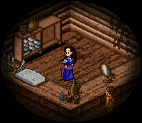

As you quickly dress, the first thought that comes to your mind is to rush
downstairs and share your wonderful new experience with Riona, the innkeeper.
As you relate to her your story, she explains to you that you have left your
mundane life and become an Aisling. She tells you that you now have the gift
to forge your own destiny and that you should go out and explore the world...
but first you should find yourself a guide.

Riona will also give you the option to remember your mundane birth. By doing
a little research on your life as a mundane or by delving into the memories of
your childhood, you can tell Riona the date and town of your birth. She will
permanently record these memories in your legend. Be warned however, should
these memories prove themselves to be false they will take their toll on your
mind when you change them `((-100 000 experience))`.

## A Choice Must be Made

With Riona's blessing you are now free to explore the lands of Temuair, but
what should you do first? Riona suggests finding a guide, but you may wish to
gather a little insight and discover the town of Mileth before attempting to
find someone who will guide you down your chosen path. Many guides, including
myself, will question your knowledge of the world before they will accept you
into their path. I therefore recommend that new Aislings visit all the
Mundanes of Mileth and glean what insight they can from them, they will have
much to teach you!

Now, as you exit the inn you might be bewildered by the size of the town.
Where should you go? Where can you find someone who will help you?

A good place to start your exploration is the Mileth Blacksmith shop. All
Aislings will have to hunt at some point their lives, so learning about some
basic weapons and armors is a good idea. By speaking with either Callough the
weapon smith or Torrance the armor smith you can learn about weapons, armor,
clothing, jewelry, and even a little about magical artifacts. Be sure to
listen carefully to all they have to say for you will surely gain some
valuable experience.

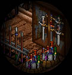

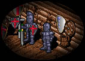

## Your First Quest

While you're at the weapon smith's, you may wish to embark on your first quest
by asking him to spare you a stick. Callough is not in the habit of giving out
weapons for free however and he will request that you find him five sturdy
branches  with which he may craft
you a stick.

Where to find such branches you ask? The two large trees next to Riona's Inn
are a perfect place to look. It may take you some time to find them, but with
a little perseverance and a lot of walking and searching you will surely
succeed.

Once you return to Callough with your branches, he will reward you not only
with a stick but a sturdy wooden shield and a few coins as well. Now wasn't
that worth the effort!

## A Visit to the Dark Wizard and the Alchemist

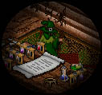

Although you have all the equipment necessary for your first hunt, there are
still many things to learn in Mileth. Your next destination should be a visit
to Dar's, the dark wizard, and to Cyan's, the alchemist. They are both in need
of special reagents for their spells and potions and they will ask you to
seek these components out for them. Dar requires either scorpion's stings,
bat wings, spider eyes or spider silk whereas Cyan will ask you to find either
mold or a variety of rotten foods such as baguettes, cherries, grapes, apples,
vegetables or tomatoes. All these things may be acquired from the various
monsters of the Mileth Crypt though some are harder to find or can only be
found in the deeper levels, such as the scorpion's sting. Should you bring the
requested items to them they will reward you with some valuable insight. You
may also wish to sell some of the reagents you find to earn a little money. In
addition to the items already mentioned, they will purchase centipede glands,
viper glands, bee stings, and mantis eyes.

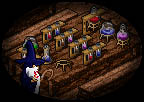

## Time for Lunch!


By this time you might be feeling a little hungry, so why not head down to the
Mileth Bakery and Tavern for a refreshing drink and some tasty treats? Aingeal
the barmaid will serve you some fine rum or brandy. She may also take care of
some of your political tasks such as voting or renouncing your citizenship.
Sit down and enjoy Duana's dancing as you drink but take heed of the old drunk
for he will try to harass you for your hard earned money. However, a gift of
1000 coins may well be worth it in the future should you have two companions
with you willing to face the perils of the Terror.

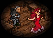

Next door you will find Oona the baker. She offers a variety of foods such as
vegetables, apples and baguettes for a light meal or chicken and beef for a
heartier one. Her daughter is often wandering in the enchanted garden and
sometimes gets bitten by vipers, or suffers from nightmares or worse. Perhaps
you can help her by finding an Aisling herbalist who can give you the proper
medicine to cure her ailment?

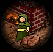

While you are here, either Aingeal or Oona may speak to you of a friend who
has lost her love... would you be able to help mend a broken heart and find
the missing love letter?

## Services of Mileth

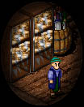

Now that you are full from your meal it might be a good time to explore the
various services that Mileth offers. Next to the Tavern and Bakery you will
find the Mileth Bank. Here you may deposit for a small fee your money and
items. Withdrawal is free of charge. You may also labor for another Aisling by
speaking with Cassidy, the higgler who runs the bank.

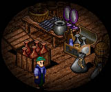

You will probably wish to stop by the Tailor Shop and purchase some proper
clothing as well. A new blouse or shirt will offer much better protection than
the ragged one you currently have. Brody will also lend you his tools to
either dye or tailor your outfits provided you have the necessary skill to do
so.

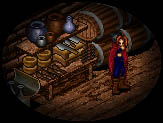

Daithi, the mysterious rogue trainer will help you should you choose the path
of the rogue.

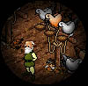

Mileth offers a wonderful pigeon carrier service. Should you ever wish to give
a gift to someone but you just don't have the time to hand it to them in
person, Colm will do the job for you. It will cost you some coin however and
only non-perishable goods may be sent.


A stop by Mileth's beautiful chapel is definitely a must! Should you speak to
Naomhan, the chapel assistant, he can explain to you a little about the
mysterious altar that lies before the Mileth Inn. Listen carefully to what he
says and you will gain some valuable experience. Someday you may also wish to
be married within the chapel.

## The Fighter Trainer


Now that your exploration of Mileth is nearing completion, you will want to
visit Keallach the fighter trainer to learn some basic fighting tactics. He
will talk to you about grouping and the importance of having a mix of classes.
He will warn you about some enemies you might wish to avoid and how best to
fight them as well as give you some weapons advice. Listen carefully if you
wish to avoid certain death!

## Devlin, the Fae Priestess

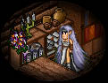

You will find Devlin just next door to Keallach. This faery will teach you
about the East Woodlands which lie just outside Mileth. Learn about the
Beautiful Enchanted Garden and its hidden Lover's Glade as well as the barren
Desert Wasteland. She will warn you not to venture out too far into the woods
for there are creatures much more dangerous than the mantis which roam its
many paths. Devlin will also speak to you about Honey, a faery's favourite
delicacy. If you should ever find some, bring it to her and she will reward
you greatly.

## Mileth Outskirts

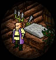

Just outside the town of Mileth you will find Glioca Temple, the Mileth Town
Hall and Courthouse and the Mileth College. At the Town Hall, Cedrik the
burgess attendant will attend to all your political needs. The Courthouse is
reserved for use by Mileth guards and judges. Hopefully you will not have to
step foot there unless it is as an officer of law!

At Mileth College you can attend a variety of courses on history, philosophy,
lore or even art! Read the various boards to find out what days and times
classes are offered and mark your calendar to attend one.

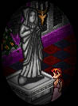

You should make sure to stop at Glioca Temple to speak with Meaveen the temple
assistant. She can teach you all you need to know about the temurian
pantheon. Listen carefully to the story of each god and learn who forms their
Holy Trinity and who opposes it. This information is a must know for any
Aisling and is a favourite source for questions by guides. You may wish to
reflect upon the characteristics of each God and begin thinking about joining
one of their fellowships. Religion is one of the great experiences of
Temuair.

## A Final Decision

Now that you have visited all the essential parts of Mileth you are presented
with two choices: either go off on your first hunt in the Mileth Crypt or
Eastern Woodlands and retrieve the necessary items for Dar, Cyan and Devlin,
or attempt to find yourself an Aisling Guide and head to the Temple of the
Veil to choose your path.

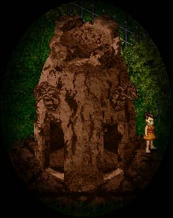

OR

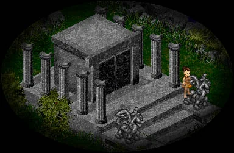

No matter your choice, you are well prepared to face all that Temuair has to
offer. I wish you the best of luck, Aisling, on your quest. May the Gods bless
you!

_Sincerely,_


_Moiraine Al'Loran_  
_Priestess of Luathas_  
_Tuatha de Deo_

## Point Form Review

* Awaken as Aisling
* Speak with Riona
* Visit Blacksmith's Shop and speak with Torrance and Callough
* 'Spare a stick' from Callough by gathering branches for him
* Visit Dar, ask about 'Dark Things'
* Visit Cyan, talk to him 'A little about...'
* Stop by the Tavern and Bakery, ask about 'The Letter' and 'Mother's Love'
* Visit the Mileth Bank
* Visit the Tailor Shop
* Visit Daithi, the Rogue Trainer
* Visit Colm at the Pigeon Carrier Service
* Visit the Chapel, talk to Naomhan about 'The Altar'
* Visit Keallach the Fighter Trainer, talk to him about 'Fighter Training'
* Visit Devlin, ask about 'Woods', 'Lover's Glade' and 'On Honey'
* Visit Mileth Town Hall and Courthouse
* Visit Mileth College
* Visit Glioca Temple, ask Meaveen about 'The Gods'
* Find an Aisling Guide or go hunting in Mileth Crypt or Eastern Woodlands

## Some Suggestions on Skill Point Allocation `((OOC))`

If you already know which path you wish to follow, here are some suggestions
on where to put your first skill points so that you can gain the maximum
benefits. If you don't know, then you may wish to wait until you have a guide
who can assist you in choosing where to allocate your points.

Constitution is a good attribute to raise for any class, though it is most
useful for warriors, rogues and monks. Constitution will help you to better
develop your health. Each time you gain an insight, you will gain a small
bonus to your health for every point in this attribute. Basic Warrior, Monk
and Rogue skills will require constitution. (This is the main attribute for
craeg [earth] wizards)

Wisdom is a good skill to raise for priests and wizards, though it is
essential for priests. Wisdom will help you to better develop your mana. Each
time you gain an insight, you will gain a small bonus to your mana for every
point in this attribute. All priests skills and some wizard skills will
require wisdom. (This is the main attribute for sal [water] wizards)

Intelligence will be a required attribute for all classes' skills but is
essential for wizards in getting their first spells. Priests will also need to
develop their intelligence throughout their life. Intelligence also gives a
slight bonus to a wizard's attack spells for every point that is allocated to
it.

Strength is a standard required attribute for Warrior and Monk as well as some
Rogue skills. This attribute will determine how much weight you can carry and
will give a small bonus to your attack for each point in it. (This is the main
attribute for srad [fire] wizards)

Dexterity is a standard requirement for Rogue and Monk skills. For every point
in dexterity you will have a slightly increased chance of dodging an enemies
attack. (This is the main attribute for athar [air] wizards)

In my personal opinion, constitution and wisdom are the most important
attributes to develop early on for they will determine how much mana and
health you have later on. They should not be developed however to the
detriment of achieving certain basic skills.

***

```
*Librarian Notes*

Recognized: Aisling, Lorekeepers Recognized (Events of Temuair post #121).
This entry has been edited to conform to Library formatting.
The original can be found at http://www.darkages.com/community/lore/Moiraine_First/index.html .
```
