# Memory Guide

_by NaLyd in **Dark Ages**_

Hello there fellow Aisling! Have you ever been in the middle of some exciting moment or interesting experience and desired to record a permanent snapshot of your surroundings onto a Memory parchment `((Screenshot))`? Have you panicked and scrambled to try and figure out the best method to do so? Or have you ever experienced the frustrating phenomenon known as Temuairan Amnesia where your Memory fails to get recorded `((Screenshots not saving as expected))`?

If you answered yes to any of these questions, then you might find this guide helpful! We'll dive into the details of saving a Memory, we'll explore a few different known curses that can cause Amnesia, and we'll also cover some potential cures.

`((Note: this guide assumes you're using a Windows 11 Desktop PC and its screenshots are using dark mode. Some instructions will be slightly different for other types of computers))`

## Saving Memories

Before we learn about Memory Amnesia, there are a few details about Memories that would be useful to explain first: how to sketch them, store them, and understand them.

### Recording a Memory

It's quite simple to record a full Memory on a piece of parchment and there are two methods native to Temuair:

1. Memory Function `((F12 Key))`
2. Memory Spell `((Screenshot Button in bottom right of game UI))`

The location of your Memory Spell is just below your Map:

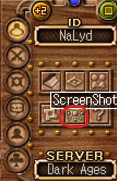

Either method will instantly inscribe on a piece of parchment a depiction of yourself and your current surroundings.

I personally prefer the Memory Function method #1 since it's usually less disruptive while actively hunting or adventuring `((Don't need to move your mouse))`, and it also allows remembering some information not available to the Memory Spell `((eg: The mouse hover-text from items, current skill/spell level, Aisling names under mouse, conversing with Mundanes))`.

But both methods have curses that can prevent saving Memories which we'll explore later.

### Locating a Memory

After you've recorded a Memory, it can be found within your Memory Archive - a simple satchel containing your Memory parchments `((Dark Ages Game Folder, where Darkages.exe is located))`. Your Memories will be automatically catalogued for you in a "helpful" incrementing fashion `((lod001.bmp, lod002.bmp, etc))`.

You might want to refresh or sort the parchments in your Memory Archive to make it easier to manually locate your recent Memories.

New Memories get filed into the bottom of an open Archive `((If you have the directory open, then newly created Screenshots might show up at the bottom of the list of files and directories after the usa.nfo file, until you re-sort it or close and reopen it))`.

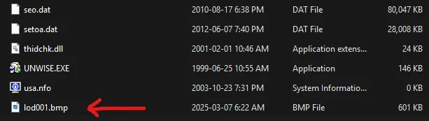

Sorting your Memory Archive by parchment name will organize them into a consistent spot `((Screenshots will appear between the Legend.dat and misc.dat files))`.

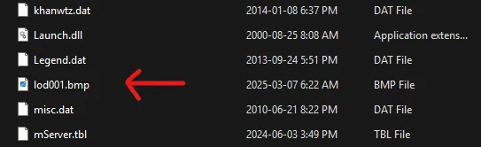

Sorting your Memory Archive by newly created or modified parchments will help locate your freshest Memories!

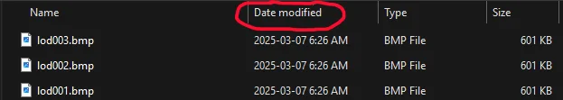

If all went well while recording your Memory, then you should have a shiny new parchment in your Archive that displays the exact moment you chose!

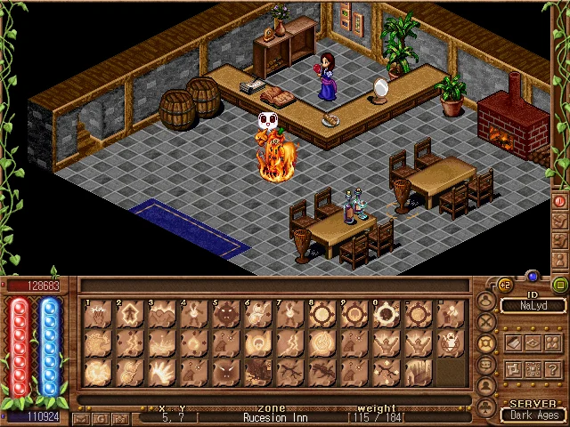

### Memory Uses

There are various ways that an Aisling can use their Memories - the most common being merely reflecting upon one's own experiences. Whether to feel a tinge of nostalgia from Deochs long ago, to share epic hunts and questing moments with others, to simply remember which Aislings you had befriended or rivaled, or to gawk at your questionable fashion choices of your youth, Memories are a great tool for exactly as they're named: remembering the past.

But Memories also serve an important function for town officials - as evidence. Guards can take Memories of Aislings in the middle of Sleephunting `((ie: using software to play Dark Ages while you're away from your computer))` or breaking other Laws and submit them as evidence against said Aisling. Refer to your own town's laws for details.

Mileth College's recently enacted Memory of the Cycle contest is also a great reason to take Memories! Aislings who win the contest can be granted Noble marks of Clave or Village `((see:https://novus-imperia.com/college/mem.htm))`

### Memory Format

Memories will be recorded in a specific style which displays you and your surroundings on a simple piece of parchment `((Bitmap files .bmp, more info: https://en.wikipedia.org/wiki/BMP_file_format))`. However, many methods of sharing Memories with other Aislings might expect more modern formats `((eg: Discord will auto-display .png or .jpeg files but not .bmp))`. I'm not aware of any way to control the default style of Memories, but if any Aislings are aware of such configurable magic then please do let me know!

If you wish to convert your Memories to a more shareable format `((eg: .png))`, there are at least a few options:

Option #1: A native Terran spell called "Snipping Tool" which can help easily select smaller sections of your Memory to save. Note that this method might lose some quality or crispness of your Memory!

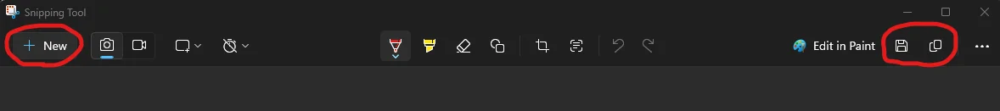

Option #2: Convert your Memory format by opening it in your preferred Memory parchment viewer, and resave it in your desired style `((eg: Save As..., in Windows Photos or Paint, etc))`

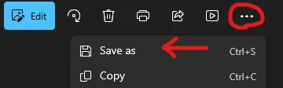

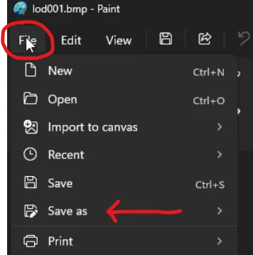

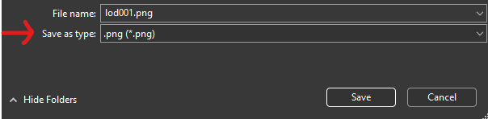

Option #3: There are also various mystical tools and "Cloud" magic (Athar adjacent, perhaps?) which can handle bulk Memory conversion `((eg: https://cloudconvert.com/bmp-to-png))`

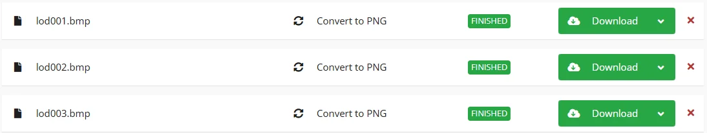

### Memory Numbering

As mentioned earlier, Memories get assigned a numerical value when created `((eg: lod001, lod002))`. Usually, your Memories will just continue to increment in this fashion until you eventually burn them or move them into a different Memory Archive location.

From what I've observed, the Numbering Process basically follows these steps:

1. When taking your first Memory from a fresh Temuair Portal `((Newly opened Dark Ages Client))`, the new Memory parchment will be assigned the lowest natural number that hasn't been used by other Memories yet `((eg: if lod001 to lod008 already exist, then a new Memory will get saved as lod009))`.
2. When taking subsequent Memories, their assigned number will simply be 1 added to the previously saved Memory number from that Portal.

Note that this Numbering Process does not refresh itself from simple naps `((Logout and log back in))`, and can only be refreshed by a full sleep from a new Portal `((Closing and re-opening the Dark Ages Client))`.

A subtle quirk from step #1 is that if your Memories currently contain a gap `((eg: if you only have lod001 and lod008 but nothing in between))`, then the next Memory to get recorded will happen at the start of that gap instead of continuing after the gap `((eg: next screenshot file will be lod002 instead of lod009))`.

A subtle quirk from step #2 is that subsequent Memory parchments DO NOT check if their number is already in use. It's only the first created Memory per Portal which safely checks for existing Memories. Thus, if your Memories accidentally start saving at an unexpected number, then new ones will naively keep adding +1 to that number without any regard to other Memories that might exist.

An additional quirk which is mostly harmless is that hoarding many Memories can slow down the Numbering Process itself. The first time you save a Memory in a fresh Portal, it will attempt to find the lowest available number which can surprisingly take a few seconds if you already have hundreds of Memories. Hopefully you don't find yourself in a life-or-death battle while this Numbering Process leaves you paralyzed, as I have!

These subtle quirks are undoubtedly responsible for some of the Amnesia curses which will be explained next.

## Amnesia Curses

Phew, ok. You understand what Memories are, and how to record and locate a Memory parchment. But for some inexplicable reason it just doesn't seem to work - you can't find your new Memories! Are you cursed to never remember your recent experiences?!

Worry not, fellow Aisling, for there are some known ao spells to cure a few common curses!

### Memory Permissions

The Memory Permissions curse is one of the most pervasive curses that prevents recording Memories. For some confounding reason, the Mundanes haven't updated the default Temuairan Portal `((Game Client))` to be self sufficient, so it still requires asking for permission from a Higher Being `((Administrator Privileges))` when you wish to first awaken or record certain information.

`((Default Dark Ages installations get saved under "C:/Program Files (x86)/KRU/Dark Ages" which requires administrator privileges to create or modify most files.))`

If you haven't been granted the proper permission upon your first attempt to awaken in Temuair, then you might receive a very confusing message:

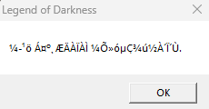

Thanks, Legend of Darkness, that helps explain the problem!

Subsequent awakenings in a default Temuair Portal will not encounter that confusing message, but they will still require Higher Being Permissions if you wish to capture Memories on parchment. If you insist on using this default configuration, then you can apply a cure by either:

1. Asking for Permission on each awakening `((Right click Darkages.exe and choose "Run as administrator"))`.

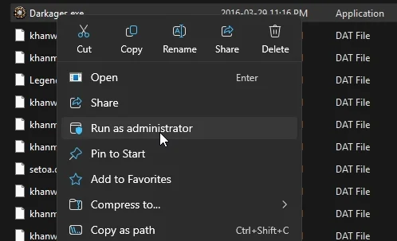
2. Or pre-emptively asking for Permission for every awakening `((Right click Darkages.exe, click "Properties", and enable "Run this program as an administrator" in the "Compatibility" tab))`.

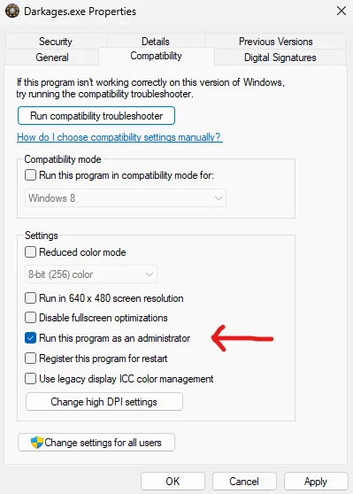

Or, a recommended alternative ao spell to the Memory Permissions curse is to merely relocate your Temuair Portal to somewhere that does not require the extra permissions! `((eg: Under your User directory))` `((Or under a different drive entirely))`


This means you'll never need to ask for permission to record a Memory ever again! Fantastic!

### Memory Lock

The Memory Lock curse is another one which can prevent you from recording Memories. This curse only applies to the Memory Function #1 method that was described earlier. If your Memory sketching tool `((Keyboard))` contains a specific lock `((F-Lock, or Function Lock, which is usually annoyingly located directly after F12))`, then it might be preventing you from properly recording your Memories.

Thankfully the ao spell for this curse is zero lines - simply try toggling the function configuration once to see if that cures it `((Press F-Lock, then F12))`! This curse has tripped me up more than once due to its close proximity to the expected Memory Function.

### Lost in Thought

This curse can prevent saving Memories at specific moments. Sometimes you might be thinking about what to say out loud or in writing `((i.e. In the middle of typing some message in-game))`, and you find yourself unable to take a Memory! This curse mostly impacts the Memory Spell method, but it can also affect the Memory Function method.

Here is a list of actions I tested where I was unable to use the Memory Spell method `((ScreenShot button))`. However, note that the Memory Function method `((F12))` still worked for these actions:

- Checking your own mail
- Viewing & writing posts on a board
- Composing spell lines
- Writing a Valentine's Note
- Conversing with Mundanes
- Accessing Fae Help `((F1))`
- Compiling memorized sentences `((F3))`
- Configuring your preferences `((F4))`
- Remembering your friends `((F10))`
- Reviewing your memorized actions `((Hotkeys))`
- Considering a nap `((Q))`
- Looking at your list of boards `((W))`
- Viewing currently awake Aislings `((E))`
- Deciding your current status `((R))`
- Checking your map `((T))`
- Observing your list of group members `((Y))`

I wasn't able to find an action where the Memory Spell succeeded and the Memory Function failed, so I highly recommend getting accustomed to using the Function rather than the Spell.

Here is a list of actions that could not be saved as a Memory with either method!

- Thinking about what to say verbally, by shout, or by whisper `((Typing a chat message))`
- Writing mail to another Aisling
- Considering ignoring an Aisling `((F9))`

I haven't found a native cure for this curse of being Lost in Thought other than just finishing your thought. But there are non-native Spells that can certainly help capture Memories mid-thought, and they'll be explained shortly.

### Overwritten Memories

There is also a most insidious curse which can silently overwrite previously saved Memory parchments - oh my!

This can be extremely confusing for Aislings because one might be absolutely certain that a Memory was saved correctly and they had even reviewed that Memory parchment. But then at a later time, the poor Aisling might be completely unable to locate the Memory again and notice that a newer Memory might've been inscribed on-top of it. Gah! Is this a curse from Chadul?! Perhaps!!

There are multiple ways for this curse to manifest, and we'll explore them separately since their cures are slightly different.

#### Manual Memory Manipulation

One common way for the Memory Overwrite curse to trigger is if you innocently try to alter your Memories without being careful. If you create a gap in your Memory numbers, then the next freshly created Temuair Portal can start filling the gap and overwrite any Memory parchments that existed after the gap.

As an example, consider this scenario:

1. An Aisling awakens in Temuair and records three Memory parchments `((lod001, lod002, lod003 created))`

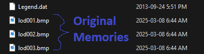
2. For whatever reason, they're unhappy with the first Memory and decide to burn it to permanently forget it `((lod001 manually deleted))`

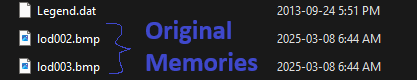
3. If they enter a deep sleep and later reawaken in a fresh Temuair Portal `((Close and re-open the game client))` to record a couple new Memories, they will now have overwritten a previous Memory!! Dangit! `((lod001 recreated, lod002 DELETED AND RECREATED))`

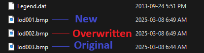

If you wish to evade this curse, try to either avoid moving/burning chunks of your Archive or to move/burn your entire Archive at once `((eg: Periodically move all your screenshots into a separate backup folder and start fresh from lod001 again))`. When moving your Memories, it's recommended to refresh all Temuair Portals `((Close and Re-open any Game Clients))` because lingering Portals can continue creating Memories at their previously chosen number `((eg: After moving lod001 to lod098, an existing Game Client could still create lod099 instead of a fresh lod001))` creating yet another dangerous gap in your Memories.

#### Aisling Cousins

Another common occurrence of the Overwritten Memories curse is when your Cousin Aisling `((Alternate character))` attempts to capture Memories while you're still adventuring in Temuair. Unfortunately, the Memory numbers are shared across you and all your related Aislings, but the Numbering Process is specific to each Portal. This means that multiple Portals can end up trying to use the same number. Given the subtle quirks discussed earlier, this means it's very easy for you to accidentally overwrite your Cousin's Memories or vice versa. As one example, consider this scenario:

1. You awaken in Temuair and record a Memory on parchment `((lod001 created, and lod002 will tentatively be your next one))`

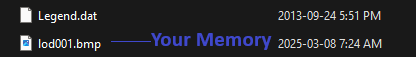
2. Your Cousin then awakens in Temuair and records a Memory `((lod002 created, and lod003 will tentatively be the Cousin's next one))`

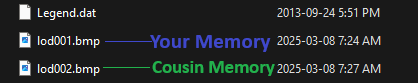
3. You decide to record a Memory for yourself again and accidentally sketch it on-top of your Cousin's Memory parchment!! AHHHHH! `((lod002 from the first Game Client overwrites lod002 from the second Game Client))`

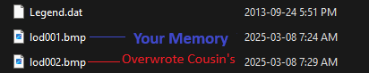

If you wish to avoid this curse, it's recommended to designate a single Temuair Portal `((Game Client))` as the Memory-taker to ensure your Aislings don't step on each other's Memory toes.

But if you'd rather be able to record Memories from multiple Portals, then it's recommended to recreate the Portal `((Close and Reopen Game Client))` whenever you switch back to an Aisling who has already taken some Memories that day. This ensures that the Portal will refresh its Numbering Process and pick a number which hasn't been used yet.

### Unknown Curses

There are rumors of other types of curses that even the above cures can't fix. My guess is that some of these curses might be related to stale Portals `((Game Clients that have been left open a long time, experienced login issues, disconnects, or Chaos rising))`, but I haven't been able to verify this.

Besides fully closing and reopening all your Portals, the only other suggestion I can recommend is to try refreshing your entire Portal Altar `((Try turning your computer off and on again))`.

If anyone knows how to reliably reproduce a mysterious uncured type of Memory Curse, please do let me know!

## Alternate Memory Methods

Given how tricky these curses can be to deal with, I wouldn't blame an Aisling for pursuing different Memory recording methods - I've definitely done so myself! Here are a few alternate methods, depending on the type of Memory that you wish to save.

### Memory Snipping

One of the easiest ways to reliably record a Memory that isn't time-sensitive is to use the handy pre-taught Terran spell called "Snipping Tool," which was mentioned earlier. It makes it very easy to selectively choose parts of your vision that you wish to record or quickly share with other Aislings.

You can use it by casting a specific spell `((Print Screen button on Keyboards, possibly labelled "PrtScn", or Windows Key + Shift + S))` which should allow you to select a part of your view that you wish to record. You can even use it on existing Memories to highlight or omit certain parts.

The spell can look like this:

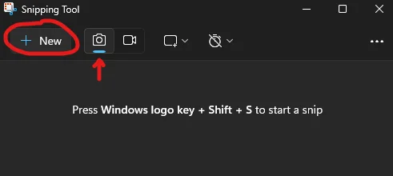

Just make sure the spell is in the proper mode and then cast it `((Click the New button))` and start snipping!


`((You can also find it by pressing the Windows Key and searching for "snipping." If you end up using it often but struggle to remember the hotkeys, then I recommend right clicking its icon and saving it to your Taskbar for easy finding in the future))`.

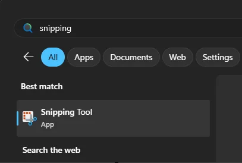

### Verbal Memories

If you're only wanting to record a conversation that is happening (e.g. in an exciting Mileth College class) and don't care about visually viewing your surroundings in your Memory parchment, then recording a Verbal Memory on parchment is a good option!

Simply cast the initial recording spell to start `((Press Alt + J))`, wait for the conversation that you wished to record to end, and then cast the same spell again to stop your recording `((Alt + J again))`.

Note that these Verbal Memory parchments get stored in a slightly different location in your Memory Archive. You must open your Aisling-specific Archive pocket `((Folder with your Aisling name within your Dark Ages folder))`.

The Verbal Memory parchment will be labelled with your Aisling name and a series of numbers corresponding to the time you took it `((eg: a file named NaLyd03311633, where every two digits correspond to a date-time component in 24 hour format. In this case 03-31-16-33, or March 31st at 4:33pm local time))`

Here's an example:

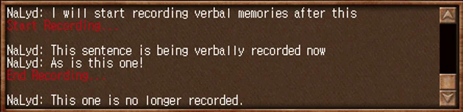

And this is what the Verbal Memory parchment recorded:

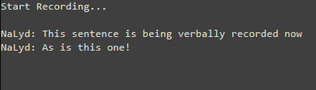

Note that this method will require the Memory Permissions mentioned earlier. And the format of these Memories will be a common parchment for words `((A simple text file))`.

### Self Portraits

There is a native spell for taking Self Portraits which can be handy for displaying in your public Aisling Profile. Simply cast the Spell which is located next to the one for leaving your group and it will capture your current appearance as a portrait `((You can also press F8))`. Unfortunately, these Self Portraits will not record your background or surroundings, so you might want to use an alternative method for a more interesting Profile display.

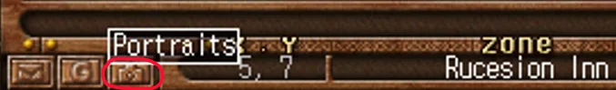

The Portrait will appear in your personal Album:

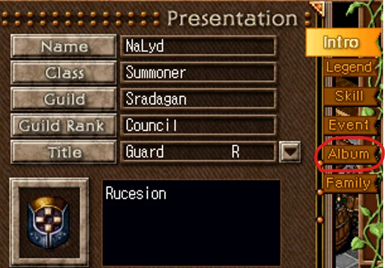

And you can choose to Save it to be displayed on your public Profile, or Delete it if you were accidentally blinking or otherwise dissatisfied with the result:

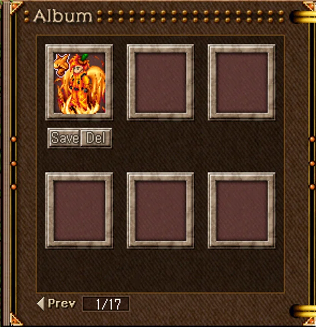

Note that this method will also require the Memory Permissions mentioned earlier.

### Motion Memories

If you want to record some Memories, but you don't want to have to remember to cast your Memory Spell at the exact moments you desire, you can instead pre-cast a Memory Aura spell on yourself, to automatically record many Memory parchments for you until you remove the spell `((eg: Screen recording software))`. I usually choose this option when I know that there will be upcoming moments that I wish to record but I'm not sure when they might happen, or when there's an entire event or quest that I wish to remember. It definitely makes the Memories feel more alive when they are a continuous stream of parchments rather than just individual moments! `((The Snipping Tool can also record videos of your screen. Alternatively, there are various 3rd party screen recording tools that you can find online))`

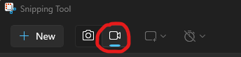

## Emotion Reference

Now that you've got a handle on reliably saving Memories, you can focus on spiffing up your Memories with various emotions that you were feeling in the moment. Temuair Portals include their own emotion reference `((Hotkeys button))`:

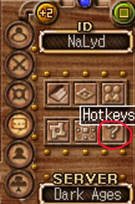

`((Hover over keys 1-9))`:

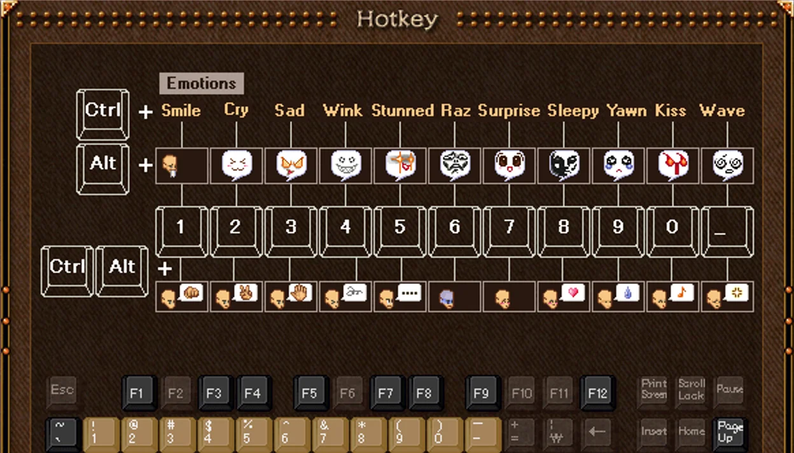

But it's missing visual examples for a third of the feelings so here's my own compiled reference showing all the fun emotions you can display in a Memory!

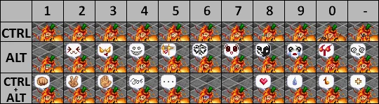

## Conclusion

As we've seen there are quite a few details involved with the simple act of sketching a Memory parchment and a few unfortunate curses that can interrupt the process. Hopefully the cures will work successfully for any confused Aislings reading this and we can slowly start transitioning towards a Temuair where Memories are always saved as desired and never lost! Thanks for reading!

## Credits

I'd like to thank the wonderful Laurier for his help with suggestions and edits for this guide!

_Fiery Summoner_

***

```
*Librarian Notes*

Recognized: Aisling, 2025 (Mileth College master list).
This entry has been edited to conform to Library formatting.
The original can be found at https://novus-imperia.com/college/lore/nalyd_memory.pdf .
```
