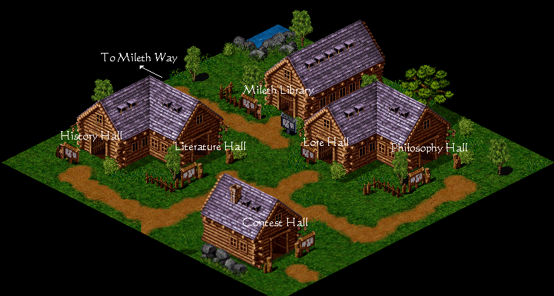
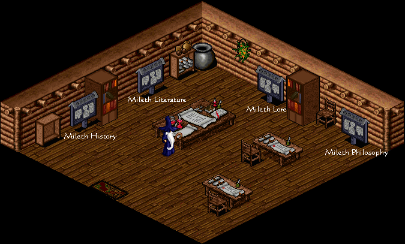

# Mileth College Lore

_by Naze in **Dark Ages**_

Mileth College exists to educate the masses of Temuair in all the Arts.
Philosophy, Art, History, Lore, and Literature are all taught and studied
within these hallowed grounds. This lore is designed to explain to the
uninitiated how the lessons of Mileth College are bestowed.

## Contents:

* The College Grounds
* Mileth Library
* Teaching a Class
  * Scheduling a Class
  * Conferring with the Classroom Mundane
    * Removing/Banishing Unruly Students
* Attending a Class
* Student Rewards
* Teacher Rewards
  * "Noble Points'"
  * Noble Armor
    * "Lord/Lady of the Arts"
    * Unique Noble Armor
  * Noble Titles
* The Contest Hall
* Conclusion

## The College Grounds



The buildings of Mileth College are nondescript, ordinary houses. Signs are
located outside each of the buildings that describe what manner of lessons are
taught within. Lessons in the Art of art itself are held within the Literature
Hall. The grey slate outside Mileth Library is to contain notices of College
business as well as class time postings.

Each hall, with the exception of the Contest Hall, contains benches for
seating, a carpet at the center for the teacher to instruct from, a slate for
the posting of class-related postings only and a mundane attendant to assist
the noble teacher in their instructions. Simple surroundings, but sufficient.

## Mileth Library



Within Mileth Library there are four slates for the discussion of the various
Arts. The librarian, Uistean, will guide you to the proper slate to post your
thoughts, musings, and responses to previous bits of discourse on one of the
Arts.

## Teaching a Class

Any noble who has been recognized in any of the Arts at a Village, Kingdom, or
Aisling level can teach a class in Mileth College. Classes can take many forms.
From stories to lectures to drawing sessions to field trips to poetry recitals,
so long as a lesson is learned, the nature of the class is fulfilled. Noble
teachers are limited only by their imaginations.

### Scheduling a Class

The time you hold your class will have a direct bearing on the number of people
who are able to attend. Try to hold your classes at a convenient hour if you
wish to reach mass numbers of Aislings. To schedule a class, simply post the
hour, date and nature of your class to the slate outside Mileth Library.
`((Time and Date, please. "((Tomorrow at 3pm))" means nothing. "((Tuesdays at
7pm PT))" or "((Saturday 5/16/04 at 3pm PT/4pm MT/5pm CT/6pm ET/11pm GMT))" is
much clearer.))` Be sure you are not conflicting with any established class
times; be courteous to your fellow nobles.

### Conferring with the Classroom Mundane

When the designated hour arrives, you may find that few, if any, have appeared
in the designated Hall. It is custom in this event to hire a herald to roam the
lands, shouting about the lesson about to occur on the College grounds. When
all the students have gathered, you many begin your lesson. As the mundane
attendants of the College say:

"Teach your lesson. This should last at least twenty minutes. Make it useful,
important, and fascinating.You may have an assistant noble that which increases
your lesson's effectiveness. Only when you are finished, assign students."

Once you have finished giving your lesson, in whatever form, the next step is
to speak to the mundane attendant to assign students. Speak with your
classroom's attendant. Under the topic of the Lesson, you will find the option
to Assign Students. Enter each students name who partook of the lesson you just
gave, one at a time. The mundane attendant will speak with them, giving them
the option to accept or deny the lesson. After they have accepted or declined
the mundane attendant will ask you for the next student's name.

When all students who wish to do so have accepted the lesson, speak once more
with the mundane attendant to Finish Lesson. You will be asked if you have an
assistant noble of your Art to help boost the level of your lesson. If you have
such an assistant, provide the mundane attendant with their name. If you have
not overtaxed yourself this day, your knowledge will shine forth. `((Takes
about half your labor, 3-4 days, to cast a Class spell in the College.))` Once
the lesson is cast, the students must either step toward you or refresh their
eyes `((Press F5 or step within four squares of the teacher))` to obtain their
boon from the day's teaching.

#### Removing/Banishing Unruly Students

In addition to aiding in casting a class spell, the mundane attendants of
Mileth College halls allow for the removal or banishment of unruly students.
This sadly becomes necessary at times. Some simply come to gatherings to cause
problems instead of helping to create solutions. When an unruly student's
antics go beyond the capacity to ignore `((F9))`, removal or banishment is
prudent. Simply talk to the mundane attendant about The Arts and you will be
given the option to either Remove the disruptive student from the grounds
`((They can come back if they're gluttons for punishment.))` or to Banish a
repeated disrupter from the College grounds for eight hours. `((For 1 hour
attempting to enter the College grounds will send them back to the Inn.))`

## Attending a Class

By and large, classes are open to all who wish to attend. Simply read the slate
outside Mileth Library to find out when a class is to be held. Appear in the
appropriate hall at the designated hour and learn. Some teachers may hold
invitation only courses, so be sure to check the slate for class times.

Be respectful. Teachers have the power to banish unruly students from the
College grounds. But be not be silent. Ask questions when appropriate, probe
for knowledge, contribute to dialogues. You are here to learn. No questions are
answered that go unasked.

Much labor is required to fully understand a lesson taught in Mileth College.
Five days of labor will be taken from you after the class has concluded when
you accept the lesson from the teacher. It is interesting to note that the
Fragile Chrysalis does not prevent one from accepting a lesson. You will not
receive the benefit of the lesson until after all students have been accepted
and the teacher casts the class spell - please be patient as this can take some
time in crowded classrooms.

## Student Rewards

The amount of experience gained from attending a class varies based upon your
insight and the level of spell cast by the teacher. The teacher cannot teach a
level of class higher than their recognition level in the field being taught.
The table below details the amount of insight a student can expect to receive
from the lesson. `((These numbers are extrapolated from minimal data. Call this
an "educated guess" as to how it works.))`

| Insight | Personal | Clave | Village | Kingdom | Aisling |
|---------|----------|-------|---------|---------|---------|
| 1-19    | 2500     | 5000  | 7500    | 10000   | 12500   |
| 20-49   | 8000     | 16000 | 24000   | 32000   | 40000   |
| 50+     | 25000    | 50000 | 75000   | 100000  | 125000  |

So an Aisling of 46 insights attending a lesson taught by a Kingdom level
teacher can only expect between 8000 and 32000 experience. The experience
gained from most lessons is slight before the 50th insight, but the true reward
is the lesson itself. Knowledge is invaluable.

## Teacher Rewards

Teaching in Mileth College is very rewarding for the dedicated noble. Insight
is gained for every student who accepts and then is touched by the class spell.
`((5k experience per student per level of spell - 5k per for Personal, 10k per
for Clave, etc.))` The true reward, of course, is seeing that you have touched
the lives of other Aislings. Imparting wisdom is a wonderful thing.

### "Noble Points"

Jean in Loures offers a host of armors and titles to noble Aislings. Many are
confused when he refers to his boons costing "Noble Marks" or "Marks of
Nobility", fearing that they will lose their hard-earned mark of nobility in
exchange for Jean's services. Rest assured, the marks Jean requires and takes
from your legend are not the Artist, Philosopher, Lorekeeper, Bard, or
Historian marks. The "Noble Marks" to which he refers are more easily obtained
marks, what are commonly referred to as "Noble Points". Your much deserved mark
of nobility cannot be stripped so easily.

Whenever a class in Mileth College surpasses a dozen students, there is as much
a chance as not `((50% chance))` that the teacher will be "nobly considered"
for their teaching efforts. Seeing this message from the classroom mundane
means that the teacher has gained a "Noble Point", the requisite mark for
Jean's favors. "Noble Points" are chronicled on one's legend, but is only
visible to oneself, like so:


`((The "-" before a legend mark means only you can see it.))`

### Noble Armors

Jean of Loures can reward the teacher with various armors in exchange for these
"Noble Points" These noble armors are not unique, save the highest armor. They
are visually identical to the armors one would normally get for their path and
gender, but require less insight to don and bear the title of 'Noble'.
`(("Noble Moon Bodice", for example.))` The cost of the various armors is
described by Jean thusly:

| Noble Points | Garment | Insight | Normally |
|--------------|---------|---------|----------|
| 1            | 1st     | 11      | 41       |
| 3            | 2nd     | 22      | 56-71    |
| 8            | 3rd     | 33      | 86-97    |
| 8            | Unique  | 1       | Unique   |

With the exception of the "Unique" Noble Armor, these armors can be freely
traded with other Aislings, and do not expire. Just be aware that you can only
make noble versions of the standard armors of your path and gender. Jean also
warns, "The noble clothing does not have the armor protection of the normal
clothing. It is useful as a display of your social status, only." `((Don't
expect more than -1 AC.))`

#### Lord/Lady of the Arts

The final Noble Armor is the Loures Lord for males or Loures Lady for females.
It is similar to Judge robes, but silver in color. This armor is permanent like
all other Noble Armors, but is bonded to its crafter and unable to be stored,
dropped, or exchanged. The forging of the armor comes with the legend mark,
"Lord of the Arts" or "Lady of the Arts" and is considered a high honor. Rumors
persist that Jean may accept a paltry half dozen "Noble Points" for the forging
of this most prestigious of armors, but only if he likes you.

Loures Lady:  
Loures Lord:

#### Unique Noble Armors

Reserved for Aisling-level nobles only, there are also Unique Noble Armors one
can rent from Jean for four moons. These outfits are the rarest in the land and
always turn heads and beg endless questions. An Aisling-level noble with
sufficient space on their person and a "Noble Point" to spend may rent the
Unique Noble Armor of the field for which they were recognized at the Aisling
level. These armors cannot leave one's person until the rental time has
expired. After four moons have passed, the guards sentried outside Mileth and
Rucesion will take this rented armor from you and return it to the vaults of
Loures. As Jean proclaims, "Praise be to the Aisling tailor of these garments,
Aisling Bentic."


As a noteworthy postscript, many Aisling-level nobles have been known to use
songs of various shrines to avoid the guards at the gates of Rucesion and
Mileth in order to hold on to these rented, unique and highly prestigious
armors just a while longer. Also note that though Jean says the rental lasts
but a double-moon, nobles who have rented these outfits have reported that they
in fact last four moons.

### Noble Titles

In addition to Unique Noble Armors, Aisling-level nobles also may exchange a
"Noble Point" for a Noble Title. As Jean explains:

"You may gain a noble title in a subject you have achieved Aisling recognition
in, and if you have 1 Noble Mark. The title lasts for a double-moon."

Noble Titles appear next to one's name on the census list of all Aislings
present in the land and reads as you would expect for your field.
"Philosopher", "Artist", and so on.

## The Contest Hall

The building to the far south of the College grounds is the Contest Hall. It is
furnished much like the other halls of Mileth College, with benches, a carpet
at the center and a mundane attendant. But within this hall no lessons are
taught. The Contest Hall was built to house a forum for the recognition of new
nobles of Temuair.

Within this hall "Contest Hosts" will post a call for noble works from all
Aislings in a particular Art. Any Aisling may enter any work that fits the Art
of the announced contest. Once all entries have been compiled, noble Aislings
will judge which of the submitted works are most worthy of recognition. The
most worthy of works are submitted to the mundanes for their perusal and
approval. The recognized works grant their creators nobility at the level the
mundanes feel your work merits. `((Contest system subject to change without
notice - Please refer to the slate and mundane in the Contest Hall as well as
news from www.darkages.com for full details.))`

## Conclusion

Mileth College is hallowed ground for the enlightenment and betterment of all
Aislingkind. With proper use the halls will continue to instruct many sparks in
the History, Lore, Art, Literature, and Philosophy of Temuair.

***

```
*Librarian Notes*

Recognized: Village, Lore Contest, 18 June 2004.
This entry has been edited to conform to Library formatting.
Recovered from the Internet Archive; the original site no longer exists.
The original can be found at https://web.archive.org/web/20090829043953/http://geocities.com/peasantnaze/college.html .
```
