# The Ways of Barbarians

_by Neurosis in **Dark Ages**_

_Guide to skills,spells,equipment,and tips_  
_"The Masters of Battlefield"_

Written in closest details`((OOC Out-Of -Character to let you understand
better))`

(This Guide is dedicated to Dark Ages and those Aislings who have trouble
finding out how a certain skill works,and those who made mistakes learning some
skills late which were needed earlier to make their Adventures easier and more
fun. And ofcourse to all Warriors.)

Introduction:This Guide will let every Aisling who chooses the way of a Warrior
get a closer look at how to start their training,what is offered for them by
the Mundane Trainers, and all the equipment a Aisling Warrior will be able to
equip by each insight. Hopefully this guide will answer youre questions,and
help you to become a powerful and a smart Warrior.

## Combat Skills

Note: (For each skill/spell you will plan to learn,you will be asked for some
kind of ingredience(items,coins),and a specific level of a skill and stat
required to be trained by the Mundane Skill Master)

(Most of the skills a Warrior is tought until the Master are in a range of
0/100,once you traine a certain skill/spell and it reaches 100/100 you may call
youreself a Master in that skill/spell)

(Hand skills work automatically when you press the (spacebar),and manual skills
such as WindBlade must be used manually by (double clicking the Skill Icon
)or(using the macro number that the skill is under)And this will Look like
this-

 

Not Activated / Activated

### Assail


Assail is a basic Assault skill which allows a person to (hit), every Aisling
will have this skill when their star starts shinning .Once a Aisling chooses a
path,their Assail range may be different which is determined on which path you
chose to walk upon. A Warriors Assail goes way up to the top to 100. When you
first start youre training,youre Assail will look something like this
0/100,once you start training(hunting) Monsters it will increase(level)by
itself,which is very important and required inorder to be able to learn
different Fighting Skills. How do you use Assail?You use Assail as you hit a
monster,and that can be examined by looking at the skill (flash)on youre skill
bar.That goes for every hand skill you will learn,you will see that skill
working by the flash of it on the Skill Bar.

### Assault


Assault is the second hand skill you will need to learn.This fighting skill is
very similar to Assail,it works the same as Assail but the difference is it's
stronger. Assault increases the damage of youre Strike towards youre target.You
will examine that as you fight a monster. Assault increases levels the same way
just by hitting the monster, and its range is also 0/100. Inorder to learn this
Skill youre (Assail) level must be around 10 I believe. _(This Skill is offered
to be tought in the Mileth Combat Skill Master)_

### Clobber

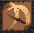

Clobber is the third hand skill you will get incontact with. Clobber is the
same type of Skill as Assail and Assault,and also works the same way just by
hitting the enemy. Clobber is a fighting Skill which Increases the damage of
youre Strike towards youre target. It also increases levels the same way as in
Assail and Assault,and its range is 0/100. Inorder to learn Clobber youre
(Assail) skill level will be required at about 20-30 range. _(This Skill is
tought in the Mileth Combat Skill Master)_

These 3 skills will be youre first fighting skills you will have to learn at
the lower insights inorder to put some decent damage into those you wish to
slay.(Once again these skills are activated just by pressing the spacebar).

### Wallop

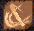

Wallop is the fourth hand skill you will get incontact with. It works the same
as the other 3 hand skills but again it Increases the damage of youre Strike
into the target,meaning you will be able to kill monsters faster than you did
before. If you balance youre stats right,I believe you will be able to lear it
at a higher insight ,Id guess in youre 50's or 60's. Its range stands up to
0/100. _(This Skill is tought in the Suomi Combat Skill Master)_

### Two-Handed-Attack

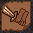

This Skill is one of the best skills a Warrior could get its hands on. This
skill is the Fifth hand skill,its so great it includes Not 1 hand but 2 hands
in the Strikes of the Blade. The skill requires 2 Handed Swords, in this case
would be Claidhmore,Emerald,Gladius and Kindjal Sword.And the lowest insight to
weild one would be insight(73). The skill itself may be learned earlier but not
used until a Warrior weilds the first 2-Handed-Sword. Two-Handed-Attack has No
range at all,its just a skill that lets you own the knowledge of handling a
Two-Handed Sword. It delivers a great deal of damage towards the target.
_(Two-Handed-Attack may be tought in Suomi Combat Skill Master)_

### WindBlade

 

WindBlade is a very usefull skill a Warrior should learn. This skill is very
different from the hand skills.WindBlade doesn't work as
Assail,Assault,Clobber,Wallop. It works by (Double Clicking on the skill icon
with youre mouse) or (by pressing the macro number the skill is under). The
name speaks for itself "WindBlade"when you strike a target with it,youre blade
swings so quickly it develops a windforce which strucks the target and puts
some damage into it. The disadvantage of this skill is it containes
aether(meaning it takes a few seconds for the skill to be restored for use
again,and you may examine that by looking at the skill bar and seeing the skill
in (purple color.)and(it may fail also sometimes when you attempt to
WindBlade). But the failure may change once you get experienced in it when
youre WindBlade starts increasing levels,and increasing the damage with it
aswell. The advantage of WindBlade is that you may strike the target standing
2-3 steps away from it. And also you may Strike 1-3 targets at once when all
the targets are lined up together in a single file WindBlade has a range of
0/100.Inorder to learn Windblade you will be asked by the mundane to present 30
levels of Assail training. _(It may be tought in Mileth Combat Skill Master)_

### Rescue

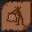 

Rescue is Not a skill used for delivering damage.Though it is used in fighting
creatures in (groups),or helping someone by covering wool over the enemie's
eyes that was targeting him/her, in that case it will turn its violent
attention towards you!and put some damage on you instead of the person you
rescued. Rescue works by (double clicking the icon skill,it also contains
(aether of a few seconds). Basicly when youre in a group and the enemy is after
youre friend or anyone in particular who needs help,you walk up to the enemy
standing right beside him and use the skill on him.Then Rescue will rescue the
person from the enemy by giving the target a blow,and that will make the
enemies mind turn its attention straight on you. Rescue has a range of 0/100
and by training it ,it will surely decrease the failure of the skill. _(Rescue
may be tought in Mileth Special Skill Master)_

Tip:Lear this skill as early as possible and train it hard,because it requires
a high level of it inorder to get one of the Warriors best skill.

### Beag Suain

 

Beag Suain I would say is the most useful skill a Warrior may know. This skill
is not only helpful to you but to youre fellow Priest aswell. This skill is
known as (Paralyze)it simply Paralyzes the target for a (few seconds)the target
then will be vulnerable thats where you are able to (switch positions and
deliver very damagable blows). It also lets youre Priest have a few seconds to
organize while not healing,cast a few spells on you to help you deliver more
damage and take less damage. Its range is 0/100.And the disadvantage of this
skill is it containes aether of a (few seconds).and its also known for its
failure,but that decreases once you practice and get better in it. This is
where the rescue skill come very important,because inorder to learn Beag Suain
the Skill Master will ask you to present youreself with (70) levels of
Rescue(70/100). _(Beag Suain may be tought to you in Suomi by the Special Skill
Master)_

Tip:Learn Rescue as early as possible so you may train it and get Beag Suain
early which will make youre Hunting Adventures alot easier.

### Ao Beag Suain

 

This type of skill relates to Beag Suain. It simply Neutralizes you from
Paralization. Its range is 0/100.And the disadvantage of this skill is it
containes aether of a (few seconds) and it's also known for its failure. The
requirements needed to learn it is (Rescue 60/100). _(Ao Beag Suain may be
tought to you in Mileth by the Special Skill Master)_

### Crasher

 

This is I would say the most damagable skill tought to a Warrior. Its very
different from the other skills dealing with the usage of it. It works
manually,once again with a (double click of the skill icon,or Macro digit). To
explain how this skill works youre HP(vita) must be less than (100) when youre
skill range is at 0/100.That changes once you train the skill and level it,then
you will be able to deliver the Strike with more (HP).Simply what you do is you
walk up to the target,standing right beside it and do the Activation of the
skill,it's a failing skill so it might fail,but if it succeeds you will gather
all youre powers from thoes to the tips of youre fingers and deliver the most
Devastating Strike of Rays toward youre target. This Strike contains aether of
a (nice few seconds)but its a deadly one. _(Crasher may be tought in Suomi
Combat Skill Master)._

Tip:Best works when youre Poisoned,that way youre (HP)will stay under
(100HP),its a good way to practice the skill but its a dangerous way at the
same time.

## Accesory Skills

Note: (These type of skills are Not fighting skills which draw damage,they are
skills which you may Benefit from,which help you sute youre own needs.)

### Look


Look is a skill you are tought by the mundane who grants you the privilage of a
lesson in the (Tutorial).Once you are born and you follow the (Tutorial) a kind
mundane which you will approach will teach it to you for no cost or
requirements. By Activating the skill a messagebox will popup which will allow
you to see the name of the Place you are located at. It can be used anywere
throughout the Temuair,even Magicfree places. Its a nice usefull little skill
for identifying places,monsters which stand infront of you, Items laying on the
ground infront of you every Aisling learns this neat skill.

### Tailor

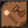 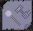

This type of skill is used for armor and armor only. By learning this skill you
are able to Upgrade youre garments to (4)types Good-Fine-Grand and -Great,and
repair them.(For best results get a Aisling's Assistance) To upgrade a garment
visit one of the Tailoring Shops in any of the towns in Temuair. To attempt to
fix youre armor place the garment in the first slot on top-left of youre
(inventory), and do the manual Activation. Warning:You might want to keep this
in mind.Once you upgrade you garment,the garment's requirements change to
higher,so you might require a couple more insights to weild then the regular
garment did.Also the tailored garmets (brake)upon death.

The skills level range is 0/90 and once you tailor a few garmants you will see
(Succeeded Tailoring digit) in youre Legend. Tailoring requires (labor),and
each Aisling is allotted. Every 4 Temauir days (12 Terran hours) each Aisling
receives 5 days worth of labor.(Labor)is working time and it also is needed for
Political things such as Voting.Class attending at the Mileth College. _(Tailor
is available in Abel Tailor Master-to the right of Abel's Bank)._

### MendWeapon

 

The name speaks for itself.Its a skill used to fix damaged weapons.Ofcourse it
wont regain all its durability because the skill is new to you and must be
practiced in order to get youre skill level higher than 0/90 range. After you
practice the skill it will increase its level and youre knowledge of fixing
damaged weapons. It also may fail ,and when it fails it might destroy the
weapon instantly. MendWeapon is used by placing the weapon in the first slot
(top-left) and do the manual Activation. _(The skill itself may be tought to
you in Abel World Armor Shop)._

Tip:I suggest taking some priceless weapons and damaging them a bit, to
practice youre WeaponMending.

### Melee Lore

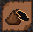 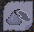

This skill is a very useful skill,available to all Aislings. It simply allows
you to Melee(identify) a weapon(sword). Once again to do this you must place
the weapon in the first slot (top-left) and do the manual Activation.Once you
succeed you will get a messagebox stating the name,weight,insight
requirement,durability and last but not least damage. Melee Lore has a range of
0/100. _(It may be tought to you in Mileth Special Skill Master)._

### Armor Lore

 

This skill is also very useful and very similar to Melee Lore,but instead of
identifying Weapons,you may identify Armor garments. To use this skill you do
the exact prosedure you do with Melee Lore. And by succeeding you will receive
information on weight,AC(armor class), durability,and insight required. Its
range is 0/100. _(Armor Lore may be tought in Mileth Special Skill Master )_

### Throw

 

Throw is a skill used only on other Aislings. Simply just walk to another
Aisling and Activate the skill manually in which you may fail or
succeed,depends on youre skill range and Luck,which in this case Throw has a
range of 0/100. When Activated and succeeded you will push the Aisling (1) tile
from the spot he was standing.This skill is used for when a Aisling is `((away
from keyboard))` and is blocking some entrance or passage,you may push him to
the side to make way.Or some Aislings use it for Wrestling. _(Throw may be
tought in Abel Combat Skill Master)or (By getting involved in Politics and
becoming a Guard)_

Tip:Remember "Practice"makes Perfect.

## Secrets(Spells) of a Warrior

Note: ( Warriors are not Wizards they do not cast spells which do harm,they
have Skills for that,therefore Since Warriors are Masters of Arm they posesses
only a few Spells.And Some Spells work a bit different than others.All the
spells are Activated(manually)There are Spells which include special task to
Activate.) (Like all spells they require MP(mana) to be casted)

### Prayer


Prayer is a spell you cast manually with a special task included. Simply what
you do is drop the prayer necklace under you (double click on the prayer icon
with youre mouse)or(press the digit under what slut is the spell
under)\*wait\*(takes a second or two for it to be casted).After you see a (blue
text appear saying "Prayer")thats when you press (Shift & Double Click
youreself with the "arm"which will allow you to pick up whats under you. And
then there should be a messagebox from the God you worship poping up infront of
you. This secret is a (Special)spell any Aisling may learn by contacting the
(right Priest),of the (right faith). There are (8)Gods you may choose upon to
worship(1) of them.

-Ceannlaidir-God of War  
-Fiosachd-God of Swiftness and Wealth  
-Sgrios-God of Destruction and Decay  
-Gramail-God of Law  
-Glocia-Goddess of Compassion  
-Deoch-God of Debauchery  
-Luathas-God of Gnosis  
-Cail-God of Nature

Pick (1) that best sutes you and youre character. (For more details go to the
nearest Worshiping temple and learn more about these Temuair gods.

### Nis

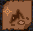

Nis is a nice little spell every single Aisling is being tought by a kind
Mundane who you shall approach making youre way through the (Tutorial). This
secret allows you to check what Deoch,Moon,Sun,Hour youre at the time. (It will
appear on youre top scrolling messagebar),and will look something like this-


To Activate it,you must do the (manual method).

### Lectures

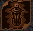

There are 3 types of Lectures a Warrior may learn. The Arms Lecture,The Combat
Lecture,and the Guide Lecture. These secrets must be Activated manually.To use
this secret cast it, then drop a coin in front of you and pick it up again.
What are they used for?They are Lectures,once the secret is casted a messagebox
launches infront of you with one of these Lectures,which may teach you a great
deal of information. The Guide Lecture is a different lecture,it works the same
but it allows you to guide youre mentoring student without having to visit the
Mundane in the (Temple of Choosing).Similar to the (Mentoring Secret). _(These
leactures may be tought in Mileth White Magic Master)_

### Taunt-Insult-Spit

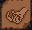

These 3 secrets are very useful for a Warrior though these secrets are also
available for All Aislings as well. Taunt is the first spell that draws a
targets attention from a far distance, its usually used on lower level
monsters. Insult is the second spell which is more aggresive towards its
target, and is used for higher level monsters. Spit is the third and last spell
which is the most aggresive out of the 3 towards its target and is used on high
level monsters. These 3 secrets are only different from each other by the level
of agression they posess. So if you attempt to Taunt a high level monster it
will not work,the agression isnt high enough to draw the targets attention.
Each of these 3 have the range of 0/80.And as you learn these skills you will
encounter many "Myst"targets.Therefore its good to train these skills so that
youre chance of "Mysting"decreases. How do I cast it?Well its very simple,all
you do is use the manual Activation method, and thats where it comes a little
different than the other spell method.You don't wait until the spell casts
itself,you must target it with you (mouse arrow)and you will examine that when
you cross the target with the mouse arrow while the spell is activated and the
target will turn (purple transparent color)and all you do then is (press right
mouse button)while the target is in (purple transparent color)and it will
attempt to Taunt,Inult,Spit, which ever you chose. These 3 skills may be used
for Rescuing a friend or getting the targets attention. _(Taunt may be tought
to you in Mileth Combat Skill Master)_ _(Insult,Spit may be tought to you in
Abel Combat Skill Master)_

## Fighting Tips

Note: There are a couple of fighting tactics a Warrior should know.

**1.** Always try to attack youre target from the back for best damage or from
the side for a little less,that way it will deliver a great deal of quick
damage,almost double the damage when striked from back rather then the front of
the target.(This task may be succeeded easier if you know the skill (Beag
Suain) (which paralyzes the target,that way you got time to switch positions
and deliver a couple of damagable blows to the target).You may examine this and
prove this tip right.)

**2.** When you and youre priest are being ambushed by a few monsters at
once,and you are close to one of the (4 corners of the room)you may arange
youreself in a way that only one monster will be able to reach you ,and that
may be completed by you positioning youreself right in the corner and youre
fellow Priest right beside you.Then if the monsters are attacking youre fellow
Priest once you are in the correct position, either way you may (WindBlade) the
target through youre Priest or (use one of youre Special Attention
Secrets,Taunt,Insult or Spit).That will eliminate the panic of youre fellow
Priest and allow him to takecare of you so that there wont be any Rescuing
missions required.

## Other Tips

Note: These are but a few of many helpful tips which may make youre Adventures
alot easier and fun.

**1.** Always protect youre Priest at any time.If you fail,youre Priest may get
in trouble with the enemy and you and youre fellow Priest may die since the
Priest isnt available to use its abilities. By doing so with the several skills
and secrets you know(Rescue,Taunt,Insult,Spit,youre Blade) you may reduce the
chances of you and youre Priest's execution, and allow youre Priest to restore
youre health,in which you may either standup to the targets or bail because of
youre fellow Priest's low MP(mana).

**2.** Always try to carry these special items with you to make youre Adventure
easier and successful.

(Beothaich Deum)   
Also know as Red Potion.It restores (Life) when one of youre group members gets
(slulled).What means getting Skulled?Getting Skulled means when youre group
member runs out of HP(health) and a (Skull)appeares above its head.That skull
must be removed by (Double clicking the Red Potion,or the digit in which the
potion is under in youre inventory) inorder to remove it.(The skulling lasts a
nice couple of seconds,Id say 15?)If its not removed in a certain period of
time,youre group member will unfortunetly drop all his items and equipment some
will brake and the rest will drop on the death spot.And also will pay a visit
to The God of Destruction and Decay named Sgrios.That visit will give him a
mark of a (Sgrios Scar)in his/hers legend.(Sgrios Scar)is a mark you shouldn't
be proud of, it stands for (Death). (Red Potions may be made by Priests with a
special skill which requires (2 cherries and 1 grape) to make.

(Hydele Deum) 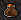  
Also known as Brown Potion.It restores ALL youre (HP). Its a very very useful
potion to have in youre inventory,it may save youre life and may reduce the
sweating that youre priest is having when he/she is healing like crazy inorder
to survive in critical situations. (These Brown Potions may be created only by
(Monks).So I suggest make friends with a few fellow Monks.)

(Personaca Deum) 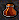  
Has a light brown color.It cures (Poison from youre organism). Poison drains
youre HP pretty quickly,and is usually casted at you by youre enemy. Its a nice
handy Potion which is not so important to have because youre Priest should have
this Secret.But it never hurts to have a couple.These potions are made by
Monks.

(Betony Deum)   
Also known as Vanilla Potion.Once used it casts a spell called _(Naomh aite
deur)._ This spell eliminates 1/2 damage taken from youre enemy. Its a great
potion to keep in youre backpack incase a situation gets critical and you must
rescue youre fellow group member.  
Disadvantage of this potion is,its known for its failure to cast the spell,like
no other potion. So you might wane keep this in mind,and carry a couple.This
potion is made once again by the Herbal Monks.

(Arcane Scroll)  
Also known as Song of the Shrine.Which means a item which allows you to return
to safety. The scroll will deport you to any of the (Village Ways)the scroll is
from. So if you go to one of youre God's Allie Temples and perform the
miracle(Entreat) of the Songs of the Shrine, and then you use the scroll,(which
may be done manually)you will end up in the (Village Way of the specific
Temple) you performed the miracle in.

## Helpful Info

Note: This is some useful information which may really help you alot,dealing
with youre (raising statistics) which you think best sute youre character.

_-Items including-  
Enchantments,Elements,Temuair God's Consecrations.  
Note:Some enchantments,and Consecration items of the Temuair God's are heavier
than others,some decrease (MP) choose wisely._

### Enchantments

-Abudance-Increases (+1) to youre DMG(damage).(Warriors enchantment)  
-Blessed-Increases (+5) to Hit.(Also good enchantment for Warriors)  
-Magic-Magic Enchantment does not decrease any (MP).(Good for Priests,Wizards)

### Elements

_Note:You will only see Elements in (Belts)and(Necklaces)  
Belt Elements defend best against same Element creature,and the Necklaces
vice-versa attacks best._

-Wind-This Element is the best protector/attacker against (Athar)enemies which
attack with the ability of (Athar)spells.  
-Earth-This Element is the protector/attacker against (Creag)enemies which
attack with the (Creag)element.  
-Fire-This Element is the protector/attacker against (Srad)enemies which attack
with the (Srad)element.  
-Sea-Last but not least the Sea element the best protector/attacker against
(Sal)enemies which attack with the (Sal)element.

### Temuair God's Consecrations

_Note:Each of the (8) God's has their own type of Consecration.  
Each type does something different from another.  
Consecrated items may be consecrated by a fellow Priest,or they may be dropped
from a creature._

-Ceannlaidir-(+1)Str Attribute to youre statistic.  
-Fiosachd-(+1)Dex Attribute to youre statistic.  
-Sgrios-(High durability of items).  
-Gramail-(+10%)Magic Resistance to youre statistic.  
-Glocia-(+1)Wis Attribute to youre statistic.  
-Deoch-(Increases regeneration speed of HP/MP).  
-Luathas-(+1)Int Attribute to youre statistic.  
-Cail-(+1)Con Attribute to youre statistic.

### Hot Keys

_Note:Dealing with youre (Character Control),Hot Keys are keys which allow you
to get to a certain (window) very quickly._

By pressing the keys-  
-**"a"** Will take you right to youre (Inventory).  
-**"s"** Will take you to the Secrets window.  
-**"d"** Will take you to the Skill window.  
-**"f"** Will take you to the (Chat Legend).  
-**"g"** Will take you to the (Statictics window).

### Targets Life Flow

_Note: This life flow of any creature is very important to know,because
sometimes when youre battleing a creature and youre low on health,and you know
the targets life flow,you may judge either to bail, or stay and finish the
job._

The targets life flow has (5)stages.  
(Green-100%)~(Green2-75%)~(Orange-50%)~(Red-20%)~(Black-5%)

## Equipment

### Swords

Note: Some Swords have(4 kinds)-(5 kinds)of different (kind) of the Sword.
Listing from (Regular-which may be purchased from a fellow
Mundane),(Good-Fine-Grand-Great which may NOT be purchased from a Mundane,but
may be droped by a Creature). (Regular-the normal insight requirement)-(For the
other 4 kinds the insight requirements increase by (2),Good (2 from the
regular)-Fine(4)-Grand(6)-Great(8),and the damage increases with the sword
aswell). All the other Regular Blades may be upgraded by a fellow Rogue into
one of the (4) types.

Legend :  
(2H)-2 Handed Sword.  
\*[red]-(5) kinds of the Sword,regular type available in the stores.  
\*[green]-(4) kinds of the Sword,regular type not available in stores.

\*[blue]-May be purchased in (Mileth's)Armory.  
\*[orange]-May be purchased in (Abel's)Armory.  
\*[purple]-May be purchased in (Rucession's)Armory.  
\*[white]-May be purchased in (Loures's)Armory.  
\*[red]-May be purchased in (Suomi's)Armory.  
\*[green]-May be purchased in (Udine's)Armory.  
\*[yellow]-May be purchased in (Piet's)Armory.

#### Swords-"The Arm of a Warrior"-

| Swords | Name | Weight | Level | Durability | DMG-small | DMG-large | Location |
|---|---|---|---|---|---|---|---|
|  | Stick | 3 | 1 | 1000 | 4m14 | 4m14 | \*[blue] |
|  | Dirk | 4 | 2 | 3000 | 5m15 | 3m13 | \*[blue] \*[orange] \*[purple] \*[red] |
| 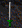 | Eppe | 5 | 2 | 4000 | 3m13 | 5m15 | \*[purple] \*[white] \*[red] |
|  | Loures Sabre | 7 | 7 | 6000 | 18m28 | 11m21 | \*[orange] \*[white] \*[yellow] |
| 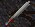 | Claidheamh | 8 | 14 | 7000 | 20m30 | 16m26 | \*[blue] \*[orange] \*[purple] \*[red] |
| 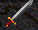 | Broad Sword | 9 | 17 | 8000 | 16m26 | 20m30 | \*[purple] \*[yellow] |
| 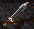 | Battle Sword | 10 | 26 | 10000 | 33m43 | 33m43 | \*[yellow] |
| 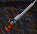 | Templar | 12 | 29 | 11000 | 35m45 | 31m41 | \*[white] \*[yellow] |
| 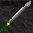 | Masquerade | 15 | 31 | 12000 | 31m41m | 35m45 | \*[white] |
| 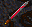 | Bramble | 12 | 41 | 15000 | 40m60 | 34m54 | \*[white] \*[yellow] |
| 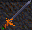 | Black Death | 18 | 45 | 16000 | 34m54 | 40m60 | \*[orange] \*[white] \*[yellow] |
| 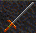 | Long Sword \*[red] | 18 | 56(+) | 20000 | 55m75 | 49m69 | \*[orange] \*[purple] \*[white] \*[yellow] |
| 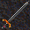 | Stilla \*[red] | 25 | 61(+) | 22000 | 49m69 | 55m75 | \*[white] |
| 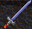 | (2H) Claidhmore \*[green] | 45 | 73(+) | 60000 | 144m184 | 128m168 | Unavailiable from mundanes |
| 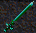 | (2H) Emerald Sword \*[green] | 50 | 79(+) | 66000 | 128m168 | 144m184 | Unavailiable from mundanes |
| 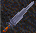 | (2H) Gladius \*[green] | 70 | 88(+) | 80000 | 154m214 | 138m198 | Unavailiable from mundanes |
| 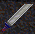 | (2H) Kindjal \*[green] | 80 | 92(+) | 90000 | 138m198 | 154m214 | Unavailiable from mundanes |

### Shields

Note: Some Shields may not be purchased in stores from the Mundanes. All
Shields droped from Creatures come (Enchanted)or(Consecrated) by one of the (8)
Temuair Gods. Each Enchanted or Consecrated Shield (weights)differently from
one another.

Legend :  
(Depends)-Depends on Enchantment or Consecration which ever it is,determines
the weight.  
\*[red]-Not available in any Stores,are only droped by Creatures.  
\*[blue]-May be purchased in (Mileth's)Armory.  
\*[silver]-May be purchased in (Loures's)Armory.

#### Shields

| Shields | Name | Weight | Level | Durability | Armor Class | Location |
|---|---|---|---|---|---|---|
|  | Wooden | 4 | 3 | 3000 | -3 | \*[blue] \*[white] |
|  | Leather | 5 | 15 | 5000 | -5 | \*[blue] |
|  | Bronze | 10 | 31 | 7000 | -8 | \*[blue] |
|  | Iron | Depends | 45 | 9000 | -10 | \*[red] |
|  | Mythril | Depends | 61 | 11000 | -13 | \*[red] |
|  | Hy-Brasyl | Depends | 77 | 13000 | -15 | \*[red] |
|  | Talos | Depends | 90 | 15000 | -18 | \*[red] |

### Armor

Note: There are (7) Circles of Armor.(Circles meaning Stages of Insights) There
is the
(11th)Circle,(26th)Circle,(41st)Circle,(56th)Circle,(71st)Circle,(86th)Circle,and
(97th)Circle. Each circle may be achieved by gaining insights.When you reach a
certain Circle you will have to do some kind of a (quest) inorder to get the
Armor.The (11th)Circle Armor does not require a quest,may be purchased in
(Loures).

Legend :  
\*[blue]-May be purchased in (Mileth's)Armory.  
\*[white]-May be purchased in (Loures's)Armory.

#### Armors only for (Male Warriors)

| Armors | Name | Weight | Level | Durability | Armor Class | Location | Quest for Armor |
|---|---|---|---|---|---|---|---|
|  | Shirt | 2 | 1 | 2000 | -4 | \*[blue] | - |
|  | Leather Tunic | 4 | 1 | 3000 | -11 | \*[blue] | - |
|  | Jupe | 7 | 11 | 6000 | -17 | \*[white] | - |
|  | Lorica | 15 | 26 | 9000 | -24 | Visit(Udine's)Armory for quest | Circle 2 Quest |
|  | Kasmanium | 25 | 41 | 12000 | -30 | Visit(Piet's)Armory for quest | Circle 3 Quest |
|  | Chainmail | 30 | 56 | 15000 | -36 | Visit(EastWoods(15-1)Faerie for quest | Circle 4 Quest |
|  | Implet Mail | 40 | 71 | 18000 | -43 | Visit(Abel Crypt's)Dwarf for quest | Circle 5 Quest |
|  | Platemail | 50 | 86 | 21000 | -49 | Visit(Abel Crypt's)Dwarf for quest | Circle 6 Quest |
|  | Hy-Brasyl | 60 | 97 | 24000 | -55 | Visit(Abel Crypts(10-1)for quest | Circle 7 Quest |

#### Helms

| Armors | Name | Weight | Level | Durability | Armor Class | Location |
|---|---|---|---|---|---|---|
|  | Implet Mail Helm | 2 | 71 | 18000 | -2 | Included with Implat Mail Armor |
|  | Platemail Helm | 3 | 86 | 21000 | -4 | Included with Platemail Armor |
| 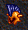 | Hy-Brasyl Helm | 4 | 99 | 24000 | -6 | Included with Hy-Brasyl Armor |

#### The (26 insight)(Circle 2) Armor Quest.

(Visit The Armory in Udine to attempt to make the garment). To complete the
quest,all you gotte do is get (2)Respected Citizens,any 2,may be you and some
other Respected Citizen with some (tailoring) experience and (labor).Go to the
Udine Armory,in which one of the 2(RC's) who are attempting to make the
garment,will have to speak to the Mundane Smith about the (Lorica)and allow the
other (RC)to Assist the making of the garment.That should do the job.

#### The (41 insight)(Circle 3)Armor Quest.

(Visit the Armory in Piet to attempt to make the garment. All you gotte do is
get (2) Respected Citizens,may be you and another (RC).The 2 Respected Citizens
must have some tailoring experience,and surely need to have labor time. Then
one of the 2 (RC's)needs to speak to the Mundane Smith and pick the other
(RC)to assist the making of the garment. This task should do the job for the
Kasmanium Armor.

#### The (56 insight)(Circle 4) Armor Quest.

(Visit The Faerie in (15-1)EastWoods to attempt to make the garment). To
complete the quest,all you gotte do is get (12)Spinel Rings,may be bought in
(Udine Armory) for 50,000 coins each.With the 12 Spinel Rings and(Full labor
time)you will have to Enter 15-1 Woods and find a secret Entrance to the
Faeries room,which may be found in the (top center)of the 15-1 woods.You will
see it there is a path made in the top center of 15-1. Then all you gotte do is
speak to her and choose the option Attempt to craft the Legendary Chainmail. If
you have the right stuff and youre 56th insight, there should be No problems.

#### The (71 insight)(Circle 5) Armor Quest.

(Visit The Dwarf in Abel Crypts)to attempt to make the garment). To complete
the quest,all you gotte do is get (6)Finished Talos,may be found in Piet
Crypts, and give them to a Rogue to finish them up.With the 6 Finished Talos
and (full labor time)go to the Dwarf and speak to him,then he will ask you if
you wish to attempt to craft the Implet Mail,if you have the right
ingredience,he should agree and Craft the Armor for you.

#### The (86 insight)(Circle 6)Armor Quest.

(Visit the Abel Crypt's to make the garment.) To attempt to make it,all you
gotte get is (12) Emerald Rings which may be bought in Suomi for 50,000 coins
each.With the 12 Emeralds make youre way to the Dwarf.Don't forget have youre
labor time Full.Then speak to the Abel Crypts Dwarf to attempt to Craft the
Platemail.If you have the right ingredience, he will agree to craft the garment
for you.

#### The (97 insight)(Circle 7)Armor Quest.

There are 3 choices to complete the 97 armor quest. (Either you may get
involved in politics,contest winner,or pay with youre (Experience points).

I.(Politics)You may achieve the Circle 7 armor by becoming a Burgess and that
requires (4 Respected citizen), (4 Demagogue),and (Burgess).It requires alot of
support(clout)to become a Burgess,but its youre choice. Plus to the position of
a Burgess you must present (5) Mythril shields of the same Enchantment or
Consecration.

II.(Experience)You may choose to sacrifice youre experience points to get the
garment.That would be 50 Million of experience points and 25 (talos)when
attempting the quest at insight 97,98. But when attempting the quest at the 99
insight you will have to sacrifice 100 Million of experience plus the 25 talos
with it.

III.(Contest Winner)You may also choose to enter a contest to get the garment
when you Win ofcourse. I believe its either Lore,Artist,or Philosopher.One of
these entriest may win with the lowest ranking required for the quest which is
Village.Will not work with Clave ranking. winner,Plus a finished Hy-Brasyl
Fragment. I would say this choice would be the smartest one. But there are the
three choices which you may choose upon.

Note:This quest may change,so please ask around to make sure.

Choose wisely.Good Luck.

### Gauntlets-Greaves

Note: Gauntlets and Greaves contain (Enchantments)and(Consecrations). There are
(3) kinds of Gauntlets and Greaves. (Leather)-(Iron)-(Mythril)

Legend :  
(Depends)-Depends on Enchantment or Consecration which ever it is,determines
the weight.  
\*[red]-Not available in any Stores,are only droped by a Creatures.  
\*[blue]-May be purchased in (Mileth's)Armory.  
\*[orange]-May be purchased in (Abel's)Armory.

#### Gauntlets

| Gauntlet | Name | Weight | Level | Durability | Armor Class | Location |
|---|---|---|---|---|---|---|
| 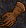 | Leather Gauntlet | 2 | 9 | 3000 | -1 | \*[blue] |
|  | Iron Gauntlet | Depends | 33 | 5000 | -2 | \*[red] |
|  | Mythril Gauntlet | Depends | 63 | 7000 | -3 | \*[red] |

#### Greaves

| Armors | Name | Weight | Level | Durability | Armor Class | Location |
|---|---|---|---|---|---|---|
| 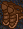 | Leather Greaves | 4 | 6 | 3000 | -2 | \*[orange] |
|  | Iron Greaves | 6 | 20 | 6000 | -4 | \*[orange] |
|  | Mythril Greaves | Depends | 59 | 9000 | -6 | \*[red] |

### Shoes-Belts

Note: Shoes may include(Enchantment)or(Consecration)of some kind.Shoes only add
(Dex)and the Enchantment or Consecration.They do not lower (AC). All belts
include one of (4)Elements.There are belts that you may purchase from a Mundane
Smith Master,specially crafted with one of the 4 Elements. Once the belt is
equiped,the Element will be added to youre (Defence).

Legend :  
\*[red]-Not available in stores,may be droped by a Creature.  
\*[blue]-May be purchased in (Mileth's)Armory.  
\*[purple]-May be purchased in (Rucession's)Armory.  
\*[red]-May be purchased in (Suomi's)Armory.  
\*[green]-May be purchased in (Udine's)Armory.  
\*[yellow]-May be purchased in (Piet's)Armory.

#### Shoes

| Shoes | Color | Name | Weight | Level | Durability | Additions | Location |
|---|---|---|---|---|---|---|---|
|  | Boots | Dark Blue | 2 | 1 | 3000 | - | \*[blue] |
|  | Grey Boots | Black | 2 | 11 | 3000 | - | \*[blue] |
|  | Cured Boots | Gray | 2 | 24 | 9000 | +1 Dex | \*[blue] |
|  | Shagreen Boots | Green | 2 | 33 | 15000 | +2 Dex | \*[blue] |
|  | Cordovan Boots \*[red] | Orange with Red | 2 | 50 | 21000 | +3 Dex | Unavailabe from the mundanes |
|  | Lapis Boots \*[red] | Blue | 2 | 56 | 3000 | - | Unavailable from the mundanes |
|  | Saffian Boots \*[red] | Purple | 2 | 66 | 27000 | +4 Dex | Unavailable from the mundanes |
|  | Magma Boots \*[red] | Red | 2 | 82 | 33000 | +5 Dex | unavailable from the mundanes |

#### Belts

| Belts | Name | Weight | Level | Durability | Additions | Location |
|---|---|---|---|---|---|---|
|  | Leather Belt \*[red] | 1 | 12 | 2000 | +1 Wis | Unavailable from the mundanes |
| 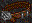 | Mythril Belt \*[red] | 1 | 12 | 2000 | +1 Con | Unavailable from the mundanes |
| 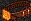 | Hy-Brasyl Belt \*[red] | 1 | 12 | 2500 | +1 Wis +1 Con | Unavailable from the mundanes |
|  | Fire Belt | 1 | 4 | 1000 | Adds Element to defence | \*[red] |
|  | Earth Belt | 1 | 4 | 1000 | Adds Element to defence | \*[yellow] |
| 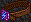 | Wind Belt | 1 | 4 | 1000 | Adds Element to defence | \*[purple] |
| 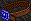 | Sea Belt | 1 | 4 | 1000 | Adds Element to defence | \*[green] |
|  | Dark Belt \*[red] | 1 | 12 | 2000 | Adds (Dark)protection | unavailable from the mundanes |

### Jewlery

Note: Earrings may come Enchanted or Consecrated when droped by a creatures.But
Necklaces Only come with (1) of the (4) Elements.Once you have equiped the
Elemental Necklace,the Element will be added to youre (Weapon Attack). The
Regular Necklaces/Earrings may be purchased in the Armory Shops from the
Mundanes without any Elements,Enchantments,or Consectration.

Legend :

\*[red]-Not available in any stores.  
\*[blue]-May be purchased in (Mileth's)Armory.  
\*[orange]-May be purchased in (Abel's)Armory.  
\*[purple]-May be purchased in (Rucession's)Armory.  
\*[white]-May be purchased in (Loures's)Armory.  
\*[red]-May be purchased in (Suomi's)Armory.  
\*[green]-May be purchased in (Udine's)Armory.  
\*[yellow]-May be purchased in (Piet's)Armory.

#### Necklaces

| Necklaces | Name | Weight | Level | Durability | Adds Damage | Adds Hit | Location |
|---|---|---|---|---|---|---|---|
|  | Fire Necklace | 1 | 6 | 1000 | 0 | 0 | \*[purple] |
|  | Earth Necklace | 1 | 6 | 1000 | 0 | 0 | \*[purple] |
|  | Wind Necklace | 1 | 6 | 1000 | 0 | 0 | \*[purple] |
|  | Sea Necklace | 1 | 6 | 1000 | 0 | 0 | \*[purple] \*[green] |
|  | Amber Necklace | 1 | 14 | 3000 | +2 | 0 | \*[blue] |
|  | Bone Necklace | 1 | 15 | 2500 | +1 | +5 | \*[blue] |
|  | Gold Jade Necklace | 1 | 10 | 2000 | +1 | 0 | \*[red] \*[yellow] |
|  | Pearl Necklace | 1 | 11 | 2000 | 0 | +5 | \*[orange] |
|  | Jade Necklace | 1 | 13 | 3000 | 0 | +10 | \*[red] |
| 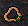 | Prayer Necklace\*[red] | 1 | 0 | 2000 | 0 | 0 | Must worship a God to get. |

#### Earrings

| Earrings | Name | Weight | Level | Durability | Additions | Location |
|---|---|---|---|---|---|---|
|  | Gold Earrings | 1 | 8 | 2000 | +2 Strength | \*[yellow] |
|  | Silver Earrings | 1 | 8 | 1000 | +1 Strength | \*[yellow] |
|  | Coral Earrings | 1 | 8 | 2000 | +2 Intelligence | \*[blue] |
|  | Ruby Earrings | 1 | 8 | 1000 | +1 Strength +1 Intelligence | \*[red] |

#### Rings

| Rings | Name | Weight | Level | Durability | Adds MP | Adds HP | Additions | Location |
|---|---|---|---|---|---|---|---|---|
|  | Emerald Ring | 1 | 12 | 2000 | 0 | +500 | +2 DMG | \*[red] |
|  | Small Emerald\*[red] | 1 | 1 | 2000 | 0 | +300 | +2 DMG | CompleteTutorial |
|  | Spinel Ring | 1 | 11 | 2000 | 0 | +500 | +2 Hit | \*[green] |
|  | Small Spinel \*[red] | 1 | 1 | 2000 | 0 | +300 | +2 Hit | Complete Tutorial |
|  | Grave Ring \*[red] | 1 | 17 | 4000 | +100 | 0 | Protects from the Scars of Sgrios | Unavailable from mundanes |
|  | Talos Ring | 1 | 4 | 2000 | 0 | +100 | - | \*[yellow] |
|  | Ruby Ring | 1 | 6 | 2000 | 0 | +200 | - | \*[blue] |
|  | Beryl Ring | 1 | 5 | 2000 | +50 | 0 | - | \*[green] |
|  | Coral Ring | 1 | 14 | 3000 | +100 | 0 | - | \*[green] |
|  | Amethyst Ring | 1 | 16 | 4000 | +100 | +200 | - | \*[blue] |
|  | Red Jade Ring | 1 | 10 | 3000 | 0 | +100 | - | \*[yellow] |
|  | Jade Ring | 1 | 16 | 5000 | +150 | +300 | - | \*[red] |

_Almost all the images in this Guide were captured from DarkAges,and are
Property of Nexon._

_Written and Compiled by Warrior Neurosis Chujin_

***

```
*Librarian Notes*

This entry has been heavily edited to conform to Library formatting.
The original can be found at http://www.darkages.com/2000/download/Neurosis_Barbarian/index.html .
```
