# Boards of Temuair

_by NiaLee in **Dark Ages**_

`((You are reading a journal with a cheap, worn leather cover. Its pages are of varying sizes and are bound together with some type of twine coil. It is written in a neat but inconsistent handwriting, and filled with crude doodles, side notes, and magically inscribed memories throughout the margins.))` `((Author's Note: All quoted board texts has been preserved in their original forms, with spelling and grammar mistakes left as they were written.))`

## Introduction

Hello, friends! Welcome to the beautiful world of Temuair! Perhaps you are just waking from a life of mundanity, or maybe you've been here for many cycles. However long you've shared this dream with me, it's never not worth it to take a look around you and admire the majesty! There are many grand things which may draw our focus. From the picturesque view of Mount Giragan in the valley of Suomi, to the foreboding castles on the Isle of Man. But there are wonders to be found at every scale! From the pages of a book in the library to the grease at the edge of Aricin's impressive moustache. Today, though, I'm here to talk about perhaps the most beautiful landmarks that Temuair has to offer: BOARDS!

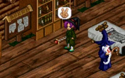

_(Even Uistean agrees! Boards are HOT!)_

What is it about boards that make them so special? Surely, their ubiquity depreciates their marvelousness?

Wrong!

Boards are special for many reasons. They can be made from a variety of materials like wood, metal, or different types of stone. Though at a surface level, many boards seem to be the same as any other, the reality is that each board has its own character! Some boards have worn faces from frequent use, while others are pristine and smooth. Some boards have finely crafted details in their etching, while others are simply designed. The pattern of holes in each wooden board is totally unique from every other board because of the placement of tacked postings! But most of all, boards are special because of what we place upon them. From poetry on the church boards, to the rules and regulations of the various nations of Temuair. You can find boards in Shrines. In caves and swamps. In castles and coliseums. On farms and behind lamp posts. Boards are often overlooked, but there's a good chance that somewhere, somehow...a board has impacted your life in ways you never imagined!

This work is all about telling you everything you ever wanted to know about the boards in Temuair. Particularly if you've ever wondered where a board is at and/or what is posted on it. Welcome home! You're in the right place, friend!

So what types of boards can one find around Temuair?

There are primarily six types:

- Angled Stone Slab Board
- Classic Stone Board
- Crossroads Wooden Board
- Classic Wooden Board
- Ancient Relief Board

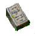 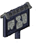  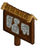 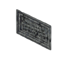

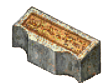

What is a memorial monument besides simply a more specialized board?

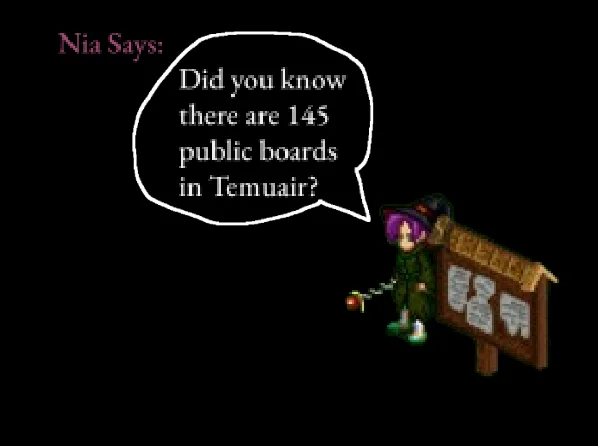

## Mileth

> _There once was a board in Mileth,_  
> _Whose beauty took away my breath._  
> _I admire its edges,_  
> _And each written message._  
> _It's loved 'til the day of my death._
>
> \- _Nia Lee's Board Book of Limericks_

### Mileth Way

- `((8, 15))` A stone board meant for matters related to the Shrine of Glioca.
- `((15, 15))` A wooden board posted near the old entrance to Mileth College. Now that it has been moved out of Mileth territory, the board reads: "Mileth College Campus has been relocated to a neutral territory. Read or write books in Mileth Library. Learn Art, Literature, Lore, or Philosophy from Aisling teachers. Gain real experience. Be sure to pay attention, learn, and respect the Aisling kind enough to provide the class. See board by library for latest schedule."
- `((2, 10))` A wooden board posted between the Village Way and the village proper. It is a direction board reading: Mileth Village - We welcome all Aislings and mundanes. --> // <--Shrine of Glioca - Goddess of Compassion."
- `((2, 3))` A stone board which is not in use and no postings can be found upon it.

### Village

- `((66, 16))` A stone board which seems to be for general use. Many of the parchments placed upon it are old and worn, some from many, many Deochs ago. However, some information from Nobles can be found related to political engagement, as well as news about Masses, Arena hostings, Suomi Troupe news, and other events.
- `((25, 19))` A wooden board noting the location of Cian's shop. It reads: "Cian - Dabbler in Alchemistries"
- `((22, 24))` A wooden board noting the location of Dar's shop. It reads: Dar - Dark Wizard of Mileth. Master of Arts Arcane, Elemental, Accursed, and Dark."
- `((13, 43))` A wooden board noting the location of Daithi's shop. It reads: Daithi - Talents for the dexterous. Arts for everyone."
- `((21, 64))` A wooden board noting the location of Torrance's shop. It reads: "Torrance Armorer, smith, and jeweler."
- `((16, 71))` A wooden board noting the location of Callough's shop. It reads: "Callough Honest man's weapons, big and small."
- `((21, 87))` A wooden board noting the location of Vorlof's training dojo. It reads: "Vorlof Trainer of new Aislings."
- `((34, 85))` A wooden board noting the location of Colm's parcel shop. It reads: "Colm - Avian deliverer of Mileth. Packages flown to anywhere in Temuair in minutes."
- `((38, 78))` A wooden board noting the location of the Mileth Church. It reads: "Naomhan Church of Our Lady of Light. Praise be to most Holy Glioca of Compassion, and Deoch, Bringer of Light."
- `((45, 61))` A wooden board noting the location of the Mileth tailoring shop. It reads: "Brody Higgler and connoiseur of fine good."
- `((25, 45))` A wooden board noting the location of the Mileth Inn. It reads: "Riona - Inn of Mileth. A Soft bed and a pleasant dream to any passing mundane or wandering Aisling."
- `((34, 40))` A wooden board noting the location of the Mileth Inn. It is identical in function and message to the other.
- `((52, 72))` A wooden board noting the location of the Mileth Storage shop or Bank. It reads: "Higgling the finest abroad."
- `((62, 83))` A wooden board noting the former location of the Mileth Race Shop. It reads: "Condemned by Church of Our Lady of Light - Naomhan."
- `((71, 82))` A wooden board noting the location of the Mileth Combat Skill Master. It reads: "Keallach - Master of Weapons. A free walloping to anyone who enters."
- `((84, 76))` A wooden board noting the location of the Mileth White Magic Master. It reads: "Devlin - Fae Princess. Keeping the gifts of the Fae alive and welcome to the true of heart."
- `((60, 64))` A wooden board noting the location of the Mileth Restaurant. It reads: "Oona Bakery. Fresh bread, baked with the love of dawn."
- `((71, 57))` A wooden board noting the location of the Mileth Tavern. It reads: Aingeal - Mileth Tavern. Heart drinks and tales for hearty travellers.
- `((89, 58))` A wooden board noting the location of the Mileth Crypt. It reads: "Crypts of Mileth - Enter not into the darkness lest you have light in your heart. Beware of things stirred from death's slumber. -amhan, Priest of Our Lady of Light.

### Mileth Storage/Bank

- `((1, 8))` This is Mileth's sales board. It is a stone board where postings related to items or services that one would like to offer, buy, or sell can be made.

### Mileth Church

- `((3, 24))` A stone board within the Mileth Church. As per the Mileth laws, its use is limited to posts related to "[...]adoption, weddings, divorces, seeking partnership (in a serious fashion), and poetry."

### Crypt Vestibule

- `((7, 0))` A faded relief set into the vestibule walls. It appears to have been vandalized by an Aisling long ago. It reads: "Which way to Suomi? // - from: AnotherTwo"

### East Woodlands Crossroads

- `((0, 9))` A wooden board noting the location of the Enchanted Garden. It reads: "Here dance the Fae. When you sniff the flowers beware, for there are green mantises that will catch of your, and more if you are not cautious or fleet."
- `((1, 0))` A wooden board noting the location of the first Woodland Trail. It reads: "Woodland Trail - Wolf walk the trail in hunt of fair Aislings. Adventure in a group, or better: Keep your distance from this place."
- `((6, 0))` A wooden board noting the location of the second Woodland Trail. It reads: "Woodland Trail - Sinister and elemental wolves lurk the path. Beware and do not travel further."
- `((11, 0))` A wooden board noting the location of the first Kobold's Vale. It reads: "Kobold's Vale - Journey not, lest you should perish under their jackaline grin."
- `((15, 0))` A wooden board noting the location of the second Kobold's Vale. It reads: "Kobold's Vale - The other vale pales to the dangers herein. Heed warnings well. Hereforth await kobolds with teeth barred for your death."
- `((19, 0))` A wooden board noting the location of the Goblin's Way. It reads: "Goblin's Way Turns back. Turn back! Goblins hunt within these woods. Don't fall prey to their blow or elemental summons! Turn back, I pray."
- `((18, 9))` A stone board which largely serves as a hunting request board. Aislings who are looking for others to group up with to hunt in the East Woodland often post here. Occasionally you will also see other, more general postings, as well as requests for groups for quests in other regions of Temuair.
- `((23, 14))` A wooden board noting the location of the Wasteland. It reads: "Wasteland - All green eaten away by the hungry things. Young Aisling, adventure cautiously within."

## Mileth College

- `((7, 8))` A stone tablet which does not appear to have any etchings upon it. It is unclear what its purpose was intended to be or will be in the future.
- `((10, 11))` A stone tablet which serves as a location for posting information, edicts, and updates as to the College submission process, teaching guidelines, and Aislings who have received recognition.
- `((16, 11))` A stone tablet noting the location of the Mileth Library. It reads: "Mileth Library. Post educational events upon this bulletin. Study and discuss The Arts within."
- `((26, 11))` A stone tablet noting the location of the Lore classroom. It reads: "Mileth Lore. Learn lore from an Aisling teacher within. See times for classes on the grey slate by the library."
- `((36, 11))` A stone tablet noting the location of the Philosophy classroom. It reads: "Mileth Philosophy. Learn philosophy from an Aisling teacher within. See times for classes on the grey slate by the library."
- `((11, 25))` A stone tablet noting the location of the Literature classroom. It reads: "Mileth Literature. Learn literature from an Aisling teacher within. See times for classes on the grey slate by the library."
- `((11, 35))` A stone tablet noting the location of the History classroom. It reads: "Mileth History. Learn history from an Aisling teacher within. See times for classes on the grey slate by the library.
- `((11, 45))` A stone tablet which does not appear to have any etchings upon it. It is unclear what its purpose was intended to be or will be in the future, but it may be intended for either outdated or future College subjects.
- `((39, 47))` A stone tablet noting the location of the Contest Hall. It reads: "Contest Hall. Aspiring nobles enter here to submit their entry for review. Refer to College Rules for entry and review criteria."

### Mileth Library

- `((1, 8))` A wooden board which serves as a location for posting recognized works in the History classification.
- `((1, 4))` A wooden board which serves as a location for posting recognized works in the Literature classification.
- `((5, 1))` A wooden board which serves as a location for posting recognized works in the Lore classification.
- `((10, 1))` A wooden board which serves as a location for posting recognized works in the Philosophy classification.

### Mileth Lore

- `((10, 1))` A wooden board which serves as a location for posting recognized works in the Lore classification.

### Mileth Philosophy

- `((1, 3))` A wooden board which serves as a location for posting recognized works in the Philosophy classification.

### Mileth Literature

- `((10, 1))` A wooden board which serves as a location for posting recognized works in the Literature classification.

### Mileth History

- `((10, 1))` A wooden board which serves as a location for posting recognized works in the History classification.

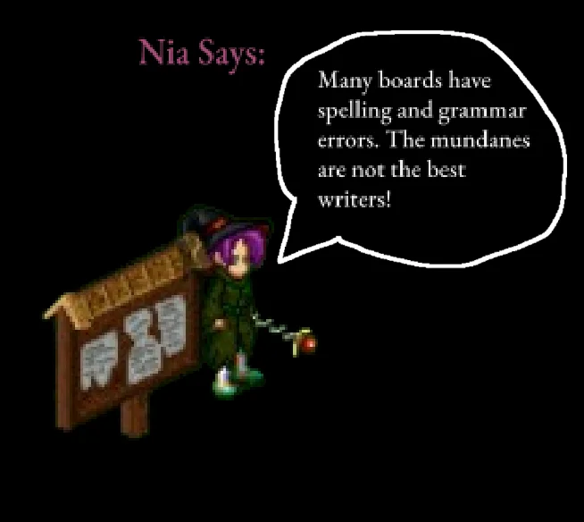

## Pravat Cave Entrance

> _Indeed, there's a board there in Pravat,_  
> _It'd be a sore shame not to have it!_  
> _It's next to a boy,_  
> _Reading it brings me joy,_  
> _And I can't think of a final line, dang nab it!_
>
> \- _Nia Lee's Board Book of Limericks_

### South Entrance

- `((29, 14))` A wooden board noting the location of the Pravat Cave. It reads: "Pravat: The Grimlock and Goblins continue a jyhad for fragments of a sacred artifact, since The Entreaty in Deoch 6. They grudge each other but fiercely attack any non-allied outsiders."

## Abel

> _There once was a board there in Abel,_  
> _Who looked to be out of a fable._  
> _Its magnificent gleam..._  
> _A board-lover's dream!_  
> _Just thinking of it makes me unstable._
>
> \- _Nia Lee's Board Book of Limericks_

### Port Way

- `((9, 3))` A stone board meant for matters related to the Shrine of Fiosachd
- `((8, 12))` A wooden directions board which reads: "<-- Port Abel // Shrine of Fiosachd - God of Fortune -->"

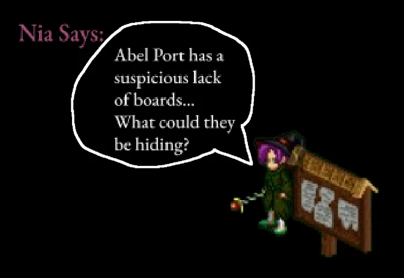

### Coast

- `((8, 27))` A wooden board that doesn't seem to have anything posted. I assume it is for Ase's Coast Bar, but it seems as though it doesn't see much use.
- `((23, 33))` A wooden board with nothing posted on it. I would have expected this to be a directions board related to the nearby Crypt, but instead it is blank.

## Undine

> _There's a board by the water in Undine,_  
> _Whose etchings are amongst the most fine._  
> _Oh, what a pleasure,_  
> _Deep breath for good measure,_  
> _Before tacking posts on this sign!_
>
> \- _Nia Lee's Board Book of Limericks_

### Village Way

- `((7, 9))` A stone board meant for matters related to the Shrine of Cail.
- `((7, 14))` A wooden directions board which reads: "<-- Undine Village // Shine of Cail - God of Harmony -->"

### Village

- `((84, 79))` A wooden board noting the location of the Undine Armor Shop. It reads: "Alexios Fine Undine Jewelry and accessories. All Hail Loures."
- `((78, 84))` A wooden board noting the location of the Undine Weapon Shop. Although weapons are clearly visible inside, none are able to be sold. It reads: "Avel - This and all weapons prohibited under the colonial rulership of Loures - Court of Loures."
- `((10, 84))` A wooden board noting the location of the Undine Restaurant. It reads: "Damara Undine fine foods and berries. Bless Loures, our watcher."
- `((19, 80))` A wooden board noting the location of the Undine Tavern. It reads: "Chloe - Sweet wines from Ardmagh."
- `((10, 34))` A wooden directions board which reads: "<-- Road to Suomi // --> Hali - Humble Higgler of Undine. All hail Loures."
- `((17, 15))` A wooden board noting the location of the Undine Black Magic Master. It reads: "Kiril - Magus Philosophicus of Temuair. Servant to none. All Fail Loures!"
- `((84, 18))` A wooden board noting the location of Undine Storage/Bank. It reads: Argus Higgler of Undine and livestock devices. All hail Loures."

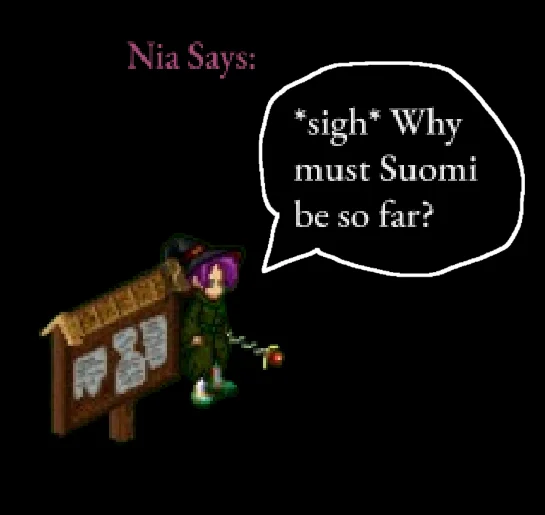

## Suomi

> _A beautiful board in Suomi..._  
> _A sight that the universe owed me!_  
> _It was tough to see,_  
> _Hidden behind a tree,_  
> _But discovering it made me feel... \*ahem\*_
>
> \- _Nia Lee's Board Book of Limericks_

### Village Way

- `((14, 13))` A wooden directions board which reads: "<-- Suomi Village // Shrine of Deoch - God of Rapture -->"
- `((6, 10))` A stone board meant for matters related to the Shrine of Deoch.

### Village

- `((36, 11))` A wooden board meant for matters related to the Suomi Troupe. It includes meeting times, membership lists, applications, events, and other such things.
- `((10, 20))` A wooden board outside of the Suomi Special Skill Master's shop. All of the parchments on it are blank and there appears to be nothing relevant to read. This is likely due to its poor placement.
- `((22, 51))` A wooden board noting the location of the Suomi Armor Shop. It reads: Valdemar - Finest jeweler of Suomi."
- `((9, 57))` A wooden board noting the location of the Suomi Weapon Shop. It reads: "Torbjorn - Suomi blades, obvious and secret."
- `((19, 89))` A wooden board noting the location of the Suomi White Magic Master. It reads: "Bertil - Fae Priestess. A mentor's mentor."
- `((69, 83))` A wooden board noting the location of the Suomi Combat Skill Master. It reads: "Berg - Battle Master of Greater Suomi. Leader of defiance against Loures."
- `((82, 77))` A wooden board noting the location of the Suomi Black Magic Master. It reads: "Hadrian - Wizard of Darker Arts. Master Wizard of Suomi."
- `((65, 44))` A wooden board noting the location of Alvar's Grape Farm. It reads: "Alvar Suomi's Finest Vineyard Farmer."
- `((84, 18))` A wooden board noting the location of the Suomi Tavern. It reads: "Viveka - Suomi Tavern."

## Piet

> _I'm viewing a board here in Piet._  
> _A joy for a board-reading vet!_  
> _They speak here of wines,_  
> _That fill up their steins,_  
> _And other fine goods one can get!_
>
> \- _Nia Lee's Board Book of Limericks_

### Village Way

- `((7, 10))` A stone board meant for matters related to the Shrine of Ceannlaidir.
- `((20, 6))` A wooden directions board which reads: "Piet Village --> // <-- Shrine of Ceannlaidir - God of War"

### Village

- `((19, 43))` A wooden board noting the location of the Piet Tavern. It reads: "Bella - Fine Liquers from the fields of Piet."
- `((13, 48))` A wooden board noting the location of the Piet Restaurant. It reads: "Alleen - Sweets & Meats from the fields of Piet and all Northern Ardmagh."
- `((31, 52))` A wooden board noting the location of the Piet White Magic Master. It reads: "Narve - Fae Priestess. Secrets of the Fae shared with kindred spirits."
- `((41, 50))` A wooden board noting the location of the Piet Magic Shop. It reads: "Appie Philosophicus of Magic and Alchemy."
- `((31, 10))` A wooden board noting the fate of an empty building. It reads: "Foreclosed for taxes unpaid. - Burgess of Loures."
- `((41, 16))` A wooden board noting the location of the Piet Inn. It reads: "Saskia - Piet Inn. Rest your head on a bed fit for an Aisling."
- `((49, 15))` A wooden board noting the location of the Piet Storage/Bank. It reads: "Jilt Leather goods and ornaments from Kasmanium to Loures."
- `((56, 25))` A wooden board noting the location of the Piet Armor Shop. It reads: "Leo - Fine Northern Ardmagh armor and jewel, made with pride."
- `((47, 29))` A wooden board noting the location of the Piet Weapon Shop. It reads: "Gunnar Fine Northern Ardmagh blades."

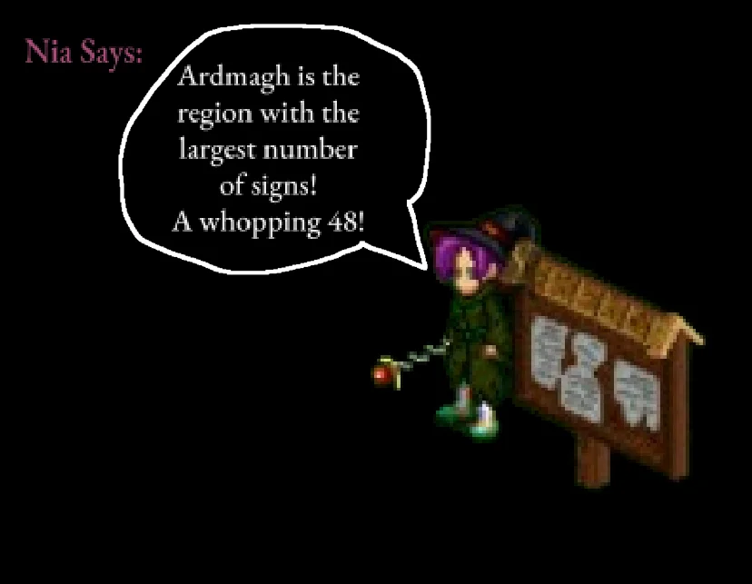

## Mehadi Swamp

> _I came upon a board in Mehadi;_  
> _A place I'd been as a young lady._  
> _Its surface was slick,_  
> _So I gave it a lick..._  
> _Oughh, now I don't feel so good..._
>
> \- _Nia Lee's Board Book of Limericks_

### Entrance

- `((7, 8))` A wooden board noting the entrance to the Mehadi Swamp. It reads: "Inhabited by the wise and old Muluk. Legend has it that their culture predates Piet. Cautious and learn well, for their culture is vastly different from human culture."

## Loures

> _The boards in the market of Loures,_  
> _Are plentiful as much as they're bores._  
> _Whichever board you're at,_  
> _Will say this or that,_  
> _It's the same message at half the doors._
>
> \- _Nia Lee's Board Book of Limericks_

### Harbor

- `((22, 4))` A stone tablet at the base of a statue. It reads: "This statue is dedicated to the Priest 'Zephaine' for valiantly breaking the Seal of Temuair."
- `((19, 4))` A stone tablet at the base of a statue. It reads: "This statue is dedicated to the Rogue 'Akter' for valiantly breaking the Seal of Temuair."
- `((16, 4))` A stone tablet at the base of a statue. It reads: "This statue is dedicated to the Monk 'WarPanther' for valiantly breaking the Seal of Temuair."
- `((14, 7))` A stone tablet at the base of a statue. It reads: "This statue is dedicated to the Warrior 'Weakest' for valiantly breaking the Seal of Temuair."
- `((14, 10))` A stone tablet at the base of a statue. It reads: "This statue is dedicated to the Wizard 'BioMagus' for valiantly breaking the Seal of Temuair."
- `((38, 42))` A large stone monument with two memorials printed on the top. The one on the left reads: "Jackie, // Dedication in your honour. You lift others up. Your strength, support and especially work for the wildlife rescue team is inspiring. // - from: Fortunea". The right side reads: "This memorial is dedicated to the memory of Cedric, Mundane Burgess of Mileth. Struck down by the forces of darkness. May the prayers of all who come here provide a beacon of love and light for Cedric's soul."

### Castle Way

- `((9, 23))` A stone board meant for matters related to the Shrine of Gramail.
- `((5, 1))` A wooden directions board which reads: "Loures Castle. Capital of Ardmagh --> // <- Shrine of Gramail - God of Law.

### Entrance Yard

- `((9, 46))` A stone board meant for matters related to Knighthood, including those who are applying for it, and open discussion about those candidates.

### Market Village

- `((15, 53))` A wooden board noting the entrance to Loures Store 1. It reads: "Services: Can't do it by yourself? Find someone who can. We provide all types of Aisling services."
- `((31, 61))` A wooden board noting the entrance to Loures Store 2. It reads: "Clothing and Weaponry: If you can wear it, we can sell it."
- `((41, 61))` A wooden board noting the entrance to Loures Store 3. It reads: "Clothing and Weaponry: If you can wear it, we can sell it."
- `((36, 40))` A wooden board noting the entrance to Loures Store 4. It reads: "Clothing and Weaponry: If you can wear it, we can sell it."
- `((51, 51))` A wooden board noting the entrance to Loures Store 5. It reads: "Potions and Gems: Find your valuable and not so valuable Potions and Gems here."
- `((53, 72))` A wooden board noting the entrance to Loures Store 6. It reads: "Animal Commodities: Brought in from the deepest forest, murkiest swamps, and darkest crypts. Find your animal parts here."
- `((60, 71))` A wooden board noting the entrance to Loures Store 7. It reads: "Animal Commodities: Brought in from the deepest forest, murkiest swamps, and darkest crypts. Find your animal parts here."
- `((58, 23))` A wooden board noting the entrance to Loures Store 8. It reads: "Rare Artifacts: Anything worth more than 15,000,000 Gold can be sold here."
- `((64, 23))` A wooden board noting the entrance to Loures Store 9. It reads: "Rare Artifacts: Anything worth more than 15,000,000 Gold can be sold here."
- `((21, 65))` A wooden board noting the entrance to Loures Store 10. It reads: "Services: Can't do it by yourself? Find someone who can. We provide all types of Aisling services."
- `((24, 34))` A wooden board noting the entrance to Loures Store 11. It reads: "Information: Want to know how strong your nemesis is? Have questions about Mastering your path? Pay to have someone explain."
- `((18, 21))` A wooden board noting the entrance to Loures Store 12. It reads: "Information: Want to know how strong your nemesis is? Have questions about Mastering your path? Pay to have someone explain."
- `((46, 36))` A wooden board noting the entrance to Loures Store 13. It reads: "Clothing and Weaponry: If you can wear it, we can sell it."
- `((67, 68))` A wooden board noting the entrance to Loures Store 14. It reads: "Adventure Artifacts: For completing all of your questing and adventuring needs."
- `((67, 41))` A wooden board noting the entrance to Loures Store 15. It reads: "Adventure Artifacts: For completing all of your questing and adventuring needs."
- `((59, 47))` A wooden board noting the entrance to Loures Store 16. It reads: "Potions and Gems: Find your valuable and not so valuable Potions and Gems here."

### Castle Library

- `((1, 1))` The parchments on this board are old and illegible. It doesn't seem to be of much use.
- `((5, 1))` This board contains a handful of Aisling works that have been recognized by the Loures Library/Mileth College contests of the old days.
- `((9, 1))` This board is used for the same purpose.
- `((13, 1))` This board, like the first, seems to only contain unreadable old parchments, and doesn't seem to be of much use.

## Coliseum Arena

> _A fierce board rests in Coliseum,_  
> _As boards go you hardly can beat 'em._  
> _"Those who've been gotten,_  
> _Will ne'er be forgotten,"_  
> _Is neatly inscribed at the bottom._
>
> \- _Nia Lee's Board Book of Limericks_

### Entrance

- `((9, 4))` A stone board which holds matters related to the Arena, including active hosts, rules, and more.
- `((3, 4))` A stone board which also holds matters related to the Arena, but seems to be more focused on Events and personal postings about arena functions.

### Gauntlet

- `((7, 4))` A stone board in front of a series of statues which reads: "Those who fell shall not be forgotten."

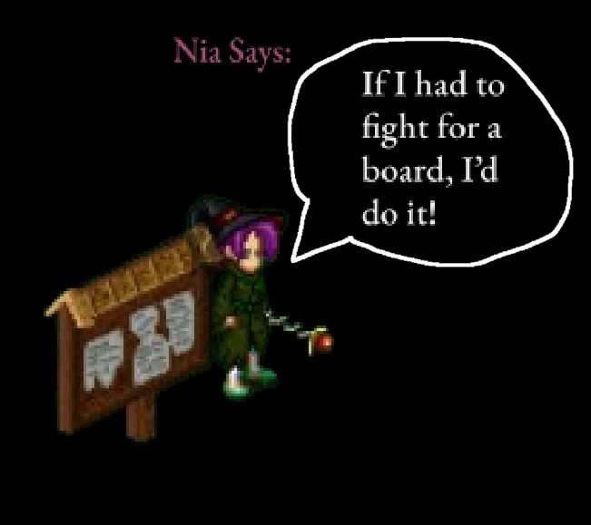

## Blackstar

> _There're boards in the village of Blackstar,_  
> _Though hardly the most there by far._  
> _The problem, if frank,_  
> _Is most there are blank._  
> _I find their lack of use bizarre._
>
> \- _Nia Lee's Board Book of Limericks_

### Village

- `((51, 66))` A stone board which does not seem to be used for anything.
- `((35, 37))` Yet another stone board which no postings...sad.
- `((37, 47))` A stone board which does not seem to be used for anything.
- `((38, 65))` Yet another stone board which no postings...sad.

### Crypt

- `((1, 19))` A stone board which strangely doesn't seem to be used for anything.

## Rucesion

> _I once saw a board in Rucesion,_  
> _That then became my new obsession._  
> _Such ornate detail,_  
> _A board holy grail,_  
> _A truly outstanding impression!_
>
> \- _Nia Lee's Board Book of Limericks_

### Village

- `((23, 35))` A stone board which does not seem to have anything left on it. Perhaps because it is a high-traffic area, pieces of parchment can be found littered around it and blown away, and folks have given up on posting there.
- `((19, 3))` A stone board that seems to be a general village posting spot, as well as a place to find official updates about arrests and other political information.

### Storage/Bank

- `((1, 8))` This is Rucession's sales board. It is a stone board where postings related to items or services that one would like to offer, buy, or sell can be made.

### Village Way

- `((6, 8))` This is a stone board for matters related to the Shrine of Luathas.
- `((18, 0))` A wooden direction board, different in format from most in similar positions. It reads: "Shrine of Luathas - God of Gnosis lies to the left. The lights behind herald the town of Rucesion. The Rucesion Commons lies south toward the right. Ahead lies of the castle of unspeakable dubhaimid."

### Dubhaim Castle

- `((21, 33))` A stone board which has very little on it at the time I am writing this, only two posts. It seems to be used to post helpful information for Aislings by members of the Sgrian Shrine.

### Shrine of Sgrios - Dubhaim

- `((2, 11))` A stone board meant for matters related to the Shrine of Sgrios.

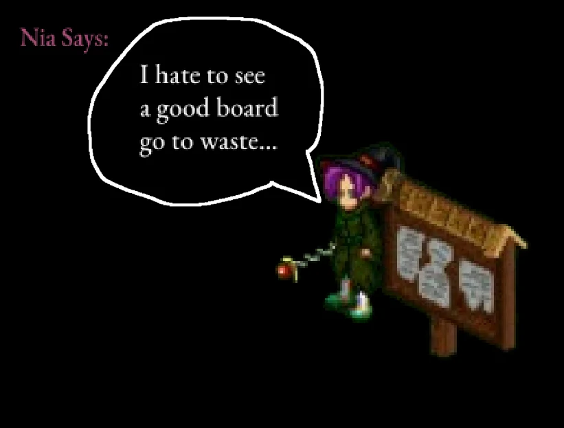

## Shinewood Forest

> _At the start of the forest of Shinewood_  
> _There's some boards that I consider good._  
> _One bids a welcome,_  
> _The other, a welcome._  
> _I'd also make more boards if I could!_
>
> \- _Nia Lee's Board Book of Limericks_

### Entrance

- `((17, 2))` A wooden board noting the entrance to Shinewood Forest. It reads: "Welcome to Shinewood Forest."
- `((5, 2))` Another wooden board noting the entrance to Shinewood Forest. It also reads: "Welcome to Shinewood Forest."

### "31"

- `((10, 12))` A strange tablet with a confusing energy. When approached, it appears to speak to your mind and say: "Hello. What can I do for you?" The legends say if you attack it with a Dragon Scale Sword, it will summon a mighty dragon.

## Oren

> _If you're looking for boards around Oren,_  
> _Your journey will probably be borin',_  
> _Believe it or not,_  
> _For as large of a spot,_  
> _There's none here by which you can get drawn in._
>
> \- _Nia Lee's Board Book of Limericks_

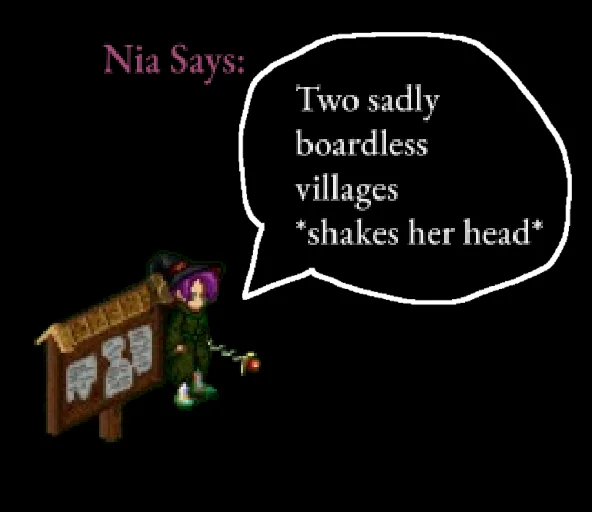

## Nobis

> _Nobis, I had such high hopes for,_  
> _A board-having village at its core._  
> _In spite of its vibe,_  
> _There's none you can find,_  
> _But boy, do I wish there were more._
>
> \- _Nia Lee's Board Book of Limericks_

## Tagor

> _The handful of boards that are Tagor's,_  
> _May be less interesting than yours._  
> _Many are broken,_  
> _Or very soft-spoken,_  
> _Except for the one near the jail doors._
>
> \- _Nia Lee's Board Book of Limericks_

### Village

- `((47, 16))` A wooden board noting the location of the Ranger Station. It reads: "Ranger Station."
- `((49, 31))` A wooden board placed in an unfortunate position similar to the one in Suomi. It does not appear usable in its location behind the light fixture.
- `((35, 38))` A wooden board noting the location of the Tagor Magic Shop. It reads: "Matei Magics."
- `((27, 57))` A wooden board noting the location of the Tagor Messenger. It reads: "Tagor Messenger Service."
- `((43, 51))` A wooden board noting the location of the Tagor Inn. It reads: "The Lazy Bones Inn."
- `((87, 52))` A wooden direction board which reads: "Broken Leg Restaurant and Dry Thirst Tavern Ahead."
- `((78, 54))` A wooden direction board which reads: "Eat, Drink, and Pray --->" It seems to be pointing to the Church.

### Church

- `((3, 24))` A stone board that does not seem to get much use.

### Rangers

- `((1, 7))` A stone board where Rangers post about their activities, including warrants and jailings.

### Farm

- `((11, 35))` A wooden board that doesn't appear to get much use. It is unclear if Anwar the farmer uses it sometimes for his own purposes.

## Final Thoughts

And there you have it! These are the 145 amazing boards that I have found in publicly accessible areas throughout Temuair. I have not included boards of Medenia in this work as I have not spent time there, although I would like to give a shoutout to the boards in the Mileth Fair as well as the boards in publicly-inaccessible areas such as the Mileth and Rucesion commons. Because these are areas that are not universally accessible at all times, I have chosen to leave them out of my records, though I highly recommend checking them out if you can! Every board is beautiful, and a secret sign is all the more alluring.

I would like to thank everyone who helped me by finding boards that I missed, and providing feedback for this work. Dylanlan, Amagakure, Absobel, Kedian, and others.

Toodles~!

_Nia Lee_

***

```
*Librarian Notes*

Recognized: Aisling, 2025 (Mileth College master list).
This entry has been edited to conform to Library formatting.
The original can be found at https://novus-imperia.com/college/lore/nialee_boards.pdf .
```
