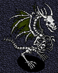
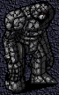
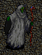
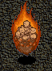

# The Chaos Realm

_by Omner in **Dark Ages**_

On a warm night in the spring of Deoch 19, I was up late in Loures Library
with insatiable curiosity. I searched what seemed like every tome for
information regarding the area we call the Chaos realm. My insatiable
curiosity has led me to venture many times into the wonderful, horrible place.
Sometimes I would go alone, praying to Glioca for protection from the fearsome
inhabitants, and sometimes I would bring a small army of companions.

This is a compilation of my findings.

## History of the Chaos Realm

The Chaos Realm is far older than any of us first imagined. It was originally
called Hn Kalrone, which means The Hearth, or The Fireplace, in the draconian
tongue. It was, in fact, one of many draco settlements throughout the world
during the second aeon -- around 25,000 summers ago!

The caves were sealed by the dracos for some unfathomable reason. It can be
guessed, from the maligned appearance of the spirits within, that it was to
seal some horror away.

In early Deoch 18, the druid Coibhi came to tell aislings that something
foreboding was on the horizon. There had been vipers mysteriously appearing in
areas where they had never before been seen. Their numbers increased slowly,
and no one knew why.

Then later that Deoch, an earthquake caused a strange room to open in the back
of Pravat Cave. Inside, the source of the vipers was found. An ancient
monolith was summoning them forth, filling all the lands with the critters. At
once, swarms of aislings descended on the monolith, attacking it in any way
they could. The monolith appeared to perish... but the snakes still came, at
an even greater pace. The temples were filled, the floor of the inns were a
sea of green, snakes were EVERYWHERE!

The monolith could not be truly destroyed, save by the collecting of three
items: Viper venom, Granite, and Sacred Wax. In time, these three items were
found, and the ceremony was preformed to stop the influx of the bothersome
snakes.

However, the removal of this monolith opened a pathway to another realm. A
realm where few are able to go, and even fewer dare try.

## Successful Strategies

Virtually all of the creatures thus far encountered are of the Dark element.
Therefore, the most effective magic is Deo Saighead, the Light Element spell.
A good Chaos team consists of 4 or 5 aislings with the ability to cast deo
saighead, 1 or 2 with the ability to blind, and 1 or 2 with the ability to
cast Mor Fas Nadur, to increase effectiveness.

In the first 7 areas, there are some tight halls. Stay close together, and do
not go faster than you are able. Patience is the key to sucess.

Conserve Mana. It is the only effective weapon in Chaos. A warriors suain, and
a monk's skill are helpful, but not truly necessary. After all, a Dark
creature with Mor Fas Nadur is all but impossible to kill with anything but
deo saighead -- a fact that most aislings with dark belts take advantage of.

## Treasure

The only items found thus far are the Bent Crux, from Batuss and Aisean
Dracos, and the Talos Ore, form the Clogad Craidhneach.

The value of coins found here averages 10,000 to 30,000 for every thing
zapped. Where does it come from? No Aisling Knows. But mundanes accept it, so
we collect it.

The training is wonderful. `((500,000 to 800,000 exp if you were to kill
anything alone, 150,000 to 300,000 in an 8-person group))`

_and now, a floor-by-floor summary of my findings._

## CHAOS 1

This is a gathering place. No creatures are able to enter this area. It was
probably the Focus of the ancient seal.

When preparing to enter, this is a good place to gather your companions and
prepare

## CHAOS 2

The first area in which you can encounter creatures.



**Aisean Draco** -- it means 'rib draco'. These skeletons are remnants of the
dracos who were trapped when the seal was made. They cannot be truly killed;
when one is destroyed it reappears after a short while.

They are easily the most dangerous of all the creatures in the first 6 areas
of Chaos. Once aroused, they will periodically cast Ard Srad Ionad, the most
powerful form of bres spells. This fearsome magik works on any aisling in the
area, at unlimited distance. Fortunately, the creatures cannot use it when
blinded.


**Batuss** -- much smaller, they resemble small stone golems. It has been
observed that they build each other from small piles of stone whenever their
numbers decrease for whatever reason. Believed to have been servants to the
dracos. Batuss are actually harder to kill that Aisean dracos. they are also
more numerous. However, they have no spellcasting abilities; their only attack
is to bludgeon with surprisingly strong arms.

EXITS:

southwest and southeast exits both lead to the same place on 3. Northwest exit
leads to chaos 1.

## CHAOS 3

Aisean Dracos and Batuss are found here as well. In addition, one may also see
an occasional


**Craidhneach** --

These are believed to be aosdic warriors who perished in the battle to seal
the realm. Their battle cries still echo in the dark caverns, and they wield
sword made from talos ore. They do not have the ability to use magic.

EXITS: Northeast leads back to Southeastern 2. Southeast leads to Chaos 5,
Southwest leads to Chaos 4

## CHAOS 4

In this area, the battle was at its hottest. The ceiling is high, and it is
wider than any other of the first few floors. But proceed with caution; the
Aisean Draco population here is very high.

Aisean Dracos, Craidhneach and Clogad Craidhneach can be found here.


**Clogad Craidhneach** -- This is a Craidhneach that still bears boots and
armor made from talos ore. This of course makes them harder to destroy. Those
who seek the Talos Ore, these are what you should battle.

EXITS: Northeast leads up to 3, Southeast leads down to 6.

## CHAOS 5

This area contains only Craidhneach and Clogad Craidneach, neither of which
are magik-using creatures. But the path becomes painfully narrow. To get an
army of aislings through can be a daunting task.

EXITS: NW up to 3 SW down to 6.

## CHAOS 6



**Artan Deamhans** -- These gigantic creatures of stone seem to be related to
the Batuss. They are able to speak in the language of the dracos, leading
scholars to believe that they were created by the dracon race, possibly as
servants.

EXITS: NW Up to 4, NE up to 5, SE down to 7

WARNING! To go beyond 6 is to risk certain doom.

## CHAOS 7

In this accursed floor, many an aisling has perished. No known group has ever
been able to defeat the loathsome fiend known as the Sgraidht.



**Sgraidht** -- It resembles a human form with a grey tattered cloak and a
long wooden staff. This malignant evil is the Chandi Mukul of the chaos realm.
It can move while suained, can apparently Ao Dall itself, and casts a spell
that is known among aislings as 'water dragon'. Fear it. This spell does
moderate damage to EVERYONE. As of this writing, if an aisling is skulled at
it is cast, the aisling will die. Instantly. `((Is this a bug???!! please say
it is, Mark. Please.))`

EXITS: Travel to the north corner first. NW is up to 6, SE is down to 8.

## CHAOS 8

In this area, everything changes. No longer are you in the dark caverns; you
are in a hot, pit of fire. This is why the place was named Hn Kalrone. This is
an advantage to aislings, as there are no high walls to block the view. But
the monsters compensate for this fact, amply. In this area are Artan
Deamhans, the dread Sgraidht, and the Srad Deamhan.



**Srad Deamhans** -- These beings of fire float approximately two arm-lengths
above the ground.

EXITS: Go south. You'll find it. Only one way to go.

## CHAOS 9

In this area, Creatures whose species have never seen the light of the sun
spawn by the light of the glowing lava. Sgraidht in great numbers appear,
making this one of the most dangerous areas in all of the Chaos realm. Srad
Deamhans float here as well, accompanying the Porboss.


**Porboss** -- The origins of this creature are unknown. Approximately the
size of an orc, it has adapted to the extreme heat of its environment. It has
one large eye, and bears an enormous clawed fist. Woe unto the aisling that
falls within its reach!

## CHAOS 10

At this point, the Sgraidht can no longer stand the intense heat. The only
creatures found at this depth are Srad Deamhans, Porboss, and the Losgann, all
adapted to incredible heat.


**Losgann** --Very little is known about this mysterious creature, save that
it has no skin on its face, clenches enormous fists, is unaffected by fire,
and does not look friendly.

## CHAOS 11

The creatures inhabiting this fiery depth are the Porboss, the Losgann, and
the Kabungkl.


**Kabungkl** -- Floating above the ground a spouting fire, this odd creature
is truly amazing. Its off appearance has led aislings to dub it, somewhat
humorously, the "Killer Bunny Rabbit." Apparently, it latches on to Srad
Deamhans while they are forming, and consumes them. This would explain why no
fully-formed Srad Deamhans are found at this depth, and also explain that odd
ball near their bellies -- an unformed Srad Deamhan.

EXITS: As soon as you get to this floor, go Southeast. The path winds around
to the SW wall, where the exit is. the NE stair, where you enter, leads back
to 10.

## CHAOS 12

Chaos 12... the greatest depth known to aislings at the time of this writing.
In this area, one may find the Losgann, the Kabungkl, and the dread Aog Ridir


**Aog Ridir** -- These fearsome Knights of Death appear as maligned mockeries
of the great Aosdic knights. Fear their blades, crafted of a metal forgotten
long before Hy-Brasyl, and far more resilient.

EXITS: Northwest and Northeast stairs both lead to the same spot on 11.

_a lore, by Omner Garamonde_

***

```
*Librarian Notes*

Recognized: Village, Lorekeepers Recognized (Events of Temuair post #191).
This entry has been edited to conform to Library formatting.
The original can be found at http://www.darkages.com/community/lore/Omner_Chaos/index.htm .
```
