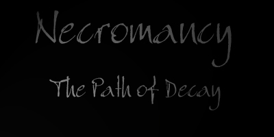
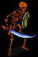
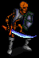
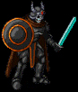
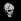
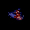

# The Dark Art

_by Oujousaighi in **Dark Ages**_



> _"So, you come into my realm to seek the knowledge of the dead? It is not an
> easy path, one that will slowly drain away your strength and leave you
> barely human. But the rewards can be great. Death is not the end, but the
> beginning of eternal existence. When one dies, his spirit leaves the body
> behind. At which time one who walks my path can use that body. It is nothing
> more than using someone's discarded pack to carry something or a sword
> someone threw away to defend yourself."_  
> _~Gigean_

Wizards in the world of Temuair have the unique option of following the path
of death and decay, Necromancy. The dark powers that dwell inside of everyone
cannot be ignored. You may try as you like to suppress them, but they can
never fully be vanquished. But instead, as a wizard of Temuair, each of you
has the amazing ability to harness this dark energy.

The tale to this art began in a town known as Tagor, where a blackened wizard
quietly developed his powers. Soon he developed the amazing ability to raise
the dead. With this, Necromancy was born into Temuair. The wizard soon
unleashed his hoard upon the town, but was vanquished by a wandering warrior
soon after. The town of Tagor still stands to this day, and so does the Dark
Art.

An old, decaying Mundane known simply as Gigean still studies this art, and
will teach it to you if he feels you are wise enough to handle this power.

Gigean's temple is hidden deep within the Sgath pits. Hug the walls on the
northeast side and you will stumble across an eerie site. The walls are
decorated with the bones of the dead and illuminated with only two dim
candles. Here, Gigean stands, to study his lost treasure. Do not enter upon
this land if ye do not feel yourself worthy. Gigean only accepts the best as
his pupils. Only the intelligent and the wise may begin to study this art.
`(( Int 25, Wis 15 ))` Be warned, many religions see Necromancy as a forbidden
art, and will not allow you to enter their fellowship. These religions include
Glioca, Deoch, Gramail, Cail and Luathas. If Gigean deems you worthy, he will
ask a small task of you -- To bring him the regent of decay, a piece of zombi
flesh from a zombie you personally have sent back to the grave. Once this is
done, your spirit will be possessed by the dead, and Gigean will teach you how
to control the dark powers. `(( At this time you will also gain the legend
"Walks the Path of Necromancy since Deoch (X)" ))`

Necromancy is performed through the spell "Spion Torradh" or Summon the Undead
in the old tongue. Gigean requires no gold, items, `(( or stats))` to teach
this spell to you. Simply ask him about it and you will learn. To use this
ability, you must have a regent of death to be used in the ritual. The
creatures are unruly, and hard to control at times. This being said, there are
certain circles of insights needed to summon the specific creatures. Below is
listed the items and insights needed for each creature of the dead:

| ITEM REQUIRED | INSIGHT REQUIRED | CREATURE SUMMONED | `(( Orange Bar Quotes))` |
|---------------|------------------|-------------------|--------------------------|
| Ghast Skull | 25 | Skeletal Warrior  | "The ground cracks as the creature claws forth." |
| Gargoyle Skull | 50 | Powerful Skeletal Warrior  | "The ground cracks as the creature claws forth." |
| Gog's Maw | 75 | Armored Skeletal Warrior  | Unknown at this time. |
| Gargoyle Fiend Skull | 80 | Powerful Armored Skeletal Warrior  | Unknown at this time. |
| Gremlin's Ear | 99 | Death Knight  | "From the Realm of Sgrios comes forth the Champion of the Dead." |

Simply cast the spell, `(( 1,000 mana to cast ))` and then drop the item at
your feet to release the summon, as you would a religious summon. `(( Note:
Spion Torradh is many lines long. So make sure you have a Magus Apollo or some
form of the Hy-Brasyl Orb equipped. Also, to increase your chances of success
-- cast the spell as many times as you can before you drop the item. The more
it is cast, the better chances you will have at summoning the creature, as
well as the number of creatures summoned using one item. You can summon up to
eight creatures with one item at a time. ))`

Understandably, these items can be a bit difficult to find. Fortunately,
Hardian, the Dark Wizard of Suomi can help. `(( Simply go to him and say
either "Necromancy" or "Necromancer" out loud. ))` He will be happy to help
you make a fake skull or ear. For the cost of a few items of course.

| ITEM TO BE CREATED | ITEMS NEEDED |
|--------------------|--------------|
|  Eithich Skull | 1 Kobold Skull (For the basic shape.)<br>2 Branches (To add the necessary bumps and deformities to the skull.)<br>1 Wolf Skin (To hold it all together.) |
|  Eithich Ear | 2 Spider Legs (To make the mold of the ear.)<br>1 Zombi Flesh (To fill the mold.) |

Of course, using imitations does have its drawbacks. There is roughly a fifty
percent chance the spell will fail, which will destroy the item. Furthermore,
there is a two percent chance that you will become permanently hurt from the
failure. `(( In such an event, you will lose one point off of either
strength, constitution or dexterity. ))` So use these imitations wisely.

The pets themselves are guardians, and will attack any creature that attacks
you, or that you attack. They are not hostile, and will only protect you.
`(( Be warned, they will attack you if you have the death mask on. ))`

The path of Necromancy is a path of risks, use it as you see fit.

Welcome, my decaying pupil.

***

```
*Librarian Notes*

Recognized: Kingdom, Lore Contest, 25 April 2002.
This entry has been heavily edited to conform to Library formatting.
The original can be found at http://www.darkages.com/2000/community/lore/Oujousaighi_TheDarkArt/index.htm .
```
