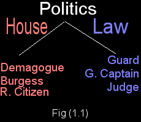
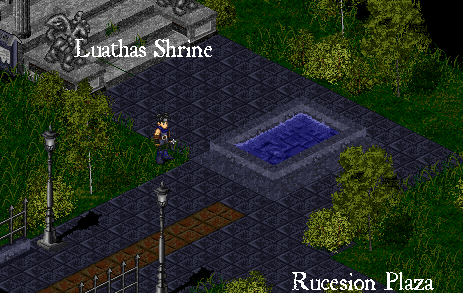
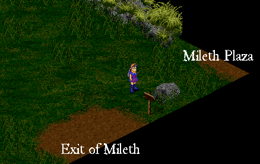

# Political Dominica

_by Paladine in **Dark Ages**_


## Table of Contents

### Section I - Basics

* I.I - Introduction (an overview of politics in Temuair.)
* I.II - Terminology (Terms you'll encounter when first joining politics.)
* I.III - Clout & Support (How you gain office.)
* I.IV - Campaigning (How to avoid attacks, gain endowment, etc.)

### Section II - The Offices

* II.I - Respected Citizen
* II.II - Guard
* II.III - Demagogue
* II.IV - Guard Captain
* II.V - Judge
* II.VI - Burgess

### Section III - The Typical City

* III.I - Law Creation
* III.II - Punishments
* III.III - Checks and Balances
* III.IV - Functionality in Political Systems

### Section IV - Odds and Ends

* IV.I - Your term in Office
* IV.II - Miscellaneous (FAQ)

### Section V - Conclusion / Addendum

* V.I - Conclusion
* V.II - Addendum

## Section I - Basics

### Section 1-1: Introduction

I thank ye for coming to visit me and share in my knowledge this day. I would
like to thank the many people who helped me in the creation of this document.
It has been a long and winding road, but this document is complete! And one
quote for you inspiration seekers out there... "_We cannot adjust the wind
direction, only our sails._"

So, I'm assuming if you're reading this document, you are interested in
politics. The Temurian Politics system is Aisling run. Aislings have total
control over certain regions, their laws, punishments, and other such items.
All disputes are handled by the Law Makers. `((With the exception of
Harassment, which is reported to Nexon))` This gives a great deal of
responsibility to us, the Aislings of Temuair. Ever since it was given to us
Aislings has been a powerful tool, and can have an overwhelming impact. One
important thing to remember before you begin is that Politics is not glamorous.
People can be rude, cold hearted, corrupt, and be annoying all at the same
time. This isn't meant to scare you off, but rather to warn you ahead of time.
Politics has its rewards and down-falls. It can lead to corruption or wealth
and prosperity, depending on how you use it. Remember, absolute power corrupts
absolutely. So, be wise when politicking.

The Politics system is comprised of a law branch and a house branch (see fig.
1-1). Temurian politics are run with a system of support `((unlike real
politics which is run on votes))`. There are no elections, and any Aisling with
an insight of <11> or higher may join the politics system. When an Aisling
reaches the 11th insight, he realizes many things, this being one of them. To
enter politics, talk to the Mundane in the Village Hall in Mileth (for Mileth
Citizens), or the Village Hall in Rucesion (for Rucesion Citizens). Prior to
Rucesion settlement, Candidates would have to travel to the Rucesion bank. The
Mundane whom can teach you much about politics is waiting there for the eager
souls who wish to make Temuair a better place. Be forewarned.. know what you're
getting into before you join the political system. It can lead to frustration
if you do not know what you are doing. This manual should help you greatly if
you are unfamiliar with such.

> _The Law Branch is the law enforcing branch of Temurian government._

> _The House Branch is the law making branch of Temurian government._



The sections ahead outline the various parts of the Political system and should
answer any questions ye may have about the great Temurian Political System.
Enjoy ^_^

~\*~ Paladine Meatha

### Section 1-2: Terminology

When first encountering Temurian politics, you may run across some unfamiliar
terms. This guide is to help you figure out what they mean.

**Attack** - _To greatly reduce the clout of the person you're attacking.
Attacking is not anonymous. (Spreading very bad rumors with evidence is an
example of an attack.) Which causes this Aisling to instantly lose much sway._

**Banishment** - _To be removed from a land, and not able to return. A person
who is banished is unable to step foot inside the place where he was banished.
Must be forgiven to re-enter lands._

**Clout** - _The sway a politician has over Aislings in his current running
status. For example a person running for Judge with 20 clout has a decent
amount of sway, while a person with 100 clout has enough sway to step into
office without opposition._

**Endow** - _To give a major amount of support to your Aisling by speaking
highly of him and giving up 10 clout. Endow gives 7 clout to the person you
endow, making their sway much greater._

**Exile** - _To be banished on a greater level. Same effect as banishment, only
it leaves a permanent scar on your legend for others to see your disgrace._

**Shares** - _Little is known about "shares", but they are political power.
When a land becomes rich, so do the shares. Only people in office hold shares
depending on their position._

**Support** - _To give your support to an Aisling and increase their clout.
Supporting increases their clout by one. (Hint: Helping, talking, or in general
being nice to one can gain you much support.)_

**Widdle** - _To politically attack your opponent with the "eye for eye" motto.
You use one of your clout to reduce your opponents by one. (using some sway to
spread nasty rumors, Aye?) ^\_~_

### Section 1-3: Clout & Support

Ok, so you've just decided to enter politics. You're going to need what is
known as "Clout" to step into office. Clout, as defined in my previous page, is
the amount of sway or trust you have with the population of the kingdom.
Positive campaigning can lead to much clout, and perhaps let you step into a
powerful office. In order to gain clout you must gain "Support" from an Aisling
whom trusts you.

(Many Aislings like to use the term "vote" when entering Politics. This is
wrong. There is no voting system in Temuair, and there are no elections or
runoffs. Please refrain from using the word "vote" and use the word "support".
Example: "Would you support me this moon LadyDanielle?", not "Would you vote
for me please?")

There are two types of support in the political system. The "Support" option,
which Aislings tell to the mundane burgess so that he can record it, gives 1
clout to the person supported. In order to give any kind of support you must
talk to your mundane burgess in your Village Hall so he may record your clout
accordingly. If ye fail to do this, he shall never receive word, and will not
let you step into office. Make sure you get your clout in writing with him. The
second type of support is endowment. You and the person who wishes to endow you
must visit the mundane burgess and speak with him about endowment. Endowment
costs 10 clout to the person endowing, and gives 5 - 7 clout to the person
receiving it. This can be a major advantage in gaining office quickly. This of
course requires much more trust from an Aisling than normal support as it
decreases their sway to campaign to increase yours. Use it wisely.

> _The mundane burgess can be found in the plaza opposite the village's
> shrine._

> _The Village Hall and Courthouse comprise the plaza of a village. It is where
> all political action takes place._

Now on the flip side of the coin, there is the unnoticed side of Politics which
those whom are sneaky can utilize against their opponents. There are two types
of tools one can use to devastate another persons sway with a kingdom. Widdle,
known as the "eye for an eye" method, reduces both your opponents clout by one.
The mundane burgess frowns upon foul play, so in return he removes one of your
clout in return. This will effectively reduce the sway your opponent has. The
second type of covert attack is known as "Attack" simply enough. It is worth it
if you wish to reduce sway a lot. This is for the extremely sneaky politician,
who likes to get pictures of an Aisling in a bad position and spread the word.
This reduces your opponents clout by 10. Of course, the mundane burgess frowns
on this action, but only reduces 5 of your clout, only reducing your sway by
half of what you do to your opponent. Uncouth tactics like this can be an
advantage or a disadvantage in any situation.

Now let's look at a chart which covers clout earned/lost by the different
tactics one uses to gain clout:


This of course leads us into believing that only a good campaigner can avoid
attacks/widdles and gain support and endowment from Aislings that populate our
world. Our next section talks about basic strategies when campaigning and how
to avoid being attacked. Use this wisdom wisely!

### Section 1-4: Successful Campaigning

_In every great world, there is a leader. Even he isn't perfect and makes
mistakes which cause him to lost public favor._ Which brings me to the point in
where I say, prepare to be widdled or attacked at least once during your
campaigning career. It \*will\* happen whether by an opponent who wants to take
his/her term in office first or some malicious person who likes to see people
suffer. Uncouth operations run rampant in a political system, even though we
don't see it. Spreading secrets here, revealing information there, it causes
Aislings to lose faith in a person. So, what do you do about it? You simply
pick yourself up off the floor and try try again. Any great campaign must start
somewhere and realize it needs the persistence to pursue to achieve greatness.

> _Campaigning: The art of obtaining support to step into office._

First off, if you're new to campaigning, read this. RELAX, this isn't a race to
see who can get into office the fastest. You'll end up on the streets with
people saying "Nuobo? Who's that? Oh... he's yesterday's news." Therefore,
using a method which I like to call "hyper-campaigning" is not welcomed nor is
it necessary. If you plan to campaign set a pace and a goal, and of course read
this section for tips on how to gain continuous support.

> _hyper-campaigning: The art of constantly campaigning while concentrating on
> nothing else to attempt to gain much sway._

The first trick of the trade is to start with \*friends\*. These could be your
hunting partners, or people you associate with on an every day basis. Asking
them for their support will probably lead to a "Sure!" or "Ok!" Be prepared for
a "NO" though. Often times, other politicians have swayed them into giving
support already. Aislings can only give support every 4 Temurian days `((12
hours for you Terran people ^_~))`. The mundane burgess will not allow any more
than that. So, what do you do in this situation? Ask for their support the next
4 days in advance. That way you can ensure their support.

It's obviously unavoidable to attain office dependent on the support of a few
friends only. You will at one point have to campaign to strangers or
aquaintences. This is much more difficult as you'll find out, but some
strategies that help a lot are:

* Do not whisper someone asking for support. Ask for support in person only.
  Aislings tend to get upset when their mind-flow is interrupted with messages
  that aren't necessary.
* Use correct terminology when asking for support at any time. "Can I have your
  vote plz!" is hardly a way to go about proper campaigning, and you may lose
  support because of this.
* Set a limit: Do not "hyper-campaign" as I said earlier. Set a limit for
  yourself daily and know when to stop campaigning for that day. The mind and
  body need a balance and concentrating on one area of your life shall lead to
  the frazzle of others.
* This may sound stupid, but always greet someone with a smile, and kindly ask
  for their support. It is very uncouth to yell out "Has everyone given
  support?" Also, it would be good to tell them which office you're running
  for, if you haven't selected, tell them which ones you're thinking about.
* Do \*not\* get frustrated when addressing people in public. It just makes you
  look bad.
* Do not ask more than once. It's rude and considered harassment in some areas
  of Temuair. "NO " means "NO".

Staying cool, calm, and collected can earn you many votes. Just remember to
campaign early, and often but knowing your limit. Also... be prepared for
obstacles like Attacks and Widdles, and even a "NO" answer. They will pop up,
and you have to take it in stride. It's one of the many problems campaigners
must deal with on a daily basis. In our next area, we shall talk about the
Offices you can run for.

## Section II - The Offices

### Section 2-1: The Office of Respected Citizen

The lowest form of political involvement when it comes to politics. Yet, the
respected citizen plays a vital role both when in office and out of office as
well. These people are the 'elite' of a town and their knowledge is keen. So
keen that city officials has given them the right to admit citizens with their
honed judgement. Also, when a person becomes respected, many Higglers look up
to them with a whole new light, and with this newfound respect, the Higglers
will give access to any Respected Citizen their dyes and tailoring materials to
modify a garment. Even out of office, your Respected Citizen mark stays with
you and you shall still have access to the dyes and tailoring materials.
Respected Citizens can only admit new citizens while in office.


Requirements:

* (10) Clout
* (1) Completed Mentorship

> _Mentorship: Where you guide a young Aisling up to the 11th insight. You must
> be of the 15th insight to mentor._

Duties:

* Admit new citizens
* Be helpful to all citizens
* Report criminals and law breakers.

Powers:

* Regional tailor/dye

Shares: 0

Term: (1) Double moon `((Terran Hours: 1 real life week))`

This office is a good choice for those who wish the option to dye clothing, or
those who want a little political involvement. There is no real "work" to being
a Respected Citizen, it's more of a status, than an office, and a grand one at
that. This also means no uniform, while higglers can tell your respected, other
Aislings cannot, unless they look at your legend. This office is the basis for
all other offices. You must become respected at least for one term before
moving on up the political ladder so to speak. The mundane burgess will not
allow you to run for another office until he sees that you have completed this
one.

### Section 2-2: The Office of Guard

This position is the basic building block of the Law branch of Temuairian
government. One step up from Respected Citizen, this is the first power holding
position. Guards are sworn into duty by the mundane burgess to do their
captains bidding and protect the city from law breakers. Guards also have the
ability to ban people, one of the first punishments available to officials.
Guards can ban people from the city as they see fit and when necessary. Set out
to do patrols and deal with Aisling issues, this job can be a stressful one at
times, but dealing with these hardships now can lead to greater political power
later. For this position is required to earn the office of captain, and then
eventually... Judge.


Requirements:

* (25) Clout
* (1) Respected Citizen

Duties:

* Prevent Crime
* Solve petty matters
* Be available when needed.

Powers:

* Banishment/Forgive Banishment

Shares: 1

Term: (2) Double moon `((Terran Hours: 2 real life weeks))`

Upon achieving this office, you shall gain access to "(town name) Law" so that
you may punish criminals and prevent crime. You shall also recieve your Guards
uniform. This is your symbol and status garb to let others know you are a
Guard. When not doing Guard duties, it is advised that you not wear it. You
shouldn't wear your garb in other lands, because it confuses the citizens of
those lands. Be responsible with your garb. This is the first political
building block of power, and be proud that you are a part of the elite forces
of a city.

> \-_"The elite force of Rucesion, known as the Rucesion Roughnecks tackled the
> problem of a Sgrios summoner today. They banished him, but before that sent
> him to his maker to show him what Rucesion was really made of."_

### Section 2-3: The Office of Demagogue

The demagogue is the first vital role in Temuairian politics. They are the law
makers of a city, and are responsible for monitoring the village boards,
creating laws, and modifying laws that a Judge, Burgess, or the general
population see unfit. Since this is the first position of power, many who step
into this office tend to overstep their bounds. Be careful, and understand
where your duties lie! This office is also needed in order to gain Burgess.
I'll go into law creation later, but as Demagogues see fit, in order to pass a
law, all the demagogues must agree, else the law cannot be passed in the land.
Signing another burgesses name to your law is very unwise and uncouth at the
same time. It can lead to the removal of your office. So, as a demagogue, you
have a balancing act between making laws which keep the citizens happy, and
maintaining city order. Demagogues have access to the Exile command, and at a
Burgess' request or if all the Demagogues agree, (s)he can flex this muscle and
remove someone from their city on a permanent basis.


Requirements:

* (50) Clout
* (4) Respected Citizen

Duties:

* Monitor Village Tablets
* Prepare Village Laws
* Admit citizens or guests

Powers:

* Exile/Forgive Exile

Shares: 1

Term: (2) Double moon `((Terran Hours: 2 real life weeks))`

Bestowing the Vermilion wear is one of responsibility, in my age I've seen many
who have taken this power to a dark place and many who have used this power
irresponsibly due to ignorance. I beg thee to use it wisely and consult people
who have had this position before. It can lead to great success in a political
career, and can also lead to a downfall, so if you use it wisely, your city
will prosper. ^_^

### Section 2-4: The Office of Guard Captain

Ah, so you want to be a leader, eh? We've got the perfect spot for you in the
city militia! Join our ranks today, ten-hut! The office of Guard Captain takes
one step above a Guard. As a Guard Captain, you'll solve crime issues in the
city, and be assigned troops to your batillion. As a leader, you must show
companionship, compassion, and a stability to give commands and orders. Whether
it be sending your troops on patrols or handling a crime in the city. Guard
Captains have access to the banish command. Of course, a Guard Captain should
always be available when needed.


Requirements:

* (50) Clout
* (4) Guard

Duties:

* Prevent Crime
* Organize troops
* Be available in your city

Powers:

* Banishment/Forgive Banishment

Shares: 2

Term: (2) Double moon `((Terran Hours: 2 real life weeks))`

Upon receiving this office, you'll get a addition to your already gorgeous
garb, a helmet, which prevents people from seeing whom you are, scaring them in
the process, and letting your guards know you're in charge. Guard Captains are
true elite soldiers of a cities militia, and should have the courage and
prowess to maneuver in any given situation and lead troops into battle.

### Section 2-5: The Office of Judge

A refined position indeed. Stepping into this office earns you much status in a
village. Don't worry, you'll get used to the mundanes and fellow Aislings
calling you "Your Honor", you deserve it. As leader of the law branch, you gain
access to many unique parts of politics. The most unique is that of the Court
house. In this place you can schedule cases, interpret the law, and deal out
punishments. Judges have access to the banish command as well, and can use it
freely. Among one of the greater powers is that of which you interpret the law
(I'll go into detail in the law section). `((Just as in Terran politics))`
there is a remote 'Checks and Balances' system in play. Judges have the ability
to claim any law 'unfair' and the Demagogues have to reword it. Judges are
truly powerful and necessary in any political system. They are fair, justice
dealing, warm hearted individuals who see all are innocent under the eyes of
Gramail.


Requirements:

* (100) Clout
* (4) Guard Captain

Duties:

* Schedule Cases
* Interpret the law
* Judge cases

Powers:

* Banishment/Forgive Banishment

Shares: 3

Term: (2) Double moon `((Terran Hours: 2 real life weeks))`

Alas, the mundanes forgot to make a garb for this office. Upon speaking with
them I learned that they couldn't find anything special enough for a Judge to
wear, and promised me they were working on something that they hope a Judge
would humbly accept. I recommend to those of you who are new to this office, to
go to the Court house, and talk with the mundane there. He can provide you much
service when scheduling cases, and can offer you an array of options for
holding court. The Judge, a respected powerful person in society.

### Section 2-6: The Office of Burgess

Perhaps the most prestigious office if nothing else. When it comes down to it,
the burgess it the leader of the political system (not the law system), and
works with the demagogues to keep a city in running order. They also, like the
demagogues hold access to the Exile command, and maintain all the boards in the
village they run. They also can make laws without approval of the demagogues if
need be. I view this position as more of a "figure head", while everyone does
the work, the burgess can don his/her cloak/pompadour and walk about and
impress the citizens. The burgess is viewed more of a socialite than anything,
and it should be their main concern to interact with the citizens.


Requirements:

* (100) Clout
* (4) Demagogue

Duties:

* Monitor Village Tablets
* Prepare Village Laws
* Admit Citizen/Guest

Powers:

* Exile/Forgive Exile

Shares: 3

Term: (2) Double moon `((Terran Hours: 2 real life weeks))`

What a fashion statement. Both the cloak and pompadour yell "I'm special!" A
true aristocrat at heart, and in doing so, the people in this office should
concentrate on maintaining a good karma between citizens and office holders.
They are the so called "leader" of a city, and in doing so with a Judge's help,
they can make a successful city much more sophisticated. This office is one of
the hardest to gain, so those who earn it, deserve all the rights to it.
Besides, what says "I'm special" more than wearing a 30 pound dress in the
woods? ^_^

## Section III - The Typical City

### Section 3-1: Law Creation

This section is used to give a politician an idea about the ideals of a
"normal" city. This is by no means any specific way, but perhaps more of a
guideline for one to create law standards. Before I begin with specifics, I'd
like to get into the theology of law creation, and how far it should go. Many
Aislings see rules as constrictive to their creative nature, creating too many
of these will bog down an Aisling and cause him to leave. This is by no means a
goal of any person in Temuair, nor should it be. A fair word of advice, the
less laws, the better. Allowing an Aisling a creative practice while
maintaining laws can lead to a very successful city. Also watch where your
civil laws head. There are already pre-existing laws that while may not hold
power, hold an overshadow. A city does not need a law for every little thing.
It's this common methodology which drives a city. For example, harassment being
a common issue in many cities I've traveled, it seems that these cities must
have laws, while it's very common that there is a "Temurian" law that
overshadows and speaks out against those Aislings whose path has gone astray.
Essentially what I'm trying to say is, don't reinvent the wheel. It's been
done, and does not need to be done again. Let Deoch's flames of inspiration
guide you to punishing these Aislings accordingly. So, one might ask in
response to this... "What if an Aisling strikes back against this and says no
law is posted?", to which I can only reply with the following: It's a
commonality that all provinces of Temuair do not favor such things as
harassment. `((Even Nexon officials will not deal with it.))` So, therefore,
these Aislings were warned well in advance before they ever take up
citizenship.

For any law creation to occur, there is one basic requirement. All you need is
one demagogue. The more officials you add into the law creation process, the
more difficult it becomes. So, I've broken it down in terms of examples and
systems to make it a bit easier to understand.

First lets go off and look at the pre-law stages. The first step in law
creation is to create a "proposed law" or "bill" which can be created by any
number of the demagogues or by a burgess. This law is placed on the "bill"
board for all the demagogues to look over.

> _A law which holds no political power._

> _This gray slate can be found in the back of the village hall of the city._

Then after meeting and sharing ideas, the demagogues (when they all agree) can
enstate a law into effect. I state this with all due authority. You must have
EVERY demagogues approval to enstate a law. To not do so makes a law null and
void. Falsely signing someone's name to a law makes them chargeable with abuse
of office.

The law is then posted to the Law board located in the village where all the
Aislings can take note and adapt as necessary.


I don't want to get into a system of checks and balances too heavily, but
within the law creation side of the system, there exists the relationship
between a burgess and demagogues. Within that, law creation can be tricky. The
methodology goes as follows:

* A burgess can approve a bill immediately without all the demagogues approval.
* Any bill proposed by the burgess must be approved by the demagogues.
* Any bill can be shot down by the burgess immediately.

This will happen and if you really think the bill should be put into effect,
perhaps rewording it, or working with the other officials to make it better
suited for your village. Then perhaps it can get enstated. With time and effort
anything is possible.

Thus this leads into law removal as well. Law removal can be done in many ways
and is discussed further in checks and balances, but here is a general outline
of how it functions. First and foremost, a Judge can remove any law without
opposition. He can interpret them as he wishes, and therefore if he deems one
unfair, he can remove it from effect. This has no effect on bills, only active
laws. A burgess can also remove any law deemed unfair or unfit for the village
if she deems worthy. Finally, the demagogues, if all agree can remove a law
that seems unfit for the community. The offices cannot overturn each others
decision, but rather can try to reinstate the law if they so desire. I shall go
into the system of checks and balances later.

As I said before, this is a lot of theories and systems that could work. But
these have been proven to work, and suggested that you use them. This will
prevent abuse of office, even if accidental, later on.

### Section 3-2: Punishments

When it comes down to someone breaking a law in your city, you must punish
them. Being of a certain citizenship does not exclude you from the laws of
another city if you break a law while in their domain. Punishment options have
been limited to those holding office, and though many attempts have been made,
the mundane burgesses have not given into the plea and created more punishments
that have been effective in a societal system. I suggest that you speak to your
mundanes about punishments and see if you can get more enstated. However, being
limited to certain punishments does not limit your creativity on how you can go
about punishing people. Look inside yourself for answers and you shall seek
what you need. Perhaps charging an individual who had stolen bouquets to
purchase new ones is a creative punishment. Much better than banishing or
exiling that aisling. I shall talk about now the different punishments that are
available to office holders.

**Warning** - _This is simply a verbal warning to the offender. This usually
occurs on the first offense for any law, and can be given by any official._

**Sgath Summoning** - _This is available to Mileth officials only. In attempts
to make Respected Citizens more active, the dark ones of the crypt offered
their services to all Mileth Officials to summon a Sgath on an lawbreaker to
mar his legend._

**Banishment** - _To either temporarily or permanently remove someone from your
jurisdiction and not allow them to set foot in the lands until they are
forgiven. This does not leave a mark on their legend._

**Exile** - _To either temporarily or permanently remove someone from your
jurisdiction and not allow them to set foot in the lands until they are
forgiven. Leaves a mar on the offenders legend, so as they are known as a
criminal in other lands._

Of course, in simple crimes, most often an official can handle the punishment
accordingly. In larger crimes, or if the individual requests, the punishments
must be handled in the Justice Hall by the Judge. If guilty the offender's fate
is in the hands of the Judge. This is where a Judge can get creative, knowing
all sides of the case, or stick to the standard punishments given to Office
Holders if he or she so desires.

> _The Justice Hall is adjacent to the Village Hall in your cities plaza._

I ask that all of you become creative with your law system. Make it unique,
stable, flexible, and most of all memorable. Doing so makes your city unique
and special. Dealing with criminals is just another stone set into the thriving
building of politics.

### Section 3-3: Checks and Balances

This has gone left unexplored for some time. The system of checks and balances
is already inherent in the political system of Temuair. It just needs some
defining to give it value. I will try to do my best to explain it clearly so
that one may understand better where an officials power lies. To start off
with, we'll explore the branches of government. As we said before, there are 2.
The "House" or the lawmakers, and the "Justice" or the law enforcers. Each
branch has certain powers over another and uses those powers to make a system
functional. There is also a separation of powers. For example, looking at the
powers of the Justice branch and their ability to "Banish" and the House's
ability to "Exile".

> _The system of checks and balances is powers that each branch has over one
> another to keep another branch from gaining too much power._

In this separation there can be no mixture. For example, A demagogue can in no
way request a forgivement of banishment from any official who can. They must
take it to the highest ranking official in the Justice branch, being the Judge
if there is one available or a Captain. With good reasons clarified, the Guard
Captain can then unbanish. This goes the same for a Burgess. Even though he or
she may hold more political power than a Guard Captain, they cannot demand that
someone be forgiven unless they take it to the highest ranking official. This
disposes of some myths as well. Both a Judge and a Burgess hold the same amount
of political power. They are equals, and the tops of their branches.

> _Be practical when you define good reason. Simply because a person is your
> friend does not make it a good reason to unbanish him/her._

So, where does the checks come in? Well, this is the basic premise for thus as
outlined in the Mundane Burgesses' manual of Politics.

* A Burgess of the "House" may dismiss any judicial case or action with good
  reason.
* A Judge of the "Justice" may overturn any law and claim it unfair with good
  reason.

These are the basic powers over each other. They are decent ways to keep the
other branch in check. You may be asking, what about a demagogues powers. Well,
a Demagogue holds no political power against a Judge, the same way a Guard
Captain holds none against a Burgess. In the cases where a Burgess is not
available, all the Demagogues acting together can make a decision as a Burgess.
In this same way, all the Guard Captains can make a decision as a Judge.
\*NOTE\* ALL must agree.

These basic checks and balances help keep a system functional. Know where the
separation of powers are, and the checks lie. The checks lie in intervention of
justice, not in a basic power of office. Of course, they are intertwined.
Perhaps a Burgess makes light of new evidence and wants to unbanish an
offender. He/She cannot simply demand an unbanishment, but must go to the Judge
and ask for a re-trial. However, someone set to go to court can simply go free
if the Burgess demands it with good reason. The difference is the timing.
Whereas, a Judge cannot overturn a bill, only a law. The checks are based on
timing alone.

Using these basic premises can help prevent abuse of office. That's all it's
really useful for. The checks and balances were not made to abuse your own
powers, because everyone is fair game under Justices' watchful eye. Use these
powers only if necessary and your system will gain support and strength. This
was all that was written in his book on checks and balances.

### Section 3-4: Functionality in Political Systems

Perhaps out of all of the sections available, this is the most important. This
talks about ideology in a political system and how to make it work for you.
Things to avoid, pitfalls, and things to encourage your cities growth are
mentioned here, so read up, because the knowledge contained herein is for any
cities functionality and it's continued support.

_Step 1_: A politician should never bring his personal issues into office. This
perhaps is the most important rule. When serving as an official to the city,
the city comes first, your personal life second. Do not let personal
differences sway your decisions in office. This is a BIG mistake on your part.
Avoid bringing personal into politics.

_Step 2_: Good relations among those in office will help a city prosper. I
don't know how to stress this fact enough. Don't allow differences with an
individual in office get in the way of serving your city. I say this again,
politics come first, then personal issues. You could make a BIG mistake and
ruin relations.

_Step 3_: An organized city is a happy city. Well, keeping people up to date on
issues will keep your citizens happy. For example, posting the "Guards List"
where people can access it keeps it convenient for people. Don't let people
wander around without a clue, inform them.

_Step 4_: An involved city is a prosperous city. Encourage committees and clubs
to form within a city. For example, the Aesthetic committee in Rucesion takes
care of cleaning up the city and beautifying it by placing fresh flowers by the
sign posts. When people are involved, your city becomes more valuable and
alluring to those not living in it.

_Step 5_: Ideas should flow freely. Ideas for laws and civil pursuits should
flow freely among officials. Don't disallow a Guard or a normal citizen who has
a fantastic idea to share it with officials. Listening to the public is what
gains favor. Public laws usually have some Public involvement, speak with your
citizens!

_Step 6_: Crime Punishment should be handled swiftly and efficiently. It is
best to deal with cases while they are fresh in the minds of those involved.
Time is an enemy, and forgetfulness can lead to a possible criminal getting off
the hook.

These are only some basic ideas, but important ones. They can be built on and
grown from with work. Use these ideas in your city to make your political
system powerful and functional. A non-active political system gets rusty and
unusable, and will eventually break down. Don't let this happen! Empower your
city with your political system and make it a happy, safe, and politically
healthy place to live.

## Section IV - Odds and Ends

### Section 4-1: Your Term in Office

Most political terms are approximately 2 double moons long, with the only
exception being the Respected Citizen, which is only one double moon. Upon
registering your candidacy for an office with the mundane burgess, it is
notated in your legend that you are running. After having sufficient clout to
enter office, speak to the mundane burgess again and register once again for
that office. He'll notice the sway you have and allow you to step in to office
and record it in your legend.

> _To announce that you are running for office, or a canidate for a position_

While in office, try to do your best with your position. Remember why you
entered office, to serve the city. Make the most of your political term,
because it is short. Respected Citizens should try to set examples, Guards and
Captains should patrol and be available to prevent crime. Demagogues should set
up laws along with the Burgess. The Judge should be available to schedule and
carry out hearings. You earned the clout to step into office, don't let it go
to waste needlessly. While I say this, don't be overbearing as well. Know the
line. ^_^

Citizens of a city can access a list of officials currently in term, called the
"Guards List", which should be posted on several of the community slates around
your city. This makes it easy for citizens to find an official if they need
one.

Lastly, a word of congratulations. If you have stepped into office, you earned
it. The road is a hard one, and often less traveled by Aislings after seeing
the clout needed for office. Use your unique skills and talents to make the
most out of your office and make your city prosper!

### Section 4-2: Miscellaneous (FAQ)

This section is to answer questions that may come in to me in an easy to read
format and will be updated as needed. Currently there are only three questions
that need to be answered. If you would like a question answered here, send me a
parcel to `((paladine@pmail.net))` and I shall do my best to post it here.

**Question 1: Where are the Rucesion/Mileth Plazas?**

A good question indeed. The Rucesion Plaza is located directly across from the
Luathas Shrine as you leave Rucesion headed for Dubhaim castle. The Mileth
Plaza is located due east of the Glioca Shrine as you leave Mileth. I have
sketched some images below for you to take reference of.





**Question 2: What is the "Guards List"?**

The "Guards List" is the list of officials currently in office delivered by the
Burgess Mundane (he's got an eye for detail) to the highest ranking official in
your city. The Mundane is then to post this on the gray slates located around
your city to inform citizens of those whom are in office.

**Question 3: What are the Gray Slates for?**

The gray slates located around your village are for different things. There is
one law board, a community board, a higgling board, a village board, a guard
board, a case/hearing board, and a political board. As to which one is which,
you'll have to figure that one out yourself. Take a look around your city at
each one and familiarize yourself with them. They are a unique tool.

## Section V - Conclusion / Addendum

### Section 5-1: Conclusion

So... have you learned anything? I hope so. This document was written for the
purpose of familiarizing yourself with our fair political system. If you
haven't become involved with politics yet, I hope this documents charges you
with the will to do so. Only when people are politically active, does a city
become charged with political energy... even if you are only supporting
someone, you are being active.

Politics is a unique way for Aislings to become involved with society, and will
lead to greater things later on. When the mundanes handed us political control
of the provinces, they gave us a gift. To use our creative will to mold a city
into a powerful, exciting, safe and fun place to live. Cities still under
mundane control are well... mundane. That is why aislings have control, we can
enstate new creative ways of living into a city, and keep the mundanes safe.

There really isn't any creative wisdoms or phrases I can say to wrap this
document up. It took me many hours to outline the political system. Perhaps
though, I would like to thank all the people who inspired me to write this
document, and those who posed while I sketched their images in this document
for you all to see. I hope you enjoyed reading it as much as I did creating it.

Deoch's flames inspire you to be politically powerful! Respectfully Yours,
Paladine Meatha.

### Section 5-2: Addendum

No corrections as of yet. (Deoch 7)

`((©1999 Roy Wilson, Jr. Any text contained within cannot be reproduced without
the authors consent. Certain images are © Nexon, Inc.))`

***

```
*Librarian Notes*

Recognized: Aisling, 1999 (Mileth College master list).
This work is one of the greatest treasures of Temuair.

This entry has been heavily edited to conform to Library formatting.
The original can be found at http://www.darkages.com/community/lore/Paladine_Politica/toc.html .
```
