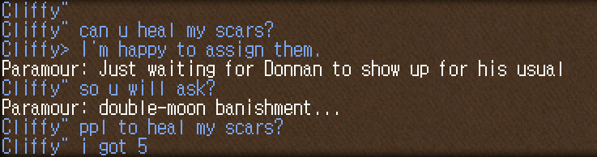
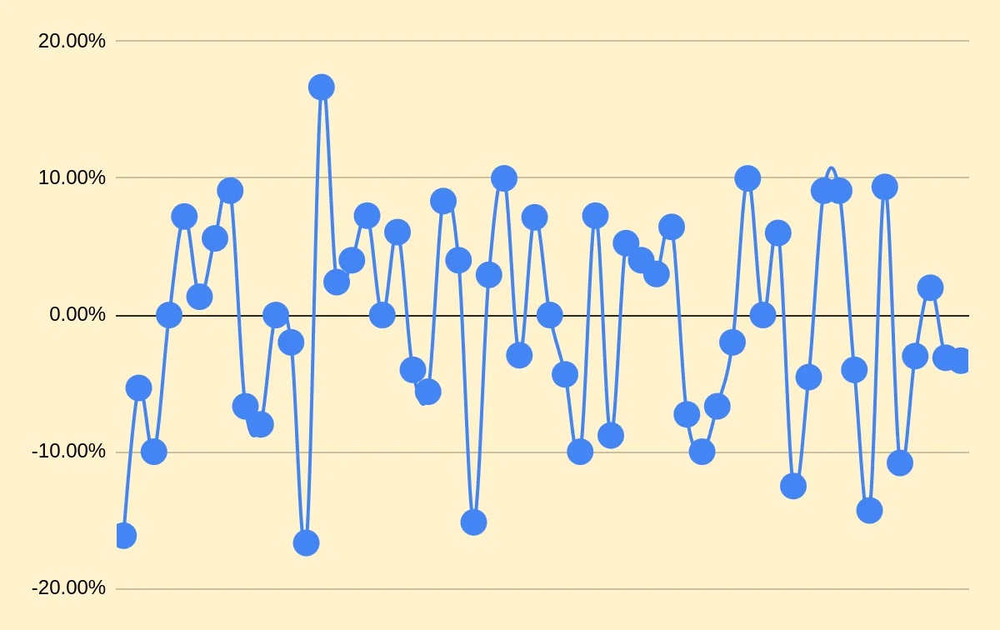
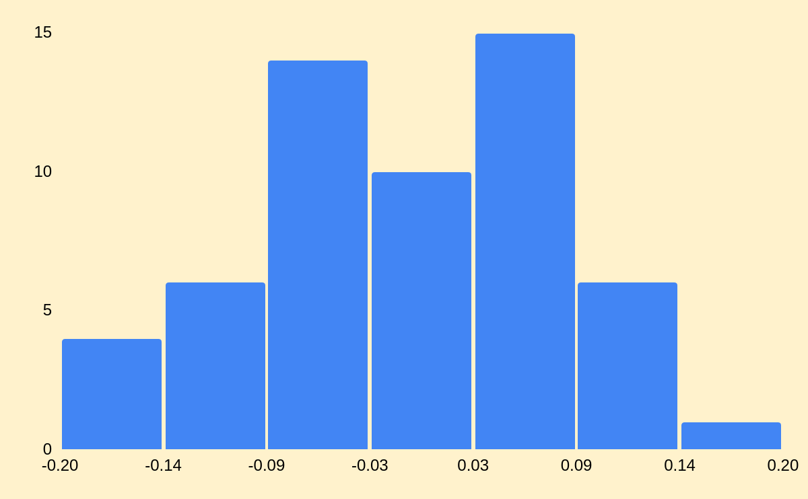
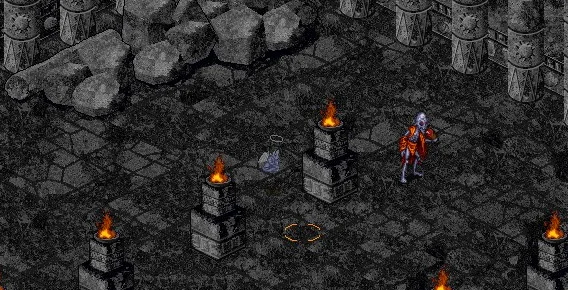
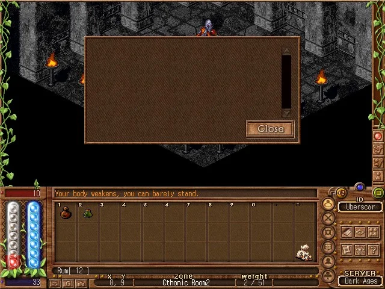
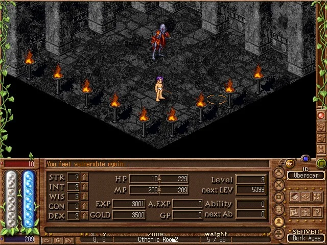
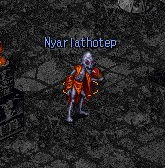
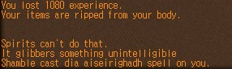
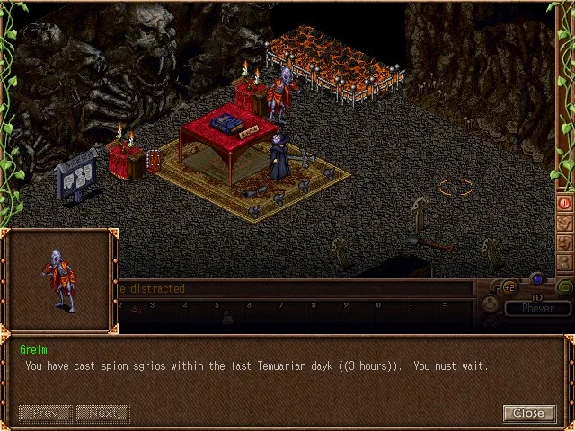
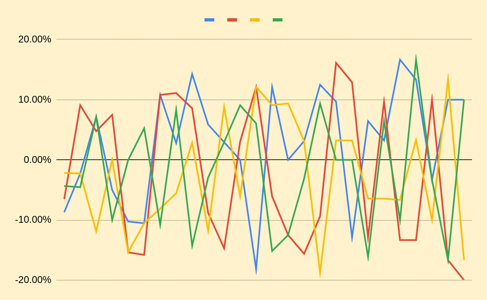

# On Growth, Death, and Scars

_by Phever in **Dark Ages**_

## Introduction

It has been growing increasingly difficult to keep my thoughts in order as of late. After grabbing my quill and parchment it is only but a moment or two before an incessant screaming rings throughout my ears.


Often I'll find my quill bouncing upon the parchment, splattering my precious ink everywhere, myself cursing in Sgrios' name.


"Why must you always ask so loudly?" I think to myself as I ready another parchment while tossing the old one to Greim for disposal.



There was a time when I would explain to them how the legendary Scar of Sgrios marks a brush with death, and that healing it does little to reverse their journey to the Cthonic Ruins.

I no longer attempt to persuade the Aislings.

After so many moons of being told that their "growth was going to be inhibited"[1] I gave up. How did this feisty rumour even get started? And why, after so many Deochs, is it still perpetuated as truth?

This slander — and constant interruption of thoughts — has grown too much for me to bear any longer. If Aislings refuse to listen to my pleas, I fear I must resort to methods much more macabre. I intend to prove that the infamous Scar of Sgrios is just that — a scar.

[1] `(( Growth was going to be inhibited: HP increase upon level up would be lowered by having scars. ))`

## Growth

Before I am able to prove that "growth is not inhibited by a Scar of Sgrios" I must first define what growth is. I much prefer to reside within the realms of death and rot, but I suppose broadening your horizons once in a while is not necessarily harmful...

### Current Understanding

I worked for many moons talking with Aislings about what their definition of growth was. Many admitted that they did not spend much thought on the matter. However, there was a single scroll that was repeatedly referenced. It is an older scroll by BioMagus, and this seems to be a culmination of the current understanding of growth. One bright young Aisling told me the only thing they knew of it was that their "growth was going to be hampered by their Scar of Sgrios." I could do little more than sigh.

It is important to note — as we all are certainly well aware — us Aislings are prone to errors. It is imperative we question preconceived notions, for we are far, far away from being omniscient beings in Temuair. As we contemplate what is commonly spoken of as a source of truth, keep in mind that it is much easier to disprove a theory than to prove one. Disproving these preconceptions often culminated in a greater understanding for us all. Though I beg of you, if you plan to disprove some preconceived notion, don't just leave it as rhetoric... go, learn, and teach.

`(( HP Rise on Level Up = (CON/(Level + 1) x 50) + 25 ))`[2] `(( MP Rise on Level Up = (WIS/(Level + 1) x 50) + 25 ))`[2]

This scroll — for example — implies that given two identically trained[3] Aislings, their respective growth[4] should be identical. Even pondering this for a short moment makes the notion seem preposterous. Aislings are rather unique as we all know, and no two are ever exactly the same! Some grow more quickly than others, some grow slightly slower, as do all creatures as far as I am aware.

Assuming that each individual grows at their own particular speed; how am I going to prove that the gracious touch of our Lord Sgrios does not affect their growth...? Hmm, it certainly complicates things, I suppose that is something to discuss later.

[2] `(( https://www.da-wizard.com/knowledge.html ))`  
[3] `(( Identically trained: Sharing the same wisdom, constitution and level. ))`  
[4] `(( Respective growth: HP/MP rise on level up ))`

### Testing Methodology

After much contemplation, I had decided on a process. If I was to demystify the limits of which an Aisling can grow, I was going to need an army of willing participants. Constantly checking their vital signs while guiding them towards class mastery[5], I should be able to record an immense amount of relevant data. Of course, these subjects would be put through identical training regimens[6] to ensure that the integrity of the experiment is maintained.

Using the recorded vital signs should make it rather trivial to disprove that all Aislings grow at identical speeds. As well — and more importantly — I will decipher the difference between the slowest growing Aisling and the fastest growing Aisling.

I rushed off to the entrance of Pravat Cave, immediately recruiting Aislings who were curious about my venture.

After convincing our motley crew of participants that the temple donatio- _ahem_

That my hard earned savings as compensation was adequate — I believe we had around a dozen Aislings volunteers at this point — we set off to rewrite the lore on growth.

[5] `(( Checking their vital signs while guiding them towards mastery: Recording their HP/MP while leveling. ))`

[6] `(( Identical training regimens: Keeping Wisdom & Constitution at 3 throughout leveling. ))` `(( I created a dozen or so fresh accounts specifically for this test. They were all peasants. I attacked Mileth Crypt monsters until about level 6-7. Some had data for level 1-2; some skipped that via the tutorial. A single level 30 scarless peasant had their data recorded throughout leveling as well. ))`

### Results

The battles were intense and difficult, but only half as strenuous as the chart-taking. A Sgrian keeping massive amounts of parchment on themselves without any of them being scriptures feels like abject blasphemy. Was I becoming Luathian on my quest to quell the screaming of scars?

"Of course not, this is all to honor Him," I reminded myself.

After guiding our recruits through a vast number of quests and battles, we were able to determine that the current knowledge on growth is... not quite correct or incorrect? While it seems that given a large number of samples, this arcane knowledge would prove to be correct on average, an individual's growth is significantly more varied. I was able to sketch diagrams on parchment to represent the vital signs we had been recording. Using BioMagus' calculations as the baseline, we were able to infer how random an Aislings vital signs could present themselves, given truly identical training regimens.



`(( These charts were gathered by finding the "expected" HP increase (using the formula from da-wizard) and comparing them to the actual HP increase. ))` `(( That means a straight line down the middle (at 0.00%) is what would happen if the old formula was perfectly correct. ))` `(( For Level 4 to 5 with 3 CON, the old formula predicts 55. If the actual HP increase was 60, we would chart 9.09% as 60/55 = 1.0909 ))`



`(( This graph shows the distribution of the deviations from above. Notice the approximately normal curve. ))`

### New Understanding

There is a profound element of randomness[7] involved in each Aisling's growth. This seems rather intuitive as mentioned, as two Aislings do not — in fact — grow at the same rate. An Aisling's baseline growth — excluding the randomness — seems to be precisely as BioMagus had written.

Our current knowledge of growth seems like it could use some updating. Just as I had suspected.

`(( HP Rise with Level = ((CON / (Level + 1) * 50) + 25) +/- 20% of that value ))` `(( MP Rise with Level = ((WIS / (Level + 1) * 50) + 25) +/- 20% of that value ))`

While these findings are noteworthy, let me plead a word of caution. I would never pretend to know these things as absolutes, or to even begin to fathom how one could predict their own growth[8].

[7] `(( Profound element of randomness: According to the gathered data a +/- 20% random value is added. Median = 0%. Mean = -0.64%. ))`

[8] `(( Predicting growth: I have no understanding of how the randomness is generated; or if it's affected by things other than Scars of Sgrios as shown later. My guess would be that it's just "random." ))`

## Death

What happens when you die? I will assume anyone reading this scroll knows about beothaich deums and similar things. I am exploring death itself, and what happens after your comrades fail to rush to your aid. Or perhaps, like many, you prefer to adventure alone?

Finally, a topic that feels wholly Sgrian. Though not strictly required to understand the interactions (if they exist) between a Scar of Sgrios and Aisling growth, the study of death remains a worthwhile pursuit — if for no other reason than that many Aislings believe it to be the source of the Scar of Sgrios.

While I will not toil needlessly explaining every intricacy, I will at the very least attempt to demystify the grisly ordeal. I've heard throughout my travels that darkness often becomes less sinister when exposed. One of the many unfortunate tendencies I've witnessed during my time as a priest is an Aislings natural desire to direct their disdain towards the unknown. Anything shrouded in secrecy makes an easy target for gossipping, and unless the shroud of secrecy is lifted it can be extraordinarily difficult to prove innocence.



### Requirements of Death

Requirements of death?! Did you assume death was unconditional? Within Temuair, death is absolutely conditional.

My test subjects were delighted to inform me of their discoveries with Shambler. I had been preparing a hemloch and wine mixture while warning them of the headache that often follows a visit with Nyarlathotep. When they returned to me in pristine condition — as I could not find a single scar after many thorough examinations — I felt rather cheated. I suppose it was truly Sgrios who was cheated, but alas — some exceptions for young ones can be understandable while they are still gathering their bearings.

Whether it be due to Shambler's protection or by Nyarlathotep's refusal, an Aisling with a spark that is still extremely fresh[9] will not be sent to the Cthonic Ruins. Rather than perishing when receiving a fatal blow, you will be sent to see Shambler. Strangely enough, Shambler prevents you from becoming a spirit at all. You enter his otherworldly realm with your worldly form intact, reportedly very exhausted but alive[10]. Shambler refutes your location of return when spoken to[11] — so regardless of how you answer Shambler — you will be likely sent home. What an incredibly curious mundane.

Secondly, there are many places throughout our lands where spells cannot be cast. If you happen to be a member of a party while residing within these areas, and you sustain a lethal blow, you will mysteriously fail to perish[12]. Perhaps it is some mystical spell that King Bruce has decreed to shield the frail. Be warned, however, this same protection is not afforded to those who are adventuring on their own.

[9] `(( Extremely fresh: less than level 6. ))`  
[10] `(( Very exhausted but alive: Set to 10HP ))`  
[11] `(( Shambler refutes your location of return when spoken to: When perishing between levels 1-5 and being sent to Shambler, you will be greeted with a lovely information box as shown below (it has no text). If you choose "sigil of Return" from the two options Shambler presents (sigil of Return or sigil of the Village), he will send you to your last "lag death" (being sent to Shambler without dying) location, or if you haven't experienced "lag death" yet, to your home. ))`  


[12] `(( Mysteriously fail to perish: Stay at 1HP, refuses to actually reach 0HP, no "skulling." ))`



### Penalties of Death

Assuming the established requirements are met, succumbing to death sets in motion an entire host of unpleasant events which simultaneously befall the slain Aisling:


- As your body shifts from the physical world to the spirit realm, many of the dead Aisling's possessions and gold will fall to a pile where once the body stood — some of the more fragile items shatter when exposed to such trauma. Aislings well studied in the field of perishables can often determine which items are known to shatter in this situation. Be wary, though, for there are murmurs of this particular field being under some dispute[13]. An Aisling can circumvent this nasty outcome by carrying a Warranty Bag on themselves at all times. Rather ironically, the Warranty Bag itself is a delicate piece — so it will not survive this jarring experience — making it quite a sacrificial ward. Further information on this topic reaches beyond the scope of this scroll.
- At precisely the same moment of that tragic ruin, you lose a very small amount of your accumulated knowledge[14]. Interestingly enough, it would seem the Aislings who have undertaken an oath will forget more or less depending on which path they follow. `(( Level 6-98: EXP LOSS = Floor((C) * Level^2); where C is your class. Warrior = (31.5), Wizard = (30.9), Rogue = (28.5), Priest/Peasant = (30), Monk = (29.4). ))` `(( Level 99: Lose 50 HP. This is an "experience" penalty of sorts as gaining back the 50 HP costs exp and scales off of your maximum HP rather than being a static value for all level 99 characters. ))`

That said, there are a number of ways through which an Aisling may avoid these treacherous fates. For instance, brave warriors are able to preserve the soul of a dying aisling by performing a rescue on their comrade. Additionally, when one begins the rite of ascension and abandons the protection of the kingdom, they will forego the punishments associated with death. Unfortunately, the fragile Warranty Bag will tear regardless of these safeguards, so be mindful that you don't lose one unnecessarily.

[13] `(( Field under some dispute: Some items have been known to show incorrect Perish Lore information. ))`  
[14] `(( Accumulated knowledge: When you die, you lose some amount of experience. See above for precise values. ))`

## Scars of Sgrios

Wait, hold on a moment — did I miss the Scar in the penalties of death?

I am afraid it is not quite that simple.

One of the many misconceptions surrounding our great lord's marks is the timing in which one receives them. In addition to discussing the details of disfigurement, I will finally be showing how growth — as defined earlier — is either affected or unaffected by the Scar of Sgrios.

The time has finally arrived to discuss the matter at hand. To produce convincing evidence that might quell the incessant whispers and shouting (sometimes shouting while whispering). After this monumental effort is finished, and I entrust those questioning my insistence on their venture being fruitless by presenting a copy of this scroll, I can only hope that they open their minds to my findings.

Once again, it was time for volunteers. I rightfully assumed it would be more difficult to find young Aislings willing to participate in this portion of my study. "No fear of death," read the recruitment post on the local board. If I was going to prove that a Scar of Sgrios was harmless, it should also be true that an incredible amount of scars are harmless, right?

### Acquiring scars

 


An Aisling does not gain a Scar of Sgrios by receiving a fatal blow, but rather by speaking with Nyarlathotep. At this moment, you also regain your corporeal form, and Aislings will often search themselves for the piecemeal Sgrios has taken in exchange for nourishment. Surely they will then begin their quest of grand annoyance, disrupting priests across Teumair in search of some remedy to their newfound guilt.

In an uncharacteristic act of benevolence, you cannot gain a second scar when speaking to Nylarlathotep within 8 hours[15] of receiving your last blessing of Sgrios. However, all the penalties (such as loss of fragile equipment) associated with that ultimate folly will still apply...

Perhaps Sgrios has had his fill and intends not to feast on one's soul past a point of regeneration? Exhausting your food source is rarely a worthwhile venture. I do not pretend to know the true wills of the divine beings, and I'm certain that knowledge is far beyond our reach.

There happens to be a secondary way to obtain a blessed Scar of Sgrios. Though certainly less common, often even forgotten, followers of the great Holy Trinity of Sgrios (Sgrios, Ceannlaidir, and Deoch) may pray to our great Lord to bless any Aisling of their choice with a scar.

Despite the safeguards Shambler has in place to protect fragile young Aislings, those defenses can be bypassed by pious followers who pray for Sgrios to touch the soul. Any such worshipper of Sgrios' Holy Trinity may supplicate our great lord to grant any Aisling of their choice a scar. I was extremely curious if the now infamous Shambler was going to interfere by protecting the fresh sparks again. Much to my surprise, scars gifted via divine devotion can be entrusted to an Aisling the moment they receive their spark.


[15] `(( 8 Temuair Hours: 1 Hour ))`

Nyarlathotep has no knowledge of the scars granted by worshippers and does not include them in his decisions.[16]

Sgrios will only grant a worshipper power to bestow a Scar of Sgrios by means of supplication once per sun[17]. Much to my amusement, if a great number of worshippers were to all gather at once and to all pray for the same Aisling to receive disfigurement, Sgrios will grant their summons without protest. Do not fret — my test subject was a "willing" participant.

[16] `(( Does not include them in his decisions: does not effect the 1 hour cooldown ))`  
[17] `(( 1 Temuair Sun or Day: 3 Hours ))`



### Effect of the Scar of Sgrios (on growth)

Armed with an armada of knowledge regarding the intricacies surrounding growth, death, and scars, I was finally ready to begin the experiment I had intended to perform.

Using a method very similar to how we determined our average growth, I will guide a swath of young Aislings — 4 in this case — through various quests. All along the way, their vital signs are going to be closely monitored. So much so in fact, that this will likely feel like a trip to an alchemist for a tincture than a grand adventure. While I had mentioned before that this harvesting and recording of massive amounts of data feels akin to heresy, the stark contrast between our two quests were significant.

As soon as the Aislings were no longer under Shambler's protection,[18] I was able to begin the ritual. While I will spare my dear readers the gruesome details, I will say, with great delight, that it was the most pious I had felt in Deochs.

The ritual took nearly 3 double-moons[19] to complete. One of the Aislings emerged so disfigured from the experiment "procedures" that they were all but unrecognizable. They were significantly more wealthy, though; so blessed be Fiosachd.

While the other two were relatively unscathed (relatively being the key word here), they both amassed an amount of scars that would cause many Aislings to run screaming to Glioca. A final Aisling stood in horror as our additional "control." They were scarred in different ways.

Once the festivities had concluded, we followed the same course that the Aislings being studied for growth had taken. They were guided on a second, much less painful journey; this one towards mastery instead of the underworld. Again, their vitals were monitored and I set off recording the data, still elated to be carrying out the lord's will.

 

Dear reader, here it is. I've drawn four different Aislings' relative growths in unique colors. They are, again, relative to BioMagus' original calculations on growth. I have left the labels off of my drawing on purpose. Knowing that one of the Aislings is so disfigured that they have difficulty speaking, do you believe you could tell me which of the following colors represents said unfortunate Aisling?

[18] `(( No longer under Shambler's protection: Level 6+ ))`  
[19] `(( 3 double-moons: 3 weeks ))`



`(( Blue has 100 scars; Red has 50 scars; Yellow has 10 scars; Green has 0 scars. ))` `(( The raw data is shown below in the Out of Context (OOC) table. ))`

| Level | HP (100) | MP (100) | HP (50) | MP (50) | HP (10) | MP (10) | HP (0) | MP (0) |
|-------|----------|----------|---------|---------|---------|---------|--------|--------|
| 6 | 392 | 372 | 394 | 389 | 394 | 380 | 380 | 380 |
| 7 | 434 | 419 | 437 | 431 | 439 | 430 | 424 | 429 |
| 8 | 477 | 467 | 485 | 479 | 482 | 478 | 466 | 475 |
| 9 | 522 | 511 | 529 | 515 | 519 | 520 | 511 | 511 |
| 10 | 560 | 553 | 572 | 557 | 559 | 556 | 547 | 547 |
| 11 | 595 | 587 | 605 | 593 | 592 | 590 | 586 | 590 |
| 12 | 629 | 627 | 637 | 626 | 626 | 632 | 626 | 630 |
| 13 | 670 | 668 | 678 | 666 | 660 | 667 | 659 | 663 |
| 14 | 707 | 698 | 718 | 705 | 694 | 700 | 698 | 694 |
| 15 | 747 | 736 | 756 | 738 | 730 | 739 | 728 | 727 |
| 16 | 783 | 767 | 787 | 773 | 760 | 777 | 761 | 764 |
| 17 | 818 | 798 | 816 | 805 | 797 | 808 | 796 | 796 |
| 18 | 851 | 833 | 850 | 843 | 828 | 837 | 832 | 824 |
| 19 | 878 | 869 | 887 | 875 | 865 | 865 | 867 | 858 |
| 20 | 915 | 896 | 918 | 909 | 901 | 898 | 895 | 895 |
| 21 | 947 | 929 | 946 | 941 | 936 | 932 | 923 | 931 |
| 22 | 980 | 962 | 973 | 976 | 969 | 958 | 954 | 957 |
| 23 | 1016 | 989 | 1002 | 1002 | 995 | 993 | 989 | 987 |
| 24 | 1050 | 1021 | 1038 | 1033 | 1027 | 1019 | 1020 | 1017 |
| 25 | 1077 | 1047 | 1073 | 1069 | 1059 | 1052 | 1051 | 1045 |
| 26 | 1110 | 1082 | 1100 | 1098 | 1088 | 1080 | 1077 | 1078 |
| 27 | 1142 | 1110 | 1134 | 1129 | 1117 | 1115 | 1110 | 1110 |
| 28 | 1177 | 1143 | 1160 | 1160 | 1145 | 1145 | 1137 | 1135 |
| 29 | 1211 | 1170 | 1186 | 1187 | 1176 | 1180 | 1172 | 1169 |
| 30 | 1240 | 1195 | 1219 | 1219 | 1203 | 1213 | 1201 | 1194 |

My test subjects grew tired of adventuring rather rapidly. Before I was even able to finish mentoring them towards their full potential,[20] their recorded vitals had already spun a tale most intriguing. Though one Aisling appeared to be composed of little tissue beyond scars, they presented wholly unhindered by their monumental trial. They had forgotten all their past experiences[21] upon completing the ritual, so a small amount of retraining was required. But apart from that — honestly miniscule — penalty, they were no worse for the wear. Perhaps that horrific Aisling was the real winner all along. They received my assistance questing and a very healthy portion of my coffers in exchange for... well nevermind.

[20] `(( Mentoring them towards their full potential: Raising their level to 99. ))`  
[21] `(( Forgotten all their past experiences: Had 0 Experience. ))`

## Conclusion

There is a profound element of randomness[22] to growth within Temuair. Previously, we had believed theories that were approximately true. For the discerning Aislings of our current Deoch, approximately is rarely ever adequate.

Penalties upon our vitality failing us have been long known. I only began to touch lightly on many of the consequences — and further of the ways we circumvent those consequences.

Is it because we Aislings yearn to live free of consequences that we carry our frail Warranty Bag with us? Is it that same failsafe that causes Aislings to want to erase the only evidence left of their folly?

Perhaps.

Suppose it's a well-meaning priest of some god learning they can heal a scar — assuming there must be honorable reasons for doing so?

Perhaps.

The one thing that I know for certain is this: will healing your scars return your memories; your strength?

No. That is absurd. Scars removed were once scars gained; we cannot rewrite history, however much we strain.

Revel in your adventures, whether they ended in glory or in pain. For we are simply the sum of our experiences, and I would never wish to forget a single one.

And please stop asking me to heal your scars.

~Phever

[22] `(( Profound element of randomness: +/- 20% compared to previous knowledge. ))`

## Credits

I must give credit where credit is due. My lovely High Priestess Paramour aided me in editing my ramblings for moons, and her patience cannot be understated. As well as my inspirational initiate Wormtongue, for his many insights regarding the above work. I am also much obliged to thank Iglis for her most Luathian guidance, as my feeble Sgrian attention span greatly appreciated her assistance while guiding the young subjects.

It should also go without saying that every waking Aisling should be thanking the incredible Biothean M'agus. Her contributions are beyond words; from breaking the seal, to her encyclopedic knowledge of all corners of Temuair put on display for anyone to read. She is truly a spark we should all feel blessed to walk alongside.

Lastly, to any and all who read and share this — thank you for continuing to make Temuair beautiful.

_Sgrios Priest_

***

```
*Librarian Notes*

Recognized: Aisling, 2025 (Mileth College master list).
This entry has been edited to conform to Library formatting.
The original can be found at https://novus-imperia.com/college/lore/phever_scars/phever_scars.pdf .
```
