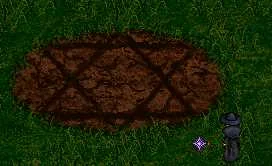
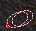
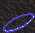
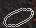
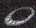
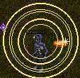
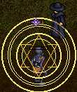
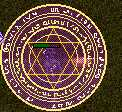
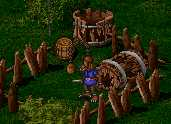

# The Aosdic Glyph

_by Pill in **Dark Ages**_

The Eldritch mark...The Glyph of Destruction..the Fatal Aosdic Glyph..all
of which refer to one mysterious spell, Mor Strioch Pian Gar. Many thought it
weak, some thought it was laughable. until now!



On my recent journeys within the Cthonic Remains, this ancient aosdic glyph
gave me many a shock. I thought I would conduct an experiment of some sorts,
so I brought all of my necklaces, each of which posessed a different element.

| Fire | Water | Wind | Earth |
|------|-------|------|-------|
|  |  |  |  |

I wore my necklace embued with the element sal, and wandered into the Second
Yard of the House Macabre, and asked a young Rogue to tell me the element of
the first creature I saw. I began to chant, and with all of my might, cast
this dark mark, and to my surprise, the creature's flesh vanished. All that
remained was its wrotting, fleshy corpse.



I thought my eyes had decieved me, as I'd heard many tales about this spell,
all of which I thought I had just proven wrong.

I, once again, found another creature, had its element identified, and cast
the eldritch mark. Sure enough, the creature remained as a bloody corpse.



I thought again that this was a mistake, as I have never been thought of as
powerful, so I conducted another test. I used the opposite element of srad,
Athar.




Not too astoundingly, the creature survived, so I replaced my necklace with
the latter, sal, and blasted, and sure enough, the creature perished.


I tell this lore to aid many youthful aislings who may still learn this
eldritch mark, as it is very difficult to understand.



A wise Kobold once told me,

" If it is this mark you seek, all of your traits, you must peak. Your
strength, wisdom, and intelligence must bear, the same as dexterity, and
constitution shall bear. All of which shall be peaked, at a minimum of forty."
His words proved very useful, as they helped me to understand the power of the
ancient glyphs.

`((Note: All of the strioch spells have requirements that effect ALL traits,
each spell, its cost, and its mana requirement, are listed in the table
below.))`

| Spell Name | Minimum Mana Required | Required Traits `((stats))` | Item Cost | Monetary Cost |
|------------|-----------------------|-----------------------------|-----------|---------------|
| Strioch Bais | 3280 | 25/25/25/25/25 | 6 Finished Ruby<br>12 Finished Coral<br>3 Coral Earrings | 500,000 |
| Mor Strioch Bais | 3280 | 25/25/25/25/25 | 6 Finished Ruby<br>6 Finished Coral<br>6 Finished Beryl | 1,000,000 |
| Mor Strioch Bais Lamh | 6560 (10,000 to cast successfully without failure) | 30/30/30/30/30 | 6 Finished Ruby<br>6 Finished Coral<br>6 Finished Beryl | 2,000,000 |
| Mor Strioch Bais Meall | 10,000 | 35/35/35/35/35 | 6 Finished Ruby<br>6 Finished Coral<br>6 Finished Beryl | 3,000,000 |
| Mor Strioch Bais Pian Gar | 600 | 40/40/40/40/40 | 6 Finished Ruby<br>6 Finished Coral<br>6 Finished Talos | 5,000,000 |

`((All images Copywritten by Nexon Inc. 1999-2001))`

_This Document Written by Pill Shizimai Tenaki-Kronagan, 2001_

***

```
*Librarian Notes*

Recognized: Folk, Lorekeepers Recognized (Events of Temuair post #157).
This entry has been heavily edited to conform to Library formatting.
The original can be found at http://www.darkages.com/community/lore/Pill_Aosdic/index.html .
```
