# The Illustrated Handbook of Color Alchemy

_by Raeven in **Dark Ages**_

On the day Maiala Kyrkonnel attained her eleventh insight, her father LeGalle
and her mother Raeven took her to the tailor's shop in Mileth.

Raeven greeted the tailor and engaged him in quiet conversation.

"What are they talking about, papa?" Maiala whispered.

Then Raeven smiled and beckoned to him, and LeGalle squeezed his daughter's
shoulder affectionately. "Come and watch," he said. "You may find this
interesting."

As Maiala stood at the counter, Raeven and LeGalle gathered around the work
table. After much labor, they produced a green lotus bodice and spread it out
for her to admire.

Maiala traced the ornate white embroidery on the bodice with inquisitive
fingers. "It's beautiful!" The Mundane tailor looked pleased. "Can I learn to
do this?"

"It takes time and practice," Raeven said, "but certainly you can. All rogues
and monks may learn different uses of color."

"You should write a book," LeGalle exclaimed, suddenly inspired. "With your
knowledge," he said to Raeven, "and Maiala's drawing skills, you could create a
color handbook for all aislings."

"A wonderful idea," Raeven agreed. "What do you think, Mai?"

Maiala nodded enthusiastically, took out her sketchpad, and began to draw.

## Introduction and Table of Contents

`(( This is an in-character handbook to all the different hair dyes, regional
clothing dyes, boots, hats and political garments used in DarkAges, a game
world created by Nexon, who owns the copyright to all images included here.
This site contains VERY LARGE GRAPHICS saved at maximum resolution to preserve
detail, so regular modem users will need patience. ))`

Many, many aislings and Mundanes obliged us by posing for these sketches, by
helping us tailor, and by sharing the details of how different garments are
created. We wish to thank them for their generosity and kindness.

\- Raeven and Maiala Kyrkonnel -

* [I. Base Ingredients](#i-base-ingredients)  
  A Compendium of Herb and Plant Dyes
* [II. Hair Dyes](#ii-hair-dyes)  
  Recipes for Hair Color
* [III. Cloth Dyes - Monk Apparel for Men](#iii-cloth-dyes---monk-apparel-for-men)
  * [The Dobok](#male-monk-apparel-the-dobok)
  * [The Culotte](#male-monk-apparel-the-culotte)
  * [The Earth Garb](#male-monk-apparel-the-earth-garb)
  * [The Wind Garb](#male-monk-apparel-the-wind-garb)
  * [The Mountain Garb](#male-monk-apparel-the-mountain-garb)
  * [More Monk Garb](#more-male-monk-apparel)
* [IV. Cloth Dyes - Monk Apparel for Women](#iv-cloth-dyes---monk-apparel-for-women)
  * [The Earth Bodice](#female-monk-apparel-the-earth-bodice)
  * [The Lotus Bodice](#female-monk-apparel-the-lotus-bodice)
  * [The Moon Bodice](#female-monk-apparel-the-moon-bodice)
  * [The Lightning Garb](#female-monk-apparel-the-lightning-garb)
  * [The Sea Garb](#female-monk-apparel-the-sea-garb)
  * [More Monk Garb](#more-female-monk-apparel)
* [V. Cloth Dyes - Priest Apparel for Men](#v-cloth-dyes---priest-apparel-for-men)
  * [The Cowl](#male-priest-apparel-the-cowl)
  * [The Galuchat Coat](#male-priest-apparel-the-galuchat-coat)
  * [The Mantle](#male-priest-apparel-the-mantle)
  * [The Hierophant](#male-priest-apparel-the-hierophant)
  * [The Dalmatica](#male-priest-apparel-the-dalmatica)
  * [More Priest Garb](#more-male-priest-apparel)
* [VI. Cloth Dyes - Priest Apparel for Women](#vi-cloth-dyes---priest-apparel-for-women)
  * [The Gorget Gown](#female-priest-apparel-the-gorget-gown)
  * [The Mystic Gown](#female-priest-apparel-the-mystic-gown)
  * [The Elle](#female-priest-apparel-the-elle)
  * [The Dolman](#female-priest-apparel-the-dolman)
  * [The Bansagart](#female-priest-apparel-the-bansagart)
  * [More Priest Garb](#more-female-priest-apparel)
* [VII. Cloth Dyes - Rogue Apparel for Men](#vii-cloth-dyes---rogue-apparel-for-men)
  * [The Scout Leather](#male-rogue-apparel-the-scout-leather)
  * [The Dwarvish Leather](#male-rogue-apparel-the-dwarvish-leather)
  * [The Paluten](#male-rogue-apparel-the-paluten)
  * [The Keaton](#male-rogue-apparel-the-keaton)
  * [The Bardocle](#male-rogue-apparel-the-bardocle)
  * [More Rogue Garb](#more-male-rogue-apparel)
* [VIII. Cloth Dyes - Rogue Apparel for Women](#viii-cloth-dyes---rogue-apparel-for-women)
  * [The Cotte](#female-rogue-apparel-the-cotte)
  * [The Brigandine](#female-rogue-apparel-the-brigandine)
  * [The Corsette](#female-rogue-apparel-the-corsette)
  * [The Pebble Rose](#female-rogue-apparel-the-pebble-rose)
  * [The Kagum](#female-rogue-apparel-the-kagum)
  * [More Rogue Garb](#more-female-rogue-apparel)
* [IX. Cloth Dyes - Warrior Apparel for Men](#ix-cloth-dyes---warrior-apparel-for-men)
  * [The Leather Tunic](#male-warrior-apparel-the-leather-tunic)
  * [The Jupe](#male-warrior-apparel-the-jupe)
  * [The Lorica](#male-warrior-apparel-the-lorica)
  * [The Chain Mail](#male-warrior-apparel-the-chain-mail)
  * [The Plate Mail](#male-warrior-apparel-the-platemail)
  * [More Warrior Garb](#more-male-warrior-apparel)
* [X. Cloth Dyes - Warrior Apparel for Women](#x-cloth-dyes---warrior-apparel-for-women)
  * [The Leather Bliaut](#female-warrior-apparel-the-leather-bliaut)
  * [The Cuirass](#female-warrior-apparel-the-cuirass)
  * [The Cotehardie](#female-warrior-apparel-the-cotehardie)
  * [The Kasmanium Hauberk](#female-warrior-apparel-the-kasmanium-hauberk)
  * [The Labirynth](#female-warrior-apparel-the-labirynth)
  * [More Warrior Garb](#more-female-warrior-apparel)
* [XI. Cloth Dyes - Wizard Apparel for Men](#xi-cloth-dyes---wizard-apparel-for-men)
  * [The Gardcorp](#male-wizard-apparel-the-gardcorp)
  * [The Journeyman](#male-wizard-apparel-the-journeyman)
  * [The Lorum](#male-wizard-apparel-the-lorum)
  * [The Mane](#male-wizard-apparel-the-mane)
  * [The Duin Uasal](#male-wizard-apparel-the-duin-uasal)
  * [More Wizard Garb](#more-male-wizard-apparel)
* [XII. Cloth Dyes - Wizard Apparel for Women](#xii-cloth-dyes---wizard-apparel-for-women)
  * [The Magi Skirt](#female-wizard-apparel-the-magi-skirt)
  * [The Benusta](#female-wizard-apparel-the-benusta)
  * [The Stoller](#female-wizard-apparel-the-stoller)
  * [The Clymouth](#female-wizard-apparel-the-clymouth)
  * [The Clamyth](#female-wizard-apparel-the-clamyth)
  * [More Wizard Garb](#more-female-wizard-apparel)
* [XIII. Specialty Apparel](#xiii-specialty-apparel)
  * [Peasant Clothes](#specialty-apparel-peasant-clothes)
  * [Wedding Clothes](#specialty-apparel-wedding-clothes)
  * [Noble Garments](#specialty-apparel-noble-garments)
  * [Mileth Political Garb](#specialty-apparel-political-garments-of-mileth)
  * [Rucesion Political Garb](#specialty-apparel-political-garments-of-rucesion)
* [XIV. Accessories](#xiv-accessories)
  * [Boots](#accessories-boots)
  * [Hats for Men](#accessories-hats-for-men)
  * [Hats for Women](#accessories-hats-for-women)

## I. Base Ingredients

These herbs and plants are found throughout Temuair and each yield a different
dye or dye ingredient. They grow in the enchanted garden, the fae glade,
different parts of the Eastern Woods, Pravat, and the meadows near the
Kasmanium Mines.

(It is quite possible these herbs and plants have medicinal or magickal
qualities also, but these are the names given to them by the Guildmasters at
the Five Guilds of Rucesion (the Rogue Guilds) who teach Paint, Ink and Dye
Alchemy.)

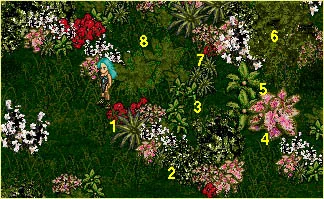

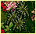

**Angelica** is a small plant that grows in clusters of small, narrow spiky
leaves that are dark green with a lighter olive green underside. It is often
mistaken for budding trigonelle. When the leaves are crushed and soaked in
wine, the mixture yields a bright blue dye.

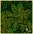

**Bittersweet** is a large bush that yields fern-like dark green leaves with
pale green undersides. When the leaves are crushed and soaked in brandy, the
mixture produces a rich green dye.

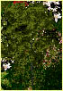

**Capsic bark** is harvested from the capsel tree, which is native to all the
major villages, towns, and areas of Temuair. Capsel trees grow to medium height
and are characterized by oval, medium green leaves and grayish-brown bark.
Capsic bark is the thin, inner layer of bark that overlays the soft wood. When
these fine shreds are peeled from the tree and steeped in one part wine and one
part rum, the mixture yields a true black dye.

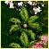

**Chicory** is a large plant that grows in fans of five to seven dark green
leaves and a large tan kernel in the center. When the kernel and leaves are
crushed together and soaked in rum, the mixture yields a rich brown dye.

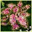

**Hyssop** is a large plant of medium height that yields large, flat pink
leaves with purple veins and a white underside. When the leaves are crushed and
soaked in brandy, the mixture yields a bright red dye.

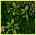

**Paola Nut** is a small plant with five to seven dark green leaves and a small
yellowish kernel in the center. It is often mistaken for budding or immature
chicory. When the kernel is crushed and soaked in spring water, the mixture
yields a bright yellow dye.

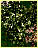

**Spirulina** is a small flowering bush characterized by round, dark green
leaves and star-shaped white blossoms. It is sometimes mistaken for betony
though it tends to grow taller and produce fewer, smaller flowers. When
spirulina flowers are crushed and soaked in rum, they produce a milky liquid
that bleaches fabric or lightens other dyes.

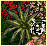

**Trigonelle** is a large plant with long, narrow, spiky leaves. When the
leaves are crushed and soaked in Suomi wine, the mixture yields a rich violet
dye.

## II. Hair Dyes

Here are the recipes for the various hair color essences, in the order they are
presented by the Mundanes:

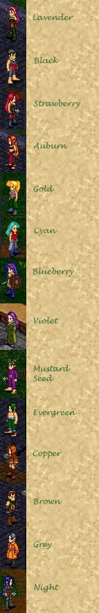

To prepare a hair dye, mix one part color essence to one part rum and one part
spring water. The rum sets the color while the water distributes it evenly.
Hair dyes may be applied at the higglers in Mileth and Rucesion. Labour is
required from both the Rogue preparing and applying the dye, and the aisling
whose hair is being transformed.

The dyes may be grouped by base color, depending upon which base color
ingredient is present in the largest amount.

The paola nut dyes are **Gold** (paola nut) and **Cyan** (paola nut and
bittersweet).

The trigonelle dyes are **Lavender** (trigonelle) and **Violet** (trigonelle
and spirulina).

The angelica dyes are **Blueberry** (angelica) and **Night** (angelica and
capsic bark).

The bittersweet dyes are **Evergreen** (bittersweet) and **Mustard Seed**
(bittersweet and paola nut).

The hyssop dyes are **Auburn** (hyssop and paola nut) and **Strawberry**
(hyssop and spirulina).

The chicory dyes are **Brown** (chicory) and **Copper** (chicory, paola nut,
and hyssop).

The capsic bark dyes are **Black** (capsic bark) and **Grey** (capsic bark,
angelica and spirulina).

## III. Cloth Dyes - Monk Apparel for Men

### Male Monk Apparel: The Dobok

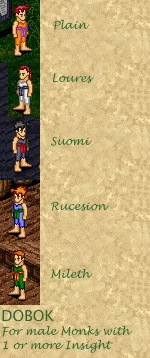

The Dobok may be worn by male Monks who have gained one or more Insights. The
loose fabric construction allows for great freedom of movement. The **Plain**
Dobok is crafted by the Mundanes with bittersweet, hyssop and paola nut. The
four dyes available at various other locations require significant Aisling
labor. The **Loures** variant is dyed with trigonelle, hyssop and paola nut.
The **Rucesion** variant is dyed with chicory, hyssop, and paola nut. The
**Suomi** variant is dyed with chicory, capsic bark and spirulina. The
**Mileth** variant is dyed with bittersweet, hyssop and paola nut.

### Male Monk Apparel: The Culotte

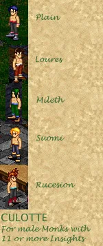

The Culotte may be worn by male Monks who have gained eleven or more Insights.
The **Plain** Culotte is crafted by the Mundanes with hyssop, spirulina,
angelica and capsic bark. The four dyes available at various other locations
require significant Aisling labor. The **Loures** variant is dyed with chicory,
paola nut, hyssop and spirulina. The **Mileth** variant is dyed with angelica,
spirulina and bittersweet. The **Suomi** variant is dyed with capsic bark,
angelica, hyssop and paola nut. The **Rucesion** variant is dyed with capsic
bark, spirulina, angelica, bittersweet and hyssop.

### Male Monk Apparel: The Earth Garb

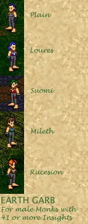

The Earth Garb may be worn by male Monks who have gained forty-one or more
Insights. The **Plain** Earth Garb is crafted by the Mundanes with capsic bark,
hyssop, paola nut and angelica. The four dyes available at various other
locations require significant Aisling labor. The **Loures** variant is dyed
with chicory, hyssop, spirulina, paola nut and angelica. The **Suomi** variant
is dyed with capsic bark, paola nut and hyssop. The **Mileth** variant is dyed
with capsic bark, angelica, hyssop and bittersweet. The **Rucesion** variant is
dyed with capsic bark, hyssop and spirulina.

### Male Monk Apparel: The Wind Garb

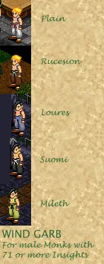

The Wind Garb may be worn by male Monks who have gained seventy-one or more
Insights. The **Plain** Wind Garb is crafted by the Mundanes with angelica,
hyssop, spirulina and capsic bark. The four dyes available at various other
locations require significant Aisling labor. The **Rucesion** variant is dyed
with bittersweet, chicory, spirulina and hyssop. The **Loures** variant is dyed
with angelica, hyssop, spirulina, capsic bark and paola nut. The **Suomi**
variant is dyed with capsic bark, spirulina, hyssop and paola nut. The
**Mileth** variant is dyed with bittersweet, paola nut, spirulina and capsic
bark.

### Male Monk Apparel: The Mountain Garb

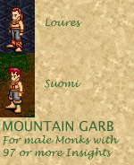

The Mountain Garb may be worn by male Monks who have gained ninety-seven or
more Insights. The four dyes available at various other locations require
significant Aisling labor. The **Loures** Mountain Garb is crafted by the
Mundanes with paola nut, hyssop, spirulina and capsic bark. The **Suomi**
variant is dyed with paola nut, hyssop, spirulina and capsic bark.

Unfortunately at this writing, the Mundanes who create the Plain Mountain Garb,
as well as the Mundanes in Mileth and Rucesion, are being very secretive about
the dyes used to create the other variants of this armor. If anyone consulting
this manual has worked with them to create Plain, Mileth or Rucesion Mountain
Garb, please contact Raeven or Maiala to add your knowledge to this manual.

### More Male Monk Apparel


The **Pattern Walker** garb may be worn by male Monks who have completely the
required quest. It is created by the Mundanes and may not be dyed by Aislings.

## IV. Cloth Dyes - Monk Apparel for Women

### Female Monk Apparel: The Earth Bodice

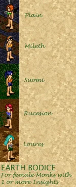

The Earth Bodice may be worn by female Monks with one or more Insights. The
fabric bodice and the leather shorts allow for greater range of movement. The
**Plain** Earth Bodice is crafted by the Mundanes with chicory and bittersweet.
The four dyes available at various other locations require significant Aisling
labor. The **Mileth** variant is dyed with paola nut and capsic bark. The
**Suomi** variant is dyed with hyssop, paola nut, and angelica. The
**Rucesion** variant is dyed with angelica and capsic bark. The **Loures**
variant is dyed with capsic bark, spirulina, and bittersweet.

### Female Monk Apparel: The Lotus Bodice

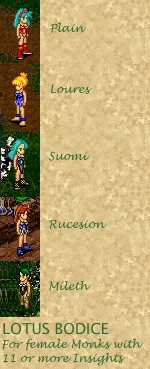

The Lotus Bodice may be worn by female Monks with eleven or more Insights. This
garb helps to protect the ankles and/or feet as the wearer gains strength and
dexterity. The **Plain** Lotus Bodice is crafted by the Mundanes with hyssop
and paola nut. The four dyes available at various other locations require
significant Aisling labor. The **Loures** variant is dyed with angelica and
spirulina. The **Suomi** variant is dyed with angelica, spirulina, bittersweet,
and capsic bark. The **Rucesion** variant is dyed with angelica, capsic bark,
and spirulina. The **Mileth** variant is dyed with bittersweet, spirulina, and
paola nut.

### Female Monk Apparel: The Moon Bodice

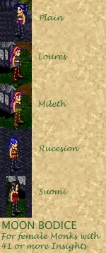

The Moon Bodice may be worn by Female Monks who have gained forty-one or more
Insights. This garb extends protection to the entire leg as needed with
intermediate Monk skills. The **Plain** Moon Bodice is crafted by the Mundanes
with trigonelle, spirulina and capsic bark. The four dyes available at various
other locations require significant Aisling labor. The **Loures** variant is
dyed with angelica, capsic back, spirulina and bittersweet. The **Rucesion**
variant is dyed with hyssop, paola nut and capsic bark. The **Mileth** variant
is dyed with bittersweet, paola nut, and chicory. The **Suomi** variant is dyed
with hyssop and capsic bark.

### Female Monk Apparel: The Lightning Garb

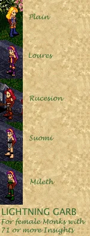

The Lightning Garb may be worn by Female Monks who have gained seventy-one or
more Insights. This garb extends protection to the arms and legs with leather,
increasing the efficacy of attack. The **Plain** Lightning Garb is crafted by
the Mundanes with angelica, hyssop and paola nut. The four dyes available at
various other locations require significant Aisling labor. The **Loures**
variant is dyed with trigonelle, hyssop and paola nut. The **Rucesion** variant
is dyed with chicory, hyssop, and paola nut. The **Suomi** variant is dyed with
chicory, capsic bark and spirulina. The **Mileth** variant is dyed with
bittersweet, hyssop and paola nut.

### Female Monk Apparel: The Sea Garb

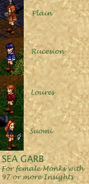

The Sea Garb may be worn by Female Monks who have gained ninety-seven or more
Insights. This garb facilitates full extension of the leg for optimal kicking
attack. The **Plain** Sea Garb is crafted by the Mundanes with chicory, hyssop,
spirulina and paola nut. The four dyes available at various other locations
require significant Aisling labor. The **Rucesion** variant is dyed with
angelica, hyssop, and paola nut. The **Loures** variant is dyed with hyssop,
spirulina and chicory. The **Suomi** variant is dyed with hyssop, paola nut and
capsic bark.

Unfortunately at this writing, the Mundanes in Mileth are being very secretive
about the dyes used to create these variants. If anyone consulting this manual
has worked with them to create Mileth Sea Garb, please contact Raeven or Maiala
to add your knowledge to this manual.

### More Female Monk Apparel


The **Pattern Walker** garb may be worn by Female Monks who have completely the
required quest. It is created by the Mundanes and may not be dyed by Aislings.

## V. Cloth Dyes - Priest Apparel for Men

### Male Priest Apparel: The Cowl

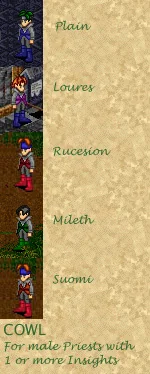

The Cowl may be worn by male Priests who have gained one or more Insights. The
gray tunic and trousers are made of gray felt with a solid color cloth field
between collar and sleeves. The **Plain** Cowl is crafted by the Mundanes with
spirulina, capsic bark and angelica. The four dyes available at various other
locations require significant Aisling labor. The **Loures** variant is dyed
with spirulina, capsic bark and trigonelle. The **Rucesion** variant is dyed
with spirulina, capsic bark and hyssop. The **Mileth** variant is dyed with
spirulina, capsic bark and bittersweet. The **Suomi** variant is dyed with
spirulina, capsic bark, hyssop and paola nut.

### Male Priest Apparel: The Galuchat Coat

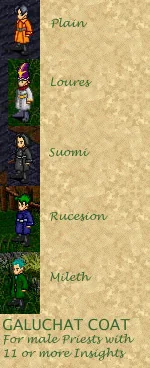

The Galuchat Coat may be worn by male Priests who have gained eleven or more
Insights. The leather coat and gray trousers protect the wearer against all
creatures and magickal elements. The **Plain** Coat is crafted by the Mundanes
with spirulina, capsic bark and paola nut. The four dyes available at various
other locations require significant Aisling labor. The **Loures** variant is
dyed with spirulina, capsic bark, angelica and paola nut. The **Suomi** variant
is dyed with spirulina and capsic bark. The **Rucesion** variant is dyed with
spirulina, capsic bark and angelica. The **Mileth** variant is dyed with
spirulina, capsic bark, hyssop and bittersweet.

### Male Priest Apparel: The Mantle

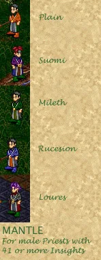

The Mantle may be worn by male Priests who have gained forty-one or more
Insights. The felt coat has a comfortable velvet drape across the chest and
arms for freedom of movement. The **Plain** Mantle is crafted by the Mundanes
with spirulina, capsic bark. bittersweet, hyssop and paola nut. The four dyes
available at various other locations require significant Aisling labor. The
**Suomi** variant is dyed with spirulina, capsic bark, angelica and trigonelle.
The **Mileth** variant is dyed with spirulina, paola nut, bittersweet and
capsic bark. The **Rucesion** variant is dyed with spirulina, capsic bark,
hyssop, paola nut and angelica. The **Loures** variant is dyed with spirulina,
capsic bark, hyssop and chicory.

### Male Priest Apparel: The Hierophant

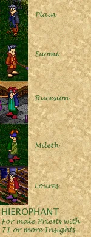

The Hierophant may be worn by male Priests who have gained seventy-one or more
Insights. The elegant cut of the coat conveys stature without restricting
freedom of movement. The **Plain** Hierophant is crafted by the Mundanes with
spirulina, angelica, hyssop and chicory. The four dyes available at various
other locations require significant Aisling labor. The **Suomi** variant is
dyed with chicory, hyssop and paola nut. The **Rucesion** variant is dyed with
spirulina, paola nut, bittersweet and angelica. The **Mileth** variant is dyed
with spirulina, capsic bark, bittersweet and paola nut.

Unfortunately at this writing, the Mundanes in Piet are being very secretive
about the dyes used to create that variant. If anyone consulting this manual
has worked with them to create a Loures Hierophant, please contact Raeven or
Maiala to add your knowledge to this manual.

### Male Priest Apparel: The Dalmatica

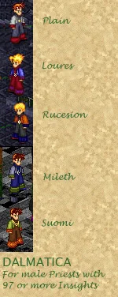

The Dalmatica may be worn by male Priests who have gained ninety-seven or more
Insights. The draped coat and bell trousers are made of cloth and velvet. The
**Plain** Dalmatica is crafted by the Mundanes with spirulina, angelica, hyssop
and capsic bark. The four dyes available at various other locations require
significant Aisling labor. The **Loures** variant is dyed with chicory, hyssop
and angelica. The **Rucesion** variant is dyed with spirulina, paola nut,
hyssop and angelica. The **Mileth** variant is dyed with spirulina, capsic
bark, bittersweet and angelica. The **Suomi** variant is dyed with chicory,
bittersweet, hyssop and paola nut.

### More Male Priest Apparel


The **Cthonic Magus** robes may be worn by male Priests who have completely the
required quest. It is created by the Mundanes and may not be dyed by Aislings.

## VI. Cloth Dyes - Priest Apparel for Women

### Female Priest Apparel: The Gorget Gown

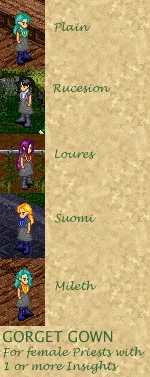

The Gorget Gown may be worn by female Priests who have gained one or more
Insights. The simple gray skirt and the high neckline convey devotion. The
**Plain** Gorget Gown is crafted by the Mundanes with capsic bark, spirulina,
angelica, bittersweet and paola nut. The four dyes available at various other
locations require significant Aisling labor. The **Rucesion** variant is dyed
with capsic bark, spirulina, trigonelle and angelica. The **Loures** variant is
dyed with capsic bark, spirulina, and hyssop. The **Suomi** variant is dyed
with capsic bark, spirulina, and angelica. The **Mileth** variant is dyed with
capsic bark, spirulina, and paola nut.

### Female Priest Apparel: The Mystic Gown

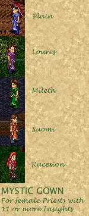

The Mystic Gown may be worn by female Priests who have gained eleven or more
Insights. The split skirt enables the wearer to move freely and quickly to
revive the dying. The **Plain** Mystic Gown is crafted by the Mundanes with
spirulina and angelica. The four dyes available at various other locations
require significant Aisling labor. The **Loures** variant is dyed with
spirulina and trigonelle. The **Mileth** variant is dyed with spirulina,
bittersweet and paola nut. The **Suomi** variant is dyed with spirulina,
hyssop, paola nut and angelica. The **Rucesion** variant is dyed with spirulina
and hyssop.

### Female Priest Apparel: The Elle

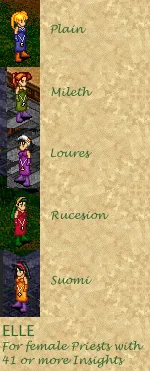

The Elle may be worn by female Priests who have gained forty-one or more
Insights. The medallion which hangs from the belt is engraved with a symbol of
the god the Priestess serves. The **Plain** Elle is crafted by the Mundanes
with spirulina and angelica. The four dyes available at various other locations
require significant Aisling labor. The **Mileth** variant is dyed with
spirulina, bittersweet and paola nut. The **Loures** variant is dyed with
spirulina and trigonelle. The **Rucesion** variant is dyed with hyssop. The
**Suomi** variant is dyed with hyssop, spirulina and paola nut.

### Female Priest Apparel: The Dolman

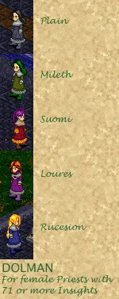

The Dolman may be worn by female Priests who have gained seventy-one or more
Insights. The cloth dress is hemmed with soft gray velvet at the cuffs and
neckline. The **Plain** Dolman is crafted by the Mundanes with spirulina,
capsic bark and angelica. The four dyes available at various other locations
require significant Aisling labor. The **Mileth** variant is dyed with
spirulina, bittersweet and capsic bark. The **Suomi** variant is dyed with
spirulina, capsic bark, hyssop and paola nut. The **Loures** variant is dyed
with trigonelle, spirulina and capsic bark. The **Rucesion** variant is dyed
with capsic bark, spirulina and angelica.

### Female Priest Apparel: The Bansagart

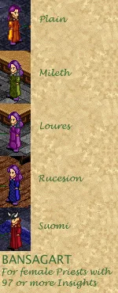

The Bansagart may be worn by female Priests who have gained ninety-seven or
more Insights. The cloth dress flows loosely to allow for quick healings and
rescues. The **Plain** Bansagart is crafted by the Mundanes with hyssop and
paola nut. The four dyes available at various other locations require
significant Aisling labor. The **Mileth** variant is dyed with bittersweet and
paola nut. The **Loures** variant is dyed with spirulina and trigonelle. The
**Rucesion** variant is dyed with spirulina and angelica. The **Suomi** variant
is dyed with hyssop, paola nut and capsic bark.

### More Female Priest Apparel


The **Pellison** may be worn by female Priests with eighty or more Insights. It
is created by the Mundanes and may not be dyed by Aislings.

## VII. Cloth Dyes - Rogue Apparel for Men

### Male Rogue Apparel: The Scout Leather

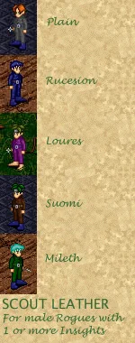

The Scout Leather may be worn by male Rogues who have gained one or more
Insights. The gray body suit is made of leather and the belt is made of cloth.
The **Plain** Scout Leather is crafted by the Mundanes with spirulina,
angelica, and capsic bark. The four dyes available at various other locations
require significant Aisling labor. The **Rucesion** variant is dyed with
spirulina, capsic bark and angelica. The **Loures** variant is dyed with
spirulina, capsic bark and trigonelle. The **Suomi** variant is dyed with
spirulina, hyssop, and chicory. The **Mileth** variant is dyed with
bittersweet, capsic bark and spirulina.

### Male Rogue Apparel: The Dwarvish Leather

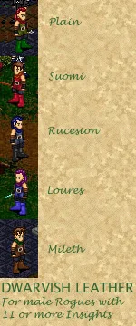

The Dwarvish Leather may be worn by male Rogues who have gained eleven or more
Insights. The sleeveless tunic has a high cloth collar, short leather trousers
and long leather bracers extending down over the back of the hand. The
**Plain** Dwarvish Leather is crafted by the Mundanes with capsic bark, chicory
and bittersweet. The four dyes available at various other locations require
significant Aisling labor. The **Suomi** variant is dyed with capsic bark,
chicory and hyssop. The **Rucesion** variant is dyed with capsic bark, chicory,
bittersweet and angelica. The **Loures** variant is dyed with capsic bark,
chicory, and angelica. The **Mileth** variant is dyed with capsic bark, chicory
and bittersweet.

### Male Rogue Apparel: The Paluten

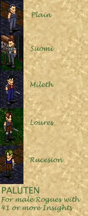

The Paluten may be worn by male Rogues who have gained forty-one or more
Insights. The armor is made with leather and cloth in varying combinations but
all variants feature close-fitting gauntlets to protect the hands during
delicate labor. The **Plain** Paluten is crafted by the Mundanes with capsic
bark and angelica. The four dyes available at various other locations require
significant Aisling labor. The **Suomi** variant is dyed with capsic bark and
spirulina. The **Mileth** variant is dyed with capsic bark, chicory, spirulina
and angelica. The **Loures** variant is dyed with capsic bark, chicory,
angelica amd hyssop. The **Rucesion** variant is dyed with capsic bark, chicory
and angelica.

### Male Rogue Apparel: The Keaton

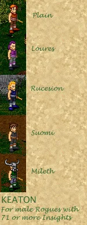

The Keaton may be worn by male Rogues who have gained seventy-one or more
Insights. The sleeveless tunic and long trousers are made with striped cloth.
The **Plain** Keaton is crafted by the Mundanes with capsic bark, spirulina and
chicory. The four dyes available at various other locations require significant
Aisling labor. The **Loures** variant is dyed with capsic bark, spirulina and
trigonelle. The **Rucesion** variant is dyed with capsic bark, spirulina and
angelica. The **Suomi** variant is dyed with capsic bark, spirulina and hyssop.
The **Mileth** variant is dyed with capsic bark, bittersweet and spirulina.

### Male Rogue Apparel: The Bardocle

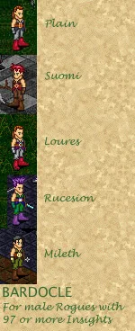

The Bardocle may be worn by male Rogues who have gained ninety-seven or more
Insights. The tunic is cut away like a long vest and held in place with a
gold-buckled cloth belt. The **Plain** Bardocle is crafted by the Mundanes with
capsic bark, spirulina, angelica and hyssop. The four dyes available at various
other locations require significant Aisling labor. The **Suomi** variant is
dyed with chicory and hyssop. The **Loures** variant is dyed with capsic bark,
spirulina, hyssop and trigonelle. The **Rucesion** variant is dyed with
bittersweet, spirulina, angelica and hyssop. The **Mileth** variant is dyed
with bittersweet, spirulina, paola nut, chicory and hyssop.

### More Male Rogue Apparel


The **Marauder Hide** garb may be worn by male Rogues who have completely the
required quest. It is created by the Mundanes and may not be dyed by Aislings.

## VIII. Cloth Dyes - Rogue Apparel for Women

### Female Rogue Apparel: The Cotte

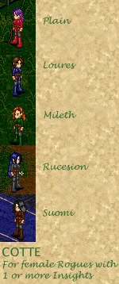

The Cotte may be worn by female Rogues who have gained one or more Insights.
The legs of the cloth tunic are cut short over the leather leggings for
dexterity in setting traps. The **Plain** Cotte is crafted by the Mundanes with
capsic bark and hyssop. The four dyes available at various other locations
require significant Aisling labor. The **Loures** variant is dyed with capsic
bark, hyssop and angelica. The **Mileth** variant is dyed with capsic bark,
hyssop and bittersweet. The **Rucesion** variant is dyed with capsic bark and
hyssop. The **Suomi** variant is dyed with capsic bark, hyssop and chicory.

### Female Rogue Apparel: The Brigandine

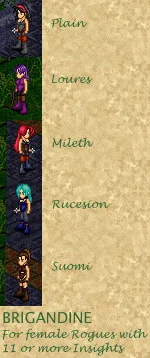

The Brigandine may be worn by female Rogues who have gained eleven or more
Insights. This armor is hand-sewn into flexible leather segments for improved
protection without sacrificing dexterity. The **Plain** Brigandine is crafted
by the Mundanes with capsic bark and hyssop. The four dyes available at various
other locations require significant Aisling labor. The **Loures** variant is
dyed with capsic bark and trigonelle. The **Mileth** variant is dyed with
capsic bark, angelica and hyssop. The **Rucesion** variant is dyed with capsic
bark, hyssop, angelica and spirulina. The **Suomi** variant is dyed with
chicory, spirulina and paola nut.

### Female Rogue Apparel: The Corsette

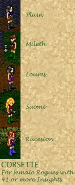

The Corsette may be worn by female Rogues who have gained forty-one or more
Insights. The leather belt and shorts have several concealed pockets for
holding Rogue traps and tools. The **Plain** Corsette is crafted by the
Mundanes with angelica and bittersweet. The four dyes available at various
other locations require significant Aisling labor. The **Mileth** variant is
dyed with capsic bark, chicory and hyssop. The **Loures** variant is dyed with
capsic bark, angelica and trigonelle. The **Suomi** variant is dyed with
hyssop, capsic bark and spirulina. The **Rucesion** variant is dyed with
trigonelle and angelica.

### Female Rogue Apparel: The Pebble Rose

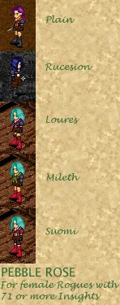

The Pebble Rose may be worn by female Rogues who have gained seventy-one or
more Insights. The high-waisted blouse is overlapped and held by a gold-buckled
belt for greater ease of movement, and the leather gauntlets protect the hands.
The **Plain** Pebble Rose is crafted by the Mundanes with hyssop, spirulina,
angelica, capsic bark and chicory. The four dyes available at various other
locations require significant Aisling labor. The **Rucesion** variant is dyed
with capsic bark, chicory angelica and trigonelle. The **Loures** variant is
dyed with capsic bark, angelica, trigonelle and hyssop. The **Mileth** variant
is dyed with angelica, hyssop, bittersweet and chicory. The **Suomi** variant
is dyed with angelica, hyssop, spirulina, chicory and capsic bark.

### Female Rogue Apparel: The Kagum

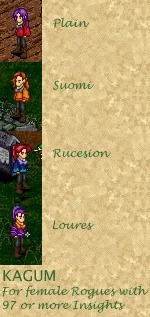

The Kagum may be worn by female Rogues who have gained ninety-seven or more
Insights. The short, full-sleeved blouse and close-fitting leather trousers are
constructed with special pockets for holding secrets and smoke bombs. The
**Plain** Kagum is crafted by the Mundanes with hyssop, spirulina, and capsic
bark. The four dyes available at various other locations require significant
Aisling labor. The **Suomi** variant is dyed with capsic bark, spirulina,
hyssop and paola nut. The **Rucesion** variant is dyed with capsic bark,
spirulina, angelica, paola nut and bittersweet. The **Loures** variant is dyed
with hyssop, trigonelle, paola nut, spirulina, angelica and capsic bark.

Unfortunately at this writing, the Mundanes in Mileth are being very secretive
about the dyes used to create that variant. If anyone consulting this manual
has worked with them to create a Mileth Kagum, please contact Raeven or Maiala
to add your knowledge to this manual.

### More Female Rogue Apparel

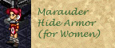

The **Marauder Hide** garb may be worn by female Rogues who have completely the
required quest. It is created by the Mundanes and may not be dyed by Aislings.

## IX. Cloth Dyes - Warrior Apparel for Men

### Male Warrior Apparel: The Leather Tunic

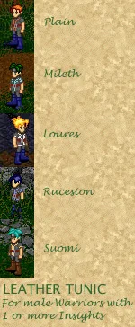

The Leather Tunic may be worn by male Warriors who have gained one or more
Insights. The leather short-sleeved tunic is trimmed with contrasting color and
held in place with a brown leather belt. The **Plain** Leather Tunic is crafted
by the Mundanes with capsic bark, spirulina, hyssop and paola nut. The four
dyes available at various other locations require significant Aisling labor.
The **Mileth** variant is dyed with capsic bark, spirulina, angelica and
bittersweet. The **Loures** variant is dyed with capsic bark and spirulina. The
**Rucesion** variant is dyed with capsic bark, spirulina, and angelica. The
**Suomi** variant is dyed with capsic bark, paola nut and spirulina.

### Male Warrior Apparel: The Jupe

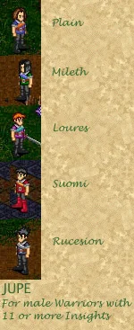

The Jupe may be worn by male Warriors who have gained eleven or more Insights.
The belted short-sleeved tunic is fitted with a contrasting sash over gray
leather trousers. The **Plain** Jupe is crafted by the Mundanes with capsic
bark, spirulina, angelica, hyssop and paola nut. The four dyes available at
various other locations require significant Aisling labor. The **Mileth**
variant is dyed with capsic bark, spirulina, angelica and bittersweet. The
**Loures** variant is dyed with capsic bark, bittersweet, trigonelle and
spirulina. The **Suomi** variant is dyed with capsic bark, spirulina, hyssop
and paola nut. The **Rucesion** variant is dyed with capsic bark, angelica and
spirulina.

### Male Warrior Apparel: The Lorica

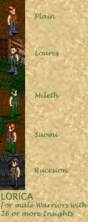

The Lorica may be worn by male Warriors who have gained twenty-six or more
Insights. The front of the sleeveless leather tunic is woven together and
embossed with color for extra protection and decoration. The **Plain** Lorica
is crafted by the Mundanes with capsic bark, spirulina, hyssop and chicory. The
four dyes available at various other locations require significant Aisling
labor. The **Loures** variant is dyed with capsic bark, spirulina and angelica.
The **Mileth** variant is dyed with capsic bark, bittersweet, angelica and
spirulina. The **Suomi** variant is dyed with capsic bark, spirulina, hyssop
and bittersweet. The **Rucesion** variant is dyed with capsic bark, hyssop,
paola nut and spirulina.

### Male Warrior Apparel: The Chain Mail

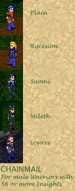

The Chain Mail may be worn by male Warriors who have gained fifty-six or more
Insights. This armor is constructed of tensile steel embossed with color. The
**Plain** Lorica is crafted by the Mundanes with angelica, hyssop, trigonelle,
paola nut and bittersweet. The four dyes available at various other locations
require significant Aisling labor. The **Rucesion** variant is dyed with capsic
bark, spirulina and angelica. The **Suomi** variant is dyed with capsic bark,
angelica and spirulina. The **Loures** variant is dyed with capsic bark,
spirulina, angelica and bittersweet. The **Mileth** variant is dyed with capsic
bark, trigonelle, angelica and spirulina.

### Male Warrior Apparel: The Platemail

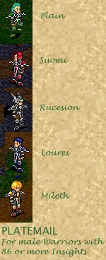

The Platemail may be worn by male Warriors who have gained fifty-six or more
Insights. This armor is constructed of handcrafted hollow steel embossed with
color and traced with precious metals. The **Plain** Plate Mail is crafted by
the Mundanes with bittersweet and spirulina. The four dyes available at various
other locations require significant Aisling labor. The **Suomi** variant is
dyed with hyssop and spirulina. The **Rucesion** variant is dyed with capsic
bark and spirulina. The **Loures** variant is dyed with angelica and spirulina.
The **Mileth** variant is dyed with hyssop, paola nut and spirulina.

### More Male Warrior Apparel

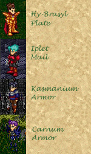

The **Hy-Brasyl Plate** armor may be worn by male Warriors who have completed
the required quest. It is created by the Mundanes and may not be dyed by
Aislings.

The **Iplet Mail** armor may be worn by male Warriors with seventy-one or more
Insights. It is created by the Mundanes and may not be dyed by Aislings.

The **Kasmanium** armor may be worn by male Warriors with forty-one or more
Insights. It is created by the Mundanes and may not be dyed by Aislings.

The **Carnun** armor may be worn by male Warriors who have completed the
required quest. It is created by the Mundanes and may not be dyed by Aislings.

## X. Cloth Dyes - Warrior Apparel for Women

### Female Warrior Apparel: The Leather Bliaut

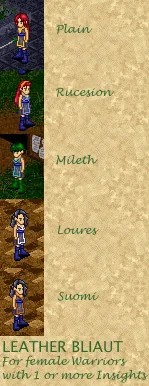

The Leather Bliaut may be worn by female Warriors who have gained one or more
Insights. The divided leather tunic is trimmed with contrasting colors and tied
in place with a cloth sash. The **Plain** Bliaut is crafted by the Mundanes
with paola nut, angelica, spirulina, and capsic bark. The four dyes available
at various other locations require significant Aisling labor. The **Rucesion**
variant is dyed with capsic bark, spirulina, and angelica. The **Mileth**
variant is dyed with capsic bark, spirulina, angelica, paola nut and
bittersweet. The **Loures** variant is dyed with spirulina, angelica and capsic
bark. The **Suomi** variant is dyed with spirulina, angelica, hyssop, paola nut
and capsic bark.

### Female Warrior Apparel: The Cuirass

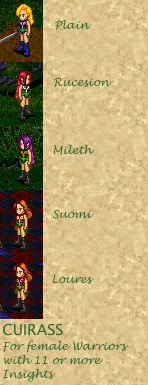

The Cuirass may be worn by female Warriors who have gained eleven or more
Insights. The fitted leather armor is embellished with contrasting colors and
the skirt is cut away for maximum dexterity. The **Plain** Cuirass is crafted
by the Mundanes with angelic, bittersweet, paola nut, and hyssop. The four dyes
available at various other locations require significant Aisling labor. The
**Rucesion** variant is dyed with capsic bark, spirulina, bittersweet and paola
nut. The **Mileth** variant is dyed with chicory, bittersweet, hyssop and paola
nut. The **Suomi** variant is dyed with spirulina, angelica, hyssop and
bittersweet. The **Loures** variant is dyed with hyssop, angelica, bittersweet
and paola nut.

### Female Warrior Apparel: The Cotehardie

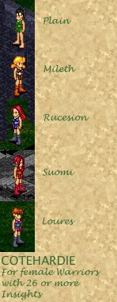

The Cotehardie may be worn by female Warriors who have gained twenty-six or
more Insights. The stomach of the armor is handcrafted hollow steel burnished
with color, while the bodice and skirt are made of leather. The **Plain**
Cotehardie is crafted by the Mundanes with bittersweet, paola nut, and
spirulina. The four dyes available at various other locations require
significant Aisling labor. The **Mileth** variant is dyed with capsic bark,
chicory, and hyssop. The **Rucesion** variant is dyed with angelica and
spirulina. The **Suomi** variant is dyed with hyssop and paola nut. The
**Loures** variant is dyed with angelica, trigonelle and paola nut and
spirulina.

### Female Warrior Apparel: The Kasmanium Hauberk


The Kasmanium Hauberk may be worn by female Warriors who have gained forty-one
or more Insights. The body of the armor is woven of pure, tensile kasmanium
while the sleeves and high boots are made of leather. The **Plain** Hauberk is
crafted by the Mundanes with angelica, hyssop, paola nut, spirulina and capsic
bark. The four dyes available at various other locations require significant
Aisling labor. The **Loures** variant is dyed with capsic bark, bittersweet and
angelica. The **Suomi** variant is dyed with hyssop, capsic bark and spirulina.
The **Mileth** variant is dyed with capsic bark and chicory. The **Rucesion**
variant is dyed with angelica, trigonelle and capsic bark.

### Female Warrior Apparel: The Labirynth


The Labirynth may be worn by female Warriors who have gained seventy-eight or
more Insights. This armor is handcrafted of moveable kasmanium plates embossed
with color. The **Plain** Labirynth is crafted by the Mundanes with trigonelle,
hyssop, paola nut and bittersweet. The four dyes available at various other
locations require significant Aisling labor. The **Suomi** variant is dyed with
hyssop, spirulina and paola nut. The **Loures** variant is dyed with hyssop,
trigonelle, angelica and paola nut. The **Rucesion** variant is dyed with
hyssop, capsic bark, and paola nut.

Unfortunately at this writing, the Mundanes in Mileth are being very secretive
about the dyes used to create that variant. If anyone consulting this manual
has worked with them to create Mileth Labirynth armor, please contact Raeven or
Maiala to add your knowledge to this manual.

### More Female Warrior Apparel


The **Phoenix Mail** armor may be worn by Female Warriors with eighty-six or
more Insights. It is created by the Mundanes and may not be dyed by Aislings.

The **Surplice Blouse** may be worn by Female Warriors with fifty-six or more
Insights. It is created by the Mundanes and may not be dyed by Aislings.

The **Carnun** armor may be worn by Female Warriors who have completed the
required quest. It is created by the Mundanes and may not be dyed by Aislings.

The **Hy-Brasyl Plate** armor may be worn by Female Warriors who have completed
the required quest. It is created by the Mundanes and may not be dyed by
Aislings.

## XI. Cloth Dyes - Wizard Apparel for Men

### Male Wizard Apparel: The Gardcorp


The Gardcorp may be worn by male Wizards who have gained one or more Insights.
The soft woven wool tunic and leather trousers provide protection from magick
and the elements. The **Plain** Gardcorp is crafted by the Mundanes with capsic
bark and paola nut. The four dyes available at various other locations require
significant Aisling labor. The **Suomi** variant is dyed with hyssop and capsic
bark. The **Rucesion** variant is dyed with capsic bark and angelica. The
**Loures** variant is dyed with angelica, paola nut and capsic bark. The
**Mileth** variant is dyed with bittersweet and capsic bark.

### Male Wizard Apparel: The Journeyman


The Journeyman may be worn by male Wizards who have gained eleven or more
Insights. The longer woven wool tunic is embroidered with contrasting color,
while the long leather overcoat provides protection during hunting and
research. The **Plain** Journeyman is crafted by the Mundanes with capsic bark,
spirulina, and hyssop. The four dyes available at various other locations
require significant Aisling labor. The **Loures** variant is dyed with
spirulina, paola nut and capsic bark. The **Suomi** variant is dyed with capsic
bark, hyssop, chicory and paola nut. The **Rucesion** variant is dyed with
angelica, spirulina and capsic bark. The **Mileth** variant is dyed with
bittersweet, trigonelle and capsic bark.

### Male Wizard Apparel: The Lorum


The Lorum may be worn by male Wizards who have gained forty-one or more
Insights. The longer cloth tunic is striped and embroidered with contrasting
color. The **Plain** Lorum is crafted by the Mundanes with chicory, angelica,
capsic bark and paola nut. The four dyes available at various other locations
require significant Aisling labor. The **Loures** variant is dyed with chicory,
hyssop, angelica, capsic bark and spirulina. The **Suomi** variant is dyed with
capsic bark, hyssop, angelica and paola nut. The **Rucesion** variant is dyed
with angelica, spirulina, chicory and capsic bark. The **Mileth** variant is
dyed with bittersweet, angelica and capsic bark.

### Male Wizard Apparel: The Mane


The Mane may be worn by male Wizards who have gained seventy-one or more
Insights. The loosely fitting tunic and leggings are made of soft woven cloth
and sometimes embroidered in contrasting color. The **Plain** Mane is crafted
by the Mundanes with chicory, hyssop and paola nut. The four dyes available at
various other locations require significant Aisling labor. The **Mileth**
variant is dyed with angelica, capsic bark and spirulina. The **Suomi** variant
is dyed with hyssop, spirulina, capsic bark and paola nut. The **Rucesion**
variant is dyed with angelica, hyssop, paola nut and capsic bark. The
**Loures** variant is dyed with spirulina and capsic bark.

### Male Wizard Apparel: The Duin Uasal


The Duin Uasal may be worn by male Wizards who have gained ninety-seven or more
Insights. The tailored tunic and trousers are made of cloth and embroidered
with precious metals. The **Plain** Duin Uasal is crafted by the Mundanes with
angelica and capsic bark. The four dyes available at various other locations
require significant Aisling labor. The **Suomi** variant is dyed with hyssop
and chicory. The **Mileth** variant is dyed with bittersweet, capsic bark and
angelica. The **Loures** variant is dyed with angelica, chicory and capsic
bark. The **Rucesion** variant is dyed with angelica, paola nut, chicory and
capsic bark.

### More Male Wizard Apparel


The **Cthonic Magus** robes may be worn by male Wizards who have completely the
required quest. It is created by the Mundanes and may not be dyed by Aislings.

## XII. Cloth Dyes - Wizard Apparel for Women

### Female Wizard Apparel: The Magi Skirt


The Magi Skirt may be worn by female Wizards who have gained one or more
Insights. The short, pleated dress has a contrasting velvet collar and sash.
The **Plain** Magi Skirt is crafted by the Mundanes with angelica and
trigonelle. The four dyes available at various other locations require
significant Aisling labor. The **Suomi** variant is dyed with angelica, hyssop
and spirulina. The **Mileth** variant is dyed with bittersweet, paola nut and
spirulina. The **Rucesion** variant is dyed with bittersweet and paola nut. The
**Loures** variant is dyed with trigonelle, hyssop, angelica and spirulina.

### Female Wizard Apparel: The Benusta


The Benusta may be worn by female Wizards who have gained eleven or more
Insights. The shaped cloth bodice and belled trousers help protect the wearer
against magick. The **Plain** Benusta is crafted by the Mundanes with paola nut
and angelica. The four dyes available at various other locations require
significant Aisling labor. The **Mileth** variant is dyed with trigonelle,
angelica, and paola nut. The **Suomi** variant is dyed with bittersweet, paola
nut and spirulina. The **Rucesion** variant is dyed with hyssop, spirulina and
angelica. The **Loures** variant is dyed with hyssop and spirulina.

### Female Wizard Apparel: The Stoller


The Stoller may be worn by female Wizards who have gained forty-one or more
Insights. The dress is made of velvet and crinoline while the leggings are made
of cloth. The **Plain** Stoller is crafted by the Mundanes with trigonelle,
spirulina and chicory. The four dyes available at various other locations
require significant Aisling labor. The **Loures** variant is dyed with
bittersweet, spirulina, and paola nut. The **Suomi** variant is dyed with
hyssop, capsic bark and paola nut. The **Mileth** variant is dyed with
bittersweet and chicory. The **Rucesion** variant is dyed with angelica and
chicory.

### Female Wizard Apparel: The Clymouth


The Clymouth may be worn by female Wizards who have gained seventy-one or more
Insights. The long dress is made of velvet and crinoline with contrasting color
sleeves and trim. The **Plain** Clymouth is crafted by the Mundanes with
trigonelle, paola nut, capsic bark and hyssop. The four dyes available at
various other locations require significant Aisling labor. The **Rucesion**
variant is dyed with angelica, hyssop, spirulina and paola nut. The **Mileth**
variant is dyed with bittersweet, capsic bark, spirulina and paola nut. The
**Suomi** variant is dyed with hyssop, chicory and paola nut.The **Loures**
variant is dyed with trigonelle, spirulina, angelica and bittersweet.

### Female Wizard Apparel: The Clamyth


The Clamyth may be worn by female Wizards who have gained ninety-seven or more
Insights. The short bodice and long divided skirt are trimmed with velvet and
embroidered with precious metals. The **Plain** Clamyth is crafted by the
Mundanes with chicory, hyssop and paola nut. The four dyes available at various
other locations require significant Aisling labor. The **Rucesion** variant is
dyed with capsic bark, hyssop, chicory and paola nut. The **Loures** variant is
dyed with capsic bark, hyssop and chicory. The **Mileth** variant is dyed with
spirulina, paola nut, chicory and bittersweet. The **Suomi** variant is dyed
with trigonelle, paola nut, chicory and capsic bark.

### More Female Wizard Apparel


The **Pellison** may be worn by female Wizards with eighty or more Insights. It
is created by the Mundanes and may not be dyed by Aislings.

## XIII. Specialty Apparel

### Specialty Apparel: Peasant Clothes


When an individual is first summoned, stunned and newly aware of his or her
aisling potential, the Mundanes provide peasant clothes. A woman's peasant
clothes consist of a simple dress with short sleeves and a short skirt
constructed of ragged yellowish cloth. A man's peasant clothes consist of a
short, green, sleeveless cloth tunic, a brown leather belt, and a pair of worn
gray leather trousers.

As soon as the individual chooses a path - Monk, Priest, Rogue, Warrior or
Wizard - they become able to wear that path's first-insight clothing. Please
consult the [table of contents](#introduction-and-table-of-contents) for the
different styles and types of first-insight garb.

### Specialty Apparel: Wedding Clothes


In Temuair, the Mundanes create beautiful traditional marriage clothing for
church weddings and for pledges in the faery glade. For the bride, there is a
white satin pleated gown embroidered with silver around the hem. There is also
a white tulle and satin veil crowned with satin roses. For the groom, there is
the white tuxedo with a white cutaway coat, white trousers, green shirt and
purple cravat. Although the happy couple must purchase their wedding attire,
every bride who wears a white gown is provided with a bouquet of pink roses.

Some brides prefer to wear the white Hair Band instead of the veil. Please flip
to the [Women's Hats](#accessories-hats-for-women) page in the Accessories
section of this handbook to see a picture of this alternative wedding garb.

### Specialty Apparel: Noble Garments


Noble garments are fashioned by the Mundanes for Aislings who have won several
Aisling awards or who have taught regular, well-attended classes at Mileth
University. The man's Noble Garment consists of a white silk shirt with lace
jabot, a yellow cravat, fine cloth trousers, and a gray silk coat lined with
ermine.

At this writing, the Mundanes report that no female Noble Garment has been
created. If any female Aislings earn a Noble Garment in the future, Raeven and
Maiala would appreciate a few moments to sketch and examine her new clothes for
the betterment of this guide.

### Specialty Apparel: Political Garments of Mileth


In return for political service, the Mundanes of Mileth craft uniforms and
other garb for the political officials of the town. The official color of
Mileth politicians (which is the same as the banner of Mileth) is green.

The **Judges** of Mileth have the most elaborate garb. Female judges wear long
flowing satin robes dyed in green, orange and yellow. The skirt is embroidered
along the hem in gold. Male judges wear a white shirt with a lace jabot, a
yellow cravat, a green velvet coat and brown velvet trousers.

The **Burgesses** of Mileth also wear ornate official clothing. The female
Burgess robes are comprised of a green satin underskirt with a cascading of
turquoise satin overskirt, and a white satin neckline embroidered with pearls.

The **Demagogues** of Mileth, male and female, wear emerald green velvet capes
lined with ermine.

The **Guard Captains** and **Guards** of Mileth wear green-embossed leather
uniforms over kasmanium chain mail and broad, ornately tooled brown leather
belts.

The uniforms and garb of [Rucesion
officials](#specialty-apparel-political-garments-of-rucesion) is similarly
impressive. Please flip to that page for illustrations.

### Specialty Apparel: Political Garments of Rucesion


In return for political service, the Mundanes of Rucesion craft uniforms and
other garb for the political officials of the town. The official color of
Rucesion politicians (which is the same as the banner of Rucesion) is blue.

The **Judges** of Rucesion have the most elaborate garb. Female judges wear
long flowing satin robes. The skirt and sleeves are embroidered in silver and
green.

Female **Burgesses** of Rucesion wear a red silk underskirt with a blue silk
open-cut dress. It is embroidered with gold and the tall portrait collar is
covered with white lace.

The **Demagogues** of Mileth also wear ornate official clothing. They wear
bright angelica blue velvet capes lined with ermine and matching blue silk
scarves.

The **Guard Captains** and **Guards** of Rucesion wear blue-embossed leather
uniforms over kasmanium chain mail and broad, ornately tooled brown leather
belts.

The uniforms and garb of [Mileth
officials](#specialty-apparel-political-garments-of-mileth) is similarly
impressive. Please flip to that page for illustrations.

## XIV. Accessories

### Accessories: Boots


To prepare a leather dye for boots, the Mundanes mix one part color essence to
equal parts mold and royal honey. The active elements in the mold and the honey
help keep the leather supple and help the color adhere properly. Boots are
fashioned by various Mundanes and others throughout Temuair, but no labour is
required from the aisling who buys them. Availability may be limited.

Here are the different types and colours of boots:

**Boots**: For Aislings with 1 or more Insights. Dyed with spirulina and
angelica.

**Grey Boots**: For Aislings with 11 or more Insights. Dyed with capsic bark
and spirulina.

**Cured Boots**: For Aislings with 24 or more Insights. Dyed with angelica and
capsic bark.

**Shagreen Boots**: For Aislings with 33 or more Insights. Dyed with
bittersweet and capsic bark.

**Cordovan Boots**: For Aislings with 50 or more Insights. Dyed with hyssop,
paola nut and spirulina.

**Lapis Boots**: For Aislings with 56 or more Insights. Dyed with angelica.

**Saffian Boots**: For Aislings with 66 or more Insights. Dyed with
trigonelle.

**Magma Boots**: For Aislings with 82 or more Insights. Dyed with hyssop.

**Enchanted Boots**: For Aislings with 97 or more Insights. Dyed with chicory.

### Accessories: Hats for Men


Here are the different types of male hats and the requirements to wear them:

**Holy Cap**: For male Priests with 11 or more Insights. Purple velvet with
gold embroidery and ermine trim, dyed with trigonelle and spirulina.

**Magus Chief**: For male Wizards with 11 or more Insights. Crimson felt with
white and gold embroidery, dyed with hyssop, paola nut and spirulina.

**Magus Conical**: For male Wizards with 11 or more Insights. Blue and gray
felt dyed with angelica, paola nut, spirulina and capsic bark.

**Holy Conical**: For male Priests with 11 or more Insights. Blue and gray
felt dyed with angelica, paola nut, spirulina and capsic bark.

**Holy Chief**: For male Priests with 11 or more Insights. Crimson felt with
white and gold embroidery, dyed with hyssop, paola nut and spirulina.

### Accessories: Hats for Women


Here are the different types of female hats and the requirements to wear them:

**Magus Toque**: For female Wizards with 11 or more Insights. Gray velvet dyed
with spirulina and capsic bark.

**Holy Vermillion**: For female Priests with 11 or more Insights. Red velvet
dyed with hyssop, trimmed with white velvet dyed with spirulina.

**Holy Conical**: For female Priests with 11 or more Insights. Blue and gray
felt dyed with angelica, paola nut, spirulina and capsic bark.

**Magus Wimple**: For female Wizards with 11 or more Insights. Yellow and
green silk with red embroidery dyed with bittersweet, hyssop and paola nut.

**Magus Conical**: For female Wizards with 11 or more Insights. Blue and gray
felt dyed with angelica, paola nut, spirulina and capsic bark.

**Hair Band**: For female Aislings with 11 or more Insights. White satin with
hy-brasyl ornaments, dyed with spirulina.

***

```
*Librarian Notes*

Recognized: Folk, Lorekeepers Recognized (Events of Temuair post #101).
This entry has been heavily edited to conform to Library formatting. The
original can be found at
http://www.darkages.com/community/lore/Raeven_Color/toc.html .
```