# On Citizenship

_by Ramanayan in **Dark Ages**_

_Faoi Shaoránacht - A Practical Lore_

Greetings Aisling!

What is **citizenship**? On a basic level citizenship is a relationship between an **individual** and a **state**. A citizen owes allegiance to the state. In the return the state makes provisions to the citizen of which can vary from state to state.

Citizenship, for most, is not a choice and is assigned automatically simply as a result of their place or birth or lineage. We aislings on the other hand are blessed with unprecedented mobility and choice in where we live and what banner we give our allegiance to.

All aislings are either a citizen of a state or are stateless. There is no dual or multi-citizenship. For most aislings there are five states that one may become a citizen of: **Mileth**, **Rucesion**, **Tagor**, **Noes** and **Suomi**.

|  |  |  |  |  |
|---|---|---|---|---|
| Mileth | Rucesion | Tagor | Noes | Suomi |

It is also possible for aislings to become citizens of **Loures** if they obtain **Knighthood**. **Undine** citizenship also exists but is currently unobtainable.

|  |  |
|---|---|
| Loures | Undine |

This lore is intended to be a guide to citizenship and the elements associated with it for the modern day aisling. I hope you find it enlightening and useful in choosing the citizenship best for you.

## Basic Elements of Citizenship

Before we look at the citizenships of each state let us first go over three basic elements common to all:

### 1. Awakening Point

First and foremost all states provide an '**awakening point**' for their citizens. Aislings who retire `((log off))` for more than a day `((about 3 hours 20 minutes))` will reawaken at this point unless they are near death `((skulled))`. Awakening points also serve as 'anchors' for spells that **"send an aisling home"** such as dachaidh and rift.

Aislings in guilds with their own awakening points are given a choice where to go each time they awaken (either stay at the guild awakening point or go to the awakening point of their citizenship), but not when using a spell to return home.

For **stateless aislings** their awakening point is the outer part of the **Mileth Village threshold**.

### 2. Politics (or lack thereof)

**Mileth**, **Rucesion**, **Noes** and **Suomi** have political systems that aisling citizens may take part in. Aisling office holders write and enforce laws in these states among other duties. **Tagor**, **Loures** and **Undine** have no such aisling political systems.

**2a. Respected Citizen:** is the lowest political office in **Mileth** and **Rucesion**. To craft most pre-master armors and to become an **Aisling of Talgonite** requires one to have held at least one term of this office or alternately be a **Tagor citizen**.

**2b. Throw:** This skill allows aislings to throw another aisling standing in front of them by one pace. It can be quite useful in the arena or simply if one needs to move sleeping aislings out of the way in daily life.

Throw can be learned by monks and rogues from the mundane trainer **Bodil** in **Abel**. For all other paths the only way to learn throw is to take office as a **Guard** in **Mileth** or **Rucesion**.

**2c. Dying Armors:** The ability to dye armors requires one to hold a political office in Mileth or Rucesion.

Due of the necessity of becoming an **Aisling of Talgonite** (and by extension the ability to **ascend**) for nearly all aislings as well as the usefulness of the skill throw, it is highly recommended that young aislings follow a specific citizenship path. See the [Recommendations Scroll](#citizenship-recommendations) for more details.

### 3. Law

All aislings are bound by the **Mundane Mandate** `((Dark Ages Terms of Service))` regardless of citizenship or lack thereof. By holding citizenship in a state with an aisling political system (**Mileth, Rucesion, Noes** and **Suomi**) an aisling also becomes answerable to as well as protected by the laws of that state in many situations.

See the [Jurisdiction Scroll](#jurisdiction) for more details.

## Mileth

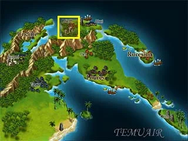

| | |
|---|---|
| Aisling Citizenship Since | Deoch 1, Fall |
| Aisling Governed Since | Deoch 5, Fall |
| Awakening Point | Mileth Inn |
| Admitted At | Mileth Inn or Tavern |
| Admitted By | Mileth Office Holders |
| Political Offices | Respected Citizen, Guard, Guard Captain, Judge, Demagogue and Burgess |
| Office Holder Terms | Respected Citizen: Two Moons; All Others: Four Moons |

Mileth was the first state in Temuair to accept aislings as citizens in Deoch 1, Fall. Since then all newly sparked aislings awaken in the Mileth Inn and are automatically granted Mileth citizenship.

Not long after Mileth became the first state where aislings assumed political power. Under aisling governance Mileth has tended to retain a more rural, conservative character and has often been known for it's turbulent local politics at times.

In modern times Mileth is a place few aislings can do without visiting on occasion.

Within Mileth Village is the **Mileth Altar** where aislings begin the process of ascension to increase their health and mana. Not far away is the **Temple of Choosing** where aislings can choose their path, subpath, master, improve their attributes and forge the mightiest of armors.

### Awakening & Travel Times

Citizens of Mileth awaken at the **Mileth Inn**. Mileth citizenship ranks worst overall of Temuarian citizenships for travel times. This is due to the particularly long trek needed from the Mileth Inn to the exit of Mileth Village.

`((Ranking is for Mileth, Rucesion, Tagor, Suomi and Loures citizenships. Times were measured using the most direct routes from the Mileth Inn available to all aislings (except to Medenia where the express ship was used). No change of form was used. All times out of character.))`

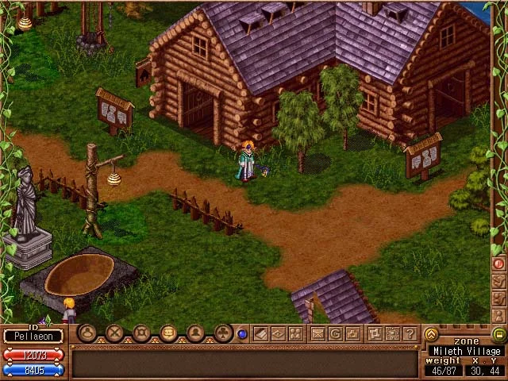

| Destination | Time | Rank | Destination | Time | Rank |
|-------------|------|------|-------------|------|------|
| Abel Tavern | 1:22 | 5th | Cail Temple | 1:15 | 5th |
| Coliseum Arena | 1:00 | 5th | Ceannlaidir Temple | 1:05 | 5th |
| Medenia (Caravan) | 2:30 | 5th | Deoch Temple | 2:25 | 5th |
| Mileth Altar | 0:06 | 1st | Fiosachd Temple | 1:00 | 5th |
| Mileth College | 0:50 | 5th | Glicoa Temple | 0:55 | 5th |
| Pravat Cave | 0:50 | 5th | Gramail Temple | 1:05 | 5th |
| Rucesion Bank | 1:20 | 5th | Luathas Temple | 1:35 | 5th |
| Temple of Choosing | 0:50 | 3rd | Sgrios Temple | 2:10 | 5th |

### Territory

Mileth territory is divided into two main areas:

**Mileth Village** is the main population center and contains many shops, services and points of interest.

The **East Woodlands** is a massive region mostly made up woodland. Points of interest in include the **Wastelands**, **Druid Circle**, **Enchanted Garden** and **Lover's Glade**. Several hostile **Goblin** and **Fae** clans who do not recognize Mileth authority also reside here.

[The **Mileth Fair** is a another area only available when the **Mileth Fair** is in progress. It contains booths for rent, two amphitheaters and other areas for events; it is accessible from Mileth Village (#21 on the map below) when open.]

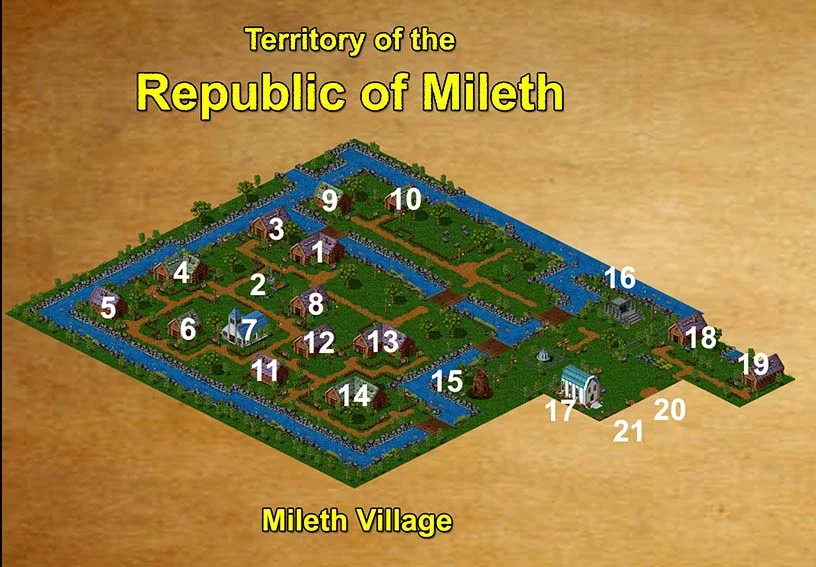

`((Click to see in full size.))`

#### Mileth Village

| No. | Location | Contact | Functions |
|-----|----------|---------|-----------|
| 1 | Mileth Inn | Riona | Awakening Point; Citizenship Functions; Set Mundane Birth |
| 2 | Mileth Altar | | Altar Worshipping; Ascension |
| 3 | Rogue Trainer | Daithi | Goods; Trainer |
| 4 | Armory Shop | Torrance & Callough | Goods; Repair; Spare A Stick Quest |
| 5 | Training Room | Vorlof | New Aisling Training Quest |
| 6 | Parcel Service | Colm | Send / Receive Items |
| 7 | Church | Naomhan | Matrimony |
| 8 | Higgler | Brody | Goods; Tailoring |
| 9 | Black Magic | Dar | Trainer; Dark Things Quest; Mentorship; Wizardry Research |
| 10 | Magic Shop | Cian | A Little Bit of That Quest; Blue Powder Creation; Goods |
| 11 | Empty Building | | |
| 12 | Bank | Cassidy | Banking; Hairstyling; Labor |
| 13 | Tavern | Aingeal, Dona, Duana, Muhsin & Teague | Citizenship Functions; Arsaidh Aon Quest; Dragon Scale Sword Quest; Letter Quest; Mother's Love Quest; "Terror Of" Quests |
| 14 | Combat & Magic | Keallach & Devlin | Goods; Trainers; Mentorship; On Honey Quest |
| 15 | Mileth Crypt | Gigean, Kieran & Skan | Hunting; Necromancy Trainer for Wizards; Sgath Pit (Judicial Executions) |
| 16 | Temple of Choosing | Aoife, Dee, Donnan, Erin, Gregory, Keefe, Logan & Neil | Ability 95 Armor Crafting; Attribute Improvement; Mastery; Path Selection; Male Wizard & Priest Nightmare Quest; Subpathing |
| 17 | Glicoa Temple | Meaveen | Glicoa Religion Functions |
| 18 | Village Hall (Mileth Citizens Only) | Aliran | Citizenship Functions; Judicial Functions; Political Functions |
| 19 | Justice Hall (Mileth Citizens Only) | Connlaoi | Civic and Judicial Records; Trial Chamber |
| 20 | Village Threshold | | Entrance to and exit from Mileth Village |
| 21 | Fair Entrance | | To the Mileth Fair (only when the fair is open) |

#### East Woodlands

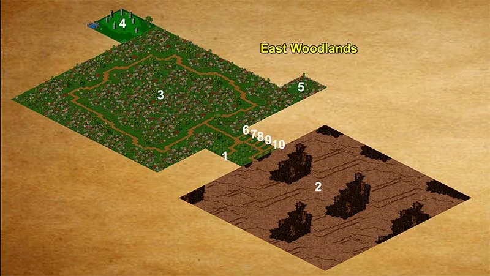

| No. | Location | Functions |
|-----|----------|-----------|
| 1 | Entrance / Exit | Crossroads Entrance / Exit |
| 2 | Wastelands | Very low insight hunting; Was a popular place to train pre-dojo |
| 3 | Enchanted Garden | Very low insight hunting; Flowers for herbalism |
| 4 | Druid Circle | No current functions; Druids here will talk about Light vs. Dark War and other events from around Deoch 17-24 |
| 5 | Lover's Glade | Fae Love |
| 6 | To 11 | Woodlands (area restricted to low insight aislings) |
| 7 | To 12 | Woodlands (area restricted to low insight aislings) |
| 8 | To 13 | Woodlands (area restricted to low insight aislings) |
| 9 | To 14 | Woodlands (area restricted to low insight aislings) |
| 10 | To 15 | Woodlands |
| 11 | To Crossroads | Return to E.W. Crossroads |
| 12 | | |
| 13 | | |
| 14 | | |
| 15 | | |
| 16 | Goblin Hut | Nightmare Quest (Warrior) |
| 17 | Great Sylvan Glade | Priest Insight 71 Armor Crafting |
| 18 | Singing Sylvan Glade | Priest "Aisling Of" Quest; Priest Insight 97 Armor Crafting |

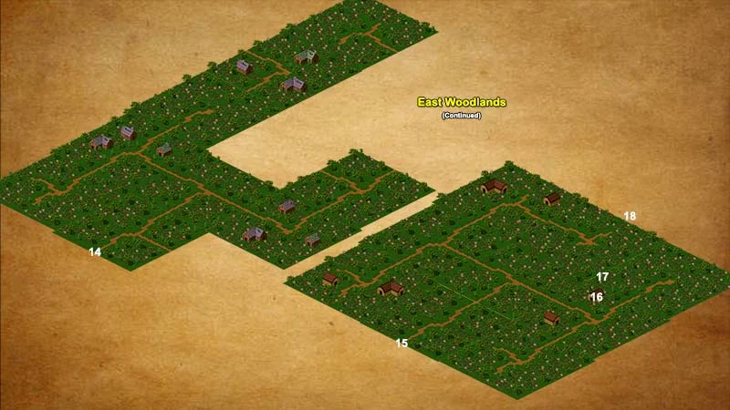

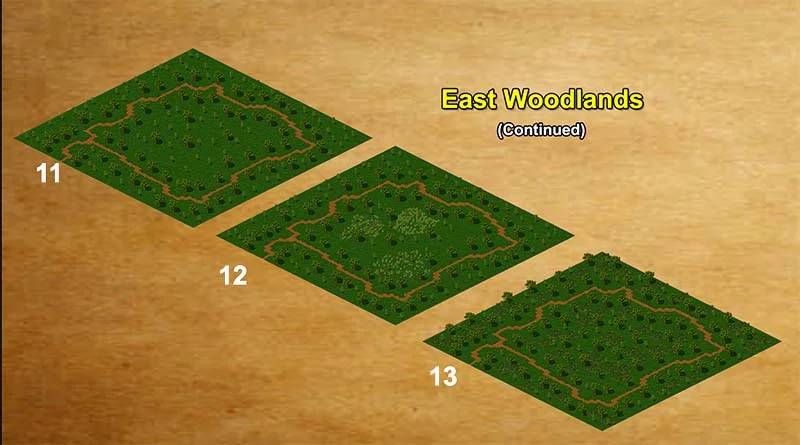

### Becoming a Mileth Citizen

[**Note:** All newly sparked aislings are automatically Mileth citizens.]

New citizens can be admitted by any Mileth office holder at the **Mileth Inn** or **Mileth Tavern** in **Mileth Village**. Prospective citizens must first be stateless.

Mileth citizenship is currently regulated by law under the **Citizenship & Office Eligibility Act**. It holds that aislings who have renounced or have otherwise lost Mileth citizenship may be readmitted freely provided they meet the following requirements:

1. No more than three jail marks
2. No jail mark less than one deoch old
3. No Sgath scars

Aislings who do not meet these requirements can make a petition to the **Mileth Demagoguery** (legislature) to be allowed citizenship.

### Changing & Losing Citizenship

**By Renunciation:** Mileth citizenship may be voluntarily renounced at the Mileth Inn, Mileth Tavern or Mileth Village Hall. The aisling will become stateless. This act will also erase an aisling's political history in Mileth as well as any political clout. Renouncing is required into order to become a Rucesion or Tagor citizen.

**By Overriding:** Mileth Citizenship may be overridden by assuming Noes or Suomi citizenship. This leaves the aisling's Mileth political history and clout intact.

**By Banishment or Exile:** Mileth citizens banished or exiled from Mileth will lose their citizenship. Banishment does not erase one's Mileth political history and clout while exile does.

`((Bug Note: Characters who have lost their citizenship by being banished or exiled may run into issues where certain NPCs think the character is still a Mileth citizen. Besides being readmitted, this can be fixed by going to the Mileth Tavern or Inn and "renouncing" citizenship.))`

### Politics & Law Enforcement

[For an in depth guide to Mileth Politics and Law Enforcement please refer to the [Mileth & Rucesion Politics Scroll](#mileth--rucesion-politics).]

Mileth is an aisling governed state with a intricate political system that citizens may participate in. Mileth's legislature is called the **Demagoguery**. Laws passed by the Demagoguery are enforced by Mileth law enforcement officers.

`(( To view the laws of Mileth hit the "W" key and then select "Mileth Law". Low insight characters may be unable to view the board. The author of this lore also maintains an out of game law archive which can [be viewed online here](https://novus-imperia.com/law.htm). ))`

Aislings who violate Mileth law can be **banished** and serious offenders **exiled**. Banishment lasts eight days `((24 hours))`. Exile terms can last up to two deochs `((90 days))` and must be lifted manually by a Demagogue or Burgess. An aisling who is banished or exiled cannot enter Mileth territory will be physically blocked from crossing the Mileth Village, Mileth Fair and East Woodland thresholds.

Exile from Mileth is hardly a laughing matter for most aislings as they will no longer have access to the Altar and Temple of Choosing.

Mileth also practices capital punishment. Executions or '**Sgathings**' are carried out publicly in the Sgath Pit located on the first level of the Mileth Crypt (take the right most set of stairs at the vestibule).

A condemned aisling is first summoned to the pit and then foul creatures known as sgaths then are summoned to dispatch them. This leaves a permanent scar on an aisling's legend. Crimes under Mileth law which call for sgathing include murder, grand theft and mass abuse of political power.

Mileth law has a far reach. Citizens are obligated to obey Mileth law when in neutral territories. Non-citizens who victimize Mileth citizens in neutral territories can be prosecuted under Mileth law as well.

For more information refer to the [Jurisdiction Scroll](#jurisdiction).

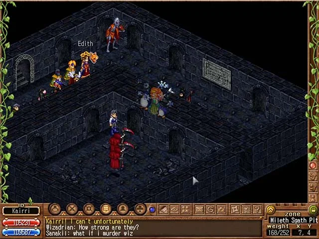

_`((Shown right: Mileth Sgath Pit. Aisling murderer the TehLeader is being sgathed. Memory Courtesy of Kairri. Click for full size.))`_

## Rucesion

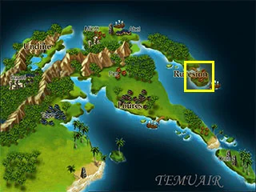

| | |
|---|---|
| Aisling Citizenship Since | Deoch 6, Fall |
| Aisling Governed Since | Deoch 6, Fall |
| Awakening Point | Rucesion Inn |
| Admitted At | Rucesion Inn or Bank |
| Admitted By | Rucesion Office Holders |
| Political Offices | Respected Citizen, Guard, Guard Captain, Judge, Demagogue and Burgess |
| Office Holder Terms | Respected Citizen: Two Moons; All Others: Four Moons |

By Deoch 6, the aisling population of Temuair was growing rapidly. Abel, Rucesion and Undine each offered themselves to become a second state for aisling settlement. A two round vote was held by aislings. Undine was eliminated in the first round and Rucesion defeated Abel in the second.

Thus Rucesion in Deoch 6, Fall became the second state to allow aislings to become citizens as well as assume political power. Aislings have governed Rucesion ever since.

Rucesion historically was the center of aisling commerce; centered around it's bank. Rucesion's community message board was the the go to place for gossip and discussion. In modern times Pravat has increasingly challenged Rucesion for commerce and message boards in general are rarely used due to newer ways of communication `((such as Dark Ages groups on Discord))`.

Rucesion has also long been and remains the center of gem polishing in Temuair. This is mostly due to the so called 'black market' being located in central Rucesion and the ability to cast spells within city limits.

### Awakening & Travel Times

Citizens of Rucesion awaken at the **Rucesion Inn**. Rucesion is tied with Suomi as the best citizenship in Temuair for travel times. Rucesion Inn is just steps away from docks where ships can take aislings to locations far and wide.

`((Ranking is for Mileth, Rucesion, Tagor, Suomi and Loures citizenships. Times were measured using the most direct routes from the Rucesion Inn available to all aislings (except to Medenia where the express ship was used). No change of form was used. All times out of character.))`

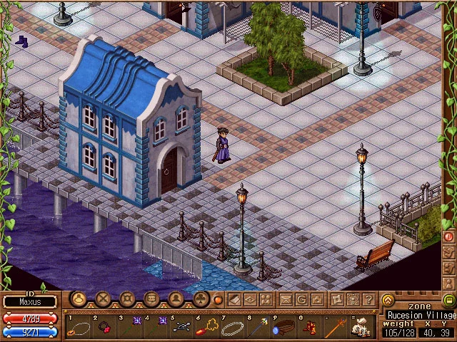

| Destination | Time | Rank | Destination | Time | Rank |
|-------------|------|------|-------------|------|------|
| Abel Tavern | 0:25 | 1st | Cail Temple | 0:25 | 1st |
| Coliseum Arena | 0:22 | 2nd | Ceannlaidir Temple | 0:20 | 1st |
| Medenia (Caravan) | 1:40 | 1st | Deoch Temple | 1:35 | 2nd |
| Mileth Altar | 1:18 | 3rd | Fiosachd Temple | 0:30 | 2nd |
| Mileth College | 0:18 | 2nd | Glicoa Temple | 0:33 | 2nd |
| Pravat Cave | 0:20 | 2nd | Gramail Temple | 0:20 | 1st |
| Rucesion Bank | 0:15 | 1st | Luathas Temple | 0:35 | 1st |
| Temple of Choosing | 0:45 | 2nd | Sgrios Temple | 1:10 | 1st |

### Territory

Rucesion territory is divided into two areas:

**Rucesion Village** is the main population center and contains shops, services and points of interest.

**Dubhaim Castle** was the seat of power of the Chadul aligned Isle of Dawn long before the aisling era. Nowadays it is a complex of decaying structures that are inhabited by foul Dubhaimaid remnants. The temple of Sgrios can be found amongst the crumbling walls accursed creatures.

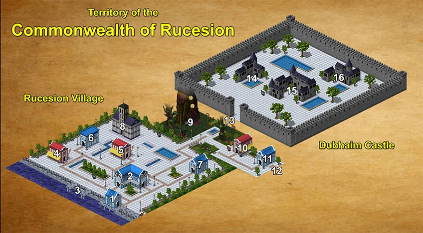

`((Click to see in full size.))`

| No. | Location | Contact | Functions |
|-----|----------|---------|-----------|
| 1 | Rucesion Inn | Maria | Awakening Point; Citizenship Functions |
| 2 | Armory | Carlos & Marcelo | Goods; Mentorship; Repair |
| 3 | Docks | | Village Entrance / Exit |
| 4 | Rogue Trainer | Baltasar | Goods; Trainer |
| 5 | Black Market (Rogues Only) | Braz | Goods |
| 6 | Goods Shop | Huberto | Goods; Tailoring; Smoke Bombs |
| 7 | Bank | Antonio & Angelo | Banking; Citizenship Functions; Hairstyling; Higgling; Send / Receive Items; Trainer |
| 8 | Church | Ereno | Matrimony |
| 9 | Luathas Temple | Gabriela | Luathas Religion Functions |
| 10 | Village Hall (Rucesion Citizens Only) | Eduardo | Citizenship Functions; Judicial Functions; Political Functions |
| 11 | Justice Hall (Rucesion Citizens Only) | Ramiro | Civic and Judicial Records; Trial Chamber |
| 12 | To Mileth Sgath Pit (Rucesion Citizens Only) | | Shortcut to the Mileth Sgath Pit |
| 13 | Dubhaim Threshold | | Entrance to and exit from Dubhaim Castle |
| 14 | Dubhaim Castle West | | Very low insight hunting; Sgrios Temple Entrance |
| 15 | Dubhaim Castle South | | Low insight hunting; Sgrios Temple Entrance |
| 16 | Dubhaim Castle North | | Mid insight hunting; Sgrios Temple Entrance |

### Becoming a Rucesion Citizen

New citizens can be admitted by any Rucesion office holder at the **Rucesion Inn** or **Bank** in Rucesion Village. Prospective citizens must first be stateless.

Rucesion citizenship is regulated by law under the **Commonwealth Preservation Act**. It holds that aislings may be admitted freely provided they meet the following requirements:

1. No more than three criminal marks
2. No criminal marks less than one deoch old

Rucesion, as per the **Codes of Practice** law, considers the following to be criminal marks: Exile, Jail, Arrest\*, Political Barment or Sgath; \* - excluding Hwarone arrests

### Changing & Losing Citizenship

**By Renunciation:** Rucesion citizenship may be voluntarily renounced at the Rucesion Inn, Bank or Village Hall. The aisling will become stateless. This act will also erase an aisling's political history in Rucesion as well as any political clout. Renouncing is required into order to become a Mileth or Tagor citizen.

**By Overriding:** Rucesion citizenship may be overridden by assuming Noes or Suomi citizenship. This leaves the aisling's Rucesion political history and clout intact.

**By Banishment or Exile:** Rucesion citizens banished or exiled from Rucesion will lose their citizenship. Banishment does not erase one's Rucesion political history while exile does.

`((Bug Note: Characters who have lost their citizenship by being banished or exiled may run into issues where certain NPCs think the character is still a Rucesion citizen. Besides being readmitted this can be fixed by going to the Rucesion Inn or Bank and "renouncing" citizenship.))`

### Politics & Law Enforcement

[For an in depth guide to Rucesion Politics and Law Enforcement please refer to the [Mileth & Rucesion Politics Scroll](#mileth--rucesion-politics).]

Rucesion is an aisling governed state with a intricate political system that citizens may participate in. Rucesion's legislature is called the Demagoguery. Laws passed by the Demagoguery are enforced by Rucesion law enforcement officers.

`(( To view the laws of Rucesion hit the "W" key and then select "Rucesion Law". Low insight characters may be unable to view the board. The author of this lore also maintains an out of game law archive which can [be viewed online here](https://novus-imperia.com/law.htm). ))`

Aislings who violate Rucesion law can be banished and serious offenders exiled. Banishment lasts eight days `((24 hours))`. Exile terms can last up to two deochs `((90 days))` and must be lifted manually by a Demagogue or Burgess. An aisling who is banished or exiled cannot enter Rucesion territory will be physically blocked from crossing the Rucesion Village and Dubhaim Castle thresholds.

Rucesion also practices capital punishment. Executions or 'Sgathings' are carried out publicly in the Sgath Pit located on the first level of the Mileth Crypt (take the right most set of stairs at the vestibule).

(**Note:** The Sgath Pit is jointly governed with Mileth and is considered the territory of both states. In addition to the entrance mentioned above Rucesion citizens are also able to enter the Mileth Sgath Pit via a short cut located at the far end of the Rucesion Commons.)

A condemned aisling is first summoned to the pit and then foul creatures known as sgaths then are summoned to dispatch them. This leaves a permanent scar on an aisling's legend. Crimes under Rucesion law which call for sgathing include murder, grand theft and mass abuse of political power.

Rucesion law has a far reach. Citizens are obligated to obey Rucesion law when in neutral territories. Non-citizens who victimize Rucesion citizens in neutral territories can be prosecuted under Rucesion law as well.

For more information refer to the [Jurisdiction Scroll](#jurisdiction).


_`((Shown right: Mileth Sgath Pit. Aisling murderer the TehLeader is being sgathed. Memory Courtesy of Kairri. Click for full size.))`_

## Mileth & Rucesion Politics


_Meeting of Mileth Officials - Circa Deoch 184_

Mileth and Rucesion have been aisling governed since Deoch 5 and Deoch 6 respectively. Since then, both have seen more than their fair share of political drama, intrigue and even outright violence. More than a few politicians have found themselves disgraced and executed in the Sgath Pit. Despite all this the Mileth and Rucesion political systems have carried on for nearly two centuries.

### Power & Authority

Mileth and Rucesion office holders have access to a variety of political and law enforcement powers by virtue of holding office `((game mechanics))`. However they cannot simply use their powers any way they want to (unless they desire a very short political career). The authority to use those powers comes from **written law**.

#### Mileth v. Rucesion Law

It is important to understand that while Mileth and Rucesion share the same base political system, they do not share the same laws. So for example while a Mileth Burgess will have the same powers as a Rucesion Burgess, how and when they may use them may be very different. This difference in law extends to matters of criminal justice, legislation, official procedures, etc.

An aisling should never assume that their knowledge of Mileth law will apply in Rucesion or vice versa.

### Base Requirements

To enter Mileth or Rucesion politics one must meet the following requirements:

1. Be a citizen
2. Be a current tax payer `((registered character))`
3. Mentored at least one aisling `((mark must be on the character's legend))`

`((These requirements are set by game mechanics.))`

Meeting these requirements will allow one to seek office as a **Respected Citizen**. Serving as a **Respected Citizen** is required to advance to the higher offices.

#### Law Requirements

Both Mileth and Rucesion law have additional requirements in addition to the base requirements:

**Mileth law** currently requires all prospective office holders to have:

1. No more than three jail marks
2. No jail marks less than one deoch old
3. No Sgath scars

Those who do not meet these requirements may submit a petition to the Mileth Demagoguery.  
[Refer to: **Mileth's Citizenship & Office Eligibility Act**]

Mileth also requires those seeking an office above that Respected Citizen to pass a **written exam** administered by senior official.  
[Refer to: **Mileth's Officer Act**]

**Rucesion law** currently requires prospective office holders for offices **_above Respected Citizen_** to have:

1. No more than three criminals marks (exile, jail, arrest, political barments; Hwarone arrests not included)
2. Those with one or two criminal marks may submit an **Application for Higher Officer** for approval to seek high office

Any lawful Rucesion citizen may assume office as a Respected Citizen regardless of criminal marks.  
[Refer to: **Rucesion's Commonwealth Preservation Act** and **Codes of Practice**]

`((Note: These requirements are set by player written laws in game and can always be changed in the future. While there are no game mechanics that will stop a character from taking office in violation of player written laws, the political system does allow players to attack and remove other players from office.))`

### Running For Office

Those who met the requirements must seek out **Aliran** in the **Mileth Village Hall** or **Eduardo** in the **Rucesion Village Hall** to declare their candidacy for office. Once an aisling's candidacy has been recognized they may begin acquiring clout and seek sponsorship.

### Clout

The political systems of Mileth and Rucesion are based on the concept of accumulating and using **clout**. Certain amounts of clout are required and/or must be spent to assume political office and execute political actions.

**Gaining Clout:**

Clout can be gained in in four ways:

1. **Citizen support** ("**voting**") is the first and foremost way to gain clout. Every tax paying `((registered))` citizen insight eleven or higher may give their 'political support; to an office holder or one seeking office once roughly every six days `((about 18 hours*))`. After six days have passed the citizen is free to provide support again to the same or a different aisling.
    - The aisling being supported receives one point of clout
    - The aisling giving support will lose two days of labor
    - Both aislings must be Temuair at the same time the support is given

    `((* NPCs in game incorrectly state that one can give support every 12 hours.))`

2. **Noble recognition** via submitting a work to the Mileth College and having it recognized awards some clout. The amount depends on the subject and recognition level:

    | | History | Philosophy | Lore | Literature | Art | Persona |
    |---|---|---|---|---|---|---|
    | Aisling | 100 | 66 | 60 | 32 | 24 | N/A |
    | Folk | 60 | 44 | 30 | 20 | 12 | 12 |
    | Village | 40 | 30 | 20 | 16 | 10 | 10 |
    | Clave | 20 | 14 | 10 | 6 | 4 | 4 |

3. **Aiding the sick children in Loures** with sevti blossoms from the Mehadi Swamp. For every fifth flower returned an aisling will receive five clout.
4. **Endowing** allows an office holder to transfer clout to another office holder or candidate, though at a price:
    - The aisling endowing loses ten points of clout and two days of labor
    - The aisling being endowed receives seven points of clout
    - Both aislings must be Temuair at the same time the endowment is given

**Maximum Clout:**

- Aislings who have never held an office higher than **Respected Citizen** may hold a maximum of **101 clout**. Once an aisling achieves an office higher than Respected Citizen their maximum clout potential is **permanently raised to 301**.

### Political Offices

There are six political offices in Mileth and Rucesion divided into legislative and judicial branches.

1. **Demagogues** and **Burgesses** make up the legislature (called the 'Demagoguery') and are responsible for the laws
2. **Guards**, **Guard Captains** and **Judges** make up the judiciary and are responsible for law enforcement and judicial processes.

Legislative and judicial officers serve terms of office that last for four moons `((two real life weeks))`.

3. **Respected Citizens** are not part of the legislative or judicial branches, but serving in this office is required to advance to the higher offices. They do not receive a uniform. Their main duty is to be a role model citizen. They also have the power to admit new citizens. Respected Citizens serve terms of office that last for two moons `((one real life week))`.

**Mileth / Rucesion Office Holder Uniforms**

| Role | Female | Male |
|---|---|---|
| Guard |   |   |
| Guard Captain |     |     |
| Judge |   |   |
| Demagogue |   |   |
| Burgess |   |   |

#### Office Requirements

| Respected Citizen | Guard | Guard Captain | Judge | Demagogue | Burgess |
|---|---|---|---|---|---|
| Mentored an Aisling; 5 Clout; Sponsorship | Respected Citizen (1); 10 Clout; Sponsorship | Guard (4); 20 Clout; Sponsorship | Guard Captain (4); 25 Clout; Sponsorship | Respected Citizen (4); 20 Clout; Sponsorship | Demagogue (4); 50 Clout; Sponsorship |

### Sponsorship

Before one can assume office they must have a **current office holder above Respected Citizen** or **Knight**\* **sponsor** them. All office holders except for Respected Citizens receive **ten sponsorship points** at the start of each term in office. They can use these points to sponsor prospective office holders who are within one rank above or below them.

Sponsorship functions can be carried out for **Mileth** in the **Mileth Inn** or **Mileth Village Hall** and for **Rucesion** in the **Rucesion Village Hall** or **Rucesion Bank**. Both the sponsor and sponsoree must be in the building at the same time.

- **Respected Citizens** cannot sponsor anyone
- **Guards** can sponsor **Respected Citizens** (1 point), **Guards** (5 points) and **Guard Captains** (10 points).
- **Guard Captains** can sponsor **Guards** (1 point), **Guard Captains** (5 points) and **Judges** (10 points)
- **Judges** can sponsor **Guard Captains** (1 point) and **Judges** (5 points)
- **Demagogues** can sponsor **Respected Citizens** (1 point), **Demagogues** (5 points) and **Burgesses** (10 points).
- **Burgesses** can sponsor **Demagogues** (1 point) and **Burgesses** (5 points)

A sponsor can **withdraw** their sponsorship. This costs the sponsor 5 clout and removes 30 from the sponsorsee. Withdrawing sponsorship is incredibly rare and is generally only done is if an office holder is warranted for removal from office.

**Notes:**

- Sponsorship points **do not carry over** from one term to another; instead they are replenished to 10.
- **Respected Citizen sponsorship** carries over indefinitely until the aisling assumes an office above Respected Citizen (thus for example a first term Demagogue's sponsor could be his or her's original sponsor from the first term of Respected Citizen)

\* **Knights** can sponsor any Mileth or Rucesion candidate, but they have no ability to withdraw sponsorship. `((Sponsorship from a Knight is done via a trinket.))`

### Common Office Holder Powers

The target aisling of any power must be in the lands at the same time the power is used; all powers will use some labor

| Power | Description | Clout Cost |
|-------|-------------|------------|
| Admit Citizen | Makes a stateless aisling a citizen | 1 |
| Attack | Reduces another's clout by 5 | 5 |
| Demote | Removes 20 clout from an officer holder one rank below | 5 |
| Dismiss | Withdraws sponsorship; reduces sponsoree's clout by 30 | 5 |
| Dying | Ability to assist aisling tailors in dying clothes | --- |
| Endow | Gives another 7 clout; costs 10 clout | 10 |
| Remove | Removes an aisling from office; target must have 0 clout | --- |
| Sponsor | Sponsors an aising one rank above or below for office | --- |
| Widdle | Anonymously reduces another's clout by 1 | 3 |

**Demotion** or **removal** of an office holder who is not warranted for removal is **illegal** under both Mileth and Rucesion law and is considered **abuse of power**.

### Judicial and Executive Powers

The target aisling of any power must be in the lands at the same time the power is used; all powers will use some labor

| Power | Description | Power of |
|-------|-------------|----------|
| Banish | Banishes an aisling | Guard, Captain, Judge |
| Unbanish | Unbanishes an aisling | Guard, Captain, Judge |
| Exile | Exiles an aisling | Demagogue, Burgess |
| Unexile | Unexiles an aisling | Demagogue, Burgess |
| Bar | Bars a citizen from involvement in politics | Burgess |
| Unbar | Unbars a citizen | Burgess |
| Sgath (Condemnation) | Brings an aisling to the Sgath Pit and marks their legend | Guard, Captain, Judge, Demagogue, Burgess |
| Sgath (Summoning) | Summons a sgath to kill a condemned aisling | Guard, Captain, Judge, Demagogue, Burgess |

Notes on banishment and exile:

- Banished and exiled aislings cannot cross a Mileth/Rucesion threshold
- Banishment lasts 8 days `((24 hours))`
- Exile is permanent until unexiled
- Exiled aislings will lose their citizenship, political record and clout if Mileth/Rucesion citizens
- Mileth and Rucesion office holders are immune to banishment and exile powers (even from the other state)

Notes on barment: Virtually never used as crimes which call for barment also call for exile (and thus loss of citizenship)

Notes on the Sgath powers: Judges and Burgesses can condemn an aisling or summon a sgath on their own; otherwise three office holders joining together is required

### Misc Powers

| Power | Description | Power of | Notes |
|-------|-------------|----------|-------|
| Appoint Fair Marshal | Appoints a Fair Marshal who has the power to open the Mileth Fairgrounds for one moon. | Burgess (Mileth Only) | Costs 250,000 Gold; Fair Marshal must be a Mileth citizen |
| Summon to Court | Summons an aisling to the Mileth/Rucesion Justice Hall | Judge | Leaves a mark on the summoned aisling's legend; Even those banished or exiled can be summoned |

### Accessing Powers

Almost all political powers are accessed from the Mileth/Rucesion Village Hall. A limited number of powers can also be accessed from the Mileth/Rucesion Inn, Mileth Tavern/Rucesion Bank and via Law and Politics Spells.

| Power | Inn | Tavern / Bank | Village Hall | Law Spell* | Politics Spell* |
|-------|-----|---------------|--------------|------------|-----------------|
| Admit Citizen | Yes | Yes | Yes | No | No |
| Attack | No | No | Yes | No | Yes |
| Demote | No | No | Yes | No | Yes |
| Dismiss | No | No | Yes | No | Yes |
| Endow | Yes | Yes | Yes | No | No |
| Remove | No | No | Yes | No | Yes |
| Sponsor | Yes | Yes | Yes | No | No |
| Widdle | Yes | Yes | Yes | No | No |
| Banish | No | No | Yes | Yes | No |
| Unbanish | No | No | Yes | Yes | No |
| Exile | No | No | Yes | No | No |
| Unexile | No | No | Yes | No | No |
| Bar | No | No | Yes | No | No |
| Unbar | No | No | Yes | No | No |
| Appoint Fair Marshal | No | No | Yes | No | No |

- Sgath (Condemnation) and Sgath (Summoning): Sgath powers are only accessible via Keiran in the Mileth Sgath Pit.
- Summon to Court: Aislings can be summoned to court only via Connlaoi in the Mileth Justice Hall or via Ramiro in the Rucesion Justice Hall.

\* Mileth/Rucesion Law and Mileth/Rucesion Politics spells are automatically learned up taking office as a judicial / legislative officer respectively (provided there is space in one's spell book). To use them one must first cast them and then drop a coin. They can be forgotten without ill-effect.

### Board Monitoring

Office holders are also responsible for board monitoring as follows:

**Mileth Boards**

| Board | Who Can Post | Administered By |
|-------|--------------|-----------------|
| Adventure | Anyone | Demagogue, Burgess |
| Cases | Anyone | Guard Captain, Judge |
| Chapel | Anyone | Demagogue, Burgess |
| Community | Anyone | Demagogue, Burgess |
| Demagoguery | Demagogue, Burgess | Burgess |
| Judgments | Anyone | Guard Captain, Judge |
| Law | Demagogue, Burgess | Burgess |
| Merchant's Quarter | Anyone | Demagogue, Burgess |
| Political Discourse | Anyone | Burgess |

**Rucesion Boards**

| Board | Who Can Post | Administered By |
|-------|--------------|-----------------|
| Adventure | Anyone | Demagogue, Burgess |
| Black Market | Anyone | Demagogue, Burgess |
| Cases | Anyone | Guard Captain, Judge |
| Community | Anyone | Demagogue, Burgess |
| Demagoguery | Demagogue, Burgess | Burgess |
| Judgments | Anyone | Guard Captain, Judge |
| Law | Demagogue, Burgess | Burgess |
| Merchant's Quarter | Anyone | Demagogue, Burgess |
| Political Discourse | Anyone | Burgess |

`(( Automatic board role assignment has been broken for many years since the Dark Ages server moved to AmazonAWS. Players with characters holding office must ticket Kru to get board administrator roles. This process can sometimes be a rather lengthy one. Once given though the admin roles are permanent (originally they would be taken away when one's term in office expired).`

`For convenience it is very common for characters who are not in office - yet retain board admin roles - to assist those office holder characters who do not yet have their roles assigned. ))`

## Tagor

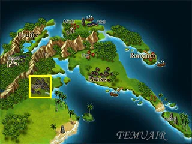

| | |
|---|---|
| Aisling Citizenship Since | Deoch 21, Fall |
| Awakening Point | Tagor Inn |
| Admitted At | Tagor Inn |
| Admitted By | Dorina |

Tagor is perhaps best known among scholars as the the birth place of necromancy. It went through many dark times and at the start of the aisling era it remained closed off to the rest of Temuair.

When Tagor reopened in Deoch 21, Fall it became the third state to allow aislings to become citizens, though not to hold political power. Despite it's dark history modern day Tagor is home to a rather eclectic set of mundanes, shops and services and is well integrated with the rest of Temuair.

### Awakening & Travel Times

Citizens of Tagor awaken at the **Tagor Inn**. Unique among awakening points in Temuair is that spells can be cast in the Tagor Inn allowing for easy improving of spells such as dachiaid and rift. (Tagor Inn is also the drop off point for aislings returning from the continent of Medenia via the magic carpet merchant in Noam.)

Unfortunately travel times are often only slightly better than that of Mileth citizenship due to the long walk from the Tagor Inn to the border.

`((Ranking is for Mileth, Rucesion, Tagor, Suomi and Loures citizenships. Times were measured using the most direct routes from the Tagor Inn available to all aislings (except to Medenia where the express ship was used). No change of form was used.))`

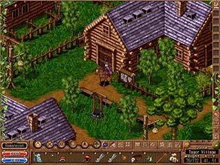

| Destination | Time | Rank | Destination | Time | Rank |
|-------------|------|------|-------------|------|------|
| Abel Tavern | 0:45 | 3rd | Cail Temple | 0:45 | 4th |
| Coliseum Arena | 0:38 | 4th | Ceannlaidir Temple | 0:38 | 4th |
| Medenia (Caravan) | 2:00 | 4th | Deoch Temple | 1:55 | 4th |
| Mileth Altar | 1:40 | 5th | Fiosachd Temple | 0:50 | 4th |
| Mileth College | 0:35 | 4th | Glicoa Temple | 0:52 | 4th |
| Pravat Cave | 0:36 | 4th | Gramail Temple | 0:38 | 4th |
| Rucesion Bank | 0:55 | 4th | Luathas Temple | 1:05 | 4th |
| Temple of Choosing | 0:58 | 5th | Sgrios Temple | 1:40 | 4th |

### Territory

The territory of Tagor is largely confined to the village itself. Before the aisling era Tagor territory was once much larger and included the House Macabre, Filth Forest and Eingren Manor before they became corrupted.

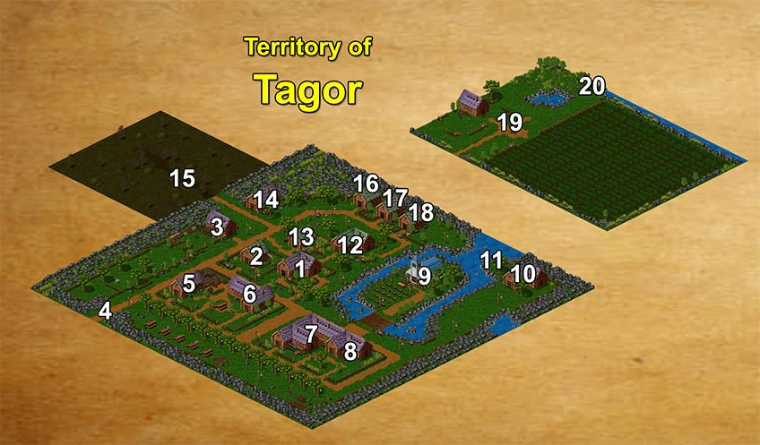

`((Click to see in full size.))`

| No. | Location | Contact | Functions |
|-----|----------|---------|-----------|
| 1 | Tagor Inn | Dorina | Awakening Point; Citizenship Functions; Returning from Medenia drop off point |
| 2 | Messenger | Cosmin | Send / Receive Items |
| 3 | Pet Shop | Areini | Buy / Exchange Pets |
| 4 | Entrance / Exit | | Entrance / Exit for Tagor Village |
| 5 | Empty Buildings | | |
| 6 | | | |
| 7 | Warrior Training Grounds | Scribe, Shay, Colan & Grouw | Trainers; Training Rooms; Sword Smithing; Goods |
| 8 | | | |
| 9 | Church | Aurel | Matrimony |
| 10 | Tavern | Elena & Tereza | Carrots; Sugar Beats; Misc Food & Drink |
| 11 | Boat | | To Tagor Farm (#19) |
| 12 | Armor Shop | Petru | Repairs (Left side of building is empty) |
| 13 | Magic Shop | Matei | Master Weapon Empowerment |
| 14 | Empty Building | | |
| 15 | Lost Souls Pass | | Help Tagor citizens |
| 16 | Bank | Cecil | Banking; Higgling |
| 17 | Nigel's Building | Nigel | Ciad, Tiota & Treas Quests |
| 18 | Ranger Station | Stefan | Ranger Functions; Ranger Records |
| 19 | Farm | Anwar | Dark Artifacts Quest |
| 20 | To Filth Forest | | To Filth Forest & Eingren Manor |

### Becoming a Tagor Citizen

New citizens are admitted at the **Tagor Inn** by the mundane **Dorina**. One must be insight 20 or higher and stateless. Citizenship requires the prospective aisling to help the mundanes of Tagor. The process is as follows:

1. Speak to Dorina at the Tagor Inn
2. Dorina will give you a belladona and task you to kill five skeletons in the nearby 'Lost Souls Pass'
3. Once inside the pass eat the Belladona and then kill five skeletons; you can have help but you must deal the death blows
4. Return to Dorina and you will receive Tagor citizenship

_**Be careful:** Do not kill any of the villagers in the pass by accident! They are very weak. You will receive a permanent orange mark on your legend and you will need to kill ten other creatures to get the stench off you._

(The only other way to become a Tagor Citizen is to be appointed a **Ranger**. Those Rangers who are not also Knights are granted Tagor citizenship. Rangers who are also Knights are typically granted Loures citizenship instead.)

### Changing Citizenship

**By Renunciation:** Tagor citizenship may be voluntarily renounced at the Tagor Inn. The aisling will become stateless. Renouncing is required into order to directly become a Mileth or Rucesion citizen.

**Aislings who renounce Tagor citizenship can never become one again. This is the only citizenship with this restriction. It is highly recommended to override Tagor citizenship instead of renouncing it.**

**By Overriding:** Tagor Citizenship may be overridden by assuming Noes or Suomi citizenship. Unlike renouncing, an aisling whose Tagor citizenship is overridden is able to become a citizen again in the future.

### Politics & Law Enforcement

Tagor has no aisling political system, offices or local laws. It is not possible to banished or exiled from Tagor. (While the Rangers of Temuair are based in Tagor, they do not function as local law enforcers or a government.)

Tagor citizens who are victims of Mundane Mandate `((Dark Ages Terms of Service))` violations can seek redress from the Rangers. In many cases they can also appeal to Mileth, Rucesion, Noes or Suomi authorities if they are a victim of crime by one of their citizens. See the [jurisdiction scroll](#jurisdiction) for more details.

(It was originally announced by the mundanes that Tagor would be governed by a "Sheriff" whom would then appoint five "Deputies". The position of sheriff would be determined by duels in which the incumbent sheriff could be challenged. Only pure path aislings would be allowed to become sheriff. This system, however, has never come to be.)

### Special Consideration: Throw

The skill **throw** can be learned by **rogues** and **monks** from the mundane trainer **Bodil** in **Abel**. For all other paths the only way to learn throw is to take office as a **Guard** in **Mileth** or **Rucesion**. For peasants, priests, warriors and wizards planning on becoming a Tagor citizen it is highly recommended that they take guard office before doing so if they wish to learn throw.

Learning throw after becoming a Tagor citizen is possible but time consuming:

1. Override Tagor citizenship with that of Suomi or Noes
2. Renounce Suomi or Noes citizenship
3. Become a citizen of Mileth or Rucesion
4. Take office as a Respected Citizen
5. Take office as a Guard
6. Renounce Mileth or Rucesion citizenship
7. Return to Dorina in the Tagor Inn to become a Tagor citizen again

Tagor citizenship cannot be regained if one renounces it so one must follow the above steps.

## Noes

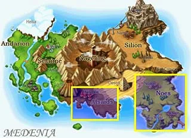

| | |
|---|---|
| Aisling Citizenship Since | Deoch 35, Fall |
| Hwarone Government Since | Deoch 61, Spring |
| Awakening Point | Aislon or Noam Inns |
| Admitted At | Noam Sacred Grounds |
| Admitted By | Earth Spirit |
| Political Offices | Soldier, Captain, General, Delegate & Councilor |
| Office Holder Terms | Permanent |

With the discovery and opening up of Medenia in Deoch 35, Fall a fourth option for aisling citizenship became available: **Noes**. At first this citizenship was similar to that of Tagor in that aisling citizens of Noes held no political power.

This situation changed in Deoch 61, Spring with the opening of **Hwarone City**. Noes citizens could become officials of Hwarone City. These officials were given authority over aislings in Medenia. It is for this reason that the terms Noes and Hwarone citizenship are often used interchangeably.

Noes is the only state with aisling citizenship that is located on the continent of Medenia. As might be expected many aspects of this citizenship are considerably different than those in Temuair.

### Awakening & Travel Times

Noes consists of two settlements: **Asilon Town** and **Noam Village**. Noes citizens awaken randomly in either Asilon Inn or Noam Inn. As one can cast spells in both inns, "jumping" from one to the other each using dachaid or rift is quite easy as well as improving those spells.

#### Traveling to / from Temuair

To travel to Temuair from Medenia without the use of scrolls one must speak to the **Magic Carpet Merchant** located just outside of **Noam Inn**. The aisling will be returned to Temuair and dropped off at the **Tagor Inn**. As such travel times from Noam Inn are considerably better than those of Asilon Inn. If one awakens in Asilon Inn it is much quicker to use dachaid or rift if available to "jump" to Noam Inn as oppose to walking to the magic carpet merchant from Asilon.

**Travel Times from Aislon Inn**

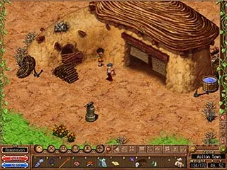

| Destination | Time | Destination | Time |
|-------------|------|-------------|------|
| Abel Tavern | 2:08 | Cail Temple | 2:13 |
| Coliseum Arena | 2:06 | Ceannlaidir Temple | 2:06 |
| Caravan (Medenia) | 0:38 | Deoch Temple | 3:23 |
| Mileth Altar | 3:08 | Fiosachd Temple | 2:18 |
| Mileth College | 2:03 | Glicoa Temple | 2:20 |
| Pravat Cave | 2:03 | Gramail Temple | 2:06 |
| Rucesion Bank | 2:23 | Luathas Temple | 2:33 |
| Temple of Choosing | 2:26 | Sgrios Temple | 3:28 |

**Travel Times from Noam Inn**

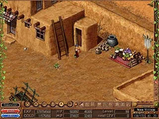

| Destination | Time | Destination | Time |
|-------------|------|-------------|------|
| Abel Tavern | 2:20 | Cail Temple | 0:57 |
| Coliseum Arena | 0:50 | Ceannlaidir Temple | 0:50 |
| Medenia (Caravan) | 0:10 | Deoch Temple | 2:07 |
| Mileth Altar | 1:52 | Fiosachd Temple | 1:12 |
| Mileth College | 0:47 | Glicoa Temple | 1:05 |
| Pravat Cave | 0:49 | Gramail Temple | 0:50 |
| Rucesion Bank | 1:07 | Luathas Temple | 1:17 |
| Temple of Choosing | 1:10 | Sgrios Temple | 1:52 |

#### Express Ships

Express Ships allow aislings to travel near instantaneously from Loures Harbor in Temuair to Asilon Harbor in Medenia. These ships are available to Noes citizens of any path. Non-Noes citizens can only make use of the express ships if they are a Medenian path.

#### Map of Ant Guardian Tunnels

Aisling possessing a **Map of Ant Guardian Tunnels** scroll can use it one every 32 hours `((4 hours))` for instant travel to the following locations in Medenia: **Andor**, **Asilon Harbor** and **Hwarone City**. The map can be obtained by completing the Temuair-Medenia **Insect Hunting Tournament** held every two deochs. `((Every March, June, September and December.))`

#### Travel Within Medenia

Settlements within Medenia are surrounded by wilderness that is quite often filled with hostile creatures and inconvenient geographical obstacles. Walking from one settlement to another can be time consuming and dangerous. For that reason most when traveling within Medenia use the caravan system. `((Using the caravan brings up a world map of Medenia where the player can quick travel almost anywhere.))`

### Territory

Noes consists of two settlements seperated by wilderness: **Asilon Town** and **Noam Village**.

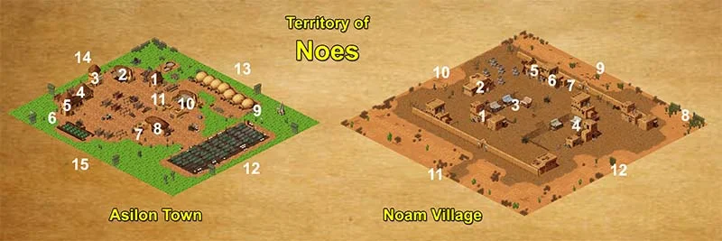

`((Click to see in full size.))`

#### Asilon Town

| No. | Location | Contact | Functions |
|-----|----------|---------|-----------|
| 1 | Home | Cruvano | Dioram Quest |
| 2 | Weapon Shop | Juwerl | Goods & Repair |
| 3 | Bank | Nulonna | Banking |
| 4 | Store | Braishi | Goods; Grimes Quest |
| 5 | Chief's Home | | (Empty) |
| 6 | Morwin | Morwin | Help Morwin Quest |
| 7 | Jedas | Jedas | Lorais Quest |
| 8 | Inn | | Awakening Point |
| 9 | Mephit | Mephit | Help Mephit Quest |
| 10 | Canteena | Tybar | Pest Quest |
| 11 | Lenoa | Lenoa | To Training Room (Become Medenian Path); To Caravan |
| 12 | To Praire 2 | | To Asilon Praire 2 |
| 13 | To Praire 6 | | To Asilon Praire 6 |
| 14 | To Praire 8 | | To Asilon Praire 8 |
| 15 | To Praire 5 | | To Asilon Praire 5 |

#### Noam Village

| No. | Location | Contact | Functions |
|-----|----------|---------|-----------|
| 1 | Home | | Empty |
| 2 | Bank | Kelan | Banking |
| 3 | Market | Pui, Nuetta & Poi | Goods |
| 4 | Market | Asahi & Cass | Goods |
| 5 | Pub | | Empty |
| 6 | Inn | Marie | Awakening Point |
| 7 | Magic Carpet Merchant | Habab | Caravan; To Temuair (Tagor Inn) |
| 8 | To Noam Sacred Grounds | | Citizenship Functions; Earth Spirit Religion |
| 9 | To Plains 10 | | To Noam Plans 10 |
| 10 | To Plains 5 | | To Noam Plans 5 |
| 11 | To Desert of Fire 0 | | To Desert of Fire 0 |
| 12 | To Plains 6 | | To Noam Plans 5 |

### Becoming a Noes Citizen

New citizens are admitted by the Earth Spirit located at the **Noam Sacred Grounds**. One must be insight 99 and have at least five million experience to give up. Five million coins must also be given to the Earth Spirit.

Noes citizenship overrides any current citizenship. As such prospective citizens do not need to be stateless.

`((Bug Note: If a character has more than two billion experience saved the Earth Spirit will erroneously say the character does not have enough experience. The character should ascend to get their saved experience below two billion.))`

### Taxes

Noes citizenship - uniquely among all aisling citizenships - carries a potential tax obligation of up to 10,000 gold coins each double moon. The specific tax rate is set by the High Council in Hwarone City. Each time an aisling awakens `((logs in))` an attempt will be made to collect any outstanding taxes.

### Changing Citizenship

**By Renunciation:** Noes citizenship may be voluntarily renounced at the Noam Sacred Grounds. The aisling will become stateless. Renouncing is required into order to become a Mileth, Rucesion or Tagor citizen.

**By Overriding:** Noes Citizenship may be overridden by assuming Suomi citizenship.

### Politics & Law Enforcement

[For an in depth guide to Noes Politics and Law Enforcement please refer to the [Noes Politics Scroll](#noes-hwarone-politics).]

The aisling government in **Hwarone City** (located in the neighboring **Alsaids** region of Medenia) has jurisdiction over all aislings in Medenia. However this government does not actually control territory the way that the aisling governments of Mileth, Rucesion and Suomi do. There are no territorial borders or thresholds. An aisling cannot be banished or exiled from Aislon, Noam, Hwarone or Medenia as a whole.

That being said the aisling government in Hwarone City is quite unique compared to the political systems in Temuair. The primary role of Hwarone politics is managing aisling participation in wars and economic decisions that go with them.

Hwarone's legislature is called the **Parliament**. Laws passed by Parliament are nominally enforced by Hwarone law enforcement officers. `((To view the laws of Hwarone hit the "W" key and then select "Hwarone Law". Low insight characters may be unable to view the board. The author of this lore also maintains an out of game law archive which can [be viewed online here](https://novus-imperia.com/law.htm).))`

Hwarone law enforcers have a power called '**arrest**', but it does not do anything except send the arrested aisling home to their citizenship's awakening point and leave a `((white))` mark on their legend. In modern times almost all law enforcement in Medenia is handled by Rangers.

## Noes (Hwarone) Politics

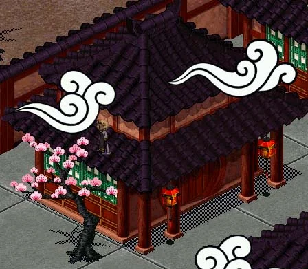

_Hwarone Parliament Building (Courtesy of Snooze)_

The politics of Noes on the surface appear to be very strange. Consider that aislings can become citizens of Noes. Citizens of Noes can then become officials in Hwarone City. Yet the mundanes of Hwarone and Noes are often at war with one another.

This makes little sense and require some explanation.

Hwarone could be arguably described as a military state and has been in an endless series of wars with it's neighboring Medenian polities for centuries. Yet no territory changes hands and there never appears to be any real danger of any of the warring sides being conquered by the other. These engagements appear to be more ritualistic than true warfare.

The Hwarone aisling government is divided into two branches: **Parliament** and **Military**. All positions are permanent barring removal, resignation or advancement. These office holders also have the benefit of not needing a pass to enter Hwarone City like ordinary Noes citizens and guests.

### Parliament

The **Hwarone Parliament** is bicameral and consists of two chambers: the lower **House of Delegates** and the upper **High Council**.

**House of Delegates:** Delegates make up the House of Delegates. Delegates propose legislation which is then voted on by the High Council. They also have the power to impeach and remove members of the High Council. To become a Delegate one must have the support of three Noes citizens and make a payment of 100 million gold coins.

**High Council:** Councilors make up the High Council. The High Council votes on legislation proposed by the House of Delegates. They also preside over trials and can remove members of the military. To become a Councilor one must have the support of five Noes citizens and make a payment of 100 million gold coins.

The High Council is also responsible for economic and war matters. They have the ability to set a mandatory tax for Noes citizens payable each double-moon up to a maximum of 10,000 standard gold coins. This revenue combined with any spoils of war goes into a treasury which can be used to import seven special items from abroad ('**Hwarone Imports**') for purchase by aislings. It costs 100 million to gold from the treasury to import one item for a limited time. These items are otherwise unobtainable.

**Hwarone Import Items**

| Hat | Hat | Hat | Overcoat | Overcoat | Overcoat | Pet |
|---|---|---|---|---|---|---|
|  |  |  |  |  |  |  |
| Hwarone Blue Hood | Blue Kerchief | Blue Cloche | Training Uniform | Hwarone Blue Shirt | Hwarone Blue Dress | Bast Cat |

- Hats: Hwarone Blue Hood, Blue Kerchief, Blue Cloche
- Overcoats: Training Uniform, Hwarone Blue Shirt, Hwarone Blue Dress
- Pet: Bast Cat

### Military

The primary role of the military is to fight in the wars. There are three ranks that one can hold: **Soldier**, **Captain** and **General**.

**Soldier:** Noes citizens who have 200 war kills can become a soldier. Soldiers are somewhat similar to Respected Citizens in Mileth and Rucesion in that they have no uniform, title or specific powers but becoming one is required to advance to higher military ranks.

**Captain:** Soldiers who have 500 war kills and the support of one Delegate and one Councilor can become a Captain. Captains receive a uniform, formal title and the ability to remove soldiers. They also are responsible for enforcing Hwarone law and have the power of arrest.

**General:** Captains who have 1500 war kills and the support of two Delegates and two Councilors can become a General. Generals receive a uniform, formal title and the ability to remove soldiers and captains. They also are responsible for enforcing Hwarone law and have the power of arrest.

**Hwarone Office Holder Uniforms**

| Role | Female | Male |
|---|---|---|
| Captain |  |  |
| General |  |  |
| Delegate |  |  |
| Councilor |  |  |

### Laws & Law Enforcement

Hwarone at one point had an extensive aisling drafted legal code. It has since been completely repealed by the so-called '**Cherry Blossom Accord**'. At the present time Hwarone has almost no local laws and has effectively given up on any sort of law enforcement.

**Captains** and **Generals** are the nominal law enforcers of Hwarone and are empowered to **arrest** law breakers. A **Hwarone arrest** is a very weak power though as being arrested only sends an arrested aisling home to their citizenship's awakening point and leaves a `((white))` mark on their legend. A Hwarone arrest does not detain an aisling like a Ranger arrest nor does it prevent them from physically accessing any territory.

`((When Hwarone was released there was talk from one G.M. about possibly restricting access to the Medenia Caravan for characters arrested by Hwarone law enforcers. This never came to pass and a Hwarone arrest remains just a legend mark.))`

The only real law in Hwarone currently is the **Mundane Mandate** `((Dark Ages Terms of Service))`. Even this is rarely enforced by Hwarone. Per the Cherry Blossom Accord the Rangers have first priority in dealing with those aislings who violate the Mundane Mandate.

### Accessing Powers

Most Hwarone political, military and law enforcement functions and powers are accessed through the mundanes **Lam** and **Wong**. They can be found next to the Hwarone political discourse board in the center of Hwarone City.

_`((Shown above: Lam and Wong in Hwarone City. Memory Courtesy of Snooze.))`_

### State of Noes / Hwarone Politics

Noes citizenship is very common and so to are their officials from Hwarone. In fact it is not unusual for there to be more Hwarone officials than officials of every polity in Temuair combined plus Rangers and Knights.

Yet paradoxically the Hwarone political system is the least active of all. No legislation has been proposed for decades. Parliament has not formally sat for at least that long. Wars are rarely fought under aisling direction and the taxation and import systems have broken down.

This is not surprising though. The active aisling population has plunged from what it was when Hwarone City was first opened. From heights of over 1000 it is now rare to see more than 150 active aislings at any given time. The numbers of aislings needed, willing and able to fight in Hwarone's wars and thus make the rest of the system work are simply not there anymore.

One member of the High Council I spoke to, Snooze, also suggested that since all of the Hwarone imports had been 'discovered' there remains little incentive for mass aisling involvement in Hwarone's wars.

`((Many of Hwarone's systems also appear bugged and/or knowledge of how they are supposed to function has been lost. One player with a character on the High Council (Giggles) spoke of money accumulated in the treasury simply vanishing; another (Eco) mentioned they were unable to set the tax rate due to a lack of a quorum.))`

The vast majority of modern day aislings spend almost all of their time in Temuair and not Medenia. It is not uncommon to be able to count the number of aislings in Medenia on fingers. With such a low population the need for local laws and law enforcement in Medenia has considerably diminished.

## Suomi

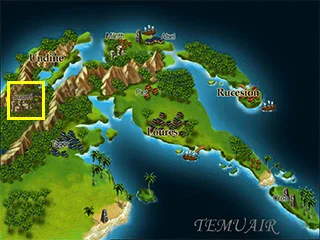

| | |
|---|---|
| Aisling Citizenship Since | Deoch 62, Fall |
| Aisling Governed Since | Deoch 62, Fall |
| Awakening Point | Suomi Inn |
| Admitted At | Anywhere |
| Admitted By | Suomi Troupe Members |
| Political Offices | Trouper, Burgess |
| Office Holder Terms | Permanent |

In Deoch 62, Fall Suomi became the fifth and thus far final state to allow aisling settlement.

Before aisling settlement Suomi was a small, isolated and rarely visited backwater. It did not even have an inn or bank. Suomi today remains small but has since grown into a modern village that is well connected to the rest of Temuair.

The aisling settlement of Suomi came during a time when many traditional values of Temuair were changing and other states were repealing their longstanding heresy laws. Indeed it's aisling settlement was based on the premise to provide a place where these values could continue. `((In short Suomi as a player settleable polity was setup to be a "role playing town".))`

This premise remains and to this day and Suomi is well known for defense and promotion of traditional Temurian values. It is the only aisling governed state where public acts of heresy remain illegal.

### Awakening & Travel Times

Citizens of Suomi awaken at the **Suomi Inn** which also functions as the local bank. Suomi citizenship is tied with Rucesion for the best travel times of all citizenships. This is made possible by the presence of a Loures Knight who stands just outside of the Suomi Inn. He is able to transport aislings (regardless of citizenship) instantly to Abel Village Way.

Just how powerful and useful this benefit is cannot be overstated: for example someone from Suomi can reach the Temple of Choosing in Mileth nearly twice as fast as a Mileth Citizen awakening at the Mileth Inn.

`((Ranking is for Mileth, Rucesion, Tagor, Suomi and Loures citizenships. Times were measured using the most direct routes from the Suomi Inn available to all aislings (except to Medenia where the express ship was used). No change of form was used.))`

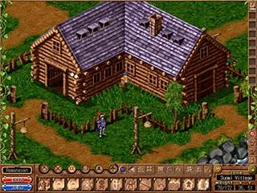

| Destination | Time | Rank | Destination | Time | Rank |
|-------------|------|------|-------------|------|------|
| Abel Tavern | 1:20 | 4th | Cail Temple | 0:35 | 2nd |
| Coliseum Arena | 0:19 | 1st | Ceannlaidir Temple | 0:26 | 2nd |
| Medenia (Caravan) | 1:50 | 2nd | Deoch Temple | 0:42 | 1st |
| Mileth Altar | 1:10 | 2nd | Fiosachd Temple | 0:11 | 1st |
| Mileth College | 0:13 | 1st | Glicoa Temple | 0:18 | 1st |
| Pravat Cave | 0:13 | 1st | Gramail Temple | 0:26 | 2nd |
| Rucesion Bank | 0:40 | 2nd | Luathas Temple | 0:50 | 2nd |
| Temple of Choosing | 0:28 | 1st | Sgrios Temple | 1:25 | 2nd |

### Territory

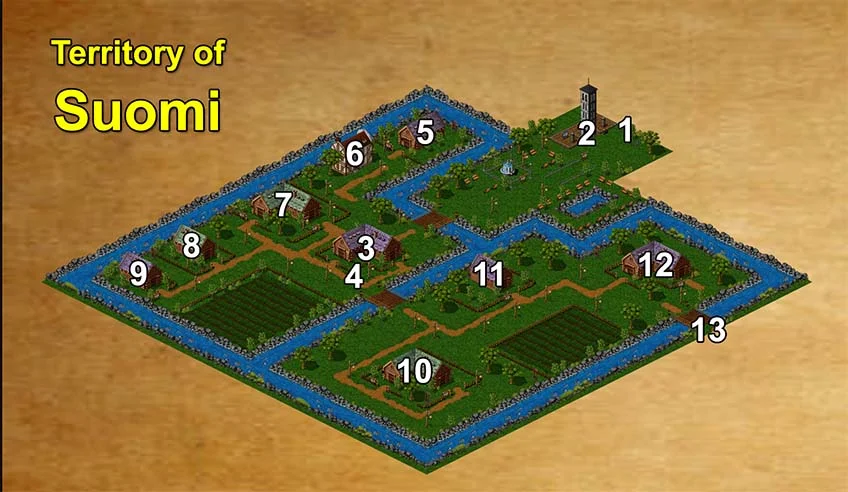

`((Click to see in full size.))`

| No. | Location | Contact | Functions |
|-----|----------|---------|-----------|
| 1 | Border | | Suomi Entrance / Exit |
| 2 | Deoch Temple | Vivianne | Deoch Religion Functions |
| 3 | Inn | Eeva & Liro | Awakening Point; Banking; Perfect Hairstyle Quest; Renounce Suomi Citizenship; Send / Recieve Items |
| 4 | Loures Knight | Keane | Transport to Abel Village Way; Capture the Flag Field Entrance |
| 5 | Special Skill Master | Frisk | Frisk's Secret Quest; Lockpicks; Trainer |
| 6 | Garamonde Theatre | | Plays and other events |
| 7 | Armory | Torbjorn & Valdemar | Goods; Porte Forest Quest; Repair; Sword Smithing; Soori Smithing; Tailoring |
| 8 | Cherry Farmer | Goran | Farm Grapes; Purchase Grapes; Sugar Beets & Carrots |
| 9 | Fae Priestess | Bertil | Cloth Gloves; Trainer |
| 10 | Combat & Black Magic Masters | Berg & Hadrian | Monk Forms Training; 'Fake' Necromancy Item Creation; Trainers |
| 11 | Grape Farmer | Alvar | Farm Grapes; Purchase Grapes; Sugar Beets & Carrots |
| 12 | Restaurant & Bar | Gudny, Viveka & Mioas | Emerald Dawn Quest; Misc Food & Drink; Mother's Love Quest; Sugar Beets & Carrots |
| 13 | To Porte Forest | | Porte Forest Entrance / Exit |

### Becoming a Suomi Citizen

New citizens can be admitted any full member of the Suomi Troupe (Trouper or Burgess). One does not need to be in any particular location as admission is done using a special scroll `((trinket))`. Suomi citizenship overrides existing citizenship so a prospective citizen does not need to be stateless.

Suomi citizenship is regulated by Suomi law under the **Citizenship Guidelines**. The requirements set down are:

1. No arrests, warrants or Ranger warnings within the previous one deoch
2. No more than two criminal marks (Arrests, Jails, Exiles) where the most recent is at least eight deochs old
3. No Sgath scars
4. No history of being publicly heretical
5. No history of public harassment of other individuals
6. No heretical or inappropriate names

A Suomi Burgess can make exceptions to these requirements if they feel an aisling has reformed but doesn't meet the requirements.

### Changing & Losing Citizenship

**By Renunciation:** Suomi citizenship may be voluntarily renounced at the Suomi Inn. The aisling will become stateless. Renouncing is required into order to become a Mileth, Rucesion or Tagor citizen.

**By Overriding:** Suomi Citizenship may be overridden by assuming Noes citizenship.

**By Stripping:** Suomi Citizenship may be stripped by a Burgess for violation of Suomi law and/or unbecoming conduct.

### Political System

Suomi's aisling government is called the **Suomi Troupe**. Unlike in Mileth, Rucesion and Noes the political system of Suomi is not divided into legislative and law enforcement branches. The Suomi Troupe is largely apolitical as it's primary role is event hosting.

The Suomi Troupe consists of three positions / offices: **Advocate, Trouper** and **Burgess**. All positions are permanent barring removal, resignation or advancement.

**Advocates:** can be Suomi or non-Suomi citizens. The position of advocate is for aislings who wish to host events with the Suomi Troupe and support Suomi culture. Advocates do not take part in the civic or law enforcement aspects of Suomi nor do they receive a uniform. Aislings can apply to become an advocate by submitting an application to any Trouper or Burgess. All active Advocates, Troupers and Burgesses will then vote on the application.

**Troupers:** are advocates who have proven themselves to become full fledged members of the Suomi Troupe. Advocates can apply to become a Trouper by submitting an application to a Trouper or Burgess. All active Troupers and Burgesses will then vote on the application. If the prospective Trouper is not a Suomi citizen they will become one upon acceptance of the position.

Troupers can admit new Suomi citizens as well as appoint and remove Advocates. They can also banish aislings who violate Suomi law. `((Both of these functions are accessed via a trinket. Troupers also have a second trinket that allows them to cast fireworks and other special graphical effects.))`

**Burgesses:** are appointed by Loures `((Kru))` usually on the recommendation of the Suomi Troupe as a whole. There is usually one or two active Burgesses at any given time. Burgesses have the same powers as Troupers as well as as the ability to appoint and remove Troupers and strip Suomi citizenships. Burgesses tend to chair meetings and liaison with the mundanes for event support.

`((Burgesses also have a trinket that allows them give out legend marks for events as well as generate Suomi Troupe Bags for prizes. They can also summon certain monsters and put up walls in maps where PVP is enabled for events.))`

**Suomi Office Holder Uniforms**

| Role | Female | Male |
|---|---|---|
| Trouper & Burgess |   |   |

### Law Enforcement

Suomi is the only state where heretical speech in public remains illegal. Otherwise Suomi has only a very small body of formal law which mostly concerns citizenship and membership in the Suomi Troupe.

Troupers and Burgesses are responsible for law enforcement and have the power of banishment. Aislings banished from Suomi cannot enter for two moons `((one real life week))` and will be physically repelled just before reaching the Deoch Temple should they attempt to do so.

(**Note:** Unlike Mileth and Rucesion banishment powers, an offender must be physically in Suomi territory at the time the Suomi banishment power is used. Also unlike Mileth and Rucesion banishment does not strip citizenship if one is a Suomi citizen.)

## Loures


| | |
|---|---|
| Aisling Citizenship Since | Deoch 41, Spring |
| Awakening Point | Knight Hall |
| Admitted By | Mundanes |

**Loures** is a special citizenship only available to aislings who are **Knights of Temuair**. This makes the citizenship very rare and the number of active Loures citizens is usually in the single digits.

Aside from the Knighthood requirement, Loures is no different than any other citizenship. It is most similar to Tagor citizenship in that there is no aisling political system, offices or local laws.

### Awakening & Travel Times

Loures citizens awaken in the Knight Hall which is located in the Loures Entrance Yard. This awakening point has somewhat decent travel times - better than those of Mileth and Tagor - but not nearly as good as Rucesion and Suomi.

`((Ranking is for Mileth, Rucesion, Tagor, Suomi and Loures citizenships. Times were measured using the most direct routes from the Knight Hall available to all aislings (except to Medenia where the express ship was used). No change of form was used. All times out of character.))`

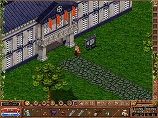

| Destination | Time | Rank | Destination | Time | Rank |
|-------------|------|------|-------------|------|------|
| Abel Tavern | 0:43 | 2nd | Cail Temple | 0:43 | 3rd |
| Coliseum Arena | 0:35 | 3rd | Ceannlaidir Temple | 0:34 | 3rd |
| Medenia (Caravan) | 1:55 | 3rd | Deoch Temple | 1:53 | 3rd |
| Mileth Altar | 1:28 | 4th | Fiosachd Temple | 0:43 | 3rd |
| Mileth College | 0:32 | 3rd | Glicoa Temple | 0:45 | 3rd |
| Pravat Cave | 0:30 | 3rd | Gramail Temple | 0:34 | 3rd |
| Rucesion Bank | 0:50 | 3rd | Luathas Temple | 0:57 | 3rd |
| Temple of Choosing | 0:55 | 4th | Sgrios Temple | 1:32 | 3rd |

### Territory

Loures territory is quite large and is divided into three main areas:

**Loures Yard** is an area outside of the walls that contains the **Gramail Temple**, **Knight Hall** and a **shortcut to Loures Castle**.

**Loures Market** is a large complex dedicated to commerce. Aisling merchants can out space here to sell their wares (though in modern times this area is effectively unused). There are also a few mundane merchants as well as the entrance to the **Loures' Sewers**.

**Loures Castle** is the mundane political center of Temuair and is the home of the **Library of Loures**. **King Bruce** and many high ranking mundane nobles reside here. There are also a variety of shops and services. Aislings who are arrested by Rangers will find themselves in the castle's lower dungeons.

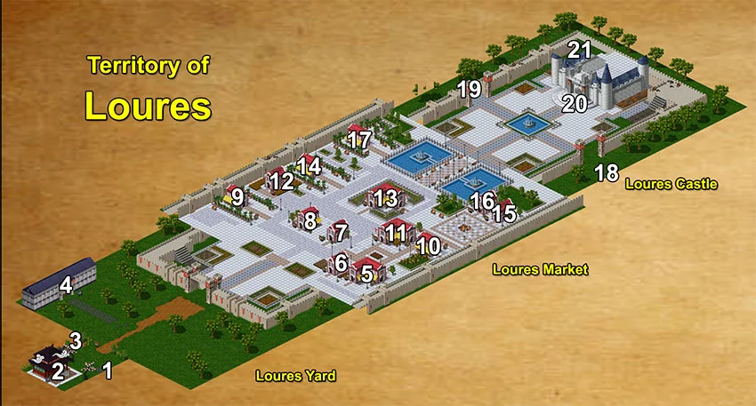

`((Click to see in full size.))`

| No. | Location | Contact | Functions |
|-----|----------|---------|-----------|
| 1 | Entrance / Exit | | |
| 2 | Gramail Temple | Camille | Gramail Religion Functions |
| 3 | To Loures Castle | | Shortcut to Loures Castle (#18) |
| 4 | Knight Hall (Knights Only) | | Awakening Point |
| 5 | Store 7 | Kasumf | Banking; Rental Space |
| 6 | Store 6 | Kasume | |
| 7 | Store 3 | Kasumb | Banking; Rental Space; Goods |
| 8 | Store 2 | Kasuma | |
| 9 | Store 10 | Kasumi | Banking; Rental Space |
| 10 | Store 15 | Kasumn | |
| 11 | Store 5 | Kasumd | |
| 12 | Store 1 | Kasum | Banking; Rental Space |
| 13 | Store 4 | Kasumc | |
| 14 | Store 11 | Kasumj | |
| 15 | Store 9 | Kasumh | Banking; Rental Space; Sewers Entrance |
| 16 | Store 8 | Kasumg | |
| 17 | Store 12 | Kasumk | |
| 18 | Castle Exit | | Leads to #3 |
| 19 | To Guild Battles | | To Guild Castles Battle Area |
| 20 | Loures Castle | Blaise, Blanchefleur, Bruce, Courtney, Jay, Jean, Lowell, Marlon, Marlin, Paulin, Thibault & Yves | Conix Lore; Goods; Loures Dungeon; Loures Library; Nobility Functions; Repair; Blanchefleur Flower Quest; Heart Quest; Pentagram Quest; Sick Child Quest; Thibault's Sword Quest |
| 21 | To Maze | | To Garden Maze & Lover's Garden |

### Politics & Law Enforcement

Loures has no aisling political system, offices or local laws. It is not possible to banished or exiled from Loures. (While the Knights of Temuair are based in Loures they do not function as local law enforcers or a government.)

## Undine


| | |
|---|---|
| Aisling Citizenship Since | N/A |
| Awakening Point | Suomi Inn |
| Admitted By | N/A |

**Undine** was once considered a possible second state for aisling citizenship in Deoch 5 before a vote by aislings ultimately choose Rucesion. Over a century later, Undine citizenship was granted to only one aisling: **Master Ranger Ishikawa**.

It is not possible for other aislings to become Undine citizens at his time. Curiously the awakening point for Undine citizenship is not in Undine itself, but rather in neighboring **Suomi** at the **Suomi Inn**.

## Jurisdiction

 vs  vs  vs 

When, where and over whom do law enforcers from aisling governed states have jurisdiction? These questions are answered by a combination of both **Loures `((Kru))` policy** and the **Jurisdiction Accords** signed by Mileth, Rucesion, Suomi, Noes, the Arena and Mileth College.

On the surface jurisdiction may appear to be an incredibly complex topic but is actually quite straightforward and can be determined by answering at most five questions from the perspective of a state law enforcer (Guards/Guard Captains/Judges in Mileth and Rucesion; Captains and Generals in Hwarone; Troupers and Burgesses in Suomi).

### 1. Has a Ranger already prosecuted the case?

- YES: Your state does not have jurisdiction.
- NO: Continue to question 2.

Rangers enforce the **Mundane Mandate** `((Dark Ages Terms of Service))`, but it is not uncommon for there to be overlap with local laws. For example harassment is both a mandate violation and against the laws of Mileth and Rucesion.

If a Ranger has already prosecuted a case no state may prosecute it again. Double jeopardy has long been explicitly forbidden by Loures `((Kru))` policy.

### 2. Did the alleged criminal activity occur in the territory of your state?

- YES: Your state has jurisdiction.
- NO: Continue to question 3.

States have jurisdiction over cases in own territory regardless of the citizenships of those involved.

### 3. Did the alleged criminal activity occur in the territory of another aisling governed state (Mileth, Rucesion, Noes, Suomi), the Arena, Mileth College or a Religious Temple?

- YES: Your state does not have jurisdiction.
- NO: Continue to question 4.

States cannot prosecute cases that took place in territory of another state or the Arena, Mileth College or a Religious Temple. (Note: The **Mileth College** and the **Glicoa Temple** are independent entities and not Mileth territory. The same goes for the temples of **Luathas** and **Sgrios** in Rucesion.)

### 4. Is the victim or perpetrator of the alleged criminal activity a citizen of your state?

- YES: Continue to question 5.
- NO: Your state does not have jurisdiction.

Territory not under the control of Mileth, Rucesion, Noes, Suomi, the Arena, Mileth College or a Religious Temple is considered **neutral territory**. States may prosecute cases that took place in neutral territory if one of their citizens was involved (as either an alleged victim or perpetrator).

(Note: Pigeon Mail, Whispers and World Shouts are legally considered to be neutral territory.)

### 5. Has another aisling governed state (Mileth, Rucesion, Noes, Suomi) already prosecuted the case?

- YES: Your state does not have jurisdiction.
- NO: Your state has jurisdiction.

As mentioned earlier double jeopardy is absolutely forbidden by Loures `((Kru))` policy. A state may only prosecute a case in neutral territory if one of the citizens was involved AND no other state or Ranger has already prosecuted the case.

### Misc. Notes

**The Dojo**

The dojo is a special neutral territory. Per Loures directive no aisling may prosecuted for the crime of sleephunting while in dojo. All other crimes, however, MAY be prosecuted.

**Mileth Sgath Pit & Gigean's Dwelling**

These two adjacent areas are unique in that they are legally the territory of both Mileth and Rucesion. In the event a crime were to take place in either it would be first come, first serve for prosecution by Mileth or Rucesion.

**Noes, Hwarone & Medenia**

The aisling government in Hwarone City has nominal authority over all aislings in Medenia. For purposes of jurisdiction all of Medenia is considered to be Noes/Hwarone territory.

## Citizenship Recommendations

Citizenship for an aisling should be considered first for the short term and then for the long term.

### Short Term

In the short term citizenship consideration is essentially based around two factors: becoming an **Aisling of Talgonite** and learning the skill **throw**.

**Aisling of Talgonite**

To gain the ability to ascend most aislings must become an **Aisling of Talgonite**. One of the requirements to become an Aisling of Talgonite is to have held at least one term of **Respected Citizen** in **Mileth** or **Rucesion** _OR_ be a **Tagor citizen**.

(An aisling can become an **Aisling of Mythril** or **Aisling of Hy-byrasyl** instead. However this path requires one to mentor 200 aislings (**for Mythril**) or achieve Aisling-level noble recognition via a submission to the Mileth College (**for Hy-brasyl**). As modern day aislings tend to reach the insights to ascend (97-99) at very young ages, it is extremely rare for one to have met one of those requirements so early in life.)

**Throw**

The skill **throw** can be learned by rogues and monks from the mundane **Bodil** in **Abel**. For peasants, priests, warriors and wizards the only way to learn throw is to take office as a **Guard** in **Mileth** or **Rucesion**.

**Recommendation for Peasants, Priests, Warriors and Wizards** (and those not planning on rededicating themselves as a monk or rogue)

1. Stay in Mileth or take citizenship in Rucesion
2. Mentor an aisling
3. Enter politics and serve one term as a **Respected Citizen**
4. Become an **Aisling of Talgonite**
5. Serve one term as a **Guard**; receive the skill throw
6. Consider long term citizenship

[**Important:** An aisling must become an Aisling of Talgonite while the mark of Respected Citizen is still on their legend. If one renounces Mileth or Rucesion citizenship that mark will be lost. One can, however, assume Noes or Suomi citizenship without issue as these two citizenships override existing citizenship without any loss of political history in Mileth or Rucesion.]

**Recommendations for Monks and Rogues**

**A: Easy Path**

1. Renounce Mileth citizenship
2. Become a Tagor citizen _[Tagor citizens do not need have served as a Respected Citizen to become an Aisling of Talgonite.]_
3. Become an Aisling of Talgonite
4. Consider long term citizenship

[**Important:** An aisling must become an Aisling of Talgonite while still a Tagor citizen.]

**B: Always Mileth Path** _(for those who want to retain their original at-spark Mileth citizenship)_

1. Mentor an aisling
2. Enter politics and serve one term as a **Respected Citizen**
3. Become an **Aisling of Talgonite**

### Long Term

After one has taking care of becoming an **Aisling of Talgonite** and learning **throw** they can consider citizenship in the long term. What citizenship would suit them the best? Let us review the elements one might consider for each citizenship.

**1. Travel Times**

If fast travel to destinations around Temuair is important then **Rucesion** and **Suomi** citizenships are best. If one spends most of their time in Medenia then **Noes** citizenship makes the most sense.

**2. Politics**

If one is interested in politics then **Mileth** and **Rucesion** citizenships are best. At the time of this writing politics in Mileth tends to be more active than that of Rucesion. While **Noes** possesses a unique political system of it's own it has been inactive and effectively broken for decades... though perhaps you could be the one to change that?

**Armor Dying:** If one wants to be able to dye pre-master armors they must be a **Mileth** or **Rucesion** **office holder.**

**3. Event Hosting**

If event hosting is one's thing then they might consider **Suomi** citizenship with a goal perhaps of becoming a part of the **Suomi Troupe**. One can also apply to be a **Suomi Culture Advocate** as a non-Suomi citizen.

**4. Legal Protections**

The best legal protections protection come with **Mileth** and **Rucesion** citizenships. Their law enforcers will step in even when their citizens are victimized outside of their territories in many situations. However given the rarity of crime in modern Temuair the value of this factor could be argued as not very significant.

**5. No Questions Asked**

Mileth, Rucesion and Suomi put restrictions on their citizenships if an aisling has a criminal record (particularly more than three Ranger jails). **Noes** and **Tagor** have no restrictions currently.

**6. Culture, Tradition & Ideology**

Lastly some may also take into account the background culture, traditions and ideology of a state when considering citizenship:

**Mileth:** Founded by one Auren D'Winter; generally believed to be the first ever warrior in the sense of the path, Mileth largely rejected magic to focus on the sword. Later on though the patron goddess of priests - Glicoa - had her temple established in Mileth. In modern times Mileth has been known for it's scholarship as well as turbulent local politics. Generally Mileth has been regarded as among the most conservative politically all of aisling states and it's government has often been at loggerheads with Loures. In Deoch 177 it became the first state to recognize the independence of Undine. `((Mileth is loosely based on real-world old Ireland.))`

**Rucesion:** Whereas Mileth rejected magic Rucesion instead embraced it and became the leading center of magical scholarship in Temuair with the Temple of Luathas - patron god of wizards - established there. It's central position as an island among the sea lanes allowed it become extremely wealthy from trade (both legitimate and through it's black market). Rucesion often was regarded as being more progressive than Mileth, though it's local politics could be just as vicious. `((Rucesion is loosely based on real-world old Portugal.))`

**Tagor** was once large and prosperous until it became the birthplace of necromancy with large areas overrun by cursed and malevolent entities. It remained largely closed off from the rest of Temuair until Deoch 21. Despite all this, modern Tagor in many ways represents resilience. It's people never surrendered to darkness or fled but rather stayed, fought and fortified. It is home now to a diverse variety of aislings, mundanes, shops and services. `((Based upon the names of it's NPCs and it's story background Tagor is likely loosely based on real-world old Romania.))`

**Noes,** like much of Medenia, is essentially on the frontier of wilderness. Unlike Temuair where there are well established travel routes and roads in Medenia one needs often needs to go through open and hostile territory to reach the next settlement. `((Noes does not appear to be based on any one particular real-world location, though many of the NPCs have names of Hebrew and Sanskrit origin. Hwarone on the other hand is very clearly inspired by East Asian civilizations.))`

**Suomi** if it had to be described in one word it would probably be "distant". It has always stood at the periphery of Temuarian civilization. Some might argue though with Suomi being the host of the temple of Deoch - god of creativity and inspiration - perhaps Suomi is really the place where much of Temuair begins and then rolls down the mountains from there. In modern times it has been a bastion of traditional Temuarian culture. `((Suomi is loosely based on real-world old Sweden.))`

## References & Sources

From the Author:

I am Ramanayan Caesar. I have been involved in aisling civics and politics since Deoch 13. The contents of this lore come primarily from my own personal experience, research and documents. That said I also referenced a number of other aisling works, board posts, laws, mundane announcements and other sources to help create this lore.

### Aisling Works

| Author | Work | Used for |
|--------|------|----------|
| Seara | [The Pacifist's Guide to Insight](Seara-The-Pacificists-Guide-to-Insight.md), Library of Loures | Information on gaining clout via the Sick Child of Loures quest |
| Xilan | [Dreuchd Teagasg (Political Lore)](Xilan-Political-Structure.md), Library of Loures | Clout award amounts gained by recognition |

`(( Backup copy of the Seara work: https://novus-imperia.com/citizenship/ref-seara.htm ))`  
`(( Backup copy of the Xilan work: https://novus-imperia.com/citizenship/ref-xilan.htm ))`

### Laws

(Preserved here as they were at the time of publication)

| Law | Title | Posted on |
|-----|-------|-----------|
| Hwarone Law | [Cherry Blossom Accord](https://novus-imperia.com/citizenship/ref-law-cherry.htm) | Hwarone Law Board |
| Mileth Law | [Citizenship & Office Eligibility Act](https://novus-imperia.com/citizenship/ref-law-mileth-citizenship.htm) | Mileth Law Board |
| Rucesion Law | [Commonwealth Preservation Act](https://novus-imperia.com/citizenship/ref-law-rucesion-cpa.htm) | Rucesion Law Board |
| Rucesion Law | [Codes of Practice](https://novus-imperia.com/citizenship/ref-law-rucesion-cop.htm) | Rucesion Law Board |
| Suomi Law | [Suomi Advancement and Voting Criteria](https://novus-imperia.com/citizenship/ref-law-suomi-adv.htm) | Suomi Troupe Board |
| Suomi Law | [Suomi Citizenship Guidelines](https://novus-imperia.com/citizenship/ref-law-suomi-citizenship.htm) | Suomi Troupe Board |
| Pan Aisling Law | [Jurisdiction Accords](https://novus-imperia.com/citizenship/ref-law-ja.htm) | Mileth / Rucesion / Hwarone Law Boards |

### Mundane Announcements

| Source | Title | Posted on |
|--------|-------|-----------|
| Listen | [Mundane Mandate](https://novus-imperia.com/citizenship/ref-knight-listen.htm) | Events of Temuair Board |
| Mundanes | Home Village Vote | News Posting |
| Mundanes | Home Village Vote Runoff | News Posting |

`(( Home Village Vote: retrieved from [darkages.fandom.com's copy of the original darkages.com news posting](https://darkages.fandom.com/wiki/News_Archive#Mileth_Enhancements_..._08.10.99); [backup copy here](https://novus-imperia.com/citizenship/ref-home-village-01.htm) ))`  
`(( Home Village Vote Runoff: retrieved from [darkages.fandom.com's copy of the original darkages.com news posting](https://darkages.fandom.com/wiki/News_Archive#Home_Village_Vote_Runoff_..._08.26.99); [backup copy here](https://novus-imperia.com/citizenship/ref-home-village-02.htm) ))`

### Special Thanks

**BioMagus**, _Dark Athar Mage of Rucesion_, for [her autobiography](http://da-wizard.com/files/biomagus_bio.html) which helped confirm specific event dates `(( Backup copy: https://novus-imperia.com/citizenship/ref-bio.htm ))`

**Laurier**, _Mileth College Chancellor_ & _Suomi Burgess_, for assisting in research on the Suomi political system

**Eco** and **Snooze**, _Hwarone High Councilors_, and Giggles, _Mileth Judge_, for insights and knowledge of the Hwarone political system

**Mayheart**, _Mileth Burgess_, for proofreading and suggestions for improvement

_Ramanayan Caesar of Mileth_  
_191.1.1_

***

```
*Librarian Notes*

Recognized: Aisling, 2022 (Mileth College master list).
This entry has been heavily edited to conform to Library formatting.
The original can be found at https://novus-imperia.com/college/lore/ramanayan_citizenship/01-intro.html .
```
