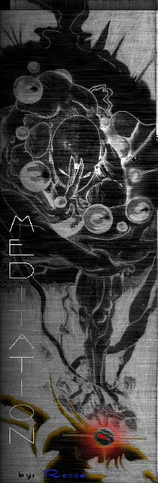

# Principia Monastica

_by Randolf in **Dark Ages**_



I. **Introduction**

II. **Life as a Monk**

- Social Graces
- Basic Equipment
- Community Involvement

III. **Basic Training**

IV. **Advanced Training**

V. **Tactics**

**Appendix**

## I. Introduction

The life of a Monk is not an easy one. You have forsworn the pursuit of Valor,
Wealth, and Power, suborning them all in service of Harmony, yet you have
accepted the personal duty of waging war upon the Darkness. This treatise will
guide your first steps along this Path.

## II. Life as a Monk

### Social Graces

Now that you are a Monk, you may be wondering how you fit into the grand scheme
of things. First of all, it is customary to address your fellow Monks as
"Brother" or "Sister;" Cail's Unity is strength. You must hold Honor inviolate.
Conduct yourself always with dignity and integrity. Do not look upon the other
Paths in scorn, for though they do not follow our ways, Cail's Harmony
encompasses all.

### Basic Equip

The appropriate garb of a beginning Monk is the Dobok for Brothers, and the
Earth Bodice for Sisters. This loose-fitting garment provides decent protection
while allowing reasonable freedom of motion. If your Master's asceticism
prevented him from providing you with one, or if it simply slipped his mind,
Doboks and Earth Bodices may be purchased from the higgler in Undine. When you
ascend to the next circle upon your 11th insight, you may then don a Culotte or
Lotus Bodice, also sold at the Undine higgler. Note that when wearing
traditional Monk garb it is expressly forbidden to wear mundane boots, in
reverence to Cail.

Rings are an essential part of a Monk's equipment. The bonuses to vitality
granted are essential to survival. The first set of such rings, Talos rings,
can be worn at the 4th insight, provide 100 vitality each, and sell for 3,000
coins pieces at the Piet armorer. At the 6th insight, Ruby rings; sold at the
Mileth armorer for 20,000 coins providing 200 vitality each, may be worn. At
the 8th insight, Lapis rings may be worn, granting 300 vitality each and sold
at the Undine armorer for 50,000 coins. The final rings for a Monk are Spinel
and Emerald rings, wearable at the 11th and 12th insights, respectively. These
much sought-after items provide 500 vitality each, as well as possessing
enchantments helpful in combat. Spinel rings help you strike true, and Emerald
rings increase the power behind your blows. However, they have a drawback:
their magic is bound to your soul; Sgrios will claim them if you should ever
visit his dark realm. Spinel rings are sold at the Undine armorer for 40,000
coins, and Emerald rings at the Suomi armorer for 54,000 coins. Such great
craftsmanship is time-consuming, so each smith can make but a few each week.

Earrings in Temuair provide a number of various enchantments. At your 8th
insight, acquire a pair of Gold earrings, sold at the Piet armorer for 8,000
coins. They are the only kind of earrings you need take note of, as their
enchantment will lend you strength in combat.

Greaves provide some added leg protection in combat situations. At the 6th
insight, you may wear Leather Greaves, sold at the Abel armorer for 4,000
coins. Upon reaching the 14th insight, Leather Greaves possessing various
enchantments may be worn. They may sometimes be found in the possession of
magical creatures in the woods and crypts, and Priests of the different Deities
can consecrate mundane ones. It is suggested that Greaves blessed by
Ceannlaidir or Gramail be worn, for their offensive and defensive value,
respectively. Iron Greaves may be worn upon reaching the 20th insight, and
enchanted Iron Greaves at the 30th.

Bracers are pieces of armor exclusive to Monks. Unlike gauntlets, they do not
dampen your innate magical abilities, yet still provide good protection to your
forearms. The first bracers you will come across are the enchanted Leather
bracers dropped by magical creatures in the woods and crypts; no mundane
equivalent exists, perhaps because the secrets of their manufacture have been
lost in time. They can be worn beginning at the 11th insight. Again,
Ceannlaidir or Gramail bracers are suggested. The next available type is Iron
Bracers, the mundane variety of which can be worn beginning the 33rd insight,
and can be consecrated as well.

Mundane necklaces provide enchantments enhancing your combat effectiveness.
Magical necklaces, in addition, infuse your strikes with elemental power. There
exist a great many types of necklaces; investigate which will best suit you.

Similarly, belts provide elemental defense. Mundane belts of each element are
sold at various armorers in Temuair for 10,000 coins each. The next belts you
will come across are elemental Leather belts, which also have a minor magical
attunement and may be worn starting at your 12th insight. Mythril belts, imbued
with a body-hardening enchantment, are much harder to find, but that much more
prized.

It is the Word of Cail that we do not sully our hands with the weapons of Man.
Many in our Path have wondered at the exact interpretation of his decree, as to
whether this proscription includes shields, or whether non-combat handling is
allowed. It is commonly known that many of our techniques are rendered
impossible by the additional imbalance, so there are strictly practical reasons
to avoid either weapons or shields.

### Community Involvement

In addition to our abilities and duties in combat, we possess some skills of
value to the community.

First of all, our attunement to Nature allows us to identify medicinal herbs
and brew potent potions from them. These have a variety of uses, and are prized
by all Aislings. Bertil, the Fae Priestess of Suomi, will begin your training
in this science for a nominal fee. For a more in-depth discussion of herbalism,
consult Priest Chloe Ta'Null's work, entitled "[Herbal
Lore](Chloe-Herbal-Lore.md)."

Secondly, our understanding of weak points makes us competent at armory.
Arnljot, the Abel higgler, can teach you the basics of this craft.

Thirdly, our knowledge of poisons and their cures allow us to aid poisoned
Aislings, especially deeper in the woodlands or while liberating treasures from
the crypt chests with a Rogue.

## III. Basic Training

Your body is a weapon; your being delivers the might of Cail. Through rigorous
training, you will hone your skills to perfection.

The first combat skill you should learn is Kick, followed by High Kick. Learn
these techniques from the Mileth Fighter. Next comes a decision. Will you
advance your offensive, defensive, or tactical abilities? For greater offense,
learn Double punch, followed by Poison punch. The Fighter will teach these
also. For a better defense, learn the secrets of the Mist dodge from the Mileth
Fae Priestess. If, however, tactics is your greater concern early on, learn
Ambush from the Mileth Special Skills Trainer. You should learn all of these
eventually, as they are all of these essential to becoming a well-rounded Monk.

Later on, you should definitely spend some time with Devlin, the Mileth Fae
Priestess to learn the intricacies of detoxification for the Ao puinsein secret
and eventually, the ability to cure blindness with the minor spell Ao dall. If
you wish, the Mileth Fighter can also teach you a few choice insults to Taunt
your opponents with. Consult the appendix for the training regimen required for
each skill or secret. For a more in-depth discussion of the combat skills,
refer to the _[Còmhraig Principia](Randolf-Comhraig-Principia.md)_, Volume I.

### Basics of Monk Combat

It is always more effective to attack an opponent from the flank or back. The
more damage you can inflict while your opponent's defenses are down, the more
assured the victory. Unleash as many of your strikes as possible while your
enemy is facing away. Once he turns to face you, either Ambush to his back or
step to the side, leaving his flank open to you when he pursues. In either
case, take advantage of the opening in your enemy's defense immediately.

One of your first strikes should be Poison punch, if you possess that
technique. Because the goal is to cause as much damage to your enemy as
possible, you are aiming to keep him poisoned during the fight as long as
possible. Once he is poisoned, don't waste your Chi by attempting to poison him
again before the initial poison wears off.

The Ambush skill has a number of uses, not least of which is to distract your
enemy from your presence, giving you some breathing room to strike at
undefended quarters, as mentioned before. You can also use this window to cast
a spell, use a potion, reposition yourself, or make good your party's escape.

### Esoterica

There are other, more advanced techniques. These will become available when you
are ready to embrace them.

## IV. Advanced Training

### Animal Forms

When you achieve a certain proficiency in the martial arts, you may choose to
specialize in one of a number of animal forms. You may either study the forms
from the original manuscripts in the possession of the Suomi Fighter, or learn
them from an elder Monk training at his facilities. Consult the appendix for
the specifics of the forms.

### Draco Form

This form is based on the deadly and well-nigh invulnerable wyrms that inhabit
the Underearth. Training in this style will harden you to pain, but slightly
desensitize you. The balance involved in the techniques also makes it difficult
to move quickly, and may decrease your effective agility. This is a
well-rounded, strong form.

#### Draco Tail Kick

This is a sweep striking in a full circle around you. It is a fairly powerful
technique but beware its slow recovery and the potential to draw the focus of
multiple opponents at once.

#### Draco Stance

Coupling Chi with magic, the Draco Form's signature stance provides an
impenetrable defense, but is severely fatiguing and difficult to maintain.

#### Snort

Exhaling the mystical steam of the wyrm, a Snort can scald an enemy and attract
its attention. This is not the true flame of a dragon, and does not do much
actual harm.

### Kelberoth Form

This form embodies the sheer unbridled power of Temuair's most savage feline.
It incorporates near-berserker rages into devastating strikes, so beware the
blindness of its fury. A powerful form, Kelberoth Form has useful abilities for
solo or group hunting.

#### Kelberoth Strike

A massive lunge at your enemy, powered by the channeling of your own
life-energies. Use with caution, as it can greatly harm the practitioner.

#### Kelberoth Stance

Tapping into the raging beast within, Chi and magic temporarily imbues the
practitioner with massive strength.

#### Roar

A magically amplified primal scream, the Kelberoth's roar can incapacitate
those nearby.

### Scorpion Form

This form imitates the venomous, scuttling giant scorpions in the crypts. The
strange rhythm and gait of the form keeps enemies off balance but the
unintuitive style can be distracting to the practitioner. Scorpion Form is a
choice to consider for Monks who need to develop their agility, and prefer to
hunt alone.

#### Sting

The practitioners of the Scorpion Form have developed a more potent form of the
Poison punch. By using both in conjunction, a practitioner can poison multiple
enemies at once, or keep an especially resistant enemy poisoned longer.

#### Scorpion Stance

Adopting the armored crouch of the crypt scorpions, a practitioner of the style
becomes even harder to hit. It is primarily a defensive stance however, and is
difficult to maintain.

#### Trance

Moving rhythmically in time to the hypnotic and deadly dance of a scorpion's
tail, a practitioner of Scorpion Form can confuse some of the weaker minded
creatures.

### White Bat Form

This form uses the abilities of the quick and cunning larger species of bats in
the crypt as its template. A style deeply entwined with magic to emulate the
inhuman abilities of the bats, White Bat Form places arcane abilities over
physicality. This is definitely a form more suited for Monks more interested in
mystical, rather than physical, abilities.

#### Dark Spear

Channeling Chi along the fingers of the striking hand, this technique scrambles
the visual field, temporarily blinding the target.

#### White Bat Stance

Curling inwards to mimic an enfolded bat, both physically and magically,
tendrils of light are deflected around the practitioner, rendering him
invisible.

#### Echolocation

Emitting a shrill cry, the White Bat practitioner can discern details
unfathomable to the naked eye.

## V. Tactics

Due to the many dangers we face in our war against the Darkness, well
thought-out tactics is very important for survival. Know your enemy and know
your allies, and always know where you stand.

### Hunting Alone

If you prefer to wage your war alone, make sure you are especially prepared for
the dangers you meet.

If you will be encountering creatures that possess magical abilities, wear as
many pieces of armor blessed by Gramail as possible - one spell can quite
easily mean the difference between escape and death. Otherwise, you may want to
wear a complement of Ceannlaidir and Deoch equipment, to make up for your lack
of support.

Be sure to mix plenty of Hydele Deum and carry several with you. If you know
how many strikes it will take to kill you, you can make an accurate judgment of
when to use the potion. Don't try to save your hydeles! A general rule of thumb
can be determined by hunting in the area first in a group and checking the
amount of damage you will take in a single attack or spell. Double that
vitality and you will have a general idea of when to use a hydele if you are
fighting one creature in a non-spell area, or if there is only one hostile
creature within your vicinity in a spell-casting region. Triple that vitality
if there are two, quadruple if there are three, and so on. This estimate should
not be above half of your total vitality, or you are hunting in areas too
dangerous for you to handle. Some Monks also advocate the use of Betony Deums,
but their uncertain success rate makes them an unattractive space-filler in
your pack, especially when you could carry more healing potions instead.

As for actual combat, your strategies will be wildly different than for hunting
in a group. Primarily, make use of "hit-and-run" tactics: strike with as many
attacks as possible in a single burst, and immediately move to the side, or
back a step, depending on where you want to lead your foe. If you are doing it
right, the enemy will not have had a chance to attack you before you attack him
and move again, barring spell casting. This may seem like it takes a lot longer
than just standing in place and brawling face-to-face, but without some
support, it is the only safe method.

### Hunting with a Warrior

This group is fairly straightforward. You bash on the enemy, the Warrior bashes
on the enemy. For greatest effectiveness, you should stand on opposite sides of
the enemy, so no matter which of you he is engaging, one of you is striking his
undefended back.

If either of you starts to get hurt pretty badly, have that person cease the
attack long enough for the other to get the enemy's attention, then resume
attacking. Move away from the enemy if you must.

If it is just you who is low on health, and the Warrior is fine, consider
Ambush. Dashing past your assailant is usually enough to draw his attention
away from you, often long enough for your partner to engage it. In fact, it's a
pretty good idea to Ambush whenever the enemy's focus is on you, just to
distract the enemy from attacking.

### Hunting with a Rogue

Before the Rogue has learned Sleep Trap, this team-up is mainly about the Monk
attacking a creature frontally and leading it over a series of damaging traps
laid by the Rogue. Effectiveness is decent, as you are doing more damage
together than either of you could alone, while being hit less. As well, in
situations when the enemy is approaching faster than the Rogue can lay the
traps, you can keep it at bay for awhile with your greater ability to shrug off
damage.

When the Rogue you are hunting with has Sleep Trap, however, things change
drastically. Executed correctly, this is one of the most efficient two-person
groups, perhaps even more so than having a Priest. Taunt or strike an enemy
into following you over a series of Sleep Traps laid by the Rogue. As soon as
the enemy is asleep, attack him relentlessly until you hear or see signs that
he is stirring, at which point you should back away for him to blunder into the
next trap. Done effectively, this tactic will ensure that neither of you takes
any damage whatsoever, barring spell casting. In the event that the enemy sends
reinforcements, the Rogue can lure them away from your one-on-one battle and
keep them from interfering with Blind Traps. Should you weaken to the point
where you feel it is too dangerous to face the enemy directly, the Rogue can
then finish him off with simple damage traps.

If you find yourself backing towards a wall while leading an enemy over sleep
traps, ask the Rogue to start laying Sleep Traps behind the enemy, leading in
the other direction. As soon as the first trap is laid and the Rogue moves onto
the next, Ambush your enemy. You now have an equal amount of room to lead him
in the other direction over a new row of traps. It is very important to study
the habits and patterns of your enemy. Learn to trick them into existing traps
as opposed to asking for new ones to be set.

### Hunting with a Wizard

This group is also fairly straightforward. You fight the enemy and retain its
attention while the Wizard blasts at it with spells. Your purpose is to be the
distraction as well as a primary source of damage. Being physically frail,
Wizards can not take very many hits before becoming incapacitated, so get
between the Wizard and any foes, and stay there. If your enemies overwhelm you,
back off and let the Wizard strike to distract them, and then resume your
attention on one at a time.

### Hunting with a Priest

The most basic hunting unit: a healer and a basher. You attack, and the Priest
heals you. Your health ceases to be your concern and becomes the Priest's. Be
considerate though, and make sure you don't strain the Priest's mana. If the
Priest says "out," listen. Of course, like the Wizard, the Priest can't take
very much damage, so your secondary role is their protector. The Priest keeps
you alive, and you keep the Priest alive.

### Hunting with other Monks

This type of group can be very entertaining, as well as decently effective,
especially when the group has Monks with different forms. The basic theme is
still plain and simple bashing, but with the various animal form skills, as
well as the confusion to the enemy caused by multiple Ambushing Monks, a lot
more can be achieved.

### Hunting in larger, mixed groups

This generally means one or more Priests, one or more Wizards, perhaps a Rogue,
and a number of Warriors and/or Monks. In these type of groups, your purpose is
to be one of a number of Aisling walls surrounding an enemy and bashing him
down, while Wizards cast at him from relative safety and Priests keep the wall
healthy.

The Rogue will generally act as interference for enemy reinforcements, except
in situations with fewer than three bashers. Under such circumstances, you and
the Rogue should function similarly to how you would hunt with just each other.
The other basher, if present, should strike at the enemy's back while you
strike his front. If the enemy loses interest in you in favor of the other
basher, ask him to cease his assault long enough for you to regain the enemy's
attention, in order to lead the enemy over the next sleep trap. Should the
enemy simply lose interest in you in favor of one of the Wizards or Priests,
follow closely and make your presence felt until the cowardly being turns to
face you again, at which point you should lead him back to the last unsprung
trap. You can afford to be a bit more careless about stepping quickly to avoid
taking hits because of the Priests present.

In all cases, if someone in your group is in trouble, go to their aid. As a
Monk, you will generally be healthier than the others near your insight will.
In addition, an Aisling loses all of their mana when they are knocked
unconscious, even if revived, so it is better that you take the blow than have
a magic-user in your party lose his effectiveness.

## Appendix

| Skill / Secret | STR | INT | WIS | CON | DEX | Location             |
|----------------|-----|-----|-----|-----|-----|----------------------|
| Assail         | N/A | N/A | N/A | N/A | N/A | N/A                  |
| Kick           | 3   | 3   | 3   | 4   | 5   | Mileth Fighter       |
| High Kick      | 3   | 3   | 3   | 7   | 3   | Mileth Fighter       |
| Double Punch   | 10  | 3   | 3   | 10  | 14  | Mileth Fighter       |
| Poison Punch   | 6   | 8   | 5   | 16  | 10  | Mileth Fighter       |
| Look           | 3   | 5   | 3   | 3   | 3   | Mileth Rogue         |
| Ambush         | 3   | 8   | 3   | 5   | 11  | Mileth Rogue         |
| Taunt          | 3   | 5   | 5   | 3   | 5   | Mileth Fighter       |
| Mist           | 3   | 5   | 5   | 3   | 14  | Mileth Fae Priestess |
| Ao Puinsein    | 3   | 10  | 5   | 13  | 3   | Mileth Fae Priestess |
| Ao Dall        | 3   | 10  | 14  | 6   | 9   | Mileth Fae Priestess |

| Forms                             | STR | INT | WIS | CON | DEX |
|-----------------------------------|-----|-----|-----|-----|-----|
| To Learn a Form Unaided           | 10  | 10  | 10  | 10  | 10  |
| To Learn a Form from Another Monk | 5   | 5   | 5   | 5   | 5   |

_Principia Monastica_  
_Brother Randolf, Fall of Deoch 5_

***

```
*Librarian Notes*

This work is one of the greatest treasures of Temuair.

This entry has been heavily edited to conform to Library formatting.
The original can be found at http://www.darkages.com/community/lore/Randolf_Monastica.html .
```
