# Hunting Grounds of Temuair

_by Sungam in **Dark Ages**_

Greetings, Dear Reader, and welcome to my latest work of lore. I noticed a lack
of any guides to the various hunting grounds of Temuair, in terms of tactics
and group requirements, so I thought I'd contribute a bit of my experience in
the field.

This lore describes each and every hunting ground in Temuair, information of
which groups would be effective, what to be aware of in the area and a guide
for finding each place, for the younger Aislings who have yet to fully explore
Temuair.

Thanks to Bentic and Angelic Stedwinn, I have also been able to make
cross-references to their '[Beastiary of
Temuair](Angelic-Beastiary-Of-Temuair.md)' providing you with detailed
descriptions of the creatures you may find in some of the hunting grounds. The
'[Beastiary of Temuair](Angelic-Beastiary-Of-Temuair.md)' is also a very good
read on its own accord, one of the greatest lores of Temuair, so I do suggest
you read it anyway.

I should note that, in the field for Suggested Groups, I have often selected a
Warrior/Wizard group using Dark items fairly low… this is not because it is not
an effective hunting group, but merely because I think the Dark items
themselves detract from the hunting. I would much rather have a "real" hunt
than a Dark item hunt whenever possible.

I hope you enjoy this lore, and that it will give you just a little more
insight on the various places to practice your skills.

## Mileth Crypt


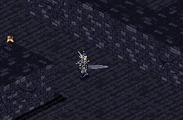

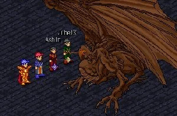

**[Cross-Reference: Beastiary of Temuair](Angelic-Beastiary-Of-Temuair.md#mileth-crypt)**

The Mileth Crypt is probably one of the first places any Aisling will hunt.
It's easy to find, lying in the outskirts of Mileth, it's cold, dank walls
visible from afar. If you walk southwest of the Temple of Choosing, you'll soon
lay your eyes upon the tall, ominous structure that is the Mileth Crypt. Some
claim it was once used as a fortress against the Dubhaim in the Great War of
Danaan and Chadul. Others claim it's been there long before man. Whichever is
true, it is now infested with monsters, many of them quite dangerous.

In the first few two levels of the crypt, you shouldn't experience much
trouble… Most Aislings can hunt alone here even at the earliest insights.
However, should you decide to venture deeper, you had better come prepared.
Already at the third level of the crypt, spell-casting monsters appear. A young
Aisling should never go here alone, it's simply too dangerous.

An interesting thing about the crypt is that unlike the East Woodlands, it
takes quite a bit of time to get to the more difficult levels. This becomes
such a problem at one point that most Aislings simply do not bother to hunt in
the crypt anymore. This makes it a good alternative for those Aislings who find
the Woodlands to be a bit too crowded. The enemies you will face in the crypt
are just as skilled as those you will meet in the Woodlands, in some cases even
more so, so you shouldn't worry about your hunts being less beneficial. Also,
it seems the creatures found in the crypt are worth quite a bit more money than
those in the Woodlands, making it an ideal place to save up a few coins.

### Suggested Groups

1. Rogue & Priest
2. Warrior/Monk, Warrior/Monk & Priest
3. Warrior/Monk & Priest
4. Warrior/Monk & Wizard (using Dark items)
5. Warrior & Monk

## East Woodlands


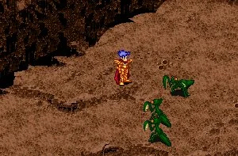

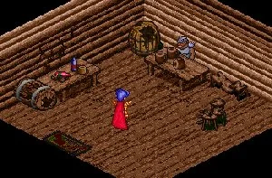

**[Cross-Reference: Beastiary of Temuair](Angelic-Beastiary-Of-Temuair.md#eastern-woodlands)**

Along with the Mileth Crypt, this is one of the first hunting places a young
Aisling will experience. It can be found just outside Mileth, easy for anyone
to find as it's the only large forest in the area. There are legends that say
the Fae lived in this forest many years ago, and if you walk quietly you might
spot one even today. However, the Fae seem to have left Temuair at large… only
a few remain. Those few who are left are either living with the mundanes in the
villages, or they reside in this very forest. Strangely, it seems some chaotic
power is present in this forest, corrupting the creatures that live in it. Even
creatures normally thought of as peaceful look to kill any intruder without
hesitation. Tread carefully in the forest…

Like the Mileth Crypt, the first two levels of the East Woodlands pose no major
threat to Aislings. Spell-casting begins in the third area at which point an
Aisling should not adventure without a group. In the 18th area and above,
creatures will be able to cast the awesome ard spells, so do be careful in
here, no matter how many insights you have.

A good thing about the East Woodlands is that there's direct access to almost
all areas, and never far to walk for those that are not immediately accessible
from the crossroads. This has made the East Woodlands one of the most popular
places for hunting, causing a slight problem: It's almost always crowded with
hunting groups. In these cases, it might be a good idea to consider the Mileth
Crypt as an alternative, even if it is a long walk.

### Suggested Groups

1. Rogue & Priest
2. Warrior/Monk, Warrior/Monk & Priest
3. Warrior/Monk & Priest
4. Warrior/Monk & Wizard (using Dark items)
5. Warrior & Monk

## Dubhaim Castle

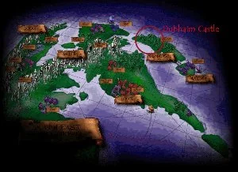

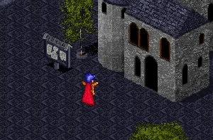

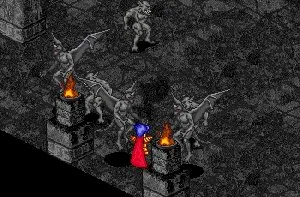

Many young Aislings do not even know of the existence of the Dubhaim Castle,
due to it's isolated location - and perhaps that's a good thing for it is not a
pleasant place to visit. Found north of Rucesion, the castle gives off an eerie
aura of death and despair… It is not without reason that the Dubhaim reside
here. The temple of Sgrios, the God of death and decay, is also in this very
building, and it is said to be the point in Temuair where Chadul's powers are
strongest. The famed dance of the Dubhaim can be witnessed here, as they move
in obscure patterns with only one intention: Kill any and all Aislings in their
reach.

Luckily, most of these Dubhaim are rather weak, at least for the first few
rooms. However, you should never underestimate the forces of darkness. Once
you've faced a Gargoyle, you will know not to take these fiends lightly. They
possess strength and speed not normally seen on the hunting fields of Temuair.

Interestingly, the weaker Dubhaim do not seem to have the ability to cast any
spells, even in some of the more difficult areas. This does come to an end at
one point, but it makes it an ideal hunting place for lone Wizards and Rogues,
since spells is normally the only thing they have to worry about.

### Suggested Groups

1. Rogue/Wizard & Priest
2. Warrior/Monk, Rogue & Priest
3. Warrior/Monk, Wizard, Rogue & Priest
4. Wizard & Rogue (in the early areas)
5. Priest & Priest (with Deo Shaghaid)

## Mehadi Swamps


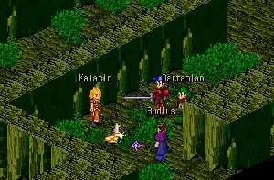

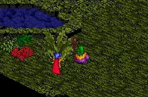

The home of the Mukhul, the Mehadi Swamps can be found near Piet. The swamps
have been the home to the Mukhul for longer than time has been recorded, and
unfathomable amounts of knowledge resides with them. While the Mukhul usually
shun outsiders, you might be able to speak with a few of them, as long as you
mind your manners. Be careful not to kill any of the local frogs if you wish to
speak with them… supposedly, the Mehadi frogs are sacred animals to the Mukhul
and they will not speak with you if you have killed one.

To be honest, there's really not much hunting done in these swamps. That's not
because it's particularly dangerous, but they just aren't very well suited for
group hunting. The enemies are mostly rather weak, with a few exceptions that
are all in small, cramped pathways. The dank climate doesn't make things any
better, but particularly the cramped pathways make it an unpleasant hunting
area.

While you wouldn't expect it from your first look at the swamp, a very
beautiful glade is in the center of Mehadi. It is in this small glade that the
legendary Sevti blossom blooms. This flower is very important to the mundanes
in Loures, as an epidemic seems to have spread there and only the Sevti can
cure them.

### Suggested Groups

1. Rogue & Priest
2. Warrior/Monk & Priest
3. Warrior & Monk
4. Warrior/Monk & Wizard (with Dark items)

## Piet Crypt


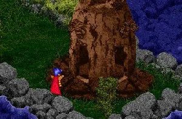

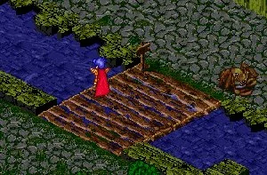

**[Cross-Reference: Beastiary of Temuair](Angelic-Beastiary-Of-Temuair.md#piet-dungeon-monsters)**

As the Mileth Crypt, this structure was supposedly used as a fortress during
the Great War of Danaan and Chadul. As time passed after the war, however, the
crypt was forgotten and no one cared to maintain it. When Loures first decided
to build a sewer system they used the old Piet Crypt for the purpose, thus
creating a very dank climate in the already unpleasant caves. This, it seems,
made it the chosen habitat of some of the strangest creatures in all of
Temuair, many seeming to have come from the sea originally. No matter where
they're from, however, they're very aggressive - and very lethal.

When it comes to hunting, the Piet Crypt isn't a very popular place. It is
actually a fairly nice place to hunt… not too crowded, adequate amount of
enemies, fair skill level… the only real problem with the Piet Crypt is that it
is incredibly cramped in there. It's almost impossible to move around by
yourself, much less in a group, forcing you to fight enemies you would rather
have run from. This also makes ambushes very dangerous, as there's often no
real escape route. The best way to counter this is to travel in small groups,
but this makes your efficiency a bit more limited… I can only suggest you try
it and judge for yourself.

The Piet Crypt can be found in the southern part of Piet, hidden behind the
trees there, as if the mundanes try to conceal the ominous structure… Honestly
I can't say I blame them. If this fortress is truly an artifact of the Great
War of Danaan And Chadul, I cannot begin to imagine how many young men have
lost their lives to the Dubhaim in there… An eternal reminder that war brings
nothing but unhappiness - how ironic it is that it is in the village of Piet,
home of the temple of the God of War.

### Suggested Groups

1. Warrior/Monk, Warrior/Monk & Priest
2. Warrior/Monk, Wizard & Priest
3. Warrior & Monk
4. Warrior/Monk, Rogue & Priest

## Pravat Caves


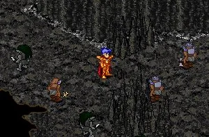

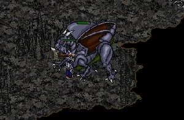

Although the mountains south of Mileth have been apparent to Aislings and
Mundanes alike for as long as they have been there, no Aisling ever set foot in
the Pravat Caves until Deoch 6 - the year of the Entreaty. It seems the Grimlok
have lived in these caves for centuries, concealed from the world outside.
However, in Deoch 6 they sent a request to all Aislings for help in defending
their caves against the Goblins. Since that day, the Pravat Caves have been
open to all Aislings, and the war between the Goblins and the Grimlok still
rages on.

The Pravat Caves provide some excellent hunting possibilities for some, and
rather poor for others. Specifically Rogues have an advantage in these caves,
while the other classes aren't quite as effective. The good aspects of the
caves is that it's huge, hence ambushes are few and easy to escape, you can
ally with either the Goblins or the Grimlok, making the amount of enemies who
are aggressive very limited. And finally, the enemies are talented fighters,
but fairly dumb… making for good practice without much danger - at least for
Rogues and possibly Wizards. For most other classes, there are two places in
the caves that are interesting: The east rooms, in which there aren't nearly
enough enemies for just one group, and the west rooms, where there's a bit too
many enemies, making ambushes common for a larger group.

An interesting option when hunting in Pravat is that if you are allied with one
of the races, their leader will reward you for slaying their enemies. This
makes for a bit of extra motivation to fight here. The enemies also seem to
carry some fairly interesting items, such as Staves, Goblin Helmets, Hatchets,
Stone Axes, Curved Daggers and a few more interesting items - as well as plenty
of gems, a good resource for money as a Rogue.

### Suggested Groups

1. Rogue
2. Rogue & Priest
3. Warrior/Monk, Warrior/Monk & Priest
4. Warrior/Monk, Rogue & Priest
5. Warrior/Monk & Wizard (with Dark items

## Astrid


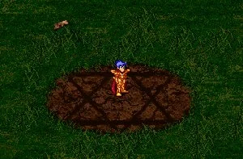

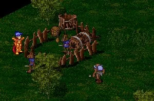

Astrid is a small area just south of Undine. Home mainly to Kobolds and
Goblins, Astrid is not a good place to visit if you want to relax and just to
make matters worse, Dubhaim also seem to visit this area from time to time.
However, such risks have to be taken in some cases - Astrid being one of those.
For a sacrifice to their God, the Kobolds kidnapped countless children from
Undine, several still being there in the depths of the fields. Rescuing a child
is not an easy mission, though. You will have to go through many areas dense
with Kobolds and Goblins, all very eager to kill you…

As far as hunting goes, I've never been particularly fond of Astrid. The
creatures here walk freely from area to area, making it very hard to determine
where the right place to hunt is for your insight. While it is true that the
creatures carry many valuable goods, and quite a bit of money, it doesn't make
up for it in the long run. Furthermore, if you intend to go deep, the enemies
are quite fond of a spell called 'suain', one that can easily take out an
entire hunting part in a few minutes…

One thing that makes the trip worthwhile are the aforementioned children there…
Even now more children are kidnapped from Undine each moon. As Aislings, we
have the required strength to save these children, and I urge every one of you
to at least save one… I guarantee you will receive the gratitude of the Undine
mundanes.

### Suggested Groups

1. Warrior/Monk, Warrior/Monk & Priest
2. Rogue & Priest
3. Warrior/Monk & Wizard (with Dark items)
4. Warrior/Monk & Priest
5. Rogue

## Labyrinth of the Heart (Loures Basement)


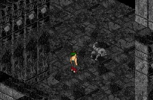

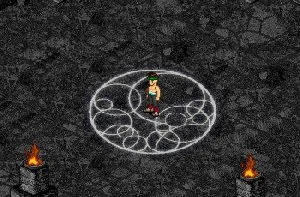

Beneath the surface of Temuair, under the mighty Loures Castle lies the
Labyrinth of the Heart. To call this a hunting place is almost absurd… No one
would want to go here to practice his or her skills. It is said that the
Dubhaim took Bella, former barmaid of Piet and love of Marlin, here, yet nobody
have been able to find her. It is for this reason that many couples travel here
in search of clues - instead they find an ancient ritual, the ritual of the
Heart.

The Dubhaim inhabit this dungeon. How they came here, and why, I think only few
can answer. Their presence reminds me of the legends of Anaman's Pact and makes
me wonder what King Bruce is thinking these days, however, this is only
speculation. As far as hunting goes, the Labyrinth of the Heart is not the best
of places to visit as it is often crowded by adventurers looking for the famed
Dark items and the halls are quite small. Also, a warning… stay away from the
Nightgaunt… underestimate this fiend at the cost of your life.

To get here is a task in its own right. First of all, go speak with Marlin in
the dungeon of Loures. He will ask you to deliver a message to Bella. Now,
speak with Jean near the Library of Loures and he will tell you Bella often
went to the Enchanted Forest. Follow his directions and you might find a
faerie… if you do, ask her where Bella is. Now, go back to Marlin and he will
reveal the final steps to enter the maze…

### Suggested Groups

I will not suggest any groups for this maze, as hunting in groups here is just
about impossible…

## Isle of Dawn Crypt (Abel Crypt)


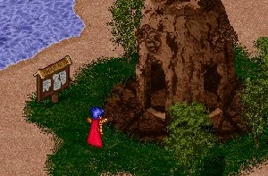

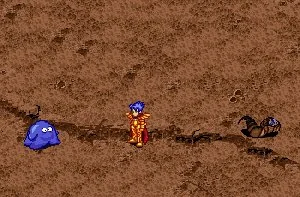

**[Cross-Reference: Beastiary of Temuair](Angelic-Beastiary-Of-Temuair.md#abel-dungeon-monsters)**

The third and final crypt of Temuair can be found on the otherwise beautiful
Isle of Dawn. The island is located just west of Rucesion's coast and can be
accessed by way of ship from Abel. The island itself is a wonderful place; one
where I would often go for a walk with my wife, however, the crypt is an
entirely different matter. Filled with vicious, albeit slightly strange,
creatures, it poses a threat for all but the strongest of Aislings. It is not
without reason that 50 insights are required to even set foot in this place…

This is one of the better hunting place for Aislings in the late 60s of
insights to the late 80s, and possibly even in the 90s. The rooms are large
with only few obstructions, making it fairly easy to move around and to avoid
ambushes. It is densely populated, but with beag suain and beag pramh this
isn't much of a problem. Although I haven't tried, I imagine a Rogue would be a
welcome addition to any group down here.

Besides some experienced foes to duel with, this crypt also offers a wealth of
rare items as well as money. Especially the Dwarves drop some valuable goods,
such as Talgonite Axes and their helmets.

### Suggested Groups

1. Warrior/Monk, Warrior/Monk, Priest & Rogue
2. Warrior/Monk, Warrior/Monk, Priest & Wizard
3. Warrior/Monk, Warrior/Monk & Priest
4. Warrior/Monk, Priest, Wizard & Rogue

## Undine Fields


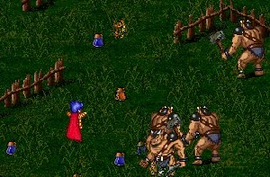

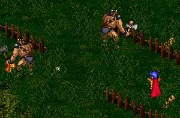

When the rebellion of Undine started Loures had already been oppressing them
for long. And as always with Loures, they had to overdo this one slightly…
Rumors state that King Bruce himself ordered Orcs and mercenaries sent to
Undine to clear the rebels. While this may or may not be true, fact remains
that there are plenty of both Orcs and Carnun Champions present in the fields
of Undine these days. While this certainly isn't very good for the rebels, it
does make quite a hunting ground for us Aislings!

There are two opinions of the Undine Fields. One sides says it's a good hunting
place for the highest of insights since it's not as long a walk, nor as risky,
as the Cthonic Remains, the other side says the area is far too small.
Unfortunately, the pessimistic side is just as right as the optimistic one: The
Undine Fields are very, very small compared to most other hunting places. While
the area is definitely large enough for one group, it quickly becomes
troublesome with two or more groups there. However, it does have an advantage
since it is very much easier to get to than the Cthonic Realms. Some may argue
that it's a long way to Undine, but if you've ever walked 30 floors down into
the Cthonic Remains you'll quickly learn to think otherwise. The Fields are
also much easier to survive in, since it's much easier to escape than the
Cthonic Remains, however, the experience there is almost as good as a hunt in
the Cthonic and much faster earned, I might add.

The final note about this place, which is sure to attract most any adventurer,
is that the creatures inhabiting this area carry some extremely valuable goods.
A Holy Diana here, a Magus Apollo there, Hy-Brasyl Gauntlets everywhere… it's a
good place to stock up. However, the grand prize of the Fields far outweighs
the others (both literally and figuratively). Once every few Temuairan days,
the Carnun Champion appears brandishing his huge Hy-Brasyl Axe. Any Warrior, or
any Aisling in need of money, will want this prize, as it is the most valuable
item in Temuair at the time of this writing. I've heard offers up to 30 million
pieces of gold for this awesome weapon!

### Suggested Groups

1. Warrior/Monk, Warrior/Monk, Wizard, Priest
2. Warrior/Monk, Wizard, Priest (with Dark items)

## House Macabre


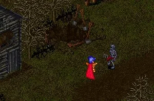

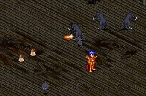

On the outskirts of Temuair lies the wicked House Macabre. Dark and twisted,
the House holds many secrets of the past, most of which I would rather not live
to hear of. This place does, and should, scare away all but the bravest of
Aislings. Zombies rise from their graves and unidentifiable creatures of
dubious origins inhabit the houses. Believe me when I tell you, this is not a
place you will visit without a very good cause.

House Macabre holds some interesting options for hunting. Not only is the place
huge, easily large enough to support large numbers of Aisling groups, but it is
also very diverse. For the Rogues and Wizards, the Zombies outside will provide
ample challenge while for Warriors, Monks and Priests, the inside of the houses
is a good option. It seems just about all creatures found in House Macabre,
with the exception of the Zombi Peasant, are docile thus they will not attack
on sight. This makes for very safe hunting, completely free of ambushes inside
the houses. There's also a large amount of creatures in the relatively small
rooms making combat available at all times. I personally gained many of my
insights in one of the houses with just a Wizard as my aid.

### Suggested Groups

1. Rogue & Priest
2. Warrior/Monk & Priest
3. Warrior/Monk & Wizard (with Dark items)
4. Warrior/Monk, Wizard & Priest
5. Wizard

## Cthonic Remains


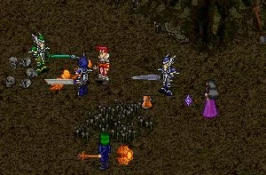

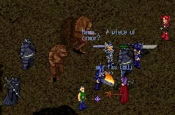

Without a doubt this is the deepest, darkest and most dangerous place in all of
Temuair. This dungeon has existed longer than any can imagine and houses some
of the greatest horrors in all of Temuair. It is not without reason that every
hunt down here is carefully planned well before time, as not just any group can
survive in the lower levels…

While the first 10 levels of the Cthonic has plenty of challenge for an able
Aisling group of at least the 4th Circle, the next twenty levels will be
certain death for any group that is not well organized, regardless of their
insight. A Rogue is of the utmost importance in the Cthonic, as is at least two
Warriors/Monks, a Priest and preferably a Wizard, especially if you intend to
use Dark items, as most would. In fact, if there were any place in Temuair
where hunting without Dark items was impossible, this would be it.

Of course, there is good reason why anyone would venture into such a dangerous
place: The rewards are plentiful! Not only does a hunt as dangerous as this one
offer unequaled experience, the items found within are well worth the trip.
Scythes, Stone Crosses, Holy Dianas, Magus Apollos, Hy-Brasyl Fragments, Talos
Fragments, Enchanted Boots, Hy-Brasyl Gauntlets and Greaves and many other
famed treasures can be found here.

### Suggested Groups

1. Warrior/Monk, Warrior/Monk, Warrior/Monk, Wizard, Rogue & Priest
2. Warrior/Monk, Warrior/Monk, Wizard, Rogue & Priest (with Dark items)
3. Warrior/Monk, Warrior/Monk, Warrior/Monk, Rogue & Priest
4. Rogue & Priest (only on the first levels)

## Kasmanium Mines


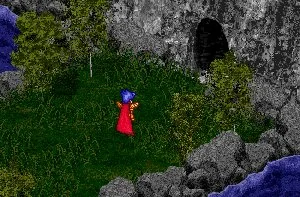

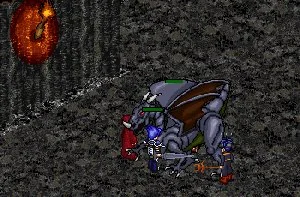

As the final stop of this tour we have the famed Kasmanium Mines, home of the
most powerful beast of all of Temuair - the Draco. While the Draco is the
creature most commonly associated with the Mines, it is by no means the only
there. Orcs, Goblins and the Grimlok are also present in ample numbers, unlike
the Draco, which tends to slumber in the deeper realms of the Mines. While my
hunting here has been limited, I have faced a Draco myself and I can promise
you that I have never met as powerful a beast before, not even the Carnun
Champion is a match for it.

Venturing deeper into the Kasmanium Mines the number of Dracos increase
dramatically making for a very unusual change of tactics applied. This is
probably the only place in Temuair where Warriors no longer are the main
offensive force. Dracos have an unrivaled defense against physical attacks,
making Warriors worth more as defensive players, to hold off the beast, than
they are meant to slay it. Instead, Wizards and especially Priest, however odd
it may sound, are the main offensive force. The main weakness of a Draco is the
light element, only usable through the Priest spell Deo Shaghaid, making the
Priests what you'll want in here.

### Suggested Groups

1. Warrior/Monk, Wizard, Priest & Priest
2. Wizard, Priest & Priest
3. Priest, Priest & Priest
4. Rogue, Priest & Priest
5. Rogue & Priest

_Sungam Chad_  
_5th Deoch Warrior_

***

```
*Librarian Notes*

Recognized: Folk, Lorekeepers Recognized (Events of Temuair post #121).
This entry has been heavily edited to conform to Library formatting.
The original can be found at http://www.darkages.com/2000/download/Sungam_Hunting/index.html .
```
