# Positioning Tactics

_by Sungam in **Dark Ages**_

_The ever elusive hunting strategy_

Welcome, Dear Reader, to my explanation of something so logical you would
expect everyone to use it, yet so rare to see on an actual battlefield. This
marvelous way of thinking can turn the tide of battle, change relentless
slashing into an art form, ease your nerves, and most importantly, save lives.
It is so simple in its nature, so easy to execute and so remarkably effective
you would think that every Aisling in Temuair would use it in every battle they
fight. Unfortunately, the truth is in fact the opposite. If any Aislings
actually know this already, it's certain that they do not use it - for in all
the battles I have fought, I would say that about 10% of my companions, at
best, have applied these tactics.

As you may have guessed, that is the reason for my writing this. If only half
the Aislings of Temuair would apply these strategies to their hunting, Sgrios'
scarring would be reduced tremendously.

So what are these strategies so good for, I hear you asking by now. If you
consider the most frequent causes of deaths on hunts, you will find that they
are either due to reckless solo-hunting, the appearance of the lag beast, or a
group being ambushed. There is not much to be done about solo-hunting - should
an Aisling choose to go out on his own, he should also know of the
consequences. The lag beast seems to be too powerful for Aislings to avoid, so
we cannot do much about this either. However, ambushes we can do something
about.

Normally the problem would be that, when ambushed, the Warriors and Monks of
the group would be hit from multiple sides, quickly demolishing what little
health they had to begin with. The Priest can't possibly keep up with this and
soon the group will find itself cornered and wounded. The obvious solution
would be to stop the other aggressors so the Warriors and Monks could
concentrate on one enemy at a time, but how to do that without an efficient
Rogue in your group? To have the Priest lead the enemies around, at the cost of
his concentration and time? No, in the long run that doesn't work in the more
dangerous ambushes… This is where Positioning Tactics come into the picture.

In this work of lore, I have attempted to describe some of the most common
ambushes each craft will run into and how to efficiently scatter them.

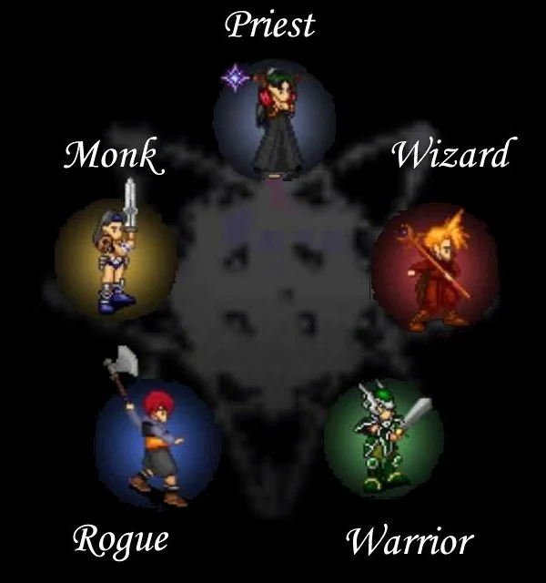

This was meant to provide you with the inspiration you need to effectively use
Positioning Tactics. However, there are endless examples of ambushes with
endless amounts of group combinations… far too much to cover in a single guide.
To truly increase your hunting potential, a certain degree of creativity,
foresight and overview is needed. With enough training you will be able to work
out the perfect counter-plan for any ambush, making up the strategy as the
battle progresses. However, it does require practice.

> _"Never assume you have nothing left to learn - if you do, you have learned
> nothing at all."_

## Warrior/Monk Positioning Tactics

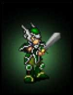


The unfortunate part of being a Warrior/Monk, when it comes to Positional
Tactics, is that you really can't do all that much once battle has begun. You
will be stuck in one place, fighting head-to-head with your enemy and there's
really not much you can do about the other approaching enemies. However, that
does not mean you should completely ignore strategy. First of all, you still
have the option of getting an advantageous position before the actual battle
starts. And second, you can still help your group members help you. Below are
the three most common examples of ambushes I have run into.

### Example 1

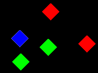

A typical example. You (the blue square), a second Warrior/Monk and a Priest
(both green) against two enemies (red) in a completely open environment - no
trees or walls to interfere.

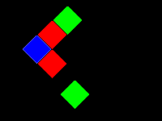

This would be the "wrong" way to handle the problem. As you can see, both
enemies would be fighting against you now, giving the Priest a hard time
healing you. At this point, I would suggest you made a small run clockwise
around the enemy you were targeting (the top one) and the Warrior/Monk. The
lower enemy would attempt to follow you all the way around, although at a
slower pace.


Once you complete your run, have the Priest stand next to you as illustrated
above. The enemy will now be locked in place (its movement pattern is
illustrated with a brighter red) unable to reach you. At this point you could
concentrate on taking out the top enemy without worrying about your pursuer. Be
sure to tell the Priest what you have in mind - it's rare that anyone considers
these things unprovoked.

### Example 2

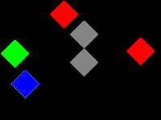

Another typical situation when hunting in the Woodlands. You (blue), a second
Warrior/Monk (green) and two enemies (red). Note that there is a tree in the
middle of the battlefield (grey). Since you don't have a Priest in your group,
the last thing you want is to fight two enemies at once.

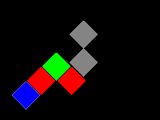

This would be an extremely unfortunate outcome. Should this happen, instruct
your partner to lure the other enemy around the tree, and then come back and
position himself next to the tree…

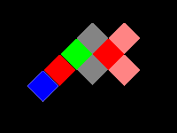

… Like so. This way the enemy on the right would be caught behind the tree,
completely cut off from the action. You could then proceed to kill the enemy on
the right whenever you were done with the first one. Do remember that enemies
have a tendency to cast spells when they're stuck, beag puinsein (poison) being
one of the most common. Be sure to carry a few Personaca Deums with you if
neither of you are Monks.

### Example 3

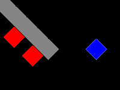

For the final example, here's a typical example of what I run into when
money-hunting in the crypt. You (blue) against two enemies (red) both on the
other side of a wall. This is one of the times when you should try to think
about your position before you charge into the battle.

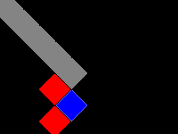

This is a perfect example of what happens when you don't think before you act.
At this point you'd be very lucky to regain a good position without running
away first. With two enemies hitting you at once, you'll be out of action
before long, even if they are "weak".

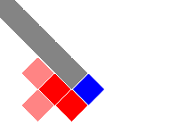

However, with a little more consideration, you could produce this scenario
instead. Obviously the enemy is completely incapable of reaching you so you can
easily sit tight and take out one at a time. As in Example 2, remember to watch
out for beag puinsein… it can easily turn the tide of battle if you aren't
prepared.

## Priest Positioning Tactics

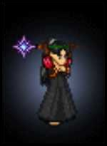

When it comes to positioning tactics, there is no one as versatile as the
Priest. This, obviously, means that the Priest also carries the greatest
responsibility to position himself correctly. The main focus of the Priest is
to obstruct the enemies' path so that they cannot reach the Warriors/Monks of
the group. Alternatively, Priests can also use the offensive spell, Deo
Shaghaid, in which case the goal is to conceal himself from the enemy. Below
are three very diverse examples of how a Priest may act in various situations.

### Example 1

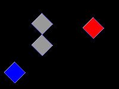

Starting off rather simply, this is really a very unlikely scenario. You
(blue), a Priest with Deo Shaghaid who's hunting alone, ran into an enemy (red)
near a tree (grey).

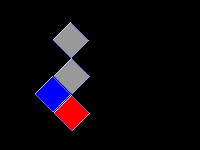

One way of killing the enemy would be to run around and cast Deo Shaghaid as if
you were a Rogue. However, chances are you'll get hit every once in a while
(especially when encountering the vicious lag beast) and you'll probably be
doing more running than casting, attracting other enemies as you wander about.

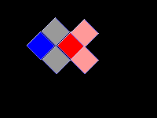

Instead, position yourself next to the tree like so. This way the enemy doesn't
stand a chance of reaching you. You can just sit back and cast Deo Shaghaid at
your own pace, removing puinsein and such from yourself when required.

### Example 2

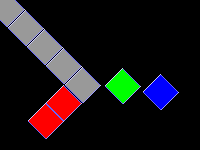

Moving on to something a bit more common. In this example, you (blue) will be
alongside a Warrior/Monk (green) against two enemies (red) with a wall in
between (grey). Since the enemies are both close to the edge of the wall, the
Warrior/Monk doesn't stand a chance of blocking them off on his own.

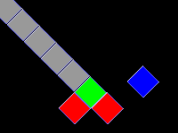

Many Priests would do as such: Let the Warrior/Monk worry about that and simply
go about your healing business. Unfortunately, it's your mana which will be
drained, thus making it your problem as much as your partner's.

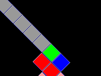

The good part about this situation is that it's very simple to prevent. Simply
stand next to your partner and both enemies will be sealed off. Since all you
need to do is heal, you might as well stand here as anywhere else. Since the
lower enemy is targeting the Warrior/Monk, that's none of your concern either -
think of yourself as part of the wall.

### Example 3


A bit more advanced now, but still one of the simpler situations that you
should be able to handle with little to no practice. You (blue) along with two
Warriors/Monks (green) against two enemies (red) in an open field. Naturally
you'll want to prevent the second enemy from reaching your Warriors/Monks
before they're done with the first enemy.


This is how you should not do it. Standing idly by will consume your mana in no
time. Even if you do have plenty of mana, it'll mean one heck of a repair bill
for the poor Warrior/Monk, so it's really not a good move to just stand by and
watch.


Instead, stand next to the lower one of your allies (in this case - it varies
depending on who the enemy is after) to prevent the enemy from reaching him.
This way it'll wander back and forth without a direct passage, as shown by the
bright red fields. Once the Warriors/Monks are done with the first enemy, the
second will have free passage into the field between them, making for another
easy kill.

## Wizard Positioning Tactics

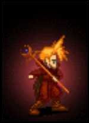

Wizards generally have two patterns of hunting, the active and the passive
role. When active, the Wizard will try to kill enemies with his strongest
spells, whereas in the passive role he'll be trying to divert enemies and
occasionally cast spells such as Fas Nadur. In the active role, the main goal
of positioning tactics would be to conceal oneself so one doesn't have to move
too much. When in the passive role, your goal would be very similar to that of
a Priest - to cut off enemies before they can reach the Warriors/Monks of your
group.

Below are three examples of both passive and active roles as a Wizard.

### Example 1


A typical example when hunting alone. You (blue) meet up with a lone enemy
(red) near a tree (grey) in the Woodlands. Since you're hunting alone,
obviously you'll be in your active role, thus your objective is to conceal
yourself.


I believe it's quite evident that this would be a very unsuccessful way of
accomplishing that. In this example, the Wizard thought of casting his spells
before he thought of taking cover - a very bad idea, I might add.


Had the Wizard instead taken cover as shown above, the enemy would be locked in
place and he could easily take it out at his own pace.

### Example 2

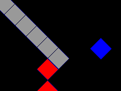

Basically the same situation as example 1, but this time in the Mileth Crypt
and with two enemies against you. Again, you'll be in your active role.

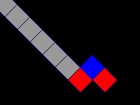

As always, focusing on your casting and not on taking cover can get you in some
pretty bad situations. Running and casting on one enemy might be a simple job,
but with two enemies you can get in trouble pretty fast.

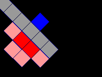

However, take a stroll along the wall and position yourself like so and you
won't have to run at all. The enemies will be walking along the wall, as
denoted by the bright red fields, trying to get to you, but to no avail. This
way you can kill them at your own leisure.

### Example 3


Finally an example showing you in your passive role. This group, consisting of
you (blue) and two Warriors/Monks (green), will probably focus on their ability
to kill and your ability to cast Fas Nadur, thus making any offensive spells
from you unnecessary.


However, contrary to what most Wizards seem to believe, this does not mean your
only job is to cast Fas Nadur. Most Wizards simply do as illustrated above:
stand by while the Warriors/Monks are assaulted from all sides.


Instead, position yourself as illustrated above. It doesn't require anything of
you really, except you have to stay there and you can't cast any offensive
spells (otherwise the enemies might target you). This way the enemy to the
right will be blocked off, letting the Warriors/Monks concentrate on one at a
time.

## Rogue Positioning Tactics

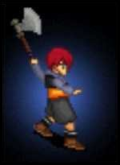

The Rogue is indeed a strange one. While all other crafts can take advantage of
positioning themselves, the Rogue's speciality is to position the enemies.
While this isn't really under positional tactics, it does involve the
dispersing of ambushes, and it does have something to do with positioning, so I
have decided to make examples of how to use Blind Traps for this chapter of my
lore. It's a well-known fact that the Rogue's primary role in a hunting party
is to blind all enemies, but it's less-known that where you blind them plays a
role - a rather large one actually.

### Example 1

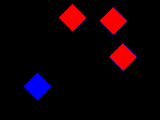

You (blue) are facing three enemies (red), wanting to blind them all. That's a
fairly simple job, but the two Warriors of your group (not in the sketch) would
really appreciate it if you blinded them at specific places.


It's very likely they'd be a bit grumpy if you did it like so. While you might
say that this would be a strange way to do it, I can assure you that some
actually do something along the lines of this, and it's extremely bothering.

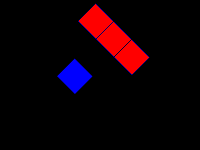

With two Warriors (or Monks) in your group, they'll want to attack the enemies
from opposite sides in order to do maximum damage. With a line-up as shown
above, the Warriors have easy access to all three enemies, and don't have to
fear being hit by another enemy in the process. Furthermore you can use spells
like Breisleich to make the enemies fight each other rather simply with this
formation.

### Example 2


Another simple example. An enemy (red) is right behind you (blue), chasing you
past a tree. There's only one enemy to blind so there's really no rush.

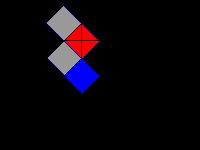

The simplest thing to do would be to just place a few traps and hope it
stumbles upon one of them. However, that could easily produce the above
situation (the black cross denotes the enemy being blinded). As in example 1,
you'll want the enemy so the Warriors can get it from opposite sides, which is
impossible in this case.

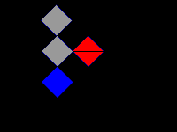

Instead, hold on to those blind traps for a few more moments and place the
enemy like so. This way both Warriors have easy access to the enemy, even
allowing a third and fourth Warrior to join the action.

### Example 3

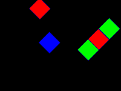

Finally moving onto something slightly more advanced. On your right you (blue)
have two Warriors (green) fighting a lone enemy (red). However, there's an
enemy approaching from the left, targeting the lower Warrior. Of course, your
job is to stop it, so how will you accomplish it?

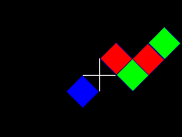

For reasons I am simply unable to understand many just place a blind trap near
the Warrior and expect him to lead the enemy over it. That is not his job -
it's yours! This way he'll have to leave the battle he was in, possibly
dragging the first enemy with him, completely messing up any kind of plan he
had. Note that the white cross symbolises a blind trap.

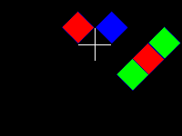

This is where the famed dexterity of the Rogue comes into play. You'll have to
move fast to accomplish this move, but it is possible, and it is your job. This
way the enemy will be stopped before it reaches the battle, allowing the
Warriors to do their job, not having to take care of yours. Always remember
that your group members can't see the blind trap, and rarely have any idea
where it is. You can't expect them to lead an enemy over something they can't
even see.

_Sungam Chad_  
_Warrior of the 5th Deoch_

***

```
*Librarian Notes*

This entry has been heavily edited to conform to Library formatting.
The original can be found at http://www.darkages.com/community/lore/Sungam_Tactics/index.html .
```
