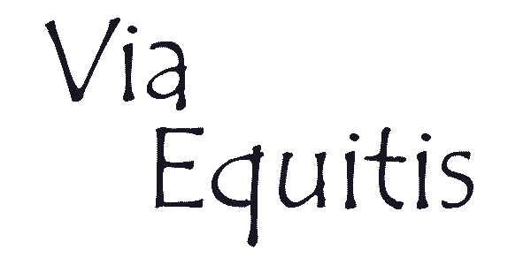
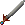
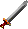
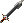
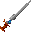
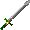

# Via Equitis

_by Sungam in **Dark Ages**_

_Warrior Lore:_



## Chapter 1: The Warrior's Path

To believe in a dream  
To defeat the one who cannot be defeated,  
To smile through unbearable pain  
To walk where only few dare follow.

To fight against injustice and violence  
To love, to believe and understand,  
To seek, though your strength withers,  
For the star you will never reach.

But to reach that star is my call,  
However hopeless it seems, however long I must go.  
To fight for my dream with an iron will,  
Through the flames of hell I shall advance towards my goal.

And I know, that if I am true to my  
Call and my belief,  
That when I am at rest beyond life  
My heart will be at peace.

And our world shall benefit from it  
For - through disdain – there was still one man  
Who fought with all his strength  
To reach that star.

## Chapter 2: Your First Steps as an Aisling and Consecutively a Warrior

Ah… the joy of being an aisling. I remember the overwhelming impression my
first day as aisling had on me… You are about to enter a life in a bright New
World. A world that will let you experience honour, faith, love, happiness,
sorrow, adventure and much, much more.

Enough of my rambling, I'm sure you'll realize all of this by yourself soon
enough. For now your first step should be to find a guide to lead you through
the first few years of your aisling life. Many aislings, such as myself, would
be happy to take another student. However, if the one you ask does not wish to
teach you, don't let that discourage you! Find someone else, you're sure to
find one sooner or later.

If the aisling you choose as your mentor is a warrior, he can also initiate you
to the warrior's craft.

Your mentor should tell you everything about what you should do, if not just
ask him. If you are not satisfied with your mentor, it is possible to take
another mentor instead if you haven't passed your 8th insight yet. Do not do
this unless absolutely necessary, though. Only abandon your mentor after you've
made sure that he isn't doing his job well enough.

Your first steps as a warrior should be to train yourself. Many quests and
social events await you in the future but for now you need to become stronger.
After getting the best equipment you can wield (see Appendix B: "Equipment
List" if in doubt), go to the crypt and start killing Rats. If you feel
confident in yourself try killing a Spider. Be wary of the Centipedes though,
as they are fearsome beasts for a young aisling. I highly recommend [Sir
Bentic's "Bestiary of Temuair"](Angelic-Beastiary-Of-Temuair.md) which may be
found under "Lore" in Loures' library. Not only is it an interesting read, but
it will also teach you of the enemies you will face during your initial
insights. When you feel that you have gotten a feel for battle, try finding a
group to hunt with.

All aspects of combat as a warrior are covered in [Chapter 3: "The warrior's
function in a hunting
party."](#chapter-3-the-warriors-function-in-a-hunting-party)

## Chapter 3: The Warrior's Function in a Hunting Party

Many think that the warrior is the most independent class of all but they are
so very wrong… Actually the warrior is one of the weakest when alone, barring
the priest and monk. But on the other hand, warriors are almost a necessity in
every effective hunting group. No other class can take as much damage as the
warrior can. While the warrior is physically strong he won't last long going
head to head with an enemy. The warrior's main function is to take all the
damage. It is expected of you that you always make the enemy attack you and
keep it away from your hunting partners.

### Hunting with Priests

Probably the most used and most effective group is a warrior and a priest. This
type of group is very simple. The warrior walks right in and attacks the enemy
while the priest keeps him alive. The priest can also supply some
ability-increasing spells that can turn the tide of battle.

A popular tactic used with this group if there are many aggressive enemies
near, is to let them all go after the priest who will constantly move while the
warrior picks them off one by one. Most aggressive enemies seem to go after the
priest by default so this tactic is fairly easy to apply.

If possible, try to get another warrior or monk to join this type of group.
This will make it much more efficient since the enemies will die faster,
resulting in the priest using less mana.

### Hunting with Monks or Warriors

This is probably the simplest of all types of groups and not too effective
either. The good aspect of it is that one of you will always get to attack from
the enemy's back and since you're both strong, it will result in fast kills.

The most important thing to remember is that the faster the enemy dies, the
less it gets to damage you. So always try to move in from the back or sides of
the enemy and catch it off guard.

If your partner is a warrior, it is also easier to split the damage between the
two of you to avoid having to rest.

If you can get a priest to join this group you will be incredibly effective,
without one you won't be able to go far.

### Hunting with Wizards

Wizards are extremely powerful with their magic, making them resemble monks and
warriors in effectiveness: They can damage the enemy but they won't help you
stay healthy. Furthermore the wizards won't be able to split the damage with
you and they depend on you to stay in place and hold off the enemy.

There isn't much strategy involved with this group. You might want to let the
wizard be the one who initiates the battle from afar and let the enemy use some
time to move closer to him, before you move in and attack it from the back.
This works best with passive enemies but can be applied towards aggressive ones
as well. After that it's just hack-and-slash until it is slain...

Again, if you can get a priest, this is a group of awesome strength and the
most versatile as well. Get a monk in addition and nothing can stop you.

### Hunting with Rogues

My experience with rogues is that they are loners. Their traps make them highly
effective when alone but only hinder any real combat, which is what you, as a
warrior, do best. This makes a group of a rogue and a warrior highly unlikely.

I have heard of a strategy that involves the rogue laying out traps, making the
enemy follow him, and then the warrior follows behind and attacks the enemy in
the back. However, my personal experience with this tactic is that the monster
starts attacking you instead and ignores the rogue…

My conclusion is that a group with one warrior and one rogue is very
ineffective but the rogue can be a great addition to another group like the
warrior/priest combination.

In addition, a rogue can be a warrior's best friend since they are able to
forge blades and find equipment in treasure chests. These skills make them
invaluable as friends out of combat if nothing else.

## Chapter 4: Choosing Your Own Path…

The warriors' craft is most frequently associated with strength, honour,
courteousness and shining armors... but always remember that a warrior is only
what the Aisling behind that armor is. Do not try to be somebody else. Do as
your heart tells you to... In the future you will have to take many stands on
politics, religions and summonings to name the most common. Do not do as "a
warrior" would do but rather what **you** would do. After all **you** are the
warrior... All of the choices you will face in your Aisling life may seem
overwhelming at first, but always remember that there are many who have been
where you are now. I myself would always be willing to share a bit of my
experience with any Aisling who would ask for it, and so would many other
Aislings. You are not alone in this troubled world... never forget that.

## Appendix A: A Few Tips

Below are a few tips and pieces of advice which I have found useful during my
adventures.

### When Hunting...

Be sure you always attack passive enemies from the back. With a little luck you
can cause incredible amounts of damage before the creature gets a chance to
turn around! Also be sure you use Wind Blade before the enemy faces you if you
get the chance, as this can cause even greater damage.

### Priest's orders...

If a priest you're hunting with asks for a break, do as he says! He is most
likely the reason why you can stay alive in the area you're hunting, so it is
for your own good. "Live to fight another day" as they say.

### Heavy Load...

This is a very useful theory, but remember that it is only a theory... I have
checked it numerous times on myself and it always seems to work... The weight
you can carry seems to be equal to your base (i.e. without any equipment)
strength plus 11. Remember that I'm not completely sure of this though...

### No shame in running...

Many warriors would never even consider the option of running if combat gets
too hot. I myself have always had a problem with turning away from a dying
enemy... which has only rewarded me with 6 scars, courtesy of Sgrios... Always
run from battle if you need to. Of course you should still protect other
Aislings if they need it, but make sure you retreat while doing so.

### Warriors live for battle?...

For some reason many young warriors think that they should join the Ceannlaidir
faith just because they are warriors. Leaving aside my personal opinion which
doesn't matter here, there's nothing wrong with Ceannlaidir, but be sure you
only join if your heart really believes in what He stands for. There's more to
a warrior than the battle.

## Appendix B: Equipment Guide

This is a list of the equipment **I** suggest that every warrior should buy. It
isn't a list of all the available equipment, only what I think you should
consider getting (I am most sorry that I have not been able to aquire images of
the Cotehardie and Kasmanium Hauberk):

### 1st Insight

#### Stick


The only weapon you can use with your first insight, and consequently the best.
You can get one for free by talking with Callough, the weapon smith of Mileth.

Sold: Mileth Weapon Smith  
Weight: 3  
Value: 100  
Durability: 1000  
Damage: Small: 4-14  
Large: 4-14

#### Shirt (male)


A peasant's clothing. Certainly not fit for an Aisling such as yourself.
However, until you are initiated into on of the five crafts, this is the only
piece of clothing you can wear.

Sold: Mileth Higgle Shop  
Weight: 2  
Value: 100  
Durability: 2000  
Armor Class: -4

#### Blouse (female)


Like the Shirt, this garment is only for the uninitiated. Still it is better
than nothing.

Sold: Mileth Higgle Shop  
Weight: 2  
Value: 100  
Durability: 2000  
Armor Class: -4

#### Boots


A fine pair of boots which will serve you well for quite a while. They do not
offer any special protection but you certainly shouldn't walk around barefoot.

Sold: Mileth Armor Smith  
Weight: 2  
Value: 1000  
Durability: 3000  
Bonus: None

#### Leather Tunic (male)


Now it's beginning to look better... The warrior's first armor! This one will
be a great ally and a symbol of your status as a Warrior of Temuair. It is also
better armored than the poor shirt you've been using so far.

Sold: Mileth Higgle Shop  
Weight: 4  
Value: 950  
Durability: 3000  
Armor Class: -11

#### Leather Bliaut (female)


Like the Leather Tunic, this is a fine garment indeed. Your first step on the
warrior's path should begin with this armor.

Sold: Mileth Higgle Shop  
Weight: 4  
Value: 950  
Durability: 3000  
Armor Class: -11

### 2nd Insight

#### Eppe


Actually the Eppe isn't as good a weapon as the Stick for the enemies you will
be facing (small type enemies), but at least it looks better...

Sold: Rucesion Weapon Smith  
Weight: 5  
Value: 500  
Durability: 4000  
Damage: Small: 3-13  
Large: 5-15

#### Dirk


Many think that the Eppe is better than the Dirk due to its appearance, but
actually the Dirk is better than both the Stick and the Eppe for the small
enemies. Get this one as soon as you can.

Sold: Mileth Weapon Smith  
Weight: 4  
Value: 500  
Durability: 3000  
Damage: Small: 5-15  
Large: 3-13

### 3rd Insight

#### Wooden Shield


As a Warrior a shield is essential to your further progress. This is the only
one you will be able to use for a very long time, so ignore its lack in
appearance and enjoy its usefulness instead.

Sold: Mileth Armor Smith  
Weight: 4  
Value: 100  
Durability: 3000  
Armor Class: -3

### 6th Insight

#### Ruby Ring


In case you already have the Small Spinel and Small Emerald Rings which you can
gain in the Tutorial this is not worth its price. However, if you do not have
those rings, the ruby rings can be life-savers! Unfortunately they are also
incredibly expensive... If you can afford it, get them. Otherwise, get some
money. Remember you can wear two rings at once.

Sold: Mileth Armor Smith  
Weight: 1  
Value: 20000  
Durability: 3000  
Bonus: +200HP

#### Leather Greaves


Good defense but also a high weight. You might not notice this until you get
your next armor but by then you probably won't be able to equip these unless
you have a very high strength.

Sold: Abel Armor Smith  
Weight: 4  
Value: 4000  
Durability: 3000  
Armor Class: -2

### 7th Insight

#### Loures Saber


Finally you can get a new sword. This one is indeed worth it as well. Much
better attack damage and a much improved appearance. I doubt I even need to
tell you to get this...

Sold: Abel Weapon Smith  
Weight: 7  
Value: 1500  
Durability: 6000  
Damage: Small: 18-28  
Large: 18-28

### 8th Insight

#### Gold Earrings


Essential to the warrior's ever growing set of equipment. Light-weight, fairly
cheap and very effective, these earrings should be an obvious buy.

Sold: Piet Armor Smith  
Weight: 1  
Value: 8000  
Durability: 2000  
Bonus: +2 STR

### 9th Insight

#### Leather Gauntlet


A nice addition to your armory... Not all that much defensive power but if you
can carry them it's still worth it. If you can afford it, get two of these.

Sold: Mileth Armor Smith  
Weight: 2  
Value: 2000  
Durability: 3000  
Armor Class: -1

### 11th Insight

#### Jupe (male)


MUCH better! Now you're on the right track to look like a warrior! Not only
that, but the armor class of this garment is greatly improved. Only bad point
is its high weight which will detract from the amount of other equipment you
may carry... In my opinion it is worth it though.

Sold: Loures Armor Smith  
Weight: 9  
Value: 9450  
Durability: 6000  
Armor Class: -17

#### Cuirass (female)


The 2nd circle, which you enter after your 11th insight, certainly offers some
great garments. Like the Jupe it does have quite a high weight but still worth
it, due to its high armor class and appearance.

Sold: Piet Armor Smith  
Weight: 9  
Value: 9450  
Durability: 6000  
Armor Class: -17

#### Grey Boots


Like your old boots these do not offer anything in terms of bonuses or armor
and are merely a proof of your social status. By now you should be able to find
enchanted ordinary boots and I advice you use those instead.

Sold: Mileth Armor Smith  
Weight: 2  
Value: 10000  
Durability: 3000  
Bonus: None

#### Spinel Ring


I only want to say two words...: "Get them!"... At least that's what I wish I
could say. But unfortunately these are extremely expensive. If you can get an
aisling to guide you, you may gain these for free and I can't stress enough how
good this would be.

Sold: Undine Armor Smith  
Weight: 1  
Value: 40000  
Durability: 2000  
Bonus: +500HP and +2 HIT

### 12th Insight

#### Emerald Ring


If you already have Spinel rings, there isn't much of a reason to get one of
these. And remember that they are even more expensive than the Spinels so you
might still be better off with those. The one difference between Emeralds and
Spinels is the bonus to hit percentage and damage respectively. Damage would
probably be better than HIT for warriors but all in all it doesn't matter all
that much.

Sold: Undine Armor Smith  
Weight: 1  
Value: 54000  
Durability: 2000  
Bonus: +500HP and +2 DAM

#### Fire/Sea/Wind/Earth Leather Belt


Much better than the normal elemental belts for two reasons: 1. It's free and
easy to find. 2. It gives a bonus to your wisdom. You should get it for the
simple reason that it's free and you'll most likely run into it soon anyway.
It's one of the first items you can use which cannot be bought so you have to
find it by slaying enemies instead.

Found: East Woodlands 3-1, 4-1 and 5-1  
Weight: 1  
Value: 25000  
Durability: 2000  
Bonus: Fire/Water/Wind/Earth magic resistance and +1 WIS

#### Fire/Sea/Wind/Earth Mythril Belt


Not all that much different from Leather Belts... It is mostly a matter of
preferance between wisdom and constitution. Unlike most other items you've
acquired so far, this one cannot be bought, which is also the reason why you
probably will not get this one for a long time yet... I personally didn't get
mine until my 40th insight.

Found: East Woodlands 9-1 and up  
Weight: 1  
Value: 25000  
Durability: 2000  
Bonus: Fire/Water/Wind/Earth magic resistance and +1 CON

### 14th Insight

#### Claidheamh



Your first large sword. This one is quite a bit better than the Loures Saber
for small enemies which still should be the only ones you battle. Since it is
also cheap there isn't really any reason why you wouldn't get it...

Sold: Mileth Weapon Smith  
Weight: 8  
Value: 1300  
Durability: 7000  
Damage: Small: 20-30  
Large: 16-26

### 15th Insight

#### Leather Shield


Didn't I say you'd have to wait a while for this one? Well it was worth it.
Both defensive strength and appearance are much better with this addition.

Sold: Mileth Armor Smith  
Weight: 10  
Value: 750  
Durability: 5000  
Armor Class: -8

### 17th Insight

#### Broad Sword



This sword may look good but actually you shouldn't use it... It is great for
large enemies but even now the majority of enemies you will fight are of the
small type which this blade definitly isn´t very effective against. Hold on to
that Claidheamh just a bit longer... In case you start fighting Goblins and
Scorpions a lot before you reach your 26th insight, you might want to get one
of these though.

Sold: Piet Weapon Smith  
Weight: 9  
Value: 1700  
Durability: 8000  
Damage: Small: 16-26  
Large: 20-30

### 20th Insight

#### Iron Greaves


Heavy and expensive armory and not all that much more armor than the Leather
version. If you can carry and afford it go ahead. Otherwise you won't miss out
on much.

Sold: Abel Armor Smith  
Weight: 6  
Value: 20000  
Durability: 6000  
Armor Class: -4

### 24th Insight

#### Cured Boots


Finally a pair of boots that offer a bonus! In addition it is pretty easy to
find enchanted versions of these. I suggest you get them as soon as you can.

Sold: Mileth Armor Smith  
Weight: 2  
Value: 5000  
Durability: 9000  
Bonus: +1 DEX

### 26th Insight

#### Battle Sword



An incredibly good sword! Run all the way to Piet and purchase one of these,
the instant you reach insight 26. Actually you might want to carry one with
only 25 insights so you can equip it immediately after. It is better than any
previous sword against both small and large type enemies by a large amount! On
top of that it looks great! If you can get a Rogue to smith it for you (be sure
you are a few insights higher than needed. How much varies with the quality of
the smithing), you will have one of the greatest blades you can get for 15 more
insights!

Sold: Piet Weapon Smith  
Weight: 10  
Value: 5000  
Durability: 10000  
Damage: Small: 33-43  
Large: 33-43

#### Lorica/Cotehardie


New armor! This is actually a pretty weird one... all other crafts only gain a
new armor for each new circle they enter, but the warriors' system is very
inconsistent... Whether this means the warriors enter the 3rd circle at the
26th insight or if the Lorica/Cotehardie is just an additional armor offered at
circle 2.5 is hard to tell... but in any event you should get it. Like the
Mythril Belt this armor cannot be bought, unlike the Mythril Belt, however, it
cannot be found either... You have to make this one yourself. I hope you
learned the Tailoring skill and practiced a little because you're going to need
it now. In addition you will need to be a Respected Citizen. So all in all you
might just want to ask another aisling to create it for you... The one bad
thing about this one is its weight, though... You will most likely have to part
with most of your heavy equipment to wear this. In my case my armor class still
improved by using the Lorica though, so I'd say it's worth it.

Made: Undine Armor Smith  
Weight: 15  
Value: 5000  
Durability: 9000  
Armor Class: -25

### 29th Insight

#### Templar



A very nice sword and better at handling small type enemies than the Battle
Sword. However, since you probably have problems carrying all your equipment
already after you got the Lorica/Cotehardie the extra weight of this blade
compared to the Battle Sword just isn't worth it. Especially since the
difference is so small and the Battle Sword is still better against large
enemies. If you can carry it there's nothing wrong with this blade, but I do
not recommend it.

Sold: Piet Weapon Smith  
Weight: 12  
Value: 5000  
Durability: 10000  
Damage: Small: 35-45  
Large: 31-41

### 31st Insight

#### Masquerade



Exactly like the Templar in comparison to the Battle Sword except that it is
better against large enemies and worse against small ones. In addition it is
even heavier than the Templar, and since you can also get a Bronze Shield by
now, extra weight is the last thing you want... I would still recommend you
stick to the Battle Sword.

Sold: Loures Weapon Smith  
Weight: 15  
Value: 5500  
Durability: 12000  
Damage: Small: 31-41  
Large: 35-45

#### Bronze Shield


A very heavy shield but also an effective one. If you can carry it, you should.
You might also want to give up on a bit of your equipment to make room for this
one. If you can get a Might Bronze Shield the weight will be greatly reduced
and in that way make this shield incredibly effective.

Sold: Mileth Armor Smith  
Weight: 15  
Value: 3750  
Durability: 7000  
Armor Class: -10

### 33rd Insight

#### Shagreen Boots


Very nice boots with an increased bonus over the Cured Boots. It is also quite
possible to find enchanted pairs of these albeit a bit rarer.

Sold: Mileth Armor Smith  
Weight: 2  
Value: 10000  
Durability: 15000  
Bonus: +2 DEX

#### Iron Gauntlet


A very nice piece of armor. It's weight-to-armor relation is a bit better than
that of Leather Gauntlets so if you can carry the extra weight it's worth it.
Only problem is that they are incredibly rare. Actually I have yet to find some
myself! Luckily I was given some by a friend and so I am able to report of
their abilities. Use them if you can find them...

Found: Rumored to be in East Woodlands 12-1 and up. Possibly from 9-1 and up.  
Weight: 3  
Value: 50000  
Durability: 5000  
Armor Class: -2

### 41st Insight

#### Bramble


Incredible sword... words cannot express how powerful this sword is. Its attack
damage is awesome and on top of that its weight is incredibly low. Just get
it...

Sold: Piet Weapon Smith  
Weight: 12  
Value: 9200  
Durability: 15000  
Damage: Small: 40-60  
Large: 34-54

#### Kasmanium Armor/Kasmanium Hauberk


This is a heavy one... However, I doubt I could talk you out of getting this
one as its appearance is incredibly beautiful. Its armor class is also pretty
good. An improvement over the Lorica anyway. Personally I couldn't wait to get
this one and I do not expect you to either. Like the Lorica this one has to be
made by you and by now you probably can by yourself.

Made: Piet Armor Smith  
Weight: 25  
Value: 26450  
Durability: 12000  
Armor Class: -30

## Appendix C: Skills/Secrets Guide

During your travels you will gain a multitude of techniques which you may use
to your advantage. Be it to kill your enemies or to improve your armor, you
will find all the information you need here. I would like to direct my
gratitude towards Sir Brim for his outstanding work in helping me compile this
list.

### Skills

#### Assail


Your basic attack and the warrior's most trusted ability. You will be using
this from the day you become an Aisling and til' you retire. It is the first
part of the warrior's "Linked attacks" which will be explained in detail later.

Using this skill is easy... using it well takes a lot of practice though. Hold
your weapon firmly at the top of the hilt (nearest the blade). Make sure you
have a tight grip and won't lose it as you swing it. Now lift your entire arm
up so your hand is right over your shoulder. Be careful not to lose your
balance! Now start "dropping" the sword a little to the right (if you are
right-handed, otherwise to the left) and as your elbow comes at level with your
chest, twist your wrist so your sword is swung towards the target. At this
point, put all your strength into the slash so you hit the target with the
maxmimal amount of damage.

Learn: Your first insight... when you become an Aisling.  
Requirements: None.  
Cost: None.

#### Assault


The first addition to your Linked Attacks. Whenever you do a normal attack with
Assail, Assault will automatically be linked right after it. It will increase
your basic attack power tremendously, however, not as much as later additions.

After using Assail your sword should be to the opposite side of the target from
your shoulder and near ground level. Now comes the hard part which requires a
considerable amount of strength: Perform the same motion as you did with
Assail, but in the opposite direction. That is, move your arm, make sure it is
not completely stretched so you don't snap your elbow, upwards and towards the
right side of the opponent. The motion should end with your legs being streched
just a little to each side and your sword pointing towards the sky. Quickly
move your shield in front of your body so the enemy is not able to counter
attack.

Learn: Mileth Warrior Master  
Requirements: Assail(level 1), STR(5), INT(3), WIS(3), CON(9), DEX(4)  
Cost: 500 coins and a Centipede's Gland

#### Clobber


The third strike in the Linked Attacks. Now your basic attack is becoming very
powerful indeed. Enemies that it took many hits to strike down before will now
perish much sooner.

Reverse the motion of Assault but this time let the attack rain down towards
the target directly from above. Remember that if this attack doesn't hit you
will be open to a counter attack. On the other hand, if it hits it will cause
trememndous amounts of damage! If you think you can hit with this one, put all
your weight in it. If it seems your target is about to evade, better try to
regain your balance and be ready to defend yourself.

Learn: Mileth Warrior Master  
Requirements: Assail(level 10), STR(9), INT(3), WIS(3), CON(5), DEX(4)  
Cost: 1000 coins and a Mantis' Eye

#### Wallop


Fourth and final Linked Attack covered in this Lore. Like Clobber it will
increase your basic attack strength quite a bit. Learn it and make good use of
it immediately.

The final linked attack is also by far the hardest to execute. Your sword
should now be at ground level between the enemy and yourself. Take a single
step back on the right leg (if you're right-handed) and draw your sword with
you so it is pointing directly at your target. Now comes the hard part:
Quickly, and I mean real fast, find an unprotected and preferably vital point
on your target. Twist your hip so your sword is moved forward and your shield
backwards. Then powerfully thrust your sword towards the point you chose on
your target, burrying the blade as deep as you can. If this attack is not
performed perfectly, you'll be completely open to anykind of attack, especially
from your right side. Quickly draw back your sword and retain your balance.

Learn: Suomi Warrior Master  
Requirements: STR(23), INT(7), WIS(7), CON(7), DEX(13)  
Cost: One Stilla, a Battle Sword and 10000 coins

#### Wind Blade


An incredible attack and the only independant attack skill covered in this
Lore. At first you will notice that it fails a lot but as you practice it you
will soon notice that your fighting potential has improved drastically! Not
only is it an incredibly powerful attack but it can also be used from afar. The
longer the distance between you and your target, the lesser the chance of
success though. Personally I have had it work from up to 3 paces from my
target. Longer distances might be possible with more practice.

As incredible as the attack is, it is also incredibly hard to perform. Slashing
your sword quickly in a "V" form, from top right to bottom then back up, with
both hands to create a small vacuum. This vacuum will make the air move quickly
to fill it and in that way slice at anything which comes in its way. However,
you will have to move your blade at an incredible speed and very precise. Do
not expect to even be able to perform this at all at first.

Learn: Mileth Warrior Master  
Requirements: Assail(level 20), STR(6), INT(5), WIS(3), CON(5), DEX(12)  
Cost: 5000 coins and a Bat's Wing

#### Rescue


At first this skill seems utterly useless. However, later you will have much
use for this noble attack. It is used just like Wind Blade (except it doesn't
have long range) and doesn't damage. On top of that it often fails as well.
Keep on using it though and the enemy will start attacking you instead of its
former target! This is great when hunting with priests and wizards and also for
saving anybody in need. You can even use it on enemies "belonging" to others.
Do not misuse this though... it is still considered stealing if the Aisling you
rescue doesn't want your help.

Whether this works or not is more a matter of luck than skill. Hold your sword
firmly and then strike an enemy with the hilt. Finding the correct balance can
be very hard so without practice most enemies will hardly notice you at all.
However, once you hit with this, if the enemy finds you bothering it might
attempt to attack you instead of its former target. This attack will not do any
damage and regaining balance after using it can be hard without practice... use
it only when you must.

Learn: Mileth Rogue Master  
Requirements: STR(8), INT(4), WIS(4), CON(5), DEX(4)  
Cost: 1000 coins

#### Tailoring


A more socially oriented skill than the ones above. Not only does this skill
allow you to repair your armor without the aid of a mundane smith but it also
enables you to improve garments. To repair clothes you need to place it in your
first inventory slot and then use the skill. Beware, however, as you might
damage the clothes instead. To improve garments, take the garment to a mundane
who will let you tailor in his shop. Usually the higglers offer this service.
The mundane will tell you all you need to know.

This skill is also needed to make armors like the Lorica/Cotehardie and
Kasmanium Armor/Hauberk.

Seems very simple at first... take a needle, attach a thread and then sew the
strong parts of the cloth together so it covers the weaker parts better...
however, you will soon find out that tailoring is far more painful for the
inexperienced than fighting a horde of succubus with your bare hands (somewhat
exaggerated...)! I myself am constantly blistered and almost bled to death
several times. The idea is simple but it is very hard in reality.

Learn: Abel HIggle Shop  
Requirements: STR(15), INT(8), WIS(3), CON(3), DEX(10)  
Cost: 1000 coins, one Shirt and one Blouse (buy both in Mileth Higgle Shop)

#### Mend Weapon


Actually not as useful for warriors as one would think... Like Tailoring it can
be used to repair your equipment, in this case your sword, but unlike Tailoring
it cannot improve a sword. Only Rogues can do that. Sure it's a nice addition
to your growing repetoire, but definitly not neccessary.

For this you will need a heavy object. A hammer would be perfect but a stone or
similar object could be used. Doing this anywhere but in a smithery is
extremely difficult as the metal will stay hard and seem impossible to mend. If
you have access to a smith's fireplace you can heat the metal to make it bend
easily. The technique is fairly simple: Bash on the sword until it is sharp as
before it was damaged.

Learn: Abel Armor Smith  
Requirements: STR(4), INT(5), WIS(3), CON(3), DEX(9)  
Cost: 2500 coins and a Good Claidheamh (have a rogue smith it)

#### Melee Lore


A very useful skill! With this you can identify any sword without a priest. In
addition you can gain information about how powerful the sword is, its weight,
its worth, and how much durability it has left/maximum.

Studying is the key word to mastering this skill. The only way to succesfully
identify a weapon is to learn just how swords are built and have plenty of
experience in how they are used.

Learn: Mileth Rogue Master  
Requirements: STR(5), INT(11), WIS(8), CON(3), DEX(3)  
Cost: 5000 coins

#### Armor Lore


Exactly like Melee Lore except usable on just about any other type of
equipment! This includes: clothes, helmets, gauntlets, greaves, necklaces,
earrings, rings, belts, shields and boots. This is especially useful in
conjunction with Tailoring as you can identify clothes yourself after tailoring
it.

Like Melee Lore, the only way to learn this skill is to study different types
of armor. Study their patching, material and which parts of the body they
protect. With plenty of study you should be able to tell the properties of any
armor.

Learn: Suomi Rogue Master  
Requirements: STR(3), INT(15), WIS(8), CON(6), DEX(3)  
Cost: 1000 coins and one pair of Leather Greaves

### Secrets

#### Taunt


One of the few semi-useful secrets warriors can learn (which are covered in
this Lore)... Using this secret will make an unharmed enemy pursue you. Useful
for getting passive enemies out from behind trees or walls but that's about it.
For the record my Taunt is still level 1/100 after having it at my disposal for
some 30 insights...

Insult an enemy to the best you have learned. If you need inspiration, visit a
tavern and listen to the locals... most of them are highly skilled in the arts
of making others aggressive. Apply these skills towards an enemy and you might
be able to taunt it into attacking you.

Learn: Mileth Warrior Master  
Requirements: STR(3), INT(5), WIS(5), CON(3), DEX(5)  
Cost: 500 coins and a Centipede's Gland

#### Spit


An "improved" version of Taunt. This secret requires almost no time at all to
use, but on the other hand it has failed more than rescue did at level 0 in my
case... Effect is exactly the same as Taunt and so isn't worth all that much.

Much like taunt, but much easier to execute. Simply spit at the enemy. Simple
as that. The hard part is making the enemy notice you... try to hit sensitive
areas such as the eye or, if it has one, the nose. If the enemy notices you
they are sure to be furious!

Learn: Abel Warrior Master  
Requirements: STR(12), INT(5), WIS(5), CON(3), DEX(18)  
Cost: 1000 coins

#### Arms Lecture


Have another Aisling drop a coin in front of you after you use this and he will
learn of arms like he could by talking with the smiths of Mileth. Not all that
useful unless you need to learn something about arms while, for example, on a
hunt.

Study, study, study... that's all there is to it. Keep studying it until you
know it by heart!

Learn: Mileth Weapon Smith  
Requirements: STR(5), INT(9), WIS(5), CON(3), DEX(3)  
Cost: 500 coins

#### Woods Lecture


Exactly like Arms Lecture, except that it teaches about the Woods as told by
Fae, the faerie priestess of Mileth.

Study, study, study... that's all there is to it. Keep studying it until you
know it by heart!

Learn: Mileth Warrior Master  
Requirements: STR(11), INT(12), WIS(3), CON(3), DEX(7)  
Cost: 500 coins

#### Combat Lecture


Exactly like Arms and Woods Lectures, except that it teaches about Combat as
told by the Warrior Master of Mileth.

Study, study, study... that's all there is to it. Keep studying it until you
know it by heart!

Learn: Mileth Warrior Master  
Requirements: STR(15), INT(8), WIS(3), CON(3), DEX(7)  
Cost: 500 coins

#### Guide Lecture


Unlike the other Lectures this one actually is somewhat useful... Instead of
having to go to the Temple of Choosing or the Fae Priestess of Suomi to Guide
an Aisling, use this skill and drop a coin under yourself. Save yourself the
walk.

By learning the ways of your craft you are able to teach them to young aislings
without the help of the Gods. This only requires that you are well trained in
your craft, enough for you to teach it to young aislings from your own
experiences.

learn: Undine Fae Priestess  
Requirements: STR(10), INT(4), WIS(4), CON(4), DEX(4)  
Cost: 500 coins and a Claidheamh

_As told by Sungam Chad_  
_Warrior of Glioca_

***

```
*Librarian Notes*

This entry has been heavily edited to conform to Library formatting.
The original can be found at http://www.darkages.com/2000/download/Sungam_Warrior/index.html .
```
