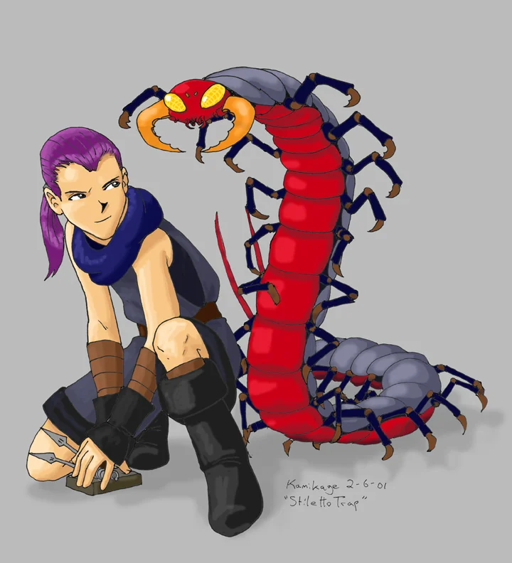

# A Rogue's Pocket Guide to Skills and Secrets

_by Taliesin in **Dark Ages**_



## Contents:

**Introduction**

**Traps**

- Offensive Traps: Needle, Stiletto, Coiled Bolt, Bolt
- Defensive Traps: Blind, Sleep, and Poison

**Combat Skills and Secrets**

- Strikes: Assail, Stab & Twist, Throw Surigam
- Confusion: Amnesia, Beag breisleich, Breisleich, Throw Smoke Bomb

**Laboring Skills**

- Tailoring
- Hairstyling
- Gem Polishing
- Smithing: Weapon, Ring

**Identification**

- Naming Skills: Appraise, Lores (Food, Armor, Missile)
- Enhanced Observation: Look, Nis, Study Creature, Sense, Peek, Eisd Creutair

**Miscellaneous**

- Taunt
- Hide
- Unlock
- Mending: Mend Weapon, Soori, and Garment
- Lectures: Guide, Mentor, Arms

**Appendix I: Requirements and Locations**

**Appendix II: Equipment for Rogues**

## Introduction:

`(( Please note that this introduction and some other portions of this guide are written within double parentheses. When you see information contained within double parentheses ((…)), it means that I am speaking out-of-character to help you better understand a concept, or explanation. For the most part though, I have stayed in character, wherever possible. ))`

This is not a manual with which you will learn everything about Rogues. I am
focusing only on the skills and secrets of the Rogue, in the hopes that you can
learn, understand and master them more quickly than I did. I have included, for
your convenience, appendices at the end of this guide listing where in Temauir
you may buy Rogue equipment, learn our secrets and skills.

## Traps

Traps are the best weapons a rogue has. If used properly traps can be extremely
useful secrets when hunting in a group, and invaluable when hunting alone. You
will eventually learn many traps including blind, sleep, and bolt. While we may
not have the physical power of a Warrior, or the Martial Arts skills of the
Monk, we have excellent armor, and an arsenal of traps. I plan to teach you how
to use each of your traps to it's full potential.

### Offensive Traps

The first trap you will receive is the **Needle Trap**. It is the least
powerful of all the traps you will receive, but even it is very affective if
you are hunting alone. The most effective way to use needle trap is to first
get one creature's attention. Once the beast is attacking you, run a few steps
away and cast needle trap. The reason you must take a few steps away, is that
the secret takes about 4 seconds to cast (during which time you cannot move, or
the trap will not set properly), and you don't want the beast to catch up to
you and injure you while you're setting the trap. After you set the first trap,
run a few more paces ahead of the creature and set another needle trap. When
you lead a creature over the spot you set your trap, it will injure your enemy.
Continue setting traps, and running, 'til the beast is dead.

This strategy works with most of your traps, including **Needle, Stiletto,
Coiled Bolt, and Bolt**. These four traps all hit your enemy with a blow, as if
you had struck the beast yourself. From weakest to most powerful the Rogue's
offensive traps would be ranked as follows: Needle, Stiletto, Coiled Bolt, and
Bolt. There are some defensive traps as well, but for now, I will continue with
the offensive ones. As I have said, these traps work well alone, as they are
more powerful than your assail, but in a group they are unpractical. When a
group hunts, regular procedure is for the Priests and Wizards to stand back and
cast their secrets. while the Monks, Rogues, and Warriors surround and attack
their chosen creature. In a group hunt, keeping the creature in one spot is
preferred, so everyone can attack it without having to chase it around
everywhere. If the creature is being kept in one spot, it cannot run over your
traps. Even if the creature was running freely around your group, who's to say
that it will chase you instead of one of your companions? So you see, offensive
traps work very well alone, but in my opinion, are not practical when hunting
in a group.

### Defensive Traps

Fear not, for the rogue does play an important role in group hunting, due
greatly in part to our defensive traps. The defensive traps consist of Sleep,
Poison, and Blind. Please note that Poison trap is technically of an offensive
nature, but due to the strange power of poison, and how you incorporate it into
your fighting style, I have included it with the defensive traps. Defensive
traps are, in my humble opinion, more versatile than the offensive variety. If
used properly, they can be very helpful when hunting alone and just as useful
fighting with other Aislings.

**Poison Trap** is almost all-purpose. It slowly drains vitality from whatever
creature walks onto your poison trap. As a result, it is very useful to use any
chance you get. If you are about to set a row of stiletto traps, for example,
set a poison trap in front of them. This way, the beast's vitality will slowly
be dropping, even before it lands on your stiletto traps, and while it is
walking over them.

**Blind and Sleep Trap** are very similar, but with slight differences. Both
lower the defenses of the beast you are attacking, and lesson your chances of
being attacked. If a creature stumbles onto your blind trap, it will stop
moving, and will not attack you…usually. When blinded, creatures can't see
anything around them. If they can't see you they can't attack you right? Wrong.
If you walk up to a blind creature and start attacking it, it will feel your
blows, know that you are standing next to it, and fight back, even though it
can't see you. Sleep is different, and slightly improved. If a creature finds
one of your sleep traps, it will fall into a slumber, although Sleep traps do
not last as long as Blind traps. When a creature is sleeping, it will not
attack you until it wakes up. It has no idea what is happening around, or to
it, and is no danger to anyone until it wakes up. If you intend to physically
bash the creature, I would suggest sleeping it, although if you just need to
slow a creature down, I would use Blind, since it does stay cast longer than
Sleep.

When hunting alone, I like to set a blind trap, then once the creature has
walked onto the trap and is dozing, set a row of offensive traps (usually 3 or
4 of them). After the creature wakes up and starts to walk over the needle/
stiletto/ bolt traps, I like to cast another blind trap, and another row of
offensive traps. If you use this strategy, you will notice that creatures die
rather quickly, and you receive virtually no physical assault against yourself.
If you set a poison trap somewhere in your row, the beast will perish all the
faster. Another use for Sleep and Blind traps when hunting alone is to cut down
on the number of creatures attacking you. If you have 2 creatures chasing you,
you could cast a Blind trap, and lead one of them over it, so you can
concentrate on the killing the other one without taking a double assault.

Defensive traps make the rogue a valued member of any hunting party that is in
a busy area. Often groups find themselves overrun by many creatures. If this
happens, it is the Rogue's job to run interference. If your group is all
attacking one goblin, for example, and two more run out of the bushes ready to
attack, you can very effectively keep the other two Goblins preoccupied, until
your group has finished off the first beast. What you should do, if you ever
find yourself in a situation like this, is to get the attention of the unwanted
creatures (by hitting them, or taunting them) then, once they are following you
instead of your hunting party, set some Blind and Poison traps. Essentially you
just keep the extra creatures distracted so the rest of your hunting party can
fight more productively against one creature at a time.

## Skills for Fighting

### Strikes

**Assail** is a skill all Aislings are born with. As you may have guessed from
its name, it is your basic assault. When you hit a creature, it is Assail that
is being used.
`((Assail does not require activation to work. When you press the spacebar to attack, it automatically uses your Assail.))`

**Stab & Twist** is a fighting skill that must be used in conjunction with a
Soori knife, or a Surigam. It will deal an especially hard blow to the creature
you are attacking, as long as you are standing directly in front of the beast.

**Throw Surigam** is a skill that does much more damage per hit than Assail. It
allows you to injure a creature from a distance, over an Aisling's shoulder, or
even through a wall. Basically, although it looks like you are fighting with
the air, you can throw your dagger or secret at a creature many paces away (but
don't worry, you don't lose your weapon by doing this…it will come back to you
every time). Like Stab and Twist, you must be carrying a Soori knife, or a
Surigam for this skill to work. This skill works well when combined with
offensive and defensive traps. While a creature is blind, asleep, or running
towards you through a row of your traps, you can use Throw Surigam to hit them,
even though you are not touching them. You can hit a creature from many paces
away, as long as it is directly in front of you (by this I mean that you and
the creature must be standing in a straight line). This is, in my opinion, one
of the greatest skills given to Rogues, but for optimum performance, it must be
continually practiced. Like I did, you will probably get very frustrated with
the effectiveness of this skill at first, but if you keep practicing, you will
get amazing results.

### Confusion

Rogues are masters of confusion. There are two secrets. **Beag breisleich** and
**Breisleich**, and two skills, **Amnesia** and **Throw Smoke Bomb,** which you
can use to confuse your enemies. For the moment I will speak only about the
first three.

`((All three are used the same way: activate the skill/secret, click on the creature you wish to confuse.))`

Amnesia is the least effective of the three, only making the creature
temporarily forget about attacking you. Beag breisleich and Breisleich both
make your chosen creature forget about you and/or attack the other creatures.
Beag meaning "little" you will notice that Beag breisleich is not as affective
at Breisleich, which you get at a later time than the lesser secret.

**Throw Smoke Bomb**, contrary to popular belief, is very different from Throw
Surigam, although it requires that you have a certain level of expertise at
Throw Surigam (level 30). This skill only works if you have a Smoke Bomb in
your inventory. Smoke Bombs can be made by Rogues at some mundane shops, and
require blue powder to create. Blue powder is made by Wizards, so if you know a
Wizard who can make you some, you may wish to turn them into smoke bombs for
yourself. You can also buy Smoke bombs in the same shops where you make them.

Once you have a bomb in your inventory, activate the skill just like you would
activate Throw Surigam, although you don't need to aim at anything in
particular with Throw Smoke Bomb. Once you use the skill, one of the Smoke
Bombs in your inventory will be used, and all the creatures
`((that are visible on your screen))` will be blinded by the smoke.

## Laboring Skills

There are many skills a rogue may learn which require labor. When I say labor,
I mean the "time" that each Aisling is allotted. Every 4 Temauir days
`((12 Terran hours))` each Aisling receives 5 days worth of labor. This labor
can be used for things such as voting for someone, tailoring, smithing weapons,
etc., although not all laboring skills require the same amount of time. If you,
for example, tailored a garment, it might use up 3 days worth of labor, while
you could smith many weapons before using up all of your time. This laboring
time is like gold for us Rogues. We have so many laboring skills that we can
do, and so little time to do them in. Unfortunately once you use up your 5 days
worth of labor you must wait 4 more days `((12 Terran hours))` before your time
is renewed and you can use more laboring skills. Fortunately, there is a way to
get some extra laboring time, if you need it. Many Aislings (namely Priests,
Warriors, and Wizards) don't consider their laboring time as invaluable as we
Rogues do. They can often be persuaded to sell their laboring time if the price
is right.
`((To "labor for" or give your time to someone, you must go to a bank and select the option "Labor", then enter the Aisling's name whom you wish to labor for.))`
The laboring skills that Rogues may learn include Tailoring, Hairstyling, Gem
Polishing, Weapon Smithing, and Ring Smithing. All these skills can be done
alone or with an assistant. If you get another Aisling to assist you, your
chances of success are improved. Also take note of the fact that if you assist
someone doing a skill, it will not take away your laboring time. Only the labor
time of the person actually using the skill will be depleted, not the
assistant's.

`((Please note that with the laboring skills, it is required that you put the item you mean to improve/ alter into the top leftmost spot in your inventory))`

### Tailoring

Tailoring is a skill, which allows you to improve the quality of a piece of
clothing. There are four qualities of improved clothing: Good, Fine, Grand, and
Great. Regardless of what kind of clothing you are tailoring, good would
improve the armor class by 1, Fine would improve it by 2, grand by 3 and great
would have an armor class 4 points higher than an untailored garment. When you
Tailor a garment you will either make one of these qualities, destroy the
garment, or not improve it at all. Your level of success depends on how skilled
a tailor you are.

You may have noticed that certain Mundane shopkeepers mention Male and Female
Tailoring. If you tried to speak to the Mundane about tailoring without
learning the Tailoring skill, it is likely that they will not say a word to you
about the subject. If, though, you have learned the Tailoring skill, the
Mundane will allow you to work on your least most powerful garment (so if you
have 2 or 3 pieces of clothing in your inventory, the least powerful garment
will be tailored). I, as a rule of thumb, make sure I am only carrying the
garment I mean to improve, and put all other clothes I am carrying in the bank,
or give them to a friend to hold onto. Once you have chosen to work on your
least most powerful garment, the Mundane will ask you if you wish to tailor
alone or with an assistant. (An assistant will always improve your chances for
success, and is preferable if you can find someone to help. Alternately, you
may be asked to assist another Aisling in a skill. You will be happy to hear
that assisting someone with a skill will not use your laboring time, only the
Aisling doing the smithing/ tailoring/ etc. will use up labor.)

### Gem Polishing

Gem polishing is a secret known only by rogues. There are many places in
Temauir where gems may be found, and many Mundane shopkeepers who will buy
gems. There are many grades of gems and each grade has a different value. The
gem qualities from worst to greatest include: Fragment, Flawed, Uncut, and
Polished. The skill of Gem Polishing can turn fragments, etc. into polished
gems, which can be sold for a much higher price.

To polish a gem, you must cast the Gem Polishing secret, drop a copper coin
under your feet, and begin. You must, of course, have a gem in your inventory
if you wish to polish. This secret doesn't require you to go to a certain
place, or shop to use it. You may cast it anywhere in Temauir where magic is
allowed.

\* Please note that although I have grouped Gem Polishing with the laboring
skills, it is, in fact, a secret.

### Hairstyling

Hairstyling is a skill known only to Rogues. It allows you to style or dye
another Aislings hair, although you cannot use this skill on yourself, thus you
are unable to style or dye your own hair. Once you have learned the Hairstyling
skill, you can dye/ style hair at most banks in Temauir as long as you and the
Aisling whose hair you are altering both have laboring time.
`((You simply go to a bank, select the "hairstyle" option, and enter the individual's name that wants the style. They will take over from there, choosing the color or style.))`

### Smithing

Once your level of Gem Smithing reaches 5, which will rise as you polish gems,
you will become able to smith rings out of the gems you collect and polish.
**Ring Smithing** is not a skill learned from a mundane, but rather, it is a
skill that you are naturally able to do when you are good enough at polishing
gems. Many armor smiths in Temuair will let you use their equipment to smith
rings once your Gem Smithing has reached level 5.

**Weapon Smithing** is almost identical to tailoring in principal, except that
you are improving a weapon instead of your clothes. You may do this skill alone
or with an assistant, and you can turn a regular weapon in to one of Good,
Fine, Grand, or Great quality. Please note that this skill can be used to
improve Warriors' swords, and Rogues' Soori knives and Surigams. Again, you run
the risk of destroying or not improving the weapon if you are not experienced
at this skill. Most Smiths will let you use their shop and equipment, and if
you have an assistant, your chances of success will be greater than alone.

### Other Uses for Labor

While the above listed skills require varying degrees of your laboring time,
there are some other things that require labor. You may want to keep the
following list of other actions/events which require your labor: voting,
attending class at college, higgling at the bank, teaching a student using the
mentor secret, getting your own hair styled or dyed by another person, and
making smoke bombs. It is often very difficult to juggle all the tasks you wish
to complete with the little laboring time you have, so use your time wisely.

## Identification Skills

### Naming Skills

There are many skills which identify (or name) one type of item or another. In
order to sell an item to a Mundane shopkeeper, or deposit it into your bank it
must be identified. Many items may be of a particular quality, or enchanted in
some way. Until identified, the item will seem just like a regular item, but
once identified, it shows it's true attributes. For example, you may find an
amber necklace, which after identified, is in fact a wind amber necklace. Until
named, you would be unable to put items like this in the bank. Some things that
may be named are potions (made by monks, priests, and wizards), clothes, armor,
jewelry, gems and weapons.

`((*To use a naming skill, you must put the item you wish to identify in the top left position in your inventory then activate the corresponding skill.))`

**Appraise** is a skill used to identify gems. A "raw" gem, once appraised
could turn out to be a fragment, flawed, uncut or finished gem. Once appraised
gems can be deposited in the bank for future use, or sold to certain mundane
shopkeepers.

**Armor lore** is a very useful skill for discovering information about
clothing. It will tell you many useful bits of info like the armor class, what
insight an Aisling must be to wear it, and, if the item has been improved by
tailored, it will name the item (good, fine, etc.) so that it may be put in the
bank. The items that may be named using Armor Lore are Greaves, Shields,
Helmets, Bracers, Gauntlets, and Necklaces.

**Missile Lore** will identify any Rogue weapon. Similar to Armor Lore, you
will discover many useful bits of information about the weapon such as weight,
Hits, and Damage. It will also identify whether it is a regular or improved
weapon, and if improved, will now be able to be deposited in the bank.

**Food lore** will tell you what nourishment an edible item has. For example,
if it is a poisonous food, it would tell you how many health points it would
remove upon eating, while if it is healthy, it will tell you how many health
points you would gain by eating it.

### Enhanced Observation

There are many skills and secrets available to Rogues that will give you
information about a person, creature, or place that are undetectable to the
average Aisling. We are able to peak into an Aislings inventory, sense how
healthy a creature is, and more.

**Nis** is a secret that will tell you what time it is in Temuair.

`((Once you cast it, you will see the current Temuairan date and time in the orange bar below your view screen.))`

**Look** is a skill, which identifies where in Temauir you are. If a creature
is standing in front of you when you "Look", it will name the creature as well.
This is a very useful skill if you have gotten lost, or need to tell someone
where to meet you. Look will tell you which town you are in, as well as the
particular shop or room.

**Study Creature** is an invaluable skill, which gets more and more useful, the
more you practice it. When you begin using this skill, it will tell you the
name and maximum experience of the creature you are facing and standing in a
line with (you don't need to be directly in front of the creature, just aimed
at it so to speak). As you practice eventually you will discover the Hit
points, Mana points, Insight, Attack nature, and Defense nature of the
creature.

**Sense** is similar to Study Creature, but instead of telling you about a
creature, it tells you about an Aisling. Like Throw Surigam and Study Creature,
as long as you are in a direct line, facing your subject, and not too far away,
it should work. At first this skill won't tell you everything, but with
practice you will be able to sense an Aisling's name, health points, mana
points, attack and defense element.

**Peak** is a skill made for the curious Rogue. With it you can peak into
anyone's inventory and see exactly what he or she is holding. To use this
skill, stand in a straight line with the person you wish to peak on, facing
them, and activate your skill.

**Eisd Creutair** is a secret which let's you see invisible Aislings. It lasts
about as long as hide, and for the entire time that it is cast, you will see a
blue hazy figure anywhere there is an Aisling using Hide.

## Miscellaneous Skills and Secrets

### Taunt

Taunt is a secret known by all young Aislings.
`((All that is required is that you activate the secret, then click on the creature you wish to antagonize, and wait for the secret to finish casting.))`
Once hit with Taunt, as long as the magic wasn't deflected, the creature will
start walking towards you, ready to attack. Taunt is very useful if you don't
enjoy chasing creatures before you attack them, or if you wish to get the
attention of a non-hostile creature.

### Hide

Hide is an indispensable secret for gaining wealth as well as defending
yourself against ambushes of creatures, or especially tough beasts. In hide, no
creature (that I have seen) can detect you. You may walk around, hidden from
Aislings and creatures alike, for upwards to 2 minutes. When using hide to go
into very dangerous areas where you would die if visible you must be very
careful. If you hit a creature or use another secret while in hide, you will
instantly become visible and vulnerable. Although not an issue for older rogues
with a lot of mana, young Aislings should take note that hide uses 200 mana.
You should always keep an eye on the amount of mana you have, so you always
have enough to hide when you need to.

### Unlock

Unlock is a wonderful skill for the lone treasure hunting Rogue. You may have
noticed the chests scattered about in the Mileth Crypt; those chests are there
just for us. Inside them are many treasures including gems, gauntlets, rings,
belts, etc. that only Rogues can access. I'm sure you've seen the Special
Skills Trainers selling Lock Picks. If you are wearing a Lock Pick, know the
Unlock skill, and are lucky, when you walk in front of a chest you will be able
to open it and access it's hidden treasures. You will not be able to unlock
all, or even most of the chests at first, but keep trying and you will be a
world class treasure hunter in no time. One danger I must mention to you is
that treasure chests are often booby-trapped with poison. As soon as you open
some chests, you will be poisoned for a minute or so. Because of this, it is
always a good idea to bring some Personica deums (poison curing potions), or if
you don't mind sharing your loot, bring a monk or priest with you instead, who
knows how to cure poison.

### Mending Skills

As you may or may not know, when you are in battle your armor and equipment
wears down. The typical solution is to go to a Smith shop and pay the Mundane
to fix your equipment. As Rogues, we have a few convenient skills, which
alleviate the need to pay a Smith. Why pay someone else when you can do it
yourself? **Mend Weapon, Mend Garment, and Mend Soori** are all Rogue skills
which you can use to fix your equipment yourself. The basic use of these
secrets is the same; make sure the item you wish to mend is in the top leftmost
spot in your inventory, and activate the skill. Mend Soori fixes only Soori
Knives, Mend Weapon will fix any type of weapon be it a Surigam, Soori, or
Sword, and Mend Garment will repair your clothes, shields, belts, etc. (most of
your equipment aside from weapons). I must add a warning though: before you get
good at these skills, you may destroy a few pieces of equipment. Occasionally
when you fail at repairing an item you will in fact destroy it in the process.

### Lectures

**Mentor** is something that most Aislings do at Dar or Devlin's shop. There is
a Mentoring secret you may learn, which will allow you to become someone's
mentor, cast mentor to give him or her experience, and to complete the
mentoring cycle at your student's 11th insight. This secret can be used
anywhere in Temuair where magic has not been banned. At a time when your
student is with you `((on the same screen))` cast the Mentor secret, then throw
a coin under your feet and pick it up again. This should activate your mentor
secret.

**Guide** is similar to Mentor in that it is a secret you cast on your
students. The usual way to cast Guide on a student is to take them all the way
back through the Temple of Choosing, and get one of the Mundanes to assist you
in. If you have this secret, you do not need to walk all the way through the
temple. Like Mentor, you can use this secret anywhere in Temuair where magic is
allowed, and your student must be near you. Once your student reaches the 11th
insight, cast Guide, drop a coin in front of or beside you, and walk over it.
This should activate your Guide secret without inconveniencing you or your
student.

**Arms Lecture** is a secret given to Rogues that can be useful to young
Aislings. Basically, once cast, you are given information on hunting, magic,
armor, etc. To use this secret, cast it, then drop a coin in front of you and
pick it up again. Essentially this is just an informative lecture, as the name
implies.

## Appendix I: Requirements and Locations

| Town           | Shop                   | Skill/Secret     | Str | Int | Wis | Con | Dex | Payment                                                       |
|----------------|------------------------|------------------|-----|-----|-----|-----|-----|---------------------------------------------------------------|
| Mileth         | Special Skills Trainer | Needle Trap      | ?   | ?   | ?   | ?   | ?   | Long forgotten                                                |
|                |                        | Stiletto Trap    | ?   | ?   | ?   | ?   | ?   | Long forgotten                                                |
|                |                        | Appraise         | 3   | 12  | 4   | 3   | 3   | Long forgotten                                                |
|                |                        | Food Lore        | 3   | 9   | 7   | 3   | 3   | Long forgotten                                                |
|                |                        | Unlock           | ?   | ?   | ?   | ?   | ?   | Long forgotten                                                |
|                | Warrior Trainer        | Taunt            | 3   | 5   | 5   | 3   | 5   | Long forgotten                                                |
|                |                        | Throw Surigam    | 6   | 3   | 3   | 3   | 11  | Long forgotten                                                |
|                |                        | Stab and Twist   | 18  | 3   | 3   | 3   | 12  | Long forgotten                                                |
|                | Blacksmith             | Armor Lore       | 5   | 9   | 5   | 3   | 3   | Long forgotten                                                |
|                | Wizard (Dar)           | Beag Breisleich  | 3   | 5   | 5   | 3   | 7   | Long forgotten                                                |
|                |                        | Breisleich       | 5   | 21  | 22  | 3   | 9   | Spider eye, viper gland, 5000 coins                           |
|                | Bank                   | Hairstyle        | 3   | 7   | 3   | 3   | 16  | Long forgotten                                                |
| Piet           | Bank                   | Gem Polishing    | 3   | 3   | 3   | 5   | 5   | Long forgotten                                                |
|                | Fae Priestess          | Eisd Creutair    | 3   | 30  | 24  | 3   | 3   | 5 uncut rubies, 10 uncut beryl, 2 coral earrings, 50000 coins |
| Abel           | Bank                   | Tailor           | 5   | 8   | 3   | 3   | 12  | Long forgotten                                                |
|                | Armory                 | Mend Garment     | 5   | 6   | 3   | 3   | 10  | assail 10, blouse, shirt, 5000 coins                          |
|                |                        | Mend Weapon      | 4   | 5   | 3   | 3   | 9   | assail 5, good dirk, 2500 coins                               |
|                |                        | Mend Soori       | ?   | ?   | ?   | ?   | ?   | good snow secret, 1000 coins                                  |
|                | Fighter Trainer        | Throw            | 10  | 3   | 3   | 10  | 10  | Scorpion Sting                                                |
| Undine         | Wizard                 | Amnesia          | 5   | 8   | 12  | 4   | 5   | throw Surigam 10                                              |
| Rucesion       | Special Skills Trainer | Poison Trap      | 6   | 7   | 6   | 8   | 12  | 4 Viper and 2 Centi Glands                                    |
|                |                        | Blind Trap       | 6   | 10  | 6   | 3   | 12  | Long forgotten                                                |
|                |                        | Sleep            | 6   | 7   | 12  | 3   | 12  | Scorpion Sting                                                |
| Suomi          | Special Skills Trainer | Coiled Bolt Trap | 20  | 6   | 3   | 18  | 10  | good blossom dagger, 10000 coins                              |
|                |                        | Bolt Trap        | 30  | 6   | 3   | 22  | 12  | Long forgotten                                                |
|                |                        | Hide             | 8   | 18  | 12  | 8   | 35  | Bat wing, scorp sting, kob skull, 5000 coins                  |
|                |                        | Armor Lore       | 3   | 15  | 8   | 6   | 3   | Leather Greaves                                               |
|                |                        | Missile Lore     | 8   | 18  | 8   | 8   | 18  | Center secret, 2000 coins                                     |
|                |                        | Peak             | 3   | 33  | 13  | 3   | 38  | Long forgotten                                                |
| Long Forgotten |                        | Study Creature   | 3   | 49  | 3   | 3   | 4   | Long forgotten                                                |
|                |                        | guide lecture    | ?   | ?   | ?   | ?   | ?   | Long forgotten                                                |
|                |                        | arms lecture     | ?   | ?   | ?   | ?   | ?   | Long forgotten                                                |
|                |                        | mentor           | ?   | ?   | ?   | ?   | ?   | Long forgotten                                                |
|                |                        | nis              | ?   | ?   | ?   | ?   | ?   | Long forgotten                                                |
|                |                        | Sense            | ?   | ?   | ?   | ?   | ?   | Long forgotten                                                |

## Appendix II: Equipment for Rogues

| Jewelry                        | Price: | Lvl | Misc.:           | Location                    |
|--------------------------------|--------|-----|------------------|-----------------------------|
| Bone Necklace                  | 1500   | 15  | Hit 5 Dam 1      | Mileth Armory               |
| Amber Necklace                 | 1600   | 14  | Dam 2            | Mileth Armory               |
| Elemental Amber, etc Necklaces | 0      | 14  | elemental attack | not available from mundanes |
| Pearl Necklace                 | 800    | 9   | Hit 5 Dam 1      | Abel Armory                 |
| Gold Jade Necklace             | 800    | 10  | Dam 1            | Piet, Suomi Armory          |
| Jade Necklace                  | 1600   | 13  | Hit 10           | Suomi Armory                |
| Earth Necklace                 | 10000  | 6   | Craeg attack     | Rucesion Armory             |
| Wind Necklace                  | 10000  | 6   | Athar attack     | Rucesion Armory             |
| Sea Necklace                   | 10000  | 6   | Sal attack       | Rucesion, Undine Armory     |
| Fire Necklace                  | 10000  | 6   | Srad attack      | Rucesion Armory             |
| Coral Earring                  | 8000   | 8   | Int. 2           | Mileth Armory               |
| Gold Earring                   | 8000   | 8   | Str. 2           | Piet Armory                 |
| Ruby Earring                   | 10000  | 8   | Str. 1 Int. 1    | Suomi Armory                |
| Enchanted Earrings             | 0      | 12  | various          | not available from mundanes |
| Talos Ring                     | 3000   | 4   | hp 100           | Piet Armory                 |
| Ruby Ring                      | 20000  | 6   | hp 200           | Mileth Armory               |
| Lapis Ring                     | 50000  | 8   | hp 300           | Undine, Abel Armory         |
| Spinal Ring                    | 40000  | 11  | hp 500 hit 2     | Undine Armory               |
| Amethyst Ring                  | 50000  | 12  | hp 200 MP 100    | Mileth Armory               |
| Jade Ring                      | 100000 | 12  | hp 300 MP 150    | Suomi Armory                |
| Emerald Ring                   | 54000  | 12  | hp 500 dam 2     | Suomi Armory                |

| Weapon:        | Price: | Lvl | Location                    |
|----------------|--------|-----|-----------------------------|
| Dirk           | 500    | 2   | Abel, Suomi Weaponry        |
| Eppe           | 500    | 2   | Loures, Suomi Weaponry      |
| Blossom Dagger | 7000   | 14  | Loures Weaponry             |
| Center Dagger  | 3000   | 4   | Loures Weaponry             |
| Snow Dagger    | 1000   | 1   | Loures Weaponry             |
| Moon Dagger    | 12000  | 30  | Loures, Rucesion Weaponry   |
| Light Dagger   | 0      | 39  | not available from mundanes |
| Lotus Dagger   | 0      | 75  | not available from mundanes |
| Snow Secret    | 1500   | 1   | Suomi Weaponry              |
| Center Secret  | 4000   | 7   | Suomi Weaponry              |
| Blossom Secret | 10000  | 21  | Suomi Weaponry              |
| Moon Secret    | 15000  | 39  | Suomi Weaponry              |
| Light Secret   | 23000  | 52  | Suomi Weaponry              |
| Lotus Secret   | 0      | 86  | not available from mundanes |
| Whip           | 20000  | 26  | Undine Higgler              |

\* Please note that when weapons are smithed and made a better quality the
insight required to use the item is increased.

| Armor:                     | Price: | Lvl | Misc.:        | Location                    |
|----------------------------|--------|-----|---------------|-----------------------------|
| Boots (blue)               | 1000   | 1   |               | Mileth Armory               |
| Gray Boots                 | 10000  | 11  |               | Mileth Armory               |
| Cured Boots (gray)         | 5000   | 24  | Dex. 1        | Mileth Armory               |
| Shagreen Boots (green)     | 10000  | 33  | Dex. 2        | Mileth Armory               |
| Cardovan Boots (tan)       | 0      | 50  | Dex. 3        | not available from mundanes |
| Lapis Boots (blue)         | 5000   | 56  |               | Piet Higgler                |
| Saffion Boots (purple)     | 0      | 66  | Dex. 4        | not available from mundanes |
| Magma Boots (red)          | 0      | 82  | Dex. 5        | not available from mundanes |
| Leather Gauntlet           | 2000   | 9   | ac - 1        | Mileth Armory               |
| Enchanted Leather Gauntlet |        | 14  | ac - 1        | not available from mundanes |
| Enchanted Iron Gauntlet    |        | 33  | ac - 2        | not available from mundanes |
| Enchanted Mythril Gauntlet |        | 63  | ac - 3        | not available from mundanes |
| Leather Greaves            | 4000   | 6   | ac - 2        | Abel Armory                 |
| Enchanted Leather Greaves  |        | 14  | ac - 2        | not available from mundanes |
| Iron Greaves               | 20000  | 20  | ac - 4        | Abel Armory                 |
| Enchanted Iron Greaves     |        | 30  | ac - 4        | not available from mundanes |
| Enchanted Mythril Greaves  |        | 59  | ac - 6        | not available from mundanes |
| Wind Belt                  | 10000  | 4   | Athar defense | Rucesion Armory             |
| Sea Belt                   | 10000  | 4   | Sal defense   | Undine Armory               |
| Earth Belt                 | 10000  | 4   | Craeg defense | Piet Armory                 |
| Fire Belt                  | 10000  | 4   | Srad attack   | Suomi Armory                |
| Elemental Leather Belt     | 0      | 12  |               | not available from mundanes |
| Elemental Mythril Belt     | 0      | 12  | Con 1         | not available from mundanes |
| Elemental Hy-Brassyl Belt  | 0      | ?   | Con 1, Wis. 1 | not available from mundanes |
| Might Belt                 | 0      | ?   |               | not available from mundanes |
| Dark Belt                  | 0      | 30  | dark defense  | not available from mundanes |

| Garment:                | Price: | Lvl | Misc.:                                 | Location:        |
|-------------------------|--------|-----|----------------------------------------|------------------|
| Blouse                  | 100    | 1   | ac -4                                  | Mileth Higgler   |
| Cotte                   | 900    | 1   | ac -10                                 | Rucesion Higgler |
| Brigadine               | 9400   | 11  | ac -20                                 | Abel Armory      |
| Corsette                | 0      | 41  | ac - 30, payment of 3 polished rubies  | Abel Tailor      |
| (Name of armor unknown) | 0      | 71  | ac - 40, payment of 12 polished rubies | Fae Glenn        |
| Shirt                   | 100    | 1   | ac -4                                  | Mileth Higgler   |
| Scout Leather           | 900    | 1   | ac -10                                 | Piet Higgler     |
| Dwarvish Leather        | 9400   | 11  | ac -20                                 | Piet Higgler     |
| Paluton                 | 0      | 41  | ac - 30, payment of 3 polished rubies  | Abel Tailor      |
| Keaton                  | 0      | 71  | ac - 40, payment of 12 polished rubies | Fae Glenn        |

_Compiled and written by Taliesin Gwion Bach_

***

```
*Librarian Notes*

Recognized: Aisling, Lorekeepers Recognized (Events of Temuair post #3).
This work is one of the greatest treasures of Temuair.

This entry has been heavily edited to conform to Library formatting.
The original can be found at http://www.darkages.com/community/lore/Taliesin_Rogue.html .
```
