# Ainmhidh de Temuair (Bestiary)

_by Taurlos in **Dark Ages**_


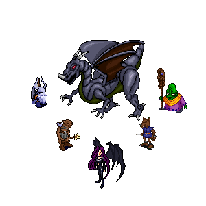


The contents of this Bestiary were gathered through information collected on my
travels through the many lands of Temuair. Although, as there is much unknown
to both Aislings and Mundanes it is likely that this book shall never truly be
completed. However as I discover new races and creatures, they will be added to
these texts. Because of the vast amount of creatures in this land, I have
decided upon splitting this encyclopedia into two volumes. This is the first
volume and contains information about creatures often seen by 1st through 3rd
circle Aislings. I hope ye enjoy.

## Chapter 1: Mileth Crypt

The Mileth Crypt is thought to be the burial ground of many decorated Mileth
soilders and war heros of the Shadow's War. It is wraught with many horrors of
the dead and creatures of the night. I explored as far as I could, through the
many depths of the tomb. I went as far as twenty-seven floors by my count.
Although it seemed like the end, I could still sense that there was somthing
more lurking beneath.

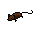

**Rat:** The rat is a vermin creature that can be found infesting the first
floors of the Crypt. Most of it's life is spent gathering mold and rotting food
for sustinance and so drops some of this collection when defeated. An ideal
creature to fight for the beginning Aisling.

|             |                     |              |                              |
|-------------|---------------------|--------------|------------------------------|
| HP Low: 25  | Experience Low: 100 | Level Low: 1 | Location: Floors 1 through 2 |
| HP Max: 250 | Experience Max: 340 | Level Max: 3 | Items: Mold, Rotten Foods    |

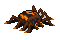

**Spider:** A perilous insect which weaves its webs on the first floors of the
crypt. Beware for some of these creatures venom can be toxic to young Aislings.

|              |                      |               |                                    |
|--------------|----------------------|---------------|------------------------------------|
| HP Low: 140  | Experience Low: 180  | Level Low: 2  | Location: Floors 1 through 4       |
| HP Max: 1500 | Experience Max: 2040 | Level Max: 17 | Items: Spider's Eye, Spider's Silk |

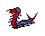

**Centipede:** A fearsome insect with numerous legs and sharp fangs...
certainly a creature to be wary of when first entering the crypt.

|              |                      |               |                                |
|--------------|----------------------|---------------|--------------------------------|
| HP Low: 210  | Experience Low: 260  | Level Low: 3  | Location: Floors 1 through 6   |
| HP Max: 2600 | Experience Max: 3080 | Level Max: 21 | Items: Mold, Centipede's Gland |


**Bat:** Sometimes called the flying rat, the bat won't hesitate in attacking
unsuspecting Aisling's who venture to close to their lairs.

|              |                      |               |                              |
|--------------|----------------------|---------------|------------------------------|
| HP Low: 1300 | Experience Low: 2250 | Level Low: 14 | Location: Floors 3 through 8 |
| HP Max: 4000 | Experience Max: 6250 | Level Max: ?? | Items: Bat's Wing            |


**Scorpion:** This creature is armed with many natural weapons ranging from
it's vice like claws, razor sharp fangs and it's lightning-quick stinger. The
stinger can strike an Aisling before knowing what hit them and render them
paralized as the venom begins to flow through their veins.

|                |                        |               |                               |
|----------------|------------------------|---------------|-------------------------------|
| HP Low: 3300   | Experience Low: 6240   | Level Low: 25 | Location: Floors 5 through 10 |
| HP Max: 11,000 | Experience Max: 13,000 | Level Max: 47 | Items: Scorpion's Sting       |


**Great Bat:** Dreaded winged creature far larger than the smaller of the
species, these beasts can pierce the night with their wicked screeching and
need no light to find their target.

|                |                        |               |                               |
|----------------|------------------------|---------------|-------------------------------|
| HP Low: 8,000  | Experience Low: 11,000 | Level Low: 35 | Location: Floors 7 through 14 |
| HP Max: 18,000 | Experience Max: 18,000 | Level Max: 57 | Items: Great Bat's Wing       |

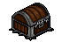

**Chest:** A cursed treasure chest... it's structure penetrated by evil
spirits, through the process growing legs and sharp rows of teeth.

|                |                        |               |                               |
|----------------|------------------------|---------------|-------------------------------|
| HP Low: 11,000 | Experience Low: 13,000 | Level Low: 45 | Location: Floors 9 through 18 |
| HP Max: 23,000 | Experience Max: 24,000 | Level Max: 66 | Items: Coins                  |


**White Bat:** Albino bats found deep within the Crypt. Although not as large
as Great Bat's, their strength and swiftness can be a suprise to ignorant
Aislings.

|                |                        |               |                                |
|----------------|------------------------|---------------|--------------------------------|
| HP Low: 19,000 | Experience Low: 23,000 | Level Low: 55 | Location: Floors 11 through 22 |
| HP Max: 29,000 | Experience Max: 34,000 | Level Max: 77 | Items: White Bat's Wing        |


**Kardi:** Kardi's were thought to have come from rats who ventured into the
depths of the crypt, and the evil they met there warped their bodies and
changed them. This change resulted in Kardis.

|                |                        |               |                                |
|----------------|------------------------|---------------|--------------------------------|
| HP Low: 21,000 | Experience Low: 35,000 | Level Low: 65 | Location: Floors 15 through 26 |
| HP Max: 35,000 | Experience Max: 45,000 | Level Max: 86 | Items: None                    |

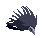

**Marauder:** Small, bird like creatures. Marauders attack with what seems to
be a long beak at the front of it's body.

|                |                        |               |                                |
|----------------|------------------------|---------------|--------------------------------|
| HP Low: 20,000 | Experience Low: 45,000 | Level Low: 75 | Location: Floors 19 through 27 |
| HP Max: 61,000 | Experience Max: 59,000 | Level Max: 91 | Items: None                    |


**Succubus:** The phrase "Beauty is only skin deep" certairly applies to these
dreaded creatures of the night. Succubi were even thought to one time be
Aisling's whom decended into darkness never to return. These mistresses of the
dark are certainly a force to be reckoned with. With the ability to charm its
opponents with their power of seduction until they are close enough to spray a
toxic substance into the faces of Aislings.

|                |                        |               |                                |
|----------------|------------------------|---------------|--------------------------------|
| HP Low: 27,000 | Experience Low: 60,000 | Level Low: 85 | Location: Floors 21 through 31 |
| HP Max: 66,000 | Experience Max: 74,000 | Level Max: 96 | Items: Succubus Hair           |

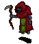

**Wraith:** Malignant horrors of the Cthonic Realm, they are the servants of
Chadul himself. These creatures should be avoided at all costs less they claim
your soul.

|                |                        |               |                                |
|----------------|------------------------|---------------|--------------------------------|
| HP Low: 60,000 | Experience Low: 75,000 | Level Low: 97 | Location: Floors 27 through 31 |
| HP Max: --     | Experience Max: --     | Level Max: -- | Items: None                    |

## Chapter 2: East Woodlands

A not so peaceful area of rolling hills and prestine trees, the East Woodlands
is an ideal hunting ground for Aislings of all insights. The woods themself
contain many forested areas, a beautiful garden, and a barren wasteland, all
inhabited by a wide variety of creatures and beasts.


**Viper:** A small, scaly reptile. It has no legs yet moves itself by
slithering across the ground. Their jaws contain needle sharp fangs, but
luckily the woodland Viper has no venom within it's glands.

|             |                     |              |                                |
|-------------|---------------------|--------------|--------------------------------|
| HP Low: 54  | Experience Low: 100 | Level Low: 1 | Location: Wasteland, E. Garden |
| HP Max: 240 | Experience Max: 340 | Level Max: 3 | Items: Viper's Gland           |

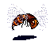

**Wasp:** An insect with large wings. These creatures have a sharp stinger
attached to the end of it's lower body, certainly a threat to anyone who
venture to near. The Wasps are well known for their ability to make wax and
honey, and such, they drop it often once defeated.

|               |                       |               |                                                   |
|---------------|-----------------------|---------------|---------------------------------------------------|
| HP Low: 120   | Experience Low: 220   | Level Low: 2  | Location: Wasteland, E. Garden 3-1, 4-1           |
| HP Max: 1,800 | Experience Max: 3,240 | Level Max: 16 | Items: Raw Honey, Raw Wax, Royal Wax, Bee's Sting |

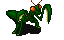

**Mantis:** Terrible insect with enourmous slashing claws. Beware of the
serrated edges of these beasts, they will easily rip through flesh and armor

|               |                       |               |                                               |
|---------------|-----------------------|---------------|-----------------------------------------------|
| HP Low: 220   | Experience Low: 260   | Level Low: 3  | Location: Wasteland, E Garden 3-1 through 6-1 |
| HP Max: 4,750 | Experience Max: 4,950 | Level Max: 27 | Items: Mantis' Eye                            |

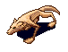

**Wolf:** Canine with powerful jaws. Nimble and strong wolves tend to hunt in
packs, preying upon Aisling's who stray far from their group. Although
dangerous, if you happen to defeat a wolf, the different parts of it's pelt may
be sold to the Martial Arts trainer in Abel for a bit of coinsare.

|               |                       |               |                                              |
|---------------|-----------------------|---------------|----------------------------------------------|
| HP Low: 1,200 | Experience Low: 2,640 | Level Low: 14 | Location:3-1 through 8-1                     |
| HP Max: 7,000 | Experience Max: 9,000 | Level Max: 37 | Items: Wolf's Skin, Wolf's Fur, Wolf's Locke |

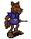

**Kobold:** Half wolf, half Mundane, these intelligent beasts hunt with sharp
and sometimes poisoned knives. Known well for their cunning and dexterity.

|                |                        |               |                           |
|----------------|------------------------|---------------|---------------------------|
| HP Low: 2,500  | Experience Low: 6,240  | Level Low: 25 | Location:5-1 through 10-1 |
| HP Max: 12,000 | Experience Max: 13,000 | Level Max: 46 | Items: Kobold's Skull     |

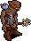

**Goblin Soldier:** Light infantry unit of the goblin race, armed with light
armor, and a club, goblin soldiers pack a punch, but are slow to when it comes
time to think.

|                |                        |               |                           |
|----------------|------------------------|---------------|---------------------------|
| HP Low: 8,000  | Experience Low: 11,000 | Level Low: 37 | Location:7-1 through 12-1 |
| HP Max: 19,000 | Experience Max: 20,000 | Level Max: 56 | Items: Goblin's Skull     |

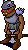

**Goblin Warrior:** Armed with a battle axe and heavy armor, Goblin Warriors
are a force to be reckoned with. They will not hesitate to start a fight.

|                |                        |               |                            |
|----------------|------------------------|---------------|----------------------------|
| HP Low: 11,000 | Experience Low: 18,000 | Level Low: 45 | Location: 9-1 through 14-1 |
| HP Max: 25,000 | Experience Max: 25,000 | Level Max: 66 | Items: Goblin's Skull      |

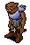

**Goblin Guard:** Defensive unit armed with chainmail and a light mace. Goblin
Guards tend to sneak up on their targets while Goblin Warriors attack their
fronts.

|                |                        |               |                             |
|----------------|------------------------|---------------|-----------------------------|
| HP Low: 14,000 | Experience Low: 25,000 | Level Low: 55 | Location: 11-1 through 16-1 |
| HP Max: 45,000 | Experience Max: 38,000 | Level Max: 77 | Items: Goblin's Skull       |

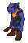

**Hobgoblin:** Close cousin to the goblin race, these ugly brutes attack with
wooden clubs. Hobgoblin strength is unsurpassed by any of their kind.

|                |                        |               |                             |
|----------------|------------------------|---------------|-----------------------------|
| HP Low: 19,000 | Experience Low: 35,000 | Level Low: 65 | Location: 13-1 through 18-1 |
| HP Max: 48,000 | Experience Max: 47,000 | Level Max: 86 | Items: Goblin's Skull       |

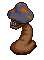

**Shrieker:** A cursed plant with glimmering rows of teeth. Shriekers will
release their spores and pollen to poison and put their enemies to sleep. Be
aware when around these creatures.

|                |                        |               |                             |
|----------------|------------------------|---------------|-----------------------------|
| HP Low: 31,000 | Experience Low: 46,000 | Level Low: 72 | Location: 15-1 through 20-1 |
| HP Max: 65,000 | Experience Max: 52,000 | Level Max: 96 | Items: Flower               |


**Wisp:** A minute creature that eminates a spectacle of light from it's body.
No Aisling has ever seen it's true body.

|                |                        |               |                             |
|----------------|------------------------|---------------|-----------------------------|
| HP Low: 30,000 | Experience Low: 58,000 | Level Low: 85 | Location: 17-1 through 20-1 |
| HP Max: 74,000 | Experience Max: 71,000 | Level Max: 97 | Items: None                 |

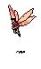

**Faerie:** Close relatives of the ancient race of the Faes, but much more
hostile. These Faeries which reside deep within the woodlands use magic to no
relent, definatly the most lethal creature within the East Woodlands.

|                |                        |               |                             |
|----------------|------------------------|---------------|-----------------------------|
| HP Low: 55,000 | Experience Low: 69,000 | Level Low: 95 | Location: 19-1 through 20-1 |
| HP Max: 75,000 | Experience Max: 79,000 | Level Max: 99 | Items: None                 |

## Chapter 3: Pravat Cave

The war between the Goblins and the Grimlocks have gone on for countless
Deochs, both races often asking Aisling's to help them collect the maddening
rocks from within the cave. Many have perished in this terrible war, and with
no end in sight, so shall many more.

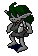

**Grimlock Prole:** The lowest stone of Grimlock Society the Prole works
aimlessly at finding the mind-bending rocks the lay within Pravat. Weak minded
and weak bodied through years of malnutrition.

|             |                      |               |                                         |
|-------------|----------------------|---------------|-----------------------------------------|
| HP Low: 900 | Experience Low: 4239 | Level Low: 15 | Location: Prole Grounds, Pravat Shallow |
| HP Max: 2k  | Experience Max: --   | Level Max: -- | Items: Raw Beryl                        |


**Grimlock Worker:** Workers mine the Cave of it's precious gems and minerals
to give as gifts to their Queen, Phailin. Although not overly aggresive, they
will ocassionally assault an unsuspecting passerby.

|               |                      |               |                                                       |
|---------------|----------------------|---------------|-------------------------------------------------------|
| HP Low: 950   | Experience Low: 4230 | Level Low: 20 | Location: Pravat Shallow, Pravat Hearth, Pravat Works |
| HP Max: 4,000 | Experience Max: 6200 | Level Max: 24 | Items: Raw Beryl, Raw Coral, Raw Ruby                 |

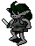

**Grimlock Soldier:** The main staple of the Grimlocks defense from Goblin
raids. Using Light Daggers they stab their opponents into submission.

|                |                        |               |                                                                    |
|----------------|------------------------|---------------|--------------------------------------------------------------------|
| HP Low: 5,000  | Experience Low: 8,500  | Level Low: 33 | Location: Pravat Shallow, Pravat Works, Pravat Hearth, Pravat Deep |
| HP Max: 12,000 | Experience Max: 13,000 | Level Max: 38 | Items: Raw Beryl, Raw Coral, Raw Ruby                              |

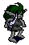

**Grimlock Warrior:** Fierce warriors of the Grimlock, yelling their battle
cries as they charge madly at their enemies. Slashing with their curved knives,
often coated with poison, the Grimlock Warrior should not be engaged with an
easy battle in mind.

|                |                        |               |                                       |
|----------------|------------------------|---------------|---------------------------------------|
| HP Low: 6,000  | Experience Low: 12,000 | Level Low: 33 | Location: Pravat Works, Pravat Hearth |
| HP Max: 16,000 | Experience Max: 16,000 | Level Max: 48 | Items: Raw Beryl, Raw Coral, Raw Ruby |


**Goblin Soldier:** Using their clubs to deliver stunning blows to an opponent,
the Goblin Soldier preys upon the weak, often ambushing from within the
darkness of the many caverns of Pravat Cave.

|                |                        |               |                                                                    |
|----------------|------------------------|---------------|--------------------------------------------------------------------|
| HP Low: 7,500  | Experience Low: 7,500  | Level Low: 35 | Location: Pravat Shallow, Pravat Works, Pravat Hearth, Pravat Deep |
| HP Max: 10,000 | Experience Max: 11,000 | Level Max: 40 | Items: Goblin's Skull                                              |


**Goblin Warrior:** Vile warriors of the Goblin race. Skilled in fighting with
different kinds of axes, the Goblin Warrior kills without remorce, often
striking opponents in the back or while in retreat.

|                |                        |               |                                                    |
|----------------|------------------------|---------------|----------------------------------------------------|
| HP Low: 12,000 | Experience Low: 15,000 | Level Low: 50 | Location: Pravat Works, Pravat Deep, Pravat Hearth |
| HP Max: 16,000 | Experience Max: 21,000 | Level Max: -- | Items: Goblin's Skull                              |

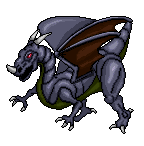

**Draco Hatchling:** The children of the ancient Dracos. These creatures,
although just hatchlings, should be avoided unless you truly wish to die. Very
swiftly they overcome any threats to their homes using their razor edges
talons, horns and teeth to tear apart any creature, be it Goblin, Grimlock or
Aisling alike.

|                |                     |               |                       |
|----------------|---------------------|---------------|-----------------------|
| HP Low: 15,000 | Experience Low: 60k | Level Low: 65 | Location: Pravat Deep |
| HP Max: 45,000 | Experience Max: --  | Level Max: -- | Items: Draco Jaw      |

## Chapter 4: Astrid

The ancient roads of Astrid, etched into the ground by some unknown race or
power. In the center, a pentagram is scratched into the ground. Astrid is
believed to be the worship grounds to the Dark Lord Chadul, many of which the
creatures here do openly.


**Wolf:** Canine with powerful jaws. Nimble and strong wolves tend to hunt in
packs, preying upon Aisling's who stray far from their group. Although
dangerous, if you happen to defeat a wolf, the different parts of it's pelt may
be sold to the Martial Arts trainer in Abel for a bit of coinsare.

|               |                       |               |                                                     |
|---------------|-----------------------|---------------|-----------------------------------------------------|
| HP Low: 880   | Experience Low: 2,610 | Level Low: 15 | Location: Lower Astrid, Mid Astrid                  |
| HP Max: 6,200 | Experience Max: 8,00  | Level Max: 26 | Simple Items: Wolf's Skin, Wolf's Fur, Wolf's Locke |


**Kobold Pup:** Young Kobolds, often found together in groups. They are
sometimes cowardly but also know how to lay devious traps taught to them by
their anscestors.

|               |                       |               |                                    |
|---------------|-----------------------|---------------|------------------------------------|
| HP Low: 2,000 | Experience Low: 4,230 | Level Low: 20 | Location: Lower Astrid, Mid Astrid |
| HP Max: --    | Experience Max: --    | Level Max: -- | Simple Items: Kobold's Skull       |


**Kobold:** Half wolf, half Mundane, these intelligent beasts hunt with sharp
and sometimes poisoned knives. Known well for their cunning and dexterity.

|                |                        |               |                                                  |
|----------------|------------------------|---------------|--------------------------------------------------|
| HP Low: 4,100  | Experience Low: 6,240  | Level Low: 25 | Location: Lower Astrid, Mid Astrid, Upper Astrid |
| HP Max: 16,000 | Experience Max: 13,000 | Level Max: 45 | Simple Items: Kobold's Skull                     |

 

**Kobold Shaman Pup:** The lesser of Kobold Shaman's, these vile beasts are
learned in the dark arts. They can change their form and summon the twisted
dubhaimed to do their bidding.

|                     |                             |               |                                    |
|---------------------|-----------------------------|---------------|------------------------------------|
| HP Low: 3,000/6,000 | Experience Low: 2,640/6,000 | Level Low: 25 | Location: Lower Astrid, Mid Astrid |
| HP Max: 4,000/6,500 | Experience Max: 4,620/8,000 | Level Max: 35 | Simple Items: Kobold's Skull       |

 

**Kobold Shaman:** Wicked masters of the Strioch magic, these unholy summoners
can be found lurking about, twisting nature into hideous forms.

|                     |                              |               |                                    |
|---------------------|------------------------------|---------------|------------------------------------|
| HP Low: 6,420/7,000 | Experience Low: 6,000/13,000 | Level Low: 40 | Location: Mid Astrid, Upper Astrid |
| HP Max: 8,000/9,000 | Experience Max: --           | Level Max: 56 | Simple Items: Kobold's Skull       |


**Goblin Warrior:** Armed with a battle axe and heavy armor, Goblin Warriors
are a force to be reckoned with. They will not hesitate to start a fight.

|                |                        |               |                                    |
|----------------|------------------------|---------------|------------------------------------|
| HP Low: 8,000  | Experience Low: 12,000 | Level Low: 45 | Location: Mid Astrid, Upper Astrid |
| HP Max: 13,000 | Experience Max: 22,000 | Level Max: 61 | Simple Items: Goblin's Skull       |


**Goblin Guard:** Defensive unit armed with chainmail and a light mace. Goblin
Guards tend to sneak up on their targets while Goblin Warriors attack their
fronts.

|                |                        |               |                              |
|----------------|------------------------|---------------|------------------------------|
| HP Low: 16,000 | Experience Low: 29,000 | Level Low: 69 | Location: Upper Astrid       |
| HP Max: 20,000 | Experience Max: 33,000 | Level Low: -- | Simple Items: Goblin's Skull |


**Goblin Shaman:** Goblins trained in the art of magic. Still no match when
compared to the Kobold Shamans, but are still quite powerful in the Arcane
arts.

|                |                        |               |                                    |
|----------------|------------------------|---------------|------------------------------------|
| HP Low: 10,000 | Experience Low: 14,430 | Level Low: 40 | Location: Mid Astrid, Upper Astrid |
| HP Max: 16,730 | Experience Max: 17,900 | Level Low: 56 | Simple Items: Goblin's Skull       |

## Chapter 5: Mehadi Swamp

Upon exploring Mehadi Swamp, I came across many different species of beasts.
Some of them were magnificent to look upon, whereas some were true nightmares.
Upon searching deeper into the swamp, I came across a beautiful, serene garden
with many exotic plants growing including the legendary Sevti, Tulsi and Nila
blossoms.


**Malini Viper:** Amphibious snakes found all throughout the swamp, Their fangs
though not very sharp, contains a harsh venom.

|             |                       |               |                                                                     |
|-------------|-----------------------|---------------|---------------------------------------------------------------------|
| HP Low: 600 | Experience Low: 1,490 | Level Low: 14 | Location: Mehadi Shenshi, Mehadi Ellama, Mehadi Garden, Mehadi Hema |
| HP Max: --  | Experience Max: --    | Level Max: -- | Items: Viper's Gland                                                |


**Anala Viper:** Very similar to the Malini Viper, but considerably larger in
size, and far greater in strength.

|               |                       |               |                                                                     |
|---------------|-----------------------|---------------|---------------------------------------------------------------------|
| HP Low: 1,500 | Experience Low: 2,640 | Level Low: 21 | Location: Mehadi Shenshi, Mehadi Ellama, Mehadi Garden, Mehadi Hema |
| HP Max: --    | Experience Max: --    | Level Max: -- | Items: Viper's Gland                                                |

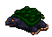

**Turtle:** A creature that ventures around with a part of it's body as
protection. When threatened the turtle can withdraw all extended limbs into the
safeness of it's shell.

|                |                        |               |                                                      |
|----------------|------------------------|---------------|------------------------------------------------------|
| HP Low: 7,000  | Experience Low: 12,000 | Level Low: 35 | Location: Mehadi Shenshi, Mehadi Maze, Mehadi Ellama |
| HP Max: 11,000 | Experience Max: 14,000 | Level Max: 38 | Items: None                                          |

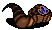

**Leech:** Blood sucking slug that lives in the murky waters of Mehadi Swamp.
They latch onto you and slowly drain your body of it's fluids.

|                |                        |               |                                                               |
|----------------|------------------------|---------------|---------------------------------------------------------------|
| HP Low: 11,000 | Experience Low: 15,000 | Level Low: 52 | Location: Mehadi Shenshi, Mehadi Maze, Chandi Mukul Gathering |
| HP Max: 17,000 | Experience Max: 19,000 | Level Max: 57 | Items: None                                                   |


**Shrieker:** A cursed plant with glimmering rows of teeth. Shriekers will
release their spores and pollen to poison and put their enemies to sleep. Be
aware when around these creatures.

|                |                        |               |                                  |
|----------------|------------------------|---------------|----------------------------------|
| HP Low: 35,000 | Experience Low: 39,000 | Level Low: 72 | Location: Chandi Mukul Gathering |
| HP Max: --     | Experience Max: --     | Level Max: -- | Items: Flower                    |

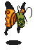

**Gruesomefly:** A malformed horror of the swamp. It's crooked smile haunting
Aisling's who ever glance upon its wretched body.

|                |                        |               |                                               |
|----------------|------------------------|---------------|-----------------------------------------------|
| HP Low: 37,000 | Experience Low: 42,000 | Level Low: 73 | Location: Mehadi Maze, Chandi Mukul Gathering |
| HP Max: --     | Experience Max: --     | Level Max: -- | Items: None                                   |


**Chandi Mukul:** The Evil Brothers of the Rishi Mukuls. They were outcasts of
the Mukul Society and left to live deep within the swamp. Any Aisling who
happens to venture into their grounds will surely find themselves a target for
the Chandi's magic.

|                |                        |               |                                  |
|----------------|------------------------|---------------|----------------------------------|
| HP Low: 12,000 | Experience Low: 10,000 | Level Low: 60 | Location: Chandi Mukul Gathering |
| HP Max: 40,000 | Experience Max: 41,000 | Level Max: 82 | Items: None                      |

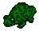

**Frog:** Natvie creature of the swamp and blessed to the Mukuls. If you happen
to slay one of these creatures the Mukuls would surely banish you from the
swamp.

|               |                       |               |                                                                                                     |
|---------------|-----------------------|---------------|-----------------------------------------------------------------------------------------------------|
| HP Low: 3,000 | Experience Low: 3,000 | Level Low: 21 | Location: Mehadi Shenshi, Mehadi Ellama, Mehadi Maze, Chandi Mukul Gathering, Rishi Mukul Gathering |
| HP Max: --    | Experience Max: --    | Level Max: -- | Items: None                                                                                         |

## Index

- **A**: Anala Viper
- **B**: Bat
- **C**: Centipede, Chandi Mukul, Chest
- **D**: Draco Hatchling
- **E**
- **F**: Faerie, Frog
- **G**: Goblin Guard, Goblin Soldier, Goblin Warrior, Goblin Shaman, Great
  Bat, Grimlock Prole, Grimlock Worker, Grimlock Soldier, Grimlock Warrior,
  Gruesomefly
- **H**: Hobgoblin
- **I**
- **J**
- **K**: Kardi, Kobold, Kobold Pup, Kobold Shaman, Kobold Shaman Pup
- **L**: Leech
- **M**: Malini Viper, Mantis, Marauder
- **N**
- **O**
- **P**
- **Q**
- **R**: Rat
- **S**: Scorpion, Shrieker, Spider, Succubus
- **T**: Turtle
- **U**
- **V**: Viper
- **W**: Wasp, White Bat, Wisp, Wolf, Wraith
- **X**
- **Y**
- **Z**

 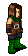

_Scribed by Taurlos Dycedar_  
_Assisted by Waylend Dubhar_

***

```
*Librarian Notes*

Recognized: Folk, Lorekeepers Recognized (Events of Temuair post #66).
This entry has been heavily edited to conform to Library formatting.
The original can be found at http://www.darkages.com/community/lore/Taurlos_Beast/index.html .
```
