# Story of Priests

_by Tmy in **Dark Ages**_

## Notes for Priests

The priests can gain favor from the gods. A priest can choose to follow a god
without help of another; while the aislings of any other path must use the
help of a priest to be initiated to a god's temple. It is a wise move if a
priest can begin to serve his/her favorite god as soon as possible. To do
this, s/he needs to go to the temple of the certain god, talk to the lady in
pink about the fellowship of the god. At first, s/he can choose to be a
probate/initiate of that god, when s/he gains enough faith of the god, s/he
can come back and ascend to priesthood. If a priest is under 11 insight, s/he
must do this with a friends of higher insight, because the god will grand
him/her the prayer necklace, but you need to be at least 11 insight to pick
the necklace up. If s/he can't hold it at the time s/he joining the
fellowship, the prayer's necklace will be placed under her/his feet. To avoid
the loss of the necklace, you should ask someone to hold it for you until you
can do it by your own. It may sound troublesome, but every time an aisling
attends a mass, s/he can get 50000 exp, which is fairly important for young
aislings. Once you join the worshipper of a certain god, you need faith to
pray to the gods. A main method of gaining faith is attending mass of the gods
in the trinity. The priest of a certain god is able to accumulate more faith
than other people by deconcentrate an item of that god's enemies if this
priest is above 11th insight. Each god of temuair has two allies and two
enemies. The priest is able to concentrate an item of the god s/he follows
too, but this will cost a lot of faith. A priest of a certain god will be
grand power over others, s/he is able to banish or excommunicate an aisling
from that gods' temple and fellowship. S/he is also able to admit worshipper,
give geas, and do many other things through the hand of the god. It is
recommended that s/he do not abuse the power. For more information about gods
of temuair, please refer to [Lore](http://www1.darkages.com/atavism/lore/).

Besides serving the god, priests need to help aisling in hunting. Most priests
are physically weak; hence it is difficult and unwise for them to engage in
hand to hand attack. But a priest is more and more vital as his/her insight
become higher. A priest's main jobs lie in two categories, protecting his/her
group and increasing the damage to monsters. A priest can protect the group by
either strengthen the defense, remove bad effects from harmful monsters or
healing. Common defensive spells include archmad, Naomi aite( beag, normal,
mor or ard) and ultimately mor dion which makes the priest invincible to
physical attacks as the spell lasts, (unfortunately it only protect the priest
who cast it, although it is strategically important). Most spells which remove
bad effects have an 'ao' in theirs names. They include ao cradh, ao poinson,
ao dall and ao suain. This function makes a priest highly desirable; cause
aislings can find a substitute of other functions of priests easily, such as
loures aite and ard ioc deum. Use Ioc spells to heal aislings if they are low
in health. There are four version of ioc, which are beag, normal, mor and ard.
In addtion to those, there is divine healing, nuandhaich, which can increase
health by a huge amount. Another reason that contributes to the popularity of
priests is their ability to increase damage to monsters. One thing priests can
do is cursing the monsters so that increase their armor class. That makes the
monsters receive more damage and be killed easily. The group can kill a
monster with ard cradh several times faster than those aren't cursed. It is
best to curse the monsters ahead if the priest has done main protect works to
their group. How well a priest can curse the monster somehow determine how
fast the group gain experience from the hunt. Priests can also use beannaich
and fas deireas to make her/his group members' attack stronger. The only spell
the priests can use to actually kill a monster directly is deo saighead, which
causes a pink lightening to strike on the monster. It is effective when you
have your secret at high level and get a good [weapon](#weapons-of-priest)
like a zeus or Diana. There are other spells that disable monsters, such as
pramh and suain. Under the effects of these secrets, the monsters will be put
into sleep and cease to harm aislings until they are awake. Wizards can double
their damage to a pramhed monster.

Path of Priests is the most sophisticated path among the five paths an aisling
can follow. No aisling can handle all the secrets available to priests. Be
aware that aislings have 3 points in their attributes at insight 1, and gain 2
points that they can resign freely at every insight till they are 99th
insight. A priest needs a good plan of their future from the beginning of
his/her journey. [A list of secrets](#secrets-and-skills) available is
provided for this purpose. `((The stats are correct, but other information
maybe inaccurate, I will put unknown at where I have not investigated.))` That
will be very frustrating if you borrow a lot of items to get the stats and
find you need to practice more or get another secret first. So ask elder
priests politely before getting a spell. As a priest, you may find a luathas
set (every luathas item increase int by 1, corol earring +2 int) very helpful
since you may choose to increase wis a lot at beginning, you also need some
ceandaliar (every ceandaliar item increase str by 1, gold earring +2 str) or
fiosca( every fiosca item adds 1 dex, some boots give you additional dex )
items now and then, a friend who cast ceandaliar str entreaty (+3 str) will be
good. A signet ring can add 1 to 5 attributes, but they are rare and valuable.
Not all aislings have one or two for use. You may wish to keep many gems in
bank and get some rogue friends, because you will need a lot of rubies and
beryl to get most spells of higher level.

## Secrets and Skills

| Spell Name | Icon | Str | Int | Wis | Con | Dex | Other Requirement | Usage | Price | Location |
|------------|------|-----|-----|-----|-----|-----|-------------------|-------|-------|----------|
| Beag Ioc |  |  |  |  |  |  |  | Minor Healing | 500 Coin | Mileth Fae |
| Beag Ioc Fein |  | 3 | 3 | 5 | 3 | 3 |  | Minor Self Healing | 500 Coin | Mileth Fae |
| Armachd Fein | 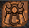 | 3 | 3 | 5 | 3 | 3 |  | -10 AC of caster | Raw Wax (1) 1000 Coin | Mileth Fae |
| Armachd |  | 3 | 3 | 5 | 5 | 3 |  | -10 AC | Raw Wax (1) 1000 Coin | Mileth Fae |
| Beag Breisleich |  | 3 | 4 | 6 | 3 | 5 |  | Confuse Enemy for a Short Time | Mantis's eye(1) 2500 Coin | Dar at Mileth |
| Beothaich Deum | 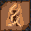 | 3 | 6 | 8 | 3 | 3 | Beag Ioc level 10 | Create a spot to make reds | Cherry (1)<br>Grape (1)<br>1000 Coin | Piet Fae |
| Ao Beag Cradh |  | 3 | 5 | 9 | 3 | 3 |  | Remove Minor Curse | 1000 Coin | Mileth Fae |
| Beannaich | 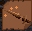 | 3 | 6 | 9 | 3 | 6 |  | +10 hit | 5000 Coin | Mileth Fae |
| Dachaidh |  | 3 | 10 | 9 | 3 | 6 |  | Return to Home | 5000 Coin | Mileth Fae |
| Fas Deireas |  | 6 | 6 | 9 | 3 | 3 | Beannaich at least level 30 | +2 Damage | 5000 Coin | Mileth Fae |
| Ao Puinsein |  | 3 | 8 | 11 | 4 | 3 |  | Cure Poison | 5000 Coin | Mileth Fae |
| Beag Slan |  | 4 | 6 | 12 | 6 | 3 |  | Increase recovery from wounds | Wolf Skin (1)<br>5000 Coin | Piet Fae |
| Beag Puinsein |  | 10 | 15 | 12 | 15 | 12 |  | Cast Poison | Unknown | Suomi Wizard |
| Ao Dall |  | 3 | 10 | 14 | 6 | 9 |  | Restore eye sights | 5000 Coin | Mileth Fae |
| Ioc |  | 3 | 13 | 14 | 3 | 3 | Beag Ioc,<br>Level unknown | A better heal than beag ioc | 5000 Coin | Mileth Fae |
| Beag Cradh |  | 3 | 7 | 15 | 3 | 3 |  | +20 AC | Centipede's Gland (1)<br>5000 Coin | Mileth Dar |
| Breisleich |  | 3 | 14 | 16 | 3 | 6 |  | Confuse enemy for a longer time | Spider's eye(1)<br>Viper's Gland (1)<br>5000 Coin | Mileth Dar |
| Beag Seun | 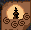 | 3 | 5 | 17 | 3 | 3 |  | Hypnotize enemies, work only on low level creature | 5000 Coin | Mileth Fae |
| Mor Beannaich | 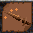 | 4 | 12 | 20 | 4 | 9 | Beannaich level 30 | +20 hit | Unknown | Piet Fae |
| Mor Briesleich |  | 3 | 19 | 20 | 3 | 8 | Briesleich level 10+ | Confuse enemy for a long time | Wolf Fur(1) 5000 Coin | Suomi Wizard |
| Cradh |  | 10 | 25 | 20 | 10 | 10 | Beag Cradh level 30+ | +35 AC | Bat's Wing (1)<br>12,000 Coin | Suomi Wizard |
| Beag Ioc Comlha |  | 3 | 14 | 22 | 3 | 3 | An unknown beag ioc level is required | Minor Heal Whole Group Except spell caster | 2500 Coin | Mileth Fae |
| Ao Cradh |  | 3 | 16 | 23 | 3 | 3 | Ao Beag Cradh level 30 | Cure Cradh | Unknown | Mileth Fae |
| Puinsein |  | 10 | 30 | 24 | 30 | 24 | Unknown | Poison the enemy for long time | Unknown | Suomi Wizard |
| Mor Seun |  | 5 | 8 | 27 | 5 | 5 | Seun 30 | Same as seun | Unknown | Piet Fae |
| Ioc Comlha |  | 4 | 18 | 28 | 4 | 4 | Ioc, level unknown<br>Beag ioc comlha, level unknown | Heal entire group except caster | Unknown | Piet Fae |
| Seun |  | 3 | 22 | 31 | 3 | 3 | Beag Seun level 10 | Same as beag seun | 5000 Coin | Mileth Fae |
| Slan |  | 8 | 8 | 32 | 16 | 3 | Beag Slan level 20+ | Increase recovery from wounds | Wolf Fur (1) 10000 Coin | Piet Fae |
| Beag Pramh |  | 3 | 12 | 38 | 12 | 3 | Beag Puinsein level 10 | Put an enemy to sleep for a short duration, double damage when enemy is pramhed | Unknown | Suomi Wizard |
| Beag Naomi Aite |  | 3 | 33 | 43 | 3 | 3 | Archmad level Unknown | Reduce Damage | Beothaich Deum (2) Corol Earring (2) 12000 Coin | Piet Fae |
| Ao Mor Cradh |  | 3 | 59 | 47 | 3 | 3 | Ao cradh level 60 | Remove Effect of Mor Cradh | Uncut Ruby (2) Uncut Beryl (4) Beryl Earring (1)<br>10000 Coin | Suomi Fae |
| Mor Ioc |  | 6 | 38 | 50 | 13 | 6 | Ioc level unknown | Perform more healing than ioc | Unknown | Piet Fae |
| Deo Saighead |  | 3 | 40 | 50 | 3 | 3 |  | Only Attacking spell of priests to really kill a creature | Unknown | Suomi Wizard |
| Ard Seun |  | 8 | 15 | 50 | 8 | 8 | Mor Seun 40 |  | Unkown | Piet Fae Priestess |
| Naomi Aite |  | 5 | 53 | 53 | 13 | 5 | Armachad level 60 | Reduce Damage for a duration | Uncut Rubies(5)<br>Uncut Beryl(10)<br>Corol Earring (2)<br>50000 Gold | Piet Fae |
| Ao Suain | 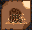 | 8 | 76 | 59 | 8 | 8 | Ao Dall level 70 | Cure Suain | Uncut Ruby (3) Uncut Beryl (6) Beryl earring(2) 50000 Coin | Suomi Fae |
| Pramh |  | 3 | 25 | 78 | 22 | 3 | Puinsein level 60 Beag Pramh level 30 | Sleep an enemy for longer duration | Unknown | Suomi Wizard |
| Puinneag Spiorad |  | 8 | 60 | 78 | 13 | 8 |  | Drain Mana of Group member for use of priest | Finished Ruby (3)<br>Finished Beryl (6)<br>Beryl Earring (2)<br>50000 Coin | Undine Wizard |
| Spion Beathach | 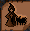 | 3 | 65 | 81 | 3 | 3 | Seun level 10 | Summon Servant Creature | Uncut Ruby (4) Uncut Beryl (8) Corol Earring (1) 50000 Coin | Piet Fae |
| Mor Cradh |  | 6 | 22 | 86 | 13 | 6 | Cradh level Unknown | +50 AC | Unknown | Undine Wizard |
| Ard Cradh |  | 3 | 49 | 108 | 23 | 3 | Mor Cradh level 30 | +65 AC | Finished Ruby(9) Finished Beryl (15) Corol Earring (6) 500,000 Coin | Undine Wizard |
| Mor Naomi Aite |  | 7 | 53 | 63 | 7 | 7 | Naomi Aite Level 20<br>Armachad level 70 | Reduce Damage for longer time than Naomi Aite | Same As Naomi Aite | Piet Fae |
| Ard Ioc |  | 3 | 78 | 65 | 3 | 3 | Mor Ioc level Unknown | A deep healing | Uncut Ruby (2) Uncut Beryl (4) Beryl Earring (1)<br>50000 Coin | Piet Fae |
| Ao Ard Cradh |  | 3 | 79 | 67 | 3 | 3 | Ao Mor Cradh Level 75 | Remove Effect of Ard Cradh | Uncut Ruby (2) Uncut Beryl (4) Beryl Earring (1)<br>50000 Coin | Undine Wizard |
| Mor Ioc Comlha |  | 3 | 87 | 68 | 3 | 3 | * | More Heal whole group but caster | Unknown | Piet Fae |
| Nuandhaich |  | 10 | 55 | 120 | 10 | 10 | Ioc level 100<br>Mor Ioc 100<br>Ard Ioc 100 | Divine Healing | Unknown | Piet Fae |
| Ard Naomi Aite |  | 13 | 83 | 73 | 13 | 13 | Unknown | Reduce Damage even longer than Mor version |  | Piet Fae |
| Sonruich Nadur | 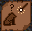 | 8 | 80 | 80 | 8 | 8 |  | Change the element of a Creature | Uncut Ruby(9)<br>Uncut Beryl(15)<br>Uncut talos(1)<br>500k coin | Piet Fae |
| Mor Dion |  | 3 | 96 | 75 | 3 | 3 | Ao dall level 75 | Protect Caster from all physical attack for a duration | Uncut Ruby (5) Uncut Beryl (10) Corol Earring (2) 50000 Coin | Piet Fae |
| Deireas Faileas |  | 5 | 70 | 80 | 33 | 15 | Unknown ( probably Mor Dion) | Occasionally reduce a enemy's magic force | Unknown | Piet Fae |
| Mor Slan |  | 8 | 8 | 85 | 55 | 8 | Unknown | Same as slan | Unknown | Piet Fae |
| Dall | 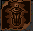 | 3 | 57 | 46 | 6 | 33 | Unknown | Takes the enemy's sight momentarily | Unknown | Undine wizard |
| Suain |  | 23 | 58 | 56 | 23 | 3 | Unknown | Instantly freeze a enemy |  | Undine wizard |
| Mentor |  | 3 | 17 | 36 | 4 | 9 |  | Mentor a Student at anywhere spell is casted | Royal Wax(1) 1000 Coin | Suomi Fae |
| Food Lore | 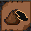 | 3 | 9 | 3 | 3 | 3 |  | Know the attributes of a food | Grape (1) Rotten Grape (1) 1200 Coin | Suomi Rogue |
| Potion Lore |  | 3 | 18 | 4 | 7 | 3 |  | Identify potions | Raw Honey (1) 1000 Coin | Suomi Wizard |
| Transfer Blood |  | 3 | 3 | 8 | 8 | 3 |  | Heal someone at the cost of some health of caster |  | Mileth Rogue |
| Wield Staff |  | 5 | 8 | 10 | 5 | 3 |  | Wield a staff | Beryl Earring (5) 5000 Coin | Suomi Wizard |
| Mend Staff | 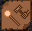 | 7 | 6 | 13 | 7 | 10 |  | Repair a staff, it may damage or destroy a staff if failed | 5000 Coin | Recussion Rogue |
| Perish Lore |  | 3 | 13 | 15 | 3 | 3 |  | Identify any item | Beothaich Deum (1) 1000 Coin | Undine Wizard |
| Herbal Lore |  | 5 | 23 | 23 | 10 | 5 |  | Make potions from wine and flower | Royal Wax(1) Wine(1) Beothaich Deum (5) 5000 Coin | Suomi Fae |

## Weapons of Priest

| Name | Holly Herm | Holly Kronos | Holly Zeus | Holly Gaea | Holly Appollo | Holly Diana |
|------|------------|--------------|------------|------------|---------------|-------------|
| Picture |  | 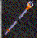 |  |  |  |  |
| Usage | Remove lines of healing spells to 0<br>(less line = faster cast) | Remove one line from two line spells<br>Used for making 71 insight armor | Remove two lines from three line spells | Make any spells with more than 3 lines 3 lines. | Make any spells 2 lines. | Remove two lines from any spells. |
| Drops<br>( information here are not complete, you may find them else where except Appollo and Diana are said to be dropped only at Kas Mine) | Drop from Woodland wolves, Pravat Cave and Astrid | Drop at Woodland 9-1 to 14-1, and from goblin shamans at Astrid | Woodland 15-1 and up,<br>Deep Mileth crypt<br>Deep Abel Crypt( not sure what level)<br>Astrid<br>Kas Mine upper level(noone seeks a zeus there seriously) | Kas Mine | Kas Mine | Kas Mine |

## Armor of priest

| Insight | Male Pic | Name | Cost | Location | Female Pic | Name | Cost | Location |
|---------|----------|------|------|----------|------------|------|------|----------|
| 1 |  | Cowl | 800 | Mileth Humble Higgler |  | Gorget Gown | 800 | Mileth Humble Higgler |
| 11 |  | Galuchat Coat | 8300 | Recussion Tailor |  | Mythtic Gown | 8300 | Loures Jean |
| 41 |  | Mantle | Respected Citizen (1) | Temple of Gods |  | Elle | Respected Citizen (1) | Temple of Gods |
| 71 |  | Hierophant | Respected Citizen(1)<br>Holly Kronos(1) | Fae at Woods 15-1 |  | Dolman | Respected Citizen(1)<br>Holly Kronos(1) | Fae at Woods 15-1 |
| 80 |  | Cthonic Disciple Robes | Nightmare Quest | Talk to the attendant at temple of Choosing for details if insight over 80 |  | Morrigu Disciple Pellison | Do nightmare quest | Talk to piet fae for information if insight over 80 |
| 97 |  | Dalmatica | Respected Citizen(1)<br>1)Aisling of Talgonite, 25 finished talos and reduce 50mil exp for 97 insight,reduce 100mil exp for 99 insight<br>2) Aisling of Mythril, mentor(200), mythril shield of same kind(6)<br>3)Aisling of Hybrasyl<br>finished hybrasyl(1)<br>Recognized Aisling(1)(At least village level) | Fae at Woods 20-1 |  | Bansagart | Respected Citizen(1)<br>1)Aisling of Talgonite, 25 finished talos and reduce 50mil exp for 97 insight,reduce 100mil exp for 99 insight<br>2) Aisling of Mythril, mentor(200), mythril shield of same kind(6)<br>3)Aisling of Hybrasyl<br>finished hybrasyl(1)<br>Recognized Aisling(1)(At least village level) | Fae at Woods 20-1 |

### Helmet Of Priest

| Gender | Name | Picture | Cost | Location | Weight |
|--------|------|---------|------|----------|--------|
| F | Holy vermillion |  | 10000 | Loures Jean | 1 |
| F | Holy Tounge |  | 10000 | Abel Higgler | 1 |
| F&M | Holy Conical |  | 10000 | Thief in Loures Jail | 1 |
| F | Holy Wimple |  | 10000 | Abel Higgler | 1 |
| M | Holy Cap |  | 10000 | Loures Jean | 1 |
| M | Holy Chief |  | 10000 | Rucession Tailor | 1 |

_Glioca Priest of DarkAges_

***

```
*Librarian Notes*

This entry has been heavily edited to conform to Library formatting.
The original can be found at http://www.darkages.com/community/lore/Tmy_Priest/Story%20of%20Priests.htm .
```
