# Trade and Commerce in Temuair

_by Vendes in **Dark Ages**_

**Trade & Commerce in Temuair**  
**Or**  
**A guide to making Money.**

I'd like to dedicate this to all the aislings who have asked me for money,
goods, and information over the Deochs. Without all your pestering, i never
would have gotten motivated to create a guide for you all.

And of course, to my mentor Klaudaryn, for teaching me not to get mad - but to
humour them all. Even the ones who i'd have liked to yell at.

## Trade & Commerce In Temuair

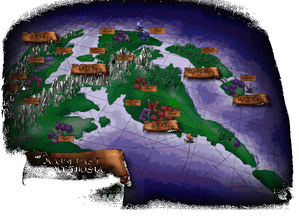

As the different towns on the map will take you to the listing of that towns
items of barter and interest, so does this explain sales to aislings - that is,
where you sell items of godly or magical properties.

There are boards in Mileth and Rucesion banks dedicated to the sales and
purchases of such items, and those are indeed your best bet for this task. Of
course, there is always the option of private sales, if you don't want to post
your goods or services on one of those boards.

However, if you run around shouting what you're selling or buying, chances are
you'll do nothing but irritate everyone around you, and perhaps get in trouble
for harassment or begging, depending.

Dark items, consecrated items (items imbued with godly attributes), elemental
items, and enchanted items, will all have to be sold to aislings, as no mundane
will buy them. But - these same items are where the real money is to be made.
So where do you find them you ask? I'll tell you.

Consecrated items - are found from creatures in the crypts, woods, swamps,
basically anywhere you kill things. The same goes for elemental items, and
enchanted items - though, some wizards will enchant items for you - just as
some priests may consecrate for you. Realize though, that they do so by choice,
you can not force them or expect them to do so, for any reason.

Now dark items, those ever so coveted things, are found in the maze beneath
Loures castle, which can only be entered if you manage to get Marlin and Jean
to talk to you about Bella. The catch is that you either do the quest to be
able to cast the spell "io dia naomh aite comlha", and cannot re-enter the
maze, or you choose a heart of stone, and may enter at any time - but cannot
cast the above spell. Rich hunting grounds, or sweet protection enwrapping
you - a tough choice - but one you'll have to make.

Now - back to the Cities.

## Abel

The port town of Abel, gateway to both Undine and Rucesion, is both the largest
town, near able to call itself a city, and the most dangerous. Thugs and
thieves litter the streets here more than the smell of the wares of the sea
litters the air.

I can attest to the fact that no step taken in Abel is unwatched, or safe.
You'd do well to do your business here quickly, with a hand firmly on your belt
knife, and your money pouch, at all times.

The goods here are of the highest quality, as they trade with every other town
of Temuair for only the finest goods and wares. If you need it, you can
probably find it somewhere in Abel.

For a price.

### Aud

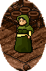

Baker

|  | Sells: | Buys: |
|--|--------|-------|
| 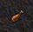 | Chicken - 20 coins | Chicken - 10 coins |
| 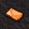 | Bread Slice - 5 coins | Bread Slice - 2 coins |
| 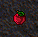 | Apple - 5 coins | Apple - 2 coins |
| 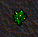 | Vegetable - 5 coins | Vegetable - 2 coins |

### Frida

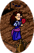

Tavern Keeper

|  | Sells: | Buys: |
|--|--------|-------|
| 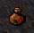 | Rum - 100 coins | Rum - 50 coins |
| 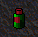 | Brandy - 200 coins | Brandy - 100 coins |
| 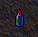 | Wine - 500 coins | Wine - 250 coins |

### Bodil

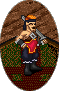

Warrior Trainer

|  | Sells: | Buys: |
|--|--------|-------|
|  | Nothing. | Kobold Skull - 1,250 coins |
|  |  | Hobgoblin Skull - 2,500 coins |
| 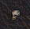 |  | Goblin Skull - 1,500 coins |

### Lamont

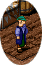

Higgler

|  | Sells: | Buys: |
|--|--------|-------|
| 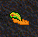 | Holy Wimple - 10,000 coins | Holy Wimple - 5,000 coins |
| 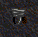 | Holy Toque - 10,000 coins | Holy Toque - 5,000 coins |
| 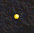 |  | Finished Beryl - 2,500 coins |
| 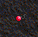 |  | Finished Ruby - 10,000 coins |
|  |  | Finished Coral - 5,000 coins |

### Arnljot

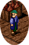

Tailor

|  | Sells: | Buys: |
|--|--------|-------|
| 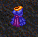 | Magi Skirt - 750 coins | Magi Skirt - 375 coins |
| 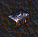 |  | Flawed Talos - 7,500 coins |
|  |  | Uncut Ruby - 2,500 coins |
|  |  | Finished Talos - 12,500 coins |
| 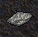 |  | Wolf's Fur - 300 coins |

### Egil

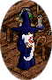

Alchemist

|  | Sells: | Buys: |
|--|--------|-------|
| 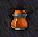 | Nothing. | Beag Ioc Deum - 250 coins |

### Vidar

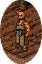

Weapons Master

|  | Sells: | Buys: |
|--|--------|-------|
| 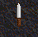 | Dirk - 500 coins | Dirk - 250 coins |
| 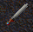 | Claidheamh - 1,300 coins | Claidheamh - 650 coins |
| 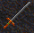 | Long Sword - 12,200 coins | Long Sword - 6,100 coins |
| 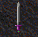 | Loures Sabre - 1,500 coins | Loures Sabre - 750 coins |
| 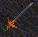 | Black Death - 8,800 coins | Black Death - 4,400 coins |
|  |  | Talos Fragment - 1,750 coins |
|  |  | Uncut Talos - 2,500 coins |
|  |  | Finished Talos - 12,500 coins |

### Steiner


Armor Master

|  | Sells: | Buys: |
|--|--------|-------|
| 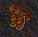 | Leather Greaves - 4,000 coins | Leather Greaves - 2,000 coins |
| 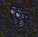 | Iron Greaves - 20,000 coins | Iron Greaves - 10,000 coins |
| 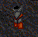 | Brigandine - 9,400 coins | Brigandine - 4,700 coins |
| 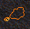 | Pearl Necklace - 800 coins | Pearl Necklace - 400 coins |
| 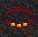 | Coral Ring - 20,000 coins | Coral Ring - 10,000 coins |
|  |  | Coral Fragment - 375 coins |
|  |  | Uncut Coral - 1,250 coins |
|  |  | Finished Coral - 5,000 coins |

## Mileth

Where all paths begin and end, Mileth is truly the busiest place of Temuair. It
is overrun with peasants and politicians, each as annoying in their own ways.

The items here are hardy, made to be put through much use and abuse, as the
crypt of mileth, and the eastern woodlands are often frequented by the
adventurers of this fair town.

Riona's motherly gaze watches over every aisling, and she always has a room for
those who need one. Dar and Daithi, Devlin and Keallach, teach our young
aislings the skills they need to survive their adventures and troubles.

### Cian


Alchemist

|  | Sells: | Buys: |
|--|--------|-------|
|  | Coral Earrings - 8,000 coins | Coral Earrings - 4,000 coins |
|  |  | Uncut Coral - 1,250 coins |
|  |  | Finished Coral - 5,000 coins |
|  |  | Coral Fragment - 375 coins |
|  |  | Flawed Coral - 2,500 coins |
| 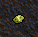 |  | Small Mold - 5 coins |
|  |  | Mold - 50 coins |
| 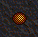 |  | Mantis Eye - 1,500 coins |
|  |  | Rotten Vegetable - 250 coins |
| 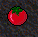 |  | Rotten Tomato - 100 coins |
| 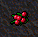 |  | Rotten Cherry - 250 coins |
| 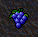 |  | Rotten Grapes - 50 coins |
| 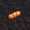 |  | Moldy Baguette - 50 coins |
|  |  | Rotten Apple - 25 coins |

### Dar

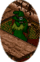

Dark Wizard

|  | Sells: | Buys: |
|--|--------|-------|
| 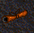 | Parchment Scroll - 500 coins | Parchment Scroll - 250 coins |
|  |  | Spider Eye - 500 coins |
| 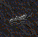 |  | Spider Silk - 1,000 coins |
| 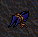 |  | Bat Wing - 1,250 coins |
|  |  | Great Bat Wing - 7,500 coins |
| 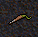 |  | Centipede Gland - 1,000 coins |
|  |  | Viper Gland - 127 coins |
|  |  | Scorpion Sting - 5,000 coins |
|  |  | Bee Sting - 400 coins |

### Daithi

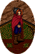

Rogue Trainer

|  | Sells: | Buys: |
|--|--------|-------|
| 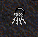 | Lockpicks - 5,000 coins | Lockpicks - 2,500 coins |

### Torrance


Armor Master

|  | Sells: | Buys: |
|--|--------|-------|
| 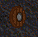 | Wooden Shield - 100 coins | Wooden Shield - 50 coins |
| 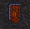 | Leather Shield - 750 coins | Leather Shield - 375 coins |
| 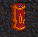 | Bronze Shield - 3,750 coins | Bronze Shield - 1,875 coins |
|  | Leather Gauntlet - 2,000 coins | Leather Gauntlet - 1,000 coins |
|  | Boots - 1,000 coins | Boots - 500 coins |
|  | Cured Boots - 5,000 coins | Cured Boots - 2,500 coins |
|  | Grey Boots - 10,000 coins | Grey Boots - 5,000 coins |
|  | Shagreen Boots - 10,000 coins | Shagreen Boots - 5,000 coins |
|  | Coral Earrings - 8,000 coins | Coral Earrings - 4,000 coins |
|  | Beryl Earrings - 3,000 coins | Beryl Earrings - 1,500 coins |
|  | Bone Necklace - 1,500 coins | Bone Necklace - 750 coins |
|  | Amber Necklace - 1,600 coins | Amber Necklace - 800 coins |
|  | Ruby Ring - 20,000 coins | Ruby Ring - 10,000 coins |
|  | Amethyst Ring - 50,000 coins | Amethyst Ring - 25,000 coins |

### Callough


Weapon Master

|  | Sells: | Buys: |
|--|--------|-------|
|  | Dirk - 500 coins | Dirk - 250 coins |
|  | Stick - 100 coins | Stick - 50 coins |
|  | Claidheamh - 1,300 coins | Claidheamh - 650 coins |

### Colm


Messenger

|  | Sells: | Buys: |
|--|--------|-------|
|  | Nothing. | Nothing. |

### Naomhan


Church Priest

|  | Sells: | Buys: |
|--|--------|-------|
|  | Nothing. | Nothing. |

### Riona


Innkeeper

|  | Sells: | Buys: |
|--|--------|-------|
|  | Nothing. | Nothing. |

### Duana


Dancer

|  | Sells: | Buys: |
|--|--------|-------|
|  | Nothing. | Nothing. |

### Tague


Drunk beggar

|  | Sells: | Buys: |
|--|--------|-------|
|  | Nothing. | Nothing. |

### Brody


Tailor

|  | Sells: | Buys: |
|--|--------|-------|
|  | Shirt - 100 coins | Shirt - 50 coins |
|  | Leather Tunic - 950 coins | Leather Tunic - 475 coins |
|  | Cowl - 800 coins | Cowl - 400 coins |
|  | Gorget Gown - 800 coins | Gorget Gown - 400 coins |
|  | Leather Bliaut - 950 coins | Leather Bliaut - 475 coins |
|  | Blouse - 100 coins | Blouse - 50 coins |

### Cassidy


Higgler

|  | Sells: | Buys: |
|--|--------|-------|
|  | Brandy - 200 coins | Brandy - 100 coins |
|  |  | Uncut Coral - 1,250 coins |
|  |  | Uncut Beryl - 625 coins |
|  |  | Uncut Ruby - 2,500 coins |
|  |  | Coral Fragment - 375 coins |
|  |  | Beryl Fragment - 250 coins |
|  |  | Ruby Fragment - 500 coins |
|  |  | Flawed Coral - 2,500 coins |
|  |  | Flawed Beryl - 1,250 coins |
|  |  | Flawed Ruby - 5,000 coins |
|  |  | Finished Coral - 5,000 coins |
|  |  | Finished Beryl - 2,500 coins |
|  |  | Finished Ruby -10,000 coins |

### Keallach


Warrior Trainer

|  | Sells: | Buys: |
|--|--------|-------|
|  | Nothing. | Nothing. |

### Devlin


Fae Priestess

|  | Sells: | Buys: |
|--|--------|-------|
|  | Nothing. | Raw Honey - 125 coins |
|  |  | Raw Wax - 50 coins |
|  |  | Royal Honey - 800 coins |
|  |  | Royal Wax - 600 coins |
|  |  | Wolf's Lock - coins |

### Oona


Baker

|  | Sells: | Buys: |
|--|--------|-------|
|  | Vegetable - 5 coins | Vegetable - 2 coins |
|  | Apple - 5 coins | Apple - 2 coins |
|  | Baguette - 10 coins | Baguette - 5 coins |
|  | Chicken - 20 coins | Chicken - 10 coins |
|  | Beef - 35 coins | Beef - 17 coins |

### Aingeal


Tavern Keeper

|  | Sells: | Buys: |
|--|--------|-------|
|  | Rum - 100 coins | Rum - 50 coins |
|  | Brandy - 200 coins | Brandy - 100 coins |

## Rucesion

Rucesion, city of magic. Pale glowing lamps light the streets, a wonder that
few things can compare to in any of these lands.

The stone streets echo quietly with the footsteps of the many wizards who make
their homes in Rucesion. It is no surprise to see lights burning in windows
late into the night, considering how studious most wizards are.

The temples of both Luathas and Sgrios are found near Rucesion, and many
priests of those faiths can be found within the city proper, or the temples, if
you can find them.

Most of the trade in Rucesion centers around the black market, leaving the true
power in this city in the hands of the rogues.

### Baltasar


Rogue Trainer

|  | Sells: | Buys: |
|--|--------|-------|
|  | Lockpicks - 5,000 coins | Lockpicks - 2,500 coins |

### Huberto


Tailor

|  | Sells: | Buys: |
|--|--------|-------|
|  | Journeyman - 7,750 coins | Journeyman - 3,850 coins |
|  | Galuchat Coat - 8,300 coins | Galuchat Coat - 4,150 coins |
|  | Cotte - 900 coins | Cotte - 450 coins |
|  | Benusta - 7,750 coins | Benusta - 3,850 coins |
|  | Magus Chief - 10,000 coins | Magus Chief - 5,000 coins |
|  | Holy Chief - 10,000 coins | Holy Chief - 5,000 coins |
|  | Smokey Sphere - 5,000 coins | Smokey Sphere - 2,500 coins |
|  | Magus Wimple - 10,000 coins | Magus Wimple - 5,000 coins |

### Antonio


Higgler

|  | Sells: | Buys: |
|--|--------|-------|
|  | Mystic Gown - 8,300 coins | Mystic Gown - 4,150 coins |
|  |  | Hy-Brasyl Fragment - 4,000 coins |
|  |  | Uncut Hy-Brasyl - 20,000 coins |
|  |  | Uncut Ruby - 2,500 coins |

### Carlos


Armor Master

|  | Sells: | Buys: |
|--|--------|-------|
|  | Earth Necklace - 10,000 coins | Earth Necklace - 5,000 coins |
|  | Wind Necklace - 10,000 coins | Wind Necklace - 5,000 coins |
|  | Sea Necklace - 10,000 coins | Sea Necklace - 5,000 coins |
|  | Fire Necklace - 10,000 coins | Fire Necklace - 5,000 coins |
|  | Wind Belt - 10,000 coins | Wind Belt - 5,000 coins |

### Marcelo


Weapons Master

|  | Sells: | Buys: |
|--|--------|-------|
|  | Moon Dagger - 12,000 coins | Moon Dagger - 6,000 coins |
|  | Claidheamh - 1,300 coins | Claidheamh - 650 coins |
|  | Long Sword - 12,200 coins | Long Sword - 6,100 coins |
|  | Broad Sword - 1,700 coins | Broad Sword - 850 coins |
|  | Dirk - 500 coins | Dirk - 250 coins |
|  | Eppe - 500 coins | Eppe - 250 coins |

### Braz


Black Market Keeper

|  | Sells: | Buys: |
|--|--------|-------|
|  | Emerald Ring - 54,000 coins | Emerald Ring - 27,000 coins |
|  | Spinel Ring - 45,000 coins | Spinel Ring - 22,500 coins |
|  | Jade Ring - 100,000 coins | Jade Ring - 50,000 coins |
|  | Iron Gauntlet - 90,000 coins | Iron Gauntlet - 45,000 coins |
|  | Two-Handed Claidhmore - 418,500 coins | Two-Handed Claidhmore - 209,250 coins |
|  | Wine - 500 coins | Wine - 250 coins |
|  | Beryl Fragment - 5,000 coins | Beryl Fragment - 2,500 coins |
|  | Coral Fragment - 7,500 coins | Coral Fragment - 3,750 coins |
|  | Ruby Fragment - 10,000 coins | Ruby Fragment - 5,000 coins |
|  | Fior Srad - 500 coins | Fior Srad - 250 coins |
|  | Fior Creag - 500 coins | Fior Creag - 250 coins |
|  | Fior Sal - 500 coins | Fior Sal - 250 coins |
|  | Fior Athar - 500 coins | Fior Athar - 250 coins |
|  |  | Wolf Skin - 300 coins |
|  |  | Goblin Skull - 1,500 coins |
|  |  | Kobold Skull - 1,250 coins |
|  |  | Hobgoblin Skull - 2,500 coins |
|  |  | Flower - 500 coins |
|  |  | Wolf Fur - 100 coins |
|  |  | Wooden Shield - 50 coins |
|  |  | Leather Shield - 375 coins |
|  |  | Bronze Shield - 1,875 coins |

I've heard Braz purchases other goods as well as those listed - but, being a
wizard, I can not enter the black market to confirm these rumours. Only the
rogues know, and as ever, they speak little of what goes on inside those walls.

## Loures

They say Loures is the center of our world, with the king ruling over all of us
with an iron fist. Perhaps this is why the goods here are often poor and
lacking - those who labor, labor poorly, always having to watch their backs in
fear of some kind of betrayal or intrigue going on.

The only things of interest here are the gossip, and the library. Ware though -
one look at the dungeon will tell you what happens to those who get too
involved in either of those things.

### Jean


Councillor

|  | Sells: | Buys: |
|--|--------|-------|
|  | Magus Conical - 10,000 coins | Magus Conical - 5,000 coins |
|  | Holy Conical - 10,000 coins | Holy Conical - 5,000 coins |
|  | Holy Vermillion - 10,000 coins | Holy Vermillion - 5,000 coins |
|  | Mystic Gown - 8,300 coins | Mystic Gown - 4,150 coins |

### Yves


Apprentice

|  | Sells: | Buys: |
|--|--------|-------|
|  | Holy Conical - 10,000 coins | Holy Conical - 5,000 coins |

### Blanchefleur


Flower Girl

|  | Sells: | Buys: |
|--|--------|-------|
|  | Nothing. | Nothing. |

### Paulin


Guard

|  | Sells: | Buys: |
|--|--------|-------|
|  | Information. | Nothing. |
|  | Prices Vary. |  |

### Bruce


King of Loures

|  | Sells: | Buys: |
|--|--------|-------|
|  | Nothing. | Nothing. |

### Thibault


Knight of Loures

|  | Sells: | Buys: |
|--|--------|-------|
|  | Nothing. | Nothing. |

### Blaise


Librarian

|  | Sells: | Buys: |
|--|--------|-------|
|  | Nothing. | Nothing. |

### Courtney & Jay


Court Jesters

|  | Sells: | Buys: |
|--|--------|-------|
|  | Nothing. | Nothing. |

### Marlon


Weapon Master

|  | Sells: | Buys: |
|--|--------|-------|
|  | Eppe - 500 coins | Eppe - 250 coins |
|  | Loures Saber - 1,500 coins | Loures Saber - 750 coins |
|  | Black Death - 8,800 coins | Black Death - 4,400 coins |
|  | Masquerade - 5,500 coins | Masquerade - 2,750 coins |
|  | Templar - 4,500 coins | Templar - 2,750 coins |
|  | Long Sword - 12,200 coins | Long Sword - 6,100 coins |
|  | Blossom Dagger - 7,000 coins | Blossom Dagger - 3,500 coins |
|  | Center Dagger - 3,000 coins | Center Dagger - 1,500 coins |
|  | Moon Dagger - 12,000 coins | Moon Dagger - 6,000 coins |

### Lowell


Armor Master

|  | Sells: | Buys: |
|--|--------|-------|
|  | Jupe - 9,450 coins | Jupe - 4,725 coins |
|  | Wooden Shield - 100 coins | Wooden Shield - 50 coins |
|  |  | Talos Fragment - 1,750 coins |

## Piet

Piet cowers under the eye of Loures. Yet, perhaps this city under Loures' rule
is not so meek and feeble as it would seem. Does not the temple of Ceannlaidir
the war-monger sit outside this town's gates? Could that be a subtle sign that
perhaps there is an uprising in the making?

Either way, the goods of Piet are well-crafted and durable. The tavern is a
favored gathering place, and rings with the songs and stories of untold
aislings. No trip would be complete without a drink there, and a tale or two.

### Appie


Alchemist

|  | Sells: | Buys: |
|--|--------|-------|
|  | Nothing. | Hy-brasyl Fragment - 2,000 coins |
|  |  | Uncut Hy-brasyl - 10,000 coins |
|  |  | Uncut Ruby - 2,500 coins |

### Narve


Fae Priestess

|  | Sells: | Buys: |
|--|--------|-------|
|  | Nothing. | Nothing. |

### Alleen


Baker

|  | Sells: | Buys: |
|--|--------|-------|
|  | Baguette - 10 coins | Baguette - 5 coins |
|  | Chicken - 20 coins | Chicken - 10 coins |
|  | Beef - 35 coins | Beef - 17 coins |
|  | Grapes - 10 coins | Grapes - 5 coins |
|  | Cherry - 50 coins | Cherry - 25 coins |

### Lia


Tavern Keeper

|  | Sells: | Buys: |
|--|--------|-------|
|  | Wine - 500 coins | Wine - 250 coins |
|  | Brandy - 200 coins | Brandy - 100 coins |

### Saskia


Innkeeper

|  | Sells: | Buys: |
|--|--------|-------|
|  | Spring Boquet - 100,000 coins | Spring Boquet - 50,000 coins |

### Jilt


Higgler

|  | Sells: | Buys: |
|--|--------|-------|
|  | Scout Leather - 900 coins | Scout Leather - 450 coins |
|  | Dwarvish Leather - 9,400 coins | Dwarvish Leather - 4,700 coins |
|  | Beryl Earrings - 3,000 coins | Beryl Earrings 1,500 coins |
|  | Lapis Boots - 5,000 coins | Lapis Boots - 2,500 coins |
|  | Wedding Veil - 50,000 coins | Wedding Veil - 25,000 coins |
|  | White Tuxedo - 500,000 coins | White Tuxedo - 250,000 coins |
|  | White Satin Gown - 500,000 coins | White Satin Gown - 250,000 coins |
|  |  | Uncut Beryl - 625 coins |
|  |  | Beryl Fragment - 250 coins |
|  |  | Finished Beryl - 2,500 coins |
|  |  | Flawed Beryl - 1,250 coins |

### Leo


Armor Master

|  | Sells: | Buys: |
|--|--------|-------|
|  | Cuirass - 9450 coins | Cuirass - 4725 coins |
|  | Hairband - 1,000,000 coins | Hairband - 500,000 coins |
|  | Silver Earrings - 3,000 coins | Silver Earrings - 1,500 coins |
|  | Gold Earrings - 8,000 coins | Gold Earrings - 4,000 coins |
|  | Gold-Jade Necklace - 800 coins | Gold-Jade Necklace - 400 coins |
|  | Talos Ring - 3,000 coins | Talos Ring - 1,500 coins |
|  | Red Jade Ring - 5,000 coins | Red Jade Ring - 2,500 coins |
|  | Magus Toque - 10,000 coins | Magus Toque - 5,000 coins |
|  | Earth Belt - 10,000 coins | Earth Belt - 5,000 coins |

### Gunnar


Weapons Master

|  | Sells: | Buys: |
|--|--------|-------|
|  | Loures Saber - 1,500 coins | Loures Saber - 750 coins |
|  | Broad Sword - 1,700 coins | Broad Sword - 850 coins |
|  | Battle Sword - 5,000 coins | Battle Sword - 2,500 coins |
|  | Templar - 4,500 coins | Templar - 2,250 coins |
|  | Bramble - 9,200 coins | Bramble - 4,600 coins |
|  | Black Death - 8,800 coins | Black Death - 4,400 coins |
|  | Long Sword - 12,200 coins | Long Sword - 6,100 coins |

## Undine

In Undine, one may see the beautiful lake, glistening a pale cyan under the
night skies, reflecting the tiny glimmers of silver starlight. This sea town
sees little traffic, being far from the well-travelled lands, but as such, it's
pristine beauty hasn't been spoiled by anyone. The fountain here is a
masterpiece of modern craftsmanship, and no trip to do trading in undine would
be complete without it.

You'll find that Undine lacks an inn proper, but the local monks are quite
friendly and willing to share their hearths, for nothing but a tale of the
other towns and lands. As most of us are not accustomed to their hardy diet,
i'd refrain from staying overlong, lest you fall ill from the more unusual
vittles.

The temple of Cail sits peacefully on the outskirts of the city, and the
priests and monks found there are among the kindest aislings in Temuair most of
the time. If you seek peace, seek there.

### Hali


Tailor

|  | Sells: | Buys: |
|--|--------|-------|
|  | Dobok - 850 coins | Dobok - 425 coins |
|  | Culotte - 8850 coins | Culotte - 4425 coins |
|  | Earth Bodice - 850 coins | Earth Bodice - 425 coins |
|  | Lotus Bodice - 8850 coins | Lotus Bodice - 4425coins |
|  | Whip - 20,000 coins | Whip - 10,000 coins |
|  | Smokey Sphere - 5,000 coins | Smokey Sphere - 2,500 coins |

### Kiril


Dark Wizard

|  | Sells: | Buys: |
|--|--------|-------|
|  | Nadurra Necklace - 500 coins | Nadurra Necklace - 250 coins |

### Chloe


Tavern Keeper

|  | Sells: | Buys: |
|--|--------|-------|
|  | Wine - 500 coins | Wine - 250 coins |

### Kalliope


Child of Undine

|  | Sells: | Buys: |
|--|--------|-------|
|  | Nothing. | Nothing |

### Damara


Baker

|  | Sells: | Buys: |
|--|--------|-------|
|  | Chicken - 20 coins | Chicken - 10 coins |
|  | Cherry - 50 coins | Cherry - 25 coins |
|  | Bread Slice - 5 coins | Bread Slice - 2 coins |

### Alexios


Armor Master

|  | Sells: | Buys: |
|--|--------|-------|
|  | Iron Bracer - 15,000 coins | Iron Bracer - 7,500 coins |
|  | Sea Belt - 10,000 coins | Sea Belt - 5,000 coins |
|  | Sea Necklace - 10,000 coins | Sea Necklace - 5,000 coins |
|  | Coral Ring - 20,000 coins | Coral Ring - 10,000 coins |
|  | Lapis Ring - 50,000 coins | Lapis Ring - 25,000 coins |
|  | Spinel Ring - 45,000 coins | Spinel Ring - 22,500 coins |
|  | Beryl Ring - 3,000 coins | Beryl Ring - 1,500 coins |
|  |  | Beryl Fragment - 250 coins |
|  |  | Coral Fragment - 375 coins |

### Argus


Higgler

|  | Sells: | Buys: |
|--|--------|-------|
|  | Whip - 20,000 coins | Whip: 10,000 coins |

## Suomi

There is little to see in Suomi - it being so far from everywhere else seems to
have cut back on any expansion of interest. The items found here are of
remarkable quality, perhaps attesting to the use of silence when crafting
things.

The wine of Suomi, is uncompareable. Be sure to visit both the cherry and grape
vineyards sometime during your visit.

Deoch's temple rests outside Suomi, and as we all remember who gifted us with
the spark, a trip to the temple to give thanks would be in good taste.

### Gudny


Baker

|  | Sells: | Buys: |
|--|--------|-------|
|  | Bread Slice - 5 coins | Gudny does not seem interested in purchasing anything from you. Not even her own wares - let's hope that isn't her own idea of their quality. |
|  | Chicken - 20 coins |  |
|  | Beef - 35 coins |  |
|  | Cherry - 50 coins |  |

### Viveka


Tavern Keeper

|  | Sells: | Buys: |
|--|--------|-------|
|  | Rum - 100 coins | Rum - 50 coins |
|  | Wine - 500 coins | Wine - 250 coins |
|  | Rose Boquet - 50,000 coins | Rose Boquet - 25,000 coins |

### Alvar


Grape Farmer

|  | Sells: | Buys: |
|--|--------|-------|
|  | Grapes - 10 coins | Alvar does not purchase anything from aislings. |
|  | You may also Harvest Grapes for 100 coins. |  |

### Hadrian


Dark Wizard

|  | Sells: | Buys: |
|--|--------|-------|
|  | Nothing. | White Bat Wings - 12,500 coins. |

### Berg


Warrior Trainer

|  | Sells: | Buys: |
|--|--------|-------|
|  | Nothing. | Nothing |

### Bertil


Fae Priestess

|  | Sells: | Buys: |
|--|--------|-------|
|  | Cloth Glove - 250 coins | Cloth Glove - 125 Coins |

### Goran


Cherry Farmer

|  | Sells: | Buys: |
|--|--------|-------|
|  | Cherry - 50 coins | Goran purchases nothing from aislings. |
|  | You may also Harvest Cherries for 1,000 coins. |  |

### Torbjorn


Weapons Master

|  | Sells: | Buys: |
|--|--------|-------|
|  | Light Secret - 23,000 coins | Light Secret - 11,500 coins |
|  | Snow Secret - 1,500 coins | Snow Secret - 750 coins |
|  | Center Secret - 4,000 coins | Center Secret - 2,000 coins |
|  | Blossom Secret - 10,000 coins | Blossom Secret - 5,000 coins |
|  | Moon Secret - 15,000 coins | Moon Secret - 7,500 coins |
|  | Eppe - 500 coins | Eppe - 250 coins |
|  | Dirk - 500 coins | Dirk - 250 coins |
|  | Claidheamh - 1,300 coins | Claidheamh - 650 coins |

### Valdemar


Armor Master

|  | Sells: | Buys: |
|--|--------|-------|
|  | Fire Belt - 10,000 coins | Fire Belt - 5,000 coins |
|  | Silver Earrings - 3,000 coins | Silver Earrings - 1,500 coins |
|  | Ruby Earrings - 10,000 coins | Ruby Earrings - 5,000 coins |
|  | Jade Necklace - 1,600 coins | Jade Necklace - 800 coins |
|  | Gold-Jade Necklace - 800 coins | Gold-Jade Necklace - 400 coins |
|  | Jade Ring - 100,000 coins | Jade Ring - 50,000 coins |
|  | Emerald Ring - 54,000 coins | Emerald Ring - 27,000 coins |

### Fisk


Rogue Trainer

|  | Sells: | Buys: |
|--|--------|-------|
|  | Lockpicks - 5,000 coins | Lockpicks - 2,500 coins |

_Vendes, Deoch 14_

***

```
*Librarian Notes*

This work is one of the greatest treasures of Temuair.

This entry has been heavily edited to conform to Library formatting.
The original can be found at http://www.darkages.com/community/lore/Vendes_Trade/index.html .
```
