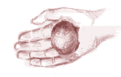
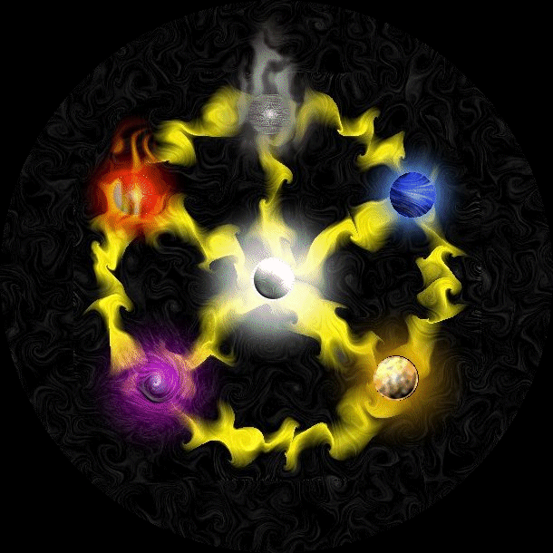

# Glyph of Classes

_by Wisal in **Dark Ages**_

## THE PATHS WE CHOOSE

**-You'd been searching for quite some time, looking for one who could provide
you ample information on the five separate paths of Temuair. There were many
people in the streets this day, but none cared to help you, by choice or by
Fate. You had almost given up your search for the day, when you noticed a young
Rogue lightly dozing against a tree. He'd pulled the violet bandana he wore
over his head down beneath his eyes, to shade them for the midday sun. The
crimson garb he wore reminded you of freshly picked roses -- or the blood of a
recently slain beast, depending on the mood you were in. The stubble that had
just begun to sprout on his chin gave him the look of faux intelligence, though
all that really knew him would say otherwise. You step closer to inspect his
features, until...-**

_"I wouldn't take another step, if Ah were ya. Ah hate bein' bothered durin' a
nap, so I set a few traps 'round me. A needle in yer foot won't kill ya, but
it'd sting for an awful while. What ya need, kid?"_

**-You prepare to spill the entire story when he holds a hand up, stopping you
mid-sentence. He tugs at the back of the violet cloth, removing it from his
eyes. Deft fingers twist within its knot until a rolled piece of wolf's skin is
produced. He whistled to a passing wizard, grinning that suave grin that all
Rogues seem to possess. The mage gives a curt wink then whispers under his
breath. The Rogue places the skin to his lips.. and the tip bursts into flames,
nearly taking his nose with it! The Rogue coughs, glaring at the Wizard with a
sharp-as-knives stare. The seasoned sorcerer just laughs and continues on his
way, the sloshing of random deums heard beneath his robes.-**

_"Sorry 'bout that.. heh. I shouldn't pester 'em, but it didn't particularly
feel like findin' some flint. Anyway, what were ya sayin'?"_

**-At first, you hesitate to begin, for fear that he may once again interrupt
you. But at last you give in and relate the situation to him. He nods at the
end of each line, visibly forcing a chuckle or two down after a few of your
more naive remarks. You finish your tale, and he quickly stands, a toe tapping
each trap, setting them off in succession.-**

_"What do ya mean, ya don't know what ya wanna be? Sheesh, ya'd think ya'd do a
bit o' research before comin' to me.. Well, tha's a'right. I'll remedy that
real quick. Ever seen one o' these?"_

**-The young man removes a small stone, polished smooth as silk. It glistens in
the sun, pulsing with a power that radiates from somewhere within. You
instinctively reach for it, in hopes to caress the rounded shape. But Wisal
quickly pulls it out of your reach, clicking his tongue in a scolding
manner.-**

_"Now, now, not yet. See, when ya touch this thing, you're goin' ta see
somethin' really weird... But ya can't be afraid of it, or you'll nevah learn
the knowledge it has ta offer. When you're ready, touch the stone, and be
prepared to commune with the ancient buildin' blocks of our land..."_





## YOUR LIFE HAS BEGUN

**-The strange feeling to grasp the light tugs at your every thought, causing
you to stare until the glow nearly blinds you from the effort. You blink to
clear the amazing glare, and notice a pearl, most likely the source of the
supernatural light. You fear to touch it, sensing a great power within, but
decide that you wish to gain as much knowledge as possible. The urge compels
you to gently stroke the precious stone, and with a gasp of air, the
'knowledge' you sought after is suddenly thrust into your head...-**

_"I am the light_  
_That keeps the night from you_  
_I am the knowledge_  
_That allows you to grow_  
_I am the link_  
_That binds you to your fellow man_  
_I am the beginning_  
_Of your path of life"_

Welcome, young Aisling. I am the light that resides within you, which all
Aislings are born with. Others can see me staring out of your eyes, telling
them that your thirst for knowledge will never be appeased. With me at your
side, nothing is impossible. But I can only offer you so much before you will
need additional help to gain what you want. My bretheren elements, that of the
earth, the fire, the wind, the water and the darkness can assist you in
choosing what you will do with your life. Go and speak with them now before you
make a rash decision. And know, that no matter where you go, I will always be
with you.

You are never alone.

**-The kind words leave you feeling comfortable with your new life. You decide
to do as instructed and listen to the advice of the other elements, in hopes
that you will use their vast intelligence to choose a path that suits your
desires...-**

## THE PATH OF THE WARRIOR

**-The wispy tendrils of smoke smell of burnt cedar, enticing you to come
closer. You shakily reach out for the rock, tracing the tips of your digits
across the cracks and crevices dotting the stone. The smoke slowly reach
outward, curling around your arm and crawling upwards. Soon, it surrounds you
on all sides, the secrets of the Warrior rolling into your mind like a
fog...-**

_"I am the rock_  
_That the weary may rest against_  
_I am the thunder_  
_That cracks the sky_  
_I am the rod_  
_That smites the wicked_  
_I am the mountain_  
_That supports the universe"_

I am the Element of Earth, a proud element. I represent the strength of the
ages and have no equal in my power. I range from the fertile lands that bare
fruit, to the tall, unchanging mountains that dot my landscape. I am a massive
force, and all elements must step aside when I am present. I cede to no one,
and force those in my path to move with my commanding presence.

I offer support to all, casting shadows for those who require shelter from the
beating sun. The weak depend on me to protect them from what they fear, and I
do so without a second thought. Some men may wish to harness this power for
evil uses, but I won't allow it. I will stamp my boot onto their throat and
crush them beneath the weight. However, there are those who have the strength
to carry the terrible burden I will lay on you.

They are the Warrior, strong in body and convictions. They rain justice on the
wicked of the world with their sharpened blades and hardened physique. Aislings
expect a Warrior to be their shield, to protect and aid them in battle at all
hours of the day. But you must understand that a Warrior is not just the brute
force behind a powerful weapon, but a tactful mind residing within a
battle-hardened form. Never underestimate a Warrior, because the stereotypical
uneducated fool no longer stands as a truth in Temuair.

A Warrior gathers his strength from the strength of others. When he witnesses
true courage, it inspires him to show the same qualities, which in turn gives
way to other Aislings mimicing the action. If not for the Warrior, our system
of beliefs and laws would not be held up, which would lead to chaos. A Warrior
must learn to bring order to this rampant chaos, so that Aislings may live
their lives in peace.

. . .

My time with you grows short, young Aisling. Soon, your mind will no longer be
clear enough to focus on the words I whisper to your subconscious. If you are
to follow this rocky path, you must know of the trials you will face.

As a Warrior, you will be granted the strength to wield weapons of unbelievable
destructive power. They range from thrusting blades, massive bastard swords, or
the rare and devastating axe. By training with a town's Master Fighter, you
will unravel the secrets of cross-slashes, stunning blows, and blade
combinations. They take a great deal of time to master, but are among the most
damaging of attacks in the land.

Also, you will be given more armor selections than any of the other paths.
While most paths will receive few armors over a long period of time, a you will
have the opportunity to constantly upgrade to newer and better armors over
smaller amounts of time. These armors are a must for any Warrior, as you will
always be face-to-face with your prey when in battle, leaving you open to
attack.

The mysteries of the Warrior are grand, and could not be told to you all at
once. But remember, only the Warrior with true determination will discover them
all. Aid others, and they will one day aid you in your quests. Do not forget
that a Warrior is strong as one, but nigh-invulnerable with many.

I can no longer stay in your mind, as I may smooth over your creativity and
turn you into a mindless drone. Be diligent, young Aisling. The path of the
Warrior will yield the respect of others, but you'll lose respect for yourself
if you stray from the path. Farewell...

**-Your eyesight comes into focus at last, and the strange glyph you came upon
earlier sits unchanging. You contemplate the choice presented before you, now
having that extra edge you'll need when selecting the path you'll eventually
walk down...-**

## THE PATH OF THE WIZARD

**-You watch as the flames lick at the darkness, threatening to push it further
back until it no longer seems to exist. You find that your hands are chilly,
and to warm them you place them closer to the never-ending flame. Strangely, no
heat is produced by the near-perfect spark of fire. You chance a finger to
swoop through it, testing your theory. As you thought, there is no pain to
accompany the action. Curiosity getting the better of you, you snatch at the
ruby that glows within the inferno. Upon contact, your mind swirls with the
carnal knowledge of the Wizard...-**

_"I am the fire_  
_That warms your soul_  
_I am the passion_  
_That fuels your desire_  
_I am the power_  
_That dares you to strive_  
_I am the flame_  
_That resides within all man"_

I am the Element of Fire, an energy that all man requires.. I am sought after
for my knowledge, and I am fear for the pain I inflict on the uneducated. A man
must choose his path, and often times I am what drives them to the secrets of
the Wizard. Those Aislings who choose me seek intelligence that they wish to
share with others. I drive back darkness and frighten others easily, but I
willingly share my powers with those I find worthy. If you wish for power over
others, then I may lie dormant within you. Many things are possibly with my
influence.

Often times, Aislings will seek me out solely for my power. While I can do
nothing to stop this, I can give a warning to all those who try to do so. Any
and all who attempt to harness my powers without the proper reasons instilled
within them will eventually be consumed by my ravenous hunger, turned to ash,
and then whisked away on the wind. But there are those who are so disciplined
that they may actually use my forces to their own advantage, for both their own
and others'.

They are the Wizard, a secretive people who hold the infinite knowledge of
Temuair in their hands. Either through intense study or by watching others of
their own kind, they are able to meld the elements, myself included, into
whatever they desire. By doing so, they craft incantations into magikal weapons
of immense destruction. But Elements are powerful, and a wizard may only be
able to master one of these at a time. He will devote himself to the study of
it, and will forsake most other elements in his quest to further that
knowledge.

Wizards may choose from four of the six elements that make up Temuair to study
and master, as I have said to you before. Creag, the element of earth, requires
a great deal of vitality. The amount of constitution you are endowed with will
determine whether or not you excel in this particular element.

Srad is the eternal element of fire, a favored path for Wizards due to the role
I play in their life. To master the dangers of srad you must be strong of heart
as well as body. Those who can control their physical nature have a greater
chance from being consumed by the heat and strain of the mighty srad.

The element of water, Sal, is a strong force in the land. To truly control the
power of sal, one must be wise beyond their years.. Only those who can tell the
difference between the temptation of power and the search for knowledge will be
able to keep themselves afloat in the oceans that accompany sal.

Lastly is the silent element of wind, Athar. Dexterity is required to continue
unimpeded through the path of athar. It takes a truly dextrous wizard to stand
his ground in the presence of the rough gusts that originate from the element
of athar.

The last elements, those of light and darkness, were lost through the ages.
Only now are their secrets beginning to be understood, and only by those
wizards who have studied the ancient texts and have kept themselves equal in
all areas. Slowly, darkness and light are being discovered once more, and the
power of the wizard grows with each new find.

. . .

My time with you grows short, young Aisling. Soon, your mind will no longer be
clear enough to focus on the words I whisper to your subconscious. If you are
to follow the path of knowledge, you must know of the trials you will face.

As a Wizard, your patron element will lend you its power in exchange for
siphoning the will from your body to create damaging magiks that will swiftly
drain the life from any creature unlucky enough to be caught in its path. A
wizard can efficiently protect himself alone, but finds his talents giving him
a better advantage when he is grouped with others of his own kind, or with
those who follow a different path.

But the Wizard's skills do not end with the controlling of elements, but rather
start there. The knowledge you gain through the study of ancient texts will
also reveal ways to take every day ordinary items and create powerful
substances for use by yourself and others, such as the much sought after
beothaich deum, which can restore the consciousness of one who is about to fall
into the clutches of Sgrios.

Wizards can create rings, as well. Depending on what raw items you own, you
will be able to craft an assortment of rings. A Wizard's study also grants them
the power to enchant items so that they may become more powerful, magical, etc.
Often times, enchanting his accessories will be the only way he can use them
with no negative effects.

I can no longer stay in your mind, as I may scar it beyond repair. Be careful,
young Aisling. The Path you choose will govern the way you grow and thrive, and
the path of the Wizard requires great diligence and discipline.

**-Your eyesight comes into focus at last, and the strange glyph you came upon
earlier sits unchanging. You contemplate the choice presented before you, now
having that extra edge you'll need when selecting the path you'll eventually
walk down...-**

## THE PATH OF THE MONK

**-The warm winds surround the amber stone, whose' core is filled with a
thundering storm. You feel the raw power radiating for the stone and do your
best to keep from backing away in fear. But the storm within the amber subsides
briefly, and a calm wind rustles your hair. You let go of your inhibitions and
fondle the powerful object. A cutting breeze licks at your ears, whispering the
enchanting secrets of the Monk to you...-**

_"I am the wind_  
_That goes unseen_  
_I am the howl_  
_That heats man's blood_  
_I am the frosty air_  
_That chills you to the core_  
_I am the unrelenting storm_  
_That rains fury onto my enemies"_

I am the Element of Wind, a truly graceful element. I know all that transpires
around me, and I am unstoppable. No prison can hold me and no man can tame me.
I follow only what path I wish to. With my strength, I can move mountains. With
my elegance, I can make a fragile feather dance in the sky. I bend and flex to
accent my surroundings, and am that much more prepared for the future because
of it. I may give life, or I may take it away. The choice is mine.

Aislings take me for granted and have forgotten that it is I who grants them
their breath, and it is I who can take it from them. I am a disciplined
element, able to rise to any situation. All who try to constrain me will be
tossed away with little effort. But there are those among me that have the
determination to hold their ground when faced will all my power.

They are the Monk, a people who's lives center around their deep link with
their spiritual side. With endless hours of training and the habit of setting
goals to reach, the Monk has become one of the most beautiful of the five
paths. They hone their bodies until reaching peak physical condition, where
upon they are able to simply strike an opponent with the tips of their fingers
and leave them in a comatose state.

Monks are aware of their surroundings at all time, and use this knowledge to
their advantage. They will leap on a creature from many angles and lash out
with devastating physical combos and then dance out of the danger zone, to
regroup themselves and then head right back into the frey. They are as swift
and silent as the wind, and flow with similar ease. They can control their
bodies so as to go without sustenance for days (if not moons) if necessary.

A Monk gains his true power from the pursuit of his inner self, the "search for
the spirit." All Monks have a patron animal spirit, which only they can tell
what it is by looking deep within themselves. Each animal spirit grants them
special advantages to aid them in life, as well as being able to aid others.

The spirit of the Draco allows a Monk to take on the fighting abilities of
these scaled, serpentine creatures. This "Draco Form" grants a Monk a more
well-rounded regime for him to follow. He will be able to fight with the
strength of these creatures, as well as be consumed by a Draco's immortal fire.
While granting him heightened defenses, it also consumes his vitality as an
after-effect. It takes true discipline to master this form.

The Kelberoth, a feline creature of great agility, lends its spiritual nexus to
the Monks as well. Any Monk studying under the "Kelberoth Form" can expect to
be granted superhuman abilities that allow for furious, raging attacks that
will confuse and crush a foe. This form allows a range of fighting tactics, so
it is ideal for those Monks who are unsure of who their battle companions may
be.

The venomous, hypnotic Scorpion's spirit is often found nestled in the heart of
a Monk. The "Scorpion Form" is one of true grace and elegance, using fluid body
movements and rapid strikes to confuse and decimate a foes' defense. A Monk
with this form will be able to efficiently protect himself when alone, but may
find his talents best used when grouped for the art of war.

The final beast to lend his energies to the monk is the White Bat, a
magnificent creature of the dark. A Monk utilizing the "White Bat Form" will
find that his spiritual energies will be focused much more easily, allowing him
to perform supernatural feats that range from blinding a target to absorbing
the light around him and becoming invisible to the naked eye.

A Monk enjoys the nature, finding it a peaceful place to meditate and sharpen
his skills as well as his mind. Monks will often gather in the woodlands to
teach eachother their selective techniques, but most of all to ponder the great
mystery of eachother. Nothing is more beautiful to a Monk than the soul of
another Aisling. Because of their connection with nature and other Aislings,
they have become a path that borrows from many others to strengthen themselves
into a near indestructible force of chaos, which is kept in check by their
rigorous training.

. . .

My time with you grows short, young one. Soon, your mind will no longer be
clear enough to focus on the words I whisper to your subconscious. If you are
to follow the path of discipline, you must know of the trials you will face.

As a Monk, you have access to attack combinations that will crush a creature's
bones into a fine powder. You have trained for so long and so hard, that
weapons no longer carry meaning for you. The only true weapon is your own body,
which you use with deadly accuracy. Also, your knowledge of your own body has
given you diverse knowledge on others' bodies, allowing you to release natural
poisons into their bloodstreams, or block these toxins with the touch of a
pressure point.

Because of the Monk's love for nature, he has been able to discern the effects
of many different herbs and how they are affected by the liquors of the world.
A Monk will use this to his benefit, crafting powerful elixirs to aid yourself
and companions. This skill is priceless to those paths which cannot perform
such things, and you will often be approached with requests.

The spiritual forms which a Monk may identify with are powerful tools. Like any
spiritual matter, though, it is harder to learn of your spirit animal simply by
reading about it. If you want to be in synch with it by all meanings of the
word, then learn from another Monk who has accepted the Animal Form which you
wish to learn of. He will be able to teach you it with greater efficiency than
you would ever be privied to by study alone.

I can no longer stay in your mind, as I may forever wipe the slate of your
memory. Be safe, young one. It takes a strong-willed Aisling to walk the
unbeaten path of the Monk. But, in time, the ache of your body will be dulled
by the pulse of your spirit. Good luck...

**-Your eyesight comes into focus at last, and the strange glyph you came upon
earlier sits unchanging. You contemplate the choice presented before you, now
having that extra edge you'll need when selecting the path you'll eventually
walk down...-**

## THE PATH OF THE PRIEST

**-As you watch the coral, its surface begins to swirl and crash in on itself
like the waves of some wee fae's ocean. In light of the other stones you've
seen, this one seems to be the most attractive. It holds a beauty like none
you've seen before. You decide to grant yourself the simple pleasure of
grasping it, and are suddenly filled with overwhelming emotion. The stone's
water seems to flood your mind, the crashing of the waves telling you of the
path of the Priest...-**

_"I am the waters_  
_That give life to all_  
_I am the ocean_  
_That sails you home to lovers_  
_I am the calm sea_  
_That makes you reflect on the past_  
_I am all the emotions_  
_That makes you grateful for life"_

I am the Element of Water, an element of unsurpassed beauty. I know no enemies
and wish to know none. Life springs from my core, and death is pressed back by
my currents. It is because of me that you can drift into the world of dreams,
where all things are possible. I soothe the pain of others and make them whole
again. I wash away their pain, their tears and the ache of their hearts.
Without me, Temuair would be a barren world.

I am immense in power, and willingly share it to those who wish to sacrifice
their own well being for the aid of others. I can not tolerate greed or
selfishness, and all who show such qualities will drown beneath my waves. But
there are a precious few who are so in tune with humanity that they have
decided to give their life over to the powers that be and accept the difficult
life that comes with it.

They are the Priest, a giving kind of people that would rather die than see
another suffer. They relish in the company of others, and commune with the Gods
in ways no other mortals could ever hope to. With little thought of themselves,
they would give their life if it could save another -- and often times, this is
exactly what happens. But they do not fear it, for they know their Gods and I
would never let true harm come to them, as long as they have faith in us.

No God will turns his back on a Priest. They will welcome him with outstretched
arms and speak with them in visions and dreams, as if to reassure them that
they are the backbone of the Aisling society. Without the Priest to heal the
wounds, moderate disputes and link normal man with their Gods, it is a sure
thing that the world would collapse.

For the younger crowd, a Priest will be seen as nothing other than a tool, to
be used and thrown away at their convenience. It is not their fault, however,
as they do not know the weight you carry. A Priest must teach them again and
again, until they see what a gift it is to even speak to a Priest. A Priest
will be burdened constantly by such people, and often times it is all they can
do to turn the other cheek. But those Aislings with experience -- those with
the knowledge of the ages respect and honor the Priest. They know what the Gods
know: a Priest is a priceless gem.

Although a Priest is most well known for their communion with the Gods, they
also may choose to share a special bond with a Warrior. Often times, a Priest
and Warrior will join together to form a symbiosis, until one cannot survive
without the other. It is a beautiful bond that can rarely be broken, and the
friendship that is sometimes sparked will be one that lasts until the end of
life, and beyond.

. . .

My time with you grows short, my beautiful young Aisling. Soon, your mind will
no longer be clear enough to focus on the words I whisper to your subconscious.
If you are to follow the path to glory, you must know of the trials you will
face.

As a Priest, the Gods have granted you the uncanny ability to focus your will
on a person and heal them of their wounds. As time goes on, you will learn how
to maintain a greater focus, which in turn produces greater effects. Also, a
Priest can purge a body of many types of toxins and other foreign matter which
may affect the way an Aisling carries himself.

A Priest is also given the knowledge of the flora of Temuair, allowing to to
take snippets of herbs from varied plants and gently mix them into powerful
liquids, such as the much sought after beothaich deum, which will grab the lost
spirit of a dying Aisling and reunite it with its body, keeping the poor
adventurer from Sgrios' grasp. A Priest must experiment to unearth all the
tricks of the trade available to them, as study is just as much a factor as
one's faith.

Lastly is the most important of all: becoming the priest of a shrine. A Priest
will often times feel the need to be closer to one God than the others, and
once having made the decision, will travel to that God's temple and pledge
their services to them. In turn, they became a window to the Heavens, so that
other Aislings may come as close to their patron Gods as the Priests do.

I can no longer stay in your mind, as I may wash away all the knowledge that I
have instilled within you. Be careful, child. While the Priesthood can provide
you with great pleasure, it will not be an easy path to walk. Do not allow
yourself to be strayed, or all is lost...

**-Your eyesight comes into focus at last, and the strange glyph you came upon
earlier sits unchanging. You contemplate the choice presented before you, now
having that extra edge you'll need when selecting the path you'll eventually
walk down...-**

## THE PATH OF THE ROGUE

**-Your fingers dance through the violet hues that swirl from the central
stone, a static charge causing the hairs that dot your arm to rise suddenly.
The tingling sensation spreads through your body the closer your hand comes to
the amethyst, which soon becomes the only source of light you see. The stately
shade fills your vision, as well as the thoughts that run your mind. It begins
to whisper the secrets of its dark child, the Rogue...-**

_"I am the shadow_  
_That hides from prying eyes_  
_I am the whisper_  
_That tempts you closer_  
_I am the night sky_  
_That sees and knows all_  
_I am that part of you_  
_That you wish none to see"_

I am the Element of Darkness, a mystical energy indeed. I am feared for my
power, yet revered for the silky blanket that I pull over man's eyes. A man
must choose his path, and often times I am what drives them to the secrets of
the Rogue. I am not pure evil; I am not inherently good. I am the shadow, and
just as a man's shadow is a reflection of himself, so too am I a reflection of
his heart. If he strives for the well being of his fellow man, then I am that
which he is. If his heart bades him to whisper lies and commit atrocities, then
I am that which he is.

Unlike my brethren, I lie deep within all men, feeding on their darkest secrets
and tempting their dreams out of hiding. When man denies his true feelings and
pushes emotions into the pit of his stomach, I grow into an ugly mass of
disgust and self-loathing. It is but a matter of time before my traits manifest
themselves into man's personality, forcing them to face what they fear or be
destroyed by it. But there are those who are so disciplined that they may
actually use my forces to their own advantage.

They are the Rogue, a nomadic people who prefer solitude over companionship. It
is by their own hand that they remain alone, however. Do not be fooled into
thinking they have no choice. The Rogue are a people of diverse choice, in
fact, as their ability to control me allows them to become great heroes among
their kind -- or become greedy, feared criminals. But it is their choice and
theirs alone; I am not responsible for their actions.

I claim the Rogue as my child, but it is Fiosachd who truly watches over them.
He was the first Rogue to grace this plane, being named as a God of many
qualities: wealth, charity, etc. But the trait his is most well known for is
greed. It is a sad fact, however, that 'greed' is only associated with his
Lordship because of the stereotypes of those who follow in his footsteps -- the
Rogue.

For ages, Rogues have been seen as street-walkers and hustlers, who used their
sharp wit and even sharper tongues to oust some pour soul out of their belongs.
But the truth is that Rogues, though often times loners, are a very generous
people. The Light which all Aislings are born with is still an integral part of
most Rogues' lives, and to appease that goodness within them, they find ways to
use their uncanny ability to amass wealth to aid others. They give their
talents often free of charge if they know it will somehow lighten the burden of
another Aisling's load. Truth be told, it is the criminal Rogue who is hard to
find, as it takes a truly dark heart to physically and emotionally scar a
fellow Aisling.

. . .

My time with you grows short, young Aisling. Soon, your mind will no longer be
clear enough to focus on the words I whisper to your subconscious. If you are
to follow the dark path, you must know of the trials you will face.

As a Rogue, Fiosachd will grant you the uncanny ability to devise traps and
snares to protect yourself from the cruelties of the land. Followers of his
unique path will teach you of these devices, provided you can prove you have
conditioned body and mind to their peak conditions. Your beginning deathtraps
will be simple enough, but as your insight grows, so too shall the complicity
of the traps.

When you feel you're ready, you will want to learn the crafts of the Rogue,
which all other Aislings will be grateful if you use these trade secrets to aid
them. Are nimble fingers allow us to mend the clothing and armor of all paths,
as well as tailor them with special cloths and materials to make them lighter
and more durable. These skills can also be directed to weapons of any sort, to
either mend them or raise their ability to maim and kill. Be warned, however,
as it takes a skilled craftsman to utilize these abilities to the best of their
employment. A novice may get no result at all, or in serious cases actually
destroy the item.

But there are some dark secrets that I myself will grant to you. The ability to
surround yourself with a shroud of darkness to hide from all those but the most
perceptive. While these are not the only gifts I grant you, it is the only one
I shall speak of. We will meet again when your powers have grown enough to
dabble in my other areas.

I can no longer stay in your mind, as I may pollute it until you will no longer
recognize yourself. Be diligent, young Aisling. The Path you choose will govern
the way you grow and thrive, and the path of the Rogue offers few easy choices.
Farewell...

**-Your eyesight comes into focus at last, and the strange glyph you came upon
earlier sits unchanging. You contemplate the choice presented before you, now
having that extra edge you'll need when selecting the path you'll eventually
walk down...-**

## WHERE WILL YOU GO FROM HERE...

_"'ey, kid, wake up! Snap out of it! You've been standin' there for, like, an
hour.. What'd you see?"_

**-You burst into a flurry of sentences, each one running over the last one,
about the things you saw and what you were told. A smile spreads across your
face, as if you've somehow discovered the secret to life without so much as
lifting a finger. Your tirade ends with a few breathless gasps for air, as you
watch for the reaction of the Rogue...-**

_"Ya mean it actually worked? Heh, that's hilarious.."_

**-His words confuse you, so you inquire as to what he meant by them.-**

_"Well, ya see, the thing is.. I just found this rock a few minutes before ya
had come along, kid. It's just an ordinary ol' rock. .. 'ey, y'okay? Ya look
like you've seen a ghost..."_

**-You whisper about how it's impossible that the rock holds no mystical
powers, and demand to touch the stone once more. The Rogue yields to your whim
and lets you finger the rock once more.. but nothing happens. You recoil in
shock, wondering aloud what had just happened. Obviously, there must be some
explanation to it. Maybe what the Rogue had been puffing on had caused the
delerious fantasy? Or maybe it was...-**

_"Hey, kid. Don't worry about it. True magik doesn't come from here..."_

**-The last word was accented as he pointed your your head, and then moved the
digit until it resided over your chest.**

_"..but from here."_

**-And with that, he lobbed the stone as far as he could over your shoulder.
You turn to watch it sail through the air and then disappear in the creek that
ran through the village. You turn back to thank the young Rogue for the lesson,
but are shocked to see that he has disappeared without a trace...-**

_Provided by Wisal Flours_

***

```
*Librarian Notes*

This entry has been heavily edited to conform to Library formatting.
The original can be found at http://www.darkages.com/2002/community/lore/Wisal_Path/index.html .
```
