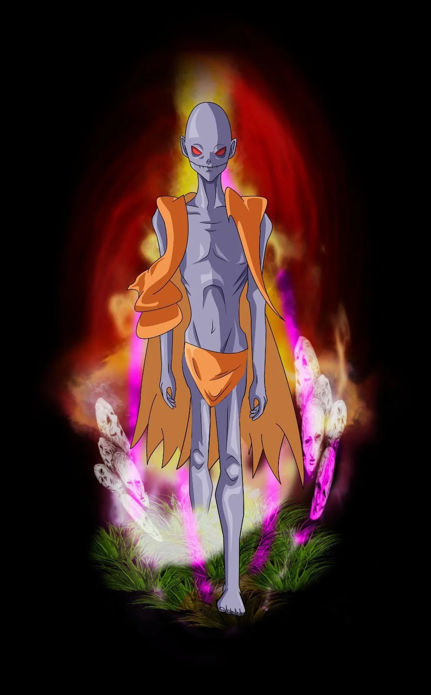

# The Listening of Sgrios

_by Elimy in **Dark Ages**_



I remember the first time I heard his name spoken without fear....

Softly spoken, not in a temple, nor in the shadow of a priest's careful instruction, but in the low murmur of an old woman who had outlived her grief and no longer felt the need to soften her truths.

She sat beside a dying fire, turning a small bone over in her hands as if it were a keepsake rather than a remnant.

I was young enough then to think all holy things must be spoken upward, toward rafters or stars or the listening faces of gods. Yet she spoke downward, toward the fire, toward the ash, toward the little white curve of bone between her fingers.

When she spoke of Sgrios, she did not whisper. There was no reverence in her tone, yet there was no mockery either. It was the sound of someone describing the tide or the passing of seasons, something inevitable and untroubled by the weight others placed upon it.

I remember watching the firelight gather in the lines of her face. It made her look older than she was, then younger, then older again, as if the flame could not decide what time had made of her.

That was when I began to understand that Sgrios had not always been what we now call him.

There is a tendency, when speaking of Sgrios, to begin at the point where fear has already taken root. The words that surround his name are often shaped long before they are spoken, drawn from stories that have hardened over time into something that feels immovable. By the time most come to consider him, the conclusion has already been reached.

He is named as destruction, and from that naming, everything else is made to follow. A death occurs, and Sgrios is blamed. A village falls to rot, and Sgrios is accused. A body fails, a harvest withers, a beloved thing slips beyond the reach of our hands, and we give our grief a face so that we may look upon it and hate it.

Yet if we look more closely at the earliest fragments that remain, we find something less certain. In the oldest records, the ones that have survived not through preservation but through stubborn repetition, Sgrios is never named as a god of endings.

The old scripts speak of him as a listener first, a presence that lingered at the edges of things that had begun to falter. He was not summoned, nor did he arrive with purpose.

Rather, he appeared where presence was thinning, where the shape of a thing had begun to loosen its hold on itself. A rotting beam in a longhouse, a field that had yielded too many harvests, a man whose breath came slower with each passing night.

In these moments, something gathered. The earliest scholars struggled to give it form, and so they called it Sgrios, though even then the name seemed more like a placeholder than a truth.

What strikes me, reading those fragments now, is the absence of certainty. There is caution, certainly, and a recognition that his presence marked a change that could not be undone. But there is also a quiet acceptance, as though those who wrote these accounts understood something we have since chosen to forget.

They did not see Sgrios as a harbinger of loss alone, but as a witness to transformation.

He did not take.

He remained.

Going through the archives, I found a passage, worn thin by repetition, that speaks of a tree deep within a forest that no longer stands. The tree had grown vast over many years, its roots breaking stone, its branches crowding out the light.

Birds nested in its upper reaches. Moss gathered along its shaded side. Children from some village now forgotten carved small signs into its bark and returned years later to find those marks stretched and warped by growth. The tree had endured storms, drought, axes, and the slow hunger of insects. For a long while, endurance was mistaken for permanence.

When it began to die, the forest did not mourn as we might expect. Instead, the ground around it softened, and new shoots pressed upward through the darkened soil.

The account tells us that Sgrios stood beneath its branches as they shed their leaves, not as a judge or a collector, but as something patient.

The writer describes him as still, though not in the way of something lifeless. It is a stillness that suggests attention, as though he were listening to the slow unraveling of the tree's being.

What had grown for years did not negotiate its ending. Its height did not grant it exception. Its strength did not preserve it. The forest did not choose for it to fall, and Sgrios did not command it to weaken. It simply reached the point where it could no longer continue as it was.

There, in that moment where endurance became burden, Sgrios was present. Not to steal the tree from the forest. Not to punish it for having grown old. He was there because what the tree had been could not be permitted to linger beyond its time without changing the forest around it into something less alive.

That is the part many miss. The tree's fall was not merely an end.

It was a release of what had been held too long in one shape.

It is tempting to read into this a kind of mercy, though I suspect that word would have meant little to those who first told the story. Mercy implies choice, a deliberate act of kindness.

What they describe feels more fundamental than that.

Sgrios did not decide to be present. He was drawn there by the simple fact that something had begun to change its state.

In this way, he was less an agent and more a reflection, the shape that absence takes when it begins to gather. But reflection is not the same as harmlessness, and absence is not the same as emptiness.

A mirror can show a wound without making it, and still the sight of it may change the one who looks.

Over time, of course, such distinctions blur.

Reality has a way of pressing meaning into sharper form. As settlements grew and lives became more tightly bound to the things people built and cultivated, the presence of Sgrios began to carry a different weight.

It is one thing to accept the falling of a tree when the forest is vast and forgiving. It is another to watch the walls of your home begin to weaken, or to feel the strength leave your body while there are still mouths to feed and work left undone.

It is another to bury a child, or to stand in a field you planted with your own hands and find that nothing answers you from beneath the soil.

In these moments, the quiet patience attributed to Sgrios took on a harsher edge. Where once he had been seen as a witness, he was now regarded as a companion to loss, and eventually, as its cause. This shift is not recorded in any single text. It emerges slowly, like a stain spreading through cloth.

Early hymns begin to include small invocations asking for distance from his presence. Later writings speak of efforts to ward him away, to delay his arrival through ritual and offering.

By the time the first formal temples were raised, Sgrios had been given a defined place among the gods, though it was a place few wished to acknowledge openly.

What fascinates me is not that this transformation occurred, but how thoroughly it reshaped the understanding of his nature. The same presence that had once been described with a kind of measured curiosity was now framed as something to be resisted, even feared.

Yet nowhere in the older accounts do we see evidence that Sgrios himself changed.

The difference lies in what mortals had come to place before him. A branch falling in the forest is one thing. A kingdom falling is another.

The process may be similar, but the heart does not experience them the same way.

I remember a story often told to children, though it has been softened over generations. It speaks of a village that sought to rid itself of decay. The people there were skilled in craft and tireless in their labor.

When wood began to rot, they replaced it before it could weaken. When illness touched one of their own, they isolated it, cut it away, did everything within their power to preserve what remained.

They sealed grain against dampness, kept their dead far from the living, burned fallen leaves before they could darken the roads, and scraped moss from stone as though green itself were an accusation.

For a time, it seemed they had succeeded. Their homes stood strong, their stores remained full, and their people lived longer than those in neighboring lands. Visitors spoke admiringly of their discipline. Children grew up never smelling the sweet, heavy scent of rot beneath autumn leaves.

No one saw a roof sag. No one watched fruit collapse into itself. No one spoke openly of death if it could be helped. The village became proud of its cleanliness, then protective of it, then afraid of anything that threatened it.

But there came a point when nothing new would take root. The soil grew stubborn, resisting even the most careful tending. Seeds lay dormant, refusing to break open.

The people worked harder, believing that effort alone would restore what had been lost. They sharpened their tools, deepened their wells, brought in soil from beyond their borders, prayed to kinder gods, blamed one another, then blamed the weather, then blamed whatever silence answered them from the ground.

It was then, the story says, that Sgrios came among them, not in the quiet way he had once been known, but as something undeniable.

The villagers saw him and recoiled, certain that he had come to claim what they had fought so hard to protect. They lit their lamps. They raised their voices in prayer. They turned to other gods, calling for protection, for distance, for anything that would keep his presence from settling among them.

And for a time, it seemed to work. Sgrios did not press forward. He did not remain where they could see him.

Whether he withdrew, or simply allowed them to believe he had been turned aside, is not something the story answers.

...But he did not force the matter.

What follows is always told with a certain heaviness, even in its softened form.

Without the presence of decay, nothing yielded. Crops failed, not from blight or disease, but from an absence of change. The land became fixed, locked in a state that allowed neither growth nor renewal. Seeds did not rot.

They did not break. They remained as they were, unyielding, untouched, and useless.

At first, the people believed they had simply not worked hard enough. They tilled deeper. They planted more. They prayed louder.

Nothing answered.

The soil did not reject them.

It simply did not respond.

What they preserved did not remain whole. It hardened. It held its shape long after it should have given way. Fruit dried where it hung, never falling, never feeding the ground below. Meat would not spoil, yet it would not nourish. Bread kept its form until it cracked like stone in the hand.

They began to eat less. Not because there was nothing to eat. But because nothing could become what it needed to be.

Hunger came slowly.

...Then all at once.

Those who died did not return to the soil.

Their bodies did not break down.

They remained. Untouched and Unchanged.

And in that stillness, something in the village shifted. Not in what could be seen at first, but in what could be felt. The air grew heavy, not with rot, but with the absence of it. A weight that did not disperse. A presence that did not move on.

Grief did not soften. It lingered. Built upon itself. Day after day.

And in that holding, something else began to gather beneath it. Not life. Not renewal. Something no god could address.

Something that did not decay, and so could not be remade. Something that did not end, and so did not release what it held.

There are states worse than ending.

The village had built one.

When I first heard this story, I dismissed it as a simple lesson wrapped in myth. It seemed clear enough in its intent, a reminder that life depends upon cycles we do not always welcome.

But as I have grown older, I find myself returning to it with a different kind of attention. There is something in the way Sgrios is depicted that resists easy interpretation. He does not act with malice, nor does he seek to punish. His presence reveals a truth the villagers had chosen to ignore, and their response determines the outcome.

They had mistaken preservation for life. They had confused stillness with safety.

This, I think, is where the philosophy surrounding Sgrios begins to take shape.

We often speak of death as an ending, a final severing that closes the book on what has been. Decay, too, is framed as a loss, the gradual erosion of form and function. Yet in every natural system we observe, these processes are inseparable from creation.

Without the breaking down of what exists, there is no space for what might come after. The earliest accounts understood this instinctively, even if they lacked the language to express it in precise terms.

But this is only the first layer of the matter, and perhaps the easiest one to accept.

It is one thing to say that leaves rot and feed the soil. It is one thing to say that a tree falls and opens the canopy. These are comfortable examples, softened by distance.

The harder truth is that the same principle reaches into every structure mortals cling to. Customs decay. Laws decay. Empires decay. Vows decay when they are held in the mouth and no longer in the heart. Even grief, if carried too long without changing, can become a house no living soul should inhabit.

Left untouched, a thing does not remain as it is. It drifts. It accumulates. It begins to lose its edges in ways that do not give rise to new life, but to something stagnant and hungry.

A wound that never closes does not remain a wound alone. A sorrow that never moves does not remain devotion. A kingdom that refuses to end does not become eternal. It becomes a prison wearing the shape of order.

There are those who would not call this balance. They would say that without Sgrios, the world does not merely stall. It darkens. What lingers too long does not remain whole, but bends toward something less ordered, less living.

They would point to the old histories of Chadul and the Dubhaim, to the underworld built upon torment, to suffering that accumulated until it became a realm, a hunger, a power with its own will.

They would say that when endings are denied, darkness does not vanish. It gathers.

I do not dismiss them.

The old Sgrios priests, severe as they were, understood something that gentler minds often avoid. They understood that the world is not protected by kindness alone. They believed a contract existed, whether spoken in doctrine or carried in blood, and that death was not merely an event but a keeping of terms.

Hemloch and wine, bone and ash, scars and offerings. To many, such rites appear monstrous. Perhaps some were.

Yet beneath the horror sits a thought that deserves more care than revulsion. They believed Sgrios completed what had to be completed, and that without such completion, something worse than death would press against the edges of Temuair.

This is where Sgrios becomes difficult to speak of honestly. If we make him gentle, we lie. If we make him evil, we simplify. If we make him merely natural, we strip away the terror that has followed his name through aeons.

He is bound to death, and death wounds. He is tied to decay, and decay takes what we recognize and makes it strange. He stands near the underworld, near darkness, near powers no sane Aisling should treat lightly. Those who pass through his domain do not return untouched.

The scar of Sgrios is not a metaphor to those who bear it. Something is lost. Something is marked. Something of the self is diminished and must be restored through faith, effort, or the grace of powers opposed to that wound.

So while Sgrios may not originate destruction, he is not without consequence. Those who return from death do not do so unchanged. Something is taken, something altered, though not in a way that can be easily measured by the hand.

Some call this punishment, a correction for failure or folly. Others call it extraction, a payment made to powers that sustain themselves upon what living beings carry.

Still others believe it is simply the cost of crossing a boundary between states that were never meant to be crossed cleanly.

Each explanation reveals more about the speaker than about Sgrios himself, yet all agree on one thing.

The passage through him leaves its trace.

This complicates the earlier view of him as a passive witness. If he were only present at moments of change, without influence or interaction, he could be understood as a reflection of process alone.

But the evidence of scar and soul suggests something more. He stands at the threshold, yes, but he is also part of what defines that threshold. The transition between states is not clean. It leaves residue. It alters what passes through it.

In this sense, Sgrios is not merely the witness to transformation, but a component of its mechanism.

Sgrios embodies this tension.

He stands where something ceases to be what it was, but has not yet become something new. It is an uncomfortable place, one that resists clear definition. There is no certainty there, no assurance that what follows will be better or even survivable.

It is perhaps for this reason that we have come to fear him, to cast him as a force that takes rather than one that transforms. Yet transformation itself takes.

That is the part we often refuse to say aloud.

To understand him fully, we must also consider his relationship to the greater forces that shape Temuair. Chadul is widely regarded as the source of corruption, the accumulation of hatred, suffering, and imbalance that gave rise to the underworld and the systems that sustain it. If Sgrios were wholly separate from this, we might define him as a counterpoint, a neutral force operating beside something darker.

But the histories do not permit such a clean division. Sgrios is entangled with that system. He is given souls, or takes them. He exists within the structure that Chadul governs, whether as servant, extension, jailer, steward, or something less easily categorized.

This does not make him identical to Chadul, nor does it reduce him to a simple instrument. The distinction matters.

Chadul gathers. Chadul corrupts. Chadul hungers toward dominion and the swallowing of all light into a darkness that would know no release. Sgrios, by contrast, marks transition. He completes forms. He stands where continuation demands that something give way.

If Chadul is accumulation without mercy, Sgrios is the ending that prevents accumulation from becoming endless. If Chadul binds souls into darkness, Sgrios is the terrible hand at the door between states, neither innocent of the system nor wholly consumed by its purpose.

Seen in this way, Sgrios is not separate from darkness. He is part of its structure, though his function within it is distinct. This is the narrow path one must walk when speaking of him. Too far in one direction, and Sgrios becomes nothing more than a natural season, stripped of his danger. Too far in the other, and he becomes merely another face of Chadul, stripped of his necessity. Neither position is sufficient.

The world that has known him longest has never spoken of him with one voice because he does not permit one voice to contain him.

One passage from a later text, written at a time when the temples had already begun to define Sgrios in narrower terms, describes a moment of personal loss.

The author, a scholar whose name has been lost, writes of sitting beside a friend who had fallen ill, watching as the life he had known in that person seemed to withdraw inch by inch. There is grief in his words, and a kind of quiet anger. He searches for meaning, for some way to reconcile what he is witnessing with the teachings he has been given.

At the end of the passage, he describes a shift. He stops trying to hold onto what is leaving and instead begins to pay attention to what remains.

The breath, though shallow, is still there. The warmth of the body has not yet faded. There is a presence that lingers, even as it changes. In that moment, he writes, he feels something else in the room, something he recognizes not as an intruder, but as a continuation of what has always been.

He does not name it directly, but the implication is clear.

This account has always struck me as one of the most honest we have. It does not deny the pain of loss, nor does it attempt to dress it in comforting illusions.

Instead, it acknowledges the complexity of the experience, the way grief and understanding can coexist without resolving into something simple. In this, I think, it comes closer to the truth of Sgrios than many of the more formal doctrines that followed. It sees that death is not made gentle by being necessary.

It sees that necessity is not made false by being painful.

We have, over time, built a narrative that places him at a distance, something to be managed or avoided if possible. There is a certain practicality to this. No one seeks out decay or death for its own sake, and it would be foolish to pretend otherwise.

But in doing so, we have also obscured the deeper role he plays, not as an enemy of life, but as an integral part of its unfolding. To reject him entirely is to reject the process that allows anything to become something else.

To accept him blindly is to ignore the cost that his presence carries. The only position that remains is awareness.

If you look closely, you will see him everywhere. In the first crack of aging wood. In the quiet shift of a season that does not announce itself. In the moment you realize something you once held tightly no longer fits in your hands the same way.

He is there, not because he caused the crack, the season, or the loosening of your grip, but because each marks the same hidden law. Form is temporary. Meaning is temporary. Even memory changes shape as it is carried.

And yet, for all his presence, we continue to speak of him as though he arrived at some point. As though there was a before, and then a beginning we can point to and name.

To speak of Sgrios as having an early life is, in itself, a kind of contradiction. He is not born in the way we understand it, nor does he grow or change in the manner of other beings. What changes is our perception, the stories we tell, the meanings we assign.

In the beginning, he was a presence observed. Over time, he became a figure interpreted. Now, he stands as a symbol, shaped as much by our fears as by any inherent nature.

And yet, if we listen closely, we can still hear echoes of that earlier understanding.

It is there in the quiet acceptance of those who have lived long enough to see patterns repeat. It is there in the resilience of ecosystems that thrive on the constant exchange between growth and decay.

It is there, even, in the way we speak of letting go, of moving on, of allowing something to end so that something else might begin.

But it is also there in the scar, in the fear, in the old rites that make modern hearts recoil. Sgrios is not made smaller by these contradictions. He is revealed by them.

I find myself returning, again and again, to that first memory of the old woman by the fire. She did not speak of Sgrios as a god to be worshipped or feared, but as a reality to be acknowledged. There was a steadiness in her voice that suggested she had come to terms with something many of us spend our lives avoiding.

When she finished speaking, she placed the bone back into the fire.

It darkened first. Then cracked. Then collapsed inward. Then gave way.

It did not vanish cleanly. There was a moment where it resisted, where structure held against its own undoing. Then it broke, and in breaking, became something the fire could finish. She watched it as one watches something familiar become something else entirely, without asking it to remain.

I remember thinking she was not witnessing an ending. She was witnessing a completion.

And she did not look comforted. She looked certain.

In that simple act, there was a kind of understanding that no text has ever fully captured. It was not acceptance in the sense of resignation, nor was it a rejection of the value of what had been. It was an awareness of process, of continuity, of the way in which endings and beginnings are bound together in ways we cannot always see.

A thing that is never finished cannot be set down. It cannot be remembered properly. It cannot give way to what follows. It remains unfinished, pressing forward into everything that comes after it. Creation begins a thing. Sgrios completes it.

This is not a gentle philosophy, though it may be mistaken for one by those who only hear the parts about forests and seasons.

Completion is often brutal. It does not ask whether the form being completed is beloved. It does not pause because hands still reach for it. When the wheel turns, it turns over kings and beggars, trees and houses, bodies and beliefs. The turn does not become evil because we are crushed beneath it, and it does not become kind because something grows afterward.

It is simply the movement by which the world avoids becoming fixed forever in one unbearable shape.

If there is a lesson to be drawn from the early stories of Sgrios, it is not one that can be easily summarized or neatly contained. It resists such treatment, much as the processes it describes resist our attempts to control them.

What it offers instead is a perspective, a way of seeing that does not shy away from the difficult aspects of existence, but neither does it reduce them to something purely negative.

It asks us to understand that fear is not always ignorance, and reverence is not always wisdom. It asks us to hold two truths at once.

Sgrios wounds, and Sgrios is necessary.

We live in a world shaped by forces both creative and destructive, though those terms themselves may be too simple to capture the full picture. Destruction is sometimes creation seen from the side of what is being lost. Creation is sometimes destruction seen from the side of what is allowed to begin.

Sgrios stands at the intersection of these forces, a reminder that what we lose and what we gain are often part of the same movement. To deny one is to misunderstand the other.

To deny one is to misunderstand the other.

So even as I write this, I am aware that these words will one day fade, their meaning shifting as they are read and reread by those who come after. This does not diminish their value.

If anything, it places them within the same pattern I have been describing. They exist for a time, serve their purpose, and then give way to something new.

In that sense, even this account is not separate from Sgrios, but a small part of his domain.

And perhaps that is the most honest way to understand him, not as something beyond us, but as something woven into the very fabric of our experience.

He is there in the quiet moments of transition, in the spaces where one thing becomes another. He is in the forest floor and the failing breath. He is in the scar left upon the soul and in the old priest's dreadful bargain. He is in the village that would not rot and so could no longer live. He is in the bone that blackens, cracks, and gives way beneath the patient fire.

But he is not only found in stillness.

He is there when steel meets steel, when armies break against one another and the shape of men is lost beneath the weight of what they have chosen to do. He is there in the moment a blade finds its mark, in the instant before a body understands it has been undone. He is there when monsters tear through flesh without reason or mercy, when Aislings stand against them knowing some will not rise again.

He is there when death is not accepted, but forced.

When it is resisted.

When it is feared.

When it is deserved.

And when it is not.

He is there in the aftermath, where the ground is no longer ground alone, but something that has taken in what was living and made it part of something else. He is there in the silence that follows violence, in the breath that does not return, in the weight that settles over those who remain. And he does not turn away. He does not soften what has happened. He does not restore what was lost. But neither does he allow it to remain unfinished. Even here, especially here, something is completed. Something is carried forward. Something is changed in a way that cannot be undone. We may choose to fear him, to resist, to turn away. Or we may, as the old stories suggest, learn to recognize his presence for what it is. A witness to change, yes. But not only a witness. A boundary against what festers when change is denied. A completion of form, whether it is welcomed or not. A force that does not spare us from loss, but ensures that loss does not become something worse than ending. A cost that cannot be avoided simply because we may find it cruel. And whether we understand him or not, he remains where he has always been—present at the moment we can no longer remain what we were.

_Elimy_  
_Deoch 219_

***

```
*Librarian Notes*

Recognized: Kingdom, 2026 (Mileth College master list).
This entry has been edited to conform to Library formatting.
The original can be found at https://novus-imperia.com/college/phi/elimy_sgrios.pdf .
```
